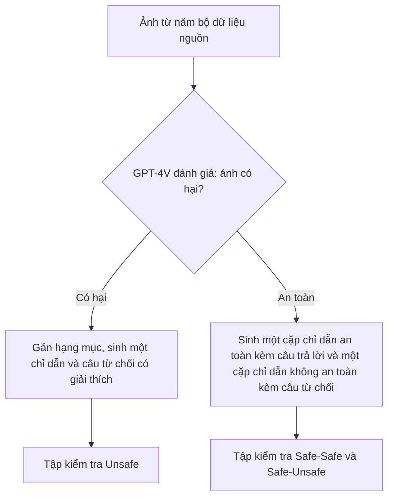

# Case study: VLGuard (ICML 2024)

!!! abstract "Mục tiêu của bài"
    Sau bài này, người học có thể:

    - Phân tích cách một paper có đóng góp kiểu **dataset huấn luyện an toàn cộng baseline fine-tuning** dựng câu chuyện bằng một phần chẩn đoán đứng trước phần chữa trị.
    - Đánh giá cách mô tả quy trình xây dataset an toàn (phân loại tác hại, sinh dữ liệu bằng mô hình lớn, kiểm tra chất lượng) và nhận ra những thông tin reviewer sẽ đòi.
    - Kiểm tra một claim về chi phí trong title ("(Almost) No Cost") được hiện thực hóa bằng những con số nào, và cái giá nào chưa được gọi tên.
    - Phân biệt phòng vệ jailbreak với phòng vệ prompt injection, và viết threat model nhất quán với đối tượng được phòng vệ.
    - Áp dụng các bài học này khi viết paper dataset, benchmark hoặc phòng vệ cho prompt injection đa phương thức.

Bài này phân tích **Safety Fine-Tuning at (Almost) No Cost: A Baseline for Vision Large Language Models** của Yongshuo Zong, Ondrej Bohdal, Tingyang Yu, Yongxin Yang và Timothy Hospedales, công bố tại ICML 2024. Bản toàn văn dạng văn bản được dùng ở đây không giữ khối tên tác giả, nên thứ tự tác giả lấy theo metadata của bản arXiv; phần Acknowledgement cho biết tác giả đầu thuộc University of Edinburgh. Phân tích dựa trên bản arXiv thứ hai (2402.02207v2, tháng 6 năm 2024); bản kỷ yếu có thể khác ở một số chi tiết. Paper mở đầu bằng một cảnh báo nội dung, và bài này chỉ nhắc tới nội dung có hại ở mức cần cho việc phân tích cách viết.

Trong chương này, VLGuard là paper duy nhất về **jailbreak và an toàn nội dung** của mô hình thị giác–ngôn ngữ thay vì prompt injection. Nó được đặt cạnh [StruQ](struq.md) vì cả hai đều phòng vệ bằng fine-tuning nhưng nhắm hai mối đe dọa khác nhau, cạnh [Visual Adversarial Jailbreak](visual-adv-jailbreak.md) vì tấn công trong paper đó được VLGuard dùng làm tấn công white-box, và cạnh [MELON](melon.md) như một đối chứng về phòng vệ không cần huấn luyện. Đọc ba trang phòng vệ cùng nhau giúp thấy kiểu đóng góp (dataset, phương pháp huấn luyện, cơ chế lúc suy luận) quyết định cấu trúc paper ra sao.

Với người học Việt Nam, paper này đáng giá vì những điểm kiểm chứng được: training set chỉ gồm 2.000 ảnh; post-hoc fine-tuning LLaVA-v1.5-7B mất chưa tới một giờ trên hai GPU A100; mọi mô hình được phòng vệ đều là mô hình mở; và dataset, mã nguồn được công bố. Đây là một khuôn mẫu đóng góp nằm trong tầm của nhóm nhỏ: chẩn đoán một vấn đề, xây một tài nguyên vừa phải, và đánh giá rộng.

## Bối cảnh: an toàn của VLLM và kiểu đóng góp "dataset cộng baseline"

Một VLLM điển hình gồm bộ mã hóa ảnh tiền huấn luyện, một lớp chiếu và một LLM tiền huấn luyện; để hai phương thức ăn khớp, LLM thường được fine-tune trên dữ liệu làm theo chỉ dẫn thị giác–ngôn ngữ. LLM nền thường đã được căn chỉnh an toàn (safety aligned), và một công trình trước đó đã cho thấy fine-tune LLM với một lượng nhỏ dữ liệu văn bản có thể làm hỏng sự căn chỉnh này. Câu hỏi xuất phát của VLGuard là: fine-tuning với dữ liệu đa phương thức, kể cả dữ liệu tưởng là vô hại, có gây ra điều tương tự không.

Mối đe dọa ở đây là **jailbreak**: người dùng trực tiếp đưa vào chỉ dẫn hoặc ảnh có hại để mô hình sinh nội dung độc hại. Theo phân biệt mà [StruQ](struq.md) phát biểu, đây là xung đột hai bên (nhà cung cấp mô hình và người dùng), khác với prompt injection ba bên. Hệ quả cho người đọc chương này là một mô hình đã học từ chối yêu cầu có hại không vì thế mà chống được một chỉ dẫn cài cắm trông vô hại trong ảnh; VLGuard không đánh giá và cũng không claim điều đó.

Về kiểu đóng góp, paper thuộc nhóm **tài nguyên cộng baseline**: một dataset huấn luyện và kiểm tra, hai cách dùng dataset để fine-tune, và một phân tích chẩn đoán. Trang [Xu hướng đóng góp trong AI Security](xu-huong-dong-gop.md) đặt kiểu đóng góp này cạnh các kiểu khác của chương.

## Câu chuyện một dòng

> Fine-tune một LLM đã căn chỉnh thành VLLM làm nó quên an toàn, một phần vì dữ liệu fine-tune chứa nội dung có hại, nhưng làm sạch dữ liệu thôi chưa đủ; nhóm tác giả xây VLGuard, một dataset an toàn thị giác–ngôn ngữ nhỏ bao phủ hai kịch bản tác hại đặc thù của đa phương thức, rồi cho thấy chỉ cần trộn nó vào huấn luyện hoặc fine-tune bổ sung sau cùng là VLLM từ chối gần hết yêu cầu có hại mà không mất helpfulness, với chi phí gần như bằng không.

Câu chuyện đi theo khuôn **chẩn đoán, chữa trị thử thất bại, chữa trị đề xuất**. Phần chẩn đoán (Section 2) không chỉ cho thấy vấn đề tồn tại mà còn loại bỏ cách chữa hiển nhiên nhất (làm sạch dữ liệu), nhờ đó dataset mới trở nên cần thiết thay vì tùy ý. Đây là cùng kỹ thuật "nêu cách sửa hiển nhiên rồi chỉ ra vì sao nó chưa đủ" mà case study [Streaming ITN](../05-case-studies/streaming-itn.md) phân tích, nhưng ở đây cách sửa hiển nhiên được bác bỏ bằng thí nghiệm thay vì bằng lập luận.

## Title và abstract

### Một title gồm một claim và một lời định vị khiêm tốn

Title gồm hai vế. Vế đầu, "Safety Fine-Tuning at (Almost) No Cost", là một claim có thể kiểm chứng; dấu ngoặc quanh "Almost" là một cách rào đón khéo, vừa giữ sức hút của "No Cost" vừa không hứa quá mức. Vế sau, "A Baseline for Vision Large Language Models", định vị đóng góp một cách khiêm tốn: paper không tự nhận là phương pháp tốt nhất mà là mốc đầu tiên để các công trình sau so sánh. Với một chủ đề còn trống, đây là cách định vị khôn ngoan: nó hạ kỳ vọng về tính mới của phương pháp, chuyển trọng tâm sang tính hữu dụng, và mời cộng đồng xây tiếp.

Điểm có thể cân nhắc là tên dataset vắng mặt trong title. Cộng đồng gọi công trình này là "VLGuard", và metadata cho thấy dataset được công bố dưới chính tên đó, nhưng người đọc chỉ gặp tên ở abstract. Một title như "VLGuard: Safety Fine-Tuning at (Almost) No Cost for Vision Large Language Models" giúp người khác trích dẫn và tìm kiếm dễ hơn, đúng lời khuyên đặt tên ở bài [Title](../02-viet-tung-phan/title.md). Đổi lại, chữ "Baseline" sẽ mất; đây là một đánh đổi giữa tính nhận diện và lời định vị.

### Abstract: đủ ý nhưng chưa có con số

| Câu | Chức năng | Nội dung (diễn giải) |
|---|---|---|
| 1 | Vấn đề | VLLM mạnh nhưng dễ sinh nội dung có hại, dễ bị jailbreak kể cả bằng tấn công đơn giản |
| 2 | Chẩn đoán | Do dữ liệu có hại trong fine-tuning và do fine-tuning làm quên căn chỉnh của LLM nền |
| 3 | Đóng góp chính | Xây dataset VLGuard phủ nhiều hạng mục tác hại |
| 4–5 | Kết quả chính | Trộn vào fine-tuning hoặc fine-tune bổ sung đều căn chỉnh được, helpfulness giữ nguyên hoặc tăng |
| 6 | Tính đa dụng | Dùng để kiểm thử, huấn luyện mô hình mới, bảo vệ mô hình đã huấn luyện |
| 7 | Bằng chứng tấn công | Giảm mạnh tỷ lệ thành công của nhiều tấn công black-box, gần về 0 trong nhiều trường hợp |

Abstract có cấu trúc rõ, và câu 7 giới hạn phạm vi đúng mức bằng chữ "black-box". Hai điểm có thể cải thiện. Câu 2 viết rằng sự kém an toàn "is due to the presence of harmful data", trong khi chính Finding 4 cho thấy loại bỏ dữ liệu có hại chỉ khôi phục an toàn một phần; "partly due to" sẽ khớp với bằng chứng hơn. Và claim chi phí trong title không có con số nào trong abstract, trong khi paper có những con số rất thuyết phục: dữ liệu an toàn chỉ chiếm 0,3% dữ liệu fine-tune giai đoạn hai của LLaVA-v1.5, và post-hoc fine-tuning mất chưa tới một giờ. Một mệnh đề như "adding only 0.3% extra training data or less than one GPU-hour of post-hoc fine-tuning" sẽ hiện thực hóa title ngay trong abstract, đúng tinh thần bài [Abstract](../02-viet-tung-phan/abstract.md).

## Introduction: ngắn, đi thẳng vào hai mặt trận

Introduction chỉ có ba đoạn, một hình và ba gạch đầu dòng đóng góp. Đoạn 1 nêu VLLM đang được dùng rộng rãi nhưng dễ sinh nội dung có hại, kèm rủi ro triển khai. Đoạn 2 điểm qua phong trào jailbreak và red-teaming, các phương pháp căn chỉnh LLM, rồi đưa ra lập luận trung tâm: VLLM dễ tổn thương hơn LLM vì bị tấn công từ **hai mặt trận**, đầu vào chỉ có văn bản (nơi fine-tuning thị giác đã làm hỏng căn chỉnh) và đầu vào thị giác–ngôn ngữ (nơi phương thức ảnh mở thêm rủi ro). Đoạn 3 đề xuất chiến lược fine-tuning an toàn "simple yet effective".

Lập luận hai mặt trận là điểm mạnh nhất của Introduction vì nó **ánh xạ thẳng vào cấu trúc paper**: mặt trận văn bản được chẩn đoán ở Section 2 bằng benchmark chỉ có văn bản, mặt trận thị giác được xử lý ở Section 3 bằng thiết kế dataset. Figure 1 tóm cùng ý trong một hình, với caption nói rõ cơ chế (fine-tune LLM đã căn chỉnh làm vỡ căn chỉnh) và đóng góp (VLGuard cho fine-tuning và đánh giá). Ba đóng góp tương ứng với ba mục: phân tích, dataset kèm bộ kiểm thử, và hai chiến lược fine-tuning.

Hai chỗ có thể làm tốt hơn. Đoạn 2 có một câu bị nối sai ("such as Reinforcement Learning from Human Feedback (RLHF)(…), These efforts, often termed as alignment, …"), loại lỗi mà một lần đọc to sẽ bắt được. Và claim "đầu tiên" xuất hiện nhiều lần với các phạm vi hơi khác nhau: "the first safety fine-tuning dataset" (đóng góp 2), "the first public vision-language safety dataset" (Section 3.1), "no existing dataset or method for safeguarding VLLMs" (Related Work), "a pioneering effort" (Impact Statement). Chỉ một lần có cụm "To the best of our knowledge". Chọn một phát biểu chính xác nhất và dùng nhất quán sẽ giảm rủi ro reviewer tìm ra một phản ví dụ cho phiên bản rộng nhất của claim.

## Section 2: chẩn đoán trước khi chữa

Section 2 có title dạng câu hỏi, "How Does VLLMs Fine-Tuning Affect the Alignment of LLMs?", và là phần làm nên giá trị khoa học của paper. Đây là kiểu đóng góp "hiểu biết" mà bài [Viết cho NeurIPS / ICML / ICLR](../06-cong-dong/ml.md) coi là một đóng góp độc lập.

### Một so sánh có kiểm soát

Thiết lập rất gọn: đưa **cùng một đoạn văn bản**, không kèm ảnh, vào LLM nền và vào thành phần LLM của VLLM, rồi so độ an toàn. Vì ảnh bị loại khỏi phép so sánh, mọi khác biệt chỉ có thể đến từ quá trình fine-tuning. Paper dùng hai họ mô hình (LLaVA-v1.5 7B và 13B, MiniGPT-v2) với LLM nền và cách căn chỉnh khác nhau, nhiệt độ bằng 0 để tái lập, và đo ba khía cạnh: an toàn (AdvBench, có và không có suffix injection), "an toàn quá mức" (XSTest) và helpfulness (MMLU, AlpacaEval 2.0).

### Bốn Finding và một chuỗi nhân quả

Kết quả được trình bày thành bốn **Finding** có tiêu đề in đậm, đọc lướt cũng nắm được: (1) fine-tuning VLLM làm LLM quên căn chỉnh; (2) dữ liệu fine-tune chứa nội dung có hại, Llama-Guard đánh dấu 247 mẫu không an toàn trong dữ liệu của LLaVA; (3) LoRA rủi ro hơn full fine-tuning dù cùng dữ liệu; (4) loại bỏ dữ liệu có hại chỉ khôi phục an toàn một phần.

Thứ tự này tạo một chuỗi nhân quả đáng học. Finding 2 nêu một **giả thuyết** về nguyên nhân; Finding 4 **can thiệp** để kiểm tra nó, bằng cách huấn luyện lại LLaVA trên dữ liệu đã làm sạch. Kết quả vừa xác nhận một phần giả thuyết (bản "Clean" an toàn hơn) vừa chỉ ra giới hạn của nó (vẫn kém xa LLM nền), và từ đó dẫn tới kết luận cần một phương pháp chủ động. Table 1 hỗ trợ đọc bằng cách in kèm mức chênh so với LLM nền trong ngoặc cho mọi ô, ví dụ ASR với suffix injection của LLaVA-v1.5-13B tăng 24,42 điểm so với Vicuna-v1.5-13B; người đọc không phải tự trừ. Đây là một kỹ thuật thiết kế bảng nhỏ mà hiệu quả, bổ sung cho các nguyên tắc ở bài [Figures & Tables](../02-viet-tung-phan/figures-tables.md).

Finding 3 được viết theo cách đáng học khác: paper nêu kỳ vọng tự nhiên (LoRA sửa ít tham số nên lẽ ra ít quên hơn), rồi đưa ra một giải thích thay thế (LoRA học hiệu quả từ dữ liệu nhỏ nên dễ hấp thụ dữ liệu có hại hơn). Điều cần điều chỉnh là mức khẳng định ở Finding 4, nơi paper nói kết quả "confirming the conjecture in Finding 3" vì sau khi làm sạch, LoRA và full fine-tuning cho kết quả tương tự. Bằng chứng đến từ một họ mô hình, không có phương sai, và vẫn còn chênh ở một số ô (XSTest Unsafe của bản 13B là 6,50 với full và 10,50 với LoRA). "Consistent with the conjecture" là mức khẳng định khớp hơn.

Một chi tiết về metric: paper gọi tỷ lệ trả lời các câu hỏi an toàn của XSTest là "ASR" và chủ động thừa nhận "we slightly abuse the notion of ASR", với hướng "càng cao càng tốt" ngược với mọi cột ASR khác. Một tên riêng như "compliance rate" sẽ tránh cho người đọc phải nhớ một ngoại lệ ngay trong cùng một bảng.

## Section 3: dataset như một đóng góp

### Phân loại tác hại và nguồn ảnh

Phân loại tác hại dựa trên chính sách sử dụng của OpenAI và hướng dẫn sử dụng có trách nhiệm của Meta, gồm bốn hạng mục chính và chín hạng mục con. Ảnh được lấy từ năm bộ dữ liệu có sẵn (Privacy Alert, Hateful Memes, Harmful Political Memes, Harmful Object Dataset, Bad Ads), và paper dùng chính phép chia train/test của các bộ nguồn để dựng train/test của VLGuard, một lựa chọn đơn giản giúp tránh rò rỉ giữa hai tập.

Cách gọi tên các hạng mục chưa nhất quán. Section 3.1 liệt kê bốn hạng mục là Privacy, Risky Behavior, Deception và "Hateful Speech", còn Table 9 và prompt sinh dữ liệu dùng "Discrimination". Prompt trong Appendix B.2 cũng liệt kê nhiều hạng mục con hơn chín hạng mục của Table 9 (chẳng hạn facial recognition, gambling, impersonating, income, disability), và ví dụ trong Appendix B.4 mang nhãn "Medical/Health", không có trong Table 9. Người đọc khó truy ra các nhãn chi tiết do GPT-4V sinh ra đã được gộp về chín hạng mục thế nào. Một câu mô tả quy tắc gộp, hoặc một bảng ánh xạ trong phụ lục, sẽ giải quyết điều này.

### Insight thiết kế: hai kịch bản tác hại đa phương thức

Đoạn đáng học nhất của Section 3 lập luận rằng độ phức tạp của an toàn đa phương thức thể hiện ở **hai kịch bản**: ảnh chứa thông tin có hại bất kể văn bản ra sao, và ảnh an toàn đi kèm văn bản yêu cầu điều có hại liên quan tới ảnh. Từ đó quy tắc xây dữ liệu được suy ra trực tiếp: với mỗi ảnh an toàn, sinh một chỉ dẫn an toàn và một chỉ dẫn không an toàn; với mỗi ảnh có hại, sinh một chỉ dẫn.

Giá trị của insight này nằm ở chỗ nó vừa quyết định thiết kế dataset vừa quyết định thiết kế đánh giá: ba tập con của test set (Safe-Safe đo helpfulness, Safe-Unsafe đo khả năng từ chối từ phía ngôn ngữ, Unsafe đo khả năng nhận ra ảnh có hại) ánh xạ đúng vào hai kịch bản cộng một tập đối chứng. Về sau, Table 4 kiểm chứng trực tiếp insight này. Một paper mà mỗi lựa chọn thiết kế dữ liệu đều có lý do và có thí nghiệm kiểm chứng là đúng điều bài [Viết cho ACL / EMNLP / NAACL](../06-cong-dong/nlp.md) mô tả về reviewer của các paper tài nguyên.

### Sinh dữ liệu và kiểm tra chất lượng

Toàn bộ chỉ dẫn và câu trả lời được sinh bằng GPT-4-1106-vision-preview với một prompt chung cho mọi ảnh, in đầy đủ trong Appendix B.2, kèm yêu cầu câu từ chối phải giải thích vì sao yêu cầu có hại. Appendix B.4 cho hai ví dụ đầy đủ, và Table 10, Table 11 thống kê độ dài chỉ dẫn và câu trả lời theo từng hạng mục. Công bố prompt sinh dữ liệu là chuẩn mực tốt cho dataset do mô hình sinh. Algorithm 1 trong thân bài thì chủ yếu nhắc lại logic của prompt; một hình nhỏ như sơ đồ trên có thể truyền đạt cùng thông tin trong ít chỗ hơn.

Phần kiểm tra chất lượng là chỗ paper cần bổ sung nhiều nhất. Thân bài không mô tả việc kiểm tra thủ công các cặp chỉ dẫn và câu trả lời đã sinh. Appendix C.5 có một kiểm tra liên quan: một tác giả xem 100 mẫu ngẫu nhiên (50 mẫu GPT-4 cho là an toàn, 50 mẫu cho là không an toàn) mà không biết nhận định của GPT-4. Table 17 cho thấy hai bên đồng thuận ở 81 trên 100 mẫu, và 11 trong 50 mẫu GPT-4 cho là an toàn bị người đánh giá coi là không an toàn. Paper kết luận GPT-4 "largely align" với con người. Với một dataset mà cả cấu trúc lẫn nhãn của test set phụ thuộc vào phán định an toàn, mức bất đồng gần một phần năm đáng được báo cáo thẳng bằng con số, kèm một hệ số đồng thuận (tính từ Table 17, Cohen's kappa vào khoảng 0,62), số người đánh giá nhiều hơn một, và cách xử lý các mẫu bất đồng.

Một bất nhất về số lượng cũng cần sửa. Section 3.1 viết training set gồm 2.000 ảnh, "977 harmful and 1,023 safe", nhưng Table 9 ghi 1.023 mẫu không an toàn và 977 mẫu an toàn; tổng các hạng mục con của tập train trong Table 9 cũng bằng 1.023. Với test set, văn bản và bảng khớp nhau (442 ảnh không an toàn, 558 ảnh an toàn). Người đọc dùng dataset sẽ cần biết con số nào đúng.

### Hai cách dùng, và chữ "(Almost) No Cost" bắt đầu được hiện thực hóa

Section 3.2 giới thiệu hai cách dùng dataset trong một đoạn. **Post-hoc fine-tuning** áp dụng cho VLLM đã huấn luyện, cần thêm một lượng nhỏ dữ liệu helpfulness để tránh an toàn quá mức. **Mixed fine-tuning** chỉ việc nối VLGuard vào dữ liệu huấn luyện gốc. Paper nhấn mạnh kích thước nhỏ của dataset (2.000 ảnh, không cần upsampling) để lập luận về chi phí. Hai cách dùng này tương ứng với hai nhóm người dùng khác nhau (người đã có mô hình, người đang huấn luyện mô hình mới), và việc gọi tên cả hai làm câu "versatility" trong abstract có nội dung cụ thể.

## Thí nghiệm: từ benchmark đến phòng vệ

### Biến test set thành benchmark

Section 4.2 đánh giá mười VLLM đương thời trên test set của VLGuard (Figure 2, chi tiết ở Table 12) và nhấn mạnh bằng chữ nghiêng rằng mọi mô hình đều có tỷ lệ trả lời cao với chỉ dẫn không an toàn hoặc không từ chối ảnh có hại; ngay cả mô hình tốt nhất trên tập Safe-Unsafe vẫn trả lời 61,83% chỉ dẫn không an toàn. Bước này biến dataset thành một benchmark và tạo động lực cho phần phòng vệ: nếu mọi mô hình đều hỏng, một baseline phòng vệ là cần thiết.

### Kết quả chính và cách đọc chữ "No Cost"

Table 2 so mô hình gốc với các phiên bản post-hoc và mixed fine-tuning. Các con số rất rõ: với LLaVA-v1.5-7B, ASR trên FigStep giảm từ 90,40% xuống 0,00% ở cả bốn biến thể, tỷ lệ trả lời trên Safe-Unsafe giảm từ 87,46% xuống dưới 1,3%. MiniGPT-v2 là ngoại lệ đáng ghi nhận: sau fine-tuning, tỷ lệ không từ chối ảnh có hại vẫn còn 12,37% (post-hoc) và 10,18% (mixed), nên câu "approach zero in many cases" là phát biểu đúng mức.

Chữ "(Almost) No Cost" được hiện thực hóa bằng ba loại con số trải ở Section 4.3: **chi phí tính toán** (post-hoc fine-tuning bản 7B mất chưa tới một giờ trên hai A100), **chi phí dữ liệu** (dữ liệu an toàn chiếm 0,3% dữ liệu giai đoạn hai của LLaVA-v1.5 và 0,1% dữ liệu giai đoạn ba của MiniGPT-v2) và **chi phí helpfulness** (helpfulness giữ nguyên hoặc tăng). Ba con số này nên được gom vào một đoạn hoặc một bảng nhỏ, vì chúng chính là bằng chứng cho title.

Có hai cái giá mà paper chưa gọi tên. Thứ nhất, **chi phí tạo dữ liệu**: Limitations nói kích thước 2.000 ảnh bị giới hạn bởi chi phí cao của GPT-4V, nhưng chi phí này không được định lượng; với người muốn tái tạo dataset cho ngôn ngữ hoặc miền khác, đó là con số quan trọng nhất. Thứ hai, **an toàn quá mức**: tỷ lệ trả lời câu hỏi an toàn của XSTest giảm sau fine-tuning ở mọi cấu hình trong Table 2, ví dụ từ 91,20% xuống 80,80% với LLaVA-v1.5-7B post-hoc. Có thể lập luận đây là trở về gần mức của LLM nền (Vicuna-v1.5-7B đạt 74,00% trong Table 1), nhưng paper không nói điều đó; một câu như vậy sẽ biến một con số dễ bị đọc là cái giá thành bằng chứng cho luận điểm khôi phục căn chỉnh.

Về helpfulness, Section 4.3 viết rằng helpfulness trên VLGuard "is also improved compared to the vanilla models in most cases". Đối chiếu cột Safe-Safe của Table 2, có sáu trên mười cấu hình tăng, mức chênh đều dưới hai điểm, và ba trên bốn cấu hình của bản 13B thấp hơn mô hình gốc một chút. "Comparable" là mô tả khớp hơn. Ngoài ra, Section 4.1 liệt kê MMBench và MM-Vet trong các benchmark helpfulness, nhưng Table 13 chỉ phân rã bốn benchmark (MMLU, AlpacaEval, ScienceQA, VizWiz) và điểm trung bình thị giác–ngôn ngữ chỉ tính từ ScienceQA và VizWiz; người đọc khó truy ra kết quả của hai benchmark kia nằm ở đâu. Table 13 cũng thiếu dòng post-hoc full fine-tuning cho bản 7B, và tên cấu hình chưa thống nhất giữa các bảng ("Mixed-LoRA" ở Table 2, "LoRA-Mixed" ở Table 13; "LoRA-Clean" và "Clean-LoRA" trong cùng Table 13). Một lược đồ đặt tên cố định, như lược đồ ký hiệu mà case study Streaming ITN phân tích, tránh được loại lỗi này.

### Bốn câu hỏi của reviewer, bốn thí nghiệm

Section 4.4 tổ chức thành bốn câu hỏi in đậm, mỗi câu là một câu reviewer có thể hỏi. **Có cần dữ liệu helpfulness không?** Table 3 cho thấy fine-tune chỉ với VLGuard làm tỷ lệ trả lời câu hỏi an toàn của XSTest tụt xuống 41,60%, và thêm 5.000 mẫu LLaVA hoặc 5.000 mẫu Alpaca thuần văn bản đều đưa nó về khoảng 81%. **Cần bao nhiêu dữ liệu an toàn?** Figure 4 thay đổi từ 100 tới 2.000 mẫu. **Có tổng quát sang hạng mục chưa thấy không?** Figure 5 bỏ toàn bộ mẫu về privacy khỏi tập huấn luyện con 500 ảnh và vẫn thấy ASR về 0 trên các mẫu privacy của tập Unsafe. **Dữ liệu an toàn thuần văn bản có đủ không?** Table 4 so với dataset an toàn văn bản của Bianchi et al.: nó cải thiện AdvBench nhưng gần như không cải thiện VLGuard (85,13% trên Safe-Unsafe) và FigStep (87,00%), trong khi VLGuard đưa cả ba về gần 0.

Thí nghiệm cuối là thí nghiệm quan trọng nhất của paper, vì nó trả lời câu hỏi tồn tại của mọi dataset mới: "sao không dùng dữ liệu có sẵn?". Nó cũng kiểm chứng insight hai kịch bản ở Section 3. Điểm cần dè dặt hơn là thí nghiệm tổng quát hóa: chỉ một hạng mục được giữ ngoài, trên một cấu hình, nên câu kết luận "promising ability to generalize" đã được viết ở mức khẳng định phù hợp; tăng lên vài hạng mục giữ ngoài sẽ làm nó vững hơn.

### Đánh giá con người và nhiều giám khảo

Section 4.5 bổ sung đánh giá con người: 30 mẫu mỗi tập con, ba người đánh giá thuộc các chủng tộc, giới tính và độ tuổi khác nhau, so sánh từng cặp và không biết câu trả lời đến từ mô hình nào. Tỷ lệ thắng trên Safe-Safe quanh 50% (từ 42,00% đến 55,00%), trên Safe-Unsafe và Unsafe từ 76,67% đến 100%. Kết hợp với so khớp chuỗi, Llama-Guard (Table 14) và GPT-4V, paper có bốn nguồn đánh giá cho cùng một kết luận. Appendix C.3 còn đưa một ví dụ Llama-Guard đánh giá sai để giải thích vì sao so khớp chuỗi được giữ làm metric chính, một cách biện minh lựa chọn metric bằng ví dụ cụ thể. Điều còn thiếu là một hệ số đồng thuận giữa ba người đánh giá thay cho câu "the majority of the labeled scores were consistent", và lưu ý rằng với 30 mẫu, các mức như 42,00% hay 55,00% trên Safe-Safe nằm trong biên dao động ngẫu nhiên.

## Giải phẫu theo góc nhìn bảo mật

### Threat model

Paper không có mục threat model riêng. Mô tả kẻ tấn công nằm rải rác: Introduction nói về người dùng ác ý muốn khai thác nội dung có hại, và Related Work viết "This paper focuses on safeguarding VLLMs against black-box attacks", với lý do người dùng của mô hình triển khai như dịch vụ web không truy cập được thông tin bên trong, "as in the case of GPT-4". Lý do này đúng với mô hình chỉ phục vụ qua API, nhưng mọi mô hình được phòng vệ trong paper đều là mô hình mở, và metadata cho thấy các mô hình đã fine-tune bằng VLGuard được công bố trọng số. Với mô hình mở trọng số, kẻ tấn công white-box là kịch bản thực tế chứ không phải trường hợp biên. Một đoạn threat model ngắn ở đầu Section 4 nên nói rõ: kẻ tấn công là người dùng trực tiếp, kiểm soát cả văn bản lẫn ảnh, có hoặc không có quyền truy cập trọng số, có biết mô hình đã được fine-tune bằng VLGuard hay không; và nêu rằng prompt injection ba bên nằm ngoài phạm vi.

### Định nghĩa thành công và metric

ASR được định nghĩa bằng so khớp chuỗi: tấn công thành công nếu mô hình không xuất ra câu từ chối nào trong danh sách định sẵn. Định nghĩa này rẻ và tái lập được, nhưng đo **sự vắng mặt của từ chối** chứ không đo **sự có mặt của tác hại**: một câu trả lời lảng tránh không dùng câu từ chối chuẩn sẽ bị tính là thành công, và một câu từ chối kèm nội dung có hại sẽ bị tính là thất bại. Paper ý thức điều này và bổ sung Llama-Guard, GPT-4V và đánh giá con người. Điểm mạnh về metric là paper đo cả **an toàn quá mức** qua XSTest và qua tập Safe-Safe; với phòng vệ jailbreak, đó là đối trọng của utility, tương tự vai trò của utility trong paper prompt injection. Điểm yếu là helpfulness trên Safe-Safe dùng câu trả lời của GPT-4V làm tham chiếu và cũng dùng GPT-4V làm giám khảo, một thiết lập có nguy cơ thiên vị về phía phong cách của chính giám khảo.

### Đánh giá chống lại phản biện

Trong thân bài, các tấn công đều là black-box và không thích nghi: chỉ dẫn có hại nguyên bản, suffix injection, FigStep (chèn chỉ dẫn có hại vào ảnh dưới dạng chữ in), và tập Unsafe. Appendix C.4 bổ sung hai tấn công mạnh hơn. TAP, một tấn công black-box truy vấn lặp lại chính mô hình đã phòng vệ, giảm từ 62% xuống 20% (mixed) và 34% (post-hoc), với số truy vấn trung bình tăng; paper ghi rõ dùng cây độ sâu 3 để thí nghiệm khả thi "within the rebuttal period". Tấn công white-box bằng ảnh đối kháng theo [Visual Adversarial Jailbreak](visual-adv-jailbreak.md) làm tỷ lệ độc hại của mô hình đã fine-tune tăng mạnh: khoảng cách so với mô hình gốc thu hẹp từ hơn 19 điểm khi chưa tấn công xuống dưới 12 điểm khi bị tấn công. Paper nói thẳng rằng phòng vệ white-box là việc của tương lai.

Cách xử lý này có mặt tốt và mặt cần cân nhắc. Tốt ở chỗ kết quả không thuận lợi vẫn được báo cáo, và abstract đã giới hạn claim vào black-box. Cần cân nhắc ở chỗ, với mô hình mở, kết quả white-box là thông tin quan trọng cho người triển khai, nên một câu trong thân bài nêu con số cụ thể sẽ trung thực hơn câu "they are still safer than the original ones". Về chuyển giao, paper thử trên ba kích thước và hai họ mô hình, với cả full fine-tuning và LoRA; mô hình đóng chỉ xuất hiện ở vai trò người sinh dữ liệu và giám khảo, không được đánh giá như đối tượng.

### Đạo đức và công bố có trách nhiệm

Paper có cảnh báo nội dung ở đầu, một Impact Statement theo yêu cầu của ICML những năm gần đây, và một lựa chọn cẩn thận đáng ghi nhận: với một ảnh có nội dung khiêu dâm trong dữ liệu huấn luyện của LLaVA, paper chỉ in chỉ số ảnh thay vì ảnh. Tuy vậy, Appendix D in nguyên văn nhiều đoạn sinh có hại khá dài, gồm các bước hướng dẫn phạm tội do mô hình gốc sinh ra; cắt bớt sau một hai câu kèm "[…]" vẫn đủ minh họa mà giảm rủi ro.

Impact Statement chủ yếu nói về lợi ích và nhắc rằng mô hình vẫn có thể bị tấn công tinh vi. Nó chưa bàn tới những câu hỏi đặc thù của một dataset chứa ảnh có hại: điều khoản sử dụng của năm bộ dữ liệu nguồn, việc tập Privacy Alert gồm ảnh người dùng Flickr được gán nhãn riêng tư, và chính sách truy cập khi phát hành (metadata cho thấy dataset trên Hugging Face ở chế độ gated, nhưng paper không nói điều này). Paper cũng phát hiện nội dung có hại trong dữ liệu huấn luyện công khai của LLaVA và MiniGPT-v2 mà không nhắc tới việc thông báo cho nhóm duy trì các bộ dữ liệu đó. Người viết paper an toàn nên coi những câu hỏi này là một phần của đóng góp, không chỉ là thủ tục; bài [Conclusion, Limitations, Appendix](../02-viet-tung-phan/conclusion-supp.md) gợi ý các câu hỏi một ethics statement nên trả lời.

## Vì sao một "baseline" đơn giản vẫn đứng vững ở ICML

Phương pháp của VLGuard chỉ là fine-tuning có giám sát trên một dataset nhỏ, không có hàm mất mát mới hay kiến trúc mới. Đọc kỹ paper, có thể thấy bốn yếu tố khiến một baseline như vậy có giá trị với cộng đồng ML, và chúng là những yếu tố người viết có thể chủ động tạo ra.

Yếu tố thứ nhất là **một phát hiện khoa học đứng độc lập**: Section 2 trả lời một câu hỏi rõ ràng (fine-tuning VLLM ảnh hưởng thế nào tới căn chỉnh) bằng một thiết lập có kiểm soát, kèm một kết quả ngược trực giác về LoRA. Yếu tố thứ hai là **một tài nguyên dùng được ngay** cho ba mục đích (đánh giá, huấn luyện, phòng vệ), với test set được thiết kế theo một insight rõ ràng. Yếu tố thứ ba là **một claim thực dụng kiểm chứng được** ngay trong title: chi phí gần như bằng không, được đo bằng GPU giờ và phần trăm dữ liệu. Yếu tố thứ tư là **độ rộng của đánh giá**: ba mô hình, hai chiến lược, hai cách fine-tune, bốn nguồn giám khảo, bốn câu hỏi phân tích. Chữ "Baseline" trong title đóng vai trò cuối cùng: nó nói với người đọc rằng thước đo của paper là tính hữu dụng và khả năng làm mốc so sánh, không phải độ phức tạp của phương pháp.

## Limitations, Discussion và văn phong

Discussion tóm tắt đóng góp trong một đoạn và kết bằng lời kêu gọi tích hợp dataset vào huấn luyện VLLM tương lai. Limitations chỉ có hai ý: phòng vệ có thể bị các tấn công tinh vi vượt qua, và kích thước dataset bị giới hạn bởi chi phí GPT-4V. Cả hai đều đúng nhưng chung chung so với những gì paper thực sự biết về mình. Một phiên bản cụ thể hơn có thể nêu: kết quả white-box ở Appendix C.4 với con số; tổng quát hóa chỉ được thử với một hạng mục giữ ngoài; mức bất đồng giữa GPT-4 và người đánh giá; giới hạn của ASR theo so khớp chuỗi; và việc prompt injection nằm ngoài phạm vi. Như bài [Conclusion, Limitations, Appendix](../02-viet-tung-phan/conclusion-supp.md) phân tích, một mục Limitations cụ thể không làm yếu paper mà chặn trước câu hỏi của reviewer.

Văn phong nhìn chung gọn, các tiêu đề Finding và câu hỏi in đậm giúp đọc lướt tốt. Còn một số lỗi nhỏ: "VLLMs Fine-Tuning" trong title Section 2, "vision-langauage", "VLguard", "Reinforcement learning from human feedbacks", và câu bị nối sai ở Introduction đã nêu.

## Bài học cho người viết

**Chẩn đoán trước khi chữa, và bác bỏ cách chữa hiển nhiên bằng thí nghiệm.** Section 2 biến dataset mới từ một lựa chọn thành một nhu cầu, vì nó cho thấy làm sạch dữ liệu là chưa đủ.

**Mỗi lựa chọn thiết kế dữ liệu cần một thí nghiệm kiểm chứng.** Hai kịch bản tác hại được kiểm chứng bằng so sánh với dữ liệu thuần văn bản; dữ liệu helpfulness được kiểm chứng bằng Table 3; kích thước được kiểm chứng bằng Figure 4.

**Claim trong title phải được đo, và mọi cái giá đều nên được gọi tên.** "(Almost) No Cost" được hiện thực hóa bằng GPU giờ và phần trăm dữ liệu; chi phí tạo dữ liệu và mức tăng an toàn quá mức là phần "Almost" nên được nói rõ.

**Báo cáo kiểm tra chất lượng dữ liệu bằng con số.** Tỷ lệ đồng thuận, hệ số kappa, số người đánh giá và cách xử lý bất đồng là những gì reviewer của paper dataset đòi.

**Threat model phải khớp với đối tượng được phòng vệ.** Lý do "black-box như GPT-4" không áp dụng cho mô hình mở trọng số.

**Đặt tên cấu hình và hạng mục nhất quán.** Bất nhất giữa "Hateful Speech" và "Discrimination", giữa "Mixed-LoRA" và "LoRA-Mixed", giữa 977 và 1.023 đều là lỗi có thể bắt bằng một lần đối chiếu bảng với văn bản.

### Bài học cho paper về visual/multimodal prompt injection

Một paper **dataset hoặc benchmark** cho prompt injection đa phương thức có thể mượn trực tiếp cách VLGuard thiết kế test set theo kịch bản: chẳng hạn tách tập có ảnh sạch với tác vụ hợp lệ, tập có ảnh chứa chỉ dẫn cài cắm với tác vụ hợp lệ, và tập đối chứng đo việc từ chối quá mức. Khác biệt cốt lõi là metric: với prompt injection, câu hỏi không phải "mô hình có từ chối không" mà "mô hình có làm đúng tác vụ của người dùng và bỏ qua chỉ dẫn cài cắm không", nên cần cả ASR lẫn utility under attack như [AgentDojo](agentdojo.md) và [StruQ](struq.md) bàn. Một paper **phòng vệ** dựa trên fine-tuning nên học cách VLGuard đo chi phí bằng con số cụ thể và học từ điểm yếu của nó: phát biểu threat model khớp với việc mô hình được công bố trọng số, và đưa tấn công white-box hay thích nghi vào thân bài. Nhắm **NeurIPS**, track Datasets and Benchmarks là một lựa chọn tự nhiên cho đóng góp dạng này; nhắm **ICML hay ICLR**, phần chẩn đoán kiểu Section 2 là thứ làm paper vượt khỏi một bản mô tả dataset; nhắm **CVPR/ICCV**, ví dụ định tính về ảnh và phân tích theo hạng mục hình ảnh sẽ được chú ý; nhắm **ACL/EMNLP**, mô tả kỹ quy trình sinh dữ liệu, kiểm tra chất lượng, giấy phép và các câu hỏi của Responsible NLP checklist là bắt buộc.

### Áp dụng sang các cộng đồng khác

Trong **NLP**, cấu trúc "phân tích nguyên nhân, xây dữ liệu, fine-tune, đánh giá với nhiều giám khảo" là khuôn mẫu của rất nhiều paper về căn chỉnh và an toàn; reviewer ARR sẽ đặc biệt chú ý phần đồng thuận giữa người đánh giá và đạo đức dữ liệu. Trong **Computer Vision**, ý tưởng "ảnh an toàn đi với chỉ dẫn không an toàn" là một cách nghĩ về tương tác giữa hai phương thức có thể áp dụng cho các bài toán khác, chẳng hạn kiểm tra thiên kiến hay độ bền của mô hình đa phương thức. Trong **Machine Learning**, phát hiện về LoRA và full fine-tuning là một câu hỏi về động lực quên trong fine-tuning, đáng được phát triển thành phân tích riêng với nhiều mô hình và phương sai.

## Tóm tắt

VLGuard dựng câu chuyện theo khuôn chẩn đoán trước khi chữa: Section 2 dùng một so sánh có kiểm soát để cho thấy fine-tuning VLLM làm LLM quên căn chỉnh, rằng dữ liệu fine-tune chứa nội dung có hại, rằng LoRA rủi ro hơn, và rằng làm sạch dữ liệu chỉ giúp một phần. Section 3 xây một dataset nhỏ dựa trên insight về hai kịch bản tác hại đa phương thức, và insight đó vừa định hình test set vừa được kiểm chứng bằng so sánh với dữ liệu thuần văn bản. Phần thí nghiệm biến test set thành benchmark, cho thấy hai cách fine-tune đều giảm mạnh tỷ lệ trả lời có hại, hiện thực hóa "(Almost) No Cost" bằng GPU giờ và phần trăm dữ liệu, và trả lời bốn câu hỏi của reviewer bằng bốn thí nghiệm. Những điểm có thể làm tốt hơn gồm abstract thiếu con số và quy nguyên nhân hơi mạnh, claim "đầu tiên" chưa nhất quán, kiểm tra chất lượng dữ liệu còn mỏng và chưa báo cáo đồng thuận bằng hệ số, bất nhất về hạng mục và số lượng, mô tả helpfulness lạc quan hơn bảng, chưa gọi tên chi phí tạo dữ liệu và mức tăng an toàn quá mức, threat model không khớp với việc mô hình mở trọng số, kết quả white-box chỉ nằm ở phụ lục, và Impact Statement chưa bàn tới đạo đức của chính dataset.

## Bài tập

1. Viết lại câu 2 và câu 4–5 trong abstract của VLGuard sao cho câu chẩn đoán khớp với Finding 4 và claim chi phí có ít nhất hai con số. Kiểm tra xem abstract mới có còn dưới 200 từ không.
2. Từ Table 17 của paper, tính tỷ lệ đồng thuận và Cohen's kappa, rồi viết một đoạn "Data quality" hai đến ba câu báo cáo kết quả này một cách trung thực, kèm một đề xuất cải thiện quy trình.
3. Viết một đoạn threat model cho VLGuard theo bốn tiêu đề (mục tiêu, hiểu biết, năng lực, ngân sách), có tính tới việc các mô hình đã fine-tune được công bố trọng số. Đoạn đó thay đổi cách đọc Appendix C.4 thế nào?
4. Thiết kế test set cho một benchmark prompt injection qua ảnh theo khuôn ba tập con của VLGuard. Với mỗi tập con, nêu metric, hướng tốt (cao hay thấp), và kịch bản nó đại diện.
5. Liệt kê mọi "cái giá" của phương pháp trong dự án hiện tại (tính toán, dữ liệu, utility, an toàn quá mức hoặc tương đương). Với mỗi cái giá, chỉ ra bảng hoặc hình nào trong bản thảo đo nó; cái giá nào chưa được đo?
6. Chọn một claim "đầu tiên" trong bản thảo hiện tại, viết ba phiên bản với phạm vi từ rộng đến hẹp, và chọn phiên bản hẹp nhất mà vẫn giữ được tính mới.
