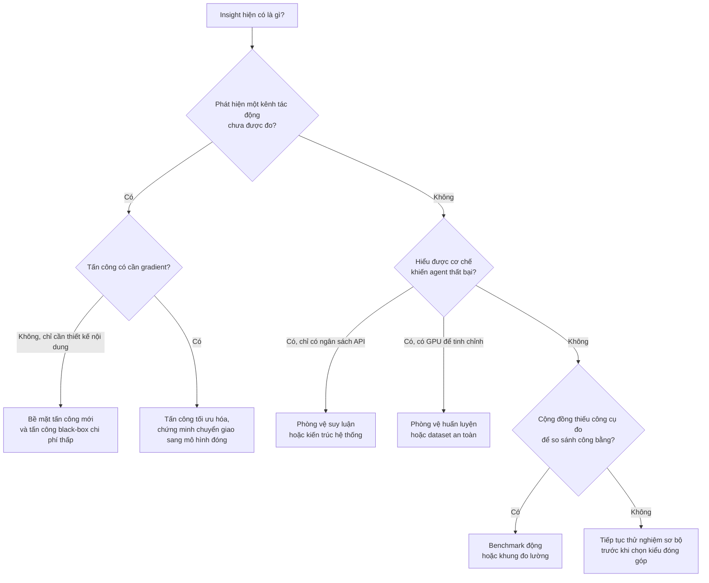

# Xu hướng đóng góp trong AI Security

!!! abstract "Mục tiêu của bài"
    Sau bài này, người học có thể:

    - phân biệt sáu kiểu đóng góp thường gặp trong nghiên cứu AI Security về prompt injection và jailbreak, và nhận ra đóng góp chính của một paper khi đọc Abstract và Introduction;
    - giải thích vì sao nhiều paper được nhận ở hội nghị hàng đầu dù gần như không huấn luyện mô hình, và vì sao những thiết kế trông "lạ" như pop-up, ảnh chữ hay phần tử HTML ẩn thực chất là lựa chọn có chủ đích;
    - mô tả các xu hướng chính của lĩnh vực trong giai đoạn 2023–2026 qua mười paper của chương;
    - nêu được tiêu chí mà reviewer ở các hội nghị CV, ML, NLP, Multimedia, AI tổng quát và Security dùng để đánh giá cùng một loại đóng góp;
    - chọn kiểu đóng góp phù hợp cho một dự án visual hoặc multimodal prompt injection và tránh những cái bẫy phổ biến.

Khi lần đầu đọc các paper về an toàn và bảo mật của mô hình ngôn ngữ lớn (LLM), mô hình thị giác–ngôn ngữ (VLM) và agent, nhiều người học có chung một băn khoăn. Ở phần lớn các chương trước, đóng góp của một paper thường là một phương pháp mới được huấn luyện rồi so sánh trên benchmark: một kiến trúc, một hàm mất mát, một chiến lược tiền huấn luyện. Trong khi đó, nhiều paper AI Security được nhận ở ICLR, ICML, ACL hay USENIX Security lại không huấn luyện mô hình nào. Có paper chỉ chèn một pop-up vào ảnh chụp màn hình, có paper thêm một ô nhập liệu vô hình vào trang web, có paper che prompt của người dùng đi rồi cho agent chạy lại. Nhìn bằng thói quen của cộng đồng ML, những việc này giống "mẹo" hơn là nghiên cứu.

Băn khoăn đó xuất phát từ việc dùng sai khung đánh giá. Trong bảo mật, câu hỏi trung tâm không phải là "mô hình đạt bao nhiêu điểm" mà là "hệ thống có bị phá vỡ dưới những giả định thực tế về kẻ tấn công hay không, và nếu có thì phòng vệ thế nào". Một bằng chứng thuyết phục rằng hệ thống bị phá vỡ, một công cụ đo cho phép so sánh tấn công và phòng vệ một cách công bằng, hay một phòng vệ chịu được cả kẻ tấn công biết rõ cơ chế của nó, đều là đóng góp có giá trị, bất kể tốn bao nhiêu GPU. Bài này dùng mười paper của chương làm cơ sở bằng chứng để trả lời ba câu hỏi: đóng góp trong lĩnh vực thường là gì, reviewer đánh giá chúng theo tiêu chí nào, và người học nên chọn kiểu đóng góp nào cho dự án đang làm.

Bài nên được đọc như bản đồ của cả chương: mỗi paper được nhắc tới đều có một trang case study riêng phân tích kỹ cấu trúc và lập luận. Chúng ta bắt đầu bằng vài khái niệm nền, sau đó đi qua bảng phân loại đóng góp, lý do vì sao ít GPU vẫn đủ, các xu hướng theo thời gian, cách reviewer ở từng loại hội nghị đọc paper, và cuối cùng là quy trình chọn kiểu đóng góp.

## Vài khái niệm nền

Hai thuật ngữ hay bị dùng lẫn là jailbreak và prompt injection. **Jailbreak** là việc vượt qua lớp căn chỉnh an toàn (safety alignment) của mô hình để buộc nó làm những điều mà nhà cung cấp mô hình muốn nó từ chối, chẳng hạn sinh nội dung độc hại. **Prompt injection** là việc chèn chỉ thị vào dữ liệu mà một ứng dụng dùng LLM sẽ xử lý, để ứng dụng làm theo kẻ tấn công thay vì làm theo nhà phát triển hay người dùng. Paper [StruQ](struq.md) phân biệt hai khái niệm này rất rõ: jailbreak là bài toán hai bên (nhà cung cấp mô hình đáng tin và người dùng không đáng tin), còn prompt injection là bài toán ba bên (nhà cung cấp mô hình, nhà phát triển ứng dụng, và một nguồn dữ liệu không đáng tin). Vì chỉ thị bị chèn có thể hoàn toàn vô hại về nội dung, chẳng hạn "in ra số 10" trong một hệ thống chấm hồ sơ xin việc, các cơ chế chống jailbreak không bắt được prompt injection. Khi chỉ thị nằm trong dữ liệu mà agent tự truy xuất, như một email, một trang web hay kết quả trả về của công cụ, ta gọi đó là **prompt injection gián tiếp** (indirect prompt injection).

Khái niệm quan trọng nhất của lĩnh vực là **threat model** (mô hình mối đe dọa): một mô tả tường minh về mục tiêu của kẻ tấn công, những gì kẻ tấn công biết, và những gì kẻ tấn công có thể thay đổi. Paper [hình thức hóa prompt injection](formalizing-pi.md) ở USENIX Security 2024 trình bày threat model theo đúng ba trục đó, và nêu một nguyên tắc mà reviewer bảo mật nào cũng thuộc: một tấn công càng có tác động khi giả định càng ít hiểu biết và năng lực của kẻ tấn công; một phòng vệ càng có tác động khi an toàn trước kẻ tấn công có càng nhiều hiểu biết và năng lực. Nguyên tắc này giải thích phần lớn những gì sẽ thảo luận trong bài.

Cuối cùng là các chỉ số và cặp khái niệm xuất hiện liên tục. **Attack success rate (ASR)** đo tỉ lệ tấn công đạt mục tiêu; **utility** đo mức hệ thống vẫn làm tốt nhiệm vụ gốc, cả khi không có tấn công lẫn khi đang bị tấn công. Về năng lực của kẻ tấn công, **white-box** nghĩa là biết trọng số mô hình và tính được gradient, còn **black-box** nghĩa là chỉ tương tác qua API hay giao diện. **Tấn công thích nghi** (adaptive attack) là tấn công được thiết kế khi đã biết cơ chế của phòng vệ, và là phép thử khắt khe nhất đối với mọi phòng vệ.

## Bảng phân loại đóng góp

Đọc kỹ đoạn contributions trong Introduction của mười paper, có thể thấy đóng góp của chúng rơi vào sáu nhóm. Một paper thường có một đóng góp chính và một hai đóng góp phụ. Việc nhận ra đóng góp chính quan trọng vì nó quyết định reviewer sẽ đòi loại bằng chứng nào: một paper tự giới thiệu là benchmark sẽ bị hỏi về độ bền lâu dài, còn một paper tự giới thiệu là phòng vệ sẽ bị hỏi về tấn công thích nghi. Các mục dưới đây giảng giải từng nhóm, mỗi nhóm kèm ví dụ, loại bằng chứng reviewer mong đợi và chi phí tính toán điển hình; bảng tổng hợp đặt ở cuối mục.

### Phát hiện bề mặt tấn công mới

**Bề mặt tấn công** (attack surface) là tập hợp các kênh mà qua đó kẻ tấn công có thể tác động vào hệ thống. Kiểu đóng góp đầu tiên, và có lẽ đặc trưng nhất của bảo mật, là chỉ ra một kênh mà cộng đồng chưa nhận thức được, hoặc chỉ ra rằng một kênh đã biết nguy hiểm hơn nhiều so với tưởng tượng. Giá trị của đóng góp nằm ở việc nó thay đổi niềm tin của cộng đồng về độ an toàn của cả một lớp hệ thống.

[Visual Adversarial Examples Jailbreak Aligned LLMs](visual-adv-jailbreak.md) (AAAI 2024) là ví dụ tiêu biểu. Paper lập luận rằng khi tích hợp thị giác vào LLM, không gian ảnh liên tục và nhiều chiều trở thành "mắt xích yếu", còn sự đa năng của LLM mở rộng hậu quả của tấn công vượt xa việc phân loại sai. Phát hiện gây ấn tượng nhất là một ảnh đối kháng duy nhất, được tối ưu trên một tập nhỏ 66 câu xúc phạm, lại jailbreak được mô hình trên nhiều loại chỉ thị độc hại mà nó chưa từng được tối ưu cho. Các paper về agent đi theo cùng tinh thần. [EIA](eia.md) (ICLR 2025) tự nhận là nghiên cứu đầu tiên về rủi ro rò rỉ thông tin cá nhân của web agent tổng quát trong môi trường bị chèn nội dung độc hại. [Pop-ups](popups.md) (ACL 2025) cho thấy agent điều khiển máy tính có thể bị đánh lạc hướng bởi những pop-up mà người dùng có kinh nghiệm sẽ nhận ra và bỏ qua. [CrossInject](crossinject.md) (ACM MM 2025) tự nhận là công trình đầu tiên thực hiện prompt injection xuyên phương thức trên agent đa phương thức. [Dissecting Adversarial Robustness of Multimodal LM Agents](dissecting-mm-agents.md) (ICLR 2025) chỉ ra rằng chính những thành phần được thêm vào để agent làm tốt hơn, như bộ đánh giá trong reflexion hay hàm giá trị trong tree search, lại có thể trở thành điểm yếu mới.

Reviewer mong đợi ba loại bằng chứng cho kiểu đóng góp này. Thứ nhất là một threat model thực tế, được neo vào kịch bản có thật: EIA neo vào thư viện front-end bị nhiễm mã độc hoặc nhà phát triển web có ý đồ xấu; Pop-ups neo vào quảng cáo độc hại, cross-site scripting và tin nhắn lừa đảo. Thứ hai là minh chứng trên các hệ thống mạnh nhất hiện có, vì một lỗ hổng chỉ tồn tại ở mô hình yếu ít có ý nghĩa: Pop-ups thử năm VLM thương mại hàng đầu, Dissecting phá được agent dùng GPT-4o kèm reflexion và tree search. Thứ ba là phân tích vì sao lỗ hổng tồn tại và các phòng vệ cơ bản có chặn được không; gần như mọi paper ở nhóm này đều thử vài phòng vệ đơn giản và cho thấy chúng không đủ. Về chi phí, đây là nhóm rẻ nhất: phần lớn chi phí là tiền gọi API và công sức thiết kế kịch bản; chỉ khi tấn công cần gradient của một mô hình mở thì mới cần GPU cho lan truyền ngược, nhưng vẫn không huấn luyện mô hình nào.

### Phương pháp tấn công

Kiểu đóng góp thứ hai là một phương pháp tấn công mới, mạnh hơn, rẻ hơn hoặc thực tế hơn các phương pháp trước. Có hai trục để phân loại phương pháp tấn công, và người viết nên định vị phương pháp được đề xuất trên cả hai trục ngay từ Introduction.

Trục thứ nhất là **cơ chế**: tấn công dựa trên tối ưu hóa hay tấn công dựa trên thiết kế nội dung. Tấn công tối ưu hóa tìm nhiễu ảnh hay chuỗi token bằng gradient. Paper visual adversarial jailbreak chạy PGD (projected gradient descent) 5000 vòng lặp trên ảnh; Dissecting dùng PGD để tấn công một captioner mã nguồn mở; CrossInject kết hợp thuật toán SSA-CWA cho ảnh với GCG (Greedy Coordinate Gradient) cho văn bản. Tấn công thiết kế nội dung không cần gradient: Pop-ups xây dựng một không gian thiết kế gồm bốn thành phần (attention hook, chỉ thị, banner thông tin và mô tả ALT); EIA thiết kế hai chiến lược Form Injection và Mirror Injection cùng một mẫu câu chỉ thị có tính thuyết phục; [AgentDojo](agentdojo.md) dùng một thông điệp kiểu "Important message" đơn giản; paper hình thức hóa prompt injection đề xuất Combined Attack bằng cách ghép ba chiến lược có sẵn.

Trục thứ hai là **mức hiểu biết của kẻ tấn công**: white-box hay black-box. Điểm tinh tế là tấn công tối ưu hóa không nhất thiết là white-box. Khi mô hình đích đóng, kẻ tấn công có thể tối ưu trên các **mô hình thay thế** (surrogate model) công khai rồi chuyển (transfer) sang mô hình đích. Dissecting tối ưu ảnh trên một tập bộ mã hóa CLIP rồi chuyển sang agent dùng LM thương mại; CrossInject dùng một tập bộ mã hóa thị giác công khai cho ảnh và Llama-3.1-8B làm LLM thay thế cho văn bản. Ngay cả paper visual adversarial jailbreak, vốn làm white-box là chính, cũng kiểm chứng khả năng chuyển giao black-box giữa ba VLM.

Reviewer đánh giá một phương pháp tấn công theo bốn tiêu chí. Tiêu chí đầu tiên là so sánh với các tấn công trước trong cùng threat model, như CrossInject so với JIP và FB. Tiêu chí thứ hai là ablation từng thành phần: Pop-ups lần lượt thay thế từng thành phần trong bốn thành phần của pop-up; CrossInject khảo sát ngân sách nhiễu, số vòng lặp tối ưu và lựa chọn mô hình thay thế. Tiêu chí thứ ba là độ nhạy với hiểu biết của kẻ tấn công: Pop-ups thay câu hỏi thật của người dùng bằng câu hỏi được LLM phỏng đoán từ nội dung màn hình; AgentDojo thử việc biết đúng hay đoán sai tên người dùng và tên mô hình. Tiêu chí thứ tư là thử tấn công trước các phòng vệ hiện có. Về chi phí, tấn công thiết kế nội dung chủ yếu tốn tiền API, còn tấn công tối ưu hóa cần GPU để tính gradient trên mô hình mở hoặc mô hình thay thế; CrossInject ghi rõ thí nghiệm chạy trên một cụm GPU A800, còn EIA ghi rằng thí nghiệm chạy trên GPU A6000, điều cần thiết khi backbone là các mô hình mở như LLaVA. Một quan sát đáng chú ý từ paper visual adversarial jailbreak là phiên bản tấn công văn bản tương ứng tốn khoảng gấp 12 lần chi phí tính toán so với tấn công ảnh, vì tối ưu rời rạc trên token khó hơn tối ưu liên tục trên pixel. Chính chênh lệch này là một phần lập luận của paper về việc ảnh là mắt xích yếu.

### Phòng vệ

Kiểu đóng góp thứ ba là phòng vệ, và đây là nơi tiêu chuẩn bằng chứng khắt khe nhất. Phòng vệ chia thành hai họ theo thời điểm can thiệp.

**Phòng vệ dựa trên huấn luyện** thay đổi trọng số mô hình. StruQ (USENIX Security 2025) lập luận rằng prompt injection là thêm một trường hợp của lỗi kinh điển "trộn kênh điều khiển với kênh dữ liệu", giống SQL injection, và cách sửa bền vững là tách hai kênh, giống như prepared statement đã làm với SQL. StruQ gồm một front-end mã hóa prompt và dữ liệu bằng các token đặc biệt dành riêng, lọc bỏ những token đó khỏi dữ liệu, và một LLM được tinh chỉnh bằng "structured instruction tuning" để chỉ làm theo chỉ thị trong phần prompt. [VLGuard](vlguard.md) (ICML 2024) xuất phát từ một phân tích nguyên nhân: tinh chỉnh thị giác–ngôn ngữ làm LLM nền "quên" căn chỉnh an toàn, một phần vì dữ liệu tinh chỉnh chứa nội dung độc hại; từ đó paper xây dựng một dataset an toàn để tinh chỉnh bổ sung.

**Phòng vệ tại thời điểm suy luận**, còn gọi là phòng vệ không huấn luyện (training-free), giữ nguyên mô hình và can thiệp vào đầu vào, đầu ra hoặc kiến trúc hệ thống. Có thể chia nhỏ thành bốn dạng. Dạng dựa trên prompt gồm dùng delimiter để bao dữ liệu, "sandwich" (nhắc lại chỉ thị gốc sau dữ liệu) hay thêm câu cảnh báo vào system prompt. Dạng phát hiện gồm đo perplexity, hỏi chính LLM, dùng một bộ phân loại như DeBERTa, hay known-answer detection (chèn một chỉ thị có đáp án biết trước để kiểm tra LLM còn làm theo chỉ thị của ứng dụng không). Dạng kiểm tra nhất quán đối chiếu hai nguồn thông tin: Dissecting thử cho LM chú thích riêng từng ảnh rồi so với văn bản đi kèm; [MELON](melon.md) (ICML 2025) chạy lại quỹ đạo của agent với prompt người dùng bị che, dựa trên quan sát rằng khi bị tấn công thành công, lời gọi công cụ của agent không còn phụ thuộc vào yêu cầu của người dùng. Dạng kiến trúc hệ thống hạn chế những gì agent được phép làm: tool filter trong AgentDojo để LLM chọn trước tập công cụ cần thiết trước khi nhìn thấy dữ liệu không đáng tin, hay Task Shield (ACL 2025), theo mô tả trong phần Related Work của MELON, kiểm tra xem các lời gọi công cụ được đề xuất có khớp với nhiệm vụ của người dùng không.

Reviewer đòi hỏi ở phòng vệ năm loại bằng chứng: hiệu quả trước nhiều tấn công khác nhau; utility được giữ khi không có tấn công và khi bị tấn công; tỉ lệ dương tính giả và âm tính giả nếu là bộ phát hiện; chi phí vận hành; và quan trọng nhất là kết quả trước tấn công thích nghi. StruQ có hẳn một mục trong đó nhóm tác giả tự tấn công phòng vệ do chính họ đề xuất, chẳng hạn dùng các delimiter "gần giống" để lách bộ lọc, và chuyển hai tấn công jailbreak mạnh là TAP và GCG sang bối cảnh prompt injection; kết quả cho thấy StruQ giảm mạnh nhưng không triệt tiêu tấn công tối ưu hóa, và paper nói thẳng rằng hệ thống chưa an toàn hoàn toàn. MELON báo cáo chi phí API xấp xỉ gấp đôi, đo tỉ lệ dương tính giả so với các bộ phát hiện khác, và phân tích 66 trường hợp tấn công lọt qua để chỉ ra các kiểu thất bại. Về chi phí, phòng vệ suy luận gần như không cần GPU nếu mô hình được gọi qua API nhưng nhân số lần gọi; phòng vệ huấn luyện cần GPU nhưng không nhất thiết lớn: StruQ tinh chỉnh toàn bộ các mô hình 7B trong ba epoch, còn VLGuard báo cáo tinh chỉnh hậu kỳ toàn bộ tham số LLaVA-v1.5-7B mất chưa tới một giờ trên hai GPU A100.

### Benchmark và môi trường đánh giá

Kiểu đóng góp thứ tư là công cụ đo. Trong một lĩnh vực mà mỗi paper tự dựng kịch bản riêng, một benchmark chung cho phép so sánh công bằng và thường được nhiều công trình sau sử dụng. Cần phân biệt hai dạng. **Benchmark tĩnh** là một tập cố định các trường hợp thử, như tập 177 bước hành động liên quan tới thông tin cá nhân mà EIA thu thập từ Mind2Web, hay tập 200 nhiệm vụ đối kháng VWA-Adv mà Dissecting chú thích thủ công trên môi trường VisualWebArena. **Môi trường động** là một khung có thể mở rộng, trong đó agent thực sự gọi công cụ và thay đổi trạng thái: AgentDojo (NeurIPS 2024 Datasets & Benchmarks) gồm 97 nhiệm vụ thực tế và 629 trường hợp kiểm thử bảo mật trong bốn môi trường Workspace, Slack, Travel và Banking.

AgentDojo lập luận rõ vì sao benchmark tĩnh không đủ cho prompt injection: rất dễ xây một phòng vệ chặn được một tấn công cụ thể nhưng không bền, nên cần đánh giá với tấn công thích nghi; và vì lĩnh vực thay đổi liên tục, benchmark phải cho phép thêm nhiệm vụ, tấn công và phòng vệ mới. Một lựa chọn thiết kế khác của AgentDojo cũng đáng học: thay vì dùng một LLM để chấm xem nhiệm vụ có hoàn thành không, nó kiểm tra trạng thái môi trường bằng các hàm xác định, vì một tấn công đủ mạnh có thể chiếm quyền cả LLM chấm điểm.

Reviewer, nhất là ở track Datasets & Benchmarks, đánh giá một benchmark theo tính thực tế của nhiệm vụ và kịch bản, độ khó, tính đúng đắn của cách chấm, khả năng mở rộng, tài liệu hóa và kế hoạch duy trì. Về độ khó, AgentDojo cho thấy các LLM giải được chưa tới 66% nhiệm vụ ngay cả khi không bị tấn công, nghĩa là benchmark còn xa mới bão hòa. Chi phí chủ yếu là công sức con người để thiết kế và chú thích nhiệm vụ cùng hàm đánh giá, cộng tiền API để chạy các mô hình.

### Hình thức hóa và đo lường

Kiểu đóng góp thứ năm là một khung hình thức hoặc một hệ chỉ số giúp cộng đồng suy nghĩ rõ ràng hơn. [Formalizing and Benchmarking Prompt Injection Attacks and Defenses](formalizing-pi.md) mở đầu bằng nhận xét rằng các công trình trước chủ yếu là case study, rồi đề xuất định nghĩa hình thức của prompt injection dựa trên hai khái niệm "target task" và "injected task", một khung tổng quát mà các tấn công có sẵn là trường hợp đặc biệt, và một hệ chỉ số gồm PNA (hiệu năng khi không bị tấn công), ASV (mức thành công của nhiệm vụ bị chèn), MR (tỉ lệ khớp với đầu ra khi chạy trực tiếp nhiệm vụ bị chèn), cùng FPR và FNR cho bộ phát hiện. Dissecting đề xuất khung ARE (Agent Robustness Evaluation), coi agent như một đồ thị các thành phần và phân rã độ thành công của tấn công thành trọng số trên các cạnh, đo "ảnh hưởng đối kháng" lan truyền qua từng cạnh.

Điều reviewer kiểm tra ở kiểu đóng góp này là khung hình thức có *làm được việc* hay không. Khung của paper hình thức hóa prompt injection làm được ba việc cụ thể: thống nhất các tấn công có sẵn, gợi ý một tấn công mới mạnh hơn các tấn công thành phần, và cho phép đánh giá có hệ thống 5 tấn công, 10 phòng vệ, 10 LLM trên 7 nhiệm vụ. Khung ARE cho phép tái sử dụng kết quả đo giữa các cấu hình agent và giải thích vì sao thêm một thành phần có thể vừa giúp vừa hại. Một khung chỉ thêm ký hiệu mà không dẫn tới phát hiện mới sẽ bị coi là trang trí. Chi phí tính toán phụ thuộc vào phần benchmark đi kèm; bản thân việc hình thức hóa chủ yếu tốn công suy nghĩ.

### Dataset huấn luyện an toàn

Kiểu đóng góp cuối cùng là một tài nguyên dữ liệu để huấn luyện mô hình an toàn hơn. VLGuard là đại diện rõ nhất: tập huấn luyện gồm 2.000 ảnh (977 ảnh có hại và 1.023 ảnh an toàn) với khoảng 3.000 cặp chỉ thị–phản hồi, được sinh bằng GPT-4V theo một phân loại bốn nhóm và chín nhóm con nội dung có hại, kèm một tập kiểm tra 1.000 ảnh. Thiết kế dữ liệu phản ánh đặc thù đa phương thức: mỗi ảnh an toàn đi kèm cả một chỉ thị an toàn lẫn một chỉ thị không an toàn, vì nguy cơ có thể nằm ở văn bản chứ không ở ảnh. StruQ không công bố dataset theo nghĩa hẹp nhưng đóng góp một công thức xây dựng dữ liệu: lấy một dataset instruction tuning chuẩn, chèn thêm chỉ thị vào phần dữ liệu của một nửa số mẫu, trong khi đáp án vẫn chỉ trả lời chỉ thị gốc.

Reviewer đánh giá một dataset an toàn theo độ bao phủ của phân loại nội dung có hại, chất lượng dữ liệu sinh tự động, tác động lên helpfulness, và khả năng tổng quát hóa sang tấn công không có trong dữ liệu huấn luyện. VLGuard đáp ứng từng điểm: đo helpfulness trên nhiều benchmark; dùng XSTest để phát hiện "an toàn thái quá" (exaggerated safety), tức từ chối cả câu hỏi vô hại như cách dừng một tiến trình Python; chỉ ra rằng cần trộn thêm dữ liệu helpfulness để tránh hiện tượng này; và thử với FigStep, một tấn công chuyển chỉ thị độc hại thành ảnh chữ. Chi phí gồm tiền API để sinh dữ liệu và GPU để tinh chỉnh, nhưng khi trộn vào huấn luyện, dữ liệu an toàn chỉ chiếm khoảng 0,3% dữ liệu giai đoạn hai của LLaVA-v1.5, đúng tinh thần "at (almost) no cost" trong tiêu đề.

### Bảng tổng hợp mười paper

Bảng dưới đây xếp mười paper theo đóng góp chính và phụ. Ô "Không" ở cột huấn luyện không có nghĩa là không dùng GPU; nó có nghĩa là trọng số của mô hình đích không thay đổi.

| Paper | Venue | Đóng góp chính | Đóng góp phụ | Huấn luyện mô hình? | Chi phí điển hình |
|---|---|---|---|---|---|
| [Visual Adv. Jailbreak](visual-adv-jailbreak.md) | AAAI 2024 | Bề mặt tấn công mới (ảnh đầu vào) | Tấn công tối ưu hóa white-box, kiểm chứng chuyển giao; phân tích phòng vệ DiffPure | Không | GPU để lan truyền ngược qua VLM mở cỡ 13B |
| [CrossInject](crossinject.md) | ACM MM 2025 | Tấn công black-box xuyên phương thức | Bề mặt tấn công mới; thử nghiệm với một xe thông minh thật | Không | Cụm GPU cho tối ưu trên mô hình thay thế |
| [Dissecting MM Agents](dissecting-mm-agents.md) | ICLR 2025 | Khung đo lường ARE và tập VWA-Adv | Tấn công captioner và CLIP; phòng vệ cơ sở | Không | GPU cho nhiễu ảnh, API cho agent |
| [Pop-ups](popups.md) | ACL 2025 | Bề mặt tấn công và tấn công thiết kế nội dung | Ablation không gian thiết kế; phòng vệ cơ bản | Không | Chủ yếu API |
| [EIA](eia.md) | ICLR 2025 | Threat model quyền riêng tư và chiến lược chèn | Tập 177 bước hành động; phân tích khả năng bị phát hiện | Không | API và suy luận backbone mở |
| [Formalizing PI](formalizing-pi.md) | USENIX Security 2024 | Hình thức hóa và benchmark | Combined Attack | Không | API và suy luận LLM mở |
| [AgentDojo](agentdojo.md) | NeurIPS 2024 D&B | Môi trường đánh giá động | Hệ chỉ số; tấn công và phòng vệ cơ sở | Không | Chủ yếu API |
| [MELON](melon.md) | ICML 2025 | Phòng vệ suy luận (kiểm tra nhất quán) | Cận sai số lý thuyết; phân tích thất bại | Không | Khoảng gấp đôi số lần gọi API |
| [StruQ](struq.md) | USENIX Security 2025 | Phòng vệ huấn luyện kèm thiết kế hệ thống | Chuyển TAP và GCG sang prompt injection; tấn công thích nghi | Có (tinh chỉnh mô hình 7B) | GPU cho tinh chỉnh toàn bộ tham số |
| [VLGuard](vlguard.md) | ICML 2024 | Dataset huấn luyện an toàn | Phân tích nguyên nhân mất căn chỉnh; chiến lược tinh chỉnh | Có (tinh chỉnh VLM) | Dưới một giờ trên hai A100 cho bản 7B |

Còn "prompting method" và "evaluation method", hai cụm từ người học hay dùng, nằm ở đâu trong bảng? "Evaluation method" tương ứng với nhóm benchmark và nhóm hình thức hóa. "Prompting method" thì hiếm khi là đóng góp chính, vì nó xuất hiện ở hai vai trò khác nhau. Ở vai trò tấn công, prompt là *vật liệu* của tấn công thiết kế nội dung, và đóng góp nằm ở threat model cùng phân tích chứ không ở câu chữ; nội dung chữ quan trọng tới mức khi Pop-ups thay pop-up bằng một pop-up trống, ASR giảm gần như về không. Ở vai trò phòng vệ, các phòng vệ chỉ dựa trên prompt liên tục bị chứng minh là yếu: paper hình thức hóa prompt injection kết luận các phòng vệ phòng ngừa có hiệu quả hạn chế hoặc làm giảm utility, Dissecting thấy system prompt phòng vệ không cải thiện độ bền, Pop-ups thấy yêu cầu agent bỏ qua pop-up không đủ, EIA thấy system prompt phòng vệ không chặn được tấn công, còn sandwich prompting trong thử nghiệm của CrossInject trung bình chỉ giảm ASR vài điểm phần trăm. Vì vậy, một paper chỉ đề xuất "một system prompt tốt hơn" khó thuyết phục reviewer, trừ khi prompt đó là biểu hiện của một insight lớn hơn về cơ chế thất bại.

## Vì sao ít cần GPU mà vẫn được nhận

Sau khi đã có bảng phân loại, câu hỏi của người học có thể được trả lời trực tiếp. Tám trong mười paper không thay đổi trọng số của mô hình đích, và hai paper còn lại chỉ tinh chỉnh ở quy mô khiêm tốn. Điều đó không phải ngẫu nhiên mà phản ánh năm đặc điểm của lĩnh vực.

### Đóng góp nằm ở threat model và insight

Trong ML thông thường, một kết quả mạnh thường là một con số tốt hơn trên benchmark, và con số đó thường đòi hỏi tài nguyên. Trong bảo mật, một kết quả mạnh là một *mệnh đề về thế giới*: "agent dùng GPT-4o kèm tree search có thể bị chiếm quyền chỉ bằng nhiễu không nhìn thấy trên một ảnh sản phẩm của chính kẻ tấn công". Mệnh đề này đúng hay sai không phụ thuộc vào việc tốn bao nhiêu GPU để kiểm chứng. Dissecting có giá trị vì nó chứng minh rằng thêm thành phần suy luận, vốn được cộng đồng agent coi là cách cải thiện hiệu năng, có thể làm hệ thống kém bền hơn trong trường hợp xấu nhất. Paper visual adversarial jailbreak có giá trị vì nó nối hai dòng nghiên cứu, adversarial examples và alignment, bằng một quan sát mà sau này cả hai cộng đồng phải tính tới.

### Mô hình mục tiêu thường là mô hình đóng

Những hệ thống đáng tấn công nhất là những hệ thống đang được triển khai, và chúng thường chạy trên mô hình thương mại. Pop-ups thử GPT-4-Turbo, GPT-4o, Gemini 1.5 Pro và hai phiên bản Claude 3.5 Sonnet; AgentDojo gọi phần lớn mô hình qua API chính thức của nhà cung cấp; paper hình thức hóa prompt injection dùng GPT-4 qua API làm mô hình mặc định. Với những mô hình này, người nghiên cứu không thể huấn luyện lại dù có bao nhiêu GPU, nên đóng góp buộc phải nằm ở đầu vào, ở môi trường hoặc ở kiến trúc hệ thống bao quanh mô hình. Ngay cả khi muốn dùng gradient, như Dissecting và CrossInject, phần tốn GPU chỉ chạy trên mô hình thay thế công khai.

### Tính thực tế là điểm mạnh của tấn công

Theo nguyên tắc threat model đã nêu, tấn công giả định ít năng lực hơn thì có tác động lớn hơn. Hệ quả là một tấn công black-box, rẻ, không cần tối ưu được đánh giá *cao hơn* chứ không thấp hơn một tấn công white-box tốn kém. Pop-ups nêu thẳng lập luận này khi so sánh với tấn công dựa trên gradient: những tấn công đó cần hàng nghìn bước tối ưu và kém chuyển giao sang VLM thương mại. Dissecting khuyến nghị cộng đồng tập trung vào kịch bản chỉ được sửa ảnh, vì nhiễu ảnh khó bị phát hiện và kẻ tấn công dễ chối bỏ trách nhiệm. EIA giả định kẻ tấn công không biết trước nhiệm vụ của người dùng và yêu cầu tấn công không làm hỏng nhiệm vụ đó, vì một tấn công làm agent thất bại rõ ràng sẽ khiến người dùng phát hiện và đưa trang web vào danh sách đen. Mỗi giả định chặt hơn làm tấn công khó hơn, nhưng làm kết luận đáng tin hơn.

### Phòng vệ suy luận dễ triển khai, nhưng huấn luyện vẫn có chỗ

Ở phía phòng vệ, các phương pháp không huấn luyện có lợi thế triển khai rõ ràng: chúng áp dụng được cho mô hình đóng và không đòi hỏi nhà phát triển ứng dụng có hạ tầng huấn luyện. MELON đưa lập luận này vào chính threat model của paper khi giả định bên phòng vệ không có tài nguyên để huấn luyện LLM và không truy cập được biểu diễn bên trong mô hình; paper cũng chỉ ra rằng phòng vệ dựa trên huấn luyện tốn tài nguyên và có thể làm giảm utility. Tuy nhiên, "không huấn luyện" không có nghĩa là miễn phí: MELON nhân đôi số lần gọi mô hình, còn kiểm tra nhất quán trong Dissecting làm số lần gọi API tăng mạnh vì phần lớn trang web trong đánh giá có hơn mười ảnh.

Mặt khác, StruQ và VLGuard cho thấy hướng huấn luyện vẫn có chỗ đứng vững, với điều kiện có một lập luận vì sao phải can thiệp vào trọng số. StruQ lập luận rằng giao diện hiện tại của LLM, vốn trộn chỉ thị với dữ liệu trong một chuỗi, là "unsafe-by-design", và các phòng vệ đã có đều chưa thỏa đáng; cách sửa tận gốc là đổi sang một giao diện tách hai kênh, và muốn vậy thì phải huấn luyện mô hình hiểu giao diện mới. VLGuard lập luận rằng nguyên nhân nằm ở dữ liệu tinh chỉnh, nên cách sửa cũng nằm ở dữ liệu tinh chỉnh. Dissecting còn đưa ra một gợi ý gián tiếp: GPT-4o bền hơn GPT-4V rõ rệt trong thí nghiệm của paper, và phỏng đoán tốt nhất của các tác giả là GPT-4o được huấn luyện với instruction hierarchy, một phương pháp huấn luyện để mô hình ưu tiên chỉ thị từ nguồn đáng tin. Nói cách khác, phòng vệ huấn luyện có lẽ là thứ nhà cung cấp mô hình cần làm, còn phòng vệ suy luận là thứ nhà phát triển ứng dụng làm được ngay.

### Các "trò lạ" là lựa chọn thiết kế có chủ đích

Những thủ thuật khiến người học ngạc nhiên đều có chung một logic: mỗi thủ thuật là cách hiện thực hóa một dòng trong threat model. Người viết chọn thủ thuật để mô phỏng một kẻ tấn công cụ thể, với một kênh tác động cụ thể và một lượng hiểu biết cụ thể, rồi dùng ablation để chứng minh thành phần nào của thủ thuật thực sự quan trọng. Bảng sau tổng hợp các thủ thuật tiêu biểu.

| Thủ thuật trông "lạ" | Paper | Kẻ tấn công được mô phỏng | Điều thủ thuật kiểm chứng |
|---|---|---|---|
| Chèn pop-up có câu tóm tắt yêu cầu người dùng | Pop-ups | Kẻ mua chỗ quảng cáo, chèn script qua XSS, hoặc gửi ảnh có thể bấm qua email lừa đảo | Agent có phân biệt được nội dung đáng ngờ mà con người tự bỏ qua không |
| Chuyển chỉ thị độc hại thành ảnh chữ | FigStep, được VLGuard dùng để đánh giá | Người dùng black-box chỉ gửi được ảnh và văn bản | Căn chỉnh an toàn học trên văn bản có chuyển sang kênh ảnh không |
| Thêm nhiễu không nhìn thấy vào ảnh sản phẩm do kẻ tấn công đăng | Dissecting | Người bán hợp lệ trên nền tảng, chỉ sửa được nội dung của chính họ | Một thay đổi chiếm dưới 5% điểm ảnh có lan truyền qua cả hệ thống agent không |
| Chèn ô nhập liệu trong suốt, nhân bản phần tử thật, kèm script tự gửi dữ liệu | EIA | Thư viện front-end bị nhiễm mã độc hoặc nhà phát triển có ý đồ xấu | Agent có bị lừa điền thông tin cá nhân vào phần tử giả mà vẫn hoàn thành nhiệm vụ không |
| Phối hợp nhiễu ảnh, lệnh văn bản và tài liệu ngoài | CrossInject | Kẻ tấn công black-box tác động được vào nhiều nguồn đầu vào của agent | Tấn công phối hợp đa phương thức có mạnh hơn tấn công đơn phương thức không |
| Che prompt người dùng rồi chạy lại agent | MELON | Bên phòng vệ, không có tài nguyên huấn luyện | Hành động của agent có còn phụ thuộc vào yêu cầu của người dùng không |
| Thay delimiter bằng token đặc biệt và lọc khỏi dữ liệu | StruQ | Bên phòng vệ thiết kế giao diện mới cho LLM | Tách kênh chỉ thị và kênh dữ liệu có ngăn được tấn công giả mạo delimiter không |

Đọc theo cột cuối, có thể thấy mỗi thủ thuật thực chất là một *thí nghiệm có kiểm soát* cho một câu hỏi khoa học. Reviewer không chấm điểm độ "thông minh" của thủ thuật mà chấm độ khớp giữa thủ thuật và kẻ tấn công được mô phỏng, cùng chất lượng của ablation đi kèm. Đây cũng là lý do Pop-ups dành nhiều trang cho các phiên bản yếu hơn của tấn công, như phỏng đoán thay vì biết yêu cầu người dùng, hay bắt buộc ghi nhãn "ADVERTISEMENT" theo quy định quảng cáo: những phiên bản đó trả lời câu hỏi "nếu kẻ tấn công thực tế bị ràng buộc hơn thì sao".

## Xu hướng theo thời gian

Mười paper của chương trải từ các bản arXiv năm 2023 tới các hội nghị năm 2025. Mười paper không phải là một mẫu đại diện cho cả lĩnh vực, nên những xu hướng dưới đây chỉ là xu hướng chung có thể thấy qua chúng; người học nên kiểm chứng thêm bằng việc đọc các hội nghị gần nhất. Dù vậy, sáu chuyển dịch khá rõ nét.

**Từ jailbreak chatbot sang prompt injection gián tiếp vào agent.** Paper visual adversarial jailbreak nghiên cứu hội thoại một lượt với một VLM đã căn chỉnh, và mục tiêu của kẻ tấn công là nội dung độc hại. Các paper sau dời trọng tâm sang agent thực hiện hành động: EIA quan tâm tới việc rò rỉ thông tin cá nhân, AgentDojo quan tâm tới việc chuyển tiền hay gửi mã xác thực cho kẻ tấn công, MELON quan tâm tới lời gọi công cụ trái phép. Khi agent có quyền hành động, hậu quả của một tấn công không còn là một câu trả lời xấu mà là một thay đổi thật trong thế giới.

**Từ văn bản sang đa phương thức và computer-use.** Paper hình thức hóa prompt injection làm việc với các ứng dụng xử lý văn bản thuần như phát hiện spam hay tóm tắt. Dissecting và Pop-ups chuyển sang agent nhìn ảnh chụp màn hình trên VisualWebArena và OSWorld. CrossInject đi xa hơn với agent nhận nhiều nguồn đầu vào và một thử nghiệm trên xe tự hành có điều khiển bằng VLM. Mỗi phương thức mới là một bề mặt tấn công mới, đúng như paper visual adversarial jailbreak đã dự báo khi nói về rủi ro gia tăng của đa phương thức.

**Từ tấn công tối ưu hóa sang tấn công thực tế, chi phí thấp.** Có thể thấy một chuỗi chuyển dịch: PGD white-box trên VLM mở, rồi tấn công chuyển giao qua mô hình thay thế, rồi tấn công thiết kế nội dung không cần gradient. Tuy nhiên, tấn công tối ưu hóa không biến mất mà đổi vai: trong đánh giá của StruQ, TAP và GCG là những tấn công mạnh nhất đối với phòng vệ được đề xuất, nên chúng trở thành công cụ để *kiểm tra* phòng vệ hơn là đóng góp tự thân.

**Từ dataset tĩnh sang môi trường động.** Các tập thử cố định nhường chỗ cho môi trường có trạng thái, nơi agent thực sự gọi công cụ và việc chấm điểm dựa trên trạng thái môi trường. AgentDojo là đại diện rõ nhất, và việc MELON chọn AgentDojo làm nơi đánh giá chính cho thấy một môi trường động tốt nhanh chóng trở thành chuẩn chung.

**Từ phòng vệ heuristic sang phòng vệ có bảo đảm hoặc ở mức hệ thống.** Các phòng vệ dựa trên prompt và bộ phát hiện đơn giản liên tục bị chứng minh là không đủ. Các hướng mới tìm kiếm bảo đảm mạnh hơn: StruQ đổi giao diện của LLM để tách chỉ thị khỏi dữ liệu; tool filter của AgentDojo và Task Shield hạn chế hành động ở mức hệ thống; MELON bổ sung một phân tích lý thuyết cho thấy khi kết hợp nhiều bộ phát hiện yếu, cận sai số giảm theo hàm mũ với số bộ phát hiện, miễn là một điều kiện về độ tương đồng trung bình được thỏa mãn.

**Đánh giá với tấn công thích nghi trở thành kỳ vọng.** Paper visual adversarial jailbreak đã lưu ý rằng DiffPure có thể thất bại trước tấn công thích nghi tinh vi hơn. AgentDojo đưa tư tưởng này vào thiết kế benchmark và vào chỉ số, khi coi một tập tấn công là thành công nếu bất kỳ tấn công nào trong tập thành công. StruQ dành hẳn một mục cho tấn công thích nghi. Dissecting đặt câu hỏi "nếu kẻ tấn công thích nghi với sự có mặt của hàm giá trị thì sao", và kết luận bằng lời kêu gọi xây dựng tấn công thích nghi mạnh hơn khi phòng vệ mới xuất hiện. Nhìn từ năm 2026, một phòng vệ không có mục tấn công thích nghi gần như chắc chắn bị reviewer hỏi tới.

| Chiều chuyển dịch | Điểm xuất phát | Hướng đi | Paper minh họa |
|---|---|---|---|
| Đối tượng | Chatbot, jailbreak một lượt | Agent hành động, injection gián tiếp | Visual Adv. Jailbreak → EIA, AgentDojo, MELON |
| Phương thức | Văn bản | Ảnh, ảnh chụp màn hình, nhiều nguồn, thế giới thật | Formalizing PI → Dissecting, Pop-ups, CrossInject |
| Cơ chế tấn công | Tối ưu hóa white-box | Chuyển giao, thiết kế nội dung black-box | Visual Adv. Jailbreak → Dissecting → Pop-ups |
| Công cụ đánh giá | Tập thử tĩnh | Môi trường động, chấm theo trạng thái | Formalizing PI, VWA-Adv → AgentDojo |
| Phòng vệ | Prompt, bộ phát hiện đơn giản | Đổi giao diện, kiểm soát hệ thống, cận lý thuyết | StruQ, Task Shield, MELON |
| Chuẩn đánh giá phòng vệ | Một vài tấn công cố định | Tấn công thích nghi bắt buộc | AgentDojo, StruQ, Dissecting |

## Reviewer ở từng loại hội nghị đánh giá thế nào

Mười paper của chương được nhận ở sáu loại hội nghị khác nhau. Cùng một kiểu đóng góp, chẳng hạn một tấn công mới, được đọc với những câu hỏi khác nhau tùy cộng đồng. Mục này trình bày những khác biệt điển hình; như mọi nhận định về văn hóa review, chúng là xu hướng chứ không phải luật, và người học cần đọc Call for Papers cùng hướng dẫn reviewer của năm nộp. Các bài ở [Chương 6](../06-cong-dong/index.md) bàn kỹ hơn về văn hóa của từng cộng đồng, và bài [Chuyển một paper giữa các cộng đồng](../06-cong-dong/chuyen-doi.md) hướng dẫn cách đóng khung lại cùng một kết quả.

### Computer Vision

Reviewer ở CVPR, ICCV và ECCV quan tâm tới bản chất *thị giác* của tấn công hoặc phòng vệ. Họ sẽ hỏi về ngân sách nhiễu và mức độ khó nhận thấy, về khả năng chuyển giao giữa các bộ mã hóa thị giác, về độ bền trước các phép biến đổi ảnh thông thường, và về khả năng hiện thực hóa trong thế giới vật lý. Hình minh họa định tính có trọng lượng lớn. Ablation ngân sách nhiễu kiểu CrossInject (từ 2 tới 32 theo chuẩn L∞) hay thử nghiệm với miếng dán đối kháng có hình biển báo dừng trên một đường thử dựng thủ công là loại bằng chứng mà cộng đồng này quen đọc. Các benchmark an toàn đa phương thức cũng có chỗ ở đây, ví dụ MM-SafetyBench được công bố ở ECCV 2024. Một tấn công chỉ dựa vào văn bản hiển thị trong ảnh có thể bị hỏi "đóng góp thị giác ở đâu", nên nếu nộp CV, người viết cần nhấn vào khía cạnh nhận thức thị giác của lỗ hổng. Xem thêm bài [hệ sinh thái CV](../00-tong-quan/he-sinh-thai-cv.md).

### Machine Learning

Reviewer ở NeurIPS, ICML và ICLR tìm kiếm tính tổng quát và một insight có thể chuyển sang bối cảnh khác. Dissecting, ở ICLR, không dừng ở việc phá được agent mà đề xuất khung ARE để mô tả cách ảnh hưởng đối kháng lan truyền qua một hệ thống phức hợp. MELON ở ICML có một quan sát mang tính nguyên lý (hành động độc lập với yêu cầu người dùng là dấu hiệu bị tấn công) kèm phân tích lý thuyết. VLGuard ở ICML mở đầu bằng một phân tích nguyên nhân về việc tinh chỉnh phá vỡ căn chỉnh, trước khi đưa ra dataset. Với cộng đồng này, một tấn công hay phòng vệ cần được trình bày như một trường hợp của một hiện tượng tổng quát hơn, và các thí nghiệm có kiểm soát giúp làm rõ cơ chế được đánh giá cao.

Track Datasets & Benchmarks của NeurIPS, nơi AgentDojo được nhận, có tiêu chí riêng. Ngoài chất lượng khoa học, reviewer thường xem xét tài liệu hóa dữ liệu, giấy phép, khả năng truy cập cho reviewer, kế hoạch duy trì, và câu hỏi then chốt là benchmark có còn hữu ích khi mô hình mạnh lên hay không. Lập luận của AgentDojo về benchmark động và khả năng mở rộng chính là câu trả lời trực tiếp cho câu hỏi đó. Tên gọi và yêu cầu của track có thể thay đổi giữa các năm, nên cần kiểm tra hướng dẫn hiện hành. Bài [Viết cho NeurIPS / ICML / ICLR](../06-cong-dong/ml.md) có thêm chi tiết.

### NLP

Reviewer ở ACL và EMNLP, qua ACL Rolling Review, quan tâm tới hành vi ngôn ngữ của mô hình và chất lượng phân tích. Pop-ups, ở ACL, dành phần lớn phần thực nghiệm cho phân tích có hệ thống về cách các thành phần văn bản trong pop-up, như câu tóm tắt yêu cầu người dùng do LLM sinh ra hay nhãn quảng cáo, ảnh hưởng tới quyết định của agent. Task Shield, một phòng vệ dựa trên kiểm tra sự khớp giữa hành động và nhiệm vụ, cũng được công bố ở ACL 2025. Cộng đồng NLP đòi hỏi mục Limitations nghiêm túc, phần thảo luận đạo đức, và Responsible NLP Checklist; với paper an toàn, reviewer thường đọc kỹ cách nhóm tác giả xử lý nội dung độc hại và công bố dữ liệu. Phân tích lỗi bằng ví dụ cụ thể và đánh giá thủ công có giao thức rõ ràng được đánh giá cao. Xem bài [Viết cho ACL / EMNLP / NAACL](../06-cong-dong/nlp.md).

### Multimedia

ACM Multimedia quan tâm tới tương tác giữa các phương thức. CrossInject phù hợp với cộng đồng này vì luận điểm chính là các tấn công đơn phương thức bỏ qua tương tác phức tạp giữa phương thức, và một tấn công phải được phối hợp qua nhiều nguồn đầu vào mới khai thác được điểm yếu của việc hợp nhất đa phương thức. Reviewer ACM MM thường đánh giá cao thử nghiệm trên hệ thống thực và ứng dụng cụ thể, như thử nghiệm xe tự hành của CrossInject. Một paper chỉ làm trên một phương thức thường không phải là lựa chọn tốt cho hội nghị này.

### AI tổng quát

AAAI nhận paper từ mọi nhánh của AI, nên reviewer có thể không phải chuyên gia hẹp về adversarial ML hay về alignment. Paper visual adversarial jailbreak phù hợp với bối cảnh đó: nó được đóng khung như một nhận định có tầm rộng về rủi ro của xu hướng đa phương thức đối với alignment, dễ tiếp cận với người đọc từ nhiều nhánh. Với hội nghị AI tổng quát, phần Introduction cần giải thích vì sao vấn đề quan trọng với cả cộng đồng AI, và các thuật ngữ chuyên ngành cần được định nghĩa cẩn thận. Bài [AAAI / IJCAI / KDD / Journal](../06-cong-dong/khac.md) bàn kỹ hơn về nhóm hội nghị này.

### Security

USENIX Security, ACM CCS, IEEE S&P và NDSS thường được coi là bốn hội nghị bảo mật hàng đầu; hạng CORE của từng hội nghị cần được tra cứu trên cổng ICORE với đúng phiên bản mà cơ quan đánh giá áp dụng. Văn hóa review ở đây khác hẳn các cộng đồng AI. Mục threat model là bắt buộc và bị đọc rất kỹ; một giả định thiếu thực tế về kẻ tấn công có thể đủ để paper bị từ chối, bất kể kết quả thực nghiệm mạnh tới đâu. Với phòng vệ, tấn công thích nghi gần như là điều kiện cần. Reviewer bảo mật đánh giá cao việc hệ thống hóa: giá trị chính của paper hình thức hóa prompt injection ở USENIX Security không nằm ở một tấn công mạnh mà ở việc biến một tập case study rời rạc thành một khung thống nhất. Họ cũng trân trọng việc nối vấn đề mới với các nguyên lý bảo mật kinh điển, như cách StruQ đặt prompt injection cạnh SQL injection và cross-site scripting. Những năm gần đây, các hội nghị này thường có nhiều đợt nộp trong năm, có thể ra quyết định yêu cầu sửa lớn (major revision), và đặt yêu cầu về thảo luận đạo đức, công bố có trách nhiệm (responsible disclosure) cũng như chia sẻ artifact; chi tiết thay đổi theo năm nên cần đọc kỹ Call for Papers.

| Loại hội nghị | Câu hỏi đầu tiên của reviewer | Bằng chứng được đánh giá cao | Ví dụ trong chương |
|---|---|---|---|
| CV | Lỗ hổng có bản chất thị giác không? | Ngân sách nhiễu, chuyển giao giữa bộ mã hóa, thế giới vật lý, hình định tính | MM-SafetyBench (ECCV 2024) |
| ML | Insight có tổng quát không? | Khung nguyên lý, thí nghiệm có kiểm soát, phân tích lý thuyết | Dissecting, EIA, MELON, VLGuard |
| ML (D&B) | Benchmark có bền theo thời gian không? | Tính thực tế, khả năng mở rộng, tài liệu hóa, chấm điểm đúng | AgentDojo |
| NLP | Hành vi ngôn ngữ được phân tích kỹ chưa? | Ablation thành phần văn bản, phân tích lỗi, Limitations, đạo đức | Pop-ups, Task Shield |
| Multimedia | Tương tác giữa phương thức ở đâu? | Phối hợp đa phương thức, hệ thống thực | CrossInject |
| AI tổng quát | Vấn đề có ý nghĩa rộng không? | Đóng khung dễ tiếp cận, hàm ý cho nhiều nhánh AI | Visual Adv. Jailbreak |
| Security | Threat model có thực tế không? | Hệ thống hóa, tấn công thích nghi, đạo đức, artifact | Formalizing PI, StruQ |

## Chọn kiểu đóng góp cho một dự án visual hoặc multimodal prompt injection

Giả sử một nhóm nghiên cứu muốn làm về prompt injection qua ảnh hoặc qua nhiều phương thức đối với VLM và agent. Sai lầm thường gặp là chọn kiểu đóng góp theo sở thích ("muốn làm phòng vệ vì nghe có vẻ tích cực") hay theo tài nguyên sẵn có ("có GPU nên phải huấn luyện gì đó"). Cách chọn tốt hơn bắt đầu từ ba câu hỏi theo thứ tự: nhóm đang có insight gì, tài nguyên thực tế thế nào, và hội nghị đích là ở cộng đồng nào. Insight đứng đầu vì nó quyết định kiểu đóng góp; tài nguyên chỉ quyết định phiên bản nào của kiểu đóng góp đó khả thi; còn hội nghị quyết định cách đóng khung. Bài [Tìm & thẩm định ý tưởng](../01-truoc-khi-viet/y-tuong.md) ở Chương 1 trình bày các kỹ thuật tìm insight nói chung; sơ đồ dưới đây áp dụng chúng vào lĩnh vực này.

Bảng sau cụ thể hóa sơ đồ thành các tình huống thường gặp, kèm hội nghị phù hợp và bằng chứng tối thiểu mà reviewer sẽ đòi.

| Tình huống của nhóm | Kiểu đóng góp nên chọn | Hội nghị phù hợp | Bằng chứng tối thiểu |
|---|---|---|---|
| Thấy agent computer-use làm theo chữ trong một phần tử giao diện mà người dùng sẽ bỏ qua; chỉ có ngân sách API | Bề mặt tấn công mới, tấn công thiết kế nội dung | NLP hoặc ML, Security nếu threat model rất chặt | Nhiều mô hình thương mại; ablation từng thành phần; phiên bản kẻ tấn công ít hiểu biết hơn; phòng vệ cơ bản; utility khi bị tấn công |
| Có GPU, muốn tạo nhiễu ảnh ép VLM làm theo chỉ thị ẩn | Tấn công tối ưu hóa, chuyển giao qua mô hình thay thế | CV hoặc Multimedia | Ngân sách nhiễu; chuyển giao sang mô hình đóng; so sánh với tấn công trước; độ bền trước biến đổi ảnh; phòng vệ tiền xử lý |
| Quan sát được một dấu hiệu hành vi phân biệt quỹ đạo bị tấn công với quỹ đạo bình thường | Phòng vệ suy luận | ML hoặc Security | Benchmark động chuẩn; nhiều tấn công; utility và dương tính giả; chi phí; tấn công thích nghi biết rõ cơ chế phòng vệ |
| Chẩn đoán được nguyên nhân trong dữ liệu hay giao diện huấn luyện | Phòng vệ huấn luyện hoặc dataset an toàn | ML hoặc Security | Phân tích nguyên nhân; helpfulness và an toàn thái quá; tổng quát hóa sang tấn công chưa thấy; tấn công tối ưu hóa và thích nghi |
| Các paper trong hướng không so sánh được với nhau vì mỗi paper tự dựng kịch bản | Benchmark động hoặc khung đo lường | ML (D&B) hoặc Security | Nhiệm vụ thực tế; chấm điểm không phụ thuộc LLM dễ bị chiếm quyền; chưa bão hòa; khả năng mở rộng; tài liệu hóa |

Một gợi ý thực tế cho nghiên cứu sinh: hai kiểu đóng góp đầu thường là điểm vào hợp lý cho paper đầu tay vì chi phí thấp và vòng thử nghiệm nhanh, nhưng chúng cạnh tranh mạnh về tính mới vì nhiều nhóm cùng tìm bề mặt tấn công. Ngược lại, phòng vệ có thời gian sống lâu hơn nếu vượt qua được tấn công thích nghi, nhưng rủi ro bị phá ngay sau khi công bố cũng cao hơn.

### Những cái bẫy thường gặp

Sau khi đã chọn kiểu đóng góp, nhóm tác giả cần tránh bốn cái bẫy mà reviewer ở mọi cộng đồng đều nhận ra ngay.

**Bẫy thứ nhất: tấn công không có threat model thực tế.** Một tấn công giả định kẻ tấn công sửa được system prompt, sửa được toàn bộ ảnh chụp màn hình, hay biết chính xác yêu cầu của người dùng mà không giải thích vì sao, sẽ bị coi là một bài kiểm tra độ bền chứ không phải một mối đe dọa. Hãy so sánh hai cách viết threat model dưới đây.

*"We assume the attacker has full access to the agent's input, including the system prompt and the entire screenshot."*

Giả định này mạnh tới mức kết quả gần như hiển nhiên, và không tương ứng với kẻ tấn công nào ngoài đời thực.

*"The attacker is a legitimate seller on the platform who can only modify the image of their own listing. They cannot change the user's request, the agent's prompts, the model weights, or content posted by other users."*

Đây là tinh thần threat model của Dissecting: kẻ tấn công có danh tính rõ ràng, kênh tác động hẹp, và mọi giả định đều kiểm chứng được.

Nếu thí nghiệm mặc định buộc phải dùng giả định mạnh, như Pop-ups mặc định kẻ tấn công biết yêu cầu của người dùng, thì paper cần có thêm các phiên bản giả định yếu hơn và báo cáo kết quả của chúng một cách trung thực.

**Bẫy thứ hai: phòng vệ không thử tấn công thích nghi.** Một phòng vệ chỉ được đánh giá với các tấn công cố định đã biết trước thì chưa chứng minh được gì về độ an toàn, vì kẻ tấn công thật sẽ đọc paper. AgentDojo nhận xét rằng việc lặp lại chỉ thị của người dùng sau mỗi lời gọi công cụ là một phòng vệ hợp lý trước tấn công mà paper dùng, nhưng khó chịu được tấn công thích nghi, chẳng hạn một chỉ thị yêu cầu mô hình bỏ qua các chỉ thị *sau* nó. Dissecting cho thấy kiểm tra nhất quán đưa ASR của tấn công captioner về gần không, nhưng chính thành phần kiểm tra cũng là một LM nhìn ảnh và có thể bị tấn công CLIP, nên trước một kẻ tấn công quyết tâm, mức bảo vệ bị giới hạn bởi độ bền của chính thành phần đó. Pop-ups cũng cho một ví dụ rất rẻ: khi phòng vệ thêm lời nhắc bỏ qua pop-up vào từng bước, chỉ cần bỏ cụm "Please click" khỏi chỉ thị trong pop-up là ASR tăng trở lại, không cần tìm kiếm hay tối ưu gì. Mục tấn công thích nghi của StruQ là một mẫu tốt: tác giả tự hỏi kẻ tấn công biết rõ front-end và bộ lọc sẽ làm gì, rồi thử những cách lách cụ thể.

!!! warning "Một câu hỏi cần tự đặt ra trước khi nộp phòng vệ"
    "Nếu kẻ tấn công đọc kỹ mục Method của paper này, họ sẽ thử điều gì đầu tiên, và kết quả là bao nhiêu?" Nếu paper chưa có câu trả lời bằng số liệu, reviewer sẽ đặt câu hỏi đó thay cho nhóm tác giả.

**Bẫy thứ ba: benchmark không có giá trị lâu dài.** Một benchmark tĩnh với các tấn công cố định có thể bão hòa nhanh: khi mô hình mới chặn được những tấn công đó, benchmark không còn phân biệt được các hệ thống. Hai biện pháp được các paper trong chương sử dụng. Thứ nhất là thiết kế để mở rộng, như AgentDojo cho phép thêm nhiệm vụ, tấn công và phòng vệ, và như Dissecting kêu gọi tạo phiên bản đối kháng của những nhiệm vụ mà agent bắt đầu giải được. Thứ hai là chọn nhiệm vụ sao cho ASR có ý nghĩa: VWA-Adv chỉ giữ những nhiệm vụ mà agent tốt nhất giải được khi không bị tấn công, và trên OSWorld, Pop-ups chọn các nhiệm vụ dễ mà agent đã hoàn thành khi không bị tấn công, vì đo ASR trên nhiệm vụ mà agent vốn thất bại thì không phân biệt được tấn công thành công với năng lực kém.

**Bẫy thứ tư: chỉ báo cáo ASR mà không báo cáo utility.** ASR đứng một mình có thể gây hiểu lầm theo cả hai chiều. Ở phía tấn công, AgentDojo quan sát rằng mô hình càng giỏi càng dễ bị tấn công, một dạng "inverse scaling", một phần vì mô hình yếu thường thất bại ngay cả khi thực hiện mục tiêu của kẻ tấn công; ASR thấp trên mô hình yếu không có nghĩa là mô hình đó an toàn. Ở phía phòng vệ, một phòng vệ từ chối mọi thứ có ASR bằng không nhưng vô dụng. Vì vậy hầu hết các paper trong chương đều đi kèm chỉ số utility: PNA trong paper hình thức hóa prompt injection và trong CrossInject; benign utility và utility under attack trong AgentDojo và MELON; tỉ lệ thành công gốc và tỉ lệ thành công khi bị tấn công trong Pop-ups; helpfulness và XSTest trong VLGuard. Với bộ phát hiện, tỉ lệ dương tính giả quan trọng không kém: MELON báo cáo tỉ lệ này cho cả phương pháp được đề xuất lẫn bộ phát hiện DeBERTa, và bộ phát hiện DeBERTa đánh dấu nhầm phần lớn các trường hợp bình thường.

*"Our attack achieves a 95% attack success rate."*

*"Our attack achieves an X% attack success rate on tasks that the agent solves Y% of the time without attack, and reduces the task success rate under attack from Y% to Z%."*

Câu này cho reviewer biết tấn công được đo trên nhiệm vụ mà agent vốn làm được, và hậu quả thực tế đối với người dùng.

!!! tip "Khi dùng LLM làm giám khảo"
    Nhiều paper dùng LLM để chấm ASR hay utility, chẳng hạn CrossInject dùng phương pháp LLM-as-a-Judge. Cách làm này tiện lợi, nhưng AgentDojo chỉ ra một rủi ro đặc thù của lĩnh vực: tấn công nhằm chèn chỉ thị vào mô hình cũng có thể chiếm quyền chính mô hình chấm điểm. Nếu dùng LLM làm giám khảo, nhóm tác giả nên giải thích vì sao giám khảo không nhìn thấy nội dung bị chèn, hoặc kiểm tra thủ công một mẫu kết quả.

## Tóm tắt

Đóng góp trong nghiên cứu AI Security về prompt injection và jailbreak rơi vào sáu nhóm: phát hiện bề mặt tấn công mới, phương pháp tấn công, phòng vệ, benchmark và môi trường đánh giá, hình thức hóa và đo lường, và dataset huấn luyện an toàn. "Prompting method" hiếm khi là đóng góp tự thân; nó là vật liệu của tấn công hoặc là một phòng vệ cơ sở thường bị chứng minh là yếu.

Nhiều paper được nhận dù gần như không huấn luyện mô hình vì giá trị nằm ở threat model và insight, vì mô hình đáng tấn công nhất thường là mô hình đóng chỉ truy cập được qua API, vì một tấn công càng rẻ và càng ít giả định thì càng có tác động, và vì phòng vệ suy luận áp dụng được ngay cho nhà phát triển ứng dụng. Các thủ thuật trông lạ như pop-up, ảnh chữ, phần tử HTML trong suốt hay chạy lại agent với prompt bị che đều là những thí nghiệm có kiểm soát, mỗi thí nghiệm hiện thực hóa một dòng trong threat model. Hướng huấn luyện vẫn có chỗ khi có lập luận rằng nguyên nhân nằm ở trọng số, như StruQ với giao diện tách chỉ thị khỏi dữ liệu và VLGuard với dữ liệu tinh chỉnh.

Qua mười paper, có thể thấy lĩnh vực chuyển từ jailbreak chatbot sang prompt injection gián tiếp vào agent, từ văn bản sang đa phương thức và computer-use, từ tấn công tối ưu hóa sang tấn công thực tế chi phí thấp, từ tập thử tĩnh sang môi trường động, từ phòng vệ heuristic sang phòng vệ ở mức hệ thống hoặc có bảo đảm, và tấn công thích nghi trở thành chuẩn mực đánh giá phòng vệ. Reviewer ở mỗi cộng đồng hỏi một câu đầu tiên khác nhau, từ "lỗ hổng có bản chất thị giác không" ở CV tới "threat model có thực tế không" ở Security. Khi chọn kiểu đóng góp, người học nên đi từ insight, rồi tới tài nguyên, rồi tới hội nghị, và tránh bốn cái bẫy: threat model phi thực tế, phòng vệ không qua tấn công thích nghi, benchmark nhanh bão hòa, và ASR không đi kèm utility.

## Bài tập

1. **Phân loại đóng góp.** Chọn ba paper AI Security mới nhất ở hội nghị mà nhóm nhắm tới, mỗi paper thuộc một cộng đồng khác nhau nếu có thể. Với mỗi paper, chỉ đọc Abstract và đoạn contributions, rồi xác định đóng góp chính và phụ theo sáu nhóm của bài này. Sau đó đọc phần thí nghiệm để kiểm tra xem paper có cung cấp đủ loại bằng chứng mà reviewer mong đợi cho đóng góp chính hay không, và ghi lại những chỗ còn thiếu.

2. **Viết threat model.** Với dự án hiện tại của người học, viết một mục threat model bằng tiếng Anh khoảng 150–250 từ theo ba trục: mục tiêu, hiểu biết và năng lực của kẻ tấn công. Gắn kẻ tấn công với một kịch bản có thật như người bán trên sàn thương mại, nhà quảng cáo hay tác giả một trang web. Sau đó viết thêm hai phiên bản giả định yếu hơn và dự đoán kết quả sẽ thay đổi thế nào.

3. **Giải thích một thủ thuật.** Chọn một thủ thuật trong dự án, hoặc trong một paper đã đọc, mà người ngoài có thể coi là "mẹo". Viết một đoạn văn cho mục Method giải thích thủ thuật đó mô phỏng kẻ tấn công nào, kiểm chứng câu hỏi khoa học gì, và thiết kế một bảng ablation tối thiểu chứng minh thành phần nào của thủ thuật thực sự quan trọng.

4. **Tự tấn công phòng vệ.** Nếu dự án là một phòng vệ, liệt kê ít nhất ba tấn công thích nghi mà một kẻ tấn công đọc kỹ mục Method sẽ thử, xếp chúng theo chi phí thực hiện, và lập kế hoạch thí nghiệm cho từng tấn công. Nếu dự án là một tấn công hay một benchmark, liệt kê các chỉ số utility sẽ báo cáo cạnh ASR và giải thích vì sao mỗi chỉ số cần thiết.
