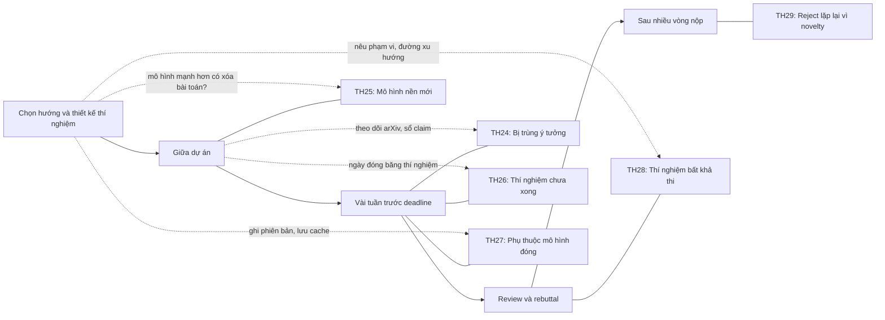

# Áp lực từ bên ngoài

!!! abstract "Mục tiêu của bài"
    Sau bài này, người học có thể:

    - Đánh giá mức độ trùng lặp khi bị một nhóm khác công bố trước, xác định phần đóng góp còn cứu được, và viết lại Introduction cùng Related Work cho đúng với thực tế mới.
    - Kiểm tra xem bài toán có còn tồn tại khi một mô hình nền mới xuất hiện, rồi chọn giữa định vị lại, chuyển sang phân tích hoặc hiệu quả, và đổi hướng.
    - Cắt claim cho vừa với bằng chứng khi deadline cận kề, xếp thứ tự thí nghiệm theo giá trị thông tin, và quyết định nộp ngay hay chờ đợt sau.
    - Tổ chức thí nghiệm dùng API hoặc mô hình đóng sao cho kết quả vẫn kiểm chứng được.
    - Trả lời yêu cầu thí nghiệm bất khả thi của reviewer, và chẩn đoán đúng ý nghĩa thật của lời phê "thiếu novelty" lặp lại qua nhiều vòng.

Bốn bài trước của chương này xem xét những mâu thuẫn nảy sinh *bên trong* một dự án: novelty kéo một hướng còn con số kéo hướng khác, nhiều thành phần cùng chạy mà không rõ cái gì tạo ra kết quả, câu chuyện đã viết không còn khớp với bằng chứng thu được. Trong những tình huống đó, nhóm tác giả nắm trong tay mọi dữ kiện; cái khó nằm ở cách đọc và cách trình bày chúng. Bài này chuyển sang một loại tình huống khác, khi áp lực đến từ những thứ nằm ngoài tầm kiểm soát của nhóm. Một nhóm khác công bố đúng ý tưởng đang làm. Một phòng thí nghiệm lớn phát hành mô hình nền giải được bài toán mà nhóm đã theo đuổi nhiều tháng. Lịch hội nghị không lùi lại vì thí nghiệm chạy chậm. Nhà cung cấp API thay đổi mô hình mà không báo trước. Reviewer yêu cầu một thí nghiệm vượt quá khả năng của hầu hết các phòng thí nghiệm đại học. Và sau ba lần nộp, cùng một lời phê "thiếu novelty" vẫn quay lại.

Điểm chung của sáu tình huống là nguồn gốc của áp lực nằm ngoài tầm tay, còn cách phản ứng thì không. Chính vì không kiểm soát được nguồn gốc, người viết dễ bù đắp bằng những gì kiểm soát được, và đó là chỗ sai lầm xuất hiện: lờ đi công trình của nhóm kia, so sánh với một phiên bản bị làm yếu của mô hình mới, điền vào bảng con số của một run chưa chạy xong, hay hứa với reviewer một thí nghiệm không bao giờ làm được. Nguyên tắc xuyên suốt của chương vẫn áp dụng ở đây: paper bán hiểu biết chứ không bán phương pháp. Khi một yếu tố bên ngoài lấy đi phần "phương pháp mới" hay phần "con số tốt nhất", câu hỏi đúng không phải là làm sao giữ chúng lại bằng mọi giá, mà là hiểu biết nào của dự án vẫn còn đứng được, và cần bằng chứng gì để bảo vệ nó.

Các tình huống được sắp gần đúng theo trình tự thời gian của một dự án. Hai tình huống đầu thường bùng phát giữa chừng hoặc sát deadline, hai tình huống tiếp theo thuộc giai đoạn hoàn thiện thí nghiệm, một tình huống thuộc giai đoạn rebuttal, và tình huống cuối cùng chỉ lộ ra sau nhiều vòng nộp. Mục tổng hợp ở cuối bài đặt cả sáu lên cùng một trục thời gian, kèm những việc có thể làm từ sớm để phòng ngừa.

## Tình huống 24: Bị trùng ý tưởng khi còn vài tuần đến deadline

### Nhận diện

Một nhóm tác giả trong mảng Computer Vision đã làm tám tháng về test-time adaptation cho phân đoạn ngữ nghĩa trên video lái xe (ví dụ giả định). Ý tưởng chính là dùng sự nhất quán theo thời gian giữa các frame liên tiếp làm tín hiệu tự giám sát, và chỉ cập nhật một tập nhỏ tham số được chọn theo một tiêu chí ổn định. Kết quả trên ba benchmark đã có, bản nháp đã xong hai phần ba, và còn khoảng năm tuần đến deadline. Một buổi sáng, một thành viên của nhóm thấy trên arXiv một preprint mới với tiêu đề gần như trùng khớp; abstract mô tả đúng việc dùng nhất quán thời gian làm tín hiệu thích nghi lúc kiểm thử, và hai trong ba benchmark trùng với của nhóm.

Hiện tượng này thường được gọi là bị *scooped*: một nhóm khác công bố trước ý tưởng mà nhóm tác giả đang theo đuổi. Dấu hiệu thường rõ ràng: một preprint hoặc paper công khai mô tả cùng cơ chế cốt lõi cho cùng bài toán, thường trên cùng benchmark. Cũng có những biến thể kín đáo hơn: một đồng nghiệp gửi đường link kèm câu hỏi "có phải giống hướng của nhóm không?", một bài nói ở hội thảo trình bày kết quả tương tự trước khi có paper, hoặc reviewer chỉ ra một công trình mà nhóm chưa từng thấy. Mục *Concurrent work* trong bài [Thẩm định ý tưởng](../01-truoc-khi-viet/y-tuong.md) đã nêu khung xử lý ba bước và tinh thần chung của các quy định hội nghị. Ở đây chúng ta đi sâu vào những câu hỏi mà khung đó mới chạm tới: trùng đến mức nào, phần nào còn cứu được, viết lại ra sao, và xử lý các biến thể như reviewer dẫn một paper ra đời sau deadline hay quyết định đưa bản thảo lên arXiv sớm.

### Chẩn đoán

Bị trùng ý tưởng hiếm khi chỉ là chuyện xui rủi. Trong một lĩnh vực phát triển nhanh, khi một công cụ mới xuất hiện (một mô hình nền, một benchmark, một kỹ thuật huấn luyện), bước đi hợp lý tiếp theo thường hiện ra cùng lúc trước mắt nhiều nhóm. Ý tưởng càng tự nhiên, khả năng có nhóm khác làm song song càng cao. Vì vậy, phản ứng đầu tiên nên là đo đạc, không phải hoảng loạn.

Việc đo đạc bắt đầu bằng đọc toàn văn paper kia, rồi so sánh theo năm chiều: bài toán và giả định, cơ chế cốt lõi, thiết lập thí nghiệm, kết quả, và hiểu biết hay phân tích đi kèm. Từ bảng so sánh đó có thể xếp mức độ trùng vào một trong ba nhóm. **Trùng một phần** là khi hai công trình chung bài toán nhưng khác cơ chế, hoặc chung cơ chế nhưng áp dụng cho một bài toán hay thiết lập khác hẳn. **Trùng gần hết** là khi cơ chế cốt lõi và bài toán giống nhau, còn khác biệt nằm ở chi tiết thiết kế, quy mô, phạm vi đánh giá hoặc chiều sâu phân tích. **Trùng hoàn toàn** là khi cơ chế, thiết lập và kết quả đều tương đương, phần khác nhau chỉ còn là chi tiết cài đặt. Trong ví dụ trên, nếu paper kia cập nhật toàn bộ các lớp chuẩn hóa ở mỗi frame còn nhóm tác giả chỉ cập nhật một tập nhỏ, và chính khác biệt này quyết định độ bền trên chuỗi video dài, thì đó là trùng gần hết chứ chưa phải trùng hoàn toàn.

Câu hỏi tiếp theo là phần nào còn cứu được. Một phép thử hữu ích: giả sử người đọc đã đọc paper kia, họ sẽ học thêm được điều gì từ paper của nhóm? Câu trả lời chính là phần novelty còn lại, vì novelty là lượng hiểu biết mới mà người đọc nhận được. Phần đó có thể là một thiết lập nơi hai cách tiếp cận cho kết quả khác nhau, một phân tích giải thích vì sao cơ chế hoạt động, một phát hiện trái chiều (một lựa chọn thiết kế của paper kia hóa ra không cần thiết hoặc gây hại), một đánh giá rộng hơn hẳn, hay một lợi thế rõ rệt về chi phí. Nếu câu trả lời duy nhất là "nhóm cũng làm được điều đó", phần còn lại rất mỏng.

Ngoài ra còn ba dữ kiện thực tế cần xác định. Thứ nhất, công trình kia xuất hiện công khai khi nào so với deadline, và đã qua bình duyệt hay mới là preprint; quy định về concurrent work dựa trên chính những yếu tố này, và chi tiết của chúng khác nhau giữa các hội nghị và theo năm, nên phải đọc Call for Papers và Reviewer Guidelines của năm nộp. Thứ hai, code của họ có công khai không, và có đủ thời gian chạy lại trong thiết lập của nhóm không. Thứ ba, khối lượng viết lại ước tính là bao nhiêu so với số tuần còn lại.

!!! note "Hai nhóm độc lập cùng đi tới một ý tưởng"
    Lịch sử khoa học có nhiều trường hợp phát hiện độc lập gần như đồng thời, chẳng hạn Newton và Leibniz với phép tính vi tích phân, hay Darwin và Wallace với thuyết chọn lọc tự nhiên. Hiện tượng này cho thấy ý tưởng đã "chín" trong bối cảnh tri thức của thời điểm đó. Với nhóm tác giả, việc một nhóm khác đi tới cùng ý tưởng là bằng chứng rằng hướng đi đúng và kịp thời, rằng cộng đồng sẽ thấy bài toán quan trọng, và rằng khả năng chọn hướng của nhóm đã được hiệu chỉnh tốt. Cảm giác mất mát là có thật, nhưng nó không nên che khuất thông tin tích cực này.

### Các lối ra

**Lối ra thứ nhất: giữ hướng và làm rõ khác biệt.** Lối ra này phù hợp với trường hợp trùng một phần, khi cơ chế hoặc thiết lập khác nhau một cách thực chất và khác biệt đó thể hiện trong kết quả. Bằng chứng lý tưởng là một thí nghiệm cho thấy khác biệt có ý nghĩa ở đâu, chẳng hạn trong thiết lập mà giả định của paper kia không còn đúng. Nếu không kịp chạy lại phương pháp của họ, tối thiểu cần một so sánh khái niệm chính xác, công bằng, và nêu rõ rằng so sánh thực nghiệm chưa được thực hiện. Lối ra này không phù hợp khi khác biệt chỉ là cách gọi tên hay một chi tiết cài đặt.

**Lối ra thứ hai: dịch trọng tâm sang phần chỉ nhóm mới có.** Với trường hợp trùng gần hết, ý tưởng cốt lõi giờ đã là của chung, nên đóng góp chính phải chuyển sang phần còn lại: một phân tích cơ chế, một thiết lập rộng hơn, một phát hiện về khi nào phương pháp hoạt động và khi nào thất bại, hoặc một xác nhận độc lập ở quy mô lớn hơn. Việc dịch trọng tâm thường kéo theo đổi giọng của paper, từ "we propose" sang "we study" hay "we show". Phép thử để biết lối ra này có khả thi không: nếu paper kia đã được công bố từ một năm trước, paper của nhóm sau khi dịch trọng tâm có còn đủ sức ở hội nghị mục tiêu không? Nếu có, main track vẫn là đích hợp lý. Nếu phần còn lại có giá trị nhưng mỏng hơn, các hình thức như Findings (với các hội nghị dùng ACL Rolling Review), workshop, hay TMLR, nơi tiêu chí chính là claim được bằng chứng ủng hộ chặt chẽ và có người quan tâm, thường phù hợp hơn.

**Lối ra thứ ba: nộp như công trình đồng thời.** Khi paper kia xuất hiện rất sát deadline và hai công trình thực chất được phát triển song song, nhóm có thể đẩy nhanh tiến độ và nộp bài, với phần thảo luận rõ ràng về công trình đồng thời. Quy định của nhiều hội nghị không đòi hỏi so sánh thực nghiệm với công trình đồng thời, nhưng điều này không bảo đảm reviewer sẽ không coi paper thiếu novelty; nhóm nên chuẩn bị sẵn lập luận cho rebuttal. Nên lưu giữ những dấu vết nội bộ về tiến trình dự án (lịch sử commit, báo cáo nhóm), không phải để đính kèm vào bản nộp ẩn danh, mà để dùng nếu hiếm hoi có tranh chấp về tính độc lập.

**Lối ra thứ tư: dừng, thu hoạch và đổi hướng.** Khi trùng hoàn toàn, nhất là khi công trình kia đã qua bình duyệt, tiếp tục theo đuổi cùng câu hỏi là đặt cược vào việc reviewer không biết paper đó, một canh bạc vừa thấp về xác suất vừa sai về nguyên tắc. Dừng lại không có nghĩa là mất trắng. Code và hạ tầng thí nghiệm vẫn còn; những kết quả âm tính hay quan sát phụ có thể trở thành điểm khởi đầu cho câu hỏi tiếp theo; và paper kia, bằng cách xác nhận hướng đi, mở ra một loạt câu hỏi tiếp nối mà nhóm có lợi thế xuất phát vì đã có hệ thống chạy được. Chi phí đã bỏ ra không phải là lý do để tiếp tục.

Đi kèm mọi lối ra trên là câu hỏi có nên đưa bản thảo lên arXiv sớm hay không. Lợi ích của việc này là có một mốc thời gian công khai cho thấy công trình được phát triển độc lập, công trình được cộng đồng biết tới sớm hơn chu kỳ review, nhóm nhận được phản hồi, và rủi ro bị trùng thêm lần nữa giảm đi. Nhưng cũng có những bất lợi đáng kể. Chính sách về preprint trong thời gian review khác nhau giữa các hội nghị và đã thay đổi qua các năm, nên phải kiểm tra trong Call for Papers của năm nộp (xem mục về preprint trong bài [Chuẩn bị nộp bài](../04-nop-va-sau-nop/submission.md)). Một preprint viết vội sẽ tồn tại vĩnh viễn, kèm mọi lỗi và claim chưa chín. Nó cũng phơi ý tưởng ra trước những nhóm có nhiều tài nguyên hơn, có thể mở rộng nhanh hơn. Và mốc thời gian trên arXiv không quyết định cách reviewer đánh giá: họ chấm nội dung, không chấm ngày đăng. Quy tắc thực hành là chỉ đưa lên arXiv phiên bản mà nhóm sẵn sàng để cộng đồng đọc và trích dẫn.

### Viết thế nào

Khi một công trình rất gần đã tồn tại, nó cần xuất hiện ngay trong Introduction, không chỉ ở cuối Related Work. Lý do là reviewer biết paper kia sẽ tìm nó trước tiên; nếu phải đọc tới trang thứ ba mới thấy, họ dễ cho rằng nhóm tác giả né tránh. Danh sách đóng góp cũng phải viết lại: mọi claim kiểu "the first" bị loại bỏ, thay bằng khác biệt cụ thể có bằng chứng đi kèm. Trong Related Work, một đoạn riêng mô tả phương pháp của nhóm kia theo cách mà chính họ sẽ thừa nhận là đúng, rồi mới nêu khác biệt và chỉ tới bằng chứng.

<div class="bad" markdown>
*"We are the first to exploit temporal consistency as a test-time adaptation signal for semantic segmentation."*

Claim "the first" giờ đã sai hoặc ít nhất là gây tranh cãi; reviewer biết paper kia sẽ mất lòng tin vào toàn bộ phần còn lại.
</div>

<div class="good" markdown>
*"Concurrently with our work, X et al. [12] also use temporal consistency as a test-time signal. While they update all normalization layers at every frame, we find that this causes drift on long sequences, and that restricting adaptation to a small set of parameters selected by a stability criterion avoids it (Sec. 5.2). We further evaluate night and rain conditions, where the two approaches differ most."*

Câu này thừa nhận sự trùng lặp ngay từ đầu, mô tả công trình kia một cách khách quan, và chuyển trọng tâm sang hiểu biết riêng có bằng chứng.
</div>

Một biến thể thường gặp là reviewer dẫn một paper xuất hiện *sau* deadline nộp bài và coi đó là bằng chứng thiếu novelty. Trước khi trả lời, cần kiểm tra ngày xuất hiện công khai đầu tiên của paper đó (phiên bản arXiv đầu tiên, hoặc ngày công bố chính thức). Nếu nó thực sự ra đời sau deadline, câu trả lời nên lịch sự nêu sự thật này, dẫn quy định của hội nghị nếu có, nhưng vẫn thể hiện sự quan tâm tới nội dung, vì AC muốn thấy nhóm tác giả hiểu mối quan hệ giữa hai công trình. Cấu trúc chung của rebuttal đã được trình bày ở bài [Rebuttal và thảo luận](../04-nop-va-sau-nop/rebuttal.md); ở đây chỉ cần một đoạn cụ thể.

<div class="bad" markdown>
*"[A] appeared after our submission, so this comment is irrelevant."*

Câu trả lời đúng về thời gian nhưng gạt bỏ reviewer, và không cho AC thấy nhóm tác giả hiểu khác biệt giữa hai công trình.
</div>

<div class="good" markdown>
*"We thank the reviewer for pointing us to [A]. We note that [A] first appeared on arXiv on <date>, after the submission deadline, and was not available to us when preparing this work; per the conference guidelines on contemporaneous work, we understand that a full experimental comparison is not expected. We will nevertheless cite [A] and discuss the differences: [A] ..., whereas we ...."*

Câu trả lời nêu sự thật có thể kiểm chứng, dựa vào quy định thay vì cảm xúc, và vẫn chủ động thảo luận nội dung.
</div>

Phản ứng của reviewer có khác nhau đôi chút giữa các cộng đồng, chủ yếu do cơ chế review. Ở các hội nghị có review và thảo luận công khai trên OpenReview, như ICLR, người ngoài cũng có thể bình luận chỉ ra công trình gần, nên phần thảo luận concurrent work cần chặt chẽ ngay từ bản nộp. Với ACL Rolling Review, nếu bị trùng giữa hai chu kỳ, revision notes của lần nộp lại phải nói rõ paper đã điều chỉnh thế nào trước công trình mới. Ở Computer Vision, rebuttal chỉ có một trang, nên đoạn trả lời về concurrent work phải ngắn và dựa trên một hai khác biệt mạnh nhất.

### Điều không được làm

Không được lờ đi một công trình mà nhóm đã biết, kể cả khi quy định không bắt buộc so sánh. Không được mô tả phương pháp của nhóm kia một cách méo mó để khác biệt trông lớn hơn. Không được tự nhận "the first" hay khẳng định một mốc thời gian không chứng minh được. Không nên vội đưa lên arXiv một bản thảo dang dở chỉ để "cắm cờ", vì những claim chưa có bằng chứng sẽ theo nhóm mãi về sau. Nếu một thành viên được phân công review chính paper của nhóm kia, phải khai báo xung đột lợi ích và không dùng vai trò reviewer để trì hoãn hay hạ thấp công trình cạnh tranh. Ranh giới chung giữa trình bày có lợi và bóp méo được bàn ở bài [Ranh giới trung thực](ranh-gioi-trung-thuc.md).

## Tình huống 25: Mô hình nền mới khiến bài toán trở nên lỗi thời

### Nhận diện

Một nhóm NLP đã làm gần một năm về hỏi đáp trên văn bản dài (ví dụ giả định). Phương pháp của nhóm chia tài liệu thành các đoạn, truy xuất những đoạn liên quan, rồi tổng hợp câu trả lời bằng một mô hình ngôn ngữ cỡ vừa; kết quả vượt ổn định các baseline đã công bố. Bốn tháng trước deadline, một mô hình nền mới được phát hành, với cửa sổ ngữ cảnh dài hơn hẳn và khả năng suy luận mạnh. Một thử nghiệm nhanh cho thấy nó vượt phương pháp của nhóm trên benchmark chính mà không cần huấn luyện thêm.

Tình huống này không riêng gì NLP. Ở Computer Vision, sự xuất hiện của các mô hình phân đoạn có thể điều khiển bằng prompt, như Segment Anything (xem case study [Segment Anything và ControlNet](../05-case-studies/sam-controlnet.md)), từng khiến nhiều nhóm làm phân đoạn tương tác chuyên biệt phải tự hỏi công trình của họ còn chỗ đứng không. Ở Machine Learning, một mô hình pre-train quy mô lớn có thể làm lu mờ một kiến trúc được thiết kế riêng cho một miền. Dấu hiệu chung rất dễ thấy: một mô hình tổng quát mới đạt kết quả ngang hoặc vượt phương pháp chuyên biệt của nhóm, người hướng dẫn hay đồng nghiệp hỏi "sao không dùng luôn mô hình X?", và nhóm biết chắc reviewer cũng sẽ hỏi đúng câu đó.

### Chẩn đoán

Đây là một hiện tượng có tính cấu trúc của ngành chứ không phải sự cố hiếm gặp. Các mô hình tổng quát được huấn luyện ở quy mô lớn định kỳ "hấp thụ" những bài toán từng cần giải pháp riêng. ViT đã cho thấy khi dữ liệu pre-training đủ lớn, inductive bias của convolution trở nên kém cần thiết; GPT-3 cho thấy in-context learning xuất hiện khi scale, khiến nhiều tác vụ không còn cần huấn luyện riêng. Người làm nghiên cứu trong giai đoạn hiện nay nên coi khả năng này là một rủi ro thường trực của mọi dự án.

Tuy vậy, "giải được benchmark" không đồng nghĩa với "giải được bài toán". Câu hỏi chẩn đoán đầu tiên là **vấn đề có còn tồn tại không**. Cần kiểm tra mô hình mới trên những tập con khó (tài liệu dài vượt ngưỡng ngữ cảnh hiệu dụng, câu hỏi cần ghép bằng chứng từ nhiều đoạn), trên ngôn ngữ ít tài nguyên hay miền chuyên biệt, và dưới các ràng buộc triển khai như chi phí, độ trễ, quyền riêng tư hay chạy trên thiết bị. Cũng cần hỏi liệu benchmark có thể đã lọt vào dữ liệu huấn luyện của mô hình mới không, nhất là khi benchmark được công bố trước thời điểm cắt dữ liệu của mô hình.

Câu hỏi thứ hai là **mô hình mới được đánh giá đã đúng cách chưa**. Một thử nghiệm nhanh với một prompt duy nhất không đủ để kết luận theo chiều nào. Mô hình mới cần được đánh giá theo cùng giao thức với các phương pháp khác, với vài cách viết prompt, kèm chi phí trên mỗi truy vấn. Nếu đó là mô hình đóng chỉ truy cập qua API, các vấn đề của Tình huống 27 bên dưới cũng áp dụng.

Câu hỏi thứ ba là **cơ chế của nhóm có còn tạo ra giá trị khi đặt lên trên mô hình mới không**. Nếu áp dụng phương pháp lên mô hình mới vẫn cải thiện kết quả, hoặc giảm đáng kể chi phí mà giữ được chất lượng, phương pháp có vai trò bổ trợ. Nếu cải thiện biến mất, cần trung thực thừa nhận điều đó. Cuối cùng là câu hỏi về thời điểm: quy định về concurrent work thường nói về paper, còn với một mô hình vừa phát hành sát deadline, kỳ vọng của reviewer khó đoán hơn, nên ít nhất cần có thảo luận về mô hình đó trong paper.

### Các lối ra

**Lối ra thứ nhất: định vị phương pháp như phần bổ trợ cho mô hình mới.** Lối ra này phù hợp khi cơ chế của nhóm trực giao với sức mạnh của mô hình nền, chẳng hạn bước truy xuất giúp mô hình mới xử lý được tài liệu vượt ngữ cảnh, hoặc giảm số token cần xử lý. Bằng chứng bắt buộc là thí nghiệm với chính mô hình mới làm nền, cho thấy phương pháp vẫn cộng thêm giá trị. Một claim "complementary" không có thí nghiệm như vậy sẽ bị reviewer bác bỏ ngay. Lối ra này không phù hợp khi cải thiện biến mất trên nền mạnh.

**Lối ra thứ hai: chuyển sang phân tích.** Hạ tầng mà nhóm đã xây dựng, gồm benchmark, các tập con khó, công cụ chẩn đoán, có thể được dùng để nghiên cứu mô hình mới thành công ở đâu, thất bại ở đâu và vì sao. Đóng góp khi đó trở thành hiểu biết, phù hợp với tinh thần "paper bán hiểu biết". Lối ra này cần phân tích có hệ thống với các biến được kiểm soát, không phải một tập ví dụ thất bại được chọn lọc. Các paper phân tích được chấp nhận ở main track của cả ba cộng đồng, và cũng phù hợp với Findings hay TMLR khi phạm vi khiêm tốn hơn.

**Lối ra thứ ba: chuyển sang hướng hiệu quả cho mô hình nhỏ.** Khi mô hình mới thắng nhưng đắt, đóng hoặc không chạy được trong điều kiện triển khai thực tế, một phương pháp giúp mô hình nhỏ và mở tiến gần tới nó trong một ngân sách cố định có giá trị riêng: cho ngôn ngữ ít tài nguyên, cho môi trường cần bảo mật dữ liệu, cho thiết bị biên. Paper "Cramming" của Geiping và Goldstein (ICML 2023) là một ví dụ về việc biến ràng buộc tài nguyên thành chính câu hỏi nghiên cứu. Bằng chứng cần thiết là một so sánh trung thực trên đường cong chất lượng theo chi phí, nêu rõ khoảng cách còn lại với mô hình lớn. Lối ra này không phù hợp khi khoảng cách quá lớn tới mức mô hình nhỏ không hữu ích ở bất kỳ ngân sách nào.

**Lối ra thứ tư: đổi hướng.** Nếu sau khi chẩn đoán kỹ, mô hình mới giải được bài toán ở mọi chế độ quan trọng với chi phí chấp nhận được, thì câu hỏi của dự án đã được trả lời, dù bởi người khác. Khi đó, tiếp tục là đầu tư vào một paper mà reviewer sẽ coi là lỗi thời. Phần thu hoạch vẫn có thể đáng kể: benchmark có thể trở thành một đóng góp riêng nếu nó còn phân biệt được các mô hình mạnh (ví dụ ở Datasets and Benchmarks Track của NeurIPS), và những hiểu biết về bài toán giúp nhóm chọn câu hỏi tiếp theo tốt hơn.

### Viết thế nào

Nguyên tắc quan trọng nhất là đối diện trực tiếp với mô hình mới ngay trong Introduction. Reviewer đọc paper trong bối cảnh của thời điểm review, không phải của thời điểm dự án bắt đầu; một paper chỉ so sánh với các baseline cũ sẽ bị hỏi "why not just use X?" và câu hỏi đó thường đủ để dẫn tới reject.

<div class="bad" markdown>
*"Our method outperforms all prior approaches on LongQA by a large margin."*

Câu này bỏ qua mô hình nền mới mà mọi reviewer đều biết; "all prior approaches" trở thành một claim sai trên thực tế.
</div>

<div class="good" markdown>
*"Recent general-purpose models such as [X] solve most LongQA questions zero-shot, but their accuracy drops sharply on documents longer than their effective context and on questions that require combining evidence from many passages (Sec. 4.1). Applied on top of [X], our retrieval step recovers most of this loss while reducing the number of processed tokens (Tab. 3)."*

Câu này thừa nhận sức mạnh của mô hình mới, chỉ ra chính xác chế độ mà vấn đề còn tồn tại, và đặt phương pháp vào vai trò bổ trợ có bằng chứng.
</div>

Mức độ nhạy cảm với câu hỏi "sao không dùng mô hình nền?" khác nhau giữa các cộng đồng. Ở NLP, câu hỏi về một baseline là mô hình ngôn ngữ lớn được prompt tốt gần như đã trở thành mặc định, và reviewer ARR thường yêu cầu hoặc baseline đó, hoặc một lý do rõ ràng vì sao không thể có. Ở Computer Vision, reviewer thường chấp nhận khung "chuyên biệt và hiệu quả" nếu lợi thế về chi phí hoặc độ chính xác ở miền hẹp được định lượng rõ. Ở Machine Learning, câu hỏi thường chuyển thành liệu hiểu biết của paper có còn đúng khi mô hình lớn hơn, nên một thí nghiệm theo nhiều kích thước mô hình có sức thuyết phục lớn.

### Điều không được làm

Không được bỏ mô hình mới khỏi phần so sánh khi nó đã có sẵn và liên quan trực tiếp. Không được làm yếu nó một cách có chủ ý, chẳng hạn dùng một prompt kém hay cấu hình sai, để phương pháp của nhóm trông tốt hơn. Không được tuyên bố phương pháp "bổ trợ" khi chưa chạy thí nghiệm chứng minh. Cũng không được chọn các chế độ mà mô hình mới thất bại *sau khi* thấy kết quả, rồi trình bày như thể đó là động cơ ban đầu của dự án; đó là một dạng HARKing (Kerr, 1998). Việc tìm chế độ mà vấn đề còn tồn tại là hợp lệ khi chế độ đó quan trọng với người dùng thực, và khi paper nói rõ nó được xác định như thế nào. Ranh giới này được bàn kỹ ở bài [Ranh giới trung thực](ranh-gioi-trung-thuc.md).

## Tình huống 26: Deadline cận kề mà thí nghiệm chưa xong

### Nhận diện

Một nhóm Machine Learning đề xuất một cách điều chỉnh learning rate theo từng lớp cho huấn luyện Transformer (ví dụ giả định). Còn mười hai ngày đến deadline. Kết quả chính trên hai benchmark nhỏ đã đủ ba seed. Trên benchmark lớn nhất mới có một seed, và seed thứ hai đang chạy được hơn nửa lịch huấn luyện. Thí nghiệm với mô hình lớn hơn, vốn được hứa trong abstract nháp, chưa bắt đầu. Ablation mới xong hai trên bốn thành phần. So sánh với baseline mạnh nhất đang dùng con số được báo cáo trong paper gốc, với một cấu hình huấn luyện khác cấu hình của nhóm.

Những dấu hiệu của tình huống này rất quen thuộc: bảng kết quả còn ô trống, bản nháp còn những chỗ ghi "TODO", abstract được viết trước khi có bằng chứng, và nhóm tranh luận mỗi ngày về việc nên chạy thêm hay nên ngồi viết.

### Chẩn đoán

Nguyên nhân thường là sự kết hợp của ba yếu tố. Ước lượng thời gian chạy hầu như luôn thiếu, vì không tính tới hàng đợi GPU, lỗi phải chạy lại và những thí nghiệm phát sinh khi câu chuyện thay đổi. Abstract và danh sách đóng góp được viết từ kỳ vọng thay vì từ kết quả. Và áp lực tốc độ của cả ngành, như Sculley và cộng sự đã phân tích trong "Winner's Curse? On Pace, Progress, and Empirical Rigor", đẩy các nhóm tới việc hy sinh sự chặt chẽ để kịp chu kỳ. Nhận ra rằng áp lực mang tính hệ thống giúp nhóm tác giả bình tĩnh hơn: đây không phải là lỗi của riêng ai, nhưng cách xử lý vẫn là trách nhiệm của nhóm. Phần lớn các nguyên nhân trên phòng ngừa được từ khâu lập kế hoạch: xếp thí nghiệm theo thứ tự giảm rủi ro, đặt mốc và cổng quyết định, dự trù ngân sách compute có phần dự phòng, và viết sẵn kế hoạch B, như bài [Lập kế hoạch nghiên cứu](../01-truoc-khi-viet/ke-hoach.md) trình bày. Phần còn lại của mục này bàn việc cần làm khi những phòng ngừa đó đã không đủ.

Bước chẩn đoán cốt lõi là liệt kê mọi claim trong abstract, Introduction và danh sách đóng góp, rồi phân loại từng claim theo mức bằng chứng hiện có. Ở **mức A**, bằng chứng đầy đủ: mọi dataset dự định, đủ seed, baseline được chạy trong cùng điều kiện. Ở **mức B**, bằng chứng một phần: hướng của kết quả rõ ràng nhưng ít seed hơn, trên tập con, hoặc ở quy mô nhỏ hơn dự định. Ở **mức C**, chỉ có tín hiệu: một pilot, một run duy nhất, một đường cong huấn luyện dang dở. Ở **mức D**, chưa có bằng chứng nào. Song song với việc phân loại, cần xác định claim nào là trung tâm, tức paper sụp đổ nếu claim đó sai, và claim nào chỉ là phụ.

Cần thận trọng với mức B và C trong những thiết lập có phương sai lớn. Henderson và cộng sự, trong "Deep Reinforcement Learning that Matters", đã cho thấy kết quả deep RL có thể thay đổi đáng kể chỉ vì seed hay chi tiết cài đặt. Một kết quả một seed trong thiết lập như vậy yếu hơn nhiều so với vẻ ngoài của nó. Câu hỏi cuối cùng cho mỗi thí nghiệm còn thiếu là: nếu kết quả ra theo chiều ngược lại, claim nào sẽ phải thay đổi? Thí nghiệm mà kết quả không làm thay đổi gì là thí nghiệm có giá trị thông tin thấp.

| Mức bằng chứng | Ví dụ | Cách xử lý trong bản nộp |
|---|---|---|
| A: đầy đủ | Đủ seed, đủ dataset, baseline cùng điều kiện | Giữ nguyên claim |
| B: một phần | Hai seed thay vì năm; tập con của benchmark | Giữ claim, nêu rõ phạm vi và độ bất định |
| C: tín hiệu | Một run, một pilot đã hoàn tất | Chuyển thành quan sát sơ bộ trong phần phân tích hoặc Limitations, hoặc bỏ |
| D: chưa có | Thí nghiệm chưa chạy | Bỏ khỏi abstract, Introduction và danh sách đóng góp |

### Các lối ra

**Lối ra thứ nhất: cắt claim cho vừa với bằng chứng.** Đây là bước luôn cần làm, bất kể quyết định cuối cùng là gì. Bảng trên cho thấy cách xử lý từng mức. Điều đáng chú ý là việc cắt claim thường làm paper mạnh lên chứ không yếu đi: mỗi claim được liệt kê là một mặt trận phải bảo vệ, và một paper có ba claim vững chắc khó bị tấn công hơn một paper có năm claim, trong đó hai claim treo lơ lửng. Trong ví dụ trên, claim "scales to larger models" bị cắt và thay bằng một câu nêu phạm vi kích thước đã kiểm chứng.

**Lối ra thứ hai: xếp thứ tự thí nghiệm theo giá trị thông tin trên thời gian chạy.** Với thời gian còn lại, mỗi thí nghiệm được đánh giá theo hai đại lượng: nó có thể làm thay đổi claim trung tâm đến mức nào, và nó cần bao lâu để chạy xong, kể cả phần dự phòng cho lỗi và hàng đợi. Thứ tự hợp lý thường là: thí nghiệm có thể làm sụp claim trung tâm; tiếp theo là thí nghiệm reviewer chắc chắn sẽ hỏi, như baseline mạnh nhất trong cùng cấu hình; sau đó là ablation của thành phần chính; cuối cùng là dataset bổ sung. Nhiều run ngắn có thông tin thường đáng giá hơn một run dài có nguy cơ không kịp. Nhóm nên đặt một ngày "đóng băng thí nghiệm" vài ngày trước deadline, sau ngày đó chỉ viết. Cũng nên quyết định *trước khi* xem kết quả rằng run nào sẽ được báo cáo và kết quả nào sẽ khiến claim bị điều chỉnh; Gelman và Loken gọi tập hợp những lựa chọn phân tích không được khai báo là "khu vườn rẽ nhánh" (*garden of forking paths*), và chúng làm sai lệch kết luận ngay cả khi không ai cố ý (xem bài [Ranh giới trung thực](ranh-gioi-trung-thuc.md)).

**Lối ra thứ ba: quyết định nộp bây giờ hay chờ đợt sau.** Tiêu chí quyết định nên được viết ra và thảo luận với người hướng dẫn. Câu hỏi đầu tiên là sau khi cắt claim, paper còn lại có phải một paper hoàn chỉnh không, tức là người đọc vẫn học được một điều mới có bằng chứng ở mức A hoặc B vững. Câu hỏi thứ hai là phần còn thiếu có phải thứ reviewer chắc chắn đòi hỏi không; nếu thiếu đúng baseline quan trọng nhất, một lần reject với review đoán trước được là gần như chắc chắn. Câu hỏi thứ ba là chi phí của một lần nộp non: công sức của reviewer, khả năng gặp lại cùng reviewer ở venue sau với ấn tượng xấu, và những dấu vết công khai như trang OpenReview của paper bị reject ở ICLR hay review cũ đi kèm khi nộp lại vào ARR. Câu hỏi thứ tư là venue tiếp theo cách bao xa và có phù hợp không (các lộ trình được vẽ ở bài [Khi bị reject](../04-nop-va-sau-nop/reject.md)); với ARR, vì có nhiều chu kỳ trong năm, chi phí chờ thường thấp hơn. Câu hỏi cuối là rủi ro bị trùng nếu chờ, vốn cao hơn trong các lĩnh vực nóng; nhưng một bản nộp non không bảo vệ được quyền ưu tiên, vì cộng đồng ghi nhận phiên bản thuyết phục chứ không phải phiên bản sớm nhất. Nộp một paper rõ ràng chưa hoàn chỉnh chỉ để "lấy review" bị nhiều người trong cộng đồng coi là dùng công sức reviewer một cách thiếu trách nhiệm.

**Lối ra thứ tư: dùng đúng deadline của tài liệu bổ sung.** Ở một số hội nghị, tài liệu bổ sung có deadline riêng, muộn hơn deadline của paper chính; ở những nơi khác, appendix nằm cùng file PDF và chung deadline. Khi có deadline muộn hơn, khoảng thời gian đó dành cho video, hình minh họa, chi tiết cài đặt và những phân tích bổ trợ, không dành cho việc hoàn thành thí nghiệm mà paper chính phụ thuộc vào. Lý do là paper chính phải tự đứng vững: reviewer không có nghĩa vụ đọc tài liệu bổ sung, và claim trong paper chính được chấm theo bằng chứng có trong paper chính.

!!! warning "Đọc kỹ Call for Papers về từng mốc deadline"
    Abstract registration, full paper, supplementary material và các checklist có thể có những mốc khác nhau, thậm chí khác cả múi giờ. Quy định về việc tài liệu bổ sung được chứa gì cũng thay đổi theo hội nghị và theo năm; đặt vào đó một phiên bản "đã sửa" của paper chính có thể bị coi là vi phạm deadline. Xem mục về lạm dụng tài liệu bổ sung trong bài [Chuẩn bị nộp bài](../04-nop-va-sau-nop/submission.md).

### Viết thế nào

Cách viết khi bằng chứng chưa đầy đủ xoay quanh một nguyên tắc: nêu chính xác những gì đã làm, với phạm vi đã kiểm chứng, và không hứa hẹn những gì chưa có. Một câu nêu phạm vi đặt đúng chỗ, trong phần thiết lập thí nghiệm và trong Limitations, thường được reviewer đánh giá là dấu hiệu của sự cẩn thận.

<div class="bad" markdown>
*"Results on the largest benchmark will be added in the final version."*

Reviewer chỉ chấm những gì có trong bản nộp; câu này vừa thừa nhận paper chưa hoàn chỉnh, vừa đưa ra một lời hứa không ai kiểm chứng được.
</div>

<div class="good" markdown>
*"Due to compute constraints, results on the largest benchmark are averaged over two seeds (five seeds for all other benchmarks); standard deviations are reported in Tab. 2. We evaluate models up to <size> parameters; whether the effect persists at larger scales remains open, as discussed in Sec. 6."*

Câu này nói rõ số seed, nơi báo độ lệch chuẩn và giới hạn kích thước mô hình, nên reviewer biết chính xác mức độ tin cậy của từng kết quả.
</div>

Sự khác biệt giữa các cộng đồng chủ yếu nằm ở chỗ đặt những câu như trên. Ở Machine Learning, NeurIPS Paper Checklist hỏi trực tiếp về ý nghĩa thống kê và tài nguyên tính toán; trả lời "No" kèm lý giải trung thực tốt hơn nhiều so với một câu "Yes" không có cơ sở (xem bài [Viết cho NeurIPS / ICML / ICLR](../06-cong-dong/ml.md)). Ở NLP, mục Limitations bắt buộc của ARR là nơi tự nhiên để nêu việc giảm số seed hay giới hạn quy mô. Ở Computer Vision, nơi tài liệu bổ sung thường có deadline riêng, cần đặc biệt cẩn thận để paper chính không tham chiếu tới một kết quả chưa tồn tại tại thời điểm nộp paper chính.

### Điều không được làm

Không được bịa số, kể cả dưới dạng "số tạm sẽ cập nhật sau". Không được báo cáo một run chưa chạy xong như kết quả cuối cùng, hay lấy một checkpoint giữa chừng vì nó trông đẹp. Nếu một run dang dở thực sự mang thông tin, nó chỉ có thể xuất hiện ngoài bảng chính, được ghi rõ là dang dở, và không được làm cơ sở cho bất kỳ claim nào. Không được viết "results will be added", không để sót các ô giữ chỗ như "xx.x" trong bản nộp, và không báo cáo seed tốt nhất như thể đó là kết quả điển hình. Những ranh giới này được hệ thống hóa ở bài [Ranh giới trung thực](ranh-gioi-trung-thuc.md).

## Tình huống 27: Kết quả phụ thuộc vào API hoặc mô hình đóng

### Nhận diện

Một nhóm làm về phát hiện vật thể với từ vựng mở (open-vocabulary detection) dùng một mô hình đa phương thức đóng qua API để sinh mô tả cho từng vùng ảnh và lọc các cặp ảnh và văn bản nhiễu trong dữ liệu huấn luyện (ví dụ giả định). Chất lượng mô tả sinh ra cũng được chấm bởi một mô hình đóng khác làm giám khảo. Ba tháng sau, khi chạy lại để bổ sung một ablation, nhóm thấy các con số lệch khỏi bản nháp dù code không đổi. Nhà cung cấp đã cập nhật mô hình phía sau cùng một tên gọi, và phiên bản cũ được thông báo sắp ngừng hỗ trợ.

Các dấu hiệu của tình huống này gồm: file cấu hình chỉ ghi tên mô hình chung chung, không có phiên bản kèm ngày; kết quả không lặp lại được khi chạy lại; không có log của từng lần gọi API; không ai biết chính xác tổng chi phí. Cần phân biệt bốn vai trò mà mô hình đóng có thể đảm nhận trong một paper: baseline để so sánh, thành phần của phương pháp, giám khảo trong đánh giá, và nguồn sinh dữ liệu. Rủi ro ở ba vai trò sau nghiêm trọng hơn hẳn vai trò đầu, vì khi đó chính kết quả của paper phụ thuộc vào một hệ thống mà không ai ngoài nhà cung cấp kiểm soát được.

### Chẩn đoán

Kết quả dựa trên mô hình đóng khó tái lập vì bốn lý do. Nhà cung cấp có thể cập nhật mô hình phía sau cùng một tên gọi. Các phiên bản cũ có thể bị ngừng hỗ trợ, khiến việc chạy lại trở nên bất khả thi. Đầu ra thường không được bảo đảm là tất định, kể cả khi cố định các tham số sinh. Và dữ liệu huấn luyện không được công bố, nên không thể loại trừ việc benchmark đã lọt vào đó.

Chen, Zaharia và Zou, trong "How is ChatGPT's behavior changing over time?" (2023, sau đăng ở Harvard Data Science Review), đã đánh giá các phiên bản tháng 3 và tháng 6 năm 2023 của GPT-3.5 và GPT-4 trên nhiều loại tác vụ khác nhau. Họ thấy hành vi và hiệu năng của "cùng một" dịch vụ thay đổi đáng kể chỉ trong vài tháng, có tác vụ tốt lên, có tác vụ kém đi, và một yếu tố chung đứng sau nhiều thay đổi là khả năng làm theo chỉ dẫn. Đáng chú ý, nhóm tác giả công bố toàn bộ prompt và câu trả lời thu được ở cả hai thời điểm, một cách làm đáng học theo.

Từ đó, các câu hỏi chẩn đoán là: mô hình đóng đóng vai trò nào trong paper; claim trung tâm có còn đứng được nếu mô hình thay đổi không; phiên bản cụ thể đã được ghi lại chưa; nhóm có giữ đầu ra thô của mọi lần gọi không; một mô hình mở có thể đảm nhận cùng vai trò không; chi phí tổng cộng là bao nhiêu, và người khác có đủ khả năng tái lập không. Ngoài ra cần đọc điều khoản sử dụng của nhà cung cấp về việc công bố đầu ra hoặc dùng đầu ra để huấn luyện mô hình khác.

### Các lối ra

Với tình huống này, các lối ra mang tính biện pháp hơn là lựa chọn loại trừ nhau, và một paper tốt thường áp dụng gần như tất cả.

**Lối ra thứ nhất: ghi phiên bản và ngày gọi.** Biện pháp này luôn cần thiết và gần như không tốn chi phí nếu làm từ đầu. Cần ghi định danh đầy đủ của mô hình, kể cả phiên bản có ngày nếu nhà cung cấp hỗ trợ, cùng tên phiên bản thực tế mà API trả về nếu có; khoảng ngày thực hiện các lần gọi; mọi tham số sinh; system prompt và các template; cách xử lý lỗi và gọi lại. Khi làm muộn, những thông tin này thường không thể khôi phục.

**Lối ra thứ hai: lưu cache đầu ra.** Mọi cặp yêu cầu và phản hồi nên được lưu lại, với khóa là giá trị băm của mô hình, prompt và tham số. Cache cho phép chạy lại toàn bộ phần phân tích mà không gọi API, trả lời yêu cầu của reviewer từ dữ liệu đã có, và công bố đầu ra để người khác tái lập các bước phía sau ngay cả khi mô hình gốc đã ngừng hoạt động, trong phạm vi điều khoản sử dụng cho phép. Đoạn code dưới đây minh họa một cách làm đơn giản; khi cần nhiều mẫu cho cùng một prompt, chỉ số mẫu nên được thêm vào tham số để mỗi mẫu có khóa riêng.

```python
import hashlib
import json
import time
from pathlib import Path

CACHE_PATH = Path("cache/api_calls.jsonl")


def _load_cache(path):
    cache = {}
    if path.exists():
        with path.open(encoding="utf-8") as f:
            for line in f:
                rec = json.loads(line)
                cache[rec["key"]] = rec
    return cache


_CACHE = _load_cache(CACHE_PATH)


def cached_call(call_fn, model_id, prompt, **params):
    """Call a model at most once per (model_id, prompt, params) and log the call.

    call_fn wraps the provider's client and returns
    (output_text, served_model, usage), where served_model is the exact
    model version reported by the provider (if any) and usage holds token counts.
    """
    payload = {"model_id": model_id, "prompt": prompt, "params": params}
    key = hashlib.sha256(
        json.dumps(payload, sort_keys=True, ensure_ascii=False).encode("utf-8")
    ).hexdigest()
    if key in _CACHE:
        return _CACHE[key]["output"]

    output, served_model, usage = call_fn(model=model_id, prompt=prompt, **params)
    rec = {
        "key": key,
        **payload,
        "served_model": served_model,
        "output": output,
        "usage": usage,
        "called_at_utc": time.strftime("%Y-%m-%dT%H:%M:%SZ", time.gmtime()),
    }
    CACHE_PATH.parent.mkdir(parents=True, exist_ok=True)
    with CACHE_PATH.open("a", encoding="utf-8") as f:
        f.write(json.dumps(rec, ensure_ascii=False) + "\n")
    _CACHE[key] = rec
    return output
```

**Lối ra thứ ba: thêm một mô hình mở để đối chiếu.** Khi mô hình đóng là thành phần, giám khảo hay nguồn sinh dữ liệu, cùng pipeline nên được chạy với ít nhất một mô hình có trọng số mở, và kết quả của cả hai được báo cáo. Điều này cho thấy phát hiện không phải là đặc thù của một nhà cung cấp, đồng thời cho người đọc một đường tái lập. Nếu mô hình mở kém hơn nhiều, đó cũng là thông tin cần báo cáo, vì nó cho biết phương pháp phụ thuộc vào năng lực của mô hình nền đến mức nào. Với vai trò giám khảo, cần thêm một bước kiểm định trên một tập con có đánh giá của con người, và đo mức đồng thuận giữa giám khảo đóng và giám khảo mở.

**Lối ra thứ tư: báo cáo chi phí.** Số lần gọi, số token, tổng chi phí tại thời điểm thí nghiệm (kèm ngày, vì giá thay đổi) và thời gian thực hiện giúp reviewer đánh giá cả khả năng tái lập lẫn tính thực tiễn của phương pháp. Một phương pháp cần hàng trăm nghìn lần gọi API cho mỗi lần huấn luyện là một thông tin quan trọng với người muốn áp dụng nó.

**Lối ra thứ năm: viết claim không phụ thuộc vào một phiên bản.** Claim bền vững nhất là claim tương đối, được kiểm chứng trên nhiều mô hình: phương pháp cải thiện so với baseline khi cùng dùng một mô hình nền, và xu hướng đó lặp lại trên hai hay ba mô hình. Nếu toàn bộ đóng góp chỉ là một prompt cho một mô hình đóng cụ thể, nhóm nên tự hỏi đóng góp đó có tồn tại qua lần cập nhật tiếp theo của nhà cung cấp không; nếu không, có lẽ paper nên được định vị lại thành một nghiên cứu đánh giá hoặc phân tích, như Tình huống 25 đã gợi ý.

Các biện pháp trên gắn trực tiếp với những checklist về khả năng tái lập (reproducibility) mà các cộng đồng yêu cầu. NeurIPS Paper Checklist hỏi về khả năng tái hiện kết quả, việc công bố dữ liệu và code, và tài nguyên tính toán; Responsible NLP Checklist của ARR hỏi về ngân sách tính toán và thiết lập thí nghiệm; mục Limitations là nơi nêu sự phụ thuộc vào mô hình đóng. Chi tiết của các checklist này có ở bài [Chuẩn bị nộp bài](../04-nop-va-sau-nop/submission.md) và bài [Viết cho ACL / EMNLP / NAACL](../06-cong-dong/nlp.md).

### Viết thế nào

Đoạn mô tả thiết lập thí nghiệm là nơi các biện pháp trên được thể hiện. Một đoạn tốt giúp người đọc ở thời điểm vài năm sau vẫn hiểu chính xác kết quả được tạo ra như thế nào.

<div class="bad" markdown>
*"We use GPT-4 to generate region descriptions and to evaluate caption quality."*

Không có phiên bản, ngày gọi, tham số hay chi phí; reviewer không đánh giá được, và vài năm sau câu này gần như vô nghĩa.
</div>

<div class="good" markdown>
*"Region descriptions were generated with `<provider-model-version>` (temperature 0, max 256 tokens; prompts in Appendix B) between <start date> and <end date>. Because API models may be updated or retired [Chen et al., 2023], we release all cached responses where the provider's terms allow, and report results with the open-weight model `<open-model>` as a reproducible reference (Tab. 4): the ranking of methods is unchanged, although the margin is smaller. All API experiments cost approximately <amount> at the time they were run."*

Đoạn này ghi đủ phiên bản, thời gian, tham số và chi phí, đối chiếu với mô hình mở, và nói thẳng điều gì giữ nguyên, điều gì thay đổi.
</div>

Phản ứng của reviewer có khác nhau giữa các cộng đồng. Ở NLP, sự phụ thuộc vào API là chủ đề được bàn nhiều, và reviewer ARR thường yêu cầu kết quả trên mô hình mở hoặc ít nhất một thảo luận trong Limitations. Ở Machine Learning, câu hỏi thường xoay quanh khả năng tái lập và việc claim có kiểm chứng được độc lập hay không. Ở Computer Vision, việc dùng mô hình đa phương thức đóng để sinh nhãn hay làm giám khảo ngày càng phổ biến, và reviewer thường hỏi về kiểm định của giám khảo so với đánh giá của con người.

### Điều không được làm

Không được giấu hoặc mô tả mơ hồ việc dùng mô hình đóng. Không được trộn đầu ra từ các phiên bản khác nhau trong cùng một bảng mà không nói rõ. Không được gọi API nhiều lần rồi chỉ giữ lần cho kết quả đẹp nhất mà không khai báo, vì đó chính là một nhánh của "khu vườn rẽ nhánh". Không được công bố đầu ra trái với điều khoản sử dụng, và không được trả lời "Yes" cho câu hỏi về khả năng tái lập trong checklist khi phần cốt lõi của kết quả không thể tái lập. Xem thêm bài [Ranh giới trung thực](ranh-gioi-trung-thuc.md). Quy trình làm việc an toàn với mô hình đóng và coding agent trong thực nghiệm, gồm ghi phiên bản, cache đầu ra và nhật ký sử dụng AI, được trình bày ở bài [AI trong lập trình và thực nghiệm](../08-ai-cong-su/thuc-nghiem.md) của Chương 8.

## Tình huống 28: Reviewer đòi thí nghiệm không thể làm

### Nhận diện

Một paper Machine Learning nghiên cứu cách chọn lọc dữ liệu pre-training cho mô hình ngôn ngữ, với thí nghiệm trên ba kích thước mô hình cỡ nhỏ và vừa (ví dụ giả định). Ba reviewer đưa ra ba yêu cầu. Reviewer thứ nhất đòi đánh giá trên một bộ dữ liệu nội bộ mà một paper khác đã dùng nhưng không công bố. Reviewer thứ hai yêu cầu kiểm chứng ở quy mô lớn hơn hàng chục lần, tức một chi phí tính toán vượt xa toàn bộ ngân sách của dự án. Reviewer thứ ba muốn so sánh với hỗn hợp dữ liệu của một mô hình thương mại, vốn chưa bao giờ được công bố.

Ba yêu cầu tương ứng với ba dạng bất khả thi thường gặp: dữ liệu không công khai, chi phí quá lớn, và hệ thống đóng. Dấu hiệu chung là yêu cầu hợp lý về mặt khoa học (nó nhằm kiểm tra tính tổng quát hay vị trí của phương pháp so với hệ thống tốt nhất), nhưng không thể thực hiện trong khả năng của nhóm, và phản xạ đầu tiên của người viết thường là gạt đi hoặc hứa bừa.

### Chẩn đoán

Một yêu cầu thí nghiệm hầu như luôn là đại diện cho một nghi ngờ. "Chạy ở quy mô lớn hơn" có nghĩa là "liệu kết quả còn đúng khi scale không?". "So sánh với hệ thống thương mại" có nghĩa là "phương pháp đứng ở đâu so với thực tiễn tốt nhất?". "Đánh giá trên dữ liệu kia" có nghĩa là "liệu kết quả có đúng với dữ liệu thực tế, không chỉ với benchmark?". Câu hỏi chẩn đoán quan trọng nhất vì vậy không phải là "có làm được thí nghiệm đó không", mà là "có thí nghiệm khả thi nào kiểm tra cùng nghi ngờ đó không".

Câu hỏi thứ hai là liệu chính paper có mời gọi yêu cầu đó không. Nếu abstract viết "scalable" mà thí nghiệm dừng ở mô hình nhỏ, hay Introduction ngụ ý phương pháp cạnh tranh với hệ thống công nghiệp, thì reviewer chỉ đang đòi bằng chứng cho claim mà nhóm tự đưa ra. Trong trường hợp đó, một phần vấn đề nằm ở cách viết, và lời giải nằm ở việc thu hẹp claim. Câu hỏi thứ ba là có bằng chứng một phần nào khả thi không: một run ở quy mô lớn hơn với ít bước huấn luyện hơn, một tập con, hay con số đã công bố của hệ thống kia trong cùng giao thức đánh giá.

### Các lối ra

**Lối ra thứ nhất: giải thích ràng buộc một cách cụ thể.** Một câu chung chung như "we lack the resources" nghe như một lời biện hộ; một ràng buộc cụ thể thì nghe như một dữ kiện. Ràng buộc cụ thể có thể là ước lượng chi phí so với toàn bộ thí nghiệm trong paper, việc hệ thống kia không công bố trọng số hay dữ liệu, hoặc việc bộ dữ liệu được phân phối theo một thỏa thuận mà nhóm không thể có. Lối ra này hầu như không bao giờ đủ nếu không đi kèm lối ra thứ hai hoặc thứ ba.

**Lối ra thứ hai: đề xuất và chạy một thí nghiệm thay thế kiểm tra cùng nghi ngờ.** Với nghi ngờ về scale, một đường xu hướng qua nhiều kích thước khả thi cho thấy cải thiện ổn định hoặc tăng dần là bằng chứng có giá trị, dù không phải là chứng minh cho quy mô chưa thử. Với hệ thống đóng, so sánh với hệ thống mở mạnh nhất cùng loại, hoặc với con số đã công bố trong cùng giao thức đánh giá, kèm ghi chú rõ ràng. Với dữ liệu không công khai, một bộ dữ liệu công khai có cùng tính chất cần kiểm tra (cùng kiểu dịch chuyển phân phối, cùng mức nhiễu) thường là thay thế hợp lý. Điều kiện để lối ra này thuyết phục là thí nghiệm thay thế phải thực sự nhắm vào cùng nghi ngờ, không phải một thí nghiệm dễ làm hơn nhưng trả lời một câu hỏi khác.

**Lối ra thứ ba: đưa bằng chứng một phần.** Khi có thể chạy một phiên bản thu nhỏ của chính thí nghiệm được yêu cầu, như một seed ở kích thước lớn hơn hay một phần của lịch huấn luyện, kết quả đó có thể được trình bày, với nhãn rõ ràng về phạm vi. Bằng chứng một phần cho thấy nhóm tác giả nghiêm túc với câu hỏi, và thường đủ để AC kết luận rằng mối lo đã được xử lý trong khả năng hợp lý.

**Lối ra thứ tư: thu hẹp claim và cam kết nêu rõ phạm vi.** Khi không có cách kiểm tra nào, câu trả lời trung thực là chấp nhận giới hạn: cam kết sửa abstract, Introduction và Limitations để nêu đúng phạm vi đã kiểm chứng. AC thường đánh giá cao một phạm vi được nêu thẳng thắn hơn một lời hứa không kiểm chứng được. Nếu reviewer vẫn giữ yêu cầu, nhóm tác giả tiếp tục trả lời lịch sự và để AC cân nhắc tính hợp lý của yêu cầu; nếu hướng dẫn cho reviewer của năm đó có điều khoản liên quan, có thể dẫn lại một cách nhã nhặn.

Phòng ngừa luôn rẻ hơn chữa. Một paper nêu rõ phạm vi từ đầu, trong Introduction, trong phần thiết lập thí nghiệm (kèm lý do chọn quy mô đó) và trong Limitations, ít bị đòi hỏi thí nghiệm ngoài tầm hơn, và khi bị đòi hỏi, rebuttal có thể chỉ thẳng tới đoạn đã viết. Một đường xu hướng theo kích thước mô hình trong paper gốc thường trả lời trước câu hỏi về scale. Những chiến lược thiết kế thí nghiệm khi tài nguyên hạn chế đã có ở mục *Khi tài nguyên hạn chế* trong bài [Experiments](../02-viet-tung-phan/experiments.md).

### Viết thế nào

Cấu trúc tổng thể của rebuttal, từ cách tổ chức theo mối lo tới cách gắn nhãn reviewer, đã có ở bài [Rebuttal và thảo luận](../04-nop-va-sau-nop/rebuttal.md). Phần dưới đây chỉ tập trung vào đoạn trả lời cho một yêu cầu bất khả thi, gồm ba nhịp: đồng ý với mục đích của yêu cầu, nêu ràng buộc cụ thể, rồi đưa bằng chứng thay thế và cam kết về phạm vi.

<div class="bad" markdown>
*"We do not have the resources to run experiments at this scale. We will add them in the camera-ready version."*

Câu đầu nghe như một lời biện hộ và không chạm tới nghi ngờ thực sự; câu sau là một lời hứa mà AC biết gần như chắc chắn không thực hiện được.
</div>

<div class="good" markdown>
*"We agree that validating at larger scale is important. Training a model of the suggested size on our data budget would require roughly <N> times the compute of all experiments in the paper combined, which is beyond our means. To address the underlying question of whether the gains persist with scale, we added a fourth model size (Tab. R1): the improvement over random selection is stable across all four sizes. We will state explicitly in Sec. 1 and in the Limitations that our conclusions are established up to <size>, and we will release our selection code so that groups with larger budgets can test them."*

Đoạn này thừa nhận giá trị của yêu cầu, định lượng ràng buộc, trả lời đúng nghi ngờ đằng sau bằng một thí nghiệm khả thi, và chỉ cam kết những gì làm được.
</div>

Với hệ thống đóng và dữ liệu không công khai, cấu trúc tương tự, chỉ thay phần ràng buộc và bằng chứng: *"The data mixture of [System] has not been publicly disclosed, so a direct comparison is not possible; as the closest available reference, we compare with the documented mixture of [open model] under the same training budget (Tab. R2)."* hoặc *"[Dataset] is distributed under a restricted agreement that we could not obtain; to test robustness to the same kind of shift, we evaluate on [public dataset], which ... (Tab. R3)."*

Hình thức phản hồi ảnh hưởng tới cách trình bày. Ở Computer Vision, rebuttal một trang buộc mỗi đoạn như trên phải được rút gọn, và bảng thay thế nên rất nhỏ. Ở Machine Learning, thảo luận nhiều vòng trên OpenReview cho phép đăng bằng chứng một phần khi nó vừa có, rồi cập nhật. Ở ARR, phản hồi đi cùng paper tới giai đoạn commit, và cam kết về phạm vi phải được phản ánh trong revision notes nếu nộp lại.

### Điều không được làm

Không được giả lập thí nghiệm được yêu cầu, hay trình bày một thí nghiệm khác như thể đó là thí nghiệm reviewer đòi. Không được hứa những gì không làm được trong bản camera-ready. Không được ngụ ý reviewer thiếu hiểu biết vì đưa ra yêu cầu tốn kém. Kênh bình luận bảo mật gửi AC dành cho những review vi phạm chuẩn mực nghiêm trọng, không dành cho một yêu cầu hợp lý về mặt khoa học nhưng vượt quá khả năng của nhóm.

## Tình huống 29: Bị reject nhiều lần với cùng lời phê "thiếu novelty"

### Nhận diện

Một paper NLP đề xuất phương pháp tăng cường dữ liệu cho nhận dạng thực thể có tên (NER) ở ngôn ngữ ít tài nguyên (ví dụ giả định). Paper đã qua ba lần nộp: hai chu kỳ ARR và một hội nghị ML. Mỗi lần, reviewer khác nhau nhưng các nhận xét đều có chung một cụm: "limited novelty", "a combination of existing techniques", "incremental". Nhóm tác giả bắt đầu tin rằng vấn đề nằm ở sự may rủi khi phân công reviewer.

Dấu hiệu của tình huống này là sự lặp lại: cùng một lời phê từ những reviewer khác nhau qua nhiều vòng. Một dấu hiệu phụ đáng chú ý là phần tóm tắt paper mà reviewer viết ở đầu review khác với điều nhóm tác giả muốn nói, hoặc mỗi vòng reviewer nêu một công trình "tương tự" khác nhau.

### Chẩn đoán

"Thiếu novelty" là tên của một triệu chứng, không phải của một bệnh. Reviewer dùng cùng cụm từ cho nhiều nguyên nhân khác nhau, và đôi khi chính reviewer đánh giá sai. Michael J. Black, trong bài viết "Novelty in Science: A guide for reviewers", lập luận rằng sự đơn giản không đồng nghĩa với thiếu novelty, rằng một ý tưởng thường trông hiển nhiên *sau khi* đã được trình bày, và rằng novelty có thể nằm ở ý tưởng, ở việc chứng minh ý tưởng hoạt động, hoặc ở hiểu biết mang lại. Những sai lệch như vậy có thật. Nhưng khi cùng một lời phê lặp lại qua ba vòng với những reviewer khác nhau, giả thuyết "xui" trở nên khó đứng vững; nhiều khả năng có điều gì đó trong paper khiến reviewer đi tới cùng một kết luận.

Có năm chẩn đoán thường gặp. Thứ nhất, **phát biểu đóng góp không rõ**: đóng góp có thật nhưng reviewer không tìm thấy nó trong hai trang đầu. Thứ hai, **sót công trình liên quan**: reviewer biết một công trình đã làm điều tương tự mà paper không trích dẫn. Thứ ba, **định vị kém**: đóng góp có thật nhưng được đặt cạnh sai điểm tham chiếu, chẳng hạn được trình bày như một phương pháp mới trong khi giá trị thực nằm ở một phát hiện, hoặc được trình bày theo kiểu "ghép A với B" (xem bẫy "A + B" trong bài [Thẩm định ý tưởng](../01-truoc-khi-viet/y-tuong.md) và bài [Ghép ý tưởng và "độn" đóng góp](ghep-va-don.md)). Thứ tư, **thật sự incremental**: khoảng cách so với công trình gần nhất nhỏ, và hiểu biết mới mỏng. Thứ năm, **sai cộng đồng**: loại novelty mà paper có được đánh giá cao ở một cộng đồng nhưng không ở cộng đồng đã nộp.

Để phân biệt các chẩn đoán, cần đặt tất cả review của mọi vòng cạnh nhau và tìm khuôn mẫu. Bảng dưới đây tổng hợp những tín hiệu thường gặp; nó bổ sung cho bảng tín hiệu tổng quát trong bài [Khi bị reject](../04-nop-va-sau-nop/reject.md) bằng cách tách riêng các nguyên nhân đằng sau lời phê về novelty.

| Tín hiệu trong các vòng review | Chẩn đoán nghiêng về |
|---|---|
| Phần tóm tắt của reviewer khác với đóng góp nhóm muốn nêu | Phát biểu đóng góp không rõ |
| Reviewer nêu tên cụ thể công trình "đã làm điều này" | Sót công trình liên quan |
| "A combination of existing techniques", mỗi vòng nêu một công trình khác | Định vị kém |
| Mọi reviewer hiểu đúng đóng góp nhưng cho rằng nó nhỏ | Thật sự incremental |
| "More suitable for...", reviewer tự nhận ít chuyên môn về chủ đề | Sai cộng đồng |

Hai phép thử bổ sung giúp kiểm chứng chẩn đoán. Phép thử thứ nhất là tìm kiếm novelty lại từ đầu theo quy trình ba tầng trong bài [Thẩm định ý tưởng](../01-truoc-khi-viet/y-tuong.md), vì lĩnh vực có thể đã thay đổi kể từ lần tìm đầu tiên. Phép thử thứ hai là nhờ một người ngoài dự án đọc nhanh phần mở đầu, như mô tả trong khung dưới đây. Nhóm cũng nên tự đọc lại paper theo đúng cách một reviewer đánh giá novelty và đối chiếu claim với bằng chứng (xem bài [Đọc paper như một reviewer](../01-truoc-khi-viet/doc-nhu-reviewer.md)), dù người ngoài dự án vẫn khách quan hơn vì không biết trước câu chuyện.

!!! tip "Phép thử một câu"
    Nhờ một đồng nghiệp trong ngành nhưng không tham gia dự án đọc Abstract và Introduction trong khoảng mười phút, rồi viết ra một câu: paper này cho người đọc biết điều gì mới. So sánh câu đó với câu nhóm tác giả muốn nghe. Nếu hai câu khác nhau, chẩn đoán nghiêng về phát biểu không rõ hoặc định vị kém, và lời giải nằm ở cách viết. Nếu hai câu giống nhau nhưng đồng nghiệp nhún vai, chẩn đoán nghiêng về incremental, và lời giải nằm ở chính nghiên cứu.

### Các lối ra

**Lối ra thứ nhất: sửa định vị.** Lối ra này dành cho ba chẩn đoán đầu. Paper được viết lại quanh hiểu biết chính: tiêu đề, abstract và đoạn đóng góp nói về phát hiện chứ không về tổ hợp kỹ thuật; một đoạn hoặc một bảng so sánh trực tiếp với công trình gần nhất theo giả định, cơ chế và kết quả; một phân tích cho thấy khác biệt có ý nghĩa ở đâu. Với chẩn đoán sót công trình liên quan, việc bổ sung so sánh có thể buộc thu hẹp claim, và điều đó cần được chấp nhận. Bằng chứng mới thường cần thiết, đặc biệt là thí nghiệm so sánh với những công trình reviewer đã nêu tên. Mức độ sửa và cách cân nhắc thời gian đã được trình bày ở mục *Sửa nhỏ, sửa lớn hay đổi hướng* trong bài [Khi bị reject](../04-nop-va-sau-nop/reject.md).

**Lối ra thứ hai: gửi TMLR hoặc journal.** Khi nghiên cứu vững chắc, đúng đắn, nhưng novelty ở mức khiêm tốn, các hình thức công bố có tiêu chí khác có thể phù hợp hơn. TMLR đánh giá chủ yếu việc claim có được bằng chứng ủng hộ một cách chính xác, thuyết phục, rõ ràng không, và có người trong cộng đồng quan tâm không, thay vì đòi hỏi mức "nổi bật" như các hội nghị lớn. Các journal của từng cộng đồng phù hợp với một phiên bản mở rộng, có phân tích sâu hơn (xem bài [AAAI / IJCAI / KDD / Journal](../06-cong-dong/khac.md)). Với các hội nghị dùng ARR, Findings là một lựa chọn khi review cho thấy paper vững về kỹ thuật. Lối ra này không phù hợp khi paper còn vấn đề về bằng chứng, vì TMLR và journal vẫn từ chối những claim không được ủng hộ.

**Lối ra thứ ba: chuyển cộng đồng.** Với chẩn đoán sai cộng đồng, một paper về hiểu biết đặc thù của ngôn ngữ ít tài nguyên có thể được đánh giá đúng hơn ở ARR so với ở một hội nghị ML, và ngược lại, một nguyên lý tổng quát có thể bị coi là nhỏ ở hội nghị chuyên ngành nhưng có giá trị ở hội nghị ML. Việc chuyển đòi hỏi viết lại framing chứ không chỉ đổi template, như bài [Chuyển một paper giữa các cộng đồng](../06-cong-dong/chuyen-doi.md) đã trình bày. Chuyển cộng đồng không phải là cách để né những phê bình xác đáng.

**Lối ra thứ tư: đổi hướng hoặc dừng.** Với chẩn đoán thật sự incremental, thêm một vòng nộp nữa với cùng nội dung chủ yếu tiêu tốn thời gian, của nhóm lẫn của reviewer. Các lựa chọn hợp lý là bổ sung một đóng góp mới thực sự, chẳng hạn một câu hỏi tiếp nối mà dự án đã có sẵn hạ tầng để trả lời; gộp công trình vào một dự án lớn hơn; công bố như một technical report kèm code để cộng đồng vẫn dùng được; hoặc dừng. Chi phí chìm của ba vòng nộp không phải là lý do để có vòng thứ tư.

### Viết thế nào

Khi sửa định vị, thay đổi quan trọng nhất nằm ở cách phát biểu đóng góp. Từ "novel" không làm một đóng góp trở nên mới; một phát hiện cụ thể, có bằng chứng, thì làm được điều đó.

<div class="bad" markdown>
*"We propose a novel framework that combines entity-aware augmentation with consistency training for low-resource NER."*

Câu này mô tả chính xác cái bẫy "A + B": hai thành phần đã biết được nối bằng chữ "combines", và tính từ "novel" không thêm thông tin nào.
</div>

<div class="good" markdown>
*"We find that most errors of augmentation-based NER in low-resource languages stem from entity boundary shifts introduced by the augmentation itself, and show that constraining augmentation to preserve boundaries closes most of the gap to a high-resource setting (Sec. 5). The closest work, [Z], also augments entity spans but does not control boundaries; Tab. 6 shows that this difference matters most for languages with rich morphology."*

Câu này đặt phát hiện lên trước phương pháp, nêu tên công trình gần nhất, và chỉ ra chỗ khác biệt có ý nghĩa bằng bằng chứng.
</div>

Khi nộp lại vào ARR, revision notes nên có một mục riêng trả lời trực tiếp lời phê về novelty, nêu những gì đã thay đổi trong cách định vị và bằng chứng mới nào được bổ sung. Sự khác biệt giữa các cộng đồng cũng ảnh hưởng tới cách viết lại: reviewer ML thường tìm một nguyên lý tổng quát; reviewer CV coi trọng phương pháp đi kèm kết quả mạnh và phân tích trực quan; reviewer NLP đánh giá cao hiểu biết về ngôn ngữ, dữ liệu và tài nguyên. Cùng một nghiên cứu có thể cần ba cách phát biểu đóng góp khác nhau cho ba cộng đồng.

### Điều không được làm

Không được thổi phồng ngôn ngữ ("novel", "first", "paradigm") khi nội dung không thay đổi. Không được lờ đi công trình liên quan mà reviewer đã nêu tên chỉ vì nó làm khoảng cách trông nhỏ hơn. Không nên nộp lại nguyên trạng với hy vọng gặp reviewer dễ tính hơn. Không được chia nhỏ công trình thành nhiều paper mỏng để tăng số lượng. Ranh giới giữa định vị lại hợp lệ và bóp méo được bàn ở bài [Ranh giới trung thực](ranh-gioi-trung-thuc.md); phép thử chung là: nếu reviewer được xem toàn bộ log thí nghiệm và toàn bộ tài liệu liên quan, claim có còn đứng được không.

## Nhìn lại theo trục thời gian của dự án

Sáu tình huống trên không xảy ra ngẫu nhiên ở bất kỳ thời điểm nào. Mỗi tình huống có một giai đoạn điển hình mà nó bùng phát, và quan trọng hơn, một giai đoạn sớm hơn mà ở đó việc phòng ngừa tốn rất ít công sức. Sơ đồ dưới đây đặt các tình huống lên trục thời gian của một dự án; mũi tên nét đứt nối từ giai đoạn có thể phòng ngừa tới tình huống tương ứng.



Bảng dưới đây tổng hợp, với mỗi tình huống, câu hỏi đầu tiên cần trả lời khi nó xảy ra và việc phòng ngừa nên làm từ sớm.

| Tình huống | Giai đoạn bùng phát điển hình | Câu hỏi đầu tiên | Phòng ngừa từ sớm |
|---|---|---|---|
| TH24: Bị trùng ý tưởng | Giữa dự án hoặc sát deadline | Người đọc paper kia còn học thêm được gì từ paper của nhóm? | Tìm kiếm novelty định kỳ, theo dõi arXiv; quyết định có chủ đích về preprint |
| TH25: Mô hình nền mới | Giữa dự án | Mô hình mới giải được benchmark hay giải được bài toán? | Ngay khi chọn hướng, hỏi liệu một mô hình tổng quát mạnh hơn có xóa câu hỏi không |
| TH26: Thí nghiệm chưa xong | Vài tuần trước deadline | Claim nào ở mức bằng chứng nào? | Viết abstract từ kết quả; lập sổ claim và bằng chứng; đặt ngày đóng băng thí nghiệm |
| TH27: Phụ thuộc mô hình đóng | Khi chạy lại hoặc khi viết | Claim trung tâm có còn đứng nếu mô hình thay đổi? | Ghi phiên bản, lưu cache từ lần gọi đầu tiên; có một mô hình mở đối chiếu |
| TH28: Thí nghiệm bất khả thi | Review và rebuttal | Yêu cầu này đại diện cho nghi ngờ nào? | Nêu phạm vi trong Introduction và Limitations; thêm đường xu hướng theo quy mô |
| TH29: Reject lặp lại vì novelty | Sau nhiều vòng nộp | Lời phê thật sự muốn nói gì? | Phép thử một câu trước khi nộp lần đầu; phát biểu đóng góp như một phát hiện |

Điều đáng chú ý từ bảng là cột cuối: phần lớn các biện pháp phòng ngừa đều rẻ, chỉ cần làm đúng lúc. Ghi phiên bản API mất vài phút ở lần gọi đầu tiên nhưng không thể khôi phục sau ba tháng. Một câu nêu phạm vi trong Introduction tốn một dòng nhưng có thể tránh một vòng tranh luận trong rebuttal. Người học nên coi cột này như một checklist cho mỗi dự án mới, và đưa nó vào buổi premortem khi lập kế hoạch: hình dung dự án đã thất bại vì một trong sáu tình huống trên, rồi hỏi biện pháp nào lẽ ra đã ngăn được điều đó (xem bài [Lập kế hoạch nghiên cứu](../01-truoc-khi-viet/ke-hoach.md)).

## Tóm tắt

Áp lực từ bên ngoài không kiểm soát được, nhưng cách phản ứng thì có. Khi bị trùng ý tưởng, việc đầu tiên là đo mức độ trùng (một phần, gần hết hay hoàn toàn) và xác định hiểu biết nào còn lại cho người đọc đã biết công trình kia, rồi thừa nhận công trình đó ngay trong Introduction thay vì né tránh. Khi một mô hình nền mới xuất hiện, cần phân biệt giải được benchmark với giải được bài toán, rồi chọn giữa vai trò bổ trợ, phân tích, hiệu quả cho mô hình nhỏ, hoặc đổi hướng, và mỗi lựa chọn đều cần bằng chứng trên chính mô hình mới. Khi deadline cận kề, mọi claim được xếp theo mức bằng chứng và cắt cho vừa, thí nghiệm được ưu tiên theo giá trị thông tin trên thời gian chạy, và quyết định nộp hay chờ dựa trên việc paper sau khi cắt có còn là một paper hoàn chỉnh không. Khi kết quả dựa vào mô hình đóng, phiên bản, ngày gọi, cache đầu ra, một mô hình mở đối chiếu và chi phí là những thành phần bắt buộc của một kết quả kiểm chứng được. Khi reviewer đòi điều bất khả thi, câu trả lời tốt nhắm vào nghi ngờ đằng sau yêu cầu bằng một thí nghiệm khả thi và một phạm vi được nêu thẳng thắn. Và khi "thiếu novelty" lặp lại qua nhiều vòng, đó là một triệu chứng cần chẩn đoán, không phải một vận rủi cần chờ qua đi.

## Bài tập

1. **Bản đồ trùng lặp.** Chọn công trình gần nhất với dự án hiện tại (hoặc giả định rằng một preprint giống dự án vừa xuất hiện). Lập bảng so sánh theo năm chiều đã nêu ở Tình huống 24, xếp mức độ trùng, và viết bằng tiếng Anh một đoạn Related Work cùng một danh sách đóng góp mới cho trường hợp đó. Ghi lại lối ra mà nhóm sẽ chọn và lý do.
2. **Kiểm tra trước mô hình nền.** Chọn mô hình tổng quát mạnh nhất hiện có liên quan tới bài toán của dự án. Đánh giá nó trên benchmark chính và trên ít nhất hai tập con khó, theo cùng giao thức với phương pháp của nhóm. Viết một đoạn trả lời câu hỏi "why not just use X?" bằng tiếng Anh, chỉ dùng bằng chứng đã có.
3. **Sổ claim và bằng chứng.** Liệt kê mọi claim trong bản nháp hiện tại và xếp mỗi claim vào mức A, B, C hoặc D. Với các thí nghiệm còn thiếu, ước lượng giá trị thông tin và thời gian chạy (kèm dự phòng), xếp thứ tự, và đặt một ngày đóng băng thí nghiệm. Viết lại abstract cho trường hợp phải nộp vào ngày đóng băng đó.
4. **Kiểm toán tái lập và phạm vi.** Nếu dự án dùng API hoặc mô hình đóng, viết đoạn mô tả thiết lập thí nghiệm theo mẫu ở Tình huống 27 và kiểm tra xem đã lưu đủ thông tin để viết nó chưa. Sau đó, tự đặt một yêu cầu bất khả thi mà reviewer có thể đưa ra cho dự án, và viết đoạn rebuttal theo ba nhịp: đồng ý với mục đích, nêu ràng buộc cụ thể, đưa bằng chứng thay thế và cam kết về phạm vi.
