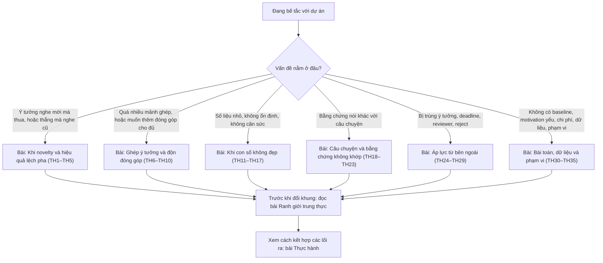

# 7. Những tình huống trớ trêu trong nghiên cứu

Các chương trước mô tả con đường suôn sẻ của một paper: ý tưởng được thẩm định, pilot cho tín hiệu tốt, thí nghiệm xác nhận giả thuyết, và câu chuyện được xây trên những bằng chứng đó. Thực tế nghiên cứu hiếm khi đi thẳng như vậy. Người mới thường mất phương hướng không phải vì thiếu nhiệt huyết, mà vì gặp những tình huống mà các tiêu chí của một paper tốt kéo về những hướng khác nhau. Ý tưởng mới và hấp dẫn nhưng số liệu thua baseline. Một mẹo đơn giản đến bất ngờ lại cho kết quả rất tốt, nhưng nghe như chẳng có gì mới. Ghép nhiều thứ lại thì đạt SOTA, nhưng không ai giải thích được cái gì tạo ra kết quả. Phần đóng góp chính có vẻ "thiếu thiếu", nên nảy ra ý thêm một pipeline dữ liệu hay một benchmark vào danh sách contribution cho đủ.

Chương này là một **cẩm nang tình huống**. Ba mươi lăm tình huống thường gặp được chia thành sáu nhóm, và mỗi tình huống được xử lý theo cùng một khung năm bước: *nhận diện* tình huống qua triệu chứng, *chẩn đoán* nguyên nhân, liệt kê *các lối ra* hợp lệ kèm điều kiện áp dụng, hướng dẫn *viết thế nào* với câu mẫu tiếng Anh, và chỉ rõ *điều không được làm*. Hai bài cuối chương không phải nhóm tình huống. Bài thứ nhất bàn về ranh giới giữa việc đóng khung lại một kết quả một cách hợp lệ và việc bóp méo kết quả, vì gần như mọi lối ra trong chương đều chạm tới ranh giới này. Bài thứ hai là bài thực hành, theo chân ba dự án giả định đi qua nhiều tình huống liên tiếp, để thấy các lối ra được kết hợp với nhau như thế nào trong một dự án thật.

Chương được đặt sau các chương về kỹ năng viết, case study và đặc thù từng cộng đồng, và mở đầu nhóm các chuyên đề, vì nó giả định người đọc đã nắm khung chuẩn: các kiểu đóng góp, cách xây câu chuyện, cách thiết kế thí nghiệm và cách reviewer đọc paper. Một số tình huống đã được nhắc ngắn gọn ở những chương đó, chẳng hạn bẫy "A + B" và concurrent work trong bài [Thẩm định ý tưởng](../01-truoc-khi-viet/y-tuong.md), hay mục *Khi kết quả không như mong đợi* trong bài [Xây "câu chuyện" của paper](../01-truoc-khi-viet/cau-chuyen.md). Ở chương này, chúng được mổ xẻ sâu hơn nhiều, cùng với nhiều tình huống chưa được bàn tới. Phần lớn các tình huống cũng có một mặt *phòng ngừa* nằm ở Chương 1: đọc công trình của người khác với con mắt phản biện ([Đọc paper như một reviewer](../01-truoc-khi-viet/doc-nhu-reviewer.md)) giúp nhận ra sớm những điểm yếu mà reviewer sẽ chỉ ra; lập kế hoạch có premortem, cổng quyết định và kế hoạch B ([Lập kế hoạch nghiên cứu](../01-truoc-khi-viet/ke-hoach.md)) giúp nhiều tình huống không bùng phát sát deadline; còn sanity check, quản lý seed và nhật ký thí nghiệm ([Vận hành thực nghiệm](../01-truoc-khi-viet/thuc-thi.md)) là tuyến phòng thủ đầu tiên trước bug, rò rỉ dữ liệu và so sánh không cân sức.

## Gốc rễ chung: tách phát hiện, phương pháp và bằng chứng

Nhiều tình huống trong chương trông rất khác nhau nhưng có chung một gốc rễ: người viết đồng nhất *đóng góp* với *phương pháp*. Khi phương pháp thua baseline, người viết kết luận rằng không còn paper. Khi phương pháp quá đơn giản, người viết kết luận rằng không có novelty. Khi phương pháp gồm nhiều mảnh ghép, người viết không biết mảnh nào thực sự là đóng góp. Cách gỡ chung là tách một công trình thành ba lớp và xét từng lớp riêng.

Lớp thứ nhất là **phát hiện** (*finding*): điều mới mà người đọc biết thêm sau khi đọc paper, phát biểu được bằng một câu không chứa tên phương pháp. Lớp thứ hai là **phương pháp** (*method*): phương tiện để khai thác hoặc chứng minh phát hiện đó. Lớp thứ ba là **bằng chứng** (*evidence*): các thí nghiệm và phân tích cho thấy phát hiện đúng, và đúng trong phạm vi nào. Lấy ResNet làm ví dụ (xem [case study ResNet](../05-case-studies/resnet.md)). Phát hiện là mạng "phẳng" càng sâu càng khó tối ưu, và đây là vấn đề tối ưu hóa chứ không phải overfitting. Phương pháp là các kết nối tắt để mạng học phần dư. Bằng chứng là đường cong huấn luyện của mạng phẳng và mạng có kết nối tắt ở nhiều độ sâu khác nhau. Phương pháp rất đơn giản, nhưng phát hiện thì mới, và bằng chứng thì sạch.

Khi đã tách được ba lớp, nhiều tình huống trớ trêu tự lộ ra lối thoát. Một phương pháp thua baseline vẫn có thể đi kèm một phát hiện giá trị về *lý do* nó thua. Một phương pháp đơn giản có thể là phương tiện tốt nhất cho một phát hiện bất ngờ. Một hệ thống ghép nhiều mảnh chỉ thành paper khi bằng chứng cho biết mảnh nào tạo ra phát hiện nào. Ngược lại, có những tình huống mà dù tách lớp thế nào cũng không tìm ra phát hiện. Khi đó, lối ra trung thực là dừng lại hoặc đổi hướng, chứ không phải độn thêm đóng góp.

## Bốn câu hỏi trước mọi quyết định

Trước khi chọn lối ra cho bất kỳ tình huống nào, nhóm tác giả nên viết ra câu trả lời cho bốn câu hỏi sau. Bốn câu hỏi này lặp lại xuyên suốt chương.

**Câu hỏi thứ nhất: phát hiện thật sự là gì?** Hãy phát biểu nó trong một câu không nhắc tên phương pháp và không chứa con số. Nếu không viết được câu này, vấn đề chưa nằm ở cách viết, mà ở chỗ công trình chưa có phát hiện.

**Câu hỏi thứ hai: bằng chứng hiện có ủng hộ phát hiện đó tới đâu?** Cần trả lời cụ thể: trên những dataset nào, với những backbone hay mô hình nào, ở chế độ dữ liệu và quy mô nào, qua bao nhiêu seed. Phạm vi của bằng chứng chính là phạm vi của claim.

**Câu hỏi thứ ba: ai quan tâm tới phát hiện này, và họ đánh giá bằng tiêu chí gì?** Cùng một kết quả có thể là một paper yếu ở main track nhưng là một paper tốt ở Findings, ở TMLR, ở Datasets & Benchmarks track, hay ở một workshop chuyên về kết quả âm tính. Chọn cộng đồng là một phần của lối ra, không phải bước làm sau cùng.

**Câu hỏi thứ tư: nếu reviewer được xem toàn bộ log thí nghiệm, cách trình bày này có còn đứng được không?** Đây là phép thử trung thực ngắn gọn nhất. Một cách đóng khung chỉ hợp lệ khi nó đúng với *toàn bộ* bằng chứng, chứ không chỉ với phần bằng chứng được chọn để đưa vào paper. Bài [Ranh giới trung thực](ranh-gioi-trung-thuc.md) giảng kỹ phép thử này.

## Ma trận novelty và hiệu quả

Bốn tình huống mà người mới hay than phiền nhất có thể xếp vào một ma trận hai chiều. Chiều thứ nhất là ý tưởng *nghe* có mới hay không. Chữ "nghe" ở đây có chủ ý, vì cảm giác mới hay cũ thường đến từ độ phức tạp bề ngoài chứ không phải từ lượng hiểu biết mới. Chiều thứ hai là kết quả đo được có tốt hay không.

| | **Kết quả tốt** | **Kết quả chưa tốt** |
|---|---|---|
| **Nghe mới** | Con đường suôn sẻ của các chương 1–4. Vẫn cần kiểm tra tình huống 6 (thành công nhờ ghép nhiều thứ) và tình huống 18 (thành công không vì lý do đã nêu). | Tình huống 1 (ý tưởng mới nhưng thua baseline), tình huống 20 (giả thuyết sai) |
| **Nghe không mới** | Tình huống 2 (đơn giản bất ngờ), tình huống 3 (bị chê hiển nhiên), tình huống 21 (baseline đơn giản được tune kỹ thắng mọi phương pháp phức tạp) | Thường là dấu hiệu nên dừng, trừ khi kết quả xấu đó bác bỏ một niềm tin phổ biến của cộng đồng (tình huống 20, 22) |

Điều đáng chú ý là ô "nghe không mới, kết quả tốt" thường là ô có tiềm năng lớn nhất nhưng lại bị người mới đánh giá thấp nhất. Nhiều paper có ảnh hưởng thuộc về ô này: Vision Transformer áp một Transformer chuẩn lên ảnh với ít thay đổi nhất có thể, ConvNeXt chỉ dùng các module ConvNet quen thuộc, còn nhiều paper "reality check" chỉ tune lại các baseline cũ cho thật kỹ. Novelty của chúng nằm ở phát hiện chứ không nằm ở độ phức tạp của phương pháp. Bài [Khi novelty và hiệu quả lệch pha](novelty-va-hieu-qua.md) phân tích cách viết cho ô này.

## Sơ đồ định hướng

Sơ đồ dưới đây giúp tìm nhanh bài cần đọc, dựa vào câu hỏi đang làm nhóm tác giả bế tắc.

## Bản đồ ba mươi lăm tình huống

| # | Tình huống | Bài |
|---|---|---|
| 1 | Ý tưởng mới, nghe hay, nhưng thua baseline | [Novelty và hiệu quả](novelty-va-hieu-qua.md) |
| 2 | Đơn giản đến bất ngờ, hiệu quả, nhưng nghe như thiếu novelty | [Novelty và hiệu quả](novelty-va-hieu-qua.md) |
| 3 | Reviewer chê "hiển nhiên", "trivial" | [Novelty và hiệu quả](novelty-va-hieu-qua.md) |
| 4 | Ý tưởng hóa ra đã có ở lĩnh vực khác hoặc từ nhiều năm trước | [Novelty và hiệu quả](novelty-va-hieu-qua.md) |
| 5 | "Chỉ là ứng dụng": mang phương pháp có sẵn sang miền hoặc ngôn ngữ mới | [Novelty và hiệu quả](novelty-va-hieu-qua.md) |
| 6 | Ghép nhiều ý tưởng, đạt SOTA, nhưng không rõ cái gì tạo ra kết quả | [Ghép và độn](ghep-va-don.md) |
| 7 | Muốn thêm dataset, pipeline, training recipe hay benchmark vào danh sách đóng góp cho đủ | [Ghép và độn](ghep-va-don.md) |
| 8 | Một paper chứa hai paper | [Ghép và độn](ghep-va-don.md) |
| 9 | Muốn cắt một dự án thành nhiều paper nhỏ | [Ghép và độn](ghep-va-don.md) |
| 10 | Claim "đầu tiên" và các từ ngữ thổi phồng | [Ghép và độn](ghep-va-don.md) |
| 11 | Cải thiện nhỏ, nằm trong dao động giữa các lần chạy | [Con số không đẹp](con-so-khong-dep.md) |
| 12 | Thắng ở dataset này, thua ở dataset kia | [Con số không đẹp](con-so-khong-dep.md) |
| 13 | Tái lập baseline không đạt số trong paper gốc | [Con số không đẹp](con-so-khong-dep.md) |
| 14 | Không đủ tài nguyên tính toán để đua với lab lớn | [Con số không đẹp](con-so-khong-dep.md) |
| 15 | Metric và đánh giá của con người nói hai điều khác nhau | [Con số không đẹp](con-so-khong-dep.md) |
| 16 | Phương pháp chỉ tốt khi tune rất kỹ | [Con số không đẹp](con-so-khong-dep.md) |
| 17 | Thắng nhờ dữ liệu nhiều hơn hoặc mô hình lớn hơn | [Con số không đẹp](con-so-khong-dep.md) |
| 18 | Phương pháp hoạt động, nhưng không vì lý do đã nêu | [Câu chuyện và bằng chứng](cau-chuyen-va-bang-chung.md) |
| 19 | Phương pháp hoạt động mà không giải thích được vì sao | [Câu chuyện và bằng chứng](cau-chuyen-va-bang-chung.md) |
| 20 | Giả thuyết sai hoàn toàn: kết quả âm tính | [Câu chuyện và bằng chứng](cau-chuyen-va-bang-chung.md) |
| 21 | Một baseline đơn giản được tune kỹ mạnh hơn mọi phương pháp phức tạp | [Câu chuyện và bằng chứng](cau-chuyen-va-bang-chung.md) |
| 22 | Mức cải thiện đến từ lỗi hoặc thiên lệch của benchmark | [Câu chuyện và bằng chứng](cau-chuyen-va-bang-chung.md) |
| 23 | Phát hiện bug hoặc rò rỉ dữ liệu sau khi đã có kết quả đẹp | [Câu chuyện và bằng chứng](cau-chuyen-va-bang-chung.md) |
| 24 | Bị trùng ý tưởng khi còn vài tuần đến deadline | [Áp lực từ bên ngoài](ap-luc-ben-ngoai.md) |
| 25 | Một mô hình nền mới làm bài toán hoặc kết quả trở nên lỗi thời | [Áp lực từ bên ngoài](ap-luc-ben-ngoai.md) |
| 26 | Deadline cận kề mà thí nghiệm chưa xong | [Áp lực từ bên ngoài](ap-luc-ben-ngoai.md) |
| 27 | Kết quả phụ thuộc vào API hoặc mô hình đóng có thể thay đổi | [Áp lực từ bên ngoài](ap-luc-ben-ngoai.md) |
| 28 | Reviewer đòi thí nghiệm không thể làm | [Áp lực từ bên ngoài](ap-luc-ben-ngoai.md) |
| 29 | Bị reject nhiều lần với cùng lời phê "thiếu novelty" | [Áp lực từ bên ngoài](ap-luc-ben-ngoai.md) |
| 30 | Bài toán mới nên không có baseline nào để so sánh | [Bài toán, dữ liệu và phạm vi](bai-toan-va-pham-vi.md) |
| 31 | Kết quả tốt cho một bài toán mà reviewer không thấy quan trọng | [Bài toán, dữ liệu và phạm vi](bai-toan-va-pham-vi.md) |
| 32 | Phương pháp tốt hơn nhưng chậm hơn hoặc tốn kém hơn nhiều | [Bài toán, dữ liệu và phạm vi](bai-toan-va-pham-vi.md) |
| 33 | Dữ liệu riêng không thể công bố | [Bài toán, dữ liệu và phạm vi](bai-toan-va-pham-vi.md) |
| 34 | Lý thuyết đẹp nhưng thí nghiệm ở quy mô đồ chơi, hoặc thực nghiệm mạnh mà không có lý thuyết | [Bài toán, dữ liệu và phạm vi](bai-toan-va-pham-vi.md) |
| 35 | Kết quả trên benchmark đẹp nhưng không chuyển được sang thực tế | [Bài toán, dữ liệu và phạm vi](bai-toan-va-pham-vi.md) |

## Đối chiếu với các case study

Các tình huống trong chương được minh họa chủ yếu bằng ví dụ giả định, để tập trung vào cơ chế. Muốn thấy chúng trong paper thật, người học có thể đọc các case study ở [Chương 5](../05-case-studies/index.md) và [Chương 9](../09-ai-security/index.md). Mỗi case study đều có đoạn nối ngược về tình huống tương ứng. Bảng dưới đây gom các cặp đối chiếu đáng đọc nhất.

| Bài trong chương | Case study có tình huống tương tự | Điểm đáng chú ý |
|---|---|---|
| [Khi novelty và hiệu quả lệch pha](novelty-va-hieu-qua.md) | [ResNet](../05-case-studies/resnet.md), [MAE & Latent Diffusion](../05-case-studies/mae-ldm.md), [DDPM](../05-case-studies/ddpm.md), [VLGuard](../09-ai-security/vlguard.md) | Ý tưởng đơn giản hoặc đã có ở lĩnh vực khác, được đóng khung quanh một phát hiện |
| [Ghép ý tưởng và "độn" đóng góp](ghep-va-don.md) | [Transformer](../05-case-studies/transformer.md), [SAM & ControlNet](../05-case-studies/sam-controlnet.md), [EDWARD-NMT](../05-case-studies/edward-nmt.md) | Hệ thống nhiều thành phần và cách mỗi thành phần được biện minh |
| [Khi con số không đẹp](con-so-khong-dep.md) | [Adam](../05-case-studies/adam.md), [NeRF](../05-case-studies/nerf.md), [ViP-VL](../05-case-studies/vip-vl.md), [SwiftBrush](../05-case-studies/swiftbrush.md) | Metric lệch với đánh giá của con người, tuning, so sánh cân sức |
| [Khi câu chuyện và bằng chứng không khớp](cau-chuyen-va-bang-chung.md) | [CheckList](../05-case-studies/checklist-acl2020.md), [PhoBERT](../05-case-studies/phobert.md) | Phê bình cách đánh giá, nguồn gốc thật của cải thiện |
| [Bài toán, dữ liệu và phạm vi](bai-toan-va-pham-vi.md) | [Anti-DreamBooth](../05-case-studies/anti-dreambooth.md), [Top-K Sparse MoE](../05-case-studies/topk-moe.md), [Streaming ITN](../05-case-studies/streaming-itn.md) | Bài toán mới cần tự dựng baseline; lý thuyết đi cùng thí nghiệm; khoảng cách giữa benchmark và thực tế |
| [Ranh giới trung thực](ranh-gioi-trung-thuc.md) | [MELON](../09-ai-security/melon.md), [Thực hành: một paper từ con số 0](../05-case-studies/worked-example.md) | Cách nói về giới hạn và claim một cách chừng mực |

## Các bài trong chương

- [Khi novelty và hiệu quả lệch pha](novelty-va-hieu-qua.md): ý tưởng mới mà thua, ý tưởng đơn giản mà thắng, lời chê "hiển nhiên", ý tưởng đã có ở nơi khác, và paper "chỉ là ứng dụng".
- [Ghép ý tưởng và "độn" đóng góp](ghep-va-don.md): gỡ rối một hệ thống ghép nhiều mảnh, vì sao độn đóng góp làm paper yếu đi, khi nào nên tách hay gộp paper, và cách viết claim không thổi phồng.
- [Khi con số không đẹp](con-so-khong-dep.md): cải thiện nằm trong nhiễu, kết quả không đồng đều giữa các dataset, baseline không tái lập được, giới hạn tài nguyên, metric lệch với đánh giá của con người, và so sánh không cân sức.
- [Khi câu chuyện và bằng chứng không khớp](cau-chuyen-va-bang-chung.md): khi ablation phủ nhận câu chuyện, khi không giải thích được vì sao phương pháp hoạt động, kết quả âm tính, paper "reality check", lỗi benchmark, và bug được phát hiện muộn.
- [Áp lực từ bên ngoài](ap-luc-ben-ngoai.md): bị trùng ý tưởng, mô hình nền mới làm bài toán lỗi thời, deadline, mô hình đóng thay đổi theo thời gian, yêu cầu bất khả thi từ reviewer, và những lần reject lặp lại.
- [Bài toán, dữ liệu và phạm vi](bai-toan-va-pham-vi.md): bài toán mới chưa có baseline, motivation yếu, phương pháp tốt hơn nhưng tốn kém, dữ liệu riêng không công bố được, khoảng cách giữa lý thuyết và thực nghiệm, và khoảng cách giữa benchmark với thực tế.
- [Đóng khung lại hay bóp méo: ranh giới trung thực](ranh-gioi-trung-thuc.md): phổ hành vi từ trình bày tốt tới sai phạm, HARKing, khu vườn rẽ nhánh, các dạng chọn lọc, tập test, ngôn từ thổi phồng, áp lực bảng xếp hạng, cắt lát và nộp trùng, ba phép thử trước khi nộp, và cách nêu quan ngại khi áp lực đến từ trong nhóm.
- [Thực hành: ba dự án đi qua ngõ cụt](thuc-hanh.md): ba dự án giả định ở Computer Vision, NLP và Machine Learning, mỗi dự án đi qua nhiều tình huống liên tiếp, với abstract và danh sách đóng góp trước và sau khi gỡ, cùng một mẫu nhật ký quyết định.

## Cách đọc chương

Chương không cần đọc theo thứ tự. Người đang bế tắc có thể tìm tình huống gần nhất trong bảng hoặc sơ đồ trên, đọc tình huống đó, rồi đọc bài [Ranh giới trung thực](ranh-gioi-trung-thuc.md) trước khi quyết định đổi khung câu chuyện. Bài [Thực hành](thuc-hanh.md) cho thấy trong một dự án thật, các tình huống hiếm khi xuất hiện riêng lẻ: một kết quả thua baseline thường kéo theo câu hỏi về chế độ thắng, về so sánh cân sức và về cách đóng khung lại. Người chưa gặp tình huống nào nên đọc lướt cả chương một lần, ngay khi dự án bắt đầu. Nhận ra sớm rằng dự án đang đi vào một tình huống quen thuộc, chẳng hạn đang ghép thêm thành phần thứ tư mà chưa ablation ba thành phần đầu, rẻ hơn nhiều so với phát hiện ra điều đó khi chỉ còn hai tuần đến deadline.

Mọi kịch bản minh họa trong chương đều là ví dụ giả định, được ghi rõ khi xuất hiện. Các paper thật chỉ được nêu khi chúng là những ví dụ nổi tiếng, được cộng đồng biết đến rộng rãi cho đúng điểm đang bàn.
