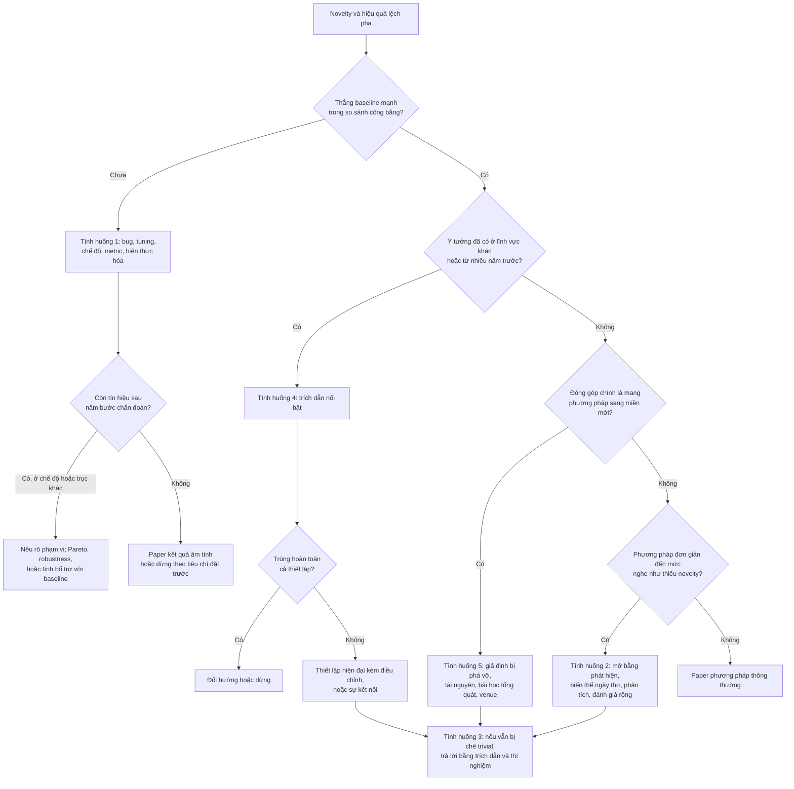

# Khi novelty và hiệu quả lệch pha

!!! abstract "Mục tiêu của bài"
    Sau bài này, người học có thể:

    - Chẩn đoán theo một trình tự cố định, từng bước, một phương pháp mới đang thua baseline, rồi chọn lối ra phù hợp với kết quả chẩn đoán, kể cả quyết định dừng lại.
    - Trình bày một phương pháp đơn giản mà hiệu quả như một phát hiện có giá trị, với bằng chứng cho thấy các biến thể ngây thơ thất bại và lời giải thích vì sao phương pháp hoạt động.
    - Nhận ra và vận dụng các thủ pháp mà những paper kinh điển như ViT, ConvNeXt hay *Understanding deep learning requires rethinking generalization* dùng để đóng khung sự đơn giản, trong Introduction, danh sách đóng góp và phần kết.
    - Phân biệt một ý tưởng "hiển nhiên khi nhìn lại" với một ý tưởng thật sự tầm thường, phòng ngừa nhận xét "trivial" ngay trong paper và trả lời nó trong rebuttal.
    - Xử lý trung thực trường hợp ý tưởng đã xuất hiện ở lĩnh vực khác hoặc từ nhiều năm trước, và biến một paper "chỉ là ứng dụng" thành một đóng góp có insight kỹ thuật, hoặc chọn đúng nơi công bố cho nó.

Form review của hầu hết hội nghị A\* hỏi hai câu tách biệt: paper có gì mới (*novelty*, *originality*), và paper có thực sự hoạt động, có ý nghĩa hay không (*soundness*, *significance*). Trong hình dung của người mới làm nghiên cứu, hai câu trả lời đi cùng nhau: một ý tưởng mới, được cài đặt cẩn thận, sẽ cho kết quả tốt hơn những gì đang có. Thực tế hiếm khi gọn gàng như vậy. Có những ý tưởng mới thật, hấp dẫn thật, nhưng số liệu không theo. Có những giải pháp đơn giản đến mức người viết ngại đưa vào paper, dù chúng chạy tốt hơn mọi thứ phức tạp. Có những ý tưởng ngỡ là mới, rồi hóa ra đã nằm trong một tạp chí thống kê từ ba mươi năm trước. Trong bài này, "hiệu quả" được hiểu theo nghĩa phương pháp thực sự cải thiện kết quả (*effectiveness*); khi nói về chi phí, bài dùng cụm "hiệu quả tính toán" (*efficiency*) để tránh nhầm lẫn.

Bài xem xét năm tình huống mà hai tiêu chí ấy lệch pha: ý tưởng mới nhưng thua baseline; giải pháp đơn giản, hiệu quả nhưng nghe như thiếu novelty; reviewer chê ý tưởng là "hiển nhiên"; ý tưởng hóa ra đã có ở nơi khác; và paper bị coi là "chỉ là ứng dụng". Cả năm tình huống đều được gỡ dễ hơn khi tách ba thứ thường bị gộp làm một: **phát hiện** (*finding*), **phương pháp** (*method*) và **bằng chứng** (*evidence*). Một paper bán hiểu biết, không bán phương pháp. Novelty là lượng hiểu biết mới mà người đọc nhận được, không phải độ phức tạp của thứ được đề xuất. Nhìn theo cách đó, một phương pháp thua baseline vẫn có thể mang một phát hiện, còn một phương pháp hai mươi dòng code vẫn có thể là đóng góp lớn.

Bài này đi sâu hơn những gì đã có ở Chương 1. Các kiểu đóng góp được chấp nhận, bẫy "A + B" và pilot experiment đã được trình bày ở bài [Tìm và thẩm định ý tưởng](../01-truoc-khi-viet/y-tuong.md); mục *Khi kết quả không như mong đợi* trong bài [Xây "câu chuyện" của paper](../01-truoc-khi-viet/cau-chuyen.md) chỉ dành cho mỗi trường hợp một đoạn ngắn. Ở đây, mỗi tình huống được mổ xẻ qua năm bước: nhận diện, chẩn đoán, các lối ra, cách viết, và điều không được làm. Tình huống 2 được viết sâu nhất, vì đó là nơi người mới hay bế tắc nhất: có trong tay một kết quả tốt mà không biết kể nó thế nào. Ranh giới giữa đóng khung lại một cách hợp lệ và bóp méo bằng chứng được bàn xuyên suốt ở bài [Ranh giới trung thực](ranh-gioi-trung-thuc.md).

## Tình huống 1: Ý tưởng mới, nghe hay, nhưng thua baseline

### Nhận diện

Một nghiên cứu sinh NLP (ví dụ giả định) đề xuất bổ sung cho mô hình ngôn ngữ một bộ nhớ làm việc lấy cảm hứng từ tâm lý học nhận thức: một số ít "ô nhớ" được ghi và xóa theo một cơ chế cổng (*gating*), cho phép mô hình giữ lại thông tin quan trọng qua những văn bản rất dài mà không phải attend lại toàn bộ ngữ cảnh. Tìm kiếm novelty ba tầng không thấy công trình nào trùng khớp, và bản pitch một trang nghe rất thuyết phục. Sau ba tháng, kết quả lại phũ phàng. Trên benchmark language modeling chuẩn, perplexity (độ đo mức "bối rối" của mô hình, càng thấp càng tốt) của mô hình cao hơn một Transformer cùng kích thước, được huấn luyện với cùng ngân sách tính toán. Trên hai tác vụ downstream, kết quả ngang hoặc thấp hơn một chút.

Dấu hiệu của tình huống này khá quen thuộc: ý tưởng được giải thích bằng lời rất mạch lạc nhưng con số không đi theo, mỗi tuần nhóm lại thử "thêm một mẹo nữa" mà không có giả thuyết rõ ràng, kết quả đổi dấu giữa các seed, và mỗi lần thất bại lại có một lời giải thích mới. Nguy hiểm nhất là khi trong nhóm bắt đầu xuất hiện những câu như "hay bỏ dataset này đi" hoặc "baseline này mạnh quá, lấy cấu hình nhỏ hơn".

### Chẩn đoán

Tình huống này phổ biến vì một lý do mang tính cấu trúc: phương pháp mới phải cạnh tranh với những baseline đã được cả cộng đồng mài giũa qua nhiều năm. Một Transformer chuẩn là kiến trúc cộng với công thức huấn luyện và vô số chi tiết đã được tối ưu qua hàng nghìn thí nghiệm, trong khi phương pháp mới chỉ ở phiên bản đầu tiên. Đặt một ý tưởng ở phiên bản 0.1 cạnh một baseline ở phiên bản 5.0 rất dễ cho kết quả thua, kể cả khi ý tưởng đúng. Nhưng cũng có thể ý tưởng sai. Việc của chẩn đoán là phân biệt hai khả năng này một cách có hệ thống thay vì theo cảm giác.

Quy trình dưới đây gồm năm bước, và nên được đi đúng thứ tự: một sanity check mất vài giờ, còn một thí nghiệm theo chế độ có thể mất vài tuần, và mỗi bước chỉ có nghĩa khi bước trước đã được loại trừ. Tìm chế độ mà phương pháp thắng là vô ích nếu phương pháp đang có bug, còn thiết kế metric mới là vô ích nếu so sánh chưa cân sức.

**Bước 1: loại trừ bug.** Kiểm tra đầu tiên là sanity check trên dữ liệu đồ chơi (*toy data*), nơi đáp án đã biết trước và insight dự đoán rõ ràng rằng phương pháp phải thắng. Với bộ nhớ làm việc, đó có thể là một tác vụ tổng hợp yêu cầu nhớ lại một token xuất hiện từ hàng nghìn bước trước. Mô hình có bộ nhớ phải giải được tác vụ này, còn baseline với ngữ cảnh bị cắt ngắn phải thất bại. Nếu chính phương pháp cũng thất bại trên bài toán được thiết kế riêng cho nó, thì hoặc có bug, hoặc insight sai. Kiểm tra thứ hai là overfit một batch nhỏ: với vài chục ví dụ, mô hình phải đưa được loss về gần không. Nếu không làm được, lỗi thường nằm ở gradient, ở mask hoặc ở cơ chế cổng. Kiểm tra thứ ba là xem thành phần mới có thực sự được dùng hay không, bằng cách ghi lại thống kê của các cổng và đo xem bộ nhớ có được ghi vào không. Một cổng bão hòa về không ngay từ những bước đầu huấn luyện biến phương pháp mới thành baseline cộng thêm tham số thừa. Đoạn code dưới đây (PyTorch, giả định module bộ nhớ lưu lại giá trị cổng của bước gần nhất) cho thấy hai kiểm tra sau gọn đến mức nào.

```python
# Kiểm tra 1: overfit một batch nhỏ cố định
batch = next(iter(train_loader))            # 32 ví dụ, giữ nguyên suốt vòng lặp
model.train()
for step in range(500):
    loss = model(**batch).loss
    loss.backward()
    optimizer.step()
    optimizer.zero_grad()
    if step % 100 == 0:
        print(step, round(loss.item(), 4))  # loss phải tiến về gần 0

# Kiểm tra 2: cơ chế cổng có thực sự ghi vào bộ nhớ không?
g = model.memory.last_write_gate            # tensor giá trị cổng ghi trong [0, 1]
print("trung bình cổng:", g.mean().item())
print("tỉ lệ cổng gần như đóng:", (g < 0.01).float().mean().item())
```

**Bước 2: kiểm tra so sánh có cân sức không.** Bất cân xứng trong tuning có thể đi theo cả hai chiều: baseline bị tune kém, hoặc phương pháp mới bị chạy với bộ hyperparameter vốn được tối ưu cho baseline. Melis, Dyer và Blunsom (*On the State of the Art of Evaluation in Neural Language Models*, ICLR 2018) cho thấy một LSTM chuẩn, khi được regularize và tune kỹ, vượt nhiều kiến trúc mới hơn trong language modeling. ConvNeXt (CVPR 2022) cho một con số cụ thể về độ lớn của hiệu ứng này: chỉ riêng việc huấn luyện ResNet-50 theo công thức huấn luyện của vision Transformer đã nâng độ chính xác ImageNet từ 76,1% lên 78,8%, và paper kết luận rằng một phần đáng kể khoảng cách giữa ConvNet và Transformer có thể đến từ kỹ thuật huấn luyện. Cách kiểm tra là cấp cho hai phía cùng ngân sách tuning và ghi lại điều đó (xem mục *So sánh công bằng* ở bài [Thiết kế thí nghiệm](../01-truoc-khi-viet/thi-nghiem.md)).

**Bước 3: xác định chế độ mà insight dự đoán.** Một insight thường chỉ dự đoán ưu thế trong một chế độ (*regime*) cụ thể: ít dữ liệu, phân phối đuôi dài, dữ liệu ngoài phân phối (*out-of-distribution*, OOD), ngữ cảnh dài, hoặc khi có ràng buộc về hiệu quả tính toán. Bộ nhớ làm việc chỉ hữu ích khi thông tin cần thiết nằm xa, nên ưu thế dễ bị pha loãng trong con số trung bình. Lịch sử của ViT (*An Image is Worth 16x16 Words*, ICLR 2021) là ví dụ rõ nhất. Theo chính paper, khi được huấn luyện trên các dataset cỡ trung như ImageNet mà không có regularization mạnh, ViT cho độ chính xác thấp hơn vài điểm phần trăm so với ResNet cùng cỡ; bức tranh chỉ thay đổi khi pre-training trên 14 tới 300 triệu ảnh. Điều đáng học là chế độ dữ liệu lớn được *insight dự đoán* từ trước, chứ không phải được tìm ra bằng cách lục lọi: Transformer thiếu các inductive bias (thiên kiến quy nạp) của convolution, nên cần nhiều dữ liệu hơn để bù lại. Câu hỏi của bước này là: theo insight, phương pháp phải thắng *ở đâu*, và theo trục nào ưu thế phải tăng dần?

**Bước 4: kiểm tra metric có đo đúng điều insight dự đoán không.** Ngay cả khi đã ở đúng chế độ, metric tổng có thể không nhạy với cơ chế. Perplexity trung bình gộp mọi token lại. Nếu insight nói về những token cần thông tin từ xa, phép đo phù hợp hơn là perplexity trên đúng nhóm token ấy, phân theo khoảng cách tới thông tin liên quan. Đây là tinh thần của "đánh giá chia nhỏ" ở bài [Xây "câu chuyện" của paper](../01-truoc-khi-viet/cau-chuyen.md). Có một điều kiện quan trọng: metric chuyên biệt phải được suy ra từ insight, tốt nhất là được định nghĩa trước khi nhìn kết quả, và luôn được báo cáo song song với metric chuẩn chứ không thay thế nó.

**Bước 5: tách insight khỏi cách hiện thực hóa.** Lịch sử masked modeling cho ảnh là một ví dụ. Bản thân paper ViT đã thử sơ bộ việc dự đoán các mảnh ảnh bị che theo kiểu BERT: ViT-B/16 đạt 79,9% trên ImageNet, hơn huấn luyện từ đầu 2% nhưng vẫn kém pre-training có giám sát 4%. Ý tưởng không sai; như bài [Tìm và thẩm định ý tưởng](../01-truoc-khi-viet/y-tuong.md) đã phân tích, MAE về sau cho thấy phải che một tỉ lệ rất lớn các mảnh ảnh thì nó mới phát huy tác dụng. Công cụ hữu ích ở bước này là thí nghiệm "oracle": cung cấp trực tiếp cho thành phần mới thông tin đúng, chẳng hạn ghi sẵn vào bộ nhớ đoạn văn bản chứa câu trả lời, rồi đo xem mô hình có tận dụng được không. Oracle cũng không giúp thì insight có lẽ sai; oracle giúp nhiều mà phiên bản học được không giúp thì vấn đề nằm ở hiện thực hóa.

Sau năm bước, nhóm tác giả nên viết ra một nhật ký chẩn đoán ngắn. Viết ra buộc mỗi bước phải có một kết luận cụ thể thay vì cảm giác "chắc là không có bug", và nhật ký này về sau chính là nguyên liệu cho phần Experiments hoặc cho mục Limitations. Một nhật ký cho ví dụ trên có thể trông như sau (mọi con số là giả định).

```text
Nhật ký chẩn đoán: bộ nhớ làm việc cho mô hình ngôn ngữ (ví dụ giả định)

Bước 1 - Bug:     Toy task truy hồi ở khoảng cách 2K token: mô hình đúng 97%,
                  baseline cắt ngữ cảnh 1K: 11%. Overfit 32 ví dụ: loss 0,03
                  sau 400 bước. Cổng ghi mở ở 31% số bước. => Không thấy bug.
Bước 2 - Tuning:  Hai phía cùng 30 lần thử, cùng không gian tìm kiếm.
                  Chênh lệch tổng vẫn còn (+0,4 perplexity).
Bước 3 - Chế độ:  Insight dự đoán ưu thế khi thông tin cần thiết cách xa hơn 4K token.
Bước 4 - Metric:  Perplexity theo khoảng cách tới token liên quan (định nghĩa
                  trước khi chạy). Ở nhóm > 4K: chênh lệch nhỏ, chưa rõ xu hướng.
Bước 5 - Oracle:  Ghi sẵn đoạn liên quan vào bộ nhớ: nhóm > 4K giảm mạnh perplexity.
Kết luận:         Insight có cơ sở; cơ chế ghi học được chưa chọn đúng thông tin.
                  Ưu tiên: sửa cơ chế ghi, giữ nguyên thiết lập đánh giá.
Tiêu chí dừng:    Nếu sau 3 tuần, nhóm > 4K không vượt rõ dao động giữa các seed,
                  chuyển sang lối ra thứ tư hoặc dừng.
```

Đoạn kết luận chẩn đoán quyết định lối ra. Trong ví dụ này, oracle cho thấy insight có cơ sở, nên lối ra hợp lý là sửa cách hiện thực hóa rồi đi theo lối ra thứ nhất. Nếu oracle cũng không giúp, lối ra thứ tư hoặc thứ năm mới là lựa chọn đúng.

### Các lối ra

**Lối ra thứ nhất: tìm chế độ mà phương pháp thắng, và nêu rõ phạm vi.** Lối ra này phù hợp khi chế độ được insight dự đoán từ trước, hoặc ít nhất được biện minh độc lập với kết quả, và đó là chế độ mà một nhóm người dùng thực sự quan tâm. Bằng chứng cần có gồm kết quả trên benchmark dành cho chế độ đó; một đường cong theo trục chế độ cho thấy điểm giao nhau giữa phương pháp và baseline; và kết quả trung thực trên benchmark chung. Lối ra này *không* phù hợp khi chế độ được tìm ra bằng cách quét hàng chục tập con cho tới khi thấy một tập thắng.

!!! warning "Chế độ được tìm ra sau khi xem kết quả"
    Gelman và Loken gọi hiện tượng này là "khu vườn của những lối rẽ" (*the garden of forking paths*): nhiều lựa chọn phân tích không được khai báo làm sai lệch suy luận, kể cả khi không ai cố ý. Thử hai mươi tập con thì gần như chắc chắn có một tập cho kết quả đẹp do ngẫu nhiên. Khi chế độ được phát hiện sau khi xem kết quả, paper cần nói rõ đây là phát hiện mang tính khám phá, và kiểm chứng lại nó trên một dataset hoặc thiết lập độc lập trước khi biến nó thành claim chính.

**Lối ra thứ hai: đổi trục so sánh.** Phương pháp có thể không thắng về chất lượng tuyệt đối nhưng thắng trên một trục khác: cùng chất lượng với chi phí thấp hơn, hoặc ổn định hơn dưới dịch chuyển phân phối, dưới nhiễu hay tấn công. Với trục chất lượng theo chi phí, bằng chứng thuyết phục là một đường biên Pareto qua nhiều kích thước mô hình, với chi phí đo trên phần cứng thực, cho thấy phương pháp nằm trên đường biên còn baseline nằm dưới. Với robustness, cần các phép dịch chuyển chuẩn đã được cộng đồng công nhận. Lối ra này không phù hợp khi trục mới được chọn chỉ vì đó là trục duy nhất phương pháp thắng, trong khi không ai cần sự đánh đổi đó.

**Lối ra thứ ba: kiểm tra tính bổ trợ với baseline.** Một phương pháp thua khi đứng riêng đôi khi lại cải thiện baseline khi được kết hợp với nó, ví dụ thêm vài ô nhớ vào một Transformer chuẩn thay vì thay thế attention. Nếu điều đó xảy ra, phương pháp đang nắm được thứ mà baseline bỏ sót, và một phân tích độ chồng lấn lỗi (hai mô hình sai ở những ví dụ khác nhau) sẽ củng cố kết luận. Cần so với baseline được cấp thêm dung lượng tương đương, và giải thích *vì sao* hai thành phần bổ trợ nhau để tránh bẫy "A + B" (xem bài [Ghép ý tưởng và "độn" đóng góp](ghep-va-don.md)).

**Lối ra thứ tư: viết một paper phân tích "vì sao X không giúp được".** Khi chẩn đoán kỹ lưỡng cho thấy ý tưởng không hoạt động, và ý tưởng ấy đủ tự nhiên để nhiều nhóm khác cũng sẽ nghĩ tới, một paper giải thích vì sao nó thất bại có giá trị thật. Giá trị không nằm ở câu "không hoạt động" mà ở lời giải thích *vì sao*, chẳng hạn chỉ ra rằng attention chuẩn đã khai thác được thông tin ở xa trong giới hạn ngữ cảnh, nên bộ nhớ bổ sung là dư thừa. Điều kiện là năm bước chẩn đoán đã được làm kín kẽ. Nơi công bố phù hợp gồm workshop *I Can't Believe It's Not Better!* (ICBINB) tổ chức tại NeurIPS từ năm 2020; workshop *Insights from Negative Results in NLP*, đi kèm các hội nghị ACL/EMNLP từ năm 2020; và TMLR, nơi tiêu chí chính là claim có được bằng chứng ủng hộ một cách chính xác, thuyết phục, rõ ràng hay không, và có người trong cộng đồng quan tâm hay không, chứ không đòi mức "nổi bật" như hội nghị. Kết quả âm tính lật đổ một niềm tin phổ biến có thể vào thẳng main track, như *Rethinking the Value of Network Pruning* (ICLR 2019) hay *Are GANs Created Equal?* (NeurIPS 2018).

**Lối ra thứ năm: dừng lại theo tiêu chí đã đặt trước.** Nếu sau năm bước chẩn đoán vẫn không có tín hiệu, và ý tưởng không đủ phổ biến để một paper kết quả âm tính có người đọc, dừng lại là một quyết định nghiên cứu tốt. Mục *Pilot experiment và tiêu chí dừng* trong bài [Tìm và thẩm định ý tưởng](../01-truoc-khi-viet/y-tuong.md) khuyên viết tiêu chí dừng trước khi chạy; tình huống này là lúc tiêu chí ấy phát huy tác dụng. Chi phí chìm không phải là lý do để tiếp tục. Nhật ký chẩn đoán và code của các sanity check vẫn là tài sản cho dự án sau.

### Viết thế nào

Khó khăn chính khi viết theo lối ra thứ nhất hoặc thứ hai là giữ cho phạm vi của claim khớp với phạm vi của bằng chứng ở *mọi* vị trí: title, abstract, Introduction và danh sách đóng góp. Paper nên nêu chế độ ngay từ abstract, và bảng kết quả chính vẫn chứa benchmark chung, kể cả khi phương pháp chỉ ngang hoặc thua ở đó. Điều này không làm paper yếu đi; nó cho reviewer thấy nhóm tác giả biết phương pháp hoạt động ở đâu và không hoạt động ở đâu. Hai cặp câu dưới đây (ví dụ giả định) minh họa sự khác biệt.

<div class="bad" markdown>
*"Our memory-augmented Transformer significantly outperforms strong baselines on language modeling."*

Claim nói về language modeling nói chung, trong khi bảng chính cho thấy perplexity tổng thể kém baseline; reviewer đọc tới Table 2 sẽ mất niềm tin vào mọi claim còn lại.
</div>

<div class="good" markdown>
*"In overall perplexity, our model is slightly behind a well-tuned Transformer baseline (+0.4, Table 2). Its advantage is concentrated where our hypothesis predicts: on tokens whose prediction depends on information more than 4K tokens back, it reduces perplexity by 11%, and the gap widens with distance (Fig. 3)."*

Câu này báo cáo trung thực kết quả tổng, rồi khoanh vùng ưu thế vào đúng chế độ mà giả thuyết dự đoán, kèm một hình cho thấy xu hướng theo khoảng cách.
</div>

Với lối ra thứ tư, cái khó là chuyển giọng từ "xin lỗi" sang "kiểm định".

<div class="bad" markdown>
*"Unfortunately, our method did not work as well as expected, possibly due to limited computational resources."*

Câu này đọc như một lời xin lỗi, không cho người đọc hiểu biết nào, và lý do được nêu ra không được kiểm chứng.
</div>

<div class="good" markdown>
*"Explicit memory modules are often assumed to help language models exploit distant context [8, 14]. We test this assumption under matched tuning budgets across three model sizes and two corpora, and find no benefit beyond 1B parameters. Attribution analysis shows that standard models already retrieve the relevant distant tokens within their context window, which makes the additional memory redundant."*

Đoạn văn biến thất bại thành một phép kiểm định: nêu niềm tin, nêu điều kiện kiểm định công bằng, nêu kết quả và cơ chế.
</div>

Phản ứng của reviewer khác nhau đáng kể giữa ba cộng đồng. Reviewer ML ở NeurIPS, ICML, ICLR coi hiểu biết là một đóng góp độc lập, nên một paper phân tích hay kết quả âm tính có thí nghiệm kiểm soát chặt, error bar và nhiều quy mô mô hình có cơ hội thật. Họ sẽ hỏi kỹ về ngân sách tuning và số seed, vì *Deep Reinforcement Learning that Matters* (Henderson et al., AAAI 2018) đã cho thấy kết quả nhạy tới mức nào với chúng. Reviewer NLP quen với paper phân tích; định dạng short paper rất hợp với một phát hiện âm tính tập trung, và mục Limitations bắt buộc của các hội nghị dùng ACL Rolling Review là chỗ tự nhiên để khoanh vùng chế độ. Reviewer CV thường bắt đầu từ bảng kết quả trên benchmark chuẩn; một claim theo chế độ cần một benchmark được cộng đồng công nhận cho chế độ đó.

### Điều không được làm

Tình huống này sinh ra ba cám dỗ, và cả ba đều biến một kết quả âm tính trung thực thành một kết quả dương tính sai. Thứ nhất là **chọn lọc dataset**: chỉ báo cáo những dataset mà phương pháp thắng. Thứ hai là **làm yếu baseline**: dùng cấu hình nhỏ hơn, ít epoch hơn, checkpoint cũ hơn, hoặc prompt sơ sài hơn cho baseline LLM. Thứ ba là **tune trên test**: chọn checkpoint, hyperparameter hay thậm chí chọn "chế độ" bằng cách nhìn tập test. Cả ba đều không qua được một phép thử đơn giản: nếu reviewer được xem toàn bộ log thí nghiệm, claim có còn đứng được không? Sculley et al. (*Winner's Curse?*, ICLR 2018 workshop) đã chỉ ra rằng áp lực "thắng bảng" làm suy giảm sự chặt chẽ thực nghiệm của cả lĩnh vực. Xem thêm bài [Ranh giới trung thực](ranh-gioi-trung-thuc.md) và các tình huống về số liệu ở bài [Khi con số không đẹp](con-so-khong-dep.md).

## Tình huống 2: Đơn giản đến bất ngờ, hiệu quả, nhưng nghe như thiếu novelty

### Nhận diện

Một nhóm Computer Vision làm nhận diện hành động trong video (ví dụ giả định). Các phương pháp mạnh nhất trên hai benchmark phổ biến đều có những module mô hình hóa thời gian ngày càng tinh vi. Trong lúc dựng baseline để so sánh, nhóm thử một việc rất thô: lấy một encoder ảnh và văn bản đã pre-train, giữ nguyên trọng số, trích đặc trưng từ tám khung hình lấy mẫu đều theo thời gian, chuẩn hóa L2 từng đặc trưng, lấy trung bình, rồi huấn luyện một bộ phân loại tuyến tính. Kết quả ngang, thậm chí nhỉnh hơn, các kiến trúc video chuyên biệt, trong khi chi phí huấn luyện chỉ bằng một phần nhỏ. Toàn bộ phương pháp gói gọn trong khoảng hai mươi dòng code.

Phản ứng đầu tiên của người viết thường không phải là vui mừng mà là lo lắng: "reviewer sẽ nói đây chỉ là average pooling". Phần Method khó viết quá nửa trang, đồng nghiệp nghe xong hỏi lại "vậy thôi à?", và trong nhóm xuất hiện đề xuất thêm một module attention "cho paper có vẻ nặng hơn". Đề xuất cuối cùng là dấu hiệu rõ nhất: động cơ để thêm một thành phần là hình thức, không phải bằng chứng. Có một biến thể khác của cùng tình huống: nhóm quyết định không viết paper, vì cho rằng kết quả "quá đơn giản để được chấp nhận", và một nhóm khác công bố đúng phát hiện ấy vài tháng sau.

### Chẩn đoán

Nỗi lo này bắt nguồn từ sự nhầm lẫn giữa novelty và độ phức tạp. Nhầm lẫn ấy có thật ở cả hai phía, người viết lẫn reviewer, và nó đủ phổ biến để có những người trong ngành viết riêng về nó.

!!! info "Novelty theo Michael J. Black"
    Trong bài blog *Novelty in Science: A guide for reviewers* (Medium, 2022), Michael J. Black lập luận rằng sự đơn giản thường bị nhầm với thiếu novelty, trong khi một ý tưởng gần như luôn trông hiển nhiên *sau khi* đã có người trình bày nó. Theo tinh thần của bài viết, novelty có thể nằm ở nhiều chỗ: ở bản thân ý tưởng, ở việc chứng minh rằng ý tưởng ấy thực sự hoạt động, hoặc ở hiểu biết mà nó mang lại cho cộng đồng. Bài viết hướng tới reviewer, nhưng người viết paper cũng nên đọc để biết cần cung cấp gì cho một reviewer công tâm.

Hiện tượng tâm lý phía sau là **thiên kiến nhìn lại** (*hindsight bias*): khi đã biết kết quả, con người đánh giá quá cao khả năng bản thân đã có thể đoán trước kết quả đó. Phép thử chống lại thiên kiến này rất đơn giản. Nếu ý tưởng hiển nhiên, vì sao cộng đồng chưa làm nó? Và quan trọng hơn, vì sao cộng đồng lại tin và làm điều ngược lại? Một phương pháp đơn giản chỉ trở thành đóng góp khi có câu trả lời cho câu hỏi thứ hai. Không có câu trả lời ấy, sự đơn giản đúng là thiếu novelty: chưa ai làm vì chưa ai cần.

Lịch sử của cả ba cộng đồng cho thấy nhiều đóng góp lớn có lõi kỹ thuật rất đơn giản, và chúng có chung một điểm: mỗi đóng góp đứng đối diện một niềm tin hoặc một thực hành phổ biến trước đó. Ở Computer Vision, thay đổi kỹ thuật của ResNet (CVPR 2016) chỉ là thêm kết nối tắt đồng nhất, tức một phép cộng; novelty nằm ở chẩn đoán rằng hiện tượng degradation là vấn đề tối ưu hóa chứ không phải overfitting (xem case study [ResNet](../05-case-studies/resnet.md)). ViT áp một Transformer chuẩn lên các mảnh ảnh với ít thay đổi nhất có thể, và phát hiện rằng khi dữ liệu pre-training đủ lớn, inductive bias của convolution kém cần thiết. ConvNeXt đi theo hướng ngược lại: hiện đại hóa dần một ResNet chuẩn và cho thấy ConvNet thuần vẫn cạnh tranh; đóng góp là một khảo sát thiết kế có hệ thống cộng với một phát hiện, không phải một module mới.

Ở NLP, *Frustratingly Easy Domain Adaptation* (Daumé III, ACL 2007) đề xuất một phép tăng cường đặc trưng rất đơn giản: mỗi đặc trưng được nhân thành một bản dùng chung cho mọi miền và các bản riêng cho từng miền, rồi đưa vào một bộ học có giám sát bình thường. Tiêu đề chủ động nhận sự đơn giản thay vì che giấu nó. Ở Machine Learning, *Understanding deep learning requires rethinking generalization* (Zhang et al., ICLR 2017, best paper) không có phương pháp mới nào. Paper dùng một thí nghiệm rất đơn giản, cho thấy mạng nơ-ron vẫn khớp được hoàn toàn nhãn ngẫu nhiên, để thách thức cách giải thích thông thường về khả năng tổng quát hóa. GPT-3 (NeurIPS 2020) cũng có kiến trúc gần như không mới; đóng góp là phát hiện về in-context learning khi tăng quy mô.

Một nhóm paper khác chọn cách định vị khiêm tốn. *Simple Baselines for Human Pose Estimation and Tracking* (Xiao, Wu, Wei; ECCV 2018) tự giới thiệu là một baseline đơn giản và hiệu quả, nhằm truyền cảm hứng và giúp đánh giá các ý tưởng mới. Case study [VLGuard](../09-ai-security/vlguard.md) phân tích một paper ICML 2024 có phương pháp chỉ là fine-tuning có giám sát trên một dataset nhỏ, với chữ "A Baseline" ngay trong tiêu đề, và chỉ ra rằng một phát hiện khoa học độc lập cùng độ rộng của đánh giá là hai trong bốn yếu tố giúp nó đứng vững. Bảng dưới đây tóm tắt điểm chung của các ví dụ.

| Paper | Niềm tin hoặc thực hành trước đó | Điều đơn giản được làm | Đóng góp thật |
|---|---|---|---|
| ResNet (CV) | Mạng sâu hơn mà kém hơn, dễ bị quy cho overfitting | Thêm kết nối tắt đồng nhất | Degradation là vấn đề tối ưu hóa |
| ViT (CV) | Thị giác cần các thiên kiến của convolution | Transformer chuẩn trên mảnh ảnh | Quy mô dữ liệu bù được cho inductive bias |
| ConvNeXt (CV) | Thành công của kiến trúc lai là nhờ self-attention | Hiện đại hóa từng bước một ResNet | ConvNet thuần vẫn cạnh tranh; lộ trình thiết kế |
| Frustratingly Easy DA (NLP) | Thích nghi miền cần mô hình phức tạp | Nhân bản không gian đặc trưng | Một baseline mạnh, dễ dùng lại |
| Zhang et al. (ML) | Tổng quát hóa được giải thích bởi họ mô hình, regularization | Huấn luyện trên nhãn ngẫu nhiên | Lý thuyết cũ không giải thích được thực tế |

Từ đó có năm câu hỏi chẩn đoán: phương pháp có thật sự mới không (nếu không, xem Tình huống 4); niềm tin nào khiến cách làm này chưa được dùng, và có trích dẫn được không; các biến thể ngây thơ có thất bại không; vì sao phương pháp hoạt động; và kết quả có vững qua nhiều benchmark, backbone và seed không.

Câu hỏi "vì sao" đáng được dừng lại lâu nhất, vì trong ví dụ video nó mở ra hai câu chuyện: hoặc mô hình hóa thời gian ít cần thiết hơn cộng đồng vẫn nghĩ, hoặc hai benchmark phổ biến không thực sự đòi hỏi suy luận thời gian. Hai câu chuyện dẫn tới hai paper khác nhau, một về phương pháp và một về benchmark, và chỉ thí nghiệm mới phân biệt được chúng. Chẳng hạn, có thể xáo trộn thứ tự khung hình rồi đo xem các mô hình video chuyên biệt có bị ảnh hưởng không, hoặc đánh giá riêng trên những lớp hành động chỉ phân biệt được qua thứ tự thời gian (mở cửa và đóng cửa). Câu chuyện thứ hai có một tiền lệ nổi tiếng ở NLP: *Annotation Artifacts in Natural Language Inference Data* (Gururangan et al., NAACL 2018) cho thấy một bộ phân loại chỉ nhìn hypothesis đã đạt độ chính xác cao bất thường, do dấu vết của quá trình gán nhãn. Một phương pháp đơn giản bất ngờ hiệu quả đôi khi chính là công cụ làm lộ ra vấn đề của benchmark.

### Các lối ra

**Lối ra thứ nhất: mở bằng phát hiện, không mở bằng phương pháp.** Cách định vị mạnh nhất cho một phương pháp đơn giản là chuyển novelty từ phương pháp sang phát hiện. Introduction bắt đầu bằng niềm tin phổ biến trước đó, kèm trích dẫn cho thấy niềm tin ấy có thật, rồi trình bày thí nghiệm đơn giản và kết quả đi ngược niềm tin đó. Khi được đặt cạnh một niềm tin cụ thể, sự đơn giản của phương pháp biến thành sức nặng của phát hiện: nếu một thứ đơn giản như vậy đủ dùng, thì những thứ phức tạp đang được thiết kế để làm gì? Bằng chứng cần có là trích dẫn xác thực cho niềm tin và một kết quả đủ rõ để thực sự thách thức nó. Lối ra này không phù hợp khi không có niềm tin nào như vậy: nếu chưa ai nghĩ tới việc cần mô hình hóa thời gian, thì việc không cần nó cũng chẳng phải tin tức.

**Lối ra thứ hai: biến sự đơn giản thành ưu điểm.** Đơn giản có nghĩa là ít hyperparameter, dễ tái lập, rẻ, dễ kết hợp với các cải tiến khác, và là một baseline mà mọi phương pháp sau đó phải vượt qua. Bằng chứng cần có là đo chi phí (số tham số, thời gian huấn luyện, bộ nhớ, throughput), cho thấy phương pháp ít nhạy với hyperparameter, và công bố code. Định vị "baseline" là một lựa chọn khiêm tốn nhưng có sức sống lâu: một baseline tốt được trích dẫn bởi mọi paper so sánh với nó. Lối ra này đòi hỏi phương pháp phải đủ mạnh để làm mốc; một baseline kém SOTA quá xa sẽ không ai cần dùng.

**Lối ra thứ ba: chứng minh rằng các biến thể ngây thơ thất bại.** Câu hỏi ngầm của reviewer trước một phương pháp đơn giản là "ai cũng làm được". Cách trả lời mạnh nhất là cho thấy những người làm theo cách hiển nhiên nhất sẽ thất bại. Trong ví dụ video, lấy trung bình mà không chuẩn hóa L2, hoặc lấy tám khung hình liên tiếp thay vì lấy mẫu đều, có thể làm kết quả giảm mạnh. Khi đó, những chi tiết nhỏ quyết định thành công chính là đóng góp kỹ thuật, và chúng cần được trình bày ở phần Method chứ không bị đẩy xuống appendix. *Bag of Tricks for Image Classification with Convolutional Neural Networks* (He et al., CVPR 2019) còn biến cả một tập tinh chỉnh huấn luyện nhỏ thành đóng góp nhờ ablation có hệ thống. Hình thức trình bày hiệu quả nhất là một bảng "từ ngây thơ tới hoàn chỉnh", mỗi dòng thay đổi đúng một yếu tố, theo kiểu lộ trình từng bước của ConvNeXt. Điều kiện là các chi tiết này phải ổn định qua dataset và seed; một chi tiết chỉ giúp trên đúng một benchmark là dấu hiệu của tuning, không phải của hiểu biết.

**Lối ra thứ tư: phân tích vì sao phương pháp hoạt động.** Một phương pháp đơn giản mà hoạt động là một dữ kiện; một lời giải thích vì sao nó hoạt động là một hiểu biết. Trong ví dụ video, các thí nghiệm xáo trộn khung hình, phân tích theo từng lớp hành động, hay so sánh với một mô hình chỉ nhìn một khung hình duy nhất sẽ cho biết thông tin nào đang được dùng. Zhang et al. là mẫu mực của kiểu paper này: thí nghiệm cốt lõi rất đơn giản, nhưng nó được bao quanh bởi các biến thể có kiểm soát (nhãn ngẫu nhiên một phần, điểm ảnh xáo trộn, nhiễu ngẫu nhiên), và việc tăng dần mức nhiễu nhãn cho thấy mạng vừa nắm được phần tín hiệu còn lại, vừa "học thuộc" phần nhiễu. Phân tích còn có một lợi ích phụ: nó cho biết phương pháp *không* hoạt động ở đâu, và đó là nội dung trung thực nhất cho mục Limitations.

**Lối ra thứ năm: đánh giá rộng hơn bình thường.** Một phương pháp đơn giản ngầm đưa ra một claim mạnh: "chỉ cần thế này là đủ". Claim mạnh đòi hỏi bằng chứng rộng. Reviewer sẽ nghi ngờ rằng kết quả là may mắn của một benchmark, của một backbone hay của một lần chạy, nên paper cần nhiều dataset hơn, nhiều backbone và quy mô hơn, baseline mạnh được tune công bằng, và error bar qua nhiều seed. *Revisiting ResNets: Improved Training and Scaling Strategies* (Bello et al., NeurIPS 2021) là ví dụ: luận điểm rằng cải thiện chủ yếu đến từ phương pháp huấn luyện và chiến lược scaling, không phải từ kiến trúc, chỉ thuyết phục được khi được kiểm chứng qua nhiều quy mô mô hình. ConvNeXt cũng không dừng ở ImageNet mà đánh giá trên phát hiện vật thể ở COCO và phân vùng ngữ nghĩa ở ADE20K, đúng những tác vụ mà theo chính paper, ViT nguyên bản gặp khó khăn.

Có hai trường hợp cần đổi hướng thay vì đi tiếp. Nếu phân tích ở lối ra thứ tư cho thấy phương pháp đơn giản hoạt động chủ yếu vì benchmark có khiếm khuyết, câu chuyện đúng là một paper về benchmark, và phương pháp đơn giản trở thành công cụ chẩn đoán trong paper đó. Nếu lối ra thứ năm cho thấy kết quả không vững ngoài một thiết lập, trung thực nhất là thu hẹp claim về đúng thiết lập ấy, hoặc nhắm một short paper hay workshop thay vì main track.

### Viết thế nào

Biết rằng sự đơn giản có thể là đóng góp chưa đủ; người viết cần biết *viết* nó ra sao. Cách tốt nhất để học là đọc kỹ những paper đã làm điều đó thành công. Đọc lại ViT, ConvNeXt và paper của Zhang et al., cùng với cách *Simple Baselines* và *Frustratingly Easy Domain Adaptation* tự định vị qua tiêu đề, có thể rút ra bảy thủ pháp lặp lại.

**Thủ pháp thứ nhất: gọi tên niềm tin một cách cụ thể và có trích dẫn.** Cả ViT, ConvNeXt lẫn Zhang et al. đều không mở đầu bằng lời giới thiệu một phương pháp đơn giản. Zhang et al. mở bằng "conventional wisdom": khả năng tổng quát hóa thường được quy cho tính chất của họ mô hình hoặc cho các kỹ thuật regularization, rồi kể tên các thước đo độ phức tạp cụ thể của lý thuyết học thống kê như VC dimension, Rademacher complexity và uniform stability. ConvNeXt viết rằng khoảng cách hiệu năng giữa Transformer phân tầng và ConvNet thường được quy cho khả năng scaling vượt trội của Transformer, với multi-head self-attention là thành phần then chốt. Niềm tin được phát biểu đủ cụ thể để có thể bị bác bỏ, và chính điều đó làm cho phát hiện sau đó có sức nặng.

**Thủ pháp thứ hai: phát biểu phát hiện trong một câu.** Zhang et al. tóm phát hiện trung tâm trong một câu in nghiêng, *"Deep neural networks easily fit random labels"*, rồi viết ngay rằng tuy đơn giản để phát biểu, quan sát này có những hệ quả sâu xa đối với lý thuyết học thống kê, và liệt kê các hệ quả đó. ViT có một câu tương tự: *"large scale training trumps inductive bias"*. Một phát hiện gói được trong một câu là thứ reviewer có thể nhắc lại khi thảo luận với AC, đúng như bài [Xây "câu chuyện" của paper](../01-truoc-khi-viet/cau-chuyen.md) yêu cầu. Câu "simple to state" của Zhang et al. còn làm một việc tinh tế hơn: nó chủ động thừa nhận sự đơn giản trước khi reviewer kịp nêu ra, rồi chuyển ngay sang câu hỏi quan trọng hơn là hệ quả.

**Thủ pháp thứ ba: không giấu chế độ bất lợi, mà biến nó thành bằng chứng cho insight.** ViT nêu ngay trong Introduction rằng trên dataset cỡ trung như ImageNet, khi không có regularization mạnh, mô hình kém ResNet cùng cỡ vài điểm phần trăm, gọi đó là một kết quả "có vẻ đáng thất vọng" nhưng "có thể đoán trước" vì Transformer thiếu các inductive bias như tính tương biến tịnh tiến và tính cục bộ, rồi mới cho thấy bức tranh đổi chiều khi dữ liệu lớn hơn. Kết quả bất lợi không làm yếu paper; nó biến thành một dự đoán của insight được xác nhận. Một paper giấu kết quả trên ImageNet sẽ bị reviewer phát hiện, còn một paper giải thích nó thì được tin hơn.

**Thủ pháp thứ tư: kiểm soát biến gây nhiễu trước khi so sánh.** ConvNeXt nói rõ mục tiêu là xác định các biến gây nhiễu (*confounding variables*), vì các so sánh ở mức hệ thống trước đó trộn lẫn khác biệt về kiến trúc với khác biệt về công thức huấn luyện. Bước đầu tiên của paper vì thế không phải là thay đổi kiến trúc, mà là huấn luyện ResNet-50 theo công thức của vision Transformer, cố định công thức đó cho mọi bước sau, giữ FLOPs gần như không đổi, và lấy trung bình ba seed. Hình lộ trình còn hiển thị cả những thay đổi đã thử nhưng không được giữ lại. Một claim "thứ đơn giản là đủ" chỉ đáng tin khi so sánh sạch; sự cẩn thận này là thứ cho phép paper nói điều táo bạo.

**Thủ pháp thứ năm: giải thích vì sao thứ đơn giản là đủ.** ViT có một mục riêng để "nhìn vào bên trong" mô hình. Paper cho thấy position embedding học được đã mã hóa cấu trúc hai chiều của ảnh, và dùng chính điều đó để giải thích vì sao các biến thể position embedding được thiết kế tay theo hai chiều không mang lại cải thiện. Phân tích khoảng cách attention còn cho thấy một số head đã tích hợp thông tin toàn cục ngay ở các lớp thấp nhất. Đây là cách trả lời câu hỏi "sao không thêm thành phần X?" trước khi reviewer đặt ra: thành phần X không cần, và đây là bằng chứng vì sao. Ở Zhang et al., phép nội suy dần từ nhãn thật sang nhãn ngẫu nhiên đóng vai trò tương tự.

**Thủ pháp thứ sáu: nhận sự đơn giản bằng lời, ở đúng chỗ, kèm điều kiện.** Phần kết của ViT gọi cách làm là "simple, yet scalable" và nói nó hoạt động tốt đến bất ngờ *khi kết hợp với pre-training trên dataset lớn*; điều kiện đi liền với lời khen. ConvNeXt nhấn mạnh mô hình được xây hoàn toàn từ các module ConvNet chuẩn và rất dễ cài đặt, và nhận xét rằng gần như trớ trêu khi một ConvNet vốn đã có nhiều tính chất mà các Transformer phân tầng phải công phu mới đạt được, chỉ theo một cách "no-frills". *Simple Baselines* và *Frustratingly Easy Domain Adaptation* đặt sự đơn giản ngay vào tiêu đề, nhưng gắn nó với một giá trị cho cộng đồng: làm mốc để đánh giá ý tưởng mới, hoặc một kỹ thuật ai cũng dùng lại được. Sự đơn giản không bao giờ được trình bày như một lời xin lỗi.

**Thủ pháp thứ bảy: kết bằng hệ quả cho cộng đồng và nêu trung thực những gì còn mở.** Introduction của ConvNeXt kết bằng hy vọng các quan sát sẽ "challenge some common beliefs" và khuyến khích cộng đồng nghĩ lại về tầm quan trọng của convolution. Phần kết của ViT liệt kê thẳng các thách thức còn lại: áp dụng cho phát hiện và phân vùng, khoảng cách lớn giữa pre-training tự giám sát và có giám sát, và việc tiếp tục scaling. Điều thú vị là giới hạn được nêu trung thực của một paper đơn giản lại trở thành điểm xuất phát của một paper đơn giản khác: ngay câu thứ hai trong abstract của ConvNeXt đã nêu chính khó khăn của ViT nguyên bản với các tác vụ thị giác tổng quát như phát hiện vật thể và phân vùng ngữ nghĩa.

Bảy thủ pháp này được áp dụng ở ba vị trí quan trọng nhất của paper: Introduction, danh sách đóng góp và phần kết. Ba cặp ví dụ dưới đây (ví dụ giả định, dùng tình huống video ở trên) cho thấy cùng một kết quả được viết theo hai cách.

Ở **Introduction**, trình tự nên là niềm tin phổ biến, bằng chứng rằng niềm tin có thật, thí nghiệm đơn giản, kết quả bất ngờ, lời giải thích và ý nghĩa. Phương pháp chỉ xuất hiện như một phương tiện để kiểm định niềm tin.

<div class="bad" markdown>
*"We propose TCAN, a novel Temporal Consensus Aggregation Network, which consists of a frame encoding module, a feature normalization module, and an adaptive temporal aggregation module."*

Ba "module" thực chất là một encoder đóng băng, một phép chuẩn hóa và một phép lấy trung bình; reviewer nhận ra điều đó ở trang 3 và từ đó đọc cả paper với sự nghi ngờ.
</div>

<div class="good" markdown>
*"Recent action recognition models devote most of their capacity to temporal modeling, reflecting a widespread view that motion cues are essential [4, 9, 17]. We find that this view needs revisiting: averaging L2-normalized features of eight uniformly sampled frames from a frozen image–text encoder matches specialized video architectures on two widely used benchmarks. This only holds with two seemingly minor design choices; the naive variants lose up to 9 points. Frame-shuffling experiments further show that specialized models are largely insensitive to temporal order on these benchmarks, suggesting that the benchmarks reward static appearance more than motion."*

Đoạn văn mở bằng niềm tin có trích dẫn (thủ pháp thứ nhất), gọi tên phương pháp đúng như bản chất của nó, nêu chi tiết quyết định cùng cái giá của biến thể ngây thơ, và kết bằng một phân tích giải thích vì sao (thủ pháp thứ năm).
</div>

Ở **danh sách đóng góp**, mỗi mục là một claim phải bảo vệ. Một danh sách tốt đặt phát hiện lên đầu, để phương pháp xuất hiện với vai trò công cụ, và mỗi mục trỏ được tới một thí nghiệm.

<div class="bad" markdown>
*"Our contributions are threefold: (1) We propose TCAN, a novel temporal consensus aggregation network. (2) We design a feature normalization module and an adaptive aggregation module that are simple yet effective. (3) Extensive experiments show that TCAN achieves state-of-the-art performance on two benchmarks."*

Ba "đóng góp" thực chất là một, đều mô tả phương pháp; chữ "novel" mời reviewer phản bác, và danh sách không chứa phát hiện nào để reviewer nhắc lại khi thảo luận.
</div>

<div class="good" markdown>
*"Our contributions are: (1) We show that a frozen image–text encoder with frame averaging matches specialized temporal architectures on two widely used action recognition benchmarks, challenging the view that explicit temporal modeling is necessary there. (2) We identify the two design choices that make this baseline work and show that naive variants fail. (3) Through frame-shuffling and per-class analyses, we show that these benchmarks can largely be solved from static appearance, and we release a temporally sensitive evaluation split on which explicit temporal modeling does matter."*

Mỗi mục là một claim kiểm chứng được và trỏ tới một thí nghiệm; phát hiện đứng đầu, phương pháp được gọi là "baseline", và mục thứ ba biến phân tích thành một tài nguyên, đồng thời thừa nhận nơi phương pháp phức tạp vẫn cần thiết.
</div>

Ở **phần kết**, cám dỗ thường gặp là lặp lại cụm "simple yet effective" và hứa hẹn những module phức tạp hơn. Phần kết tốt nêu hệ quả cho cộng đồng và giữ claim trong phạm vi bằng chứng (thủ pháp thứ bảy).

<div class="bad" markdown>
*"In this paper, we proposed a simple yet effective method for action recognition. Extensive experiments demonstrate its superiority. In the future, we will explore more complex temporal modules to further improve performance."*

Phần kết không cho người đọc biết đã học được gì, và câu cuối tự mâu thuẫn với thông điệp: nếu thứ đơn giản là đủ, vì sao hướng tiếp theo lại là module phức tạp hơn?
</div>

<div class="good" markdown>
*"A frozen image–text encoder with frame averaging is a strong baseline that future temporal models should be compared against. Our analyses suggest that much of the recent progress on these benchmarks reflects better appearance modeling rather than better temporal reasoning. We therefore recommend reporting results on temporally sensitive splits, such as the one we release, and we expect explicit temporal modeling to matter most where order cannot be inferred from appearance."*

Phần kết nêu hệ quả thực hành (baseline mới cần được so sánh, cách đánh giá nên thay đổi), dùng "suggest" đúng với mức bằng chứng, và chỉ ra nơi mô hình hóa thời gian vẫn cần thiết, tức một giới hạn trung thực.
</div>

Tiêu đề là nơi người viết có thể chủ động nhận sự đơn giản thay vì để reviewer phát hiện ra nó. "Simple", như trong *Simple Baselines for Human Pose Estimation and Tracking*, báo trước rằng giá trị nằm ở tính hữu dụng. "Frustratingly Easy", như trong *Frustratingly Easy Domain Adaptation*, nhận sự dễ dàng một cách hài hước và tự tin. "Revisiting", như trong *Revisiting ResNets*, và "Rethinking", như trong *Rethinking ImageNet Pre-training* (He, Girshick, Dollár; ICCV 2019, cho thấy huấn luyện từ đầu có thể đạt kết quả tương đương pre-training ImageNet trên COCO nếu huấn luyện đủ lâu) hay *Understanding deep learning requires rethinking generalization*, báo hiệu một cuộc xem xét lại niềm tin cũ. Mỗi từ là một lời hứa: "Rethinking" đòi hỏi paper thực sự lật lại một điều gì đó, còn "Simple" đòi hỏi phương pháp vừa thực sự đơn giản vừa thực sự mạnh. Các mẫu này đã bị bắt chước nhiều, nên chỉ nên dùng khi sự đơn giản hoặc sự xem xét lại chính là thông điệp, không phải để trang trí. Bài [Title](../02-viet-tung-phan/title.md) phân tích kỹ hơn mẫu "câu hỏi hoặc xem xét lại".

Về phản ứng của reviewer, cộng đồng CV đã quen với bảng so sánh các "module mới", nên một paper đơn giản cần kết quả mạnh trên nhiều benchmark chuẩn và phân tích trực quan; ViT, ConvNeXt và *Simple Baselines* cho thấy cộng đồng này đón nhận nếu bằng chứng đủ rộng. Cộng đồng NLP đánh giá cao phân tích và baseline mạnh, và một phát hiện gọn có thể vừa với short paper. Reviewer ML sẽ hỏi "vì sao" và "dưới giả định nào"; một phương pháp đơn giản kèm thí nghiệm có kiểm soát, hoặc một toy experiment cô lập hiện tượng, là bằng chứng họ tìm kiếm (xem bài [Viết cho NeurIPS / ICML / ICLR](../06-cong-dong/ml.md)).

### Điều không được làm

Cám dỗ lớn nhất của tình huống này là **phức tạp hóa giả tạo**. Lipton và Steinhardt gọi một dạng của nó là *mathiness*: những phương trình và ký hiệu được thêm vào để paper trông có chiều sâu lý thuyết, trong khi chúng không làm rõ điều gì. Dạng còn lại là **thêm module vô ích** hoặc đặt tên kêu cho những phép toán tầm thường, như gọi phép lấy trung bình là "adaptive temporal aggregation". Cả hai đều phản tác dụng. Một ablation trung thực sẽ cho thấy module thêm vào không đóng góp gì, và reviewer nhận ra điều đó sẽ nghi ngờ mọi phần còn lại; nếu ablation bị bỏ đi để che điều đó, paper đã vượt sang vùng thiếu trung thực. Ngoài ra, không được giấu chi tiết quyết định để giữ "bí quyết", vì một phương pháp đơn giản chỉ có giá trị khi người khác dùng lại được. Và không được dựng lên một niềm tin giả không có trích dẫn (xem thêm Tình huống 3). Bài [Ghép ý tưởng và "độn" đóng góp](ghep-va-don.md) bàn tiếp về việc thêm đóng góp yếu, còn bài [Ranh giới trung thực](ranh-gioi-trung-thuc.md) bàn về ranh giới giữa trình bày và che giấu.

## Tình huống 3: Reviewer chê "hiển nhiên", "trivial"

### Nhận diện

Một nhóm Machine Learning (ví dụ giả định) nghiên cứu fine-tuning liên tục, khi một mô hình được fine-tune lần lượt qua nhiều tác vụ. Nhóm đo được rằng hiện tượng mất ổn định ngay sau mỗi lần chuyển tác vụ đến từ ước lượng moment bậc hai của Adam đã "cũ", vẫn phản ánh độ lớn gradient của tác vụ trước, và sửa bằng cách đặt lại ước lượng này tại ranh giới tác vụ kèm một đoạn warmup ngắn. Cải thiện nhất quán qua nhiều chuỗi tác vụ và kích thước mô hình, nhưng review trả về với điểm borderline và những câu như *"The proposed fix is trivial"* hay *"It is obvious that resetting the optimizer state helps when the task changes."*

Dấu hiệu của tình huống này là review không phản bác kết quả mà phản bác tầm quan trọng của nó. Các từ "obvious", "straightforward", "trivial", "well-known" xuất hiện, thường không kèm trích dẫn nào.

### Chẩn đoán

Từ "hiển nhiên" gộp hai thứ khác hẳn nhau. **Hiển nhiên khi nhìn lại** là khi ý tưởng chỉ trông dễ dàng sau khi đã được trình bày, còn trước đó cộng đồng tin hoặc làm khác. **Thật sự tầm thường** là khi ý tưởng đã là thực hành chuẩn, là hệ quả trực tiếp của điều ai cũng biết, hoặc tạo ra cải thiện không đáng kể mà không mang theo hiểu biết nào.

Bốn câu hỏi giúp phân biệt hai trường hợp. Trước công trình này, cộng đồng thực sự làm gì: các codebase phổ biến có giữ nguyên trạng thái optimizer qua các tác vụ không, và các paper chính quy hiện tượng mất ổn định cho nguyên nhân nào? Các biến thể tự nhiên (giảm learning rate, warmup dài hơn, đặt lại toàn bộ trạng thái) có hoạt động như nhau không? Paper có mang lại hiểu biết vượt ra ngoài cách sửa không, như một phép đo trực tiếp cho thấy ước lượng moment cũ là nguyên nhân? Và mức cải thiện có đáng kể về độ lớn và phạm vi không? Nếu thực hành chuẩn đã là đặt lại trạng thái, ý tưởng là tầm thường, thậm chí đã có, và người viết đang ở gần Tình huống 4.

Có một sự thật khó chịu mà người viết nên chấp nhận: rất nhiều nhận xét "trivial" là hệ quả của cách viết. Nếu Introduction không nói cộng đồng đã tin hoặc làm gì trước đó, reviewer chỉ còn dựa vào trực giác của chính họ sau khi đọc paper, và trực giác ấy luôn bị thiên kiến nhìn lại chi phối. Còn nếu câu trả lời trung thực cho bốn câu hỏi là "thật sự tầm thường", phản bác reviewer sẽ không giúp gì.

### Các lối ra

**Lối ra thứ nhất: phòng ngừa ngay trong paper bằng cách nêu rõ cộng đồng đã tin hoặc làm gì.** Đây là lối ra rẻ và hiệu quả nhất, nhưng phải được làm trước khi nộp. Introduction cần một đoạn có trích dẫn mô tả thực hành hiện có (giữ trạng thái optimizer qua các tác vụ) và cách giải thích phổ biến (quy mất ổn định cho sự trôi dạt của biểu diễn). Một khảo sát nhỏ các bản cài đặt công khai, nếu được làm thật và mô tả rõ phạm vi, biến "ai cũng biết" thành "trên thực tế, không ai làm".

**Lối ra thứ hai: chứng minh cách làm ngây thơ thất bại.** Paper nên tự đặt câu hỏi "liệu những cách đơn giản hơn có đủ không?" và trả lời bằng thí nghiệm. Khi bảng kết quả cho thấy giảm learning rate, kéo dài warmup hay đặt lại toàn bộ trạng thái đều không xóa được mất ổn định, còn chỉ đặt lại ước lượng moment bậc hai thì xóa được, "hiển nhiên" trở thành "cụ thể". Cùng với một phép đo trực tiếp cơ chế, đây là bằng chứng rằng paper đã xác định đúng nguyên nhân chứ không chỉ đưa ra một mẹo.

**Lối ra thứ ba: trả lời trong rebuttal bằng bằng chứng cụ thể.** Mục tiêu là chuyển cuộc tranh luận từ cảm nhận sang dữ kiện, như mục *Phân loại ý kiến reviewer* trong bài [Rebuttal & thảo luận](../04-nop-va-sau-nop/rebuttal.md) khuyên với mọi ý kiến về novelty: đồng ý với phần đúng, tách phần đóng góp thật, dẫn chứng bằng trích dẫn và bảng kết quả, và lịch sự đề nghị reviewer cung cấp tài liệu nếu họ biết công trình nào đã chỉ ra điều này.

**Lối ra thứ tư: khi reviewer đúng, mở rộng hoặc đổi hình thức công bố.** Nếu ý tưởng thật sự tầm thường, có thể mở rộng thành một nghiên cứu sâu hơn, chẳng hạn một phân tích có hệ thống về động lực của optimizer khi phân phối dữ liệu thay đổi, trong đó cách sửa chỉ là một hệ quả; hoặc chuyển sang short paper, workshop hay TMLR. Bài [Khi bị reject](../04-nop-va-sau-nop/reject.md) bàn về lựa chọn giữa sửa nhỏ, sửa lớn và đổi hướng.

### Viết thế nào

Trong rebuttal, giọng văn quyết định phần lớn hiệu quả của câu trả lời. Reviewer, và quan trọng hơn là AC hay meta-reviewer, cần thấy một lập luận dựa trên dữ kiện, không phải một phản ứng tự vệ. Cặp câu dưới đây là ví dụ giả định.

<div class="bad" markdown>
*"We strongly disagree with the reviewer. Our method is not trivial. It is novel and effective, as shown by our extensive experiments."*

Câu trả lời mang tính cảm xúc, không có dữ kiện mới, và đặt AC vào thế phải chọn giữa hai lời khẳng định.
</div>

<div class="good" markdown>
*"We agree that the fix is simple to implement, and we see this as a strength. What was not known, to our knowledge, is the cause of the instability: prior work attributes it to representation drift [12, 15], and the public implementations of [12, 15, 21] carry optimizer states across tasks. Table 4 shows that seemingly equivalent alternatives (lowering the learning rate, longer warmup, resetting all optimizer states) do not remove the instability, whereas resetting only the second-moment estimate does. If the reviewer is aware of prior work that identifies this cause, we would be grateful for the reference and will discuss it in the revision."*

Câu trả lời đồng ý với phần đúng, tách đóng góp thật khỏi cách sửa, đưa trích dẫn và bảng kết quả, và mời reviewer cung cấp bằng chứng phản bác một cách lịch sự.
</div>

Cách mở "we agree that the fix is simple… and we see this as a strength" là phiên bản rebuttal của câu "simple to state" ở Zhang et al.: thừa nhận sự đơn giản trước, rồi chuyển ngay sang điều thật sự mới. Không nên viết thẳng rằng reviewer mắc thiên kiến nhìn lại; dù đúng, câu ấy đọc như một lời trách móc. Cách hiệu quả hơn là *cho thấy* điều đó bằng trích dẫn về niềm tin trước đó, để reviewer và AC tự rút ra kết luận.

!!! tip "Viết sẵn đoạn phòng ngừa trong paper"
    Một câu như *"A natural question is whether simpler remedies suffice; we test three of them in Sec. 5.2"* ngay trong Introduction thường ngăn được nhận xét "trivial" từ đầu. Nó báo cho reviewer rằng nhóm tác giả đã nghĩ tới phản bác này và đã có câu trả lời bằng thí nghiệm.

Cơ chế phản hồi khác nhau giữa ba cộng đồng. Ở CV, rebuttal thường gói trong một trang PDF và chỉ có một lần, nên bảng các biến thể ngây thơ phải nằm ngay trong trang đó và lời giải thích phải rất gọn. Ở ML, thảo luận nhiều vòng trên OpenReview cho phép hỏi lại reviewer, nhưng phản hồi có thể được công khai. Ở NLP, phản hồi trong ARR được meta-reviewer đọc toàn bộ, nên mỗi câu trả lời cần tự đứng vững. Một số hướng dẫn dành cho reviewer khuyến cáo không coi sự đơn giản là lý do để reject; nếu Reviewer Guidelines của hội nghị và năm nộp có điều khoản như vậy, có thể nhắc lại một cách lịch sự, sau khi đã đọc nguyên văn.

### Điều không được làm

Không công kích hay mỉa mai reviewer, và không lặp lại khẳng định "phương pháp không tầm thường" mà không có bằng chứng mới. Không dựng lên một niềm tin giả để phương pháp trông bất ngờ: mọi câu kiểu "previous work assumes…" phải được trích dẫn bằng những công trình thực sự giả định như vậy. Không thổi phồng phương pháp trong bản sửa bằng thành phần vô ích để trông "không tầm thường", vì đó là quay lại đúng cám dỗ của Tình huống 2. Và nếu nêu một khảo sát về thực hành của cộng đồng, khảo sát đó phải được làm thật. Xem thêm bài [Ranh giới trung thực](ranh-gioi-trung-thuc.md).

## Tình huống 4: Ý tưởng hóa ra đã có ở lĩnh vực khác hoặc từ nhiều năm trước

### Nhận diện

Một nhóm NLP (ví dụ giả định) đề xuất một tiêu chí chọn ví dụ minh họa cho in-context learning: chọn tham lam những ví dụ phủ được nhiều đặc trưng của đầu vào cần xử lý nhất, đồng thời phạt sự trùng lặp giữa các ví dụ đã chọn. Tiêu chí có công thức gọn và cho kết quả tốt. Hai tuần trước deadline, một đồng tác giả có nền tảng thống kê nhận ra tiêu chí này trùng với một thủ tục thiết kế thí nghiệm tuần tự trong một paper thống kê giữa thập niên 1990, vốn được phát triển cho hồi quy tuyến tính với rất ít quan sát. Chuyện tương tự xảy ra ở mọi cộng đồng, như một phép chuẩn hóa đặc trưng hóa ra là bộ lọc thích nghi của xử lý tín hiệu, hay một quy tắc điều chỉnh learning rate hóa ra là một luật điều khiển cổ điển.

Dấu hiệu thường đến từ bên ngoài nhóm, khi một người ở lĩnh vực lân cận nói "cái này giống với…", hoặc từ chính phương pháp, khi công thức quá gọn để chưa từng có ai nghĩ ra. Tình huống này khác với concurrent work ở mục *Concurrent work* trong bài [Tìm và thẩm định ý tưởng](../01-truoc-khi-viet/y-tuong.md): công trình kia đã có từ lâu, nên không quy định nào miễn trừ việc so sánh và ghi nhận nó.

### Chẩn đoán

"Phát minh lại" xảy ra thường xuyên vì các lĩnh vực gọi cùng một khái niệm bằng những tên rất khác nhau, công bố ở những venue mà người làm học sâu ít đọc, và việc tìm tài liệu thường chỉ phủ vài năm gần nhất trong chính lĩnh vực của người tìm.

Trước khi chọn lối ra, cần trả lời chính xác bốn câu hỏi. Mức độ trùng lặp thực sự là bao nhiêu: cùng hàm mục tiêu, cùng thuật toán, cùng giả định, hay chỉ cùng tinh thần? Điều gì đã thay đổi kể từ công trình cũ: quy mô, thiết lập (in-context learning không tồn tại vào thập niên 1990), và những điều chỉnh cần thiết để phương pháp cũ hoạt động? Công trình cũ đã chứng minh được gì, và chưa chứng minh được gì? Và một reviewer xuất thân từ lĩnh vực kia sẽ đọc paper như một sự phát minh lại, hay như một cây cầu nối hai lĩnh vực?

"Ý tưởng cũ, quy mô mới" không phải là điều đáng xấu hổ. Như phần mở đầu của ConvNeXt nhắc lại, mạng tích chập huấn luyện bằng lan truyền ngược đã có từ thập niên 1980, nhưng phải đến cuối năm 2012 tiềm năng thật của nó mới được thấy rõ. Những đóng góp kiểu này được ghi nhận khi chúng nói rõ đứng trên nền móng nào, và chỉ ra chính xác cái gì đã khác.

### Các lối ra

**Lối ra thứ nhất: trích dẫn nổi bật và trung thực.** Lối ra này áp dụng trong mọi trường hợp. Công trình cũ cần xuất hiện ở Introduction và ở phần Method, không chỉ ở một dòng trong Related Work, và mối liên hệ cần được nói thẳng: tiêu chí của paper *trùng với* hoặc *là một biến thể của* thủ tục kia. Đây vừa là nghĩa vụ đạo đức vừa là chiến thuật đúng. Reviewer biết công trình cũ sẽ tìm ra nó dù paper có nhắc hay không; khi paper tự nói trước, "phát minh lại" biến thành "kết nối", và phương pháp có thêm nền tảng lý thuyết để dựa vào.

**Lối ra thứ hai: chuyển đóng góp sang "nó hoạt động ở quy mô hoặc thiết lập hiện đại, kèm các điều chỉnh cần thiết".** Bằng chứng cần có là so sánh với phiên bản nguyên gốc của phương pháp cũ áp dụng trực tiếp. Nếu phiên bản ấy thất bại vì giả định của nó bị vi phạm (ví dụ giả định tuyến tính và nhiễu Gauss không còn đúng với không gian biểu diễn của mô hình ngôn ngữ lớn), các điều chỉnh trở thành đóng góp kỹ thuật thật. Nếu phiên bản nguyên gốc đã hoạt động tốt như phiên bản của nhóm, đóng góp chỉ còn là một thí nghiệm ứng dụng, và cần được cân nhắc như Tình huống 5.

**Lối ra thứ ba: biến chính sự kết nối thành đóng góp.** Phát hiện rằng một kỹ thuật hiện đại tương đương với một phương pháp cổ điển đôi khi là một hiểu biết có giá trị tự thân, nếu nó cho phép mang các công cụ phân tích của lĩnh vực kia sang, hoặc giải thích vì sao kỹ thuật hiện đại hoạt động. Bằng chứng cần có là một phát biểu chính xác về sự tương đương (dưới giả định nào, theo nghĩa nào) và ít nhất một hệ quả kiểm chứng được mà sự kết nối mang lại.

**Lối ra thứ tư: nếu trùng hoàn toàn, đổi hướng.** Khi công trình cũ đã áp dụng đúng ý tưởng trong một thiết lập về cơ bản giống hệt, với kết quả tương tự, không còn paper nào ở đây. Thời gian còn lại nên dành cho một câu hỏi sâu hơn mà công trình cũ chưa trả lời, chẳng hạn khi nào tiêu chí cổ điển thất bại với mô hình ngôn ngữ lớn và vì sao, hoặc dừng lại. Đổi hướng sát deadline rất đau, nhưng vẫn rẻ hơn nộp một paper sẽ bị nhận ra là phát minh lại (xem bài [Khi bị reject](../04-nop-va-sau-nop/reject.md)).

### Viết thế nào

Cách viết của tình huống này xoay quanh một nguyên tắc: người đọc phải biết về công trình cũ từ chính paper, sớm và rõ. Paper của Zhang et al. là một ví dụ đẹp về cách làm điều đó với một công cụ mượn từ lĩnh vực khác. Ngay khi giới thiệu phương pháp luận, paper viết rằng cốt lõi của nó là một biến thể của randomization test quen thuộc trong thống kê phi tham số, kèm trích dẫn. Thay vì làm giảm novelty, việc gọi tên nguồn gốc cổ điển cho thấy nhóm tác giả hiểu rõ công cụ đang dùng, và đặt phát hiện vào một truyền thống mà reviewer có thể kiểm tra. Cặp câu dưới đây (ví dụ giả định) minh họa hai cách trình bày cùng một phương pháp.

<div class="bad" markdown>
*"Inspired by information theory, we propose DACS, a novel Diversity-Aware Coverage Selection criterion for in-context learning."*

Câu này đặt tên mới và dùng chữ "novel" cho một tiêu chí đã có, khiến bất kỳ reviewer nào biết công trình cũ đều đọc phần còn lại của paper như một sự che giấu.
</div>

<div class="good" markdown>
*"Our selection criterion is not new: it coincides with the sequential design criterion of [31], developed for linear regression with few observations. Our contribution is to show that it transfers to in-context example selection for large language models, where its assumptions do not hold directly, and to identify two modifications without which it underperforms random selection (Table 3)."*

Câu này nói thẳng mối liên hệ ngay ở phần trình bày phương pháp, rồi định vị đóng góp vào đúng phần còn mới: chuyển giao sang thiết lập hiện đại và các điều chỉnh có bằng chứng.
</div>

Ngoài phần Method, mối liên hệ nên được nhắc ở Introduction ngay sau khi giới thiệu phương pháp, và ở Related Work trong một đoạn riêng cho dòng nghiên cứu cổ điển, kèm câu phân biệt rõ ràng (xem bài [Related Work](../02-viet-tung-phan/related-work.md)). Nếu sự kết nối là trung tâm của đóng góp, như ở lối ra thứ ba, nó xứng đáng có mặt trong abstract.

Xác suất reviewer biết công trình cũ khác nhau giữa các cộng đồng. Reviewer ML thường có nền tảng thống kê, tối ưu hóa hoặc điều khiển, nên dễ nhận ra một phương pháp cổ điển, và cũng là những người đánh giá cao nhất một kết nối được trình bày trung thực. Ở NLP, truyền thống NLP thống kê vẫn còn trong ký ức của nhiều reviewer; ở CV, nhiều kỹ thuật xử lý ảnh cổ điển có tương đương trong kiến trúc học sâu. Ở cả ba cộng đồng, nhận xét *"this is a rediscovery of…"* đi kèm sự che giấu gần như là lý do reject; còn cùng mối liên hệ ấy, khi được paper tự nêu ra, thường được ghi nhận như một điểm cộng.

### Điều không được làm

Hai điều không được làm là **giấu đi** và **đổi tên**. Giấu đi gồm không trích dẫn, trích dẫn ở một chú thích khó thấy, hoặc mô tả sai công trình cũ để khác biệt có vẻ lớn hơn thực tế. Đổi tên là đặt một tên mới kèm chữ "novel" cho một phương pháp đã có, với hy vọng reviewer không liên hệ được. Cả hai có thể bị phát hiện nhiều năm sau khi công bố, với hậu quả nặng hơn nhiều một lần reject. Nếu công trình cũ chỉ được phát hiện sau khi paper được chấp nhận, bản camera-ready cần bổ sung trích dẫn và điều chỉnh các claim về tính mới. Xem thêm bài [Ranh giới trung thực](ranh-gioi-trung-thuc.md).

## Tình huống 5: "Chỉ là ứng dụng"

### Nhận diện

Một nhóm Computer Vision (ví dụ giả định) mang một mô hình phân vùng ảnh hiện đại sang ảnh vệ tinh đa phổ để xác định ranh giới các thửa ruộng nông nghiệp. Nhóm tự gán nhãn một dataset, fine-tune mô hình, và đạt kết quả tốt nhất trên dataset đó. Review trả về với một nhận xét quen thuộc: *"The paper applies an existing method to a new domain; the technical novelty is limited."* Kịch bản tương tự xảy ra ở NLP khi một phương pháp có sẵn được áp dụng cho một ngôn ngữ mới, hay ở ML khi một kiến trúc có sẵn được dùng để dự đoán tính chất của phân tử.

Dấu hiệu nằm ngay trong bản thảo: phần Method chủ yếu mô tả lại phương pháp của người khác, danh sách đóng góp mở đầu bằng "We apply X to Y", không có đoạn nào giải thích vì sao miền mới đòi hỏi điều mà phương pháp gốc không có, và kết quả chỉ được so với các baseline cũng được áp dụng nguyên trạng.

### Chẩn đoán

Main track của các hội nghị A\* đánh giá những hiểu biết có thể mang sang nơi khác. Một paper ứng dụng không chỉ ra được thách thức kỹ thuật đặc thù của miền thì không để lại gì cho người đọc ngoài miền, và đó là lý do của nhận xét "chỉ là ứng dụng". Paper ứng dụng vẫn có chỗ đứng khi chỉ ra được thách thức đó (mục *Ứng dụng có insight kỹ thuật* ở bài [Tìm và thẩm định ý tưởng](../01-truoc-khi-viet/y-tuong.md)).

Các câu hỏi chẩn đoán xoay quanh giả định của phương pháp gốc. Miền mới phá vỡ giả định nào? Với ảnh vệ tinh, đó có thể là giả định ảnh có ba kênh màu tự nhiên như dữ liệu pre-training, giả định vật thể có hướng chuẩn (ảnh chụp từ trên xuống không có "phía trên"), hay giả định ranh giới đủ dày để không bị xóa khi giảm độ phân giải. Áp dụng nguyên trạng có thất bại theo cách giải thích được bằng giả định bị phá vỡ không? Cộng đồng có thiếu một tài nguyên mà nhóm có thể cung cấp đạt chuẩn không? Và người đọc chính là cộng đồng phương pháp hay cộng đồng của miền ứng dụng? Câu hỏi cuối quyết định venue nhiều hơn mọi câu hỏi khác.

### Các lối ra

**Lối ra thứ nhất: chỉ ra đặc thù của miền phá vỡ giả định của phương pháp gốc.** Đây là lối ra biến paper ứng dụng thành paper có insight. Ví dụ có thật được phân tích trong giáo trình này là PhoBERT (Findings of EMNLP 2020), trong case study [PhoBERT](../05-case-studies/phobert.md). Các mô hình kiểu BERT áp BPE lên những đơn vị được phân tách bằng khoảng trắng, ngầm giả định khoảng trắng phân tách từ; trong tiếng Việt, khoảng trắng phân tách âm tiết, và nhiều từ gồm nhiều âm tiết. PhoBERT tách từ trước khi áp BPE, và chính quan sát ngôn ngữ học này, chứ không phải kiến trúc, là lý do tồn tại của paper. Case study cũng chỉ ra một bài học: bằng chứng rằng tách từ là nguyên nhân của cải thiện còn gián tiếp, vì mô hình đề xuất và đối thủ khác nhau ở nhiều yếu tố cùng lúc. Paper theo lối ra này cần ablation chỉ thay đổi đúng yếu tố đặc thù của miền; với ảnh vệ tinh, đó là so sánh phương pháp gốc nguyên trạng, phương pháp có điều chỉnh, và các biến thể chỉ thay đổi đúng một giả định.

**Lối ra thứ hai: đóng góp tài nguyên đạt chuẩn.** Nếu miền mới thiếu dữ liệu đánh giá đáng tin cậy, một dataset hoặc benchmark được xây cẩn thận là đóng góp có giá trị lâu dài. "Đạt chuẩn" nghĩa là có tài liệu mô tả dữ liệu, giấy phép rõ ràng, quy trình gán nhãn kèm mức đồng thuận giữa người gán nhãn, cách chia tập tránh rò rỉ (với ảnh vệ tinh, chia theo vùng địa lý thay vì chia ngẫu nhiên các mảnh ảnh), và các baseline mạnh. NeurIPS có Datasets and Benchmarks Track từ năm 2021, còn các hội nghị thuộc hệ ACL thường có track cho tài nguyên và đánh giá. Một dataset nội bộ chỉ dùng để báo cáo kết quả thì không phải là đóng góp tài nguyên.

**Lối ra thứ ba: rút ra bài học tổng quát.** Một paper ứng dụng mạnh trả lời được câu hỏi "người làm ở miền khác học được gì?". Bài học có thể là sự lệch phương thức giữa dữ liệu pre-training và dữ liệu đích quan trọng hơn lựa chọn kiến trúc, hoặc với những ngôn ngữ mà khoảng trắng không trùng ranh giới từ, đơn vị tokenization là một biến số cần kiểm soát. Để bài học đáng tin, cần kiểm chứng nó trên ít nhất một miền hoặc một ngôn ngữ thứ hai. Bài [Chuyển một paper giữa các cộng đồng](../06-cong-dong/chuyen-doi.md) bàn về cách trình bày lại đóng góp cho những người đọc khác nhau.

**Lối ra thứ tư: chọn venue phù hợp với người đọc.** Đây là quyết định chiến lược, không phải sự thỏa hiệp. Ở NLP, Findings là kênh dành cho những paper vững chắc nhưng không được chọn vào hội nghị chính, và chính PhoBERT được công bố ở đó; các hội nghị thuộc hệ ACL những năm gần đây cũng thường có Industry Track cho hệ thống ứng dụng. KDD có Applied Data Science Track. Ở CV, WACV là hội nghị mà ngay tên gọi đã đặt trọng tâm vào ứng dụng của thị giác máy tính, còn các hội nghị chuyên ngành như MICCAI cho ảnh y tế hay LREC cho tài nguyên ngôn ngữ là nơi người đọc của miền tập trung. Journal chuyên ngành của miền ứng dụng thường đánh giá cao chính tính hữu dụng và tác động lên miền. Tên track và phạm vi thay đổi theo năm, nên cần kiểm tra Call for Papers của năm nộp.

**Lối ra thứ năm: khi không lối ra nào đứng được, chọn hình thức khác hoặc dừng.** Nếu miền mới không phá vỡ giả định nào, không có tài nguyên mới, không có bài học tổng quát, và cộng đồng của miền cũng không cần kết quả này, tiếp tục nộp chỉ lặp lại cùng một nhận xét. Một báo cáo kỹ thuật kèm code hoặc một bài ở workshop của miền là lựa chọn trung thực hơn.

### Viết thế nào

Paper ứng dụng có insight bắt đầu từ giả định bị phá vỡ, không bắt đầu từ phương pháp được mượn. Cặp câu dưới đây (ví dụ giả định) là hai cách mở cùng một paper.

<div class="bad" markdown>
*"We apply a state-of-the-art segmentation model to multispectral satellite images and obtain the best results on our new dataset."*

Câu này chỉ có thao tác và kết quả trên dataset do chính nhóm xây; reviewer không biết vì sao miền mới khó, và không có lý do để tin kết quả có ý nghĩa ngoài dataset đó.
</div>

<div class="good" markdown>
*"Segmentation models pre-trained on RGB photographs assume three natural color channels and a canonical object orientation, two assumptions that multispectral satellite imagery violates. We show that naive transfer loses most of its accuracy on thin field boundaries, and that two targeted changes, spectral-aware input adaptation and rotation-equivariant decoding, recover it. The same pattern holds on a second sensor, and we release a geographically split benchmark to support future work."*

Đoạn văn gọi tên giả định bị phá vỡ, cho thấy hậu quả đo được, nêu điều chỉnh xuất phát từ giả định, kiểm chứng trên một miền thứ hai, và đóng góp một tài nguyên được chia tập đúng cách.
</div>

Phản ứng của reviewer khác nhau rõ rệt giữa ba cộng đồng. Reviewer CV ở CVPR, ICCV, ECCV chấp nhận paper theo miền khi nó mang tới một tác vụ mới, một dataset có ảnh hưởng hoặc một insight kỹ thuật; nếu không, họ thường gợi ý chuyển sang venue chuyên ngành. Reviewer NLP đánh giá cao công trình cho ngôn ngữ ít tài nguyên và đa ngôn ngữ, nhưng kỳ vọng paper gọi tên ngôn ngữ được nghiên cứu, giải thích đặc điểm ngôn ngữ học cho người không biết ngôn ngữ đó, và có ablation tách đặc điểm ấy (xem bài [Viết cho ACL / EMNLP / NAACL](../06-cong-dong/nlp.md)). Reviewer ML hỏi liệu bài học có vượt ra ngoài miền không (xem bài [Viết cho NeurIPS / ICML / ICLR](../06-cong-dong/ml.md)).

### Điều không được làm

Không thổi phồng độ khó của miền mà không có bằng chứng: một câu "this domain poses unique challenges" phải đi kèm một thí nghiệm cho thấy thách thức ấy. Không tuyên bố "đầu tiên trong miền" khi chưa tìm kiếm kỹ ở cả venue của miền ứng dụng. Không xây dataset với cách chia tập gây rò rỉ, vì kết quả đẹp trên một tập test rò rỉ là kết quả sai. Không khái quát từ một miền hay một ngôn ngữ ra mọi miền, mọi ngôn ngữ. Và không trình bày một phương pháp mượn nguyên vẹn như thể đó là đóng góp của nhóm; phần nào mượn, phần nào mới phải được nói rõ. Xem thêm bài [Ranh giới trung thực](ranh-gioi-trung-thuc.md).

## Tổng hợp: từ triệu chứng đến lối ra

Năm tình huống trên không tách rời nhau: một phương pháp đơn giản có thể đồng thời là một ý tưởng cũ, một paper ứng dụng có thể bị chê là hiển nhiên. Sơ đồ dưới đây gợi ý một thứ tự đặt câu hỏi, từ kiểm tra bằng chứng tới kiểm tra tính mới rồi tới cách định vị. Thứ tự này phản ánh nguyên tắc xuyên suốt của bài: trước hết phải chắc chắn về bằng chứng, sau đó mới bàn tới câu chuyện.



Nhánh "Chưa" ở câu hỏi đầu tiên dẫn tới chẩn đoán chứ không tới cách trình bày, vì một phương pháp thua baseline chưa được chẩn đoán thì chưa có gì để trình bày. Tình huống 3 nằm ở cuối nhiều nhánh, nhưng cách phòng ngừa nó nằm ở các nhánh phía trên, trong chính cách paper được viết trước khi nộp.

## Tóm tắt

Khi novelty và hiệu quả lệch pha, câu hỏi đầu tiên luôn là bằng chứng nói gì, và chỉ sau đó mới là câu chuyện nên kể thế nào. Một ý tưởng mới thua baseline cần được chẩn đoán theo năm bước có thứ tự (bug, so sánh cân sức, chế độ, metric, rồi tách insight khỏi cách hiện thực hóa bằng thí nghiệm oracle) và ghi vào một nhật ký chẩn đoán trước khi chọn lối ra, kể cả dừng lại. Một phương pháp đơn giản mà hiệu quả không thiếu novelty khi nó đứng đối diện một niềm tin phổ biến, cho thấy các biến thể ngây thơ thất bại, giải thích được vì sao nó hoạt động và được đánh giá rộng hơn bình thường; ViT, ConvNeXt và Zhang et al. cho thấy cách gọi tên niềm tin, phát biểu phát hiện trong một câu, kiểm soát biến gây nhiễu và kết bằng hệ quả cho cộng đồng. Nhận xét "trivial" được phòng ngừa tốt nhất ngay trong paper, bằng cách nêu rõ cộng đồng đã tin và làm gì trước đó. Khi ý tưởng đã có ở nơi khác, trích dẫn nổi bật và trung thực là bắt buộc. Một paper ứng dụng có chỗ đứng ở main track khi nó chỉ ra giả định bị phá vỡ, đóng góp tài nguyên đạt chuẩn hoặc rút ra bài học tổng quát; nếu không, chọn đúng venue là một quyết định tốt.

## Bài tập

1. Với một kết quả chưa như mong đợi trong dự án hiện tại, viết nhật ký chẩn đoán theo mẫu ở Tình huống 1: kiểm tra nào đã loại trừ bug, ngân sách tuning của hai phía là bao nhiêu, chế độ nào được insight dự đoán, metric nào đo cơ chế, và thí nghiệm oracle nào có thể làm. Dựa trên nhật ký đó, chọn một lối ra và liệt kê bằng chứng còn thiếu.
2. Chọn một paper có phương pháp đơn giản trong lĩnh vực của dự án. Với mỗi thủ pháp trong bảy thủ pháp đóng khung, tìm đoạn mà paper dùng thủ pháp đó, hoặc ghi rõ paper bỏ qua nó, và nêu câu hỏi reviewer sẽ đặt ra ở chỗ bị bỏ qua.
3. Viết lại Introduction, danh sách đóng góp và đoạn kết cho đóng góp đơn giản nhất của dự án hiện tại theo ba cặp mẫu ở Tình huống 2. Đặt phát hiện lên đầu danh sách đóng góp và kiểm tra mỗi mục có trỏ tới một thí nghiệm hay không.
4. Viết sẵn một đoạn rebuttal tiếng Anh khoảng 120 từ cho nhận xét giả định *"the method is trivial"* về dự án hiện tại, theo mẫu ở Tình huống 3, rồi viết câu phòng ngừa tương ứng để đặt vào Introduction.
5. Diễn đạt ý tưởng cốt lõi của dự án bằng thuật ngữ của hai lĩnh vực lân cận (thống kê, xử lý tín hiệu, điều khiển…), tìm kiếm trên các nguồn của chúng, và hỏi một người thuộc lĩnh vực ấy. Nếu tìm thấy một công trình gần, viết câu trình bày mối liên hệ cho phần Method theo mẫu ở Tình huống 4.
