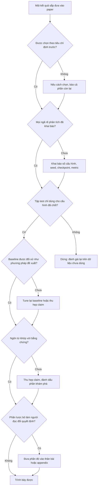

# Đóng khung lại hay bóp méo: ranh giới trung thực

!!! abstract "Mục tiêu của bài"
    Sau bài này, người học có thể:

    - Phân biệt ba vùng trên phổ trình bày kết quả (hợp lệ, vùng xám, sai phạm) và nêu điều kiện khiến một hành vi chuyển vùng.
    - Giải thích HARKing, phân biệt nó với đổi khung hợp lệ, và viết câu đánh dấu một phân tích là khám phá.
    - Nhận diện và khai báo các bậc tự do của người nghiên cứu trong một dự án ML: seed, hyperparameter, checkpoint, dataset, metric, tiền xử lý.
    - Nhận ra các dạng chọn lọc, rò rỉ tập test, ngôn từ thổi phồng, cắt lát và nộp trùng.
    - Dùng ba phép thử nhanh và các thực hành phòng ngừa để tự kiểm tra, kể cả khi áp lực đến từ trong nhóm.

Các bài khác trong chương này liên tục khuyên người viết đổi khung (reframe) câu chuyện: kể một phương pháp thua trên benchmark tổng thể như một phương pháp mạnh ở chế độ ít dữ liệu, viết lại một tổ hợp nhiều thành phần thành nghiên cứu về việc thành phần nào thực sự quan trọng, biến một kết quả âm tính thành một phát hiện. Những lời khuyên đó đúng, vì kế hoạch ban đầu hiếm khi còn nguyên vẹn sau khi gặp dữ liệu. Nhưng nếu bị đẩy quá xa, chúng trượt sang chọn phần bằng chứng đẹp, giấu phần xấu, và kể một câu chuyện mà toàn bộ dữ liệu không ủng hộ. Ranh giới giữa hai thứ hiếm khi được vạch rõ, và người mới thường chỉ nhận ra đã vượt qua nó khi reviewer chỉ ra, hoặc khi một nhóm khác không tái lập được kết quả.

Bài [Xây "câu chuyện" của paper](../01-truoc-khi-viet/cau-chuyen.md) đã có mục ngắn *Trung thực*, nêu những điều không được làm và nhắc tới HARKing. Bài này đi sâu hơn theo ba hướng: thay danh sách cấm bằng một **phổ liên tục**, vì phần lớn quyết định khó nằm ở vùng giữa; giảng các khái niệm phương pháp luận nằm sau những lời khuyên quen thuộc; và cung cấp công cụ kiểm tra, phòng ngừa, cùng cách nêu quan ngại trong nhóm. Mục tiêu không phải là khiến người viết ngại trình bày thuyết phục, mà là biết một quyết định đang nằm ở đâu, để mạnh dạn ở vùng hợp lệ và dừng đúng chỗ.

## Phổ từ trình bày tốt tới sai phạm

Cách nghĩ phổ biến về đạo đức nghiên cứu là nhị phân: bịa số liệu là gian lận, mọi thứ khác đều được phép. Nó khiến người viết yên tâm với những thực hành gây hiểu lầm như báo seed tốt nhất hay lặng lẽ bỏ một dataset bất lợi, đồng thời khiến một số người coi cả lựa chọn chính đáng, như đặt kết quả mạnh nhất lên Figure 1, là thao túng. Hữu ích hơn là xem các hành vi như những điểm trên một phổ ba vùng.

**Vùng hợp lệ** gồm những lựa chọn giúp người đọc hiểu bằng chứng nhanh hơn và đúng hơn: thứ tự trình bày, nhấn mạnh phát hiện chính, chọn ví dụ theo tiêu chí nêu rõ, đặt câu chuyện quanh chế độ mà phương pháp mạnh trong khi vẫn báo cáo các chế độ còn lại. Phép thử của vùng này là: nếu người đọc biết mọi điều tác giả biết, họ vẫn rút ra cùng kết luận.

**Vùng xám** gồm những hành vi mà tính hợp lệ phụ thuộc vào ngữ cảnh và nhất là vào việc có được **khai báo** hay không. Báo seed tốt nhất chấp nhận được khi paper ghi rõ "best of N", báo kèm trung bình và áp cùng quy tắc cho baseline; nó gây hiểu lầm khi được trình bày như kết quả điển hình. Văn liệu phương pháp luận gọi những hành vi kiểu này là *questionable research practices*: thường không xuất phát từ ý định lừa dối, nhưng tác động lên người đọc thì như nhau. Khai báo kéo chúng về vùng hợp lệ, vì khi biết cách chọn, người đọc tự điều chỉnh mức tin tưởng.

**Vùng sai phạm** gồm những hành vi làm sai lệch bằng chứng theo cách người đọc không thể tự điều chỉnh, hoặc vi phạm trực tiếp quy định của nơi công bố. Ở cực xa nhất là bịa đặt (fabrication), sửa đổi (falsification) và đạo văn, nhưng vùng này rộng hơn thế: tune trên tập test rồi báo như kết quả trên dữ liệu chưa thấy là sai phạm dù không số nào bị bịa, vì con số không còn đo đại lượng nó tuyên bố đo; nộp trùng là sai phạm dù cả hai bản đều chứa kết quả thật, vì nó vi phạm cam kết tác giả đưa ra khi nộp.

Từ mô hình này rút ra hai nguyên tắc cho cả bài. Thứ nhất, **ý định không phải là thước đo chính**: một nghiên cứu sinh thật lòng tin rằng seed tốt nhất là "seed đúng" vẫn gây cho người đọc đúng sai lệch như người cố ý chọn, nên phòng ngừa phải dựa vào quy trình chứ không vào thiện chí. Thứ hai, **khai báo nối được vùng xám với vùng hợp lệ, nhưng không bắc được tới vùng sai phạm**: một paper viết *"we tuned hyperparameters on the test set"* là trung thực, nhưng con số của nó vẫn vô giá trị như một ước lượng về khả năng tổng quát hóa.

Bảng dưới đây tổng hợp mười lăm hành vi thường gặp; cột cuối nêu điều kiện chuyển vùng.

| Hành vi | Vùng | Điều kiện và ghi chú |
|---|---|---|
| Chọn ví dụ định tính theo tiêu chí nêu rõ, kèm failure cases | Hợp lệ | Tiêu chí ghi trong caption hoặc appendix |
| Chọn ví dụ định tính đẹp nhất mà không nói cách chọn | Xám, nghiêng về sai phạm | Ghi rõ là chọn lọc, thêm mẫu ngẫu nhiên ở appendix |
| Báo trung bình và độ lệch chuẩn qua nhiều seed | Hợp lệ | Nêu số seed và yếu tố thay đổi giữa các lần chạy |
| Báo seed tốt nhất | Xám | Ghi "best of N", kèm trung bình, cùng quy tắc cho baseline |
| Đổi khung sau khi có kết quả, khung mới đúng với toàn bộ bằng chứng | Hợp lệ | Phần hậu nghiệm được đánh dấu là khám phá |
| Trình bày giả thuyết hậu nghiệm như tiên nghiệm (HARKing) | Xám tới sai phạm | Càng che giấu bằng chứng trái chiều, càng gần sai phạm |
| Bỏ dataset vì lý do khách quan (license, lỗi nhãn đã biết, ngoài phạm vi) | Hợp lệ | Lý do được nêu và không phụ thuộc vào kết quả |
| Bỏ dataset chuẩn của bài toán chỉ vì phương pháp thua | Sai phạm | Báo cáo và phân tích nó, hoặc thu hẹp claim |
| Chọn hyperparameter hoặc checkpoint trên tập test | Sai phạm | Khai báo không cứu được con số |
| Dùng baseline yếu, cũ, hoặc tune kém hơn phương pháp đề xuất | Xám tới sai phạm | Cùng ngân sách tune, baseline mạnh gần đây, nguồn số liệu rõ ràng |
| Chỉ báo metric mà phương pháp thắng | Xám | Báo đủ metric chuẩn; metric mới cần lý do độc lập với kết quả |
| Thổi phồng đóng góp và ngôn từ | Xám | Sai phạm khi tác giả biết claim "first" là không đúng |
| Cắt một kết quả thành nhiều paper chồng lấn | Xám tới sai phạm | Mỗi paper đứng được riêng, trích dẫn chéo, khai báo chồng lấn |
| Nộp trùng | Sai phạm | Vi phạm quy định đã cam kết khi nộp |
| Không trích dẫn công trình đồng thời hay công trình gần đã biết | Xám tới sai phạm | Trích dẫn và nêu khác biệt khách quan |

Gần như mọi điều kiện ở cột cuối quy về hai ý: **khai báo** (người đọc có được biết cách chọn không) và **đối xứng** (quy tắc áp cho phương pháp đề xuất có được áp y hệt cho baseline không).

!!! danger "Những điều không có vùng xám"
    Bịa hoặc sửa số liệu, hình ảnh, log hay nhãn; báo con số đã tối ưu trên tập test như kết quả trên dữ liệu chưa thấy; nộp trùng; đạo văn, kể cả đạo ý tưởng hay hình vẽ. Tùy quy định của hội nghị và cơ sở nghiên cứu, hậu quả có thể gồm rút paper, bị hạn chế nộp bài và xử lý ở cấp cơ sở, kéo theo tổn hại lâu dài cho mọi đồng tác giả.

## Đổi khung sau khi có kết quả: HARKing và đổi khung hợp lệ

Đổi khung sau khi có kết quả là hành vi khó phân định nhất trong bảng, vì cùng một thao tác bề ngoài có thể rơi vào bất kỳ vùng nào. Năm 1998, nhà tâm lý học Norbert Kerr đặt tên cho dạng có vấn đề của nó trong một bài trên *Personality and Social Psychology Review*: **HARKing** (*Hypothesizing After the Results are Known*), tức trình bày một giả thuyết hình thành *sau khi* thấy kết quả như thể nó được đặt ra *từ trước*.

Giả thuyết hậu nghiệm có thể hoàn toàn đúng; cái hại nằm ở cách người đọc cân sức nặng của bằng chứng. Một giả thuyết đặt ra trước, có thể bị thí nghiệm bác bỏ mà không bị, đã "chịu rủi ro" và sống sót. Một giả thuyết nặn ra sau thì khớp với kết quả vì được xây để khớp. Trình bày nó như tiên nghiệm khiến bằng chứng trông mạnh hơn thực tế, nhiễu của một dataset có thể được nâng thành "lý thuyết", và những giả thuyết ban đầu đã thất bại biến mất khỏi văn liệu, khiến các nhóm khác tốn công thử lại.

Trong ML, CV và NLP, giả thuyết thường ẩn dưới dạng "thành phần A giúp ích vì nó xử lý vấn đề X". Xét một ví dụ giả định ở NLP: một nhóm thiết kế cơ chế truy xuất tăng cường để giảm ảo giác (hallucination) trên thực thể hiếm, nhưng kết quả cho thấy gần như không có tác dụng ở đó, trong khi cải thiện rõ trên câu hỏi suy luận nhiều bước (multi-hop). Phiên bản HARKing của paper mở đầu bằng *"We hypothesize that multi-hop reasoning fails because…, and design our method to address this"*, dù giả thuyết này chưa được kiểm tra trên dữ liệu nào ngoài chính dữ liệu đã gợi ra nó.

Phiên bản hợp lệ không buộc paper kể lại nhật ký dự án; tổ chức câu chuyện quanh phát hiện multi-hop là chính đáng, với ba điều kiện. Một là **khung mới đúng với toàn bộ bằng chứng**. Hai là **trạng thái của bằng chứng được nói đúng**: quy luật phát hiện trên chính dữ liệu dùng để báo cáo là kết quả khám phá (exploratory); nếu giả thuyết hình thành trên tập validation rồi được kiểm tra trên hai benchmark multi-hop chưa dùng trong phân tích, nó trở thành kết quả khẳng định (confirmatory). Ba là **điều người đọc cần biết về giả thuyết ban đầu không bị xóa**: nếu cộng đồng có lý do kỳ vọng truy xuất giúp ích cho thực thể hiếm, việc nó không giúp ích là thông tin có giá trị, nên có mặt ít nhất trong phần phân tích hoặc appendix.

<div class="bad" markdown>
*"As hypothesized, our retrieval mechanism substantially improves multi-hop reasoning (Table 4)."*

Cụm *"as hypothesized"* khẳng định một trình tự không có thật, và người đọc sẽ coi Bảng 4 là một phép kiểm định thành công.
</div>

<div class="good" markdown>
*"Although our mechanism was not designed for multi-hop questions, the gains concentrate there (Table 4). We hypothesize that retrieval helps by supplying intermediate facts, and test this on two multi-hop benchmarks that were not used in this analysis (Sec. 5.4)."*

Người đọc biết phát hiện là hậu nghiệm, biết giả thuyết là gì, và biết bằng chứng nào là kiểm định độc lập.
</div>

Khi không kiểm chứng được trên dữ liệu mới, cách trung thực là gọi tên trạng thái khám phá, như các câu mẫu sau.

```text
This analysis is exploratory: we identified the pattern on the validation set
after observing the main results, and it should be read as hypothesis-generating
rather than confirmatory.

We did not pre-specify this subgroup analysis. For completeness, Appendix D
reports the same analysis for all other subgroups we examined.

Our initial motivation was to reduce hallucination on rare entities; we found no
consistent effect there (Appendix C). The gains instead concentrate on multi-hop
questions, which we study in the remainder of the paper.
```

Câu mẫu thứ hai còn báo cáo *mọi* nhóm con đã xem, và điều đó dẫn sang khái niệm tiếp theo: số con đường đã đi qua trước khi tới kết quả.

## Khu vườn rẽ nhánh: những lựa chọn không ai nhìn thấy

HARKing là đổi câu hỏi sau khi thấy câu trả lời; vấn đề tinh tế hơn xảy ra cả khi câu hỏi giữ nguyên. Andrew Gelman và Eric Loken, trong bài viết năm 2013 *The garden of forking paths*, chỉ ra rằng các lựa chọn phân tích không được khai báo làm sai lệch suy luận *kể cả khi không ai cố ý thử nhiều phân tích để tìm kết quả đẹp*. Nhà nghiên cứu có thể chỉ chạy một phân tích, nhưng phân tích ấy được chọn sau khi nhìn dữ liệu; với dữ liệu khác, một phân tích khác cũng hợp lý đã có thể được chọn, nên con số cuối cùng mang dấu vết của nhiều phép so sánh tiềm năng.

Một phép tính đơn giản cho thấy mức độ: nếu mỗi cấu hình có 5% khả năng trông "tốt hơn có ý nghĩa" chỉ do ngẫu nhiên, thì qua 20 cấu hình độc lập, khả năng ít nhất một cấu hình như vậy là 1 − 0,95^20, khoảng 64%. Các cấu hình trong ML không độc lập, nên con số thực tế khác đi, nhưng hướng hiệu ứng không đổi: càng nhiều ngã rẽ, nhánh tốt nhất càng lạc quan so với hiệu quả thật.

Các bậc tự do của người nghiên cứu (*researcher degrees of freedom*) trong ML, CV và NLP gồm **seed**, **hyperparameter** (cả không gian lẫn ngân sách tìm kiếm), **checkpoint**, **dataset** (cả phiên bản lẫn cách chia), **metric** (cả cách cài đặt, vì khác cách tokenize hay ngưỡng IoU có thể cho những con số không so sánh được) và **tiền xử lý** (với LLM, cả prompt template lẫn tham số giải mã). Henderson và cộng sự, trong *Deep Reinforcement Learning that Matters* (AAAI 2018), cho thấy kết quả deep RL nhạy với seed, hyperparameter và chi tiết cài đặt, và kêu gọi một chuẩn báo cáo chặt hơn.

Không thể tránh đưa ra lựa chọn, nhưng có thể làm cho chúng nhìn thấy được: chốt lựa chọn trên tập validation trước khi chạm vào test; khai báo cả số nhánh đã thử chứ không chỉ nhánh được chọn; cho thấy kết luận vững qua các nhánh hợp lý bằng phân tích độ nhạy; và áp cùng quy trình cho baseline. Bảng sau tổng hợp cách khai báo, và đoạn mẫu bên dưới gói chúng vào vài câu cho phần Experimental setup.

| Bậc tự do | Ngã rẽ điển hình | Khai báo trong paper |
|---|---|---|
| Seed | Số lần chạy, seed nào được báo | Số seed, mean ± std, yếu tố thay đổi giữa các lần chạy |
| Hyperparameter | Không gian, ngân sách, tập dùng để chọn | Không gian tìm kiếm, số cấu hình mỗi phương pháp, tiêu chí chọn |
| Checkpoint | Cuối, tốt nhất trên validation, trung bình | Quy tắc chọn, như nhau cho mọi hệ thống |
| Dataset | Dataset, phiên bản, cách chia, lọc mẫu | Mọi dataset đã đánh giá, phiên bản, quy tắc lọc |
| Metric | Metric nào, cài đặt nào | Định nghĩa, thư viện và phiên bản, tham số |
| Tiền xử lý | Độ phân giải, tokenization, khử trùng lặp, prompt | Quy trình đầy đủ ở appendix; prompt nguyên văn |

```text
Hyperparameters for all methods, including baselines, were selected on the
validation set with the same budget of 30 configurations per method (Appendix B.1),
and the same checkpoint rule was applied to all systems. Results are mean ± std
over 5 seeds. No dataset was excluded after observing results, and the test set
was used once per reported configuration.
```

## Chọn lọc: năm chỗ dễ trượt

Khu vườn rẽ nhánh nói về lựa chọn *trong lúc phân tích*; chọn lọc là lựa chọn *khi trình bày*. Năm đối tượng hay bị chọn lọc nhất là seed, ví dụ định tính, dataset, baseline và metric, và mỗi đối tượng có một dạng hợp lệ lẫn một dạng gây hiểu lầm.

**Seed.** Ngoài việc báo lần chạy tốt nhất, còn một dạng kín đáo hơn: chỉ chạy lại "cho chắc" khi kết quả xấu và dừng ngay khi kết quả đẹp. Quy tắc dừng phụ thuộc kết quả như vậy cũng là chọn lọc. Reviewer nghi ngờ khi mức cải thiện nhỏ mà không có error bar, hoặc khi baseline chạy lại thấp hơn paper gốc. Cách làm đúng đã có ở mục *Số liệu và ý nghĩa thống kê* trong bài [Experiments](../02-viet-tung-phan/experiments.md): cố định số seed từ trước và báo mean ± std.

**Ví dụ định tính.** *"Cherry-picked visualizations"* là phê bình quen thuộc ở CV, và vấn đề tương tự xảy ra với đầu ra được trích của mô hình sinh văn bản ở NLP. Chọn ví dụ đẹp để minh họa điều phương pháp *có thể* làm không có gì sai; vấn đề nằm ở việc ngụ ý đó là chất lượng điển hình. Cách giải quyết là nêu tiêu chí chọn trong caption, thêm mẫu ngẫu nhiên ở appendix theo kiểu phân biệt *curated* và *uncurated* của mô hình sinh ảnh, và đặt một hình failure case cạnh các ví dụ thành công.

**Dataset.** Câu hỏi then chốt là danh sách dataset được chốt *khi nào*. Nếu chốt sau khi biết phương pháp thắng ở đâu, danh sách ấy là một nhánh trong khu vườn rẽ nhánh. Bỏ dataset vì lý do khách quan được nêu ra là hợp lệ; bỏ một dataset chuẩn vì phương pháp thua thì không. Phân tích vì sao phương pháp thua thường làm lộ ra ranh giới áp dụng của nó, một lối ra mạnh hơn người viết nghĩ (xem [Khi con số không đẹp](con-so-khong-dep.md)).

**Baseline.** Lipton và Steinhardt, trong *Troubling Trends in Machine Learning Scholarship* (2018), xếp "không xác định được nguồn gốc của cải thiện thực nghiệm" vào bốn xu hướng đáng lo ngại, chẳng hạn cải thiện được gán cho kiến trúc mà thực ra đến từ tuning. Các nghiên cứu đánh giá lại ở mục *So sánh công bằng* trong bài [Thiết kế thí nghiệm](../01-truoc-khi-viet/thi-nghiem.md), của Melis và cộng sự (ICLR 2018), Lucic và cộng sự (NeurIPS 2018), Musgrave và cộng sự (ECCV 2020), cho thấy nhiều "tiến bộ" co lại khi baseline được đối xử công bằng. Chọn baseline yếu là chọn lọc đối thủ.

**Metric.** Khi cộng đồng dùng nhiều metric, chỉ báo metric mà phương pháp thắng là chọn lọc, dù mỗi con số đều đúng; đổi metric chính sau khi thấy kết quả cũng vậy. Đề xuất metric mới là đóng góp hợp lệ khi lý do cho nó độc lập với việc phương pháp đề xuất đạt điểm cao trên nó, và các metric chuẩn vẫn được báo bên cạnh.

Năm dạng chọn lọc có chung một câu hỏi, sẽ trở lại ở mục *Ba phép thử nhanh*: nếu thấy được phần không được chọn, người đọc có đổi ý không?

## Tập test là thứ thiêng liêng

Tập test chỉ có một vai trò: ước lượng hiệu năng trên dữ liệu mà hệ thống chưa từng "thấy" theo bất kỳ nghĩa nào. Vi phạm ở đây không làm con số kém chính xác đi một chút, mà làm nó mất chính ý nghĩa nó tuyên bố. Có bốn dạng.

**Tune trên test** là chọn hyperparameter, checkpoint, ngưỡng hay prompt dựa trên kết quả test. Ít ai làm điều này công khai, nhưng nó hay xảy ra qua đường vòng, như code chọn checkpoint đọc metric từ tập test, hoặc benchmark chỉ có hai phần chia và phần "test" bị dùng làm validation.

**Đánh giá lặp lại trên test** không có bước tune nào: nhóm chạy test sau mỗi thay đổi rồi quyết định bước tiếp. Mỗi lần nhìn để lại một chút thông tin về tập test trong quyết định của con người; qua đủ nhiều vòng, hiệu quả không khác gì tune trên test, và đó là lý do nhiều benchmark có tập test ẩn giới hạn số lần nộp. Ở quy mô cộng đồng, Recht và cộng sự (*Do ImageNet Classifiers Generalize to ImageNet?*, ICML 2019) tạo lại tập test theo quy trình gốc và thấy độ chính xác đều giảm nhưng thứ hạng giữa các mô hình phần lớn được giữ. Đó là tin tương đối tốt về thứ hạng, nhưng không phải giấy phép để một paper chọn cấu hình dựa trên test, và mức sụt giảm nhắc rằng con số tuyệt đối trên một tập test không nên được đọc như năng lực tổng quát.

**Rò rỉ dữ liệu** (data leakage) thường hoàn toàn vô ý: mẫu trùng hoặc gần trùng giữa các phần chia; cùng một thực thể ở cả train và test (cùng bệnh nhân, cùng người nói, các khung hình của cùng video, các câu của cùng tài liệu); dữ liệu huấn luyện chứa thông tin từ sau thời điểm của dữ liệu test; thống kê chuẩn hóa hay từ vựng được tính trên toàn bộ dữ liệu; nhãn lộ ra qua metadata hay tên file. Rò rỉ không phải gian lận, nhưng đã phát hiện mà không sửa và không báo cáo thì là vấn đề.

**Contamination** trong mô hình lớn là khi benchmark có thể đã nằm trong dữ liệu pre-training; các cách giảm thiểu đã có ở bài [Viết cho ACL / EMNLP / NAACL](../06-cong-dong/nlp.md). Khi không loại trừ được contamination, paper phải nói như vậy và thu hẹp claim; "zero-shot generalization" không đứng vững nếu dữ liệu test có thể đã được mô hình thấy. Với mô hình đóng qua API, mô hình phía sau còn có thể thay đổi: Chen, Zaharia và Zou (2023) ghi nhận hành vi của GPT-3.5 và GPT-4 thay đổi giữa hai thời điểm trong cùng một năm. Ghi lại tên mô hình, phiên bản và ngày gọi là cách trung thực để nói rõ con số đo cái gì.

Quy ước nhóm đơn giản nhất, đã nêu trong bài [Thiết kế thí nghiệm](../01-truoc-khi-viet/thi-nghiem.md), là tập test chỉ chạy cho cấu hình đã chốt, và mỗi lần chạy được ghi vào log kèm lý do.

## Ngôn từ và đóng góp thổi phồng

Ngay cả khi mọi con số đều sạch, paper vẫn có thể gây hiểu lầm qua chữ. Bốn xu hướng mà Lipton và Steinhardt nêu gồm: không phân biệt giải thích với suy đoán; không xác định nguồn gốc của cải thiện thực nghiệm (đã bàn ở mục *Chọn lọc*); "mathiness", tức dùng toán để gây ấn tượng thay vì làm rõ (xem bài [Viết cho NeurIPS / ICML / ICLR](../06-cong-dong/ml.md)); và lạm dụng ngôn từ.

Xu hướng thứ nhất là họ hàng của HARKing: một lời giải thích chưa từng được kiểm tra được trình bày như sự thật, rồi được các paper sau nhắc lại. Hai tác giả nêu một ví dụ tích cực: paper giới thiệu dropout dành riêng một mục *Motivation* cho phần suy đoán về mối liên hệ với sinh học, tách nó khỏi phần bằng chứng. Suy đoán được phép, thậm chí có ích, miễn là được đánh dấu bằng những cụm như *"we conjecture"* hay *"one possible explanation is"*.

Lạm dụng ngôn từ có ba dạng. *Định nghĩa gợi ý* (suggestive definitions) là đặt cho khái niệm kỹ thuật một cái tên mang hàm ý đời thường, như thuật ngữ của nhận thức con người, để "lén" đưa vào những hàm ý chưa được chứng minh. *Quá tải thuật ngữ* (overloaded terminology) là dùng một thuật ngữ đã có nghĩa kỹ thuật chính xác theo nghĩa lỏng lẻo hay trái với nghĩa gốc. *Từ va li* (suitcase words), mượn từ Minsky, là những từ gói nhiều nghĩa, như *generalization*: sang test cùng phân phối, sang miền khác, hay ra thế giới thực; lẫn lộn chúng dẫn tới đánh giá quá cao hệ thống, như các claim lỏng lẻo kiểu *"human-level"*.

Ở cấp paper, thổi phồng tập trung ở danh sách đóng góp, và nguyên tắc xuyên suốt của chương là **mỗi đóng góp được liệt kê là một claim phải bảo vệ** (xem [Ghép ý tưởng và "độn" đóng góp](ghep-va-don.md)). *First* đòi hỏi tìm kiếm novelty nghiêm túc và một phạm vi cụ thể; biết có công trình đồng thời hay công trình gần mà không trích dẫn đẩy claim này sang vùng sai phạm (xem mục *Concurrent work* trong bài [Thẩm định ý tưởng](../01-truoc-khi-viet/y-tuong.md)). *Solves* hầu như không bao giờ đúng, *significantly* được hiểu là có ý nghĩa thống kê, và *state-of-the-art* cần nói rõ trên benchmark nào, dưới ràng buộc nào. Cặp ví dụ sau thuộc một phương pháp CV giả định.

<div class="bad" markdown>
*"We propose the first framework that truly understands visual scenes, significantly outperforming all existing methods and solving the long-standing problem of compositional generalization."*

Bốn claim lớn không có phạm vi; *understands* là định nghĩa gợi ý, *significantly* chưa có kiểm định, *solving* không thể bảo vệ.
</div>

<div class="good" markdown>
*"We propose a scene-graph-conditioned decoder that improves compositional generalization on CLEVR-style splits by 4.1 points over the strongest baseline (mean over 5 seeds; Table 2). The gains shrink on natural images (Table 5), suggesting that the benefit depends on accurate scene graphs."*

Claim có thước đo, phạm vi, đối tượng so sánh và độ bất định; giới hạn nằm ngay cạnh kết quả.
</div>

Câu tốt không yếu hơn câu xấu: nó cho reviewer một thứ cụ thể để tin. Lipton và Steinhardt khuyên tác giả hỏi "cái gì đã hiệu quả?" và "vì sao?", chứ không chỉ "tốt tới mức nào?", qua ba thực hành: phân tích lỗi, ablation và kiểm tra độ vững.

## Áp lực bảng xếp hạng

Nhiều hành vi trong bài xuất phát từ một cấu trúc khuyến khích chung: tiến bộ được đo bằng việc ai đứng đầu bảng. Sculley và cộng sự gọi tên vấn đề trong *Winner's Curse? On Pace, Progress, and Empirical Rigor* (ICLR 2018 workshop): nhịp công bố nhanh và sự nhấn mạnh vào việc "thắng" làm sự chặt chẽ thực nghiệm suy giảm, và cộng đồng cần chuẩn mực đánh giá và báo cáo tốt hơn, theo tinh thần đặt sự chặt chẽ và hiểu biết lên trên việc thắng.

Tiêu đề mượn một khái niệm của kinh tế học đấu giá: người thắng đấu giá thường là người đã ước lượng giá trị món hàng cao hơn thực tế. Trong ML, khi nhiều phương pháp với nhiều cấu hình được đánh giá trên cùng một benchmark có nhiễu, phương pháp đứng đầu có xu hướng vừa tốt vừa *may mắn*, nên mức cải thiện nó báo cáo thường lạc quan, và khoảng cách co lại khi người khác tái lập. Không cần ai gian lận để điều này xảy ra.

Với người viết, áp lực này hiện ra qua những cám dỗ cụ thể: in đậm con số cao hơn 0,1 điểm khi độ lệch chuẩn là 0,4; dồn ngân sách tune cho phương pháp đề xuất trong khi baseline chạy cấu hình mặc định; nộp nhiều lần lên server đánh giá. Cách đối phó là báo kèm độ bất định và nói đúng về những gì nằm trong nhiễu. Câu *"our method performs on par with the strongest baseline (within one standard deviation) while using 40% fewer FLOPs"* vẫn là một claim có giá trị.

Áp lực cũng không hoàn toàn đến từ reviewer: hướng dẫn cho reviewer của một số hội nghị những năm gần đây nhắc rằng không nên bác bỏ paper chỉ vì không đạt SOTA; nên kiểm tra Reviewer Guidelines của năm nộp. TMLR, với tiêu chí chú trọng việc claim được bằng chứng ủng hộ chính xác hơn mức độ nổi bật, là một lựa chọn thực sự. Các bài [Khi novelty và hiệu quả lệch pha](novelty-va-hieu-qua.md) và [Áp lực từ bên ngoài](ap-luc-ben-ngoai.md) bàn chi tiết các lối ra này.

## Cắt lát, nộp trùng và tự đạo văn

Nhóm hành vi cuối cùng liên quan tới quan hệ *giữa các paper*: một kết quả được công bố bao nhiêu lần, ở đâu, dưới hình thức nào.

**Cắt lát** (salami slicing) là chia một nghiên cứu thành nhiều paper nhỏ để tăng số công bố. Một dự án lớn sinh ra nhiều paper là bình thường; vấn đề là khi các paper không đứng riêng được hoặc chồng lấn mà không khai báo. Phép thử: mỗi paper có trả lời một câu hỏi riêng, với đóng góp mà paper kia không có, và đọc hiểu được mà không cần paper kia không? Nếu có, và các paper trích dẫn nhau minh bạch, việc chia tách là hợp lệ.

**Nộp trùng** (dual submission) là nộp cùng nội dung, hoặc nội dung chồng lấn đáng kể, tới hai nơi có bình duyệt trong khoảng thời gian chồng lấn. Quy định và rủi ro đã được trình bày ở các bài [Chuẩn bị nộp bài](../04-nop-va-sau-nop/submission.md) và [Chuyển một paper giữa các cộng đồng](../06-cong-dong/chuyen-doi.md), kể cả điểm hay bị hiểu sai rằng viết lại framing không biến paper thành paper khác. Hành vi này thuộc vùng sai phạm vì nó vi phạm cam kết tác giả đưa ra khi nộp và tiêu tốn công sức của hai nhóm reviewer cho một đóng góp.

**Tự đạo văn** (self-plagiarism, hay text recycling) là dùng lại nội dung đã công bố của chính nhóm mà không trích dẫn hay khai báo. Đây là vùng xám rộng nhất, vì thực hành khác nhau giữa các nơi công bố. Dùng lại một đoạn mô tả thiết lập chuẩn, có trích dẫn, thường không bị coi là vấn đề lớn; trình bày lại kết quả, hình hay bảng đã công bố như đóng góp mới thì khác. Mở rộng workshop paper thành paper hội nghị, hay paper hội nghị thành bài tạp chí, có thể hợp lệ khi quy định của cả hai nơi cho phép, bản trước được trích dẫn, và phần mới đủ đáng kể theo tiêu chí của nơi nộp sau. Ở hội nghị double-blind, công trình trước của chính nhóm thường được trích dẫn ở ngôi thứ ba như mọi công trình khác.

!!! info "Quy định khác nhau giữa các hội nghị và theo năm"
    Ranh giới của nộp trùng, việc workshop paper có bị coi là công bố trước không, yêu cầu về phần mới khi mở rộng sang tạp chí, và chính sách preprint khác nhau giữa các hội nghị, tạp chí và thay đổi theo năm. Căn cứ duy nhất là Call for Papers, Author Guidelines và chính sách đạo đức của nơi nộp trong năm nộp. Khi còn phân vân, nên hỏi trực tiếp Program Chairs hoặc biên tập viên và khai báo phần chồng lấn ngay trong form nộp bài.

Cả ba hành vi làm sai lệch "kế toán" của tri thức: cộng đồng tưởng có nhiều bằng chứng độc lập hơn thực tế, hoặc tưởng một đóng góp là mới khi nó đã được công bố.

## Ba phép thử nhanh

Sau các khái niệm, chúng ta cần công cụ đủ gọn để dùng ngay lúc viết: ba phép thử, mỗi phép là một câu hỏi.

**Phép thử toàn bộ log.** Nếu reviewer được xem toàn bộ log thí nghiệm, gồm mọi lần chạy, mọi cấu hình, mọi dataset đã thử và mọi lần chạm vào tập test, claim có còn đứng được không? Đây là phép thử trung tâm của chương. Nó bắt được chọn seed, bỏ dataset, tune bất đối xứng và HARKing, vì tất cả đều để lại dấu vết trong log.

**Phép thử người tái lập.** Một người có năng lực, độc lập với nhóm, chỉ có paper và code, làm đúng theo mô tả, có thu được những con số cùng cỡ và đi tới *cùng kết luận* không? Phép thử này bắt được những ngã rẽ không được khai báo: quy tắc chọn checkpoint ngầm định, một bước tiền xử lý chỉ có trong code, một prompt đã tinh chỉnh nhiều vòng mà paper chỉ ghi bản cuối.

**Phép thử quyết định của người đọc.** Thông tin bị lược bỏ có làm thay đổi quyết định của một người đọc hợp lý không, như tin vào claim, dùng phương pháp, hay chọn nó làm baseline? Nếu có, nó phải có mặt trong paper: ở thân bài nếu liên quan tới claim chính, ở appendix nếu là chi tiết bổ trợ. Lược một ablation phụ không làm ai đổi quyết định; lược một dataset nơi phương pháp thua thì có.

Phép thử phụ **đảo vai** hỏi: nếu gặp đúng cách trình bày này trong paper của một nhóm cạnh tranh, khi đang làm reviewer, nhóm tác giả có chấp nhận không? Sơ đồ dưới đây gom các câu hỏi thành một trình tự tự kiểm tra trước khi đưa một kết quả vào paper.



Chỉ nhánh của tập test dẫn tới "dừng" thay vì "khai báo rồi đi tiếp", đúng như nguyên tắc thứ hai ở đầu bài.

## Thực hành phòng ngừa

Vì phần lớn sai lệch xảy ra vô thức, cách phòng ngừa hiệu quả nhất là thiết kế quy trình để chúng khó xảy ra ngay từ đầu.

**Sổ tay thí nghiệm và nhật ký quyết định.** Mục *Ghi chép thí nghiệm* trong bài [Thiết kế thí nghiệm](../01-truoc-khi-viet/thi-nghiem.md) đã hướng dẫn lưu metadata cho mỗi lần chạy và ánh xạ mỗi con số trong paper về một lần chạy. Cần bổ sung thứ mà metadata tự động không ghi được: một **nhật ký quyết định**. Mỗi khi đổi metric chính, bỏ dataset, đổi quy tắc chọn checkpoint hay thêm phân tích nhóm con, ghi lại ngày, lựa chọn, lý do, và quan trọng nhất, lựa chọn đó được đưa ra *trước* hay *sau* khi nhìn kết quả liên quan. Vài dòng mỗi tuần đủ để khi viết, nhóm biết phân tích nào là khẳng định, phân tích nào là khám phá, thay vì dựa vào trí nhớ.

**Ghi giả thuyết và tiêu chí trước khi chạy.** Đăng ký trước (preregistration) chính thức có ở tâm lý học và nghiên cứu lâm sàng nhưng chưa phổ biến trong ML, CV và NLP; phiên bản gọn nhẹ thì dễ áp dụng: trước mỗi đợt thí nghiệm quan trọng, viết một trang kế hoạch và commit vào repository để có dấu thời gian. Dòng *Amendments* ở cuối mẫu là quan trọng nhất: kế hoạch thay đổi là bình thường, miễn là mọi thay đổi để lại dấu vết.

```text
Analysis plan (commit before running; never edit; append amendments at the end)
Date:
Claim under test:
Result that would support it / result that would count against it:
Datasets and splits (complete list):
Primary metric (implementation, version) and secondary metrics:
Baselines and tuning budget (same for all methods):
Seeds (number fixed in advance), checkpoint selection rule:
Test-set protocol (who runs it, how many times):
Planned subgroup analyses:
Amendments (date, change, reason, before or after seeing which results):
```

**Báo cáo mọi run.** Paper không chứa được mọi lần chạy, nhưng báo được *số lượng* và *phạm vi*: bao nhiêu cấu hình mỗi phương pháp, những dataset nào đã đánh giá, những biến thể nào đã thử mà không hiệu quả. Một câu như *"Appendix E lists all 47 configurations we trained, including variants that did not improve over the baseline"* trả lời trước phép thử toàn bộ log.

**Mục Limitations.** Ngoài cách viết đã có ở bài [Conclusion, Limitations và Appendix](../02-viet-tung-phan/conclusion-supp.md), Limitations còn là nơi tự nhiên để khai báo trạng thái khám phá của một phân tích, rủi ro contamination không loại trừ được, các chế độ mà phương pháp không cải thiện, và những ngã rẽ mà kết luận nhạy cảm. Do tác giả chủ động nêu, chúng cho thấy công trình hiểu rõ phạm vi của nó; do reviewer phát hiện, chúng trở thành bằng chứng của sự che giấu.

**Các checklist.** NeurIPS Paper Checklist và ARR Responsible NLP Checklist là hai ví dụ tiêu biểu về việc cộng đồng biến những câu hỏi của bài này thành yêu cầu bắt buộc; nội dung được trình bày ở các bài [Viết cho NeurIPS / ICML / ICLR](../06-cong-dong/ml.md) và [Chuẩn bị nộp bài](../04-nop-va-sau-nop/submission.md). Nên điền chúng từ bản nháp đầu tiên: mỗi câu trả lời khó viết trung thực là một chỗ cần sửa.

## Khi áp lực đến từ trong nhóm

Những tình huống khó nhất về trung thực thường đến từ một đề nghị của người hướng dẫn hay đồng tác giả: bỏ dataset này đi, chỉ báo lần chạy tốt nhất, viết rằng phương pháp được thiết kế cho mục đích thực ra chỉ phát hiện sau. Với nghiên cứu sinh, đây là bài toán khó vì quan hệ trong nhóm không cân bằng.

Phần lớn những đề nghị như vậy đến từ áp lực deadline, từ thói quen "ai cũng làm thế", hoặc từ việc người đề nghị chưa xem kỹ log, chứ không từ ý định lừa dối. Vì vậy, nên coi đây là câu hỏi về chất lượng paper, không phải cuộc đối đầu về đạo đức. Bốn yếu tố giúp nêu quan ngại một cách xây dựng. Thứ nhất, **dựa vào chuẩn mực cộng đồng** thay vì quan điểm cá nhân: checklist của NeurIPS, mục Limitations của ARR, phê bình *"cherry-picked visualizations"* quen thuộc ở CV; chúng chuyển cuộc trao đổi từ "đúng hay sai" sang "reviewer sẽ đọc thế nào", câu hỏi mà mọi đồng tác giả đều quan tâm. Thứ hai, **đưa bằng chứng cụ thể** từ log và từ văn liệu. Thứ ba, **luôn kèm một phương án trình bày vừa trung thực vừa mạnh**; quan ngại không kèm đề xuất dễ bị coi là cản trở, còn quan ngại kèm đề xuất là một đóng góp. Thứ tư, **nêu sớm và bằng văn bản**, tập trung vào nội dung chứ không vào con người.

Một bình luận theo cấu trúc trên có thể gồm bốn phần, như ví dụ giả định dưới đây:

- **Quan sát.** Bảng 2 không có dataset Z; log cho thấy phương pháp thấp hơn baseline B khoảng một điểm trên Z, trung bình năm seed.
- **Chuẩn mực.** Z là một trong ba benchmark mà hầu hết paper gần đây về bài toán đều dùng, nên reviewer nhiều khả năng sẽ hỏi.
- **Đề xuất.** Giữ Z trong Bảng 2; thêm một đoạn ở Mục 5.3 cho thấy Z có văn bản dài hơn hẳn, đúng chế độ mà phương pháp không nhắm tới; thu hẹp claim ở Introduction thành cải thiện trên văn bản ngắn; nêu Z trong Limitations.
- **Chi phí.** Khoảng nửa trang, không cần thí nghiệm mới; đổi lại, claim chính khó bị tấn công hơn.

Phương án thay thế thường có sẵn trong các bài khác của chương: nói rõ chế độ mà phương pháp thắng, biến phân tích bất lợi thành phát hiện về phạm vi, thu hẹp claim, thêm thí nghiệm kiểm chứng, hoặc đổi nơi công bố. Đôi khi phương án tốt nhất là lùi sang chu kỳ sau hoặc dừng hướng đi hiện tại; dừng lại cũng là một quyết định nghiên cứu tốt, và chi phí chìm không phải là lý do để tiếp tục.

!!! note "Mọi tác giả đứng tên đều chịu trách nhiệm về nội dung"
    Theo chuẩn mực chung của cộng đồng khoa học, đứng tên trên một paper đồng nghĩa với chịu trách nhiệm về nội dung của nó, không chỉ về phần việc của riêng từng người. Vì vậy mỗi đồng tác giả có quyền nêu quan ngại. Khi bất đồng về một vấn đề nghiêm trọng kéo dài, có thể tìm ý kiến của một người thứ ba đáng tin cậy như một giảng viên khác, hoặc tham khảo bộ phận phụ trách liêm chính học thuật mà các trường và viện thường có. Rút tên khỏi paper là lựa chọn sau cùng, nhưng chính đáng.

Ở phía ngược lại, người hướng dẫn có thể làm những cuộc trao đổi này dễ hơn: đặt quy ước về tập test và báo cáo seed từ đầu dự án, và đón một kết quả xấu bằng câu hỏi "điều này cho biết gì?" thay vì "làm sao để nó biến mất?".

## Tóm tắt

Trình bày kết quả là một phổ ba vùng chứ không phải lựa chọn nhị phân: ở vùng hợp lệ, người đọc biết mọi điều tác giả biết vẫn rút ra cùng kết luận; ở vùng xám, khai báo và đối xử đối xứng với baseline kéo hành vi về vùng hợp lệ; ở vùng sai phạm, như tune trên test, nộp trùng hay bịa số liệu, không cách trình bày nào cứu được. Đổi khung sau khi có kết quả là hợp lệ khi khung mới đúng với toàn bộ bằng chứng và trạng thái khám phá hay khẳng định được nói đúng; HARKing là khi giả thuyết hậu nghiệm được trình bày như tiên nghiệm. Khu vườn rẽ nhánh nhắc rằng các lựa chọn về seed, hyperparameter, checkpoint, dataset, metric và tiền xử lý cần được chốt trên validation và khai báo. Chọn lọc, rò rỉ tập test, ngôn từ thổi phồng, cắt lát và nộp trùng có chung phép thử trung tâm: nếu reviewer được xem toàn bộ log, claim có còn đứng được không. Các thực hành phòng ngừa biến trung thực từ thiện chí thành quy trình, và khi áp lực đến từ trong nhóm, nên nêu quan ngại dựa trên chuẩn mực cộng đồng, kèm một phương án vừa trung thực vừa mạnh.

## Bài tập

1. **Lập sổ cái thí nghiệm.** Liệt kê mọi cấu hình, seed, dataset, metric và biến thể đã thử trong dự án hiện tại, kể cả những thứ đã bỏ. Áp phép thử toàn bộ log lên các bảng trong bản nháp và quyết định, với mỗi khác biệt, cần khai báo hay sửa claim.
2. **Viết kế hoạch phân tích.** Trước đợt thí nghiệm quan trọng tiếp theo, điền mẫu kế hoạch phân tích và commit vào repository. Sau khi có kết quả, ghi thay đổi vào *Amendments* và viết bằng tiếng Anh các câu đánh dấu phần khám phá.
3. **Xếp hành vi lên phổ.** Với bảng kết quả chính, một hình định tính và danh sách đóng góp trong bản nháp, xếp từng lựa chọn trình bày vào một vùng theo bảng tổng hợp, và viết câu khai báo hoặc bản sửa để đưa nó về vùng hợp lệ.
4. **Thực hành nêu quan ngại.** Giả định một đồng tác giả đề nghị bỏ một kết quả bất lợi. Viết một bình luận theo cấu trúc bốn phần (quan sát, chuẩn mực, đề xuất, chi phí), trong đó phần đề xuất có câu tiếng Anh sẽ dùng trong paper.
