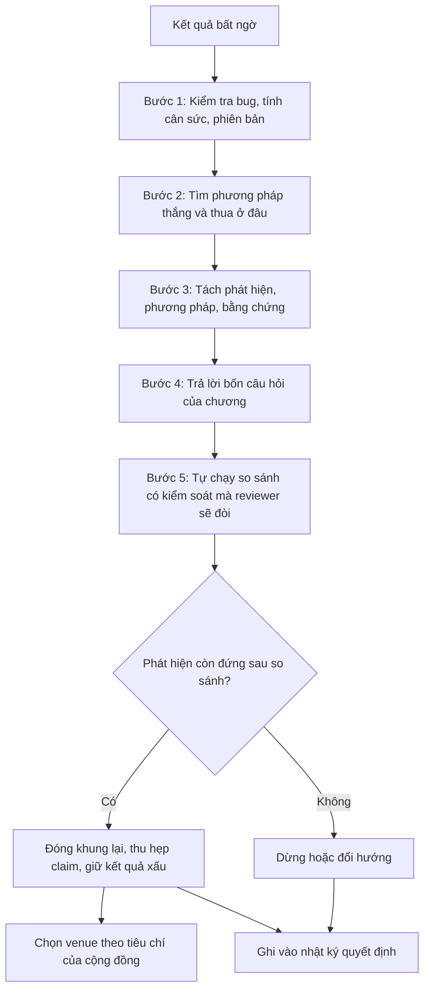

# Thực hành: ba dự án đi qua ngõ cụt

!!! abstract "Mục tiêu của bài"
    Sau bài này, người học có thể:

    - Nhận ra rằng trong một dự án thật, các tình huống trớ trêu hiếm khi đến riêng lẻ mà nối tiếp nhau, và lối ra được chọn ở tình huống trước quyết định hình dạng của tình huống sau.
    - Áp dụng khung ba lớp (phát hiện, phương pháp, bằng chứng) và bốn câu hỏi của chương cho trọn một dự án, từ lúc kết quả bất ngờ xuất hiện tới lúc chọn venue.
    - Viết lại abstract và danh sách contribution sau khi đổi khung, và giải thích từng thay đổi bằng bằng chứng cụ thể.
    - Nhận diện những lối tắt vi phạm ranh giới trung thực ngay khi chúng xuất hiện dưới dạng một đề xuất nghe rất hợp lý.
    - Duy trì một nhật ký quyết định cho dự án nghiên cứu của người học.

Các bài trước trong chương xử lý mỗi tình huống như một ca bệnh riêng: một triệu chứng, một chẩn đoán, vài lối ra. Cách trình bày ấy cần thiết cho việc học, nhưng nó che đi một đặc điểm quan trọng của nghiên cứu thật: các tình huống thường đến thành chuỗi. Một module mới thua baseline; phân tích kỹ thì thấy nó thắng ở tập con này và thua ở tập con kia; để cứu con số tổng, nhóm thêm vài mẹo huấn luyện và đạt SOTA, nhưng giờ không ai còn biết cái gì tạo ra kết quả. Mỗi lối ra được chọn ở bước trước làm thay đổi các lối ra còn mở ở bước sau. Một lựa chọn sai ở giữa chuỗi, chẳng hạn viết abstract SOTA trước khi làm ablation, có thể khóa nhóm tác giả vào một câu chuyện mà bằng chứng về sau không còn ủng hộ.

Bài thực hành này theo dõi ba dự án giả định, mỗi dự án thuộc một cộng đồng, từ ý tưởng ban đầu tới bản paper được nộp. Bài [Thực hành: một paper từ con số 0](../05-case-studies/worked-example.md) ở Chương 5 đi theo dự án DenseQ, một con đường tương đối suôn sẻ, với trọng tâm là quy trình. Ba dự án ở đây thì đều đi vào ngõ cụt, và trọng tâm là cách *ra khỏi* ngõ cụt. Mỗi dự án được kể như một nghiên cứu tình huống theo dòng thời gian, gồm chín phần cố định: ý tưởng và câu chuyện ban đầu; diễn biến thí nghiệm; nhận diện tình huống và bốn câu hỏi; các lối ra; abstract trước và sau; contribution trước và sau; venue; những gì không làm; và bài học. Cấu trúc lặp lại có chủ ý, để người học đặt ba dự án cạnh nhau ở cùng một điểm của quy trình.

Cũng cần nói trước một điều: không dự án nào kết thúc bằng một paper "thắng lớn". Cả ba kết thúc bằng một paper *đúng*, với claim hẹp hơn kỳ vọng ban đầu nhưng đứng vững trước toàn bộ log thí nghiệm. Đó là kết cục thường gặp nhất của một dự án đi qua ngõ cụt và được xử lý tốt. Người mới làm nghiên cứu lại hay đánh giá thấp nó nhất.

!!! note "Mọi chi tiết trong bài là ví dụ giả định"
    Ba dự án, tên phương pháp (ScaleBridge, DecoVer, StabReg), tên benchmark tự tạo (NoisySmall-6), mọi con số, nhận xét của người hướng dẫn, và cả paper concurrent ở dự án thứ hai đều là **giả định** để minh họa. COCO, CIFAR-10 và ImageNet là các benchmark có thật, nhưng mọi kết quả trên chúng trong bài đều là giả định. Paper thật chỉ được nhắc khi đó là ví dụ nổi tiếng cho đúng điểm đang bàn.

Bảng dưới đây giới thiệu nhanh ba dự án trước khi đi vào chi tiết.

| | Dự án thứ nhất | Dự án thứ hai | Dự án thứ ba |
|---|---|---|---|
| Cộng đồng | Computer Vision | NLP | Machine Learning |
| Ý tưởng ban đầu | Module cross-scale attention cho instance segmentation | Pipeline prompt năm bước cho bài toán suy luận | Regularizer xuất phát từ một bound ổn định thuật toán |
| Chuỗi tình huống | TH1, TH12, TH6, TH18 | TH2, TH27, TH24 | TH34, TH14, TH11, TH7 |
| Lối ra chính | Đóng khung quanh trade-off theo kích thước vật thể, so sánh cùng recipe | Paper "simple baseline + phân tích", thêm mô hình mở | Thu hẹp claim về đúng chế độ mà lý thuyết dự đoán |
| Venue | Hội nghị CV lớn, giữ deadline | Chu kỳ ARR kế tiếp, chấp nhận khả năng Findings | TMLR |

## Dự án thứ nhất (Computer Vision): module attention cho vật thể nhỏ

### Ý tưởng ban đầu và câu chuyện ban đầu

Nhóm tác giả gồm một nghiên cứu sinh năm hai, một postdoc và người hướng dẫn, làm instance segmentation, tức bài toán vừa phát hiện vừa vẽ mặt nạ (*mask*) chính xác cho từng vật thể trong ảnh. Quan sát xuất phát rất quen thuộc: các mô hình mạnh hiện nay cho mask kém ở vật thể nhỏ. Trên COCO, benchmark chuẩn của bài toán, kết quả thường được báo cáo tách theo ba nhóm kích thước, gọi là AP_S, AP_M và AP_L. Theo quy ước của COCO, vật nhỏ có diện tích dưới 32×32 pixel, vật lớn có diện tích trên 96×96 pixel. AP_S luôn thấp hơn hẳn hai nhóm còn lại.

Giả thuyết của nhóm như sau. Mask head của các mô hình dựa trên query làm việc chủ yếu trên feature map độ phân giải thấp, nơi một vật nhỏ chỉ còn vài ô. Nếu cho các feature thô này "hỏi" trực tiếp feature map độ phân giải cao (stride 4) qua một cơ chế attention, chi tiết bị mất do downsampling có thể được khôi phục. Module được đặt tên là ScaleBridge. Câu chuyện ban đầu được viết trong bản pitch ở tháng thứ nhất:

> *Cross-scale attention lets coarse semantic features recover the fine detail lost by downsampling, improving segmentation for objects of all sizes, and especially for small objects.*

Câu chuyện này có một điểm yếu mà về sau mới lộ ra: nó chứa hai claim chứ không phải một. "Cải thiện cho mọi kích thước" và "đặc biệt cho vật nhỏ" nghe như cùng một ý. Thực ra chúng tách rời được, và bằng chứng hoàn toàn có thể ủng hộ claim này trong khi phủ định claim kia. Ở giai đoạn pitch không ai trong nhóm để ý điều đó, vì khi chưa có số liệu, mọi claim đều có vẻ cùng hướng.

### Diễn biến thí nghiệm: kết quả bất ngờ ở đâu

Trong tháng thứ hai và thứ ba, nhóm cài ScaleBridge vào một mô hình instance segmentation dựa trên query có mã nguồn mở, và chạy lại baseline bằng mã chính thức với ba seed. Kết quả đầu tiên là một cú sốc nhỏ: mask AP tổng thể *giảm* từ 44,1 xuống 43,7. Trước khi diễn giải, nhóm làm việc mà bài [Khi con số không đẹp](con-so-khong-dep.md) khuyên làm đầu tiên, đó là kiểm tra bug. Nhánh đầu ra của ScaleBridge được khởi tạo bằng 0, để lúc bắt đầu huấn luyện module chỉ là phép đồng nhất, và nhóm xác nhận rằng ở bước 0 mô hình cho kết quả trùng với baseline. Họ cũng kiểm tra rằng attention thực sự trải trên nhiều vị trí độ phân giải cao chứ không dồn về một điểm, và rà lại learning rate của module mới. Không có bug. Kết quả thua là thật.

Bước tiếp theo cũng theo đúng tinh thần của chương: tìm xem phương pháp thắng ở đâu trước khi kết luận rằng nó thua. Tách theo kích thước, bức tranh khác hẳn. AP_S tăng 2,3 điểm, AP_M gần như không đổi, còn AP_L giảm 2,1 điểm. Trên một dataset thứ hai gồm ảnh đường phố đô thị, nơi hơn một nửa số instance là vật nhỏ, AP tổng tăng 1,4 điểm. Phân tích sâu hơn cho thấy box AP của vật lớn gần như không đổi: mô hình vẫn tìm thấy vật lớn, chỉ có *chất lượng mask* giảm. Khi xem các mask lỗi, nhóm thấy một mẫu hình nhất quán. Trên vật lớn có bề mặt nhiều kết cấu (*texture*), như một chiếc sofa hoa văn hay một con hươu cao cổ, mask bị vỡ thành nhiều mảnh. Có vẻ như chi tiết tần số cao từ feature map độ phân giải cao đã tạo ra những đường biên giả nằm bên trong vật thể.

Sang tháng thứ tư, deadline chỉ còn khoảng sáu tuần. Postdoc đề xuất thêm ba mẹo huấn luyện đã được dùng rộng rãi: lịch huấn luyện dài gấp đôi, tăng cường dữ liệu bằng thay đổi tỉ lệ ảnh mạnh (*large-scale jitter*), và trung bình trượt của trọng số (*EMA*). Với ba mẹo này, ScaleBridge đạt 45,6 mask AP, cao hơn con số tốt nhất đã công bố cho các mô hình cùng backbone (giả định là 45,2). Cả nhóm thở phào, và một bản abstract "SOTA" được viết ngay trong tuần đó.

Người hướng dẫn đọc bản abstract và chỉ hỏi một câu: baseline với cùng ba mẹo đạt bao nhiêu? Ablation chạy mất năm ngày. Bảng dưới đây (giả định; COCO val; trung bình ba seed, độ lệch chuẩn ghi cho AP tổng) là bước ngoặt của dự án.

| Cấu hình | AP | AP_S | AP_M | AP_L |
|---|---|---|---|---|
| (a) Baseline, recipe gốc | 44,1 ± 0,1 | 26,0 | 47,6 | 61,2 |
| (b) Baseline + ScaleBridge, recipe gốc | 43,7 ± 0,2 | 28,3 | 47,4 | 59,1 |
| (c) Baseline + ba mẹo | 45,4 ± 0,15 | 27,1 | 48,9 | 62,6 |
| (d) Baseline + ScaleBridge + ba mẹo | 45,6 ± 0,2 | 29,0 | 48,8 | 61,1 |
| (e) Như (d), thêm gate theo kích thước | 45,7 ± 0,2 | 28,8 | 48,9 | 62,0 |

So dòng (c) với dòng (a), riêng ba mẹo đã mang lại 1,3 điểm. So dòng (d) với dòng (c), khi cả hai cùng được hưởng ba mẹo, ScaleBridge chỉ thêm 0,2 điểm AP tổng, nằm trong dao động giữa các seed. Như vậy con số SOTA gần như hoàn toàn đến từ recipe. Tuy nhiên bảng còn cho thấy điều mà con số tổng che đi: khi recipe giống nhau, ScaleBridge vẫn tăng AP_S 1,9 điểm và vẫn giảm AP_L 1,5 điểm. Trade-off theo kích thước không phải sản phẩm phụ của một recipe yếu. Nó là thuộc tính của chính cơ chế. Dòng (e) là kết quả của một thử nghiệm sau đó, sẽ được bàn ở phần lối ra.

### Nhận diện tình huống và bốn câu hỏi

Nhìn lại, dự án đã đi qua bốn tình huống của chương theo đúng thứ tự xuất hiện. Đầu tiên là ý tưởng mới, nghe hay, nhưng thua baseline (TH1, bài [Khi novelty và hiệu quả lệch pha](novelty-va-hieu-qua.md)). Tiếp theo là thắng ở chỗ này, thua ở chỗ kia (TH12, bài [Khi con số không đẹp](con-so-khong-dep.md)), ở đây xuất hiện cả dưới dạng tập con theo kích thước lẫn dưới dạng hai dataset. Sau đó là ghép nhiều thứ, đạt SOTA, nhưng không rõ cái gì tạo ra kết quả (TH6, bài [Ghép ý tưởng và "độn" đóng góp](ghep-va-don.md)). Cuối cùng là phương pháp "hoạt động" nhưng không vì lý do đã nêu (TH18, bài [Khi câu chuyện và bằng chứng không khớp](cau-chuyen-va-bang-chung.md)): bản abstract SOTA quy cải thiện cho cross-scale attention, trong khi bằng chứng quy nó cho recipe. Trong bài "Troubling Trends in Machine Learning Scholarship", Lipton và Steinhardt gọi hiện tượng này là không xác định được nguồn gốc của cải thiện thực nghiệm, và nêu đúng kiểu ví dụ này: cải thiện thực ra đến từ tuning chứ không đến từ thay đổi kiến trúc được nhấn mạnh.

Bốn tình huống không đến ngẫu nhiên. TH1 tạo áp lực; áp lực dẫn tới việc thêm mẹo; thêm mẹo mà không ablation dẫn tới TH6; còn TH18 là hệ quả tất yếu khi abstract được viết trước ablation. Nếu nhóm dừng lại ở TH12 và hỏi ngay "cơ chế nào gây ra trade-off này", hai tình huống sau có lẽ đã không xảy ra. Bốn câu hỏi của chương giúp nhóm xác định phải đi đâu tiếp.

**Phát hiện thật sự là gì?** Phát biểu không có tên phương pháp và không có con số: *đưa chi tiết độ phân giải cao vào mask head giúp mask của vật nhỏ, nhưng chính chi tiết ấy làm vỡ mask của vật lớn nhiều kết cấu, và trade-off này bị che khuất trong AP tổng.* Câu này viết được, và nó khác hẳn câu chuyện ban đầu: không còn "mọi kích thước", và có thêm một vế về cái giá phải trả.

**Bằng chứng ủng hộ phát hiện tới đâu?** Hiện có một kiến trúc nền, một backbone, COCO cùng một dataset thứ hai, và ba seed. Trade-off giữ nguyên dưới hai recipe khác nhau; đây là bằng chứng mạnh nhất. Còn thiếu hai thứ: kết quả trên một backbone thứ hai, để biết trade-off không gắn với một kiến trúc cụ thể; và một phép đo định lượng cho cơ chế "đường biên giả", chẳng hạn đếm số thành phần liên thông của mask theo kích thước vật và theo mức độ kết cấu bề mặt.

**Ai quan tâm, và họ đánh giá bằng tiêu chí gì?** Cộng đồng CV, đặc biệt là những người làm với vật nhỏ (ảnh đường phố, ảnh drone, ảnh y khoa) và những người thiết kế mask head. Reviewer CV vẫn coi trọng bảng so sánh với SOTA, nhưng họ cũng quen với những paper phân tích một trade-off, miễn là bằng chứng sạch và so sánh cân sức.

**Nếu reviewer được xem toàn bộ log, cách trình bày có còn đứng được không?** Bản abstract SOTA không qua được phép thử này: chỉ cần thấy dòng (c) là claim chính sụp đổ. Bản đóng khung quanh trade-off thì qua được, với điều kiện cả dòng (b) lẫn dòng (c) đều có mặt trong paper.

### Các lối ra đã cân nhắc và lối ra được chọn

Nhóm ngồi lại với bảng kết quả và viết ra bốn lối ra.

**Lối ra thứ nhất: giữ claim SOTA, coi ba mẹo là một phần của phương pháp.** Đây là lối ra hấp dẫn nhất, vì con số đã có sẵn, và về hình thức không có gì sai khi một phương pháp bao gồm cả recipe huấn luyện. Nhóm loại nó vì hai lý do. Thứ nhất, reviewer CV từng đọc "Bag of Tricks for Image Classification with Convolutional Neural Networks" (He et al., CVPR 2019) hay "Revisiting ResNets" (Bello et al., NeurIPS 2021) đều biết rằng các tinh chỉnh huấn luyện có thể tạo ra cải thiện lớn ngang, thậm chí hơn, thay đổi kiến trúc. Câu hỏi "baseline với cùng recipe thì sao?" gần như chắc chắn sẽ được đặt ra. Thứ hai, kể cả khi không ai hỏi, paper sẽ dạy người đọc một điều sai: rằng cross-scale attention làm tăng AP tổng.

**Lối ra thứ hai: sửa phương pháp cho tới khi hết thua ở vật lớn.** Lối ra này hợp lệ nếu sửa đổi xuất phát từ chẩn đoán chứ không từ thử sai. Nhóm đã có chẩn đoán: chi tiết tần số cao tạo đường biên giả trên vật lớn. Từ đó suy ra một sửa đổi có nguyên tắc: một gate học được, điều chỉnh mức đóng góp của ScaleBridge theo kích thước dự đoán của vật thể. Dòng (e) cho thấy gate giảm mức thua ở vật lớn từ 1,5 xuống 0,6 điểm, đồng thời giữ được 1,7 trong 1,9 điểm tăng ở vật nhỏ. Gate không xóa được trade-off. Nhóm quyết định không thử thêm biến thể nào chỉ để kéo AP_L lên, vì mỗi biến thể là một nhánh rẽ nữa trong "khu vườn rẽ nhánh" mà Gelman và Loken mô tả và bài [Ranh giới trung thực](ranh-gioi-trung-thuc.md) phân tích: thử đủ nhiều biến thể thì kiểu gì cũng có một biến thể trông đẹp, kể cả khi không có cơ chế thật nào đứng sau. Vì vậy lối ra này được giữ lại như một phần của lối ra thứ ba, chứ không thay thế nó.

**Lối ra thứ ba: đóng khung lại quanh trade-off theo kích thước, với so sánh có kiểm soát.** Mọi mô hình trong bảng chính, kể cả baseline và các phương pháp so sánh được chạy lại, đều dùng chung ba mẹo. Paper báo cáo AP_S, AP_M và AP_L ở mọi bảng, đặt các dòng (a) đến (e) vào bảng ablation chính, và trình bày gate như một cách giảm nhẹ trade-off chứ không phải lời giải cho nó. Đây là lối ra được chọn. Trước deadline, lối ra này đòi thêm hai thí nghiệm: chạy lại trên một backbone thứ hai, và đo định lượng hiện tượng mask vỡ mảnh.

**Lối ra thứ tư: dừng dự án, hoặc chuyển thành một paper về recipe.** Nhóm cân nhắc nghiêm túc khả năng dừng, vì AP tổng không tăng. Họ không dừng vì phát hiện về trade-off đứng vững qua hai recipe và hai dataset; đó là một hiểu biết thật. Ý tưởng paper về recipe bị loại ngay: cả ba mẹo đều đã được biết rộng rãi, và một paper chỉ cho thấy "recipe mạnh thì kết quả tốt hơn" không thêm hiểu biết nào so với những khảo sát có hệ thống đã có.

Lối ra thứ ba cũng đi kèm một quy tắc dừng được viết ra trước: nếu backbone thứ hai không cho thấy trade-off cùng chiều, claim sẽ được thu hẹp về đúng kiến trúc đã thử, hoặc paper sẽ lùi sang hội nghị kế tiếp. Kết quả (giả định) cho thấy trade-off giữ nguyên chiều trên backbone thứ hai, với AP_S tăng 1,5 và AP_L giảm 1,2 điểm, nên kế hoạch tiếp tục.

### Abstract trước và sau

<div class="bad" markdown>
**Bản trước** (viết trong tuần có kết quả 45,6 AP, trước khi có dòng (c)):

Instance segmentation models still struggle to produce accurate masks, especially for small objects, because repeated downsampling discards fine spatial detail. We propose ScaleBridge, a novel cross-scale attention module that allows coarse semantic features to adaptively query high-resolution feature maps and recover the lost detail at every scale. ScaleBridge is lightweight, plug-and-play, adds marginal computational cost, and can be inserted into any query-based segmentation model. Combined with an improved training recipe, ScaleBridge achieves a new state of the art of 45.6 mask AP on COCO, surpassing all prior methods with comparable backbones, and delivers consistent and significant gains on a second benchmark rich in small objects. Extensive experiments and ablations demonstrate that cross-scale attention is a powerful and general mechanism for improving segmentation quality across object sizes. Code will be released.

Bản này quy con số SOTA cho module, trong khi ablation quy nó cho recipe; câu cuối khẳng định "across object sizes" trong khi AP_L giảm.
</div>

<div class="good" markdown>
**Bản sau** (viết sau khi có đủ các dòng (a) đến (e) và backbone thứ hai):

Overall mask AP can hide how a segmentation model trades accuracy between objects of different sizes. We study one such trade-off, created by injecting high-resolution features into the mask head through cross-scale attention. Under a controlled protocol in which every model, including all baselines, is trained with the same recipe, this attention improves mask AP on small objects by 1.9 points on COCO, and the gain transfers to a second backbone and to a dataset dominated by small objects. The same mechanism, however, lowers mask AP on large objects by 1.5 points: our analysis shows that high-frequency detail creates spurious internal boundaries in large, textured objects and fragments their masks. A simple scale-aware gate reduces this loss to 0.6 points while retaining most of the small-object gain. We further find that most of the overall improvement obtained by combining the module with a stronger recipe comes from the recipe itself. We release code and per-size results for all models.

Bản này mở bằng phát hiện, nêu cả cái được lẫn cái mất, và mỗi con số trong đó đều đến từ một so sánh cân sức.
</div>

Khác biệt đầu tiên nằm ở câu mở. Bản trước mở bằng một khó khăn chung chung ("still struggle") mà reviewer nào cũng đã đọc hàng trăm lần. Bản sau mở bằng một khoảng trống cụ thể: AP tổng che giấu trade-off giữa các kích thước. Câu này vừa nêu vấn đề vừa báo trước loại đóng góp của paper, một phân tích có kèm phương pháp, theo đúng chức năng của câu "khoảng trống" trong khuôn ở bài [Abstract](../02-viet-tung-phan/abstract.md).

Khác biệt thứ hai là vị trí của tên phương pháp. Ở bản trước, ScaleBridge là chủ ngữ của gần mọi câu. Ở bản sau, tên module thậm chí không xuất hiện trong abstract; thứ đứng ở vị trí chủ ngữ là cơ chế ("this attention", "the same mechanism"). Đây không phải là quy tắc bắt buộc, vì nhiều paper tốt vẫn nêu tên phương pháp trong abstract. Nhưng việc tên module "lùi lại" phản ánh đúng sự dịch chuyển của paper, từ bán phương pháp sang bán hiểu biết về một cơ chế.

Khác biệt thứ ba là loại con số được nêu. Bản trước nêu con số tổng 45,6 AP, một con số mà phần lớn đến từ recipe. Bản sau nêu ba con số gắn trực tiếp với phát hiện: +1,9 ở vật nhỏ, −1,5 ở vật lớn, −0,6 khi có gate. Cả ba đều đo trong cùng recipe. Đáng chú ý là con số âm được đặt ngay trong abstract chứ không bị đẩy xuống mục Limitations. Lý do không chỉ là trung thực: con số âm chính là một nửa của phát hiện, và một reviewer thấy nhóm tác giả tự nêu điểm yếu ngay từ abstract sẽ tin các con số dương hơn.

Khác biệt cuối cùng là câu về recipe. Ở bản trước, recipe được nhắc như một phụ gia ("combined with an improved training recipe"). Ở bản sau, chính sự kiện "phần lớn cải thiện tổng đến từ recipe" trở thành một phát hiện phụ. Một mối đe dọa của paper (reviewer phát hiện ra dòng (c)) được chuyển thành một đóng góp (nhóm tự công bố dòng (c) như một bài học cho cộng đồng). Các cụm "novel", "powerful and general", "consistent and significant gains" biến mất, vì không có bằng chứng nào trong log ủng hộ chúng. Tiêu đề paper cũng đổi theo: từ "ScaleBridge: Cross-Scale Attention for Instance Segmentation" sang một tiêu đề nêu trade-off, chẳng hạn "What Fine Detail Costs: Size Trade-offs of Cross-Scale Attention in Instance Segmentation".

### Danh sách contribution trước và sau

Bản trước có bốn contribution:

1. *We propose ScaleBridge, a novel cross-scale attention module that recovers fine detail for objects of all sizes.*
2. *We introduce an improved training recipe that further boosts segmentation performance.*
3. *We achieve state-of-the-art results on COCO and consistent gains on a second benchmark.*
4. *Extensive ablations demonstrate the effectiveness of each component.*

Bản sau còn ba:

1. *A size-stratified analysis showing that injecting high-resolution features through cross-scale attention improves masks of small objects but fragments masks of large, textured objects, a trade-off hidden by overall AP.*
2. *A scale-aware gate that reduces the large-object loss while retaining most of the small-object gain, evaluated on two backbones and two datasets.*
3. *A controlled comparison in which all models share the same training recipe, showing that the recipe accounts for most of the overall improvement attributed to the module.*

Contribution thứ hai của bản trước, "training recipe", là ví dụ điển hình của việc độn đóng góp (TH7, bài [Ghép ý tưởng và "độn" đóng góp](ghep-va-don.md)). Ba mẹo đều đã có từ trước. Liệt kê chúng như một đóng góp chỉ mở thêm mặt trận cho reviewer ("these tricks are well known"), và tệ hơn, nó mâu thuẫn với chính so sánh có kiểm soát: nếu recipe là đóng góp của nhóm, vì sao baseline cũng được dùng nó? Ở bản sau, recipe được chuyển vào mục thiết lập thí nghiệm, mô tả đầy đủ và áp dụng như nhau cho mọi mô hình. Contribution thứ ba và thứ tư của bản trước cũng biến mất. "SOTA" không còn đúng theo nghĩa có ý nghĩa, còn "extensive ablations" là bằng chứng chứ không phải đóng góp.

Ba contribution của bản sau ứng đúng với ba lớp của chương: một phát hiện, một phương pháp, một bằng chứng. Mỗi contribution có một thí nghiệm cụ thể trong paper để bảo vệ, và không contribution nào dùng từ "novel". Danh sách ngắn hơn, nhưng mỗi dòng đều phòng thủ được.

### Venue được chọn và lý do

Nhóm giữ mục tiêu ban đầu là main track của một hội nghị CV lớn, và giữ deadline hiện tại. Lý do thứ nhất là phát hiện mang tính đặc thù của thị giác máy tính: trade-off giữa chi tiết và ngữ cảnh theo kích thước vật thể là chủ đề mà cộng đồng CV quan tâm trực tiếp, còn reviewer ML có thể thấy nó quá hẹp. Lý do thứ hai là bằng chứng chính đã có đủ, và hai thí nghiệm bổ sung vừa trong khoảng ba tuần, để lại hai tuần cho việc viết lại.

Rủi ro lớn nhất được ghi rõ trong kế hoạch: một reviewer có thể chê "no improvement in overall AP" hoặc "limited novelty", gần với TH3 và TH29 ở các bài [Khi novelty và hiệu quả lệch pha](novelty-va-hieu-qua.md) và [Áp lực từ bên ngoài](ap-luc-ben-ngoai.md). Câu trả lời đã nằm sẵn trong paper: bảng so sánh có kiểm soát và phân tích theo kích thước. Phương án dự phòng nếu bị reject là hội nghị CV lớn kế tiếp, kèm thêm một backbone và một dataset; về lâu dài, một phiên bản mở rộng có thể hướng tới tạp chí như TPAMI hay IJCV, như bài [Khi bị reject](../04-nop-va-sau-nop/reject.md) đã phân tích.

### Những gì không làm vì vi phạm ranh giới trung thực

Trong sáu tuần cuối, nhóm đối mặt với ít nhất bốn đề xuất nghe rất hợp lý nhưng vượt qua ranh giới. Đề xuất đầu tiên là đặt dòng (d) cạnh dòng (a) trong bảng chính và đẩy dòng (c) vào supplementary. Về hình thức, mọi con số vẫn có mặt. Về thực chất, đây là một so sánh không cân sức được trình bày như so sánh chính. Nhóm đặt cả năm dòng vào bảng ablation chính.

Đề xuất thứ hai đến khi nhóm thấy vật nhỏ thắng: một thành viên gợi ý đổi ngưỡng "vật nhỏ" từ 32×32 lên 48×48 pixel, để nhóm "nhỏ" rộng hơn và mức tăng trông lớn hơn. Đây chính là một nhánh rẽ trong khu vườn rẽ nhánh. Ngưỡng được chọn *sau khi* thấy dữ liệu, theo hướng có lợi cho phương pháp. Nhóm giữ định nghĩa chuẩn của COCO, vốn là định nghĩa mọi paper khác dùng. Phân tích mịn hơn được trình bày trong appendix dưới dạng đường cong AP theo nhiều mức kích thước, với *mọi* mức được công bố.

Đề xuất thứ ba là trình bày gate như một phần của thiết kế ban đầu. Paper nói rõ gate được thiết kế sau phân tích lỗi trên tập val, và mọi lựa chọn của gate được cố định trước khi chạy đánh giá cuối cùng. Một câu như vậy không làm yếu paper. Nó cho reviewer biết chính xác bằng chứng nào mang tính khám phá và bằng chứng nào mang tính xác nhận.

Đề xuất thứ tư nhỏ hơn nhưng phổ biến: chỉ chọn ảnh định tính có vật nhỏ được cải thiện. Hình định tính cuối cùng gồm cả trường hợp thành công lẫn trường hợp mask vỡ mảnh trên vật lớn. Cụm "state of the art" không xuất hiện ở đâu trong paper ngoài một câu mô tả trung thực: *"With the shared recipe, all models, including the baselines, are competitive with the best published results for this backbone."*

### Bài học

Bài học lớn nhất của dự án này là **ablation phải đến trước ăn mừng**. Bản abstract SOTA được viết trước khi có dòng (c), và trong vài ngày nó đã định hình cách cả nhóm nghĩ về dự án. Một nguyên tắc đơn giản đã có thể ngăn điều đó: mọi thứ được thêm vào phương pháp, dù là module hay mẹo huấn luyện, phải được thêm vào baseline trước, trừ khi có lý do rõ ràng để không làm vậy. Tinh thần này cũng là điều khiến Rainbow (Hessel et al., AAAI 2018) trở thành mẫu mực cho paper "ghép": mỗi thành phần được đo riêng.

Bài học thứ hai là **trade-off là một câu chuyện, không phải một vết nhơ**. Kết quả AP_L giảm từng là thứ nhóm muốn giấu. Cuối cùng nó trở thành một nửa của phát hiện chính, và là lý do paper có giá trị cho người đọc: những ai làm với vật nhỏ giờ biết họ được gì và mất gì khi dùng loại module này. Bài học thứ ba là **tách câu chuyện thành từng claim ngay từ lúc pitch**. Nếu claim "mọi kích thước" và claim "đặc biệt vật nhỏ" được viết thành hai dòng riêng ngay từ đầu, nhóm đã biết phải đo AP theo kích thước từ tuần đầu tiên, thay vì phát hiện ra trade-off ở tháng thứ ba.

## Dự án thứ hai (NLP): pipeline prompt năm bước và một biến thể một dòng

### Ý tưởng ban đầu và câu chuyện ban đầu

Nhóm tác giả của dự án thứ hai gồm hai nghiên cứu sinh và người hướng dẫn, làm về khả năng suy luận của mô hình ngôn ngữ lớn (LLM). Điểm xuất phát là một quan sát quen thuộc: với chain-of-thought (CoT), tức prompt yêu cầu mô hình suy luận từng bước trước khi trả lời, LLM vẫn mắc nhiều lỗi trên các bài toán có nhiều điều kiện ràng buộc. Giả thuyết của nhóm là mô hình cố giải mọi thứ "một hơi", và lỗi sẽ giảm nếu quy trình được chia thành các bước có kiểm soát.

Phương pháp được đặt tên DecoVer, gồm năm bước: phân rã bài toán thành các câu hỏi con; giải từng câu hỏi con bằng CoT; tự kiểm tra từng đáp án trung gian; phê bình lời giải so với đề bài gốc; và tổng hợp thành đáp án cuối cùng. Mỗi câu hỏi tốn khoảng bảy lượt gọi mô hình. Nhóm đánh giá trên ba loại tác vụ, gồm bài toán lời văn, hỏi đáp nhiều bước (*multi-hop question answering*) và suy luận logic, với một LLM thương mại qua API. Mô hình được gọi bằng tên mặc định mà nhà cung cấp đưa ra, vốn luôn trỏ tới phiên bản mới nhất. Câu chuyện ban đầu như sau:

> *Complex reasoning requires explicit decomposition and verification; each of DecoVer's five stages addresses a distinct failure mode of chain-of-thought prompting.*

Câu chuyện này có một giả định ngầm mà nhóm chưa từng kiểm tra: rằng năm bước ứng với năm kiểu lỗi khác nhau, và bước nào cũng cần thiết. Đây là kiểu giả định rất dễ xuất hiện khi phương pháp được thiết kế từ trực giác về "quy trình suy luận tốt" thay vì từ phân tích lỗi thực tế.

### Diễn biến thí nghiệm: kết quả bất ngờ ở đâu

Hai tháng đầu diễn ra suôn sẻ. DecoVer vượt CoT rõ rệt trên cả ba tác vụ, và nhóm bắt đầu viết bản nháp. Sang tháng thứ ba, theo đúng bài [Thiết kế thí nghiệm](../01-truoc-khi-viet/thi-nghiem.md), nhóm làm ablation bằng cách bỏ từng bước. Kết quả không như dự kiến. Bỏ bước phân rã chỉ làm giảm chưa tới một điểm, bỏ bước tự kiểm tra cũng vậy, nhưng bỏ bước phê bình so với đề bài gốc thì mất gần hết lợi ích. Đọc kỹ đầu ra của bước phê bình, nhóm thấy phần lớn các sửa chữa thuộc cùng một kiểu: "lời giải đã bỏ qua điều kiện X trong đề bài".

Nhóm làm một phân tích lỗi có hệ thống. Hai nghiên cứu sinh gán nhãn độc lập 300 câu trả lời sai của CoT, 100 câu mỗi tác vụ, vào năm loại: bỏ sót điều kiện, sai số học, sai bước suy luận, hiểu sai câu hỏi, và loại khác. Mức đồng thuận được đo bằng Cohen's kappa (giả định 0,71), và các trường hợp bất đồng được phân xử. Kết quả cho thấy *bỏ sót điều kiện* là loại lỗi lớn nhất, chiếm khoảng một nửa số lỗi ở bài toán lời văn và hỏi đáp nhiều bước, nhưng ít hơn hẳn ở suy luận logic.

Từ chẩn đoán này, nhóm thử một biến thể đơn giản đến mức gần như ngượng ngùng: một prompt duy nhất, chỉ thêm một chỉ dẫn vào CoT.

```text
Before solving, list every quantity and every condition stated in the problem.
Then solve step by step, and check your final answer against each listed condition.
```

Prompt này được xây dựng và chỉnh câu chữ trên tập dev, sau đó cố định trước khi chạy trên tập test. Bảng dưới đây (giả định, độ chính xác tính theo phần trăm) cho thấy kết quả.

| Phương pháp | Lượt gọi mỗi câu | Token tương đối | Toán lời văn | Hỏi đáp nhiều bước | Suy luận logic |
|---|---|---|---|---|---|
| CoT | 1 | 1,0× | 78,0 | 61,5 | 70,2 |
| DecoVer (năm bước) | khoảng 7 | 6,4× | 84,1 | 66,0 | 76,8 |
| Liệt kê điều kiện (một lượt) | 1 | 1,1× | 83,4 | 65,2 | 73,9 |

Biến thể một dòng thu hồi được khoảng 89% lợi ích của DecoVer ở bài toán lời văn và 82% ở hỏi đáp nhiều bước, với chi phí bằng khoảng một phần sáu. Ở suy luận logic, nó chỉ thu hồi được khoảng 56%. Đây là chi tiết quan trọng sẽ được giữ lại trong câu chuyện cuối cùng.

Cũng trong tháng thứ ba, một bất ngờ khác xuất hiện. Khi chạy lại CoT để tính khoảng tin cậy, nhóm thu được con số cao hơn lần chạy ở tháng đầu khoảng hai điểm, dù prompt và dữ liệu không đổi. Nguyên nhân là nhà cung cấp đã cập nhật mô hình đứng sau tên mặc định. Phiên bản cũ được thông báo sắp ngừng phục vụ, nên các con số tháng đầu không thể tái lập. Đây là hiện tượng đã được ghi nhận công khai: Chen, Zaharia và Zou, trong "How is ChatGPT's behavior changing over time?", cho thấy hành vi của GPT-3.5 và GPT-4 qua API thay đổi đáng kể giữa hai thời điểm trong năm 2023. Nhóm chuyển sang gọi một phiên bản cố định có ghi ngày (*snapshot*), và chạy lại *mọi* phương pháp trong cùng một tuần. Toàn bộ bảng trên là kết quả của lần chạy lại này.

Ba tuần trước deadline của chu kỳ ACL Rolling Review (ARR) mà nhóm nhắm tới, một preprint xuất hiện trên arXiv đề xuất một pipeline nhiều bước rất giống DecoVer, gồm lập kế hoạch, giải, kiểm tra và sửa, với kết quả tốt trên hai benchmark trùng với nhóm. Phản ứng đầu tiên của cả nhóm là hoảng hốt: "DecoVer bị trùng rồi."

### Nhận diện tình huống và bốn câu hỏi

Dự án đi qua ba tình huống chính. Tình huống thứ nhất là một giải pháp đơn giản đến bất ngờ, hiệu quả, nhưng nghe như thiếu novelty (TH2, bài [Khi novelty và hiệu quả lệch pha](novelty-va-hieu-qua.md)). Nó nằm sát TH21 ở bài [Khi câu chuyện và bằng chứng không khớp](cau-chuyen-va-bang-chung.md), nơi một baseline đơn giản được làm kỹ mạnh ngang các phương pháp phức tạp. Nhìn từ phía DecoVer, đây còn là TH32 ở bài [Bài toán, dữ liệu và phạm vi](bai-toan-va-pham-vi.md): phương pháp phức tạp tốt hơn một chút nhưng tốn kém hơn nhiều. Tình huống thứ hai là kết quả phụ thuộc vào một API đóng có thể thay đổi (TH27). Tình huống thứ ba là bị trùng ý tưởng khi còn vài tuần đến deadline (TH24). Cả hai đều ở bài [Áp lực từ bên ngoài](ap-luc-ben-ngoai.md).

Điều đáng chú ý là ba tình huống này tương tác với nhau theo một cách có lợi, nếu nhóm nhìn đúng. Paper concurrent trùng với *phương pháp* DecoVer, không trùng với *phát hiện* về lỗi bỏ sót điều kiện. Một khi đã tách được hai lớp này, TH24 bớt đáng sợ hẳn: paper kia là thêm một pipeline nhiều bước mà lợi ích của nó có thể được giải thích bởi cùng cơ chế. Bốn câu hỏi giúp làm rõ điều đó.

**Phát hiện thật sự là gì?** *Lỗi phổ biến nhất của LLM trên các bài toán nhiều điều kiện là bỏ sót điều kiện chứ không phải suy luận sai, và chỉ cần buộc mô hình nêu rõ mọi điều kiện trước khi giải là sửa được phần lớn lỗi này; phần lớn lợi ích của pipeline nhiều bước đến từ chính cơ chế đó.* Câu này không nhắc tên phương pháp nào và đứng độc lập với DecoVer.

**Bằng chứng ủng hộ phát hiện tới đâu?** Hiện có một mô hình đóng (đã cố định snapshot), ba tác vụ, 300 lỗi được gán nhãn với mức đồng thuận được báo cáo. Còn thiếu khá nhiều. Thứ nhất là các mô hình mở thuộc nhiều kích cỡ, để biết phát hiện không phải đặc thù của một mô hình và để người khác tái lập được. Thứ hai là độ nhạy với câu chữ của prompt, vì một biến thể một dòng có thể phụ thuộc vào cách diễn đạt chính xác; cần ít nhất vài cách diễn đạt tương đương. Thứ ba là khoảng tin cậy bằng bootstrap. Cuối cùng, vế "phần lớn lợi ích của pipeline nhiều bước" hiện mới được kiểm chứng trên đúng một pipeline, là DecoVer. Nếu không thể kiểm chứng trên pipeline khác, vế này phải được thu hẹp.

**Ai quan tâm, và họ đánh giá bằng tiêu chí gì?** Cộng đồng NLP, nơi phân tích lỗi có ví dụ cụ thể và baseline đơn giản được làm kỹ là những kiểu đóng góp được trân trọng (xem [Viết cho ACL / EMNLP / NAACL](../06-cong-dong/nlp.md)). Người làm ứng dụng cũng quan tâm, vì chi phí giảm sáu lần là một con số có ý nghĩa thực tế. ARR đánh giá riêng hai trục Soundness và Excitement; một paper "simple baseline" vững về kỹ thuật có thể được đánh giá cao về Soundness nhưng chỉ ở mức vừa phải về Excitement, và vì thế có khả năng vào Findings.

**Nếu reviewer được xem toàn bộ log?** Log cho thấy DecoVer là phương pháp ban đầu, và biến thể một dòng được tìm ra sau phân tích. Nếu paper bán DecoVer làm phương pháp chính, reviewer thấy bảng trên sẽ hỏi ngay vì sao cần năm bước. Nếu paper trình bày biến thể một dòng như một phương pháp "được thiết kế từ nguyên lý" mà giấu nguồn gốc của nó, đó là HARKing theo nghĩa của Kerr (1998): trình bày một giả thuyết hình thành sau khi thấy kết quả như thể nó có từ trước. Cách trình bày đứng được là kể đúng con đường: bắt đầu từ một pipeline phức tạp, phân tích nó, và tìm ra cơ chế thật.

### Các lối ra đã cân nhắc và lối ra được chọn

**Lối ra thứ nhất: nộp DecoVer vào chu kỳ ARR sắp tới, trích dẫn paper kia như công trình đồng thời.** Ba tuần đủ để hoàn thiện bản nháp, và quy định về concurrent work, như mục *Concurrent work* trong bài [Thẩm định ý tưởng](../01-truoc-khi-viet/y-tuong.md) đã trình bày, giúp nhóm không bị bắt buộc so sánh thực nghiệm. Nhóm loại lối ra này vì một lý do không liên quan tới paper kia. Biến thể một dòng *phải* có mặt trong paper, vì đó là điều trung thực. Một khi nó đã có mặt, độ phức tạp của DecoVer không còn được biện minh. Ngoài ra, ba tuần không đủ để thêm mô hình mở, nên paper sẽ dựa hoàn toàn vào một API đóng, và reviewer NLP gần như chắc chắn sẽ hỏi về khả năng tái lập.

**Lối ra thứ hai: đặt một cái tên hấp dẫn cho biến thể một dòng và bán nó như một kỹ thuật prompt mới.** Lối ra này không vi phạm trung thực nếu nguồn gốc được kể đúng, nhưng nó đặt trọng tâm sai chỗ. Một prompt một dòng được trình bày như "phương pháp" gần như mời gọi lời chê "trivial" (TH3). Giá trị thật nằm ở *lời giải thích*: vì sao một dòng lại thu hồi được phần lớn lợi ích của năm bước. Nhóm loại cách đóng khung này, nhưng giữ lại một bài học từ nó. Có những paper nổi tiếng chủ động nhận sự đơn giản ngay trong tiêu đề, như "Frustratingly Easy Domain Adaptation" (Daumé III, ACL 2007), hoặc tự định vị là một baseline đơn giản để cộng đồng đo các ý tưởng mới, như "Simple Baselines for Human Pose Estimation and Tracking" (Xiao, Wu, Wei; ECCV 2018). Như Michael Black lập luận trong bài viết về novelty dành cho reviewer, đơn giản không đồng nghĩa với thiếu novelty, và một ý tưởng thường chỉ trông hiển nhiên *sau khi* đã được trình bày.

**Lối ra thứ ba: paper "simple baseline + phân tích", nộp ở chu kỳ ARR kế tiếp.** Đây là lối ra được chọn. Kế hoạch cho khoảng thời gian tới chu kỳ sau gồm: ba mô hình mở thuộc hai họ, từ cỡ nhỏ tới cỡ lớn; ba cách diễn đạt tương đương cho mỗi prompt; khoảng tin cậy bằng bootstrap; bảng chi phí theo token; mở rộng phân tích lỗi; và ablation từng bước của DecoVer, được trình bày như phân tích một pipeline nhiều bước tiêu biểu chứ không như phương pháp đề xuất. Nếu paper concurrent công bố mã nguồn, nhóm sẽ chạy cùng phân tích trên pipeline đó; nếu không, vế "pipeline nhiều bước nói chung" được thu hẹp thành "pipeline được phân tích trong paper" và chỉ thảo luận định tính về pipeline kia.

**Lối ra thứ tư: gửi một bản ngắn tới workshop ngay, bản đầy đủ sau.** Cách này giúp nhận phản hồi sớm. Nhưng nó đòi hỏi kiểm tra kỹ quy định về archival và dual submission của cả workshop lẫn ARR, và với một phát hiện đã khá vững, nhóm thấy không đáng phân tán công sức. **Lối ra cuối cùng, dừng lại,** được cân nhắc rất ngắn: phát hiện có giá trị thật, và chi phí để hoàn thiện nó thấp.

Lối ra được chọn có một cái giá cần nói thẳng. Khi lùi sang chu kỳ sau, tùy quy định của hội nghị và khoảng thời gian, paper kia có thể không còn được coi là công trình đồng thời, và nhóm phải đối xử với nó như công trình đã có: trích dẫn đầy đủ, mô tả khác biệt, và nếu được thì so sánh. Nhóm chấp nhận cái giá này vì khung mới không cạnh tranh với paper kia mà bổ sung cho nó. Quy định cụ thể về concurrent work, về preprint và về ẩn danh khác nhau giữa các hội nghị và theo năm, nên cần được kiểm tra trong Call for Papers và hướng dẫn của ARR ở đúng chu kỳ nộp.

### Abstract trước và sau

<div class="bad" markdown>
**Bản trước** (viết ở tháng thứ hai, trước ablation):

Large language models (LLMs) still fail on complex multi-step reasoning problems. We introduce DecoVer, a novel five-stage prompting framework that decomposes a problem into sub-questions, solves each with chain-of-thought, verifies every intermediate answer, critiques the solution against the original question, and reconciles the results into a final answer. DecoVer requires no training, is simple to implement, and works with any LLM. On three challenging benchmarks covering math word problems, multi-hop question answering, and logical deduction, DecoVer improves accuracy over chain-of-thought prompting by up to 6.6 points with a state-of-the-art commercial LLM, establishing a new state of the art among prompting methods. Ablation studies confirm that every stage contributes to the final performance. Our results show that structured decomposition and verification are the key to unlocking the reasoning abilities of LLMs.

Bản này khẳng định mọi bước đều cần thiết và quy lợi ích cho "decomposition and verification", trong khi ablation cho thấy phần lớn lợi ích đến từ bước đối chiếu với điều kiện của đề bài.
</div>

<div class="good" markdown>
**Bản sau** (viết sau khi có mô hình mở và phân tích lỗi đầy đủ):

Multi-stage prompting pipelines that decompose, verify, and critique are increasingly used to improve LLM reasoning, but it is unclear which of their many components matter. Starting from such a pipeline, we analyze where its gains come from and which errors it corrects. Manual analysis of chain-of-thought failures on three reasoning tasks shows that the most frequent error is not a faulty reasoning step but an omitted constraint: the model ignores a condition stated in the problem. A single-pass prompt that asks the model to list all stated quantities and conditions before solving recovers 82–89% of the full pipeline's gain on math word problems and multi-hop question answering, at about one sixth of the token cost. The remaining gap is largest on logical deduction, where explicit verification still helps. These findings hold for one commercial model evaluated at a fixed, dated snapshot and for three open-weight models, although the smallest model benefits less because it often lists conditions incorrectly. We release all prompts, model outputs, and annotations.

Bản này nêu câu hỏi nghiên cứu, phát hiện, phạm vi của phát hiện và cả nơi phát hiện không đúng hoàn toàn.
</div>

Hai bản abstract trả lời hai câu hỏi khác nhau. Bản trước trả lời câu hỏi "phương pháp của nhóm có tốt không?", và câu trả lời của nó dựa trên một mô hình ở một thời điểm không còn tái lập được. Bản sau trả lời câu hỏi "trong một pipeline nhiều bước, cái gì thực sự có tác dụng?". Đây là câu hỏi mà cộng đồng quan tâm hơn, vì các pipeline loại này đang được dùng ngày càng nhiều. Câu mở của bản sau chính là câu khoảng trống: "it is unclear which of their many components matter".

Bản sau giữ lại một chi tiết mà nhiều người viết sẽ muốn bỏ: khoảng cách còn lại ở suy luận logic. Chi tiết này làm phát hiện bớt "gọn" nhưng tăng độ tin cậy, vì nó cho thấy phân tích đủ tinh để phân biệt các tác vụ. Nó cũng cho người đọc một lời khuyên thực tế: với suy luận logic, bước kiểm tra tường minh vẫn đáng chi phí. Tương tự, câu về mô hình nhỏ nhất ("benefits less because it often lists conditions incorrectly") đặt ra ranh giới của phát hiện, đúng như câu hỏi thứ hai của chương yêu cầu.

Về từ ngữ, "novel", "state of the art", "the key to unlocking" đều biến mất. Cụm "with a state-of-the-art commercial LLM" ở bản trước được thay bằng "at a fixed, dated snapshot", một cụm ít hào nhoáng hơn nhưng là thứ reviewer NLP thực sự cần để đánh giá khả năng tái lập. Câu cuối của bản sau, công bố prompt, đầu ra mô hình và nhãn lỗi, không phải là phép lịch sự. Với một paper dựa một phần vào API đóng, đó là cách duy nhất để người khác kiểm tra lại phân tích khi snapshot không còn được phục vụ.

### Danh sách contribution trước và sau

Bản trước:

1. *We propose DecoVer, a novel five-stage prompting framework for complex reasoning.*
2. *DecoVer achieves state-of-the-art results among prompting methods on three reasoning benchmarks.*
3. *Comprehensive ablations show that each stage of DecoVer is necessary.*

Bản sau:

1. *An error analysis of chain-of-thought failures on three reasoning tasks, with two annotators and reported agreement, identifying omitted constraints as the most frequent error type.*
2. *A component-wise analysis of a representative multi-stage pipeline, together with a single-pass constraint-listing baseline that recovers most of its gain at a fraction of the cost, and a characterization of where this baseline falls short.*
3. *A reproducible evaluation across a dated snapshot of a commercial model and three open-weight models, with all prompts, outputs, and annotations released.*

Contribution thứ ba của bản trước, "each stage is necessary", là một claim mà bằng chứng phủ định trực tiếp; nó phải biến mất bất kể khung mới là gì. Contribution thứ hai, SOTA trên một mô hình đóng, vừa không tái lập được vừa không còn là trọng tâm. Ở bản sau, DecoVer vẫn có mặt nhưng ở vị trí khác: nó là đối tượng được phân tích trong contribution thứ hai, không phải sản phẩm được bán. Contribution thứ ba của bản sau trông như một chi tiết kỹ thuật, nhưng ở cộng đồng NLP, với một paper về hành vi của LLM, khả năng tái lập là một phần thật của giá trị paper. Responsible NLP Checklist của ARR cũng hỏi trực tiếp về phiên bản mô hình, chi phí tính toán và việc công bố tài nguyên.

### Venue được chọn và lý do

Nhóm nộp vào chu kỳ ARR kế tiếp, chọn area gần nhất với phân tích mô hình (tên area cụ thể thay đổi theo chu kỳ), và dự định commit tới hội nghị ACL, EMNLP hoặc NAACL gần nhất sau khi có review. Nhóm chấp nhận trước rằng kết quả có thể là Findings thay vì main conference, và coi đó là một kết cục tốt: [PhoBERT](../05-case-studies/phobert.md), một case study của giáo trình, được công bố ở Findings và có ảnh hưởng lớn trong cộng đồng NLP tiếng Việt.

Nhóm cân nhắc ICLR hoặc NeurIPS, vì hành vi của LLM cũng là chủ đề của cộng đồng ML. Họ chọn ARR vì bằng chứng trung tâm là một phân tích lỗi có ví dụ ngôn ngữ cụ thể và có giao thức gán nhãn, đúng khẩu vị của reviewer NLP. Phần Limitations, bắt buộc ở ARR, nêu thẳng các giới hạn: snapshot thương mại có thể ngừng phục vụ; ba tác vụ đều bằng tiếng Anh; vế "pipeline nhiều bước nói chung" mới được kiểm chứng trên số ít pipeline; và mô hình nhỏ hưởng lợi ít hơn.

### Những gì không làm vì vi phạm ranh giới trung thực

Lối tắt đầu tiên mà nhóm từ chối là giấu biến thể một dòng, hoặc nhắc nó trong một câu ở appendix. Đây không phải là một lựa chọn trình bày mà là che giấu bằng chứng bất lợi, đúng loại hành vi mà bài [Ranh giới trung thực](ranh-gioi-trung-thuc.md) xếp vào phía bóp méo. Lối tắt thứ hai tinh vi hơn: trộn con số của các snapshot khác nhau trong cùng một bảng, hoặc chọn lần chạy API cho kết quả đẹp nhất. Mọi con số trong paper đến từ một snapshot, được chạy trong cùng một tuần, và ngày chạy được ghi trong paper.

Lối tắt thứ ba liên quan tới quá trình xây dựng prompt. Biến thể một dòng được thiết kế dựa trên phân tích lỗi; nếu phân tích ấy dùng tập test, mọi con số trên test đều bị nhiễm. Nhóm chỉ dùng tập dev cho phân tích lỗi và cho việc chỉnh câu chữ, cố định ba cách diễn đạt trước khi chạy test, và mô tả quy trình này trong paper. Lối tắt thứ tư liên quan tới paper concurrent: không lờ nó đi, không hạ thấp nó, và không viết những câu như *"we are the first to show that decomposition helps"*. Câu mô tả quan hệ giữa hai công trình được viết theo tinh thần sau:

*"Concurrent work [X] proposes a multi-stage plan–solve–verify–revise pipeline and reports gains on two of our benchmarks. Our study is complementary: rather than proposing a new pipeline, we ask which components of such pipelines account for their gains, and find that a single constraint-listing step recovers most of them on two of three tasks."*

Cuối cùng, nhóm không vội đăng lên arXiv một bản DecoVer chưa đầy đủ chỉ để "giành ưu tiên". Đăng preprint là thực hành hợp lệ và phổ biến, với điều kiện tuân thủ chính sách ẩn danh của venue. Nhưng đăng một bản mà nhóm biết claim chính đã không còn đúng là đưa vào tài liệu khoa học một kết luận sai.

### Bài học

Bài học thứ nhất: **ablation phương pháp của chính nhóm là một công cụ nghiên cứu, không chỉ là thủ tục để làm reviewer hài lòng.** Phát hiện có giá trị nhất của dự án đến từ đúng thí nghiệm mà nhóm định làm "cho đủ bảng". Bài học thứ hai: **với API đóng, cố định phiên bản và ghi ngày ngay từ lần chạy đầu tiên.** Chi phí của việc này gần như bằng không. Chi phí của việc không làm là mất toàn bộ con số của hai tháng đầu.

Bài học thứ ba: **công trình trùng lặp thường là một vấn đề đóng khung hơn là một bản án.** Paper concurrent chỉ trùng với lớp phương pháp. Khi nhóm tách được phát hiện ra khỏi phương pháp, paper kia trở thành thêm một lý do để phát hiện của nhóm có giá trị. Bài học thứ tư, quen thuộc nhất nhưng khó chấp nhận nhất: **cái đơn giản có thể chính là đóng góp.** Nhóm từng cảm thấy biến thể một dòng "giết" dự án. Thực ra nó là lý do dự án có một paper đáng đọc.

## Dự án thứ ba (Machine Learning): regularizer có lý thuyết đẹp

### Ý tưởng ban đầu và câu chuyện ban đầu

Nhóm tác giả của dự án thứ ba gồm một nghiên cứu sinh mạnh về lý thuyết và người hướng dẫn, với tài nguyên tính toán khiêm tốn: một máy chủ tám GPU dùng chung cho cả lab. Điểm xuất phát là một phân tích lý thuyết. Theo hướng ổn định thuật toán (*algorithmic stability*), nhóm chứng minh (giả định) một bound, trong đó khoảng cách tổng quát hóa (*generalization gap*) của SGD bị chặn bởi một đại lượng tỉ lệ thuận với phương sai của gradient theo từng mẫu dọc quỹ đạo huấn luyện, và tỉ lệ nghịch với kích thước tập huấn luyện $n$.

Từ bound này, một phương pháp xuất hiện rất tự nhiên: thêm vào hàm mất mát một số hạng phạt ước lượng của phương sai đó, tức tối ưu $\hat{L}(\theta) + \lambda\,\hat{V}(\theta)$, với $\hat{V}$ được ước lượng rẻ bằng cách chia mỗi minibatch thành các micro-batch. Phương pháp được đặt tên StabReg. Câu chuyện ban đầu như sau:

> *StabReg is a theoretically grounded regularizer: it directly tightens a generalization bound for SGD and improves generalization across scales.*

Ngay ở đây đã có một mầm mống của vấn đề. Bound có $n$ ở mẫu số, nghĩa là nó tự dự đoán rằng số hạng phương sai chỉ quan trọng khi $n$ nhỏ, và nhãn nhiễu (vốn làm tăng phương sai gradient theo từng mẫu) sẽ làm số hạng này lớn hơn. Nhóm có nhận thấy điều đó, nhưng coi định lý như một *lời biện minh* cho một phương pháp tổng quát, chứ không coi nó là một *dự đoán* cần kiểm chứng. Đây là ranh giới mỏng giữa lý thuyết phục vụ claim và lý thuyết trang trí, mà Lipton và Steinhardt gọi là "mathiness", và bài [Viết cho NeurIPS / ICML / ICLR](../06-cong-dong/ml.md) bàn trong mục *Lý thuyết phải liên quan, không trang trí*.

### Diễn biến thí nghiệm: kết quả bất ngờ ở đâu

Hai tháng đầu là giai đoạn đẹp nhất của dự án. Chứng minh được hoàn thiện. Trên một mạng hai lớp với dữ liệu tổng hợp, khoảng cách tổng quát hóa thu hẹp rõ khi dùng StabReg. Trên một tập con 5.000 ảnh của CIFAR-10 với ResNet-18 và ba seed, StabReg tăng độ chính xác test 3,1 điểm.

Sang tháng thứ ba, người hướng dẫn hỏi: weight decay của baseline có được tune với cùng ngân sách như $\lambda$ của StabReg không? Câu trả lời là không. Baseline dùng weight decay mặc định, còn $\lambda$ được quét qua sáu giá trị. Nhóm tune lại baseline với cùng ngân sách sáu cấu hình cho weight decay và cho label smoothing, và mức tăng thu hẹp còn 1,9 điểm. Đây là bài học mà Melis, Dyer và Blunsom (ICLR 2018) đã cho thấy ở mô hình ngôn ngữ: một baseline được tune kỹ có thể xóa đi phần lớn khoảng cách với các phương pháp mới hơn. Dự án chưa sụp, nhưng con số đẹp đầu tiên đã một phần là sản phẩm của so sánh không cân sức.

Cũng trong tháng thứ ba, nhóm hình dung trước phản ứng của reviewer NeurIPS: "chỉ có CIFAR-10 thì chưa đủ, cần ImageNet." Với tám GPU, một lần huấn luyện ResNet-50 trên ImageNet tốn vài ngày, và StabReg làm tăng thời gian huấn luyện khoảng 10%. Ba seed cho mỗi phương pháp chiếm gần trọn máy chủ trong hai tuần rưỡi. Nhóm vẫn làm. Kết quả (giả định): baseline đạt 76,30 ± 0,12, StabReg đạt 76,45 ± 0,15. Mức chênh 0,15 điểm nằm gọn trong dao động giữa các seed.

Tháng thứ tư, deadline NeurIPS còn năm tuần. Trong một buổi họp, một đồng tác giả nhận xét rằng paper "chưa đủ đóng góp" và đề xuất xây một benchmark mới, NoisySmall-6, gồm sáu tác vụ phân loại ảnh ít mẫu, nhãn nhiễu, tạo bằng cách lấy mẫu con từ các dataset công khai và tiêm nhiễu nhân tạo vào nhãn. Trên sáu tác vụ này, StabReg thắng 3 đến 5 điểm, và benchmark sẽ được liệt kê như contribution thứ tư. Khi người hướng dẫn hỏi sáu tác vụ được chọn thế nào, câu trả lời làm cả nhóm im lặng: ban đầu có mười tác vụ ứng viên, và bốn tác vụ nơi StabReg không giúp đã bị bỏ sau những lần chạy thử.

### Nhận diện tình huống và bốn câu hỏi

Dự án đi qua bốn tình huống. Tình huống thứ nhất là lý thuyết đẹp nhưng thí nghiệm ở quy mô đồ chơi (TH34, bài [Bài toán, dữ liệu và phạm vi](bai-toan-va-pham-vi.md)). Tình huống thứ hai là không đủ tài nguyên tính toán để đua với các lab lớn (TH14). Tình huống thứ ba là cải thiện nằm trong dao động giữa các lần chạy, ở đây là trên ImageNet (TH11). Cả hai tình huống này đều ở bài [Khi con số không đẹp](con-so-khong-dep.md). Tình huống thứ tư là muốn thêm một benchmark vào danh sách đóng góp cho "đủ" (TH7, bài [Ghép ý tưởng và "độn" đóng góp](ghep-va-don.md)). Chuỗi nhân quả rất rõ: TH34 đẩy nhóm lên quy mô lớn; TH14 giới hạn quy mô đó; ở quy mô lớn thì gặp TH11; và TH7 là phản ứng tâm lý trước cảm giác "chưa đủ".

Điểm mấu chốt của dự án nằm ở một nhận ra mà chỉ bốn câu hỏi mới làm lộ: kết quả ImageNet *không phải* bằng chứng chống lại lý thuyết. Với $n$ cỡ hơn một triệu ảnh, bound của chính nhóm dự đoán số hạng phương sai gần như không đáng kể. Kết quả "thất bại" ấy, nếu claim được phát biểu đúng, lại là một điểm dữ liệu xác nhận.

**Phát hiện thật sự là gì?** *Phạt phương sai gradient theo từng mẫu giúp tổng quát hóa khi dữ liệu ít hoặc nhãn nhiễu, và lợi ích giảm dần khi dữ liệu tăng, đúng như một phân tích ổn định dự đoán.* Phát biểu này kiểm chứng được, và có thể sai. Đó là dấu hiệu của một claim khoa học tốt.

**Bằng chứng ủng hộ tới đâu?** Hiện có một bài toán toy, một kích thước tập con CIFAR-10 với ba seed, và một kết quả ImageNet không có ý nghĩa thống kê. Để kiểm chứng phát hiện, cần một phép quét có kiểm soát theo $n$ (chẳng hạn 1.000, 5.000, 20.000 và 50.000 mẫu) và theo tỉ lệ nhiễu nhãn (0%, 20%, 40%), với đủ seed để thấy xu hướng. Cần kiểm tra cơ chế: StabReg có thực sự làm giảm $\hat{V}$ không, và khoảng cách tổng quát hóa có biến thiên theo $\hat{V}$ không. Cần đo bound lỏng tới mức nào khi tính ra số cụ thể. Và mọi baseline phải được tune với cùng ngân sách.

**Ai quan tâm, và họ đánh giá bằng tiêu chí gì?** Những người nghiên cứu lý thuyết tổng quát hóa, vì đây là một trường hợp hiếm hoi một bound đưa ra dự đoán định tính kiểm chứng được trên mạng sâu; và những người làm ứng dụng với dữ liệu ít hoặc nhãn nhiễu, như ảnh y khoa hay dữ liệu khoa học. Reviewer NeurIPS, ICML hay ICLR thường kỳ vọng tính tổng quát và quy mô. TMLR, theo tiêu chí công bố của tạp chí, hỏi liệu claim có được bằng chứng ủng hộ chính xác, thuyết phục và rõ ràng không, và có người trong cộng đồng quan tâm không, chứ không đòi mức "nổi bật".

**Nếu reviewer được xem toàn bộ log?** Log cho thấy baseline từng không được tune, kết quả ImageNet không có ý nghĩa, và sáu tác vụ của benchmark được chọn sau khi bỏ bốn tác vụ bất lợi. Câu chuyện "consistent improvements across scales" kèm benchmark mới không đứng được. Câu chuyện "lợi ích nằm đúng ở chế độ lý thuyết dự đoán" thì đứng được, với điều kiện kết quả ImageNet được báo cáo trong phần chính và benchmark bị loại bỏ.

### Các lối ra đã cân nhắc và lối ra được chọn

**Lối ra thứ nhất: giữ claim tổng quát, thêm NoisySmall-6, nộp NeurIPS.** Nhóm loại lối ra này vì ba lý do. Claim "across scales" bị chính kết quả ImageNet phủ định. Benchmark được chọn sau khi thấy kết quả, nên mọi con số trên nó đều thiên lệch có hệ thống, bất kể ý định. Và một benchmark được liệt kê là đóng góp đòi hỏi bằng chứng riêng: lý do chọn tác vụ, kiểm tra chất lượng, bộ baseline đầy đủ. Đó là một paper khác, đúng kiểu "một paper chứa hai paper" (TH8) ở bài [Ghép ý tưởng và "độn" đóng góp](ghep-va-don.md).

**Lối ra thứ hai: "cứu" kết quả ImageNet.** Có hai cách được đề xuất: chạy thêm seed cho tới khi khác biệt có ý nghĩa thống kê, và tune thêm $\lambda$ trên ImageNet. Thêm seed là hợp lệ khi số seed được quyết định từ trước và kết quả được báo cáo dù ra sao. Thêm seed *cho tới khi* đạt ngưỡng là dừng tùy chọn (*optional stopping*), một dạng p-hacking. Tune thêm $\lambda$ trên ImageNet mà không tune baseline tương ứng là lặp lại đúng lỗi của tháng thứ ba. Henderson et al., trong "Deep Reinforcement Learning that Matters" (AAAI 2018), đã cho thấy kết quả có thể nhạy với seed và hyperparameter tới mức nào; nhóm không muốn thêm một ví dụ cho hiện tượng đó. Ngoài ra, chi phí tính toán của lối ra này vượt quá khả năng của lab.

**Lối ra thứ ba: thu hẹp claim về đúng chế độ mà lý thuyết dự đoán.** Đây là lối ra được chọn. Trước khi chạy phép quét, nhóm viết vào nhật ký quyết định ba dự đoán: (i) mức tăng giảm dần khi $n$ tăng; (ii) ở cùng $n$, mức tăng lớn hơn khi nhãn nhiễu hơn; (iii) StabReg làm giảm $\hat{V}$, và khoảng cách tổng quát hóa biến thiên cùng chiều với $\hat{V}$. Nhóm cam kết báo cáo kết quả dù các dự đoán đúng hay sai. Lối ra này còn biến TH14 thành một lợi thế: chế độ mà claim nói tới, dữ liệu nhỏ, cũng chính là chế độ rẻ, nên mười seed cho mỗi cấu hình hoàn toàn nằm trong khả năng của tám GPU. Tinh thần này gần với "Cramming" của Geiping và Goldstein (ICML 2023), nơi giới hạn tài nguyên được biến thành chính câu hỏi nghiên cứu.

**Lối ra thứ tư: chuyển thành một paper lý thuyết thuần túy.** Nhóm loại lối ra này vì bound tự thân không đủ sâu cho một venue lý thuyết. Giá trị của nó nằm ở chỗ đưa ra một dự đoán kiểm chứng được trên mạng sâu, và phần kiểm chứng ấy là thực nghiệm.

**Lối ra thứ năm: dừng lại.** Nhóm viết sẵn điều kiện cho lối ra này: nếu phép quét không xác nhận dự đoán (i) và (iii), dự án dừng, và kết quả âm tính có thể được viết ngắn gọn cho một workshop như "I Can't Believe It's Not Better!" (ICBINB) tại NeurIPS. Viết điều kiện dừng ra từ trước là cách chống lại chi phí chìm hiệu quả nhất, như mục *Pilot experiment và tiêu chí dừng* trong bài [Thẩm định ý tưởng](../01-truoc-khi-viet/y-tuong.md) đã nhấn mạnh.

Kết quả phép quét (giả định; CIFAR-10; ResNet-18; mười seed; baseline tune cùng ngân sách) xác nhận cả ba dự đoán về chiều hướng. Không có nhiễu nhãn, mức tăng lần lượt là 3,8; 1,9; 0,6 và 0,1 điểm ở $n$ bằng 1.000; 5.000; 20.000 và 50.000. Ở $n$ = 50.000 với 40% nhãn nhiễu, mức tăng là 1,6 điểm. $\hat{V}$ giảm rõ khi dùng StabReg. Khi tính ra số, bound lỏng hơn khoảng cách thực tế cả một bậc độ lớn, nhưng nó biến thiên cùng chiều với khoảng cách ấy. Paper nói rõ cả hai điều.

### Abstract trước và sau

<div class="bad" markdown>
**Bản trước** (viết ở tháng thứ tư, khi định nộp NeurIPS):

Generalization in deep learning remains poorly understood, and widely used regularizers lack principled foundations. We introduce StabReg, a theoretically grounded regularizer derived from a novel algorithmic stability bound, which directly penalizes the variance of per-example gradients. We prove that StabReg tightens the generalization bound of stochastic gradient descent and provide an efficient estimator with negligible overhead. Empirically, StabReg consistently improves generalization across scales, from synthetic tasks and CIFAR-10 to ImageNet, and across a wide range of architectures, and it is complementary to standard regularizers. To further evaluate robustness, we introduce NoisySmall-6, a new benchmark of six small-sample, noisy-label image classification tasks, on which StabReg outperforms all baselines by a large margin. Our results establish gradient-variance regularization as a simple and general principle for improving generalization in deep networks.

Bản này khẳng định cải thiện nhất quán "across scales" và "across a wide range of architectures" trong khi ImageNet nằm trong nhiễu và chỉ có hai kiến trúc, gọi chi phí 10% là "negligible", và dựa vào một benchmark được chọn sau khi thấy kết quả.
</div>

<div class="good" markdown>
**Bản sau** (viết sau phép quét, nộp TMLR):

Stability-based generalization bounds suggest that penalizing the variance of per-example gradients should improve generalization, but they also predict when it should help: most when the training set is small or labels are noisy, and progressively less as the training set grows. We test this prediction directly. We derive a regularizer from such a bound, with an estimator that adds about 10% to training time, and evaluate it in controlled sweeps over training-set size, from 1,000 to 50,000 examples, and label-noise rate, using ten seeds per configuration and baselines tuned with the same budget. On CIFAR-10, the regularizer improves test accuracy by 3.8 points with 1,000 training examples; the gain shrinks monotonically as data grows and increases with label noise, as the bound predicts. On ImageNet with ResNet-50, we observe no significant difference, which is consistent with the bound rather than evidence against it. We also measure how loose the bound is in practice and discuss when the regularizer is worth its cost.

Bản này biến lý thuyết thành một dự đoán, kiểm chứng dự đoán đó, và đặt kết quả ImageNet vào đúng vị trí của nó trong câu chuyện.
</div>

Thay đổi quan trọng nhất là vai trò của lý thuyết. Ở bản trước, định lý là một tấm huy chương ("theoretically grounded", "we prove that StabReg tightens"). Cụm "tightens the generalization bound" nghe mạnh nhưng gần như là một mệnh đề hiển nhiên: phạt một số hạng trong bound thì bound giảm. Nó không nói gì về việc khoảng cách tổng quát hóa *thực tế* có giảm hay không. Ở bản sau, lý thuyết là một công cụ sinh dự đoán, và câu ngắn nhất của abstract, "We test this prediction directly", là câu quan trọng nhất. Đây đúng là kiểu dùng lý thuyết mà reviewer ML đánh giá cao.

Thay đổi thứ hai là cách xử lý kết quả ImageNet. Bản trước gộp nó vào "consistently improves ... to ImageNet", một khẳng định mà bảng số liệu không ủng hộ. Bản sau nêu thẳng "no significant difference", và ngay trong cùng câu giải thích vì sao kết quả này không mâu thuẫn với claim. Đây là một kỹ thuật viết đáng học: một kết quả âm tính được đặt cạnh lời giải thích *dựa trên chính lý thuyết của paper*, chứ không dựa trên một lý do được nghĩ ra sau, chẳng hạn "có lẽ cần tune thêm".

Thay đổi thứ ba là tính trung thực của các mô tả nhỏ. "Negligible overhead" trở thành "about 10% to training time". "Consistently", "a wide range of architectures" và "large margin" biến mất. Câu cuối của bản trước, "establish ... a simple and general principle", được thay bằng một lời hứa khiêm tốn hơn nhưng hữu ích hơn: đo độ lỏng của bound và bàn khi nào regularizer đáng dùng. NoisySmall-6 không còn xuất hiện. Hai bản có độ dài gần nhau, nhưng bản sau chứa nhiều thông tin kiểm chứng được hơn hẳn.

### Danh sách contribution trước và sau

Bản trước:

1. *A novel algorithmic stability bound for SGD in terms of per-example gradient variance.*
2. *StabReg, a theoretically grounded regularizer with an efficient estimator.*
3. *Consistent improvements across scales, from synthetic data and CIFAR-10 to ImageNet.*
4. *NoisySmall-6, a new benchmark for small-sample, noisy-label learning.*

Bản sau:

1. *A stability bound that yields an explicit, testable prediction about the regime (small training sets, noisy labels) in which gradient-variance regularization should help.*
2. *A controlled empirical test of this prediction, sweeping training-set size and label noise with ten seeds and equal tuning budgets, which confirms its direction and reports a null result at ImageNet scale.*
3. *A practical estimator, a measurement of how loose the bound is in practice, and guidance on when the regularizer is worth its cost.*

Contribution thứ tư của bản trước bị loại hoàn toàn, và đây là quyết định khó nhất về mặt cảm xúc, vì đồng tác giả đề xuất nó đã bỏ công sức thật. Lý do loại đã được phân tích ở phần lối ra. Ở đây chỉ cần nói thêm rằng phép quét có kiểm soát theo $n$ và theo tỉ lệ nhiễu *vẫn* nằm trong paper, nhưng như một giao thức thí nghiệm để kiểm chứng dự đoán, được mô tả trong mục thí nghiệm, chứ không như một "benchmark" được liệt kê là đóng góp. Khác biệt này không chỉ là chữ nghĩa. Một giao thức thí nghiệm chỉ cần phục vụ câu hỏi của paper. Một benchmark tự nhận vai trò công cụ chung cho cộng đồng, và vì thế phải chịu những tiêu chuẩn kiểm định riêng.

Nếu ý tưởng về một benchmark cho chế độ ít mẫu, nhãn nhiễu thực sự có giá trị, nó xứng đáng là một dự án riêng: danh sách tác vụ được cố định *trước* khi chạy bất kỳ phương pháp nào, mọi tác vụ ứng viên được báo cáo, và có thể hướng tới NeurIPS Datasets & Benchmarks track. Contribution thứ ba của bản trước, "consistent improvements", được thay bằng contribution thứ hai của bản sau, vốn mô tả *thí nghiệm* chứ không mô tả *kết quả mong muốn*, và nêu cả kết quả âm tính.

### Venue được chọn và lý do

Nhóm chọn TMLR thay vì NeurIPS. Lý do thứ nhất là sự khớp giữa paper và tiêu chí: claim đã được thu hẹp, vững, có bằng chứng rõ ràng, và có người quan tâm. Đó đúng là những gì TMLR đánh giá. Ở một hội nghị lớn, paper có nguy cơ bị đánh giá là "limited significance" vì không cải thiện ở quy mô lớn, dù chính kết quả đó là một phần của phát hiện. Lý do thứ hai là TMLR nhận bài liên tục, không theo mùa deadline. Áp lực deadline chính là thứ đã sinh ra đề xuất độn benchmark; bỏ áp lực đó giúp nhóm làm phép quét một cách cẩn thận thay vì vội vã. Lý do thứ ba là quy trình review của TMLR cho phép trao đổi và sửa đổi, phù hợp với một paper mà phần lý thuyết cần được đọc kỹ.

Nhóm không loại trừ hoàn toàn ICLR. Nếu phép quét cho ra những hiện tượng nổi bật hơn dự kiến, chẳng hạn một quy luật định lượng rõ ràng giữa mức tăng và $n$, một hội nghị lớn có thể phù hợp. Quyết định được ghi vào nhật ký, kèm điều kiện để xem xét lại. Quy định cụ thể của TMLR về định dạng, độ dài và quy trình cần được kiểm tra trên trang hướng dẫn tác giả tại thời điểm nộp.

### Những gì không làm vì vi phạm ranh giới trung thực

Nhóm không viết "consistent improvements across scales", và không đẩy kết quả ImageNet xuống appendix; nó nằm trong bảng chính, kèm độ lệch chuẩn. Nhóm không thêm seed cho tới khi khác biệt trên ImageNet đạt ý nghĩa thống kê; số seed của mọi thí nghiệm được quyết định trước khi chạy và được ghi trong nhật ký. Nhóm không tune StabReg nhiều hơn baseline, và ngân sách tune của mọi phương pháp được báo cáo trong paper. Đây chính là sai lầm của tháng thứ ba, và nhóm coi việc báo cáo minh bạch ngân sách tune là cách bảo đảm nó không lặp lại.

NoisySmall-6 không xuất hiện trong paper. Nếu bất kỳ tác vụ nào trong số mười tác vụ ứng viên được dùng làm bằng chứng, cả mười tác vụ sẽ phải được báo cáo, vì chọn sáu trong mười sau khi thấy kết quả là một dạng chọn lọc bằng chứng. Về lý thuyết, nhóm không dùng những từ như "guarantees" hay "proves that StabReg improves generalization". Định lý nói về một bound, và bound lỏng một bậc độ lớn. Paper phát biểu đúng như vậy, nêu đầy đủ giả định của định lý, và để phần chứng minh trong appendix với cấu trúc dễ kiểm tra.

Còn một điểm tinh tế. Dự đoán về chế độ đã nằm sẵn trong bound từ đầu, nhưng *quyết định kiểm chứng nó* chỉ đến sau kết quả ImageNet. Như vậy có phải HARKing không? Không, vì ba dự đoán được viết ra *trước khi* chạy phép quét, và phép quét là dữ liệu mới, không phải dữ liệu đã thấy. Kết quả ImageNet thúc đẩy câu hỏi nhưng không quyết định câu trả lời. Nhật ký quyết định ghi lại chính xác trình tự này, và nếu reviewer hỏi, nhóm có thể trả lời bằng bằng chứng có ghi ngày.

### Bài học

Bài học thứ nhất: **lý thuyết cho biết chế độ, và chế độ chính là ranh giới của claim.** Một bound có $n$ ở mẫu số đã nói trước rằng phương pháp sẽ không giúp gì nhiều ở ImageNet. Nhóm mất hai tháng và gần hết ngân sách tính toán để khám phá lại điều mà chính định lý của họ đã nói. Bài học thứ hai: **một kết quả âm tính ở đúng chỗ có thể là bằng chứng xác nhận.** Kết quả ImageNet từng là nỗi xấu hổ của dự án; trong paper cuối cùng, nó là một điểm dữ liệu khớp với dự đoán.

Bài học thứ ba: **muốn độn đóng góp là một triệu chứng, không phải một kế hoạch.** Đề xuất NoisySmall-6 xuất hiện đúng lúc áp lực deadline lớn nhất và cảm giác "chưa đủ" mạnh nhất. Lời đáp đúng cho cảm giác "chưa đủ" là làm rõ đóng góp đang có, không phải thêm một đóng góp mới yếu hơn. Bài học thứ tư: **ghi dự đoán trước khi chạy.** Ba dòng trong nhật ký quyết định đã biến một phép quét thông thường thành một phép thử thực sự, và đó là thứ khiến paper đáng tin.

## So sánh ba dự án: điểm chung trong cách gỡ

Ba dự án thuộc ba cộng đồng, gặp những tình huống khác nhau, và kết thúc ở ba venue khác nhau. Nhưng khi đặt cạnh nhau, cách chúng được gỡ có một cấu trúc chung đáng kinh ngạc. Hiểu cấu trúc này quan trọng hơn nhớ chi tiết của từng dự án, vì dự án tiếp theo của người học gần như chắc chắn sẽ gặp một chuỗi tình huống khác, nhưng nhiều khả năng sẽ được gỡ theo cùng một cách.

Điểm chung đầu tiên là **kiểm tra trước khi diễn giải**. Cả ba nhóm, trước khi đổi khung, đều làm một bước kiểm tra để loại trừ khả năng kết quả bất ngờ chỉ là lỗi kỹ thuật: dự án CV khởi tạo module bằng phép đồng nhất; dự án NLP phát hiện ra mô hình đứng sau API đã đổi và cố định snapshot; dự án ML tune lại baseline với cùng ngân sách. Không có bước này, mọi đổi khung sau đó đều xây trên cát.

Điểm chung thứ hai là **phát hiện sống sót, phương pháp lùi lại**. Trong cả ba dự án, claim về phương pháp co lại đáng kể. ScaleBridge không còn là SOTA, DecoVer không còn là phương pháp chính, StabReg không còn "nhất quán ở mọi quy mô". Nhưng ở cả ba, một phát hiện vẫn đứng vững: trade-off theo kích thước, lỗi bỏ sót điều kiện, chế độ mà lý thuyết dự đoán. Đây là minh họa trực tiếp cho nguyên tắc của chương: paper bán hiểu biết, không bán phương pháp.

Điểm chung thứ ba là **bước ngoặt luôn là một so sánh có kiểm soát**: dòng (c) với baseline cùng recipe, biến thể một dòng so với pipeline năm bước, phép quét theo $n$ và tỉ lệ nhiễu. Cả ba đều chính là thí nghiệm mà một reviewer giỏi sẽ yêu cầu. Khi nhóm tác giả tự làm thí nghiệm đó trước, mối đe dọa trở thành bằng chứng. Khi để reviewer yêu cầu, nó trở thành lý do reject.

Điểm chung thứ tư là **kết quả "xấu" được giữ lại và trở thành ranh giới của phát hiện**: AP_L giảm, khoảng cách còn lại ở suy luận logic, không có khác biệt trên ImageNet. Không kết quả nào trong số đó bị giấu. Mỗi kết quả trả lời câu hỏi thứ hai của chương, bằng chứng ủng hộ phát hiện tới đâu, và làm paper đáng tin hơn.

Điểm chung thứ năm là **danh sách contribution ngắn lại và cụ thể hơn**. Những gì bị loại đều thuộc cùng một nhóm: recipe đã biết, SOTA không cân sức, claim "mọi bước đều cần", benchmark được chọn sau kết quả. Đó là những đóng góp độn mà TH7 cảnh báo, và chúng xuất hiện ở cả ba dự án dưới những hình thức khác nhau.

Điểm chung thứ sáu là **venue là một phần của lối ra**. Dự án CV giữ main track vì phát hiện thuộc về cộng đồng CV. Dự án NLP lùi một chu kỳ và chấp nhận khả năng vào Findings. Dự án ML chuyển sang TMLR. Không nhóm nào chọn venue sau cùng như một thủ tục hành chính; với cả ba, venue được chọn cùng lúc với khung câu chuyện.

Điểm chung cuối cùng là **mỗi dự án đều có một cám dỗ nghe rất hợp lý**: đổi ngưỡng "vật nhỏ", chọn lần chạy API đẹp nhất, thêm seed cho tới khi có ý nghĩa thống kê. Không cám dỗ nào trông giống gian lận vào lúc nó xuất hiện; mỗi cám dỗ đều đi kèm một lý lẽ. Cả ba bị từ chối vì nhóm tác giả đặt câu hỏi thứ tư một cách tường minh: nếu reviewer thấy toàn bộ log, cách trình bày này có còn đứng được không?

Bảng dưới đây tổng hợp những điểm chung vừa phân tích.

| | Dự án CV | Dự án NLP | Dự án ML |
|---|---|---|---|
| Bước kiểm tra đầu tiên | Khởi tạo module bằng phép đồng nhất | Cố định snapshot có ghi ngày | Tune baseline với cùng ngân sách |
| So sánh bước ngoặt | Baseline với cùng recipe | Biến thể một dòng so với pipeline năm bước | Quét theo kích thước dữ liệu và tỉ lệ nhiễu |
| Phát hiện sống sót | Trade-off theo kích thước vật thể | Lỗi bỏ sót điều kiện | Lợi ích nằm ở chế độ lý thuyết dự đoán |
| Kết quả "xấu" được giữ lại | AP_L giảm | Khoảng cách ở suy luận logic | Không khác biệt trên ImageNet |
| Đóng góp bị loại | Recipe, SOTA | "Mọi bước đều cần", SOTA | Benchmark tự tạo, "mọi quy mô" |
| Cám dỗ đã từ chối | Đổi ngưỡng "vật nhỏ" | Chọn lần chạy API đẹp nhất | Thêm seed tới khi có ý nghĩa |
| Venue | Hội nghị CV lớn | ARR, chấp nhận Findings | TMLR |

Sơ đồ dưới đây tóm tắt trình tự gỡ chung. Nó không thay thế các bài tình huống, mà chỉ cho thấy thứ tự của các quyết định.



## Nhật ký quyết định

Cả ba dự án đều nhắc tới một "nhật ký quyết định". Đây là công cụ đơn giản nhất trong bài, và có lẽ cũng là công cụ hữu ích nhất. Lý do cần nó bắt nguồn từ cách trí nhớ con người làm việc. Sau ba tháng, nhóm tác giả gần như không thể nhớ chính xác thứ tự các sự kiện: gate được nghĩ ra trước hay sau khi xem lỗi trên vật lớn, sáu tác vụ của benchmark được chọn trước hay sau lần chạy thử, dự đoán về chế độ được viết trước hay sau phép quét. Trí nhớ không chỉ mờ đi mà còn tự sắp xếp lại theo hướng có lợi cho câu chuyện hiện tại. Đó chính là cơ chế khiến HARKing và khu vườn rẽ nhánh xảy ra ở những người hoàn toàn không có ý định gian lận.

Nhật ký quyết định làm bốn việc. Thứ nhất, nó buộc mỗi lần đổi khung phải đi kèm một lý do dựa trên bằng chứng, nên khó đổi khung chỉ vì cảm giác. Thứ hai, ô "điều đã khai báo trong paper" buộc nhóm nối mỗi thay đổi với một câu cụ thể trong paper; khi viết bản cuối, danh sách những điều cần khai báo đã có sẵn. Thứ ba, khi có tranh chấp, chẳng hạn reviewer nghi ngờ một phân tích là hậu nghiệm hoặc cần chứng minh một công trình được phát triển độc lập, nhật ký có ghi ngày là bằng chứng. Thứ tư, ô "dự đoán và điều kiện đảo ngược" biến nhật ký thành một hình thức đăng ký trước (*pre-registration*) gọn nhẹ: một dự đoán được viết trước khi chạy thí nghiệm có giá trị bằng chứng cao hơn hẳn cùng dự đoán ấy được viết sau. Nhật ký quyết định bổ sung cho hai công cụ ở Chương 1: bản kế hoạch với các cổng quyết định ở bài [Lập kế hoạch nghiên cứu](../01-truoc-khi-viet/ke-hoach.md) ghi lại điều nhóm *định* làm, nhật ký thí nghiệm và các buổi review tiến độ ở bài [Vận hành thực nghiệm](../01-truoc-khi-viet/thuc-thi.md) ghi lại điều đã chạy, còn nhật ký quyết định ghi lại *vì sao* câu chuyện thay đổi giữa hai thứ đó.

Một mục nhật ký nên được viết mỗi khi có một trong các sự kiện sau: phát biểu một câu của phát hiện thay đổi; một dataset, metric hay tập con được thêm hoặc bỏ; baseline hoặc ngân sách tune thay đổi; một thành phần được thêm vào phương pháp sau khi đã thấy kết quả; venue mục tiêu thay đổi; hoặc nhóm sắp chạy một thí nghiệm có khả năng làm đổi khung. Mẫu dưới đây có thể dùng nguyên văn trong một file markdown đặt cùng thư mục với mã nguồn, và được commit cùng code để có dấu thời gian.

```markdown
## Mục nhật ký số ___        Ngày: ____-__-__        Người ghi: ______

### Bằng chứng mới
- Thí nghiệm hoặc phân tích: (mô tả ngắn; đường dẫn tới log, commit, ID lần chạy)
- Kết quả chính: (con số, số seed, độ lệch chuẩn hoặc khoảng tin cậy)
- Đã kiểm tra bug và tính cân sức chưa? Bằng cách nào?

### Khung cũ
- Phát hiện (một câu, không tên phương pháp, không con số):
- Claim chính trong abstract:
- Danh sách contribution:

### Khung mới
- Phát hiện:
- Claim chính:
- Danh sách contribution:
- Tình huống đang gặp (số TH trong Chương 7):

### Lý do
- Vì sao bằng chứng mới buộc đổi khung:
- Các lối ra đã cân nhắc và vì sao loại:
- Phép thử toàn bộ log: khung mới có đứng được không? Vì sao?

### Điều đã khai báo trong paper
- Vị trí (mục, bảng, chú thích, appendix):
- Câu khai báo dự kiến (tiếng Anh):

### Dự đoán và điều kiện đảo ngược
- Thí nghiệm tiếp theo và kết quả dự đoán (ghi TRƯỚC khi chạy):
- Kết quả nào sẽ khiến quyết định này bị đảo ngược:
- Ngày xem xét lại:
```

Để thấy mẫu được điền thế nào, dưới đây là mục nhật ký (giả định) mà nhóm của dự án thứ nhất viết ngay sau khi có dòng (c).

```markdown
## Mục nhật ký số 7        Ngày: tháng 4, tuần 2        Người ghi: Tác giả A

### Bằng chứng mới
- Ablation recipe: baseline + ba mẹo (lịch dài gấp đôi, large-scale jitter, EMA),
  3 seed, cùng cấu hình với ScaleBridge + ba mẹo. Log: runs/abl_recipe/.
- Baseline + ba mẹo: 45,4 ± 0,15 AP. ScaleBridge + ba mẹo: 45,6 ± 0,2 AP.
  AP_S +1,9; AP_L -1,5 (so trong cùng recipe).
- Kiểm tra cân sức: cùng số epoch, cùng độ phân giải, cùng augmentation, cùng code.

### Khung cũ
- Phát hiện: chi tiết độ phân giải cao giúp mask ở mọi kích thước.
- Claim chính: ScaleBridge + recipe đạt SOTA 45,6 AP trên COCO.
- Contribution: module, recipe, SOTA, ablation.

### Khung mới
- Phát hiện: chi tiết độ phân giải cao giúp mask vật nhỏ nhưng làm vỡ mask
  vật lớn nhiều kết cấu; trade-off bị che trong AP tổng.
- Claim chính: +1,9 AP_S, -1,5 AP_L trong cùng recipe; recipe giải thích
  phần lớn cải thiện tổng.
- Contribution: phân tích theo kích thước; gate; so sánh cùng recipe.
- Tình huống: TH6, TH18 (sau TH1, TH12).

### Lý do
- Cải thiện tổng (+0,2) nằm trong dao động seed khi recipe giống nhau.
- Đã loại: giữ claim SOTA (không qua phép thử toàn bộ log); paper về recipe
  (ba mẹo đều đã biết).
- Phép thử toàn bộ log: khung mới đứng được nếu bảng chính có cả dòng (b) và (c).

### Điều đã khai báo trong paper
- Mục 4.1 và Bảng 2: mọi mô hình dùng chung recipe; có đủ các dòng (a) đến (e).
- Câu dự kiến: "When all models share the same training recipe, most of the
  overall gain disappears; the size-dependent effects remain."

### Dự đoán và điều kiện đảo ngược
- Dự đoán: trên backbone thứ hai, AP_S tăng và AP_L giảm (cùng chiều).
- Đảo ngược nếu: backbone thứ hai không cho trade-off cùng chiều, khi đó thu hẹp
  claim về một kiến trúc hoặc lùi sang hội nghị kế tiếp.
- Ngày xem xét lại: tháng 4, tuần 4.
```

Mục nhật ký này mất khoảng hai mươi phút để viết. Đổi lại, khi viết bản cuối, nhóm có sẵn câu khai báo cho Mục 4.1. Khi reviewer hỏi gate có được thiết kế sau khi thấy dữ liệu không, nhóm có câu trả lời kèm ngày. Và khi backbone thứ hai cho kết quả, nhóm biết chính xác phải làm gì, vì quyết định đã được đưa ra từ trước, lúc chưa bị kết quả ảnh hưởng.

!!! tip "Ô quan trọng nhất là ô dự đoán"
    Nếu chỉ có thời gian điền một phần của mẫu, hãy điền phần "Dự đoán và điều kiện đảo ngược", và điền nó *trước* khi chạy thí nghiệm. Một dòng dự đoán viết trước biến một thí nghiệm khám phá thành một phép thử, và đó là khác biệt mà reviewer cẩn thận nhận ra. Trong dự án thứ ba, ba dòng dự đoán viết trước phép quét chính là thứ phân biệt paper cuối cùng với một trường hợp HARKing.

Có ba lỗi thường gặp khi giữ nhật ký. Lỗi thứ nhất là chỉ ghi kết quả mà không ghi khung: "Chạy recipe, được 45,4" không nói lên điều gì về quyết định. Lỗi thứ hai là viết nhật ký sau khi mọi việc đã xong, để "cho đủ hồ sơ". Một nhật ký viết lại có chính những thiên kiến mà nhật ký được tạo ra để chống lại. Lỗi thứ ba là giữ nhật ký riêng của một người. Nhật ký có giá trị nhất khi cả nhóm cùng đọc, vì khi đó một đồng tác giả có thể chỉ ra rằng khung mới đang xa dần bằng chứng, trước khi điều đó lọt vào paper.

## Tóm tắt

Ba dự án giả định trong bài đều đi vào ngõ cụt theo những cách rất quen thuộc. Dự án CV có một module attention thua baseline, rồi thắng ở vật nhỏ và thua ở vật lớn, rồi đạt SOTA nhờ ba mẹo huấn luyện mà baseline cũng hưởng lợi y như vậy (TH1, TH12, TH6, TH18). Dự án NLP có một pipeline prompt năm bước mà gần hết lợi ích được một prompt một dòng thu hồi lại, kết quả phụ thuộc vào một API thay đổi theo thời gian, và một paper concurrent xuất hiện ba tuần trước deadline (TH2, TH27, TH24). Dự án ML có một regularizer với lý thuyết đẹp, thí nghiệm ở quy mô nhỏ, cải thiện nằm trong nhiễu ở ImageNet, và đề xuất độn một benchmark được chọn sau khi thấy kết quả (TH34, TH14, TH11, TH7).

Cả ba được gỡ theo cùng một trình tự: kiểm tra bug và tính cân sức trước khi diễn giải; tìm xem phương pháp thắng và thua ở đâu; tách phát hiện khỏi phương pháp và bằng chứng; trả lời bốn câu hỏi của chương; tự chạy so sánh có kiểm soát mà reviewer sẽ đòi; rồi đóng khung lại quanh phát hiện còn đứng vững, giữ lại các kết quả "xấu" như ranh giới của phát hiện. Abstract của cả ba chuyển từ "phương pháp cộng con số" sang "phát hiện cộng phạm vi"; danh sách contribution ngắn lại và mỗi dòng đều bảo vệ được; venue được chọn như một phần của lối ra. Ở mỗi dự án đều có một lối tắt nghe hợp lý nhưng vi phạm ranh giới trung thực, và cả ba được nhận ra nhờ phép thử toàn bộ log. Nhật ký quyết định, với ô dự đoán được điền trước khi chạy thí nghiệm, là công cụ giúp mọi bước trên được thực hiện trung thực và có thể kiểm chứng về sau.

## Bài tập

1. **Bốn câu hỏi cho dự án hiện tại.** Chọn dự án nghiên cứu đang làm, kể cả khi nó chưa gặp ngõ cụt nào. Viết câu trả lời cho bốn câu hỏi của chương, mỗi câu trả lời không quá năm dòng. Phát hiện phải được phát biểu trong một câu không có tên phương pháp và không có con số. Nếu không viết được câu đó, hãy liệt kê những thí nghiệm hay phân tích nào có thể giúp viết được nó, theo cách dự án CV đã làm với phân tích theo kích thước.
2. **Thí nghiệm mà reviewer sẽ đòi.** Với dự án của người học, xác định so sánh có kiểm soát đóng vai trò "dòng (c)": thí nghiệm mà nếu reviewer đòi và kết quả bất lợi thì claim chính sụp đổ. Ghi dự đoán kết quả vào một mục nhật ký quyết định *trước* khi chạy, kèm điều kiện đảo ngược. Sau khi chạy, so kết quả với dự đoán và ghi lại quyết định.
3. **Abstract trước và sau.** Lấy abstract hiện tại của dự án (hoặc viết một bản theo khuôn ở bài [Abstract](../02-viet-tung-phan/abstract.md)). Với mỗi câu, ghi rõ bằng chứng nào trong log ủng hộ nó. Viết lại những câu không có bằng chứng tương ứng, rồi phân tích khác biệt giữa hai bản theo cách bài này đã làm: câu mở, vị trí của tên phương pháp, loại con số được nêu, và kết quả bất lợi được đặt ở đâu.
4. **Kiểm toán danh sách contribution.** Liệt kê các contribution hiện có. Với mỗi contribution, ghi ba thứ: nó thuộc lớp nào (phát hiện, phương pháp hay bằng chứng), thí nghiệm nào bảo vệ nó, và câu tấn công mạnh nhất mà reviewer có thể đưa ra. Contribution nào không có thí nghiệm bảo vệ, hoặc chỉ tồn tại vì danh sách có vẻ "thiếu thiếu", hãy chuyển nó vào mục thiết lập thí nghiệm, đưa sang appendix, hoặc bỏ hẳn. Đối chiếu với TH7 trong bài [Ghép ý tưởng và "độn" đóng góp](ghep-va-don.md).
5. **Nhật ký hồi cứu.** Viết lại, theo mẫu ở mục *Nhật ký quyết định*, ba lần gần nhất mà khung câu chuyện của dự án đã thay đổi, kể cả những thay đổi nhỏ như thêm một dataset hay đổi một metric. Với mỗi lần, kiểm tra xem paper hiện tại đã khai báo điều đó chưa. Nếu có thay đổi nào không thể khai báo mà không làm yếu claim, hãy đọc lại bài [Ranh giới trung thực](ranh-gioi-trung-thuc.md) trước khi viết tiếp.
