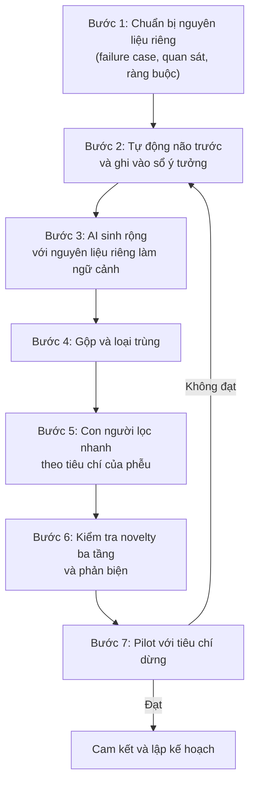

# AI trong đọc tài liệu và tìm ý tưởng

!!! abstract "Mục tiêu của bài"
    Sau bài này, người học có thể:

    - Phân biệt các nhóm công cụ AI hỗ trợ tìm tài liệu, biết mỗi nhóm hoạt động thế nào và hay sai ở đâu.
    - Giải thích vì sao tóm tắt do AI viết dễ sai ở chi tiết, và kiểm chứng trích dẫn qua DBLP, ACL Anthology, arXiv và DOI, kể cả bằng một script nhỏ.
    - Dùng AI làm trợ lý đọc với yêu cầu chỉ ra vị trí bằng chứng, đối chiếu với lượt đọc của chính người học, và dựng bảng literature có kiểm chứng.
    - Tổ chức quy trình "sinh rộng, con người lọc" và áp dụng AI cho các phương pháp tìm khoảng trống mà không rơi vào bẫy đồng nhất hóa.
    - Dùng AI để phản biện ý tưởng, biết giới hạn của việc giả lập reviewer, và viết prompt giảm sycophancy.
    - Kết hợp AI vào quy trình kiểm tra novelty ba tầng mà không giao quyết định về novelty cho AI.

Bài [Nguyên tắc, chính sách và rủi ro khi làm việc với AI](nguyen-tac.md) đã cho thấy AI là một cộng sự rộng hơn là sâu: nó sinh nhanh nhiều phương án, nhưng không tự đánh giá được chính nó, và người dùng thường đánh giá sai mức hữu ích của nó. Bài này áp dụng nhận xét đó vào hai công đoạn đầu tiên của một dự án: đọc tài liệu và tìm ý tưởng. Đây là nơi lợi thế về tốc độ của AI rõ nhất, vì nó đọc nhanh hơn và sinh ý tưởng nhiều hơn bất kỳ người nào. Nhưng đây cũng là nơi lỗi của AI nguy hiểm nhất theo một cách riêng: một tóm tắt sai, một trích dẫn bịa hay một khẳng định "chưa ai làm điều này" không gây hậu quả ngay, mà âm thầm đi vào nền móng của dự án, để rồi lộ ra sau vài tháng, khi một reviewer chỉ ra công trình gần nhất mà nhóm đã bỏ sót.

Chương 1 đã có bốn bài về hai công đoạn này: [Đọc và lập bản đồ tài liệu](../01-truoc-khi-viet/literature.md), [Đọc paper như một reviewer](../01-truoc-khi-viet/doc-nhu-reviewer.md), [Tìm khoảng trống và nguồn ý tưởng](../01-truoc-khi-viet/tim-khoang-trong.md) và [Thẩm định ý tưởng](../01-truoc-khi-viet/y-tuong.md). Bài này không thay thế chúng. Nó trả lời một câu hỏi hẹp hơn: trong từng quy trình mà bốn bài đó đã dạy, AI có thể chen vào ở đâu để giúp ích, và ở đâu thì không được chen vào. Câu trả lời xuyên suốt có thể tóm trong một câu: **AI mở rộng, con người thẩm định**. AI giúp tìm được nhiều paper hơn, đọc được nhanh hơn, nghĩ ra nhiều phương án hơn; còn việc quyết định paper nào đúng là quan trọng, chi tiết nào đúng là paper nói, ý tưởng nào đáng theo đuổi và có thật sự mới không, vẫn thuộc về người nghiên cứu.

Bài đi theo thứ tự tự nhiên của công việc: tìm tài liệu, đọc tài liệu, sinh ý tưởng, phản biện ý tưởng, kiểm tra novelty. Cuối bài là một bộ prompt mẫu bằng tiếng Anh cho từng việc, mỗi prompt kèm giải thích vì sao nó được viết như vậy; bộ prompt đầy đủ hơn cho toàn bộ chương nằm ở bài [Quy trình mẫu và thư viện prompt](quy-trinh-mau.md).

## AI trong tìm tài liệu

Câu hỏi đầu tiên khi dùng AI để tìm tài liệu không phải là "công cụ nào tốt nhất" mà là "công cụ này *lấy paper từ đâu*". Có hai cách một hệ thống có thể đưa ra một paper: truy xuất nó từ một chỉ mục các paper có thật, hoặc *sinh* ra nó từ những gì mô hình đã học. Cách thứ nhất có thể bỏ sót nhưng hiếm khi bịa; cách thứ hai có thể bịa với bất kỳ tần suất nào. Phần lớn các công cụ hiện nay kết hợp cả hai, và hiểu tỉ lệ kết hợp đó là chìa khóa để biết nên tin chúng tới đâu.

### Năm nhóm công cụ

Nhóm thứ nhất là **công cụ tìm kiếm học thuật có lớp AI**. Semantic Scholar, do Viện Allen về AI (AI2) phát triển từ năm 2015, là ví dụ tiêu biểu đã được giới thiệu trong bài [Đọc và lập bản đồ tài liệu](../01-truoc-khi-viet/literature.md). Theo paper mô tả nền tảng (Kinney và cộng sự, arXiv 2023, bản cập nhật với số liệu tháng 5 năm 2025), đồ thị học thuật của Semantic Scholar có khoảng 225 triệu paper, kèm các tính năng dựa trên AI như tóm tắt một câu (TLDR), nhãn ý định trích dẫn, cờ đánh dấu trích dẫn có ảnh hưởng lớn và gợi ý paper mới. Vì kết quả đến từ một chỉ mục thật, paper trả về là paper có thật; AI chỉ nằm ở lớp xếp hạng và tóm tắt. Nhưng chính lớp đó cần được hiểu đúng: theo mô tả trong paper, chức năng tìm kiếm theo độ liên quan xếp hạng lại kết quả theo hướng ưu tiên paper khớp tiêu đề và paper gần đây được trích dẫn nhiều. Điều này hợp lý cho đa số người dùng, nhưng có nghĩa là danh sách kết quả đầu tiên không phải là một tổng quan đầy đủ: một paper ít được trích dẫn nhưng làm đúng ý tưởng của nhóm có thể nằm rất sâu. TLDR cũng là văn bản do mô hình sinh ra, nên chỉ dùng để quyết định có đọc tiếp hay không.

Nhóm thứ hai là **trợ lý tổng quan tài liệu dựa trên truy xuất**. Đây là những hệ thống nhận một câu hỏi nghiên cứu, truy xuất các paper liên quan, rồi tổng hợp câu trả lời kèm trích dẫn; một số công cụ thương mại, Elicit là cái tên thường được nhắc tới, còn trích thông tin từ nhiều paper thành bảng. Tính năng và độ bao phủ của các công cụ thương mại thay đổi nhanh, nên giáo trình không đánh giá chúng; người dùng cần đọc mô tả của chính công cụ về nguồn dữ liệu. Một hệ thống mở trong nhóm này đã được đánh giá công khai là OpenScholar (Asai và cộng sự, arXiv 2024, sau đăng trên *Nature* 2026): nó truy xuất trên khoảng 45 triệu paper truy cập mở, và trên bộ câu hỏi chuyên gia của nhóm tác giả, đạt độ chính xác trích dẫn ngang với chuyên gia, trong khi GPT-4o không có truy xuất bịa trích dẫn trong 78–90% trường hợp. Chính nhóm tác giả vẫn lưu ý rằng các hệ thống dựa trên mô hình ngôn ngữ chưa thể tự động hóa hoàn toàn việc tổng hợp tài liệu. Hai giới hạn chung của nhóm công cụ này là độ bao phủ, vì một hệ thống chỉ truy xuất được tài liệu nằm trong chỉ mục của nó, và bước tổng hợp, nơi mô hình có thể nói nhiều hơn những gì các paper được trích thực sự nói.

Nhóm thứ ba là **chatbot đa năng**, có hoặc không có tìm kiếm web. Khi không có tìm kiếm, mọi trích dẫn đều là sản phẩm của trí nhớ mô hình. Nghiên cứu của Walters và Wilder (*Scientific Reports*, 2023) ghi nhận 55% trích dẫn của GPT-3.5 và 18% của GPT-4 là bịa khi các mô hình này được yêu cầu viết tổng quan ngắn. Các mô hình mới hơn tốt hơn, nhưng cơ chế vẫn vậy, nên một chatbot không có tìm kiếm chỉ nên được dùng để gợi ý từ khóa, không bao giờ để gợi ý paper.

Nhóm thứ tư là **tính năng "deep research"**, xuất hiện ở các phòng thí nghiệm lớn trong khoảng từ cuối năm 2024 tới năm 2025 (Xu và Peng, arXiv 2025). Đây là những agent tự lập kế hoạch tìm kiếm qua nhiều bước, đọc hàng chục tới hàng trăm trang web, rồi viết một báo cáo dài có trích dẫn. Điểm mạnh của chúng là bề rộng: trong vài chục phút, người dùng có một bản đồ sơ bộ của một chủ đề lạ. Điểm yếu đến từ chính cách chúng làm việc: nguồn trên web có chất lượng không đều, nên báo cáo có thể dựa vào một bài blog tóm tắt paper thay vì chính paper; bước tổng hợp có thể kết luận vượt quá nguồn; thông tin có thể lẫn giữa các phiên bản của một paper; và vì agent đọc nội dung web không kiểm soát, nó chịu rủi ro prompt injection đã phân tích ở bài trước. Một báo cáo deep research là điểm xuất phát tốt cho tầng tìm kiếm từ khóa, không phải là phần Related Work.

Nhóm thứ năm là **agent hoặc script do chính người nghiên cứu viết trên API**. Semantic Scholar có Graph API cho phép tra paper theo mã arXiv hay DOI, lấy danh sách trích dẫn và tài liệu tham khảo, và API gợi ý paper từ một tập paper hạt giống. Đây chính là công cụ mà cả agent sinh ý tưởng trong nghiên cứu của Si và cộng sự lẫn *The AI Scientist* dùng để tìm tài liệu liên quan. Với người nghiên cứu, API hữu ích nhất để tự động hóa quy trình lan tỏa từ paper hạt giống (*snowballing*) trong bài [Đọc và lập bản đồ tài liệu](../01-truoc-khi-viet/literature.md): lấy toàn bộ paper trích dẫn ba đến năm paper hạt giống trong mười hai tháng gần nhất, rồi dùng AI để sắp xếp thứ tự đọc. Giới hạn tốc độ truy vấn của API thay đổi theo thời gian, nên cần đọc tài liệu hiện hành.

| Nhóm công cụ | Paper đến từ đâu | Mạnh ở | Hay sai ở | Dùng cho |
|---|---|---|---|---|
| Tìm kiếm học thuật có lớp AI | Chỉ mục thật | Paper có thật, đi theo trích dẫn | Xếp hạng ưu tiên paper nổi tiếng; TLDR có thể sai | Tầng từ khóa và trích dẫn |
| Trợ lý tổng quan dựa trên truy xuất | Chỉ mục của công cụ | Tổng hợp nhanh, kèm trích dẫn | Độ bao phủ; tổng hợp vượt quá nguồn | Bản đồ sơ bộ, gợi ý paper để đọc |
| Chatbot không tìm kiếm | Trí nhớ mô hình | Gợi ý thuật ngữ, cách diễn đạt | Bịa trích dẫn | Chỉ gợi ý từ khóa |
| Deep research | Web | Bề rộng, tốc độ | Nguồn thứ cấp; kết luận vượt nguồn; prompt injection | Bản đồ chủ đề lạ |
| Script trên API | Chỉ mục thật | Lan tỏa trích dẫn có hệ thống | Phụ thuộc chất lượng truy vấn | Snowballing, theo dõi paper mới |

### Vì sao tóm tắt do AI viết dễ sai ở chi tiết

Ngay cả khi paper là thật và được đưa trọn vào ngữ cảnh, bản tóm tắt do AI viết vẫn có những kiểu sai có hệ thống. Hiểu năm cơ chế dưới đây giúp người đọc biết phải kiểm tra chỗ nào.

Cơ chế thứ nhất là **nén thông tin**. Tóm tắt là chọn giữ lại cái gì, và những thứ bị bỏ đầu tiên thường là điều kiện và phạm vi: "trên hai dataset" trở thành "trên các benchmark", "khi biết trước camera pose" biến mất, "với mô hình 7B" trở thành "với LLM". Đây đúng là những chi tiết quyết định một paper có thật sự gần với ý tưởng của nhóm hay không. Cơ chế thứ hai là **lấp chỗ trống bằng cái điển hình**. Khi một chi tiết không rõ hoặc nằm ở chỗ mô hình không chú ý, mô hình có xu hướng điền vào bằng cái thường gặp nhất trong các paper tương tự: dataset phổ biến nhất, metric phổ biến nhất, thiết lập phổ biến nhất. Với một lĩnh vực có hàng chục paper gần giống nhau, chi tiết của paper này có thể bị trộn với paper khác.

Cơ chế thứ ba là **đọc PDF không trọn vẹn**. Văn bản được trích từ PDF thường làm hỏng bảng, công thức và chú thích hình; nhiều hệ thống chỉ đọc văn bản. Nhóm *The AI Scientist* thừa nhận hệ thống của họ không nhìn được hình, và báo cáo về thử nghiệm review của AAAI-26 ghi nhận review do AI viết đôi khi đọc sai phương trình và bảng (Biswas và cộng sự, arXiv 2026). Với paper CV, nơi bằng chứng nằm nhiều ở hình, đây là giới hạn lớn. Cơ chế thứ tư là **ngữ cảnh dài**. Nghiên cứu *Lost in the Middle* (Liu và cộng sự, TACL 2024) cho thấy với các mô hình được thử, hiệu năng truy xuất thông tin cao nhất khi thông tin nằm ở đầu hoặc cuối ngữ cảnh, giảm rõ khi nó nằm ở giữa, và giảm khi ngữ cảnh dài ra. Các mô hình sau này đã cải thiện nhiều, nhưng bài học vẫn còn giá trị: không nên mặc định rằng mô hình đã "đọc" đều mọi trang của một paper dài cùng phụ lục. Cơ chế thứ năm là **trích dẫn không ủng hộ nội dung**: trong các thí nghiệm của OpenScholar, ngay cả khi trích dẫn là thật, phần lớn trường hợp nội dung được gán cho paper không được paper đó ủng hộ.

Hai ví dụ giả định cho thấy hậu quả. Ở CV, một bản tóm tắt viết rằng phương pháp tái tạo 3D "không cần camera pose", trong khi paper chỉ không cần pose *lúc suy luận*, còn lúc huấn luyện vẫn cần; nếu nhóm đang làm đúng bài toán không có pose lúc huấn luyện, paper này không phải là công trình trùng, nhưng cũng không phải là baseline phù hợp. Ở NLP, một bản tóm tắt viết rằng paper "đánh giá trên mười hai ngôn ngữ", trong khi bảng chính chỉ có năm ngôn ngữ và bảy ngôn ngữ còn lại nằm ở phụ lục với một metric khác. Cả hai lỗi đều không làm bản tóm tắt "sai" theo nghĩa thông thường; chúng chỉ làm nó sai đúng ở chỗ quan trọng. Vì vậy, tóm tắt do AI viết phù hợp cho việc *sàng lọc*, tức quyết định có đọc tiếp không, và không phù hợp làm nguồn để viết Related Work hay để kết luận về novelty.

!!! warning "Không viết Related Work từ bản tóm tắt của AI"
    Mỗi câu về một công trình khác trong paper phải dựa trên việc người viết đã đọc công trình đó, ít nhất tới lượt thứ hai. Tác giả của công trình được nhắc tới có khả năng cao nằm trong số reviewer, và một mô tả sai, dù chỉ ở một điều kiện hay một con số, là cách nhanh nhất để mất thiện cảm của họ.

### Quy trình kiểm chứng trích dẫn

Mọi paper mà AI gợi ý, và mọi mục trong file `.bib`, cần đi qua một quy trình kiểm chứng trước khi vào bản thảo. Quy trình dưới đây được thiết kế theo các kiểu lỗi đã được ghi nhận. Một preprint phân loại 100 trích dẫn bịa tìm thấy trong paper được nhận ở NeurIPS 2025 (Ansari, arXiv 2026) chia chúng thành các nhóm: bịa hoàn toàn (khoảng hai phần ba), trích dẫn có thật bị sửa sai một số thông tin như tác giả hay năm (khoảng một phần tư), mượn định danh của một paper khác, để nguyên dòng giữ chỗ, và gán sai nội dung. Mỗi bước dưới đây bắt một nhóm lỗi.

**Bước một: kiểm tra sự tồn tại.** Tra tiêu đề chính xác trên DBLP, nơi bao phủ tốt cả ba cộng đồng, trên ACL Anthology với paper NLP, và trên Semantic Scholar hoặc Google Scholar. Một paper không xuất hiện ở bất kỳ nguồn nào trong số đó là một cờ đỏ lớn; với paper AI/ML được công bố ở hội nghị lớn, điều đó gần như chắc chắn có nghĩa là trích dẫn bị bịa. Bước này bắt được nhóm bịa hoàn toàn và nhóm giữ chỗ.

**Bước hai: kiểm tra định danh.** Nếu trích dẫn có mã arXiv, mở trang arXiv của mã đó và so tiêu đề, tác giả; nếu có DOI, phân giải DOI qua doi.org và so tương tự. Một mã arXiv có thật nhưng trỏ tới paper khác là dấu hiệu của lỗi mượn định danh, loại lỗi mà phép kiểm tra "mã có tồn tại không" sẽ bỏ qua.

**Bước ba: kiểm tra thông tin.** So tên và thứ tự tác giả, năm, hội nghị hoặc tạp chí với bản ghi chính thức. Chú ý phân biệt bản arXiv với bản đã công bố; như bài [Đọc và lập bản đồ tài liệu](../01-truoc-khi-viet/literature.md) đã khuyên, khi paper đã được công bố thì trích dẫn bản công bố. Bước này bắt nhóm trích dẫn bị sửa sai thông tin.

**Bước bốn: kiểm tra nội dung.** Mở paper và tìm đúng đoạn văn, bảng hoặc định lý ủng hộ điều mà bản thảo gán cho nó, rồi ghi lại vị trí. Đây là bước tốn công nhất và không thể tự động hóa, nhưng cũng là bước bắt được lỗi khó nhất: paper có thật, thông tin đúng, nhưng không nói điều bản thảo nói. Tác giả của paper được trích rất có thể là reviewer, và họ sẽ nhận ra ngay.

**Bước năm: lấy BibTeX từ nguồn chính thức.** Lấy từ DBLP hoặc ACL Anthology, không bao giờ từ đầu ra của LLM, kể cả khi đầu ra đó trông đúng.

**Bước sáu: ghi trạng thái.** Đánh dấu mục đã kiểm chứng trong phần mềm quản lý tài liệu, chẳng hạn bằng một tag trong Zotero, và ghi vào nhật ký tìm kiếm. Trước khi nộp, mọi mục trong `.bib` chưa có dấu này phải được xử lý.

Ba bước đầu có thể được tự động hóa một phần. Script dưới đây là một phác thảo dùng API công khai của DBLP, arXiv và Crossref để sàng lọc một file `.bib`: với mỗi mục, nó tìm tiêu đề trên DBLP và so độ giống, kiểm tra mã arXiv và DOI có trỏ tới paper cùng tiêu đề không, rồi in ra các mục đáng ngờ. Đây là công cụ sàng lọc, không phải công cụ xác nhận: một mục "qua" vẫn phải đi qua bước bốn, và một mục bị đánh dấu có thể chỉ do tiêu đề viết khác hoặc paper quá mới. DBLP chỉ bao phủ khoa học máy tính, nên paper của ngành khác sẽ bị đánh dấu dù có thật. Cách phân tích file `.bib` bằng biểu thức chính quy ở đây rất thô, nên với file phức tạp nên thay bằng một thư viện chuyên dụng; API của các dịch vụ cũng có giới hạn tốc độ và có thể thay đổi định dạng, nên cần đọc tài liệu hiện hành.

```python
"""check_refs.py — sàng lọc sơ bộ các mục trong một file .bib (phác thảo).

Dùng: python check_refs.py references.bib
Kết quả chỉ để sàng lọc; nội dung trích dẫn vẫn phải được kiểm tra bằng tay.
"""
import difflib
import json
import re
import sys
import time
import urllib.error
import urllib.parse
import urllib.request
import xml.etree.ElementTree as ET

HEADERS = {"User-Agent": "ref-checker/0.1 (mailto:your-email@example.org)"}


def fetch(url):
    req = urllib.request.Request(url, headers=HEADERS)
    with urllib.request.urlopen(req, timeout=30) as resp:
        return resp.read().decode("utf-8")


def norm(text):
    text = re.sub(r"[{}\\]", "", text or "").lower()
    return re.sub(r"[^a-z0-9 ]+", " ", text).split()


def similarity(a, b):
    return difflib.SequenceMatcher(None, " ".join(norm(a)), " ".join(norm(b))).ratio()


def parse_bib(path):
    """Tách các mục @type{key, ...} và lấy title, eprint, doi (rất thô)."""
    text = open(path, encoding="utf-8").read()
    for chunk in re.split(r"\n(?=@)", text):
        head = re.match(r"@(\w+)\s*\{\s*([^,\s]+)\s*,", chunk)
        if not head or head.group(1).lower() in {"comment", "string", "preamble"}:
            continue
        fields = {}
        for name in ("title", "eprint", "doi"):
            m = re.search(r"(?<![a-z])" + name + r"\s*=\s*[{\"](.+?)[}\"]\s*,?\s*\n",
                          chunk, re.I | re.S)
            if m:
                fields[name] = " ".join(m.group(1).split())
        yield head.group(2), fields


def dblp_best(title):
    q = urllib.parse.quote(title)
    data = json.loads(fetch(f"https://dblp.org/search/publ/api?q={q}&format=json&h=5"))
    hits = data.get("result", {}).get("hits", {}).get("hit", [])
    best = max(hits, key=lambda h: similarity(title, h["info"].get("title", "")),
               default=None)
    if best is None:
        return 0.0, None
    info = best["info"]
    return similarity(title, info.get("title", "")), info


def arxiv_title(arxiv_id):
    xml = fetch("http://export.arxiv.org/api/query?id_list=" + urllib.parse.quote(arxiv_id))
    ns = {"a": "http://www.w3.org/2005/Atom"}
    entry = ET.fromstring(xml).find("a:entry", ns)
    title = entry.find("a:title", ns) if entry is not None else None
    if title is None or title.text.strip().lower() == "error":
        return None
    return " ".join(title.text.split())


def doi_title(doi):
    try:
        data = json.loads(fetch("https://api.crossref.org/works/" + urllib.parse.quote(doi)))
    except urllib.error.HTTPError:
        return None
    titles = data.get("message", {}).get("title", [])
    return titles[0] if titles else None


def main(path, threshold=0.9):
    for key, f in parse_bib(path):
        title, problems = f.get("title", ""), []
        if not title:
            problems.append("không có title")
        else:
            score, info = dblp_best(title)
            if score < threshold:
                problems.append(f"DBLP: không thấy tiêu đề khớp (giống nhất {score:.2f})")
            if f.get("eprint"):
                t = arxiv_title(f["eprint"])
                if t is None or similarity(title, t) < threshold:
                    problems.append(f"arXiv {f['eprint']} trỏ tới: {t}")
            if f.get("doi"):
                t = doi_title(f["doi"])
                if t is None or similarity(title, t) < threshold:
                    problems.append(f"DOI {f['doi']} trỏ tới: {t}")
        status = "CẦN KIỂM TRA" if problems else "qua sàng lọc"
        print(f"[{status}] {key}: " + "; ".join(problems))
        time.sleep(1.5)  # tôn trọng giới hạn tốc độ của các API công khai


if __name__ == "__main__":
    main(sys.argv[1])
```

Script không thay được bước bốn, nhưng nó biến việc rà soát cả trăm mục tham khảo từ một buổi chiều thành vài phút, và làm lộ ngay những mục đáng ngờ nhất. Một thói quen tốt là chạy nó mỗi lần cập nhật file `.bib`, và một lần nữa trước khi nộp.

Cuối cùng, nếu AI đã được dùng để tìm tài liệu, đoạn khai báo nên nói rõ rằng công cụ không phải là nguồn của bất kỳ trích dẫn nào. Mẫu dưới đây bổ sung cho các mẫu khai báo ở bài [Nguyên tắc, chính sách và rủi ro khi làm việc với AI](nguyen-tac.md); như mọi mẫu, cần sửa cho đúng với việc đã làm thật.

```text
We used [tool, version] to suggest search terms and candidate related work
during the literature review. All cited papers were read by the authors,
and every reference was checked against DBLP, the ACL Anthology or the
publisher's page; no reference was taken from model output.
```

## AI làm trợ lý đọc

Sau khi đã có danh sách paper, công việc chính là đọc. Ở đây AI có thể là một trợ lý thực sự hữu ích: giải thích một khái niệm nền, dò một chi tiết trong phụ lục dài, so hai paper về cùng một khía cạnh. Nhưng một trợ lý đọc chỉ có ích khi được dùng theo một kỷ luật nhất định, vì nếu không, nó sẽ thay thế việc đọc thay vì hỗ trợ việc đọc. Ba nguyên tắc dưới đây tạo nên kỷ luật đó.

### Đọc trước, hỏi sau

Phương pháp ba lượt của S. Keshav (*How to Read a Paper*, ACM SIGCOMM Computer Communication Review, 2007), đã trình bày trong bài [Đọc và lập bản đồ tài liệu](../01-truoc-khi-viet/literature.md), cho một khung tự nhiên để đặt AI vào. Ở lượt thứ nhất, khi mục tiêu chỉ là quyết định có đọc tiếp không, một tóm tắt do AI viết hay TLDR của Semantic Scholar có thể thay cho việc lướt abstract, vì sai ở đây chỉ dẫn tới một quyết định đọc tiếp hay bỏ qua. Ở lượt thứ hai, khi mục tiêu là nắm được nội dung chính và bằng chứng, người đọc nên tự đọc *trước* rồi mới hỏi AI. Lý do không chỉ là kiểm chứng, mà còn là hiệu ứng mỏ neo: nếu đọc bản tóm tắt của AI trước, người đọc có xu hướng nhìn paper qua khung mà AI đã dựng sẵn, và dễ bỏ qua chính những điểm AI bỏ qua. Ở lượt thứ ba, khi mục tiêu là hiểu sâu tới mức tái hiện được paper, AI hữu ích nhất trong vai người giải đáp: giải thích một bước biến đổi, gợi ý vì sao tác giả chọn một thiết kế, chỉ ra chỗ hai phương trình có vẻ mâu thuẫn. Mọi câu trả lời ở lượt này đều phải được kiểm tra lại bằng chính paper.

Có một ngoại lệ hợp lý: với paper nằm ngoài chuyên môn, chẳng hạn một nghiên cứu sinh NLP phải đọc một paper về tối ưu lồi, có thể nhờ AI giải thích các khái niệm nền *trước* khi đọc. Khi đó, phần giải thích thuộc mức "thông tin tra cứu được" trên thang xác minh, và nên được đối chiếu với một giáo trình hay bài giảng trước khi dùng để hiểu paper.

### Mọi câu trả lời phải chỉ ra vị trí bằng chứng

Kỷ luật quan trọng nhất khi hỏi AI về một paper là yêu cầu mọi câu trả lời đi kèm *vị trí* của bằng chứng trong paper: số mục, số trang, số bảng, số phương trình, và một trích dẫn ngắn nguyên văn. Yêu cầu này làm ba việc cùng lúc. Nó biến việc xác minh từ "đọc lại cả paper" thành "kiểm tra một con trỏ", nên rẻ hơn hàng chục lần. Nó làm lộ ngay những câu trả lời bịa, vì một vị trí không tồn tại hoặc một câu trích không có trong paper dễ phát hiện hơn nhiều so với một khẳng định chung chung. Và nó buộc mô hình bám vào văn bản thay vì vào trí nhớ về những paper tương tự.

Hai yêu cầu đi kèm làm kỷ luật này chặt hơn. Thứ nhất, cho phép và khuyến khích câu trả lời "không tìm thấy trong paper"; nếu không có lựa chọn đó, mô hình sẽ có xu hướng trả lời bằng một điều nghe hợp lý. Thứ hai, yêu cầu tách bạch "paper nói" với "suy luận của mô hình". Câu hỏi "phương pháp có hoạt động với ảnh độ phân giải thấp không?" thường không có câu trả lời trực tiếp trong paper, và một câu trả lời trung thực là "paper không thử; dựa trên thiết kế ở Mục 3.2 có thể đoán…", chứ không phải "có". Prompt thứ hai trong mục *Prompt mẫu* ở cuối bài thể hiện cả ba yêu cầu này.

Hai lưu ý về phạm vi. Chỉ đưa vào AI những paper đã công khai, như bản arXiv hay bản đã công bố, không bao giờ đưa bài đang review hay bản thảo người khác chia sẻ riêng. Và vì PDF có thể chứa văn bản ẩn, khi câu trả lời của AI về một paper có những khẳng định bất thường, cần mở paper ra kiểm tra.

### Đối chiếu với lượt đọc của người học

Cách dùng AI giúp người đọc tiến bộ nhanh nhất là biến nó thành một bên đối chiếu. Sau lượt đọc thứ hai, người đọc tự viết một tóm tắt năm câu và danh sách claim chính của paper. Sau đó, hỏi AI cùng những câu hỏi đó, với yêu cầu chỉ ra vị trí bằng chứng, rồi so sánh. Mỗi chỗ hai bên khác nhau là một câu hỏi phải trả lời bằng paper: AI sai, người đọc sai, hay paper mơ hồ. Cả ba khả năng đều hữu ích. Khi AI sai, người đọc học được AI hay sai ở loại chi tiết nào. Khi người đọc sai, họ biết được bản thân hay bỏ sót gì. Khi paper mơ hồ, đó thường là một điểm yếu thật của paper, đáng ghi vào bảng literature ở cột giả định và hạn chế, và có khi là một khoảng trống.

Sau mười tới hai mươi paper, việc ghi lại các chỗ AI sai trong một "sổ lỗi" nhỏ sẽ cho người đọc một hiểu biết thực nghiệm về công cụ đang dùng, cụ thể cho lĩnh vực đang làm, có giá trị hơn mọi đánh giá chung chung. Chẳng hạn (ví dụ giả định), một nghiên cứu sinh ML có thể phát hiện công cụ đang dùng thường đọc đúng phần phương pháp nhưng hay nhầm giả định của định lý giữa phiên bản chính và phiên bản trong phụ lục; từ đó, mỗi khi hỏi về định lý, người đó luôn yêu cầu trích nguyên văn phát biểu.

### Dựng bảng literature với AI

Bảng literature trong bài [Đọc và lập bản đồ tài liệu](../01-truoc-khi-viet/literature.md), với các cột bài toán, ý tưởng chính, giả định và hạn chế, kết quả, code và quan hệ với dự án, là nơi AI có thể tiết kiệm nhiều thời gian nhất, và cũng là nơi dễ đưa lỗi vào dự án nhất. Lý do là bảng này sẽ trở thành nguyên liệu trực tiếp cho phần [Related Work](../02-viet-tung-phan/related-work.md), cho bảng so sánh tính chất và cho danh sách baseline. Một ô sai trong bảng là một câu sai trong paper.

Một quy trình an toàn có bốn bước. Bước đầu, sau khi người đọc đã đọc paper tới lượt thứ hai, AI điền nháp các cột cho paper đó, với mỗi ô kèm vị trí bằng chứng và một trích dẫn ngắn, và ghi "không tìm thấy" khi paper không nêu. Bước thứ hai, người đọc kiểm tra từng ô theo vị trí được chỉ, sửa những ô sai, và đánh dấu dòng đó là đã kiểm chứng. Bước thứ ba, khi bảng đã có vài chục dòng, AI có thể đề xuất cách gom các paper thành hai tới bốn nhóm cho Related Work và gợi ý một khái niệm tương phản chính cho mỗi nhóm; người viết quyết định cách gom cuối cùng, vì cách gom chính là lập luận về vị trí của paper. Bước thứ tư, với bảng so sánh tính chất, mỗi dấu ✓ hay ✗ của các phương pháp khác phải được kiểm tra trong paper gốc, vì một dấu sai trong bảng này là cách nhanh nhất để làm phật lòng một reviewer là tác giả của phương pháp đó.

Điều không nên làm là đưa năm mươi paper chưa đọc vào một công cụ và nhận về một bảng hoàn chỉnh. Bảng như vậy trông rất đầy đủ, nhưng người dùng không biết ô nào đúng, và quan trọng hơn, người dùng không hiểu lĩnh vực hơn so với trước khi có bảng. Bảng literature có giá trị vì quá trình điền nó buộc người đọc phải hiểu; một bảng do AI điền mà không được đọc lại chỉ có giá trị trang trí.

Một biến thể hữu ích của quy trình này là dùng AI để điền nháp *bảng claim và bằng chứng* trong bài [Đọc paper như một reviewer](../01-truoc-khi-viet/doc-nhu-reviewer.md): liệt kê mọi claim của paper và chỉ ra thí nghiệm, bảng hay định lý được dùng để đỡ từng claim. AI làm tốt phần liệt kê và định vị; việc đánh giá mỗi bằng chứng có thực sự đủ sức đỡ claim hay không vẫn là việc của người đọc.

### Đọc review công khai

Với các hội nghị công khai review trên OpenReview như ICLR, các bản review, rebuttal và thảo luận là một nguồn học quý, như mục luyện tập với review công khai trong bài [Đọc paper như một reviewer](../01-truoc-khi-viet/doc-nhu-reviewer.md) đã chỉ ra. AI có thể giúp tổng hợp những phản biện lặp lại trong các review của một mảng con, chẳng hạn những baseline nào reviewer hay đòi, những claim nào hay bị coi là quá mức, để người học biết cộng đồng kỳ vọng gì. Nhưng tổng hợp đó chỉ là một bản đồ; người học vẫn cần đọc trực tiếp một số review tiêu biểu để cảm nhận được giọng điệu, mức độ chi tiết và cách lập luận của một reviewer giỏi, những thứ không tồn tại trong một bản tổng hợp.

## AI làm người cùng sinh ý tưởng

Sinh ý tưởng là công đoạn mà khả năng của AI được quảng bá nhiều nhất, và cũng là nơi bằng chứng cần được đọc kỹ nhất. Mục này bắt đầu từ bằng chứng, rồi xây một quy trình dựa trên đúng những gì bằng chứng cho phép.

### Bằng chứng nói gì

Các nghiên cứu đã được phân tích chi tiết trong bài [Nguyên tắc, chính sách và rủi ro khi làm việc với AI](nguyen-tac.md); ở đây chỉ cần nhắc lại ba kết quả và rút ra hệ quả. Thứ nhất, trong nghiên cứu của Si, Yang và Hashimoto (ICLR 2025) với hơn một trăm nhà nghiên cứu NLP, ý tưởng về prompting do một agent LLM sinh ra được chuyên gia chấm là mới hơn ý tưởng của chuyên gia (điểm novelty trung bình 5,64 so với 4,84), khi chỉ đánh giá trên giấy. Thứ hai, khi các ý tưởng đó được thực hiện thành dự án (Si, Hashimoto, Yang, ICLR 2026), điểm của ý tưởng AI giảm nhiều hơn có ý nghĩa thống kê so với ý tưởng người. Thứ ba, cũng trong nghiên cứu đầu, chỉ khoảng 200 trong 4.000 ý tưởng hạt giống mà agent sinh cho mỗi chủ đề là không trùng lặp, và LLM chấm ý tưởng chỉ đồng thuận với con người ở mức 53,3%, thấp hơn mức 56,1% giữa hai reviewer người.

Các nghiên cứu về sự đồng nhất củng cố kết quả thứ ba từ những góc khác. Paper *Artificial Hivemind* (Jiang và cộng sự, NeurIPS 2025) cho thấy với câu hỏi mở, kể cả câu hỏi động não, một mô hình lặp lại chính nó và các mô hình khác nhau hội tụ về câu trả lời giống nhau. Ngoài khoa học, thí nghiệm của Doshi và Hauser (*Science Advances*, 2024) với người viết truyện ngắn cho thấy gợi ý của GPT-4 làm từng truyện được chấm sáng tạo hơn, nhưng làm các truyện giống nhau hơn: cá nhân có lợi, tập thể mất đa dạng.

Từ đó có ba hệ quả cho quy trình. **AI là máy sinh rộng tốt nhưng là bộ lọc kém**: nó đáng được dùng ở pha mở rộng, còn pha lọc phải do người làm. **Đánh giá trên giấy không đủ**: vì điểm yếu của ý tưởng AI lộ ra khi thực thi, mọi ý tưởng, nhất là ý tưởng có nguồn gốc từ AI, cần qua pilot experiment trước khi được cam kết. **Đa dạng phải được chủ động tạo ra**: nếu để mặc định, AI sẽ đưa người dùng tới cùng những ý tưởng mà mọi người dùng khác cũng nhận được. Hệ quả cuối cùng cộng hưởng với hai lời cảnh báo có từ trước khi có LLM. John Schulman (*An Opinionated Guide to ML Research*, 2020) chỉ ra rằng nghiên cứu xuất phát từ việc đọc paper rồi tìm cách cải tiến dễ bị người khác làm trước, vì mọi người đều đọc cùng những paper đó. Andrej Karpathy (*A Survival Guide to a PhD*, 2016) khuyên tránh những ý tưởng kiểu "bước logic tiếp theo đang lơ lửng trong không khí". Câu hỏi "hướng mở tiếp theo của paper này là gì?" đặt cho một LLM sinh ra đúng loại ý tưởng ấy, cho tất cả những ai hỏi cùng câu.

### Quy trình "sinh rộng, con người lọc"

Quy trình dưới đây tổ chức việc dùng AI sinh ý tưởng theo đúng ba hệ quả trên. Nó gắn vào phễu kiểm ý tưởng nhiều tầng và sổ ý tưởng trong bài [Tìm khoảng trống và nguồn ý tưởng](../01-truoc-khi-viet/tim-khoang-trong.md), và kết thúc ở bộ câu hỏi thẩm định trong bài [Thẩm định ý tưởng](../01-truoc-khi-viet/y-tuong.md).



**Bước một: chuẩn bị nguyên liệu riêng.** Đây là bước quyết định chất lượng của cả quy trình. Nguyên liệu riêng là những thứ nhóm có mà người khác không có: các failure case thu được khi chạy SOTA trên dữ liệu của nhóm, những quan sát bất ngờ trong thí nghiệm trước, một ràng buộc thực tế như thiết bị biên hay ngôn ngữ ít tài nguyên, hiểu biết về một miền ứng dụng cụ thể. Nguyên liệu càng cụ thể, ý tưởng sinh ra càng khó trùng với ý tưởng của người khác.

**Bước hai: tự động não trước.** Người nghiên cứu tự viết ra mười tới hai mươi hướng, dù thô, vào sổ ý tưởng, *trước* khi hỏi AI. Có hai lý do. Danh sách tự viết là thước đo để biết AI thực sự thêm được gì; và nó bảo vệ người nghiên cứu khỏi hiệu ứng mỏ neo, vì một khi đã đọc danh sách của AI, rất khó nghĩ ra điều gì nằm ngoài nó.

**Bước ba: AI sinh rộng.** Đưa nguyên liệu riêng vào ngữ cảnh và yêu cầu nhiều ý tưởng, chẳng hạn ba mươi, với những ràng buộc buộc mô hình rời khỏi câu trả lời điển hình: mỗi ý tưởng phải xuất phát từ một failure case cụ thể trong danh sách, phải nêu cơ chế được giả định, không được là việc ghép một module có sẵn vào một phương pháp có sẵn. Nên chạy vài lượt với những góc nhìn khác nhau, chẳng hạn một lượt bắt đầu từ failure case, một lượt từ giả định ngầm, một lượt từ một mục tiêu năng lực theo cách nghiên cứu dẫn dắt bởi mục tiêu mà Schulman khuyến nghị. Paper *Artificial Hivemind* cảnh báo rằng chỉ đổi sang một mô hình khác chưa chắc tạo ra đa dạng thật; đổi *góc nhìn và nguyên liệu* hiệu quả hơn đổi mô hình.

**Bước bốn: gộp và loại trùng.** AI làm tốt việc gom các ý tưởng gần nhau thành cụm và loại bản trùng. Sau bước này, danh sách thường co lại đáng kể, điều mà nghiên cứu của Si và cộng sự đã cho thấy ở quy mô lớn. Cũng ở bước này, đặt danh sách của AI cạnh danh sách tự viết ở bước hai: những ý tưởng chỉ có ở danh sách tự viết thường là những ý tưởng có nhiều nguyên liệu riêng nhất, và đáng được ưu tiên xem xét.

**Bước năm: con người lọc nhanh.** Áp tầng lọc nhanh của phễu kiểm ý tưởng trong bài [Tìm khoảng trống và nguồn ý tưởng](../01-truoc-khi-viet/tim-khoang-trong.md) cho từng cụm. Những câu hỏi lọc kinh điển vẫn là tốt nhất ở đây: bài toán có quan trọng không và có "cách tấn công" hợp lý không, theo nghĩa mà Richard Hamming đã nói trong bài giảng *You and Your Research* (1986) rằng không phải hệ quả mà chính việc có một cách tấn công hợp lý làm nên tầm quan trọng của bài toán; nếu một nhóm khác công bố ý tưởng này, nhóm có hào hứng đọc paper đó không, câu hỏi của Rachel Prudden được Chris Olah dẫn lại trong ghi chú *Research Taste Exercises* (2021); và nếu sức tính toán tăng gấp mười, ý tưởng còn giá trị không. Không nên giao bước này cho AI chấm điểm, vì như đã thấy, bộ chấm bằng LLM gần mức ngẫu nhiên; nếu muốn dùng AI ở bước này, chỉ để nó sắp thứ tự xem xét.

**Bước sáu và bảy: kiểm tra và pilot.** Ba tới năm ý tưởng còn lại đi qua kiểm tra novelty ba tầng và phản biện, trình bày ở hai mục sau, rồi qua pilot experiment với tiêu chí dừng như bài [Thẩm định ý tưởng](../01-truoc-khi-viet/y-tuong.md) hướng dẫn. Pilot là nơi khoảng cách giữa ý tưởng và thực thi lộ ra với chi phí thấp nhất. Một ý tưởng không qua pilot quay về sổ ý tưởng cùng với lý do thất bại; lý do đó thường là nguyên liệu riêng tốt nhất cho vòng sau.

### Dùng AI cho các phương pháp tìm khoảng trống

Bài [Tìm khoảng trống và nguồn ý tưởng](../01-truoc-khi-viet/tim-khoang-trong.md) trình bày mười một phương pháp tìm khoảng trống có hệ thống. AI có thể hỗ trợ ở hầu hết các phương pháp, nhưng ở mỗi phương pháp có một phần mà chỉ con người làm được. Dưới đây là cách phân vai cho những phương pháp mà AI hữu ích nhất.

**Lật giả định.** Phương pháp này, mà khóa học CS197 của Michael Bernstein ở Stanford gọi là *bit flip*, bắt đầu bằng việc gọi tên một giả định, thường không được nói ra, mà các công trình trước dựa vào, rồi đề xuất điều ngược lại. AI làm tốt phần đầu: đưa cho nó một paper hoặc vài paper, yêu cầu liệt kê mọi giả định ngầm kèm vị trí trong paper nơi giả định đó lộ ra (chẳng hạn trong mô tả dataset hay thiết lập thí nghiệm). Phần con người phải làm là chọn giả định nào *sai trong một thiết lập thực tế có ý nghĩa*, vì không phải phép lật nào cũng đáng giá; nhiều phép lật chỉ tạo ra một bài toán không ai cần. Ví dụ (ví dụ giả định) ở CV: AI liệt kê rằng các phương pháp tái tạo 3D từ ít ảnh trong một nhóm paper đều giả định cảnh tĩnh và ánh sáng không đổi; người nghiên cứu, vốn làm với ảnh chụp ngoài trời theo thời gian, nhận ra giả định ánh sáng không đổi bị vi phạm hằng ngày trong dữ liệu của nhóm, và đó là một khoảng trống có nhu cầu thật.

**Khai thác failure case.** Failure case thật chỉ đến từ việc chạy mô hình thật trên dữ liệu thật, và đây là phần AI không thể làm thay. Nhưng khi đã có vài trăm mẫu lỗi, AI có thể giúp gom chúng thành nhóm và đề xuất giả thuyết cho từng nhóm. Ví dụ (ví dụ giả định) ở NLP: một nghiên cứu sinh thu được ba trăm câu mà mô hình dịch máy dịch sai; AI gom chúng thành các nhóm như câu có phủ định kép, câu có tên riêng tiếng Việt không dấu, câu có thành ngữ. Người nghiên cứu phải kiểm tra lại cách gom trên chính các mẫu, đếm lại số lượng mỗi nhóm, và quyết định nhóm nào là lỗi có hệ thống chứ không phải nhiễu. Chỉ đưa vào AI dữ liệu mà nhóm được phép chia sẻ.

**Tìm mâu thuẫn trong tài liệu.** Khi hai paper báo cáo kết luận ngược nhau về cùng một kỹ thuật, đó thường là dấu hiệu của một biến chưa được kiểm soát. AI làm tốt việc so sánh có hệ thống: đặt hai paper cạnh nhau, liệt kê khác biệt về dataset, kích thước mô hình, cách tune, metric, kèm vị trí. Ví dụ (ví dụ giả định) ở ML: hai paper kết luận ngược nhau về lợi ích của một kỹ thuật regularization; bảng so sánh do AI dựng cho thấy paper thứ nhất tune lại learning rate cho mỗi cấu hình còn paper thứ hai giữ cố định, một khác biệt mà Deep Learning Tuning Playbook của Google gọi là xử lý *nuisance hyperparameter* khác nhau. Người nghiên cứu phải kiểm tra từng khác biệt trong paper gốc và thiết kế thí nghiệm để xác định biến nào thực sự gây ra mâu thuẫn.

**Chuyển giao giữa các lĩnh vực.** LLM có hiểu biết rộng về nhiều lĩnh vực, nên giỏi gợi ý những phép tương tự: "kỹ thuật X ở lĩnh vực A giải bài toán có cấu trúc giống bài toán của nhóm". Đây là nơi AI có thể đóng góp những ý tưởng mà người nghiên cứu khó tự nghĩ ra vì chưa đọc lĩnh vực kia. Nhưng hai kiểm tra là bắt buộc: phép tương tự có đúng về mặt kỹ thuật không, và đã có ai chuyển giao điều đó chưa. Như bài [Thẩm định ý tưởng](../01-truoc-khi-viet/y-tuong.md) nhắc, nếu câu trả lời cho "vì sao chưa ai làm" là "chưa ai nghĩ tới", khả năng cao là đã có người làm.

**Đơn giản hóa và ablate SOTA.** AI có thể đọc một phương pháp phức tạp và liệt kê các thành phần cùng vai trò được tác giả nêu cho từng thành phần, rồi đối chiếu với các ablation trong paper để chỉ ra thành phần nào chưa từng được ablate. Danh sách đó là điểm khởi đầu cho một kế hoạch thí nghiệm kiểu "thành phần nào thực sự cần". Việc chạy ablation, tất nhiên, là việc của người nghiên cứu.

**Đọc phê phán Limitations, Future Work và review công khai.** AI có thể trích nhanh phần Limitations của hàng chục paper mới trong một mảng và gom chúng lại, giúp thấy những hạn chế được nhiều paper cùng thừa nhận mà chưa ai giải. Nhưng chính vì những hạn chế này được nêu công khai, nhiều nhóm khác cũng đang nhìn vào chúng; giá trị thật nằm ở việc kết hợp chúng với nguyên liệu riêng của nhóm.

### Chống đồng nhất hóa trong thực hành

Bảy thói quen dưới đây tổng hợp các biện pháp đã nêu, để chống lại xu hướng tự nhiên của AI là đưa mọi người tới cùng một chỗ.

- [ ] Luôn đưa nguyên liệu riêng (failure case, quan sát, ràng buộc) vào ngữ cảnh khi nhờ AI sinh ý tưởng.
- [ ] Tự động não và ghi lại trước khi hỏi AI.
- [ ] Yêu cầu nhiều ý tưởng với ràng buộc cụ thể, thay vì hỏi "nên làm gì tiếp".
- [ ] Chạy nhiều lượt với góc nhìn khác nhau thay vì chỉ đổi mô hình.
- [ ] Gộp, loại trùng, và đặt danh sách của AI cạnh danh sách tự viết.
- [ ] Với mỗi ý tưởng, hỏi: "nếu mười nhóm khác đưa cùng prompt cho cùng mô hình, bao nhiêu nhóm sẽ có ý tưởng này?"
- [ ] Ghi rõ trong sổ ý tưởng ý tưởng nào có nguồn gốc từ AI, để sau này khai báo đúng và kiểm tra nguồn gốc kỹ hơn.

Thói quen cuối cùng có thêm một lý do về chính sách. Chính sách của ACL về hỗ trợ của AI, từ năm 2023 và vẫn còn trong chính sách hiện hành, lưu ý rằng khi công cụ gợi ý ý tưởng mới, tác giả cần kiểm tra xem ý tưởng có nguồn gốc đã biết không, vì nhiều khả năng chúng đến từ công trình của người khác. Một ý tưởng đến từ AI vì thế cần được kiểm tra novelty *kỹ hơn*, không phải lỏng hơn, so với một ý tưởng tự nghĩ ra.

## AI làm người phản biện ý tưởng

Sau khi một ý tưởng qua được bước lọc nhanh, câu hỏi chuyển từ "ý tưởng này có hay không" sang "ý tưởng này sẽ chết ở đâu". AI có thể là một người phản biện hữu ích ở bước này, với điều kiện được hỏi đúng cách, vì như bài trước đã phân tích, mặc định của nó là đồng ý với người hỏi.

### Red-team một ý tưởng

*Red-team* một ý tưởng nghĩa là chủ động tìm mọi cách để nó thất bại, trước khi đầu tư vào nó. Có bốn câu hỏi phản biện mà AI trả lời khá tốt. Câu thứ nhất là câu hỏi kiểu *premortem*, kỹ thuật được Gary Klein mô tả (*Performing a Project Premortem*, Harvard Business Review, 2007) và được bài [Lập kế hoạch nghiên cứu](../01-truoc-khi-viet/ke-hoach.md) áp dụng cho dự án nghiên cứu: giả sử sáu tháng nữa dự án đã thất bại, những lý do có khả năng nhất là gì? Câu thứ hai là phản bác mạnh nhất mà một reviewer giỏi trong lĩnh vực sẽ nêu. Câu thứ ba là những cách giải thích khác cho kết quả kỳ vọng: nếu phương pháp tốt hơn baseline, có thể vì lý do gì khác ngoài cơ chế được giả định, như thêm tham số, tune kỹ hơn, hay rò rỉ dữ liệu? Câu thứ tư là baseline đơn giản nhất có thể đạt kết quả tương tự, vì nếu tồn tại một baseline như vậy mà nhóm chưa nghĩ tới, reviewer sẽ nghĩ tới.

Cách dùng câu trả lời của AI ở đây khác với ở pha sinh ý tưởng. Mỗi phản biện mà AI đưa ra là một *giả thuyết về rủi ro* cần được đánh giá: phản biện đó có đúng với ý tưởng này không, và nếu đúng thì có thể giảm rủi ro bằng thí nghiệm nào. Những phản biện đúng và quan trọng nhất trở thành thí nghiệm đầu tiên của pilot, theo đúng tinh thần làm phần dễ thất bại trước được trình bày trong bài [Tìm khoảng trống và nguồn ý tưởng](../01-truoc-khi-viet/tim-khoang-trong.md).

### Giả lập reviewer: dùng được gì, không dùng được gì

Một cách dùng phổ biến là yêu cầu AI đóng vai reviewer của một hội nghị cụ thể và đánh giá một bản mô tả ý tưởng hay một bản nháp. Các bằng chứng cho phép nói khá rõ cách dùng này cho được gì và không cho được gì. Theo nghiên cứu của Liang và cộng sự (NEJM AI, 2024), các ý mà GPT-4 nêu trùng với ý của reviewer thật ở mức tương đương mức trùng giữa hai reviewer người, nhưng mô hình ít bình luận về novelty hơn con người khoảng 10 lần, ít đòi ablation hơn và hay đòi "thêm dataset". Bộ chấm ý tưởng bằng LLM trong nghiên cứu của Si và cộng sự gần mức ngẫu nhiên, và reviewer tự động của *The AI Scientist* chấp nhận nhầm nhiều hơn hẳn con người. Ở hội nghị thử nghiệm Agents4Science 2025, theo một người tổ chức, các mô hình khác nhau cho đánh giá khác nhau rõ rệt và có thể chiều theo tác giả; báo cáo về thử nghiệm của AAAI-26 ghi nhận review AI khó xác định vấn đề nào quan trọng nhất.

Từ đó, cách dùng hợp lý là coi reviewer giả lập như một *máy sinh danh sách câu hỏi*: những câu hỏi hiển nhiên mà một reviewer có thể hỏi, những chỗ mô tả chưa rõ, những baseline có thể bị đòi. Danh sách này giúp chuẩn bị, không giúp dự đoán. Điểm số do AI cho không mang thông tin đáng tin cậy và không nên được dùng để quyết định nộp hay không; và vì AI yếu nhất ở đánh giá novelty, việc nó không nêu vấn đề novelty không có nghĩa là ý tưởng không có vấn đề novelty.

### Tự phản biện theo cách đọc của reviewer

Cách mạnh nhất để phản biện ý tưởng của chính nhóm là đọc nó bằng đúng những công cụ mà bài [Đọc paper như một reviewer](../01-truoc-khi-viet/doc-nhu-reviewer.md) đã dạy, áp dụng cho bản mô tả ý tưởng: phân tích delta với ba công trình gần nhất, bảng claim và bằng chứng dự kiến, bảng cờ đỏ, và các vị trí mà novelty có thể nằm. AI có thể giúp ở từng công cụ, nhưng theo một thứ tự cố định: người nghiên cứu điền trước, AI phản biện bản đã điền, rồi người nghiên cứu quyết định sửa gì. Ví dụ, với phân tích delta, người nghiên cứu tự chọn ba công trình gần nhất và tự viết delta; AI được yêu cầu chỉ ra delta nào có vẻ bị thổi phồng và công trình nào có thể gần hơn cả ba công trình đã chọn. Mọi công trình AI gợi ý phải qua quy trình kiểm chứng trích dẫn ở đầu bài.

Một tác dụng phụ đáng giá của bước này là phát hiện những phản biện *lười* trong chính đầu ra của AI. Bài [Đọc paper như một reviewer](../01-truoc-khi-viet/doc-nhu-reviewer.md) liệt kê các heuristic phản biện lười, như chê một ý tưởng là "chỉ là kết hợp của hai thứ đã biết" hay "quá đơn giản". Michael Black (*Novelty in Science: A guide for reviewers*, 2022) chỉ ra rằng sự đơn giản thường bị nhầm với thiếu novelty, trong khi novelty phải được đánh giá như trước khi ý tưởng tồn tại. Một AI được yêu cầu "phản biện thật gắt" thường sinh ra đúng những phản biện kiểu này. Người nghiên cứu cần phân biệt phản biện có căn cứ với phản biện theo khuôn mẫu, và chỉ giữ lại loại thứ nhất.

### Sycophancy và cách viết prompt để giảm nó

Như bài trước đã phân tích, sycophancy là xu hướng của mô hình chiều theo quan điểm của người hỏi (Sharma và cộng sự, ICLR 2024), và nó có hại nhất đúng ở pha phản biện. Bảy kỹ thuật dưới đây giúp giảm nó; chúng được dùng trong các prompt mẫu ở cuối bài.

**Trình bày ở ngôi thứ ba.** Giới thiệu ý tưởng như của "một nhóm khác" hay "một bài nộp", không phải "ý tưởng của nhóm". Cách này loại bỏ tín hiệu về quyền sở hữu mà mô hình dễ chiều theo. **Không để lộ mong muốn.** Tránh những câu như "nhóm rất hào hứng với ý tưởng này" hay "ý tưởng này có mới không?", vốn đã gợi ý câu trả lời; hỏi trung tính "đánh giá novelty của ý tưởng so với các công trình sau". **Yêu cầu phản biện trước.** Yêu cầu liệt kê các điểm yếu và lý do reject *trước* khi được nêu điểm mạnh, để phần phản biện không bị lời khen làm loãng. **Yêu cầu lập luận cho cả hai phía**, hoặc đóng vai người phản đối mạnh nhất, để mô hình phải xây được lập luận chống đối tốt nhất có thể. **Hỏi câu có đáp án kiểm chứng được.** "Điều kiện nào khiến phương pháp thất bại?", "baseline nào có thể đạt kết quả tương tự?" cho câu trả lời có thể kiểm tra, khác với "phương pháp có tốt không?". **Thử phản bác.** Sau khi AI nêu một phản biện, phản bác lại nó một cách hời hợt; nếu AI lập tức rút lại, phản biện đó hoặc yếu, hoặc mô hình đang chiều người hỏi, và cả hai trường hợp đều đáng biết. **So sánh mù.** Đặt bản mô tả ý tưởng của nhóm cạnh hai bản mô tả công trình đã công bố có cùng định dạng, không cho biết bản nào của ai, và yêu cầu xếp hạng theo tiêu chí; cách này cho tín hiệu ít thiên lệch hơn so với hỏi riêng về ý tưởng của nhóm.

Cuối cùng, một nguyên tắc chung cho mọi phản hồi của AI ở pha này: coi lời khen là thông tin bằng không, và chỉ ghi lại những phản biện cụ thể, kiểm tra được.

## AI và kiểm tra novelty

Câu hỏi "ý tưởng này đã có ai làm chưa?" là câu hỏi mà người mới hay hỏi AI nhất, và là câu hỏi mà AI trả lời kém tin cậy nhất. Mục này giải thích vì sao, rồi chỉ ra cách đưa AI vào quy trình kiểm tra novelty mà không giao cho nó quyết định.

### Vì sao AI không bảo đảm được novelty

Có năm lý do, mỗi lý do đủ để không tin vào câu trả lời "chưa ai làm" của AI. Thứ nhất là **độ bao phủ**: không công cụ nào có mọi paper, và các công cụ dựa trên tài liệu truy cập mở bỏ sót những gì nằm ngoài chỉ mục. Thứ hai là **độ mới**: những công trình gần nhất, quan trọng nhất cho novelty, lại thường mới xuất hiện vài tuần hay vài tháng, sau mốc dữ liệu của mô hình hoặc chưa được chỉ mục. Thứ ba là **thuật ngữ**: cùng một ý tưởng được gọi bằng những tên khác nhau ở các cộng đồng khác nhau, như ví dụ *test-time adaptation* và các tên gọi tương đương trong bài [Thẩm định ý tưởng](../01-truoc-khi-viet/y-tuong.md), và tìm kiếm bằng một tên sẽ bỏ sót các tên khác. Đánh giá của Beel và cộng sự về *The AI Scientist* cho thấy hậu quả: hệ thống chỉ tìm bằng từ khóa đơn giản nên xếp một kỹ thuật quen thuộc như micro-batching cho SGD là ý tưởng mới. Thứ tư là **công trình chưa công khai**: concurrent work đang được nộp hay đang được làm chỉ có thể biết qua con người. Thứ năm là **bản chất của câu hỏi**: "chưa ai làm" là một khẳng định về sự vắng mặt, chỉ đúng khi đã tìm đủ, và AI không thể bảo đảm đã tìm đủ. Nghiên cứu của Liang và cộng sự còn cho thấy LLM ít bình luận về novelty hơn con người nhiều lần, tức đây là điểm yếu có hệ thống chứ không phải ngẫu nhiên.

### Kết hợp với quy trình ba tầng

Quy trình tìm kiếm novelty ba tầng trong bài [Thẩm định ý tưởng](../01-truoc-khi-viet/y-tuong.md), gồm từ khóa, trích dẫn và con người, vẫn là xương sống. AI được đặt vào từng tầng như sau.

Ở **tầng từ khóa**, AI có ích nhất: yêu cầu nó diễn đạt ý tưởng theo mười tới hai mươi cách, bao gồm thuật ngữ mà các cộng đồng lân cận có thể dùng, rồi người nghiên cứu tự chạy các truy vấn đó trên Google Scholar, Semantic Scholar, arXiv, ACL Anthology và OpenReview. Đây là đầu ra mức "gợi ý" trên thang xác minh, nên không cần kiểm chứng từng từ khóa, chỉ cần dùng chúng. Ở **tầng trích dẫn**, AI giúp xử lý khối lượng: sau khi lấy danh sách các paper trích dẫn ba đến năm paper hạt giống, có thể bằng API của Semantic Scholar, AI đọc abstract và sắp xếp chúng theo mức độ gần với ý tưởng, kèm lý do. Người nghiên cứu đọc kỹ những paper đứng đầu danh sách, nhưng cũng lướt qua những paper bị xếp thấp, vì AI có thể đánh giá thấp một paper dùng thuật ngữ khác. Ở **tầng con người**, AI không thay được, nhưng có thể giúp chuẩn bị: soạn một mô tả ý tưởng ngắn gọn để hỏi người hướng dẫn hay đồng nghiệp, với lưu ý không đưa ý tưởng chưa công bố của người khác vào công cụ.

!!! info "Câu trả lời “chưa ai làm” không phải là bằng chứng"
    Khi AI nói chưa có công trình nào làm một ý tưởng, điều đó chỉ có nghĩa là nó không tìm thấy hoặc không nhớ ra. Ghi câu trả lời đó vào nhật ký như một giả thuyết, rồi kiểm tra bằng ba tầng tìm kiếm.

Ngoài ba tầng, có một cách dùng AI đặc biệt hiệu quả: **đảo ngược câu hỏi**. Thay vì hỏi "ý tưởng này đã có ai làm chưa?", vốn mời gọi câu trả lời "chưa", hãy yêu cầu AI *giả định rằng ý tưởng đã được làm* và đề xuất những công trình, thuật ngữ và cộng đồng nơi nó có thể đã xuất hiện. Cách hỏi này tận dụng điểm mạnh của AI là sinh rộng, và hướng nó vào việc tìm bằng chứng phản bác thay vì xác nhận. Mọi công trình được đề xuất phải qua quy trình kiểm chứng trích dẫn; nhiều đề xuất sẽ là bịa, nhưng thuật ngữ và cộng đồng được gợi ý vẫn có thể dẫn tới một công trình thật mà nhóm chưa biết.

### Nhật ký novelty

Mọi lần tìm kiếm, kể cả những lần có AI tham gia, nên được ghi vào nhật ký tìm kiếm mà bài [Thẩm định ý tưởng](../01-truoc-khi-viet/y-tuong.md) đã khuyên dùng. Với AI, nhật ký cần thêm hai cột: công cụ đã dùng và những gì AI gợi ý đã được kiểm chứng ra sao. Nhật ký này là cơ sở để viết câu "*to the best of our knowledge*" một cách có trách nhiệm: câu đó chỉ được viết khi phía sau là một cuộc tìm kiếm thật của con người, không phải một câu trả lời của AI.

```text
Nhật ký novelty — ý tưởng: [mô tả một câu]

| Ngày | Tầng | Công cụ | Truy vấn / paper hạt giống | Kết quả gần nhất | Mức gần (1-5) | Đã kiểm chứng thế nào |
|------|------|---------|----------------------------|------------------|---------------|-----------------------|
| ...  | Từ khóa | Semantic Scholar | "test-time adaptation" + "point cloud" | Paper X (2025) | 4 | Đọc Sec. 3, so delta |
| ...  | Đảo ngược | LLM [tên, phiên bản] | "assume this was done" | 3 thuật ngữ mới; 2 paper gợi ý | - | 1 paper bịa; 1 paper thật, gần mức 2 |
| ...  | Con người | Hỏi người hướng dẫn | Mô tả 3 câu | Gợi ý workshop Y năm trước | 3 | Tìm thấy, đọc abstract |
```

## Prompt mẫu

Các prompt dưới đây được viết bằng tiếng Anh, vì tài liệu cần xử lý là tiếng Anh và việc giữ cùng một ngôn ngữ giúp công cụ trả lời nhất quán hơn. Chúng có chung bốn đặc điểm, mỗi đặc điểm tương ứng một rủi ro đã phân tích: yêu cầu vị trí bằng chứng để chống bịa, cho phép "không tìm thấy" để chống tự tin thái quá, trình bày ở ngôi thứ ba và yêu cầu phản biện trước để chống sycophancy, và đưa nguyên liệu riêng vào ngữ cảnh để chống đồng nhất hóa. Các prompt chỉ dùng cho tài liệu đã công khai và dữ liệu nhóm được phép chia sẻ, không bao giờ cho bài đang review. Phần trong ngoặc vuông cần được thay bằng nội dung thật. Bộ prompt cho các công đoạn khác của chương nằm ở bài [Quy trình mẫu và thư viện prompt](quy-trinh-mau.md).

### Mở rộng truy vấn tìm kiếm

Prompt đầu tiên phục vụ tầng từ khóa của quy trình tìm kiếm novelty. Yêu cầu "do not list papers" là có chủ đích: ở bước này, chỉ cần thuật ngữ, và cấm liệt kê paper loại bỏ hoàn toàn rủi ro bịa trích dẫn. Yêu cầu nêu cộng đồng dùng mỗi thuật ngữ giúp người nghiên cứu biết phải tìm ở kho nào.

```text
The goal is to find prior work related to the research idea below.
Do not list any papers. Instead:
1. Rephrase the core idea in 15 different ways, using terminology that
   researchers in computer vision, NLP, machine learning, robotics,
   statistics and information retrieval might use for the same concept.
2. For each phrasing, name the community most likely to use it.
3. List 5 broader concepts and 5 narrower concepts that a related paper
   might be indexed under.

Idea: [one-paragraph description]
```

### Trích thông tin cho bảng literature

Prompt thứ hai điền nháp một dòng của bảng literature trong bài [Đọc và lập bản đồ tài liệu](../01-truoc-khi-viet/literature.md). Ba ràng buộc quan trọng nhất là: mỗi ô kèm vị trí và trích dẫn ngắn, "NOT STATED" khi paper không nêu, và tách cột giả định được nêu với giả định ngầm, vì loại sau là suy luận của mô hình và cần được kiểm tra kỹ nhất.

```text
You will extract information from the paper below for a literature table.
Rules:
- Use only the text of this paper. Do not use outside knowledge.
- For every field, give the answer, then the location (section, page,
  table or equation number) and a short verbatim quote (at most 20 words).
- If the paper does not state something, write NOT STATED. Do not guess.
- Keep "assumptions stated by the authors" separate from "implicit
  assumptions you infer"; mark the second kind as INFERRED.

Fields: task; core idea in one sentence; datasets; metrics; main result
(numbers as reported); assumptions stated by the authors; implicit
assumptions (INFERRED); limitations stated by the authors; code
availability.

[paper text]
```

### Hỏi đáp có bằng chứng

Prompt thứ ba dùng ở lượt đọc thứ hai và thứ ba, sau khi người đọc đã tự đọc paper. Việc yêu cầu tách "the paper states" với "my inference" chống lại xu hướng trả lời những câu hỏi mà paper không trả lời bằng một điều nghe hợp lý.

```text
Answer the questions below about the attached paper.
For each answer:
- Start with one of: STATED IN PAPER / INFERRED / NOT FOUND.
- If STATED IN PAPER, give the location and a short verbatim quote.
- If INFERRED, explain which parts of the paper the inference relies on.
- If NOT FOUND, say so and do not speculate further.

Questions:
1. [question]
2. [question]
```

### So sánh hai paper và tìm mâu thuẫn

Prompt thứ tư phục vụ phương pháp tìm mâu thuẫn trong tài liệu. Nó yêu cầu liệt kê khác biệt về thiết lập trước khi kết luận, vì phần lớn "mâu thuẫn" giữa hai paper thực ra là khác biệt về thiết lập chưa được nhận ra; danh sách khác biệt đó chính là danh sách các giả thuyết cần kiểm tra.

```text
Paper A and Paper B reach different conclusions about [technique].
Do not decide which paper is right. Instead:
1. State each paper's conclusion, with location and a short quote.
2. Build a table of every difference in experimental setup that could
   explain the disagreement: data, model size, training budget,
   hyperparameter tuning protocol, metric, evaluation split, number of
   seeds. Give the location of each detail in each paper, or NOT STATED.
3. Rank the differences by how plausibly they explain the disagreement,
   and propose one experiment that would test the top-ranked difference.

[Paper A text]
[Paper B text]
```

### Lật giả định

Prompt thứ năm phục vụ phương pháp lật giả định. Bước cuối buộc mô hình đánh giá *thiết lập thực tế* nơi giả định bị vi phạm, vì một phép lật chỉ có giá trị khi có người thực sự gặp tình huống đó; nhưng việc chọn phép lật nào để theo đuổi vẫn là của người nghiên cứu.

```text
Below are the abstracts and method sections of [N] recent papers on
[problem]. List the assumptions that these papers share, including
assumptions that are never stated explicitly (for example about the data,
the deployment setting, the compute budget or the evaluation).
For each assumption:
- give the evidence (paper and location) that the assumption is made;
- describe one realistic setting where the assumption is violated;
- say whether you expect current methods to degrade in that setting, and
  why. Mark this part as a hypothesis.

[texts]
```

### Gom và phân tích failure case

Prompt thứ sáu dùng khi nhóm đã có một tập mẫu lỗi từ chính thí nghiệm của nhóm. Yêu cầu đếm số mẫu và trích mã mẫu cho từng nhóm giúp người nghiên cứu kiểm tra lại cách gom trên dữ liệu thật, thay vì tin vào một cách phân loại nghe hợp lý.

```text
Below are [N] examples where our model fails, each with an ID, the input,
the model output and the expected output. Group the failures into
categories. For each category give: a name, a one-sentence definition,
the number of examples, and the IDs of all examples in it. Put examples
that fit no category in "OTHER". Then propose, for each of the three
largest categories, one hypothesis about the cause that could be tested
with a small experiment. Do not claim that any hypothesis is true.

[examples]
```

### Sinh ý tưởng từ nguyên liệu riêng

Prompt thứ bảy là bước "AI sinh rộng" trong quy trình sinh ý tưởng. Mọi ràng buộc trong prompt đều nhằm kéo mô hình ra khỏi câu trả lời điển hình: ý tưởng phải xuất phát từ quan sát cụ thể của nhóm, phải nêu cơ chế, và không được là việc ghép một module có sẵn vào một phương pháp có sẵn. Yêu cầu tự đánh giá mức "hiển nhiên" giúp lọc bớt những ý tưởng mà nhiều nhóm khác cũng sẽ nghĩ ra.

```text
Context: we work on [problem]. Below are our own observations from
experiments, including failure cases, and the constraints of our setting.

Generate 30 research ideas. Each idea must:
- start from one specific observation in the list (cite its number);
- state the hypothesized mechanism in one sentence;
- not be "add an existing module X to an existing method Y";
- include the cheapest experiment that could falsify it.
After the list, mark each idea as OBVIOUS (many groups reading the same
recent papers would think of it) or NON-OBVIOUS, and explain briefly.

Observations: [numbered list]
Constraints: [compute, data, deployment setting]
```

### Phản biện kiểu red-team

Prompt thứ tám áp dụng các kỹ thuật giảm sycophancy: ý tưởng được trình bày như của "a team" chứ không phải của người hỏi, phần phản biện đứng trước, và mỗi phản biện phải đi kèm một thí nghiệm kiểm tra được. Câu hỏi kiểu premortem ở mục đầu thường cho những rủi ro thực tế mà các câu hỏi phản biện trực tiếp bỏ qua.

```text
A team proposes the research idea below. Your job is to find every reason
it could fail. Do not describe strengths.
1. Premortem: assume that six months from now the project has failed.
   List the five most likely reasons, from most to least likely.
2. Give the strongest objection an expert reviewer in [field] would raise.
3. List alternative explanations for the expected improvement other than
   the proposed mechanism (for example extra parameters, more tuning,
   data leakage).
4. Name the simplest baseline that might achieve a similar result.
For every point, propose one experiment that would test it.

[idea description]
```

### Giả lập reviewer có kiểm soát

Prompt thứ chín giả lập một reviewer nhưng không yêu cầu điểm số, vì điểm do AI cho không đáng tin. Nó tập trung vào những câu hỏi mà reviewer thật có thể đặt ra, và yêu cầu phân biệt phản biện có căn cứ với phản biện theo khuôn mẫu, để người dùng tự lọc bỏ những heuristic lười.

```text
You are reviewing the submission summary below for [venue].
Do not give a score or an accept/reject recommendation.
1. List the questions a careful reviewer would ask the authors, ordered by
   how much they would affect the evaluation.
2. For each weakness you raise, say what evidence in the summary it is
   based on. If a criticism would apply to almost any paper (for example
   "the idea is simple" or "more datasets are needed"), label it GENERIC.
3. Identify which claims in the summary lack a planned experiment.

[summary of the idea, planned experiments and closest prior work]
```

### Săn công trình gần nhất

Prompt cuối cùng áp dụng cách đảo ngược câu hỏi novelty: thay vì hỏi "đã có ai làm chưa", nó yêu cầu mô hình giả định rằng đã có. Câu cuối của prompt nhắc mô hình về rủi ro bịa trích dẫn, nhưng điều đó không thay được việc người nghiên cứu kiểm chứng từng gợi ý.

```text
Assume the idea below has already been published, possibly under a
different name or in a different community. Help find it.
1. List the terms, problem names and communities under which it might
   have appeared.
2. List the most likely venues and years.
3. If you suggest specific papers, give only titles you are confident
   exist, mark each as VERIFY, and say what part of the idea it might
   overlap with. It is better to suggest no paper than an invented one.

Idea: [description]
```

## Khác biệt giữa các cộng đồng

Quy trình trong bài áp dụng chung cho cả ba cộng đồng, nhưng mỗi cộng đồng có đặc điểm riêng khiến AI hữu ích hơn ở chỗ này và rủi ro hơn ở chỗ khác.

### Computer Vision

Ở CV, phần lớn bằng chứng và cả phần lớn ý tưởng nằm ở hình: kết quả định tính, so sánh trực quan, những failure case nhìn thấy được. Đây là nơi giới hạn của AI khi đọc PDF nặng nề nhất, nên mọi câu trả lời của AI về hình hay về so sánh định tính phải được kiểm tra bằng mắt trên chính hình đó. Ngược lại, failure case trong CV thường dễ thu thập và dễ nhìn, nên nguyên liệu riêng cho việc sinh ý tưởng khá dồi dào: một thư mục ảnh mà mô hình làm sai, được người nghiên cứu tự xem và chú thích, là nguyên liệu tốt hơn nhiều so với bất kỳ bản tóm tắt tài liệu nào. Paper của CVPR và ICCV có thể được truy cập miễn phí qua CVF Open Access, thuận tiện cho bước kiểm chứng.

### NLP

NLP có hai lợi thế cho quy trình kiểm chứng: ACL Anthology lưu trữ toàn bộ paper của hệ ACL kèm BibTeX chuẩn, và các nghiên cứu về khả năng sinh ý tưởng của LLM, như hai nghiên cứu của Si và cộng sự, được thực hiện chính trên ý tưởng NLP, nên là bằng chứng gần nhất với công việc của người làm NLP. Bất lợi là tốc độ: mảng LLM có lẽ di chuyển nhanh nhất trong cả ba cộng đồng, nên rủi ro kiến thức lỗi thời và rủi ro đồng nhất hóa đều cao, khi rất nhiều nhóm cùng đọc những paper nổi bật trong tuần và cùng hỏi những mô hình giống nhau. Chính sách của ACL cũng nói rõ về việc dùng AI để tìm tài liệu, với lời nhắc cảnh giác thiên lệch trong các trích dẫn được gợi ý.

### Machine Learning

Ở ML, OpenReview công khai toàn bộ review của ICLR, tạo ra nguồn học phong phú nhất cho việc đọc review và cho việc dùng AI tổng hợp những phản biện lặp lại trong một mảng. Với paper lý thuyết, AI có thể giúp giải thích một chứng minh, nhưng một lời giải thích trôi chảy không bảo đảm chứng minh đúng hay lời giải thích đúng; mọi bước phải được kiểm lại bằng tay. Nhiều mâu thuẫn trong tài liệu ML bắt nguồn từ cách tune hyperparameter, nên prompt so sánh hai paper ở trên đặc biệt hữu ích ở cộng đồng này, khi đi kèm cách phân loại hyperparameter của Deep Learning Tuning Playbook.

## Tóm tắt

AI giúp ở cả bốn việc của giai đoạn đầu dự án, tìm tài liệu, đọc tài liệu, sinh ý tưởng và phản biện ý tưởng, theo cùng một nguyên tắc: AI mở rộng, con người thẩm định. Khi tìm tài liệu, cần biết công cụ lấy paper từ đâu, vì truy xuất từ chỉ mục thật có thể bỏ sót còn sinh từ trí nhớ mô hình có thể bịa; mọi trích dẫn đi qua quy trình kiểm chứng sáu bước, trong đó bước kiểm tra nội dung không thể tự động hóa. Tóm tắt do AI viết sai có hệ thống ở chi tiết, nên chỉ dùng để sàng lọc; khi đọc, người học đọc trước rồi hỏi sau, yêu cầu mọi câu trả lời chỉ ra vị trí bằng chứng, và dùng AI như một bên đối chiếu. Khi sinh ý tưởng, AI là máy sinh rộng tốt nhưng bộ lọc kém, và mặc định đưa mọi người tới cùng một chỗ, nên quy trình "sinh rộng, con người lọc" bắt đầu từ nguyên liệu riêng, đi qua bước tự động não trước, và kết thúc bằng pilot. Khi phản biện, AI hữu ích như máy sinh câu hỏi chứ không như người chấm điểm, và cần được hỏi theo cách giảm sycophancy. Cuối cùng, AI không bảo đảm được novelty; nó có ích nhất ở tầng từ khóa và khi được yêu cầu săn công trình gần nhất, còn câu "*to the best of our knowledge*" chỉ được viết khi phía sau là một cuộc tìm kiếm thật của con người.

## Bài tập

1. **Kiểm tra công cụ tìm tài liệu của chính nhóm.** Chọn một chủ đề mà người học đã biết rõ tài liệu. Dùng hai công cụ AI thuộc hai nhóm khác nhau trong bài để tìm mười paper quan trọng nhất của chủ đề. Kiểm chứng từng paper theo sáu bước, rồi so với danh sách người học tự biết: công cụ bỏ sót những paper nào, gợi ý những paper nào không tồn tại hoặc sai thông tin, và gợi ý được paper thật nào mà người học chưa biết?
2. **Đối chiếu tóm tắt.** Chọn ba paper gần với dự án. Với mỗi paper, tự viết tóm tắt năm câu và bảng claim sau lượt đọc thứ hai, rồi dùng prompt hỏi đáp có bằng chứng để hỏi AI cùng các nội dung đó. Ghi mọi chỗ khác nhau, mở paper để xác định ai đúng, và bắt đầu "sổ lỗi" của AI cho lĩnh vực của người học.
3. **Chạy script kiểm chứng.** Chạy script trong bài, hoặc một công cụ tương tự, trên file `.bib` của bản thảo gần nhất. Với mỗi mục bị đánh dấu, xác định nguyên nhân: trích dẫn sai thật, tiêu đề viết khác, paper ngoài phạm vi của DBLP, hay paper quá mới. Sau đó chọn năm mục "qua sàng lọc" và làm bước kiểm tra nội dung bằng tay.
4. **Sinh rộng, con người lọc.** Với dự án hiện tại, làm trọn quy trình bảy bước: chuẩn bị ít nhất mười quan sát riêng, tự động não mười ý tưởng, dùng prompt sinh ý tưởng từ nguyên liệu riêng để có ba mươi ý tưởng, gộp và loại trùng, rồi lọc còn ba ý tưởng. Ghi lại bao nhiêu ý tưởng trong ba ý tưởng cuối có nguồn gốc từ danh sách tự viết, và bao nhiêu ý tưởng AI bị đánh dấu "OBVIOUS".
5. **Red-team và săn công trình gần nhất.** Lấy ý tưởng tốt nhất từ bài tập 4. Dùng prompt red-team và prompt săn công trình gần nhất, mỗi prompt trong một phiên riêng. Kiểm chứng mọi paper được gợi ý, cập nhật nhật ký novelty, và viết một đoạn ngắn: phản biện nào đáng biến thành thí nghiệm đầu tiên của pilot, và vì sao.

## Tài liệu tham khảo của bài

Bằng chứng về AI trong đọc tài liệu và sinh ý tưởng:

- Chenglei Si, Diyi Yang, Tatsunori Hashimoto (2025). *Can LLMs Generate Novel Research Ideas? A Large-Scale Human Study with 100+ NLP Researchers*. ICLR 2025. arXiv:2409.04109. https://iclr.cc/virtual/2025/poster/29961
- Chenglei Si, Tatsunori Hashimoto, Diyi Yang (2026). *The Ideation–Execution Gap: Execution Outcomes of LLM-Generated versus Human Research Ideas*. ICLR 2026. arXiv:2506.20803. https://iclr.cc/virtual/2026/poster/10010564
- Chris Lu, Cong Lu, Robert Tjarko Lange, Jakob Foerster, Jeff Clune, David Ha (2024). *The AI Scientist: Towards Fully Automated Open-Ended Scientific Discovery*. Preprint, arXiv:2408.06292.
- Joeran Beel, Min-Yen Kan, Moritz Baumgart (2025). *Evaluating Sakana's AI Scientist for Autonomous Research: Wishful Thinking or an Emerging Reality Towards 'Artificial Research Intelligence' (ARI)?* Preprint, arXiv:2502.14297.
- Weixin Liang và cộng sự (2024). *Can Large Language Models Provide Useful Feedback on Research Papers? A Large-Scale Empirical Analysis*. NEJM AI. arXiv:2310.01783.
- Liwei Jiang và cộng sự (2025). *Artificial Hivemind: The Open-Ended Homogeneity of Language Models (and Beyond)*. NeurIPS 2025, track Datasets & Benchmarks. arXiv:2510.22954.
- Anil R. Doshi, Oliver P. Hauser (2024). *Generative AI enhances individual creativity but reduces the collective diversity of novel content*. Science Advances 10(28), eadn5290. DOI 10.1126/sciadv.adn5290.
- Mrinank Sharma và cộng sự (2024). *Towards Understanding Sycophancy in Language Models*. ICLR 2024. arXiv:2310.13548.
- Joydeep Biswas và cộng sự (2026). *AI-Assisted Peer Review at Scale: The AAAI-26 AI Review Pilot*. Preprint, arXiv:2604.13940.
- Federico Bianchi, Owen Queen, Nitya Thakkar, Eric Sun, James Zou (2025). *Exploring the use of AI authors and reviewers at Agents4Science*. Preprint, arXiv:2511.15534.

Công cụ, trích dẫn và đọc ngữ cảnh dài:

- Rodney Kinney và cộng sự (2023, bản cập nhật 2025). *The Semantic Scholar Open Data Platform*. Preprint, arXiv:2301.10140. Tài liệu API: https://api.semanticscholar.org/api-docs
- Akari Asai và cộng sự (2024; bản tạp chí 2026). *OpenScholar: Synthesizing Scientific Literature with Retrieval-augmented LMs*. arXiv:2411.14199; Nature, DOI 10.1038/s41586-025-10072-4. https://openscholar.allen.ai/
- Renjun Xu, Jingwen Peng (2025). *A Comprehensive Survey of Deep Research: Systems, Methodologies, and Applications*. Preprint, arXiv:2506.12594.
- William H. Walters, Esther Isabelle Wilder (2023). *Fabrication and errors in the bibliographic citations generated by ChatGPT*. Scientific Reports 13, 14045. DOI 10.1038/s41598-023-41032-5.
- Samar Ansari (2026). *Compound Deception in Elite Peer Review: A Failure Mode Taxonomy of 100 Fabricated Citations at NeurIPS 2025*. Preprint, arXiv:2602.05930.
- Nelson F. Liu, Kevin Lin, John Hewitt, Ashwin Paranjape, Michele Bevilacqua, Fabio Petroni, Percy Liang (2024). *Lost in the Middle: How Language Models Use Long Contexts*. Transactions of the Association for Computational Linguistics 12. arXiv:2307.03172.

Lời khuyên và phương pháp của các nhà nghiên cứu:

- S. Keshav (2007). *How to Read a Paper*. ACM SIGCOMM Computer Communication Review 37(3). https://doi.org/10.1145/1273445.1273458
- John Schulman (2020). *An Opinionated Guide to ML Research*. Bài blog. http://joschu.net/blog/opinionated-guide-ml-research.html
- Andrej Karpathy (2016). *A Survival Guide to a PhD*. Bài blog. https://karpathy.github.io/2016/09/07/phd/
- Richard W. Hamming (1986). *You and Your Research*. Bài giảng tại Bell Communications Research, 7/3/1986. https://www.cs.virginia.edu/~robins/YouAndYourResearch.html
- Chris Olah (2021). *Research Taste Exercises*. Ghi chú trên blog. https://colah.github.io/notes/taste/
- Michael J. Black (2022). *Novelty in Science: A guide for reviewers*. Bài blog. https://medium.com/@black_51980/novelty-in-science-8f1fd1a0a143
- Michael Bernstein. *CS 197: Computer Science Research*. Khóa học, Stanford University. https://web.stanford.edu/class/cs197/
- Gary Klein (2007). *Performing a Project Premortem*. Harvard Business Review 85(9). https://hbr.org/2007/09/performing-a-project-premortem
- Varun Godbole, George E. Dahl, Justin Gilmer, Christopher J. Shallue, Zachary Nado (2023). *Deep Learning Tuning Playbook*. Tài liệu trên GitHub, phiên bản 1.0. https://github.com/google-research/tuning_playbook

Chính sách (chi tiết theo hội nghị ở bài [Dùng AI hỗ trợ viết (đúng luật)](../03-ky-thuat/ai-tools.md); luôn kiểm tra phiên bản mới nhất):

- ACL (2023). *ACL 2023 Policy on AI Writing Assistance*. https://2023.aclweb.org/blog/ACL-2023-policy/
- ACL Rolling Review. *AI Writing/Coding Assistance Policy*, trong Call for Papers hiện hành. https://aclrollingreview.org/cfp#ai
