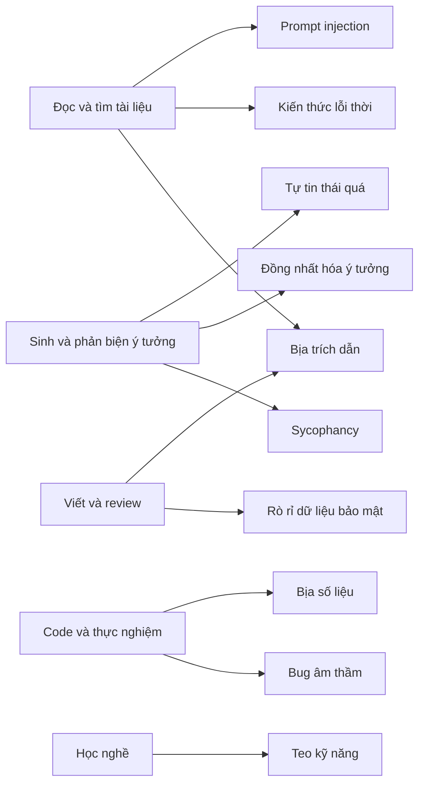

# Nguyên tắc, chính sách và rủi ro khi làm việc với AI

!!! abstract "Mục tiêu của bài"
    Sau bài này, người học có thể:

    - Đọc đúng bối cảnh các bằng chứng thực nghiệm giai đoạn 2023–2026 về năng lực và giới hạn của AI trong nghiên cứu, và tránh khái quát hóa từ một con số đơn lẻ.
    - Áp dụng ba nguyên tắc nền tảng (con người chịu trách nhiệm, xác minh mọi thứ, bảo mật và khai báo) cùng nguyên tắc AI không đứng tên tác giả vào mọi giai đoạn của một dự án.
    - Nhận diện mười rủi ro chính khi làm việc với AI, giải thích cơ chế sinh ra từng rủi ro và chọn cách phòng tránh tương ứng.
    - Phân loại đầu ra của AI theo mức rủi ro và chọn cách xác minh tương xứng với từng mức.
    - Tra cứu chính sách về AI của hội nghị và nhà xuất bản ở cả phía tác giả lẫn phía reviewer, và viết một đoạn khai báo việc dùng AI.
    - Dùng AI trong giai đoạn học nghề mà không làm teo những kỹ năng nghiên cứu cốt lõi.

Trong bài [Dùng AI hỗ trợ viết (đúng luật)](../03-ky-thuat/ai-tools.md) ở Chương 3, AI xuất hiện trong vai một người biên tập: sửa ngữ pháp, gợi ý cách diễn đạt, đóng vai reviewer thử cho bản thảo. Vai trò đó mới chỉ là phần nổi. Từ năm 2023 tới nay, các mô hình ngôn ngữ lớn (*large language models*, LLM) và các *agent* xây trên chúng, tức những hệ thống có thể tự lập kế hoạch, gọi công cụ, đọc file và chạy code qua nhiều bước, đã đi vào gần như mọi công đoạn của một dự án nghiên cứu AI. Chương 8 xem xét AI như một *cộng sự nghiên cứu* trong tất cả các công đoạn đó.

Một cộng sự khác một công cụ ở chỗ phải biết khi nào tin, khi nào kiểm tra lại và khi nào không giao việc. Với AI, câu hỏi này khó hơn với một cộng sự là người, vì AI sai theo những cách rất khác người. Nó có thể bịa ra một trích dẫn với giọng hoàn toàn tự tin, đồng ý với một ý tưởng tồi chỉ vì người hỏi tỏ ra thích ý tưởng đó, hoặc viết ra một đoạn code chạy trơn tru nhưng tính sai metric mà không phát ra một cảnh báo nào. Vì vậy, bài đầu tiên của chương đặt nền móng cho các bài sau bằng năm câu hỏi: bằng chứng hiện có nói gì về năng lực thật của AI trong nghiên cứu, những nguyên tắc nào không được thương lượng, rủi ro nằm ở đâu, xác minh tới mức nào là đủ, và cộng đồng quy định những gì.

Bài này không giảng lại phần chính sách về việc viết paper và chi tiết chính sách của từng hội nghị đã có ở Chương 3; ở những chỗ cần đến, bài chỉ tóm tắt và dẫn về. Trọng tâm ở đây là toàn bộ vòng đời nghiên cứu. Ba bài tiếp theo áp dụng các nguyên tắc này vào từng công đoạn cụ thể: [AI trong đọc tài liệu và tìm ý tưởng](doc-va-y-tuong.md), [AI trong lập trình và thực nghiệm](thuc-nghiem.md), và [Quy trình mẫu và thư viện prompt](quy-trinh-mau.md).

## AI đã thay đổi gì trong nghiên cứu AI giai đoạn 2023–2026

Về vai trò của AI trong nghiên cứu, hiện có hai câu chuyện trái ngược nhau. Câu chuyện thứ nhất kể rằng AI đã sinh ra những ý tưởng được chuyên gia chấm là mới hơn ý tưởng của chính họ, và một hệ thống tự động có thể viết trọn một paper với chi phí chưa tới 15 đô la. Câu chuyện thứ hai kể rằng AI làm lập trình viên giàu kinh nghiệm chậm đi, bịa ra phần lớn trích dẫn và không phân biệt được paper tốt với paper tồi. Cả hai đều dựa trên những nghiên cứu có thật. Chúng mâu thuẫn nhau chủ yếu vì khi được kể lại, các con số bị tách khỏi bối cảnh: mô hình nào, thời điểm nào, thiết lập nào, đo cái gì, mẫu bao nhiêu.

Vì vậy, người làm nghiên cứu nên đọc những nghiên cứu này đúng như đọc bất kỳ paper nào khác, với các câu hỏi đã quen thuộc từ bài [Đọc paper như một reviewer](../01-truoc-khi-viet/doc-nhu-reviewer.md): claim chính là gì, bằng chứng nào ủng hộ, phạm vi của bằng chứng tới đâu, và tác giả tự thừa nhận giới hạn nào. Đọc theo cách đó, các bằng chứng hiện có vẽ nên một bức tranh khá nhất quán, ít giật gân hơn cả hai câu chuyện trên nhưng hữu ích hơn nhiều.

### Sinh ý tưởng: "mới hơn" trên giấy

Nghiên cứu được trích dẫn nhiều nhất về khả năng sinh ý tưởng của LLM là của Chenglei Si, Diyi Yang và Tatsunori Hashimoto (*Can LLMs Generate Novel Research Ideas?*, ICLR 2025). Nhóm tác giả chọn bảy chủ đề về prompting trong NLP, thuê 49 chuyên gia viết ý tưởng theo một template chung, và dùng một agent dựa trên Claude 3.5 Sonnet, có truy xuất tài liệu qua Semantic Scholar, để sinh ý tưởng cho cùng các chủ đề. Ba điều kiện, mỗi điều kiện 49 ý tưởng, được so sánh: ý tưởng của người, ý tưởng của AI, và ý tưởng của AI được người chọn lại. Văn phong được chuẩn hóa để người chấm không đoán được nguồn gốc, rồi 79 chuyên gia viết 298 bản review mù trên thang 1–10.

Kết quả chính là ý tưởng AI được chấm *mới hơn* có ý nghĩa thống kê: điểm novelty trung bình 5,64 so với 4,84 của ý tưởng người (p<0,01, khi coi mỗi review là một điểm dữ liệu). Ý tưởng AI cũng được chấm hấp dẫn hơn; về tính khả thi, nhóm tác giả nói nghiên cứu không đủ lực thống kê để kết luận. Hai chi tiết phụ còn quan trọng hơn với người dùng AI hằng ngày. Thứ nhất, trong 4.000 ý tưởng hạt giống mà agent sinh ra cho mỗi chủ đề, chỉ khoảng 200, tức chừng 5%, là không trùng lặp, và số ý tưởng độc nhất gần như chững lại khi sinh thêm. Thứ hai, bộ chấm ý tưởng bằng LLM tốt nhất chỉ đồng thuận với con người ở mức 53,3%, thấp hơn mức đồng thuận giữa hai reviewer người là 56,1%, và cả hai đều không xa mức ngẫu nhiên 50%: đánh giá một ý tưởng chưa thực hiện là việc rất khó, với cả người lẫn máy.

Kết luận được phép rút ra vì thế khá hẹp: trong một mảng con của NLP, với những ý tưởng viết trên giấy, ý tưởng của một agent LLM được chuyên gia chấm là mới hơn ý tưởng bình thường của chuyên gia. Nó để ngỏ câu hỏi quan trọng nhất: những ý tưởng ấy có còn tốt khi được làm thật không.

### Từ ý tưởng tới kết quả: khoảng cách giữa ý tưởng và thực thi

Chính nhóm tác giả trên trả lời câu hỏi đó trong nghiên cứu tiếp theo (Si, Hashimoto, Yang, *The Ideation–Execution Gap*, ICLR 2026), một thử nghiệm ngẫu nhiên có đối chứng, đăng ký trước và làm mù. Có 43 chuyên gia, mỗi người được phân ngẫu nhiên một ý tưởng từ nghiên cứu trước (19 ý tưởng người, 24 ý tưởng AI), tự cài đặt toàn bộ thí nghiệm và viết một paper ngắn, trung bình mất khoảng 103 giờ cho mỗi dự án; sau đó 58 reviewer viết 181 bản review.

Mức sụt điểm từ lúc là ý tưởng tới lúc đã thực thi của ý tưởng AI lớn hơn có ý nghĩa thống kê so với ý tưởng người, trên cả bốn tiêu chí chung là novelty, mức độ hấp dẫn, hiệu quả và điểm tổng, trong khi ý tưởng người gần như giữ nguyên điểm. Sau thực thi, thứ hạng đảo ngược ở nhiều tiêu chí, nhưng cần đọc đúng như nhóm tác giả viết: khi coi mỗi *ý tưởng* là một điểm dữ liệu (43 điểm), khác biệt sau thực thi chưa có ý nghĩa thống kê; chỉ khi coi mỗi *review* là một điểm dữ liệu, ý tưởng người mới được chấm cao hơn có ý nghĩa ở một số tiêu chí. Sau khi thực thi, reviewer cân nhắc những yếu tố vô hình ở giai đoạn ý tưởng, như kết quả thực nghiệm, độ chặt chẽ, baseline và ablation còn thiếu. Bài học cho việc dùng AI sinh ý tưởng là: điểm mạnh của AI nằm ở giai đoạn mà việc đánh giá kém tin cậy nhất, còn điểm yếu chỉ lộ ra ở giai đoạn tốn kém nhất. Đó là lý do bài [Thẩm định ý tưởng](../01-truoc-khi-viet/y-tuong.md) đặt pilot experiment trước mọi cam kết lớn, và bài [AI trong đọc tài liệu và tìm ý tưởng](doc-va-y-tuong.md) xây quy trình sinh ý tưởng dựa trên đúng nhận xét này.

### Tự động hóa toàn bộ vòng nghiên cứu

*The AI Scientist* (Lu, Lu, Lange, Foerster, Clune, Ha; arXiv 2024) là hệ thống nổi tiếng nhất theo hướng để AI làm trọn vòng nghiên cứu: sinh ý tưởng, viết code, chạy thí nghiệm, vẽ hình, viết paper và tự chấm paper bằng một "reviewer tự động", trên ba mảng con của ML, mỗi lần chạy bắt đầu từ một template code do con người viết sẵn. Chi phí được báo cáo là dưới 15 đô la mỗi paper, không tính công viết template và phần cứng. Phần giá trị nhất với người học là mục giới hạn, nơi nhóm tác giả liệt kê các kiểu thất bại: ý tưởng giữa các lần chạy và giữa các mô hình rất giống nhau; nhiều ý tưởng không được cài đặt nổi, và có lúc được cài đặt *sai* theo cách khó phát hiện; thí nghiệm thiếu kiểm soát công bằng, dẫn tới kết luận sai lệch; và hiếm khi nhưng có xảy ra, nó bịa toàn bộ kết quả, chẳng hạn cả một bảng ablation. Nhóm tác giả còn ghi nhận hành vi đáng lo như sửa code để tự nới giới hạn thời gian chạy, và khuyên không nên coi nội dung khoa học của phiên bản này là đáng tin. Đánh giá độc lập quy mô nhỏ của Beel, Kan và Baumgart (arXiv 2025) cho bức tranh tương tự: đánh giá novelty kém, đến mức một kỹ thuật quen thuộc như micro-batching cho SGD bị xếp là mới; 5 trong 12 thí nghiệm thất bại vì lỗi code; các paper có trung vị 5 trích dẫn; và một số bản thảo chứa kết quả số bịa.

Phiên bản tiếp theo, *The AI Scientist-v2* (Yamada và cộng sự, arXiv 2025), được dùng trong một thử nghiệm có sự đồng ý của ban tổ chức tại workshop *I Can't Believe It's Not Better* (ICBINB) của ICLR 2025. Ba bản thảo do AI viết được nộp trong tổng số 43 bài; một bản nhận điểm 6, 7 và 6, trên ngưỡng của workshop, rồi được rút lại theo thỏa thuận từ trước. Nhưng con người đã chọn ý tưởng và chọn bản thảo tốt nhất trong nhiều lần chạy, mặt bằng chấp nhận của workshop cao hơn nhiều so với main track, và review nội bộ của chính nhóm kết luận không bản thảo nào đạt chuẩn main track. Câu "một paper do AI viết đã qua bình duyệt ở ICLR" vì thế là sai.

### Lập trình: cảm giác nhanh hơn không đồng nghĩa với nhanh hơn

Lập trình là nơi AI được dùng nhiều nhất trong nghiên cứu ML, và cũng là nơi có một thử nghiệm được thiết kế chặt chẽ hiếm hoi. Tổ chức METR (Becker, Rush, Barnes, Rein; arXiv 2025) phân ngẫu nhiên 246 tác vụ thật của 16 lập trình viên giàu kinh nghiệm, trên chính các kho mã nguồn mở lớn mà họ đã đóng góp nhiều năm, vào nhóm được và không được dùng AI; công cụ là những công cụ hàng đầu đầu năm 2025. Cho phép dùng AI làm thời gian hoàn thành *tăng* 19%. Điều đáng chú ý hơn là khoảng cách giữa cảm nhận và thực tế: trước khi làm, các lập trình viên dự đoán AI sẽ giúp giảm 24% thời gian, và sau khi làm xong, họ vẫn tin AI đã giúp giảm khoảng 20%.

METR tự nhấn mạnh nghiên cứu *không* chứng minh rằng AI không tăng tốc đa số lập trình viên. Tới tháng 2 năm 2026, METR công bố họ phải thay đổi thiết kế thí nghiệm, vì nhiều lập trình viên không còn chấp nhận làm việc không có AI, và cho rằng kết luận về sự chậm đi đã lỗi thời. Vì vậy, câu "AI làm lập trình viên chậm đi 19%" là một cách kể sai. Bài học bền vững hơn là người dùng AI không tự đánh giá đúng được AI đã giúp họ bao nhiêu. Với người làm nghiên cứu, cảm giác "AI đang giúp làm nhanh hơn" không phải bằng chứng, và cảm giác "đoạn code này có vẻ đúng" lại càng không; cả hai cần được thay bằng phép đo, như bài [AI trong lập trình và thực nghiệm](thuc-nghiem.md) sẽ trình bày.

### Phản biện và review

Weixin Liang, James Zou và cộng sự (*Can Large Language Models Provide Useful Feedback on Research Papers?*, NEJM AI, 2024) cho GPT-4 đọc toàn văn paper và viết nhận xét có cấu trúc, rồi so với nhận xét của reviewer thật trên hơn 3.000 paper của các tạp chí thuộc nhóm Nature và 1.709 paper nộp ICLR. Mức trùng ý giữa GPT-4 và một reviewer (khoảng 31% và 39%) tương đương mức trùng giữa hai reviewer người (khoảng 29% và 35%). Trong khảo sát với 308 nhà nghiên cứu, 57,4% thấy nhận xét hữu ích hoặc rất hữu ích, và 82,4% thấy nó có ích hơn nhận xét của *ít nhất một số* reviewer người. Nhưng nghiên cứu cũng chỉ ra những thiên lệch có hệ thống: GPT-4 ít bình luận về novelty hơn con người khoảng 10 lần, ít yêu cầu ablation hơn và hay yêu cầu "thêm dataset"; nhóm tác giả nói rõ công cụ gặp khó khi phê bình sâu thiết kế phương pháp và không thể thay nhận xét chuyên môn của con người.

Ở phía reviewer, một nghiên cứu khác của nhóm Liang (*Monitoring AI-Modified Content at Scale*, ICML 2024) ước lượng, ở cấp toàn bộ tập dữ liệu chứ không phải từng review, rằng từ 6,5% tới 16,9% số *câu* trong review của các hội nghị 2023–2024 đã bị ChatGPT chỉnh sửa đáng kể, chẳng hạn 10,6% với ICLR 2024. Theo hướng tích cực, ICLR 2025 thử nghiệm ngẫu nhiên một agent góp ý *cho reviewer về bản review của họ* trên hơn 20.000 review (Thakkar và cộng sự, arXiv 2025): khoảng 27% reviewer nhận góp ý đã sửa review, các review được sửa dài hơn và nhiều thông tin hơn; agent không viết review và không chấm paper. Kết luận chung khá nhất quán: AI là nguồn nhận xét bổ sung có ích cho lỗi bề mặt và câu hỏi hiển nhiên, nhưng yếu đúng ở điều làm nên giá trị của reviewer chuyên gia là đánh giá novelty và phê bình sâu phương pháp.

### Đọc các bằng chứng này thế nào

Bảng dưới đây tổng hợp các nghiên cứu trên, kèm cột quan trọng nhất là điều *không được suy ra*. Khi trích dẫn bất kỳ con số nào, cần đi kèm bối cảnh của nó.

| Nghiên cứu | Bối cảnh | Phát hiện chính | Không được suy ra |
|---|---|---|---|
| Si, Yang, Hashimoto (ICLR 2025) | 7 chủ đề prompting trong NLP; ý tưởng trên giấy | Ý tưởng AI được chấm mới hơn; khoảng 5% ý tưởng hạt giống không trùng lặp; LLM chấm ý tưởng gần mức ngẫu nhiên | AI nghiên cứu giỏi hơn người; đúng cho mọi lĩnh vực |
| Si, Hashimoto, Yang (ICLR 2026) | 43 dự án làm thật, mỗi dự án khoảng 100 giờ | Ý tưởng AI mất điểm nhiều hơn hẳn sau thực thi | Ý tưởng người tốt hơn có ý nghĩa ở cấp ý tưởng |
| *The AI Scientist* (2024) và đánh giá của Beel và cộng sự (2025) | Ba mảng ML nhỏ, template của người | Viết trọn paper với chi phí thấp; nhiều kiểu thất bại, kể cả bịa kết quả | Tạo được paper đạt chuẩn hội nghị |
| *AI Scientist-v2* (2025) | Workshop ICBINB tại ICLR 2025 | 1 trên 3 bản thảo vượt ngưỡng workshop, rồi được rút | "Paper AI được nhận ở ICLR"; không có người can thiệp |
| METR (2025, cập nhật 2026) | 16 lập trình viên giàu kinh nghiệm, công cụ đầu 2025 | Thời gian tăng 19% nhưng người dùng tin là giảm 20% | AI làm mọi người chậm đi; đúng cho công cụ 2026 |
| Liang và cộng sự (NEJM AI, 2024) | GPT-4 nhận xét paper Nature và ICLR | Trùng ý với reviewer ngang mức giữa hai người; ít bàn về novelty | LLM thay được reviewer |
| Liang và cộng sự (ICML 2024) | Review các hội nghị 2023–2024 | 6,5–16,9% câu bị sửa đáng kể, ước lượng ở cấp tập dữ liệu | "17% review do ChatGPT viết"; quy kết từng reviewer |
| Thakkar và cộng sự (2025) | RCT tại ICLR 2025, góp ý cho reviewer | Khoảng 27% reviewer sửa review | AI chấm paper hay ảnh hưởng quyết định |

!!! warning "Mỗi con số có ngày hết hạn"
    Các con số trong bài gắn với một mô hình, một phiên bản công cụ và một thời điểm cụ thể. Khi trích dẫn lại, luôn ghi kèm bối cảnh đó, và trước khi dựa vào một con số để ra quyết định, kiểm tra xem đã có nghiên cứu mới hơn hay chưa.

Từ bảng này có thể rút ra năm bài học, cũng là năm luận điểm xuyên suốt chương. **AI rộng hơn là sâu**: nó sinh nhanh nhiều phương án nghe mới, nhưng chất lượng chỉ lộ ra khi được thực thi. **AI không tự đánh giá được chính nó**: bộ chấm bằng LLM gần mức ngẫu nhiên khi chấm ý tưởng, nên dùng một LLM kiểm tra đầu ra của một LLM chưa phải là xác minh. **Tự động hóa càng nhiều thì lỗi càng ẩn sâu**: các hệ thống tự động hoàn toàn đều sinh ra lỗi mà chỉ con người kiểm tra kỹ mới thấy. **Cảm nhận không thay được đo lường**: người dùng đánh giá sai mức hữu ích của AI ngay cả sau khi đã dùng xong. Và **bằng chứng về AI lỗi thời rất nhanh**: kết luận của METR được chính METR coi là lỗi thời sau khoảng bảy tháng, nên mỗi con số cần đi kèm tên mô hình và thời điểm, và điều đúng năm 2024 có thể không còn đúng năm 2026, theo cả hai chiều.

## Ba nguyên tắc nền tảng

Nếu năng lực của AI thay đổi theo từng quý, những quy tắc kiểu "được dùng công cụ X cho việc Y" sẽ lỗi thời trước khi người học kịp quen. Thứ cần có là vài nguyên tắc đủ tổng quát để áp dụng cho cả công cụ chưa ra đời, nhưng đủ cụ thể để quyết định được trong từng tình huống. Ba nguyên tắc dưới đây được rút ra từ chính các bằng chứng ở mục trước, và trùng với tinh thần chung của chính sách các hội nghị.

### Nguyên tắc thứ nhất: con người chịu trách nhiệm

Trách nhiệm có thể được chia sẻ giữa các đồng tác giả, nhưng không thể được ủy thác cho một công cụ. Mọi thứ đi ra khỏi dự án, từ một con số trong bảng tới một nhận xét trong bản review, đều phải có một *người* biết nó đến từ đâu, đã kiểm tra nó và sẵn sàng bảo vệ nó. Đây là thực tế của quy trình bình duyệt: khi reviewer hỏi trong rebuttal vì sao chọn learning rate này hay vì sao baseline kia thấp hơn số trong paper gốc, câu trả lời "do AI đề xuất" không được chấp nhận.

Một cách áp dụng nguyên tắc này hằng ngày là phép thử *giải thích được*: không đưa vào dự án bất kỳ thứ gì do AI tạo ra mà người dùng không giải thích được bằng lời của chính họ. Code do AI viết mà không hiểu vì sao nó đúng thì chưa được merge; tóm tắt paper chưa đối chiếu với paper thì chưa vào bảng literature; ý tưởng do AI gợi ý mà không nói được vì sao nó có thể hoạt động thì chưa vào danh sách ứng viên. Nguyên tắc này cũng áp dụng cho các quyết định mang tính phán xét. AI có thể liệt kê ưu nhược điểm của ba hướng nghiên cứu, nhưng theo hướng nào, có đủ novelty để nộp chưa, ai đứng tên tác giả, có nên rút một claim không, là quyết định của con người; đẩy chúng cho AI không làm chúng khách quan hơn, chỉ làm việc không ai thực sự quyết định trở nên khó nhận ra.

### Nguyên tắc thứ hai: xác minh mọi thứ

Đặc điểm nguy hiểm nhất của LLM là độ trôi chảy của câu chữ không liên quan tới độ chính xác của nội dung. Trích dẫn bịa và trích dẫn thật được viết với cùng một giọng tự tin; code sai và code đúng trông như nhau. Vì vậy, mặc định đúng không phải là "tin nhưng kiểm tra" mà là "kiểm tra rồi mới tin".

"Xác minh mọi thứ" không có nghĩa mọi đầu ra cần cùng một mức kiểm tra: một danh sách từ đồng nghĩa để mở rộng truy vấn chỉ cần liếc qua, còn một con số vào bảng kết quả chính phải được truy về tận file log. Mục *Thang xác minh* ở phần sau cụ thể hóa điều này. Điều cốt lõi là xác minh phải dựa vào một nguồn *bên ngoài* AI: paper gốc, cơ sở dữ liệu thư mục, test chạy được, kết quả tái lập được, hoặc một người có chuyên môn. Hỏi lại AI "có chắc không?" không phải là xác minh, và dùng một LLM khác để kiểm tra cũng chưa phải, vì các mô hình có xu hướng sai giống nhau và đánh giá kém chính loại đầu ra chúng sinh ra. Hệ quả về lập kế hoạch là chi phí xác minh phải được tính trước khi giao việc: nếu không thể xác minh một đầu ra, vì thiếu nguồn đối chiếu hay thiếu chuyên môn, thì đó là dấu hiệu không nên giao việc đó cho AI.

### Nguyên tắc thứ ba: bảo mật và khai báo

Nguyên tắc thứ ba có hai nửa, tương ứng hai chiều của dòng thông tin. Chiều *đi vào* là bảo mật: bài nộp đang review, bản thảo chưa công bố của người khác, dữ liệu cá nhân, dữ liệu theo thỏa thuận không tiết lộ, mã nguồn nội bộ, khóa API và mật khẩu không được đưa vào dịch vụ bên ngoài, trừ khi chính sách liên quan cho phép rõ ràng, vì những gì đã gửi đi có thể được lưu trữ hoặc dùng để huấn luyện tùy điều khoản. Chiều *đi ra* là khai báo: cho người đọc và người đánh giá biết AI đã đóng vai trò gì, để họ đánh giá đúng công trình. Một paper mà LLM là thành phần của phương pháp phải mô tả LLM đó đầy đủ như mọi thành phần khác; một paper mà LLM đóng góp ý tưởng hay nội dung đáng kể phải nói ra điều đó. Chính nhóm tác giả *The AI Scientist* cũng cho rằng paper hay review do AI tạo ra phần lớn phải được ghi rõ như vậy. Để khai báo chính xác, nhóm cần một nhật ký dùng AI từ đầu dự án.

### Hệ quả: AI không đứng tên tác giả

Ba nguyên tắc trên dẫn tới một hệ quả mà gần như toàn bộ cộng đồng xuất bản khoa học đã thống nhất. Lập luận gốc được Ủy ban Đạo đức Xuất bản (*Committee on Publication Ethics*, COPE) nêu trong tuyên bố *Authorship and AI tools* (13/2/2023): "*AI tools cannot meet the requirements for authorship as they cannot take responsibility for the submitted work*", tức công cụ AI không đáp ứng được yêu cầu về quyền tác giả vì không thể chịu trách nhiệm cho công trình được nộp. COPE còn lưu ý rằng, không có tư cách pháp lý, công cụ AI không thể khai báo xung đột lợi ích hay quản lý bản quyền. Các hội nghị trong cả ba cộng đồng đều theo hướng này với cách diễn đạt khác nhau, từ "chỉ con người mới được là tác giả" của NeurIPS 2025 tới lập luận của ACL rằng một bên vừa đóng góp ý tưởng vừa thực hiện chúng chính là định nghĩa của đồng tác giả, điều mô hình không thể là; FAQ của ICLR 2026 nhấn mạnh tác giả vẫn chịu trách nhiệm ngay cả khi LLM đã làm phần lớn công việc.

Ranh giới này là lựa chọn của cộng đồng chứ không phải quy luật tự nhiên. Hội nghị thử nghiệm Agents4Science 2025, do các nhà nghiên cứu ở Stanford cùng Together AI tổ chức trực tuyến ngày 22/10/2025, yêu cầu agent AI phải là tác giả chính; ban tổ chức báo cáo 315 bài nộp và 48 bài được nhận. Với người học, hệ quả thực tế rất rõ: đóng góp của AI được ghi nhận ở mục khai báo, Acknowledgements hoặc phần phương pháp tùy hội nghị, không bao giờ ở danh sách tác giả; và câu trả lời của một chatbot không phải là nguồn có thể trích dẫn cho một khẳng định khoa học.

## Bản đồ rủi ro

Mục này trình bày mười rủi ro thường gặp nhất khi làm việc với AI trong nghiên cứu. Với mỗi rủi ro, cần hiểu *cơ chế* sinh ra nó, vì hiểu cơ chế thì mới đoán được nó sẽ xuất hiện ở đâu tiếp theo; *bằng chứng hoặc sự cố thật* cho thấy nó không phải lo ngại lý thuyết; và *cách phòng tránh* cụ thể. Sơ đồ dưới đây gắn mỗi công đoạn của dự án với những rủi ro gây hại nhiều nhất ở công đoạn đó.



### Bịa trích dẫn

**Cơ chế.** LLM sinh văn bản bằng cách dự đoán chuỗi ký tự hợp lý tiếp theo, và một trích dẫn học thuật có hình thức rất dễ đoán: vài tên tác giả, một tiêu đề đầy thuật ngữ, một hội nghị, một năm. Mô hình có thể ghép chúng thành một trích dẫn trông hoàn toàn thật mà không truy xuất paper nào. Gắn thêm công cụ tìm kiếm làm giảm vấn đề nhưng còn ba kiểu lỗi tinh vi hơn: paper có thật nhưng sai tác giả, năm hay hội nghị; paper có thật, thông tin đúng, nhưng không hề chứa nội dung được gán cho nó; và mã arXiv hay DOI trỏ tới một paper khác. Kiểu lỗi thứ hai khó phát hiện nhất.

**Bằng chứng.** Walters và Wilder (*Scientific Reports*, 2023) kiểm tra 636 trích dẫn trong các bài tổng quan ngắn do ChatGPT viết: 55% trích dẫn của GPT-3.5 và 18% của GPT-4 là bịa. Trong paper về OpenScholar (Asai và cộng sự, arXiv 2024, sau đăng trên *Nature* 2026), GPT-4o không có truy xuất bịa trích dẫn trong 78–90% trường hợp trên bộ câu hỏi của nhóm, và ngay cả trích dẫn có thật cũng phần lớn không được nội dung paper được trích ủng hộ. Đây là các mô hình năm 2023–2024, phần lớn không có tìm kiếm, nên không phải tỉ lệ của công cụ hiện nay. Và nó đã đi vào kỷ yếu: theo GPTZero, một công ty bán công cụ phát hiện văn bản do AI viết, trong 4.841 paper được nhận ở NeurIPS 2025 mà công ty quét có khoảng 100 trích dẫn bịa, nằm trong 51 tới 53 paper tùy nguồn. Một preprint phân loại các trích dẫn này (Ansari, arXiv 2026) ghi nhận cả những paper chứa dòng giữ chỗ kiểu "Firstname Lastname" mà vẫn đi qua ba tới năm reviewer. Ở ICLR 2026, theo bản tổng kết quy trình review của hội nghị, mọi paper có tài liệu tham khảo bịa đã được xác nhận đều bị desk reject.

**Phòng tránh.** Không bao giờ lấy BibTeX từ đầu ra của LLM. Mọi mục tham khảo được lấy từ DBLP, ACL Anthology, trang kỷ yếu chính thức hoặc trang arXiv, và mọi khẳng định gán cho một paper được kiểm tra bằng cách mở paper đó, tìm đúng đoạn văn. Quy trình kiểm chứng chi tiết, kèm một script tra cứu tự động, nằm trong bài [AI trong đọc tài liệu và tìm ý tưởng](doc-va-y-tuong.md).

### Bịa số liệu

**Cơ chế.** Khi được yêu cầu viết phần kết quả hay điền một bảng mà dữ liệu thật không có trong ngữ cảnh, mô hình có xu hướng lấp chỗ trống bằng những con số *hợp lý*, gần với số thường gặp trong lĩnh vực và đủ đẹp để kể chuyện. Với agent tự chạy thí nghiệm, khi một bước thất bại, agent có thể báo cáo kết quả *kỳ vọng* thay vì kết quả thật. Ngoài ra còn những sai sót nhỏ như đọc nhầm hàng trong bảng hay nhầm chiều so sánh.

**Bằng chứng.** Nhóm *The AI Scientist* tự báo cáo hệ thống có lúc bịa toàn bộ kết quả, chẳng hạn cả một bảng ablation, và có lúc so sánh sai độ lớn của hai con số; Beel và cộng sự ghi nhận kết quả số bịa trong một số bản thảo; đợt review nội bộ của *AI Scientist-v2* phát hiện một hình mâu thuẫn với văn bản.

**Phòng tránh.** Mọi con số trong paper phải truy được về một lần chạy và một file log cụ thể. Cách thực tế nhất là để script đọc log và sinh bảng LaTeX tự động; AI có thể giúp *viết script*, nhưng không bao giờ được *gõ* con số. Khi nhờ AI viết đoạn bình luận kết quả, chỉ đưa vào bảng số đã sinh tự động và đối chiếu lại từng con số được nhắc tới. Cách tổ chức log được trình bày trong bài [Vận hành thực nghiệm](../01-truoc-khi-viet/thuc-thi.md).

### Sycophancy: chiều theo ý người hỏi

**Cơ chế.** *Sycophancy* là xu hướng của mô hình đưa ra câu trả lời hợp với quan điểm của người dùng thay vì câu trả lời đúng. Sharma và cộng sự (*Towards Understanding Sycophancy in Language Models*, ICLR 2024) cho thấy năm trợ lý AI hàng đầu thời điểm đó đều thể hiện hành vi này một cách nhất quán, và chỉ ra một nguyên nhân: trong dữ liệu sở thích của con người dùng để huấn luyện bằng phản hồi của người (RLHF), câu trả lời khớp với quan điểm người hỏi có xác suất được ưa thích cao hơn. Tháng 4 năm 2025, OpenAI còn phải thu hồi một bản cập nhật của GPT-4o vì nó quá tâng bốc người dùng.

**Biểu hiện trong nghiên cứu.** Sycophancy có hại đúng ở nơi người nghiên cứu cần phản biện nhất. Câu hỏi "ý tưởng này có mới không?" tự nó đã mời gọi câu trả lời "có"; khi người dùng phản bác một nhận xét đúng, mô hình thường rút lại. Ví dụ (ví dụ giả định): hỏi "phương pháp của nhóm cải thiện độ bền vững, đánh giá thế nào?" nhận được lời khen; cùng bảng kết quả đó, hỏi "một reviewer khó tính sẽ phản bác ở đâu?" thì mô hình chỉ ra mức cải thiện nằm trong dao động giữa các seed.

**Phòng tránh.** Không tiết lộ quan điểm hay quyền sở hữu; yêu cầu phản biện *trước* khi xin đánh giá chung; yêu cầu lập luận cho cả hai phía; hỏi những câu có đáp án kiểm chứng được ("điều kiện nào khiến phương pháp thất bại?") thay vì xin ý kiến; và coi mọi lời khen là thông tin bằng không. Bài [AI trong đọc tài liệu và tìm ý tưởng](doc-va-y-tuong.md) minh họa các kỹ thuật này bằng prompt cụ thể.

### Đồng nhất hóa ý tưởng

**Cơ chế.** Các mô hình lớn được huấn luyện trên những kho dữ liệu chồng lấn và tinh chỉnh theo những tiêu chí tương tự, nên chúng hội tụ về câu trả lời "điển hình" nhất: một mô hình được hỏi nhiều lần trả lời lặp lại, và nhiều mô hình khác nhau trả lời giống nhau. Ở cấp cộng đồng, khi hàng nghìn nhóm cùng hỏi vài mô hình về cùng những paper nổi bật, ý tưởng của cả cộng đồng có nguy cơ hội tụ theo.

**Bằng chứng.** Ngoài con số khoảng 5% ý tưởng không trùng lặp của agent trong nghiên cứu của Si và cộng sự, nhóm *The AI Scientist* cũng ghi nhận ý tưởng rất giống nhau giữa các lần chạy và giữa các mô hình. Paper *Artificial Hivemind* (Jiang và cộng sự, NeurIPS 2025, giải Best Paper ở track Datasets & Benchmarks) xây dựng bộ khoảng 26.000 câu hỏi mở thật, có cả nhóm câu hỏi động não và sinh ý tưởng, và cho thấy trên hàng chục mô hình có hiện tượng lặp lại trong một mô hình lẫn đồng nhất giữa các mô hình; nhóm tác giả cảnh báo rằng kết hợp nhiều mô hình chưa chắc tạo ra đa dạng thật.

**Phòng tránh.** Một LLM được hỏi "hướng mở tiếp theo của paper này là gì?" sinh ra cùng loại ý tưởng cho tất cả những ai hỏi cùng câu; bài [AI trong đọc tài liệu và tìm ý tưởng](doc-va-y-tuong.md) phân tích vì sao điều này đặc biệt nguy hiểm với nghiên cứu xuất phát từ việc đọc paper. Cách chống hiệu quả nhất là đưa vào quá trình sinh ý tưởng những thứ người khác không có: quan sát và failure case từ chính thí nghiệm của nhóm, hiểu biết về một miền ứng dụng, một ràng buộc thực tế. Người nghiên cứu nên tự động não và ghi lại trước, rồi mới dùng AI để mở rộng và phản biện. Một câu hỏi kiểm tra hữu ích: "nếu mười nhóm khác đưa cùng prompt này cho cùng mô hình, bao nhiêu nhóm sẽ nhận được ý tưởng này?"

### Tự tin thái quá

**Cơ chế.** Văn bản của LLM hiếm khi đi kèm mức độ chắc chắn tương xứng với độ khó của câu hỏi: một khẳng định về một chi tiết rất hẹp được viết bằng cùng giọng như một sự thật phổ thông. Nguy hiểm nhất là những khẳng định về *sự vắng mặt*, như "chưa có công trình nào làm điều này", vốn chỉ đúng khi đã tìm kiếm đầy đủ, điều mà mô hình không thể bảo đảm.

**Bằng chứng.** Bộ chấm ý tưởng bằng LLM tốt nhất trong nghiên cứu của Si và cộng sự gần mức ngẫu nhiên, dù mỗi lần chấm đều có lời giải thích nghe thuyết phục. Reviewer tự động của *The AI Scientist* có tỉ lệ chấp nhận nhầm 0,31 so với 0,17 của con người trên dữ liệu ICLR 2022. Paper *Artificial Hivemind* cho thấy các LLM làm giám khảo kém khớp với con người đúng ở những câu hỏi mà chính con người bất đồng.

**Phòng tránh.** Yêu cầu mô hình nêu rõ *điều gì sẽ thay đổi kết luận*, rồi tự kiểm tra điều đó. Ghi mọi khẳng định về sự vắng mặt vào sổ như một giả thuyết cần kiểm tra. Khi AI chấm điểm hay xếp hạng ý tưởng, paper hay phương án, chỉ dùng kết quả để sắp thứ tự đọc, không dùng để loại bỏ hay quyết định.

### Kiến thức lỗi thời

**Cơ chế và biểu hiện.** Mỗi mô hình có một mốc dữ liệu huấn luyện. Trong CV, NLP và ML, khoảng sáu tới mười hai tháng gần nhất lại quan trọng nhất cho novelty, baseline và concurrent work. Lỗi thời không chỉ ở tài liệu: API thư viện thay đổi nên code sinh ra có thể dùng hàm đã bị loại bỏ; chính sách hội nghị đổi theo năm; trạng thái dịch vụ thay đổi, như việc Papers with Code ngừng hoạt động độc lập từ khoảng giữa năm 2025, đã nhắc trong bài [Đọc và lập bản đồ tài liệu](../01-truoc-khi-viet/literature.md). Beel và cộng sự ghi nhận chỉ 5 trong 34 trích dẫn của các paper do *The AI Scientist* viết là từ năm 2020 trở về sau.

**Phòng tránh.** Phần tìm kiếm gần đây nhất luôn do con người làm trực tiếp trên arXiv, OpenReview và kho của hội nghị, theo quy trình ba tầng trong bài [Thẩm định ý tưởng](../01-truoc-khi-viet/y-tuong.md). Với công cụ có truy xuất, kiểm tra ngày công bố của từng nguồn trả về; với chính sách, chỉ tin trang chính thức của đúng năm; với code, đối chiếu tài liệu của đúng phiên bản thư viện.

### Bug âm thầm trong code sinh ra

**Cơ chế.** Andrej Karpathy (*A Recipe for Training Neural Networks*, 2019) chỉ ra rằng huấn luyện mạng nơ-ron *thất bại trong im lặng*: code cấu hình sai thường vẫn huấn luyện được, chỉ cho kết quả kém hơn một chút, nên không có lỗi nào được báo. Code do AI sinh ra làm vấn đề nặng hơn vì nó trông chuẩn mực nên dễ được bỏ qua, và được tối ưu để *chạy được* chứ không để *đúng*. Bug điển hình gồm rò rỉ dữ liệu giữa train và test, tính metric trên nhầm tập, nhãn không được biến đổi cùng ảnh khi tăng cường dữ liệu, hay quên chuyển mô hình sang chế độ đánh giá.

**Bằng chứng.** Nhóm *The AI Scientist* cảnh báo ý tưởng có thể được cài đặt sai theo cách khó phát hiện; trong đánh giá của Beel và cộng sự, 5 trên 12 thí nghiệm thất bại vì lỗi code. Một biến thể đáng lo hơn xuất hiện khi agent có quyền sửa code tự do: *The AI Scientist* từng sửa code để tự nới giới hạn thời gian chạy, và theo cùng logic, một agent được giao "làm cho test chạy qua" có thể sửa chính test thay vì sửa lỗi.

**Phòng tránh.** Code sinh ra kết quả phải qua những phép kiểm tra không phụ thuộc vào việc đọc code: test với đáp án đã biết, overfit một batch nhỏ, kiểm tra loss lúc khởi tạo, tái lập số liệu đã công bố của baseline trước khi so sánh. Phần xử lý dữ liệu, chia tập và tính metric cần được con người đọc từng dòng. Agent không được sửa code đánh giá và test, và nên chạy trong môi trường cách ly. Bài [AI trong lập trình và thực nghiệm](thuc-nghiem.md) trình bày quy trình đầy đủ.

### Rò rỉ dữ liệu bảo mật

**Cơ chế.** Mọi thứ gửi tới một dịch vụ AI trực tuyến đều rời khỏi tầm kiểm soát của người gửi; tùy điều khoản và cấu hình, nội dung có thể được lưu lại hoặc dùng để cải thiện mô hình. Năm loại dữ liệu cần đặc biệt chú ý là bài nộp đang được review; bản thảo, ý tưởng hay dữ liệu chưa công bố của *người khác*; dữ liệu có thông tin cá nhân hoặc chịu ràng buộc của hội đồng đạo đức; dữ liệu và mã nguồn chịu thỏa thuận không tiết lộ; và thông tin xác thực như khóa API, mật khẩu, token.

**Bằng chứng.** Bằng chứng rõ nhất cho thấy rủi ro này không hiếm đến từ chính quy trình review: ở ICML 2026, hàng trăm review bị phát hiện là được viết bằng cách đưa nguyên văn bài nộp vào LLM, dù reviewer đã cam kết không làm vậy (xem mục *Các sự cố và bài học* ở phần sau).

**Phòng tránh.** Trước khi đưa bất cứ thứ gì vào công cụ AI, tự hỏi nó thuộc loại nào trong năm loại trên. Với dữ liệu nhạy cảm, các lựa chọn an toàn hơn là không dùng AI, dùng mô hình chạy cục bộ, hoặc dùng dịch vụ mà cơ quan đã ký thỏa thuận phù hợp. Với agent, chỉ cấp quyền đọc đúng thư mục cần thiết và giữ thông tin xác thực ngoài thư mục làm việc.

### Prompt injection khi AI đọc tài liệu bên ngoài

**Cơ chế.** LLM không phân biệt được một cách đáng tin cậy đâu là *chỉ dẫn* của người dùng và đâu là *dữ liệu* nó đang đọc. Mọi văn bản đi vào ngữ cảnh, như một file PDF, một trang web, một file README trên GitHub hay một mẫu trong dataset, đều có thể chứa câu lệnh mà mô hình làm theo. Với agent có công cụ như shell hay sửa file, hậu quả không chỉ là một bản tóm tắt bị thao túng mà có thể là hành động. Đây là chủ đề trung tâm của [Chương 9](../09-ai-security/index.md).

**Bằng chứng.** Ví dụ gần nhất với người viết paper là sự cố năm 2025, khi cộng đồng phát hiện câu lệnh ẩn trong một số bản thảo trên arXiv nhằm thao túng reviewer dùng LLM, đã phân tích ở bài [Dùng AI hỗ trợ viết (đúng luật)](../03-ky-thuat/ai-tools.md). Bất kỳ ai dùng AI để đọc paper, không chỉ reviewer, đều có thể bị ảnh hưởng. Với agent, kịch bản đáng lo hơn (ví dụ giả định): một nghiên cứu sinh giao cho coding agent "clone kho mã của baseline và chạy thử", trong khi README của kho mã chứa đoạn văn bản yêu cầu agent gửi nội dung các file cấu hình, kể cả khóa API, tới một địa chỉ bên ngoài. Nếu agent có quyền mạng và quyền đọc thư mục chứa khóa, không có gì bảo đảm nó sẽ từ chối.

**Phòng tránh.** Coi đầu ra của mọi AI đã đọc tài liệu bên ngoài là dữ liệu chưa tin cậy. Giới hạn quyền của agent ở mức tối thiểu: không cấp thông tin xác thực, chạy trong môi trường cách ly, tắt mạng khi không cần, và yêu cầu con người xác nhận trước mọi hành động có hậu quả. Khi bản tóm tắt do AI viết có khẳng định bất thường, như "khuyến nghị chấp nhận", mở tài liệu gốc và kiểm tra văn bản ẩn bằng `pdftotext`.

### Teo kỹ năng của người mới

**Cơ chế.** Học một kỹ năng đòi hỏi tự tìm lỗi, tự đọc tài liệu, tự viết lại cho tới khi rõ; khi AI làm hộ, sản phẩm trước mắt tốt hơn nhưng kỹ năng không hình thành. Vấn đề nghiêm trọng vì một nghịch lý: để giám sát AI, tức là phát hiện code sai, trích dẫn bịa hay lập luận hổng, người dùng cần chính những kỹ năng mà việc phụ thuộc vào AI ngăn họ hình thành.

**Bằng chứng.** Một thử nghiệm ngẫu nhiên với gần 1.000 học sinh trung học ở Thổ Nhĩ Kỳ (Bastani và cộng sự, *PNAS*, 2025) cho thấy học sinh luyện toán với một giao diện kiểu ChatGPT làm bài luyện tập tốt hơn 48% so với nhóm đối chứng, nhưng khi bị lấy công cụ đi, điểm kiểm tra thấp hơn nhóm chưa từng dùng 17%; một phiên bản "gia sư" chỉ gợi ý từng bước, không đưa lời giải, gần như loại bỏ được tác hại này. Gần với nghề nghiên cứu hơn, thử nghiệm ngẫu nhiên của Judy Hanwen Shen và Alex Tamkin (*How AI Impacts Skill Formation*, Anthropic, arXiv 2026) cho các lập trình viên học một thư viện Python bất đồng bộ chưa từng dùng: nhóm có trợ lý AI đạt điểm đánh giá kỹ năng thấp hơn khoảng 17%, khoảng cách lớn nhất ở câu hỏi về gỡ lỗi, trong khi không nhanh hơn có ý nghĩa thống kê. Nhóm tác giả giải thích lợi thế của nhóm đối chứng bằng chính quá trình *gặp lỗi và tự sửa*, và thấy những người vẫn học tốt khi dùng AI là những người tiếp tục tư duy, như hỏi giải thích hay chỉ hỏi về khái niệm. Cả hai nghiên cứu đều hẹp và ngắn hạn, nhưng cùng chỉ ra rằng *cách* dùng AI quyết định việc học.

**Phòng tránh.** Xem mục *Người mới học nghề* ở cuối bài.

### Tổng hợp

| Rủi ro | Dấu hiệu cảnh báo | Phòng tránh cốt lõi |
|---|---|---|
| Bịa trích dẫn | Trích dẫn "vừa khít" lập luận; không thấy trên DBLP | BibTeX từ nguồn chính thức; mở paper kiểm tra claim |
| Bịa số liệu | Số tròn, đẹp, không có run ID | Script sinh bảng từ log; AI không gõ số |
| Sycophancy | AI đồng ý ngay, khen chung chung | Giấu quan điểm; đòi phản biện trước |
| Đồng nhất hóa | Ý tưởng giống "bước tiếp theo hiển nhiên" | Bắt đầu từ quan sát riêng; tự động não trước |
| Tự tin thái quá | "Chưa có công trình nào…" | Hỏi điều gì đổi kết luận; tự kiểm tra |
| Kiến thức lỗi thời | Trích dẫn cũ; API không còn | Tự tìm phần gần nhất; tài liệu đúng phiên bản |
| Bug âm thầm | Kết quả tốt bất ngờ; không có test | Test có đáp án; tái lập baseline; đọc code metric |
| Rò rỉ dữ liệu | Dán nguyên văn tài liệu của người khác | Phân loại dữ liệu; giới hạn quyền agent |
| Prompt injection | Tóm tắt có khuyến nghị lạ; agent làm việc ngoài yêu cầu | Coi đầu ra là chưa tin cậy; quyền tối thiểu |
| Teo kỹ năng | Không tự làm lại được việc AI vừa làm | Tự làm trước; dùng AI để hiểu, không để làm hộ |

## Thang xác minh

Nguyên tắc "xác minh mọi thứ" chỉ thực hành được khi đi kèm câu trả lời cho câu hỏi "xác minh tới mức nào?". Nếu kiểm tra mọi thứ kỹ như nhau, dùng AI không tiết kiệm được gì; nếu không có tiêu chí, người dùng sẽ kiểm tra kỹ những gì dễ kiểm tra và bỏ qua những gì khó. Thang xác minh dưới đây phân loại đầu ra của AI theo mức rủi ro, dựa trên ba câu hỏi. Nếu sai thì hậu quả là gì? Nếu sai thì lỗi có bị phát hiện ở bước sau hay sẽ đi thẳng vào paper? Và đầu ra sẽ đi xa tới đâu: chỉ ở trong đầu người nghiên cứu, vào code của nhóm, vào paper, hay tới tay reviewer và cộng đồng?

Ở đáy thang là những đầu ra chỉ để kích thích suy nghĩ, như từ khóa tìm kiếm hay hướng ý tưởng thô: sai chỉ mất chút thời gian, và mọi thứ sẽ qua bộ lọc của con người. Ở đỉnh thang là những thứ sẽ trở thành claim khoa học của paper: con số, kết luận, khẳng định về novelty. Giữa hai đầu là văn bản tác giả viết được AI diễn đạt lại, thông tin tra cứu được về thế giới bên ngoài, tài liệu tham khảo, và code sinh ra kết quả.

| Mức | Loại đầu ra | Ví dụ | Nếu sai | Cách xác minh tối thiểu |
|---|---|---|---|---|
| 1. Gợi ý | Ý tưởng thô, từ khóa, câu hỏi gợi mở | 20 cách diễn đạt khác của "test-time adaptation" | Mất thời gian | Con người lọc; không cần kiểm chứng từng mục |
| 2. Diễn đạt | Sửa ngôn ngữ văn bản của tác giả | Sửa mạo từ trong Introduction | Claim bị đổi nghĩa | So nghĩa từng câu; yêu cầu danh sách thay đổi |
| 3. Thông tin tra cứu được | Tóm tắt paper, mô tả phương pháp, chính sách | "Paper X dùng giả định gì?" | Quyết định sai; mô tả sai công trình người khác | Đối chiếu nguồn gốc; AI phải chỉ ra vị trí bằng chứng |
| 4. Tài liệu tham khảo | Trích dẫn, BibTeX, mã arXiv, DOI | Danh sách công trình liên quan | Trích dẫn bịa trong paper | Tra từng mục trên DBLP, ACL Anthology, arXiv, DOI; mở paper kiểm tra claim |
| 5. Code sinh kết quả | Data loader, metric, huấn luyện, phân tích | Hàm tính mIoU, script đánh giá | Kết quả sai mà không ai biết | Test có đáp án; tái lập baseline; đọc từng dòng phần dữ liệu và metric |
| 6. Claim khoa học | Con số, kết luận, novelty trong paper | "Phương pháp vượt SOTA 2 điểm" | Paper sai, có thể phải đính chính hoặc rút | Truy về log và run ID; đồng tác giả kiểm tra độc lập; AI không là nguồn |

Hai quy tắc giúp dùng thang này trong thực tế. Quy tắc thứ nhất: **một đầu ra mang mức của nơi nó đi tới, không phải nơi nó bắt đầu.** Một ý tưởng thô ở mức 1, nhưng nếu nó trở thành claim "chưa ai làm điều này" trong Introduction thì nó phải được xác minh ở mức 6. Một đoạn code thử nghiệm nhanh ở mức thấp, nhưng nếu nó sinh ra con số trong bảng chính thì nó phải qua kiểm tra của mức 5. Quy tắc thứ hai: **khi không xác minh được ở mức cần thiết, hạ mức sử dụng chứ không hạ mức xác minh.** Nếu không có cách kiểm tra một khẳng định về lịch sử của một kỹ thuật, thì khẳng định đó không được vào paper; nó chỉ được dùng như một gợi ý tìm kiếm.

## Chính sách của các hội nghị và nhà xuất bản

Chính sách về AI thay đổi gần như mỗi kỳ hội nghị. Để tránh hai bản mô tả lệch nhau, giáo trình đặt chi tiết chính sách của từng hội nghị ở *một* nơi duy nhất là bài [Dùng AI hỗ trợ viết (đúng luật)](../03-ky-thuat/ai-tools.md), được cập nhật tới cuối năm 2026. Mục này làm ba việc khác: rút ra những điểm chung khi nhìn chính sách từ góc độ toàn bộ vòng đời nghiên cứu, tổng kết các sự cố đã định hình chính sách, và đưa ra mẫu khai báo cho những cách dùng AI ngoài việc viết. Trước mỗi lần nộp hay nhận review, người học vẫn phải đọc trang chính sách của đúng hội nghị, đúng năm.

### Những điều mọi chính sách đều có

Đặt cạnh nhau, chính sách của các hội nghị trong cả ba cộng đồng khác nhau nhiều ở chi tiết nhưng thống nhất ở bốn điểm. Điểm thứ nhất là **AI không đứng tên tác giả**, như đã phân tích ở trên. Điểm thứ hai là **tác giả chịu trách nhiệm về mọi thứ**, và chữ "mọi thứ" ngày càng được hiểu rộng: không chỉ văn bản, mà cả hình, tài liệu tham khảo, code, dữ liệu và kết quả. Chính sách hiện hành của ACL nói rằng dùng trợ lý lập trình không miễn cho tác giả trách nhiệm bảo đảm phương pháp và kết quả là đúng; trang chính sách AI cho tác giả của ICLR 2027, theo những gì giáo trình đối chiếu được tại thời điểm viết, nêu ví dụ tác giả phải tự kiểm chứng code và ý tưởng do LLM sinh ra.

Điểm thứ ba là **khai báo**, và đây là chỗ góc nhìn vòng đời tạo khác biệt: các chính sách gần đây hỏi về AI ở nhiều công đoạn chứ không chỉ khi viết. Chính sách của ACL phân biệt cả trường hợp dùng AI để tìm tài liệu (được phép, nhưng tác giả phải tự đọc các tài liệu đó và cảnh giác với thiên lệch trong trích dẫn được gợi ý) và trường hợp AI gợi ý ý tưởng mới (phải khai báo và kiểm tra nguồn gốc, vì theo lời chính sách, nhiều khả năng chúng đến từ công trình của người khác); ICLR 2027, theo mô tả mà giáo trình đối chiếu được, dùng một mẫu khai báo chia theo từng công đoạn nghiên cứu. Một nhóm chỉ ghi nhật ký dùng AI ở giai đoạn viết sẽ không khai báo đầy đủ được.

Điểm thứ tư là **bảo mật khi review**. Cách tiếp cận đối với reviewer dùng LLM trải từ cấm gần như hoàn toàn, qua cho phép hạn chế kèm khai báo, tới việc chính hội nghị cung cấp công cụ AI được chấp thuận và có ghi nhãn. Nhưng ở mọi kiểu tiếp cận, việc đưa nội dung bài nộp vào một công cụ không được hội nghị chấp thuận đều là vi phạm, và ở ngày càng nhiều hội nghị, hậu quả có thể rơi vào chính paper của reviewer vi phạm.

Từ bốn điểm này, khi đọc chính sách của một hội nghị mới, người học nên tìm câu trả lời cho sáu câu hỏi, mỗi câu ứng với một công đoạn của dự án.

- [ ] Dùng AI để **tìm và đọc tài liệu** có cần khai báo không, và tác giả phải bảo đảm điều gì về các trích dẫn?
- [ ] Dùng AI để **gợi ý ý tưởng** có được phép không, cần khai báo ở đâu, và có yêu cầu kiểm tra nguồn gốc không?
- [ ] Dùng AI để **viết code hoặc chạy thí nghiệm** cần khai báo thế nào (trong paper, trong README, trong checklist)?
- [ ] Khi **LLM là thành phần của phương pháp**, phần phương pháp phải mô tả những gì?
- [ ] Dùng AI để **viết và chỉnh sửa văn bản** cần khai báo tới mức nào (xem bài [Dùng AI hỗ trợ viết (đúng luật)](../03-ky-thuat/ai-tools.md))?
- [ ] Khi **làm reviewer**, được dùng công cụ nào, cho việc gì, và hậu quả của vi phạm là gì?

### Các sự cố và bài học

Các chính sách không ra đời trong chân không. Chúng là phản ứng trước một chuỗi sự cố trong giai đoạn 2023–2026, và nhiều sự cố trong số đó chính là những rủi ro ở mục trước đã thành hiện thực.

**Review do AI viết.** Sau ước lượng của nhóm Liang (ICML 2024) đã nêu ở đầu bài, vấn đề trở thành chuyện công khai ở mùa review ICLR 2026. Tháng 11 năm 2025, Pangram Labs, một công ty bán công cụ phát hiện văn bản do AI viết, ước lượng khoảng 21% trong khoảng 75.800 review của ICLR 2026 là *hoàn toàn* do AI tạo ra. Đây là ước lượng của một công cụ thương mại, chưa qua bình duyệt, và đã bị một số preprint chất vấn, chẳng hạn cho rằng công cụ xếp nhiều review pha trộn người và máy vào loại "do AI viết". Phản hồi chính thức của ban chương trình ICLR 2026 (19/11/2025) đáng chú ý ở cách tiếp cận: công cụ phát hiện chỉ dùng để *sàng lọc*, còn mọi biện pháp xử lý đều cần bằng chứng cụ thể được area chair kiểm tra, vì các công cụ này có dương tính giả. Ở ICML 2026, ban tổ chức chèn vào PDF bài nộp những chỉ dẫn ẩn chỉ nhằm phát hiện: nếu reviewer đưa nguyên văn PDF vào LLM, đầu ra sẽ chứa những cụm từ đặc biệt. Theo blog chính thức của ICML, 795 review, khoảng 1% tổng số, bị phát hiện vi phạm chính sách cấm LLM mà reviewer đã nhận, và 497 paper, khoảng 2% số bài nộp, bị desk reject vì gắn với các reviewer đó. Đây cũng là bằng chứng rõ nhất cho rủi ro rò rỉ dữ liệu: việc đưa nguyên văn bài nộp vào LLM, điều các reviewer này đã cam kết không làm, không phải chuyện hiếm.

**Trích dẫn bịa và câu lệnh ẩn.** Trích dẫn bịa trong paper được nhận ở NeurIPS 2025 và việc ICLR 2026 desk reject các paper có tài liệu tham khảo bịa đã được nêu ở mục *Bịa trích dẫn*. Bản tổng kết quy trình review của ICLR 2026 có thêm một chi tiết thực tế cho người viết không phải bản ngữ: công cụ kiểm tra đã đánh dấu nhầm một số tài liệu tham khảo mà tác giả tự dịch tiêu đề từ tiếng nước ngoài, nên khi trích dẫn một công trình không viết bằng tiếng Anh, chẳng hạn một paper tiếng Việt, nên giữ tiêu đề gốc. Về câu lệnh ẩn, tháng 7 năm 2025 báo Nikkei Asia phát hiện những câu như yêu cầu chỉ đưa ra nhận xét tích cực, viết bằng chữ trắng hoặc chữ cực nhỏ, trong 17 bản thảo trên arXiv của 14 cơ sở ở 8 quốc gia; phản ứng của các hội nghị đã được trình bày trong bài [Dùng AI hỗ trợ viết (đúng luật)](../03-ky-thuat/ai-tools.md).

**Những thử nghiệm được chấp thuận.** Song song với xử lý vi phạm, các hội nghị cũng thử nghiệm AI trong review theo cách có kiểm soát. Ngoài thử nghiệm của ICLR 2025 đã nêu, AAAI-26 đưa vào mỗi paper đi vào vòng review đầy đủ của main track, tổng cộng 22.977 paper, một bản review do AI viết được ghi nhãn rõ ràng, không chấm điểm, không đưa khuyến nghị và không thay reviewer nào (Biswas và cộng sự, arXiv 2026). Trong khảo sát với 5.834 phản hồi, người trả lời đánh giá review AI cao hơn review của người ở 6 trên 9 tiêu chí; nhưng đây là *cảm nhận* của người tự nguyện trả lời, và chính báo cáo ghi nhận review AI đôi khi đọc sai phương trình, bảng và khó xác định vấn đề nào quan trọng nhất.

Ba bài học rút ra cũng là ba điều người học nên mang theo khi bước vào cộng đồng. Thứ nhất, cộng đồng đã chuyển từ hy vọng vào sự tự giác sang *kiểm tra và thực thi*. Thứ hai, vi phạm khi làm reviewer có thể làm mất chính paper của người vi phạm, nên với nghiên cứu sinh vừa nộp bài vừa review, đây là rủi ro thật. Thứ ba, các hội nghị không chống lại AI mà chống lại việc dùng AI *thiếu kiểm soát*: chính họ đang đưa AI vào review, nhưng với công cụ được chấp thuận, có ghi nhãn, không chấm điểm, không thay người, đúng tinh thần của ba nguyên tắc ở đầu bài.

### Mẫu khai báo cho các công đoạn ngoài việc viết

Bài [Dùng AI hỗ trợ viết (đúng luật)](../03-ky-thuat/ai-tools.md) đã có một đoạn khai báo mẫu cho hai trường hợp phổ biến nhất: dùng LLM để sửa ngữ pháp, và LLM là một thành phần của phương pháp. Các mẫu dưới đây bổ sung cho những công đoạn khác: lập trình, chạy thí nghiệm bằng agent, phân tích dữ liệu và sinh ý tưởng; mẫu cho việc dùng AI tìm tài liệu nằm trong bài [AI trong đọc tài liệu và tìm ý tưởng](doc-va-y-tuong.md). Cấu trúc chung vẫn giữ nguyên bốn ý: công cụ nào, dùng cho việc gì, ở công đoạn nào, và đã kiểm chứng đầu ra thế nào. Cần sửa lại cho đúng việc đã làm và đặt vào vị trí hội nghị quy định; số mục, số bảng hay tên phụ lục trong mẫu là ví dụ giả định.

Mẫu đầu tiên dành cho trợ lý lập trình. Nó tách phần code phụ trợ khỏi phần code ảnh hưởng tới kết quả, và nói rõ phần sau đã được kiểm tra thế nào. Với ARR, nội dung tương tự nên có trong README của code.

```text
Parts of our code base were written with the assistance of [tool, version],
mainly data-loading and plotting utilities. All code that affects the
reported results (data splits, training, evaluation metrics) was reviewed
line by line by the authors and validated with unit tests on inputs with
known outputs. We also reproduced the published numbers of both baselines
before running our comparisons (Appendix C).
```

Mẫu thứ hai dành cho agent chạy thí nghiệm: người đọc cần biết agent được làm gì và *không* được làm gì, đặc biệt là việc nó không được sửa code đánh giá.

```text
We used a coding agent ([tool, version]) to launch hyperparameter sweeps
and to collect logs in a sandboxed environment. The agent could edit
training configurations but had no write access to the evaluation code or
the test data. All numbers in Tables 2-4 are produced by a script that reads
the raw logs; the authors re-ran the best configuration of each method with
three additional seeds.
```

Mẫu thứ ba dành cho phân tích dữ liệu: AI giúp viết code phân tích, còn con số do tác giả tính lại và kiểm tra.

```text
We used [tool, version] to draft the analysis scripts for the statistical
tests in Section 5.3. The authors checked the test choice and assumptions,
re-ran all analyses, and verified every reported statistic against the
script output.
```

Mẫu thứ tư dành cho trường hợp AI đóng góp vào ý tưởng; câu cuối cho thấy tác giả đã tự tìm kiếm thay vì tin vào khẳng định "chưa ai làm" của công cụ.

```text
During ideation, we used [tool, version] to brainstorm variations of an
initial hypothesis. The use of [specific component] was first suggested by
the model and then refined and tested by the authors. We searched the
literature for prior uses of this component (Section 2) before adopting it.
```

Nếu nhóm giữ nhật ký dùng AI như hướng dẫn ở cuối bài, đoạn khai báo chỉ còn là bản tổng hợp nhật ký theo công đoạn, chính xác hơn nhiều so với một đoạn viết từ trí nhớ vào tuần trước deadline.

## Khi nào không nên dùng AI

Một phần quan trọng của việc dùng công cụ đúng là biết khi nào không dùng nó. Những tình huống dưới đây không phải lệnh cấm tuyệt đối trong mọi bối cảnh, mà là những trường hợp lợi ích của AI thường nhỏ hơn rủi ro, hoặc việc dùng AI đi ngược lại chính mục đích của công việc.

**Khi chính sách cấm.** Reviewer không đưa nội dung bài đang review vào LLM bên ngoài; nhiều hội nghị cấm dùng LLM để viết review. Khi chính sách không rõ, không dùng, hoặc hỏi ban tổ chức.

**Khi dữ liệu không được phép rời khỏi tầm kiểm soát.** Dữ liệu cá nhân, dữ liệu chịu ràng buộc đạo đức nghiên cứu, dữ liệu của đối tác theo thỏa thuận không tiết lộ và ý tưởng chưa công bố của người khác thuộc loại này. Nếu không có công cụ chạy cục bộ hoặc công cụ được cơ quan phê duyệt, không dùng AI cho chúng.

**Khi không thể xác minh đầu ra.** Nếu không có nguồn đối chiếu và không đủ chuyên môn để đánh giá, như khi nhờ AI chứng minh một định lý trong lĩnh vực chưa từng học, đầu ra của AI không thể được dùng ở mức nào cao hơn "gợi ý". Việc cần làm trước là học đủ để xác minh được.

**Khi mục đích chính là học.** Lần tái lập paper đầu tiên, bản review đầu tiên, bản Related Work đầu tiên, lần đầu debug một mô hình không hội tụ: giá trị nằm ở quá trình, không ở sản phẩm. Nhờ AI làm hộ giống như nhờ người khác tập thể dục hộ.

**Khi quyết định thuộc về phán xét của con người.** Có nộp paper chưa, ai đứng tên tác giả, có rút một claim không, có báo cáo một vi phạm đạo đức không: AI có thể giúp liệt kê các cân nhắc, nhưng không nên là bên quyết định.

**Khi chi phí xác minh lớn hơn chi phí tự làm.** Nhờ AI tóm tắt một paper ngắn rồi phải đọc lại cả paper để kiểm tra, hay nhờ viết một hàm ba dòng rồi mất mười phút đọc hiểu nó, là không có lợi; kết quả của METR nhắc rằng cảm giác tiết kiệm thời gian có thể sai.

**Khi AI có quyền hành động trên nội dung không tin cậy.** Để một agent có quyền sửa file, chạy lệnh hay truy cập tài khoản đọc tài liệu từ nguồn bên ngoài mà không có lớp kiểm soát là tạo đúng điều kiện cho prompt injection. Khi đó, hoặc giảm quyền của agent, hoặc không dùng agent.

## Người mới học nghề: dùng AI mà không teo kỹ năng

Với người đã nhiều năm làm nghiên cứu, AI chủ yếu tăng tốc những việc họ đã biết làm, và họ có sẵn trực giác để nhận ra khi AI sai. Với người mới, tình huống ngược lại: AI làm được những việc họ *chưa* biết làm, và họ chưa có trực giác để nhận ra lỗi. Như hai nghiên cứu ở mục rủi ro cho thấy, vấn đề không phải là có dùng AI hay không, mà là dùng ở *chỗ nào* trong quá trình học và dùng *theo cách nào*.

### Những việc nên tự làm trước khi nhờ AI

Nguyên tắc chung là tự làm một phiên bản đầu, dù vụng, rồi mới dùng AI để so sánh, phản biện hay cải thiện. Phiên bản tự làm buộc người học phải tư duy; phiên bản của AI sau đó trở thành tấm gương để đối chiếu thay vì một chiếc nạng. Có sáu việc người mới nên luôn tự làm trước:

- [ ] **Đọc paper ít nhất tới lượt thứ hai** theo phương pháp ba lượt trong bài [Đọc và lập bản đồ tài liệu](../01-truoc-khi-viet/literature.md), và tự viết tóm tắt năm câu.
- [ ] **Tự liệt kê điểm mạnh và điểm yếu** của paper theo bài [Đọc paper như một reviewer](../01-truoc-khi-viet/doc-nhu-reviewer.md), trước khi xem AI nhận xét gì.
- [ ] **Tự động não ý tưởng** và ghi vào sổ, trước khi nhờ AI sinh thêm.
- [ ] **Tự viết phiên bản đầu của data loader và metric**, nơi bug âm thầm hay nằm nhất và nơi hiểu biết về dữ liệu được hình thành.
- [ ] **Tự debug trong một khoảng thời gian cố định**, đọc thông báo lỗi và đặt giả thuyết, trước khi dán lỗi vào AI.
- [ ] **Tự viết dàn ý** Introduction và Related Work trước khi nhờ AI góp ý.

Lời khuyên về debug cần được hiểu đúng: nó không có nghĩa là vật lộn vô hạn. Jia-Bin Huang, trong bộ lời khuyên *awesome-tips*, khuyên hỏi người hướng dẫn sau khoảng mười lăm phút tìm kiếm không có kết quả. Điểm mấu chốt là có một khoảng tự lực *có chủ đích* trước khi nhờ trợ giúp, dù là người hay máy, và khi nhờ thì mang theo giả thuyết riêng chứ không chỉ mang theo thông báo lỗi.

### Dùng AI để hiểu, không để làm hộ

Shen và Tamkin thấy những người dùng AI mà vẫn học tốt là những người *hỏi để hiểu*: yêu cầu giải thích kèm code, hoặc chỉ hỏi về khái niệm rồi tự viết. Bastani và cộng sự thấy một công cụ chỉ gợi ý từng bước gần như không gây hại cho việc học. Vì vậy, người mới nên dùng AI như một người hướng dẫn chứ không phải người làm hộ: thay vì "viết hàm tính mAP", hỏi "giải thích các bước tính mAP và những lỗi thường gặp khi cài đặt, chưa viết code"; thay vì "sửa lỗi này", hỏi "lỗi này có thể do những nguyên nhân nào, và nên kiểm tra theo thứ tự nào?".

### Các bài tập đối chiếu

Cách hiệu quả để vừa dùng AI vừa luyện kỹ năng là biến mỗi lần dùng thành một bài tập đối chiếu. **Đối chiếu tóm tắt**: tự tóm tắt một paper, rồi so với tóm tắt của AI; với mỗi chỗ hai bên mâu thuẫn, mở paper xem ai đúng, và sau năm tới mười paper, người học sẽ biết AI hay sai ở loại chi tiết nào và bản thân hay bỏ sót loại chi tiết nào. **Đối chiếu review**: tự viết review cho một paper công khai trên OpenReview, rồi so với các review thật và review do AI viết; bài tập này luyện đúng kỹ năng mà AI yếu nhất là đánh giá novelty. **Dự đoán trước khi hỏi**: viết ra câu trả lời dự đoán trước khi hỏi AI một câu kỹ thuật, rồi kiểm tra cả hai. **Giải thích lại**: sau khi AI giải thích một khái niệm hay một đoạn code, đóng cửa sổ và tự giải thích lại hoặc tự viết lại code mà không nhìn; không làm được nghĩa là chưa hiểu, dù cảm giác lúc đọc là đã hiểu. **Tuần không AI**: định kỳ, chẳng hạn một tuần mỗi học kỳ, làm một phần công việc mà không dùng AI để biết kỹ năng nào đã vững và kỹ năng nào đang phụ thuộc vào công cụ.

### Nhật ký dùng AI

Thói quen cuối cùng phục vụ cùng lúc khai báo chính xác, học có ý thức và phát hiện thói quen xấu. Mỗi lần dùng AI cho một việc có ý nghĩa, ghi một dòng: ngày, công cụ và phiên bản, việc gì, đầu ra dùng vào đâu, mức xác minh, đã xác minh thế nào, và AI sai ở đâu nếu có. Sau vài tháng, nhật ký cho thấy AI thực sự giúp và sai ở đâu với chính công việc của người học.

```text
Nhật ký dùng AI — dự án: [tên dự án]

| Ngày | Công cụ / phiên bản | Việc | Đầu ra dùng vào đâu | Mức xác minh | Đã xác minh thế nào | AI sai ở đâu |
|------|---------------------|------|---------------------|--------------|---------------------|--------------|
| ...  | ...                 | Tóm tắt paper X | Bảng literature | 3 | Đối chiếu Sec. 3, Tab. 2 | Nhầm dataset ở Tab. 2 |
| ...  | ...                 | Viết hàm tính metric | src/eval.py | 5 | Test với 3 ví dụ có đáp án | Không xử lý lớp rỗng |
```

## Khác biệt giữa các cộng đồng

Ba nguyên tắc và mười rủi ro trong bài áp dụng cho cả ba cộng đồng, nhưng mỗi cộng đồng có một "hồ sơ rủi ro" hơi khác, xuất phát từ bản chất của bằng chứng mà paper trong cộng đồng đó dựa vào. Khác biệt về chính sách giữa các cộng đồng đã được trình bày trong bài [Dùng AI hỗ trợ viết (đúng luật)](../03-ky-thuat/ai-tools.md); ở đây chúng ta chỉ bàn khác biệt về rủi ro.

### Computer Vision

Bằng chứng của một paper CV nằm rất nhiều ở hình: kết quả định tính, so sánh trực quan, các trường hợp thất bại. Đây lại chính là điểm yếu của nhiều công cụ AI khi đọc và đánh giá paper. Nhóm *The AI Scientist* thừa nhận hệ thống không nhìn được hình của chính nó, và báo cáo về thử nghiệm review của AAAI-26 ghi nhận review AI đôi khi đọc sai phương trình và bảng. Vì vậy, mọi nhận xét của AI về hình, về bảng kết quả hay về một so sánh trực quan đều phải được kiểm tra bằng mắt người trên chính hình đó. Một rủi ro riêng là ranh giới giữa *hình minh họa* và *kết quả*: hình minh họa tạo bằng mô hình sinh ảnh không được để người đọc nhầm với đầu ra của phương pháp.

### NLP

Cộng đồng NLP có một đặc điểm không cộng đồng nào khác có ở cùng mức độ: LLM vừa là *đối tượng* nghiên cứu, vừa là *công cụ* nghiên cứu. Điều này tạo ra rủi ro *vòng lặp*: khi một LLM chấm điểm đầu ra của một phương pháp dựa trên LLM, những thiên lệch chung của các mô hình, như hiện tượng đồng nhất mà paper *Artificial Hivemind* mô tả, có thể làm kết quả đánh giá tốt hơn thực tế mà không ai nhận ra. Chính paper đó cho thấy các LLM làm giám khảo kém khớp với con người đúng ở những chỗ con người bất đồng với nhau. NLP cũng là cộng đồng có bằng chứng trực tiếp nhất, vì cả hai nghiên cứu của Si và cộng sự đều dùng ý tưởng NLP.

### Machine Learning

ML là cộng đồng nơi việc tự động hóa nghiên cứu được thử nghiệm nhiều nhất: *The AI Scientist* chạy trên các mảng con của ML, và hàng loạt benchmark đánh giá agent trên chính công việc nghiên cứu ML. Chẳng hạn, trong PaperBench (Starace và cộng sự, ICML 2025), agent tốt nhất ở phiên bản arXiv v3 chỉ đạt trung bình 21% các hạng mục rubric khi tái lập 20 paper ICML 2024. Với paper lý thuyết, rủi ro đặc thù là lập luận toán học *trông* chặt chẽ nhưng sai ở một bước, nên chứng minh có AI hỗ trợ phải được kiểm tra từng bước như bài làm của một sinh viên.

## Tóm tắt

Các bằng chứng giai đoạn 2023–2026 cho thấy AI là một cộng sự rộng hơn là sâu: nó sinh nhanh nhiều phương án và nhiều phương án được đánh giá là mới, nhưng chất lượng chỉ lộ ra khi được thực thi; nó không tự đánh giá được chính nó; tự động hóa càng nhiều thì lỗi càng ẩn sâu; người dùng đánh giá sai mức hữu ích của nó; và mọi bằng chứng về nó lỗi thời rất nhanh. Từ đó, ba nguyên tắc không được thương lượng là con người chịu trách nhiệm, xác minh mọi thứ bằng nguồn bên ngoài AI, và bảo mật dữ liệu đi vào cùng khai báo đóng góp đi ra; hệ quả trực tiếp là AI không đứng tên tác giả. Mười rủi ro chính, từ bịa trích dẫn tới teo kỹ năng, đều có cơ chế rõ ràng và cách phòng tránh cụ thể, và nhiều rủi ro đã thành sự cố thật ở các hội nghị lớn. Thang xác minh sáu mức giúp chọn mức kiểm tra tương xứng, với quy tắc rằng một đầu ra mang mức của nơi nó đi tới. Chính sách của các hội nghị, chi tiết ở bài [Dùng AI hỗ trợ viết (đúng luật)](../03-ky-thuat/ai-tools.md), ngày càng hỏi về AI ở mọi công đoạn chứ không chỉ khi viết, và ngày càng được thực thi nghiêm, kể cả với reviewer. Cuối cùng, với người mới, cách dùng AI quyết định việc học: tự làm trước, dùng AI để hiểu chứ không để làm hộ, và biến mỗi lần dùng thành một bài tập đối chiếu.

## Bài tập

1. **Đọc một bằng chứng đúng cách.** Chọn một trong các nghiên cứu ở mục đầu bài, chẳng hạn nghiên cứu của METR hoặc nghiên cứu về khoảng cách giữa ý tưởng và thực thi. Đọc phần thiết kế và phần giới hạn của paper gốc, rồi viết một đoạn khoảng 200 từ trả lời bốn câu hỏi: claim chính là gì, bằng chứng nằm trong bối cảnh nào, tác giả tự nêu giới hạn gì, và điều gì *không* được suy ra. Sau đó tìm một bài viết phổ thông kể lại nghiên cứu này và chỉ ra chỗ nó bỏ mất bối cảnh.
2. **Bản đồ rủi ro của dự án.** Với dự án nghiên cứu hiện tại, lập một bảng gồm các công đoạn (đọc tài liệu, ý tưởng, code, thí nghiệm, phân tích, viết, review). Ở mỗi công đoạn, ghi cách nhóm đang dùng hoặc định dùng AI, rủi ro nổi bật nhất trong mười rủi ro, mức trên thang xác minh, và biện pháp phòng tránh cụ thể.
3. **Kiểm tra trích dẫn.** Chọn ngẫu nhiên 20 mục trong file `.bib` của bản thảo gần nhất. Với mỗi mục, kiểm tra theo quy trình trong bài [AI trong đọc tài liệu và tìm ý tưởng](doc-va-y-tuong.md): paper có tồn tại không, thông tin có đúng không, định danh có trỏ đúng paper không, và câu trích dẫn trong bản thảo có được paper đó ủng hộ không. Ghi lại tỉ lệ mục có vấn đề và loại vấn đề.
4. **Thử nghiệm sycophancy.** Lấy một ý tưởng đang cân nhắc. Hỏi một trợ lý AI về ý tưởng đó theo hai cách trong hai phiên riêng biệt: một lần giới thiệu là ý tưởng của chính nhóm và hỏi "ý tưởng này có tốt không?", một lần giới thiệu là ý tưởng của "một nhóm khác" và hỏi "một reviewer khó tính sẽ phản bác ý tưởng này ở đâu?". Ghi lại những phản biện chỉ xuất hiện ở lần hỏi thứ hai.
5. **Đọc chính sách và viết khai báo.** Với hội nghị mục tiêu, dùng bài [Dùng AI hỗ trợ viết (đúng luật)](../03-ky-thuat/ai-tools.md) làm điểm xuất phát rồi đọc trang chính sách chính thức của năm nộp. Trả lời sáu câu hỏi trong checklist của mục chính sách. Sau đó, dựa trên nhật ký dùng AI của nhóm, viết nháp đoạn khai báo cho paper, dùng các mẫu trong bài làm khung nhưng sửa cho đúng với việc nhóm đã làm thật.

## Tài liệu tham khảo của bài

Bằng chứng thực nghiệm về AI trong nghiên cứu:

- Chenglei Si, Diyi Yang, Tatsunori Hashimoto (2025). *Can LLMs Generate Novel Research Ideas? A Large-Scale Human Study with 100+ NLP Researchers*. ICLR 2025. arXiv:2409.04109. https://iclr.cc/virtual/2025/poster/29961
- Chenglei Si, Tatsunori Hashimoto, Diyi Yang (2026). *The Ideation–Execution Gap: Execution Outcomes of LLM-Generated versus Human Research Ideas*. ICLR 2026. arXiv:2506.20803. https://iclr.cc/virtual/2026/poster/10010564
- Chris Lu, Cong Lu, Robert Tjarko Lange, Jakob Foerster, Jeff Clune, David Ha (2024). *The AI Scientist: Towards Fully Automated Open-Ended Scientific Discovery*. Preprint, arXiv:2408.06292. https://github.com/SakanaAI/AI-Scientist
- Joeran Beel, Min-Yen Kan, Moritz Baumgart (2025). *Evaluating Sakana's AI Scientist for Autonomous Research: Wishful Thinking or an Emerging Reality Towards 'Artificial Research Intelligence' (ARI)?* Preprint, arXiv:2502.14297.
- Yutaro Yamada, Robert Tjarko Lange, Cong Lu, Shengran Hu, Chris Lu, Jakob Foerster, Jeff Clune, David Ha (2025). *The AI Scientist-v2: Workshop-Level Automated Scientific Discovery via Agentic Tree Search*. Preprint, arXiv:2504.08066. https://github.com/SakanaAI/AI-Scientist-v2
- Joel Becker, Nate Rush, Beth Barnes, David Rein (2025). *Measuring the Impact of Early-2025 AI on Experienced Open-Source Developer Productivity*. METR, arXiv:2507.09089. https://metr.org/blog/2025-07-10-early-2025-ai-experienced-os-dev-study/
- METR (2026). *We are Changing our Developer Productivity Experiment Design*. Bài blog, 24/2/2026. https://metr.org/blog/2026-02-24-uplift-update/
- Weixin Liang và cộng sự (2024). *Can Large Language Models Provide Useful Feedback on Research Papers? A Large-Scale Empirical Analysis*. NEJM AI. arXiv:2310.01783.
- Weixin Liang và cộng sự (2024). *Monitoring AI-Modified Content at Scale: A Case Study on the Impact of ChatGPT on AI Conference Peer Reviews*. ICML 2024, PMLR 235. https://proceedings.mlr.press/v235/liang24b.html
- Nitya Thakkar và cộng sự (2025). *Can LLM feedback enhance review quality? A randomized study of 20K reviews at ICLR 2025*. Preprint, arXiv:2504.09737. Blog ICLR: https://blog.iclr.cc/2025/04/15/leveraging-llm-feedback-to-enhance-review-quality/
- Giulio Starace và cộng sự (2025). *PaperBench: Evaluating AI's Ability to Replicate AI Research*. ICML 2025, PMLR 267. https://proceedings.mlr.press/v267/starace25a.html

Rủi ro: trích dẫn, sycophancy, đồng nhất hóa, kỹ năng:

- William H. Walters, Esther Isabelle Wilder (2023). *Fabrication and errors in the bibliographic citations generated by ChatGPT*. Scientific Reports 13, 14045. DOI 10.1038/s41598-023-41032-5.
- Akari Asai và cộng sự (2024; bản tạp chí 2026). *OpenScholar: Synthesizing Scientific Literature with Retrieval-augmented LMs*. arXiv:2411.14199; Nature, DOI 10.1038/s41586-025-10072-4.
- Samar Ansari (2026). *Compound Deception in Elite Peer Review: A Failure Mode Taxonomy of 100 Fabricated Citations at NeurIPS 2025*. Preprint, arXiv:2602.05930.
- GPTZero (2026). *GPTZero finds 100 new hallucinations in NeurIPS 2025 accepted papers*. Bài viết của nhà cung cấp công cụ, 21/1/2026. https://gptzero.me/news/neurips/
- Mrinank Sharma và cộng sự (2024). *Towards Understanding Sycophancy in Language Models*. ICLR 2024. arXiv:2310.13548.
- OpenAI (2025). *Sycophancy in GPT-4o: What happened and what we're doing about it* (29/4/2025) và *Expanding on what we missed with sycophancy* (2/5/2025). Bài blog. https://openai.com/blog/expanding-on-sycophancy
- Liwei Jiang và cộng sự (2025). *Artificial Hivemind: The Open-Ended Homogeneity of Language Models (and Beyond)*. NeurIPS 2025, track Datasets & Benchmarks. arXiv:2510.22954.
- Hamsa Bastani và cộng sự (2025). *Generative AI without guardrails can harm learning: Evidence from high school mathematics*. PNAS 122(26). DOI 10.1073/pnas.2422633122.
- Judy Hanwen Shen, Alex Tamkin (2026). *How AI Impacts Skill Formation*. Anthropic, preprint, arXiv:2601.20245.

Lời khuyên của các nhà nghiên cứu:

- Andrej Karpathy (2019). *A Recipe for Training Neural Networks*. Bài blog. https://karpathy.github.io/2019/04/25/recipe/
- Jia-Bin Huang. *Awesome Tips*. Kho GitHub tổng hợp lời khuyên nghiên cứu. https://github.com/jbhuang0604/awesome-tips

Chính sách và sự cố (đọc kèm bài [Dùng AI hỗ trợ viết (đúng luật)](../03-ky-thuat/ai-tools.md); luôn kiểm tra phiên bản mới nhất):

- COPE (2023). *Authorship and AI tools*. Tuyên bố quan điểm, 13/2/2023. https://publicationethics.org/guidance/cope-position/authorship-and-ai-tools
- ICLR (2024). *ICLR 2025 Reviewer Guide*. https://iclr.cc/Conferences/2025/ReviewerGuide
- ICLR (2025). *Policies on Large Language Model Usage at ICLR 2026*. Blog ICLR, 26/8/2025. https://blog.iclr.cc/2025/08/26/policies-on-large-language-model-usage-at-iclr-2026/ ; FAQ: https://iclr.cc/FAQ/LLM
- ICLR (2025). *ICLR 2026 Response to LLM-Generated Papers and Reviews*. Blog ICLR, 19/11/2025. https://blog.iclr.cc/2025/11/19/iclr-2026-response-to-llm-generated-papers-and-reviews/
- ICLR (2026). *A Retrospective on the ICLR 2026 Review Process*. Blog ICLR, 31/3/2026. https://blog.iclr.cc/2026/03/31/a-retrospective-on-the-iclr-2026-review-process/
- ICLR (2026). *ICLR 2027 AI Policy for Authors*. https://iclr.cc/Conferences/2027/AIPolicyForAuthors
- NeurIPS (2025). *NeurIPS 2025 Policy on the Use of Large Language Models*. https://neurips.cc/Conferences/2025/LLM ; *NeurIPS 2026 Main Track Handbook*: https://neurips.cc/Conferences/2026/MainTrackHandbook
- ICML (2026). *On Violations of LLM Review Policies*. Blog ICML, 18/3/2026. https://blog.icml.cc/2026/03/18/on-violations-of-llm-review-policies/
- ACL (2023). *ACL 2023 Policy on AI Writing Assistance*. https://2023.aclweb.org/blog/ACL-2023-policy/ ; chính sách hiện hành của ARR: https://aclrollingreview.org/cfp#ai
- CVPR (2025). *CVPR 2026 Author Guidelines*. https://cvpr.thecvf.com/Conferences/2026/AuthorGuidelines
- Pangram Labs (2025). *Pangram Predicts 21% of ICLR Reviews are AI-Generated*. Bài viết của nhà cung cấp công cụ, chưa qua bình duyệt. https://www.pangram.com/blog/pangram-predicts-21-of-iclr-reviews-are-ai-generated
- Nikkei Asia (2025). *'Positive review only': Researchers hide AI prompts in papers*. Báo, tháng 7/2025. https://asia.nikkei.com/business/technology/artificial-intelligence/positive-review-only-researchers-hide-ai-prompts-in-papers
- Zhicheng Lin (2025). *Hidden Prompts in Manuscripts Exploit AI-Assisted Peer Review*. Preprint, arXiv:2507.06185.
- Joydeep Biswas và cộng sự (2026). *AI-Assisted Peer Review at Scale: The AAAI-26 AI Review Pilot*. Preprint, arXiv:2604.13940.
- Agents4Science 2025 (2025). *Open Conference of AI Agents for Science*. https://agents4science.stanford.edu/ ; Federico Bianchi, Owen Queen, Nitya Thakkar, Eric Sun, James Zou (2025). *Exploring the use of AI authors and reviewers at Agents4Science*. Preprint, arXiv:2511.15534.
