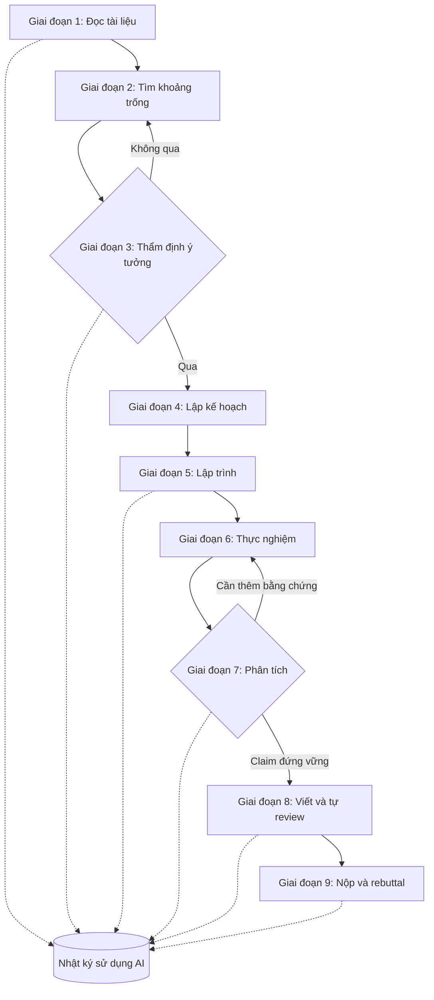

# Quy trình mẫu và thư viện prompt

!!! abstract "Mục tiêu của bài"
    Sau bài này, người học có thể:

    - Mô tả, cho từng giai đoạn của một dự án từ đọc tài liệu tới rebuttal, AI làm gì, con người làm gì, xác minh ra sao và cần ghi gì vào nhật ký sử dụng AI.
    - Dùng và tùy biến một thư viện prompt tiếng Anh theo giai đoạn, hiểu vì sao mỗi prompt được viết như vậy và biết kiểm tra đầu ra của nó.
    - Lập và duy trì nhật ký sử dụng AI cho dự án, rồi chuyển nhật ký đó thành câu khai báo phù hợp với hội nghị mục tiêu.
    - Rà soát toàn bộ việc dùng AI của dự án bằng một checklist trước khi nộp.

Các bài trước của chương trình bày nguyên tắc chung, rồi đi vào cách dùng AI trong từng nhóm việc: đọc tài liệu và tìm ý tưởng, lập trình và thực nghiệm. Mỗi bài tập trung vào một giai đoạn, nên người học dễ thấy từng mảnh mà khó thấy nhịp của cả dự án: quyết định ở giai đoạn đầu ảnh hưởng tới giai đoạn sau thế nào, và vì sao một thói quen như ghi nhật ký phải bắt đầu từ ngày đầu chứ không phải tuần trước deadline. Bài này ghép các mảnh lại bằng một dự án giả định đi từ lúc đọc paper đầu tiên tới lúc gửi rebuttal.

Phần thứ hai của bài là bộ công cụ dùng lại được: một thư viện prompt tiếng Anh sắp theo giai đoạn, một template nhật ký sử dụng AI, các mẫu câu khai báo và một checklist trước khi nộp. Bài được thiết kế để tra cứu trong lúc làm việc, nên mỗi prompt đi kèm ba thông tin: khi nào dùng, vì sao viết như vậy, và kiểm tra đầu ra thế nào. Nguyên tắc nền, chính sách hội nghị và thang xác minh nằm ở bài [Nguyên tắc, chính sách và rủi ro khi làm việc với AI](nguyen-tac.md); quy trình an toàn với coding agent nằm ở bài [AI trong lập trình và thực nghiệm](thuc-nghiem.md); các prompt cho việc viết và sửa câu chữ nằm ở bài [Dùng AI hỗ trợ viết (đúng luật)](../03-ky-thuat/ai-tools.md) và không được lặp lại ở đây.

## Một dự án giả định với AI làm cộng sự

Toàn bộ dự án trong mục này là ví dụ giả định: các con số và tình huống được dựng để minh họa quy trình, không phải kết quả thật. Chỉ những công trình được trích kèm nguồn là có thật.

Tác giả A là nghiên cứu sinh năm nhất trong một nhóm Computer Vision, có hai GPU 24 GB và khoảng tám tháng tới hạn nộp của một hội nghị CV. Hướng nghiên cứu được chọn là **thích nghi tại thời điểm test** (*test-time adaptation*, TTA): điều chỉnh một mô hình đã huấn luyện ngay trên luồng dữ liệu test khi phân phối dữ liệu thay đổi so với lúc huấn luyện. Phương pháp nền tảng là Tent, thích nghi bằng cách tối thiểu hóa entropy của dự đoán, ước lượng lại thống kê chuẩn hóa và cập nhật các tham số affine theo kênh trên từng batch (Wang và cộng sự, *Tent*, ICLR 2021). Benchmark chính là ImageNet-C, bộ đánh giá chuẩn hóa độ bền của bộ phân loại ảnh trước các loại nhiễu ảnh thông thường (Hendrycks và Dietterich, ICLR 2019). Nhóm dùng một trợ lý hội thoại cho đọc và lập kế hoạch, và một coding agent cho lập trình; người hướng dẫn gặp tác giả A mỗi tuần.

Sơ đồ dưới đây tóm tắt chín giai đoạn. Hai điểm cần chú ý: mỗi giai đoạn kết thúc bằng một cổng xác minh do con người quyết định, và nhật ký sử dụng AI chạy song song với toàn bộ dự án chứ không phải một bước ở cuối.



### Giai đoạn 1: Đọc tài liệu

Tác giả A bắt đầu bằng việc lập bản đồ tài liệu về TTA theo bài [Đọc và lập bản đồ tài liệu](../01-truoc-khi-viet/literature.md). Trợ lý AI giúp gom khoảng bốn mươi paper liên quan và chuyển mỗi paper đã tải về thành một ghi chú có cấu trúc: bài toán, giả định, giao thức đánh giá, kết quả chính, giới hạn được tác giả thừa nhận. Mười paper cốt lõi được tác giả A đọc trọn vẹn theo cách của bài [Đọc paper như một reviewer](../01-truoc-khi-viet/doc-nhu-reviewer.md), có dùng prompt đọc phản biện trong thư viện bên dưới làm người đối thoại.

Hai sự cố nhỏ xảy ra, và cả hai đều điển hình. Một ghi chú do AI viết khẳng định một paper "đánh giá với batch size bằng 1"; khi mở paper, tác giả A thấy thí nghiệm đó chỉ có trong phụ lục, với một kiến trúc khác. Khi được hỏi thêm về "các công trình liên quan khác", trợ lý đưa ra ba trích dẫn, trong đó một trích dẫn không tồn tại. Hiện tượng này đã được đo đạc: trong một nghiên cứu năm 2023, 55% trích dẫn do ChatGPT-3.5 và 18% trích dẫn do ChatGPT-4 sinh ra khi viết tổng quan ngắn là bịa (Walters và Wilder, *Scientific Reports*, 2023); trong các thí nghiệm của nhóm OpenScholar, GPT-4o không có công cụ truy xuất bịa trích dẫn trong 78–90% trường hợp (Asai và cộng sự, *OpenScholar*, 2024). Đó là mô hình hội thoại không có tìm kiếm, ở thời điểm của từng nghiên cứu, nhưng bài học áp dụng cho mọi công cụ: mọi trích dẫn phải được mở ra và đối chiếu. Bài [AI trong đọc tài liệu và tìm ý tưởng](doc-va-y-tuong.md) bàn kỹ cách dùng AI ở giai đoạn này.

- **AI làm gì:** gợi ý paper, chuyển paper đã tải thành ghi chú có cấu trúc, trích bảng kết quả, đóng vai người đối thoại khi đọc phản biện.
- **Con người làm gì:** chọn paper cốt lõi, đọc trọn vẹn chúng, tự viết bản đồ tài liệu và các nhận xét phản biện.
- **Xác minh:** mở mọi paper được trích; với mỗi ghi chú do AI viết, đối chiếu ít nhất các khẳng định về giả định, giao thức và con số với vị trí tương ứng trong paper.
- **Nhật ký AI:** công cụ và phiên bản, truy vấn tìm kiếm, những ghi chú do AI viết và ghi chú nào đã được đối chiếu, các lỗi phát hiện.

### Giai đoạn 2: Tìm khoảng trống

Để tìm khoảng trống, tác giả A làm hai việc song song. Việc thứ nhất là tự chạy lại Tent ở nhiều batch size và thấy rằng với batch nhỏ, accuracy sau thích nghi giảm mạnh, có khi thấp hơn cả mô hình không thích nghi. Việc thứ hai là dùng prompt "lật giả định" với ghi chú của mười paper cốt lõi. Kỹ thuật này đến từ khái niệm *bit flip* trong khóa CS197 của Michael Bernstein tại Stanford: phát biểu một giả định thường bị để ngầm trong công trình trước, rồi lật nó (Bernstein, CS197, Stanford). AI liệt kê các giả định chung của nhóm paper: batch đủ lớn, luồng dữ liệu đến từ một loại nhiễu duy nhất, phân phối nhãn không đổi, và thích nghi luôn có lợi trên mọi batch.

Tác giả A chọn lật giả định cuối cùng, vì nó khớp với điều chính người học đã quan sát được ở batch nhỏ. Đây là điểm quan trọng nhất của giai đoạn: khoảng trống được chọn không phải vì AI xếp nó lên đầu, mà vì một quan sát thực nghiệm do người học tự tạo ra ủng hộ nó. Ý tưởng do AI sinh ra có xu hướng đồng dạng: trong nghiên cứu của Si, Yang và Hashimoto, chỉ khoảng 200 trong 4.000 ý tưởng hạt giống mỗi chủ đề là không trùng lặp (Si, Yang, Hashimoto, ICLR 2025), và các mô hình khác nhau có xu hướng hội tụ về những đầu ra tương tự (Jiang và cộng sự, *Artificial Hivemind*, NeurIPS 2025). Một khoảng trống mà nhiều người cùng nhờ AI tìm ra dễ là khoảng trống nhiều nhóm cùng nhắm tới. Bài [Tìm khoảng trống và nguồn ý tưởng](../01-truoc-khi-viet/tim-khoang-trong.md) trình bày đầy đủ các phương pháp tìm khoảng trống.

- **AI làm gì:** liệt kê giả định ngầm của một nhóm paper, đề xuất các phép lật, gợi ý từ khóa để tìm công trình đã làm điều tương tự.
- **Con người làm gì:** tạo quan sát thực nghiệm riêng (chạy lại baseline, xem failure case) và chọn khoảng trống dựa trên quan sát đó.
- **Xác minh:** kiểm tra mỗi giả định có thật sự xuất hiện trong các paper được nêu; coi khẳng định "chưa ai làm" của AI là không có giá trị bằng chứng.
- **Nhật ký AI:** prompt đã dùng, danh sách giả định và phép lật do AI đề xuất, phép lật được chọn và lý do.

### Giai đoạn 3: Thẩm định ý tưởng

Ý tưởng ban đầu là một "cổng tin cậy": trước khi cập nhật mô hình trên một batch, ước lượng xem việc thích nghi trên batch đó có khả năng có lợi hay không, và bỏ qua những batch đáng ngờ. Tác giả A dùng prompt red-team trong thư viện, đặt AI vào vai một area chair khó tính. AI nêu ngay khả năng đã có công trình lọc mẫu theo entropy trong TTA và gợi ý từ khóa tìm kiếm. Tác giả A tìm theo ba tầng của bài [Thẩm định ý tưởng](../01-truoc-khi-viet/y-tuong.md) và quả thật thấy hai paper lọc từng mẫu theo entropy. Ý tưởng được làm sắc lại: quyết định ở cấp batch, dựa trên mức đồng thuận giữa dự đoán trên hai phiên bản augmentation của cùng batch, một tín hiệu rẻ và khác với entropy. Một tiêu chí dừng được viết ra trước khi chạy thử: nếu sau hai tuần, cổng không vượt cả hai baseline "luôn thích nghi" và "không bao giờ thích nghi" ít nhất một điểm ở batch size 16 trên các loại nhiễu dùng làm validation, dự án quay lại giai đoạn 2.

Có hai điều tác giả A cố ý không làm. Thứ nhất, không nhờ AI chấm điểm ý tưởng: trong nghiên cứu của Si, Yang và Hashimoto, bộ chấm LLM tốt nhất chỉ đạt 53,3% khi dự đoán đánh giá của con người về ý tưởng, thấp hơn mức đồng thuận 56,1% giữa hai reviewer người. Thứ hai, không loại ý tưởng chỉ vì nó đơn giản. Michael Black nhắc rằng reviewer hay nhầm sự đơn giản với thiếu novelty, trong khi novelty phải được đánh giá như thể ý tưởng chưa từng tồn tại (Black, *Novelty in Science*, 2022); prompt red-team trong thư viện vì thế có một dòng yêu cầu AI không coi sự đơn giản là thiếu novelty. Quyết định đi tiếp được đưa ra trong buổi gặp với người hướng dẫn.

- **AI làm gì:** red-team ý tưởng, gợi ý loại công trình có thể đã làm điều tương tự và từ khóa tìm chúng, đề xuất thí nghiệm rẻ để "giết" ý tưởng.
- **Con người làm gì:** tìm novelty ba tầng, chạy pilot, đặt tiêu chí dừng, ra quyết định cùng người hướng dẫn.
- **Xác minh:** mọi công trình được nhắc tới phải được tìm thấy và đọc; không dùng điểm số do AI chấm làm căn cứ.
- **Nhật ký AI:** các phản biện chính của AI, phản biện nào dẫn tới thay đổi ý tưởng, kết quả tìm kiếm novelty.

### Giai đoạn 4: Lập kế hoạch

Tác giả A viết proposal hai trang theo Heilmeier Catechism, như bài [Lập kế hoạch nghiên cứu](../01-truoc-khi-viet/ke-hoach.md) hướng dẫn, rồi dùng prompt chuyển proposal thành kế hoạch. AI đề xuất 27 công việc. Sau lượt kiểm tra độ phủ, tác giả A cắt còn 16, vì nhiều công việc không phục vụ claim nào. Công việc được đưa lên đầu là "tái lập chắc chắn hiện tượng suy giảm của Tent ở batch nhỏ qua ba seed", vì nếu hiện tượng không ổn định, toàn bộ dự án mất nền móng; đây là cách sắp thứ tự theo rủi ro mà Steinhardt đề xuất (Steinhardt, *Research as a Stochastic Decision Process*, 2018).

Premortem được làm theo hai lượt, và thứ tự có chủ đích. Tác giả A và người hướng dẫn tự viết danh sách lý do thất bại trước, rồi mới chạy prompt premortem, để danh sách của AI không neo suy nghĩ của con người (Klein, *Performing a Project Premortem*, 2007). AI thêm một rủi ro mà nhóm chưa nghĩ tới: một mẹo đơn giản ở phía thống kê chuẩn hóa có thể đã giải quyết phần lớn vấn đề batch nhỏ. Hai baseline đơn giản tương ứng được đưa vào ma trận bằng chứng. Khi phản biện ma trận, AI chỉ ra rằng claim "cổng tránh được các cập nhật có hại" cần đo trực tiếp các cập nhật có hại, tức accuracy trước và sau mỗi bước cập nhật, chứ không chỉ accuracy cuối cùng; một cột đo mới được thêm vào kế hoạch.

- **AI làm gì:** phân rã proposal thành công việc, tham gia premortem sau khi con người đã làm lượt riêng, phản biện ma trận bằng chứng.
- **Con người làm gì:** viết proposal, cắt công việc thừa, ước lượng thời gian, sắp thứ tự theo rủi ro, chấm mức nghiêm trọng của rủi ro.
- **Xác minh:** mỗi claim có chuỗi công việc dẫn tới bằng chứng; mỗi đề xuất baseline hay phép đo mới của AI được người hướng dẫn duyệt.
- **Nhật ký AI:** phiên bản proposal đưa vào, danh sách công việc và rủi ro AI đề xuất, những gì được giữ lại.

### Giai đoạn 5: Lập trình

Repository được dựng theo quy trình trong bài [AI trong lập trình và thực nghiệm](thuc-nghiem.md): một file `AGENTS.md` với các vùng cấm, đặc tả viết trước cho từng nhiệm vụ, test viết trước cho vùng đỏ. Tác giả A tự viết bộ nạp dữ liệu nhiễu và vòng đánh giá, chỉ nhờ AI giải thích API và lỗi. Coding agent cài đặt mô-đun cổng tin cậy, script quét hyperparameter và hạ tầng logging.

Lượt review diff đầu tiên bắt được một lỗi đáng giá. Đặc tả ghi rõ giao thức đánh giá: mô hình được khôi phục về trạng thái ban đầu trước mỗi loại nhiễu, giống cách đánh giá baseline. Script do agent viết không khôi phục mô hình giữa các loại nhiễu, khiến phương pháp đề xuất được đánh giá theo kiểu thích nghi liên tục qua mọi loại nhiễu, trong khi baseline được đánh giá theo từng loại nhiễu riêng. Code chạy, test hiện có đều qua, và con số chênh lệch theo hướng có thể làm sai phép so sánh. Tác giả A viết thêm một test kiểm tra rằng sau bước khôi phục, mọi tham số bằng đúng giá trị ban đầu, và đặt test đó ở chế độ chỉ đọc. Một lần khác, agent đề xuất cài một package có tên gần giống một thư viện phổ biến; kiểm tra trên kho package cho thấy tên đó không tồn tại.

- **AI làm gì:** cài đặt mô-đun mới, script thí nghiệm, logging; sinh test cho vùng vàng và vùng xanh; review diff như lớp kiểm tra bổ sung.
- **Con người làm gì:** viết đặc tả, viết vùng đỏ (dữ liệu, giao thức, metric), đọc mọi dòng ở vùng đỏ, review mọi diff.
- **Xác minh:** test tính tay và test bất biến; test ẩn chạy sau mỗi nhiệm vụ; đối chiếu kết quả baseline với con số trong paper gốc.
- **Nhật ký AI:** mỗi phiên agent: nhiệm vụ, commit tạo ra, file bị chạm tới, vấn đề phát hiện khi review và cách xử lý.

### Giai đoạn 6: Thực nghiệm

Agent chạy các loạt thí nghiệm quét hyperparameter với script đánh giá đã khóa, và hyperparameter chỉ được chọn trên một nhóm loại nhiễu dành riêng làm validation, không bao giờ trên các loại nhiễu xuất hiện trong bảng kết quả chính. Mỗi cấu hình chạy ba seed. Mọi lần chạy, kể cả những lần agent tự chạy trong lúc debug, được ghi vào hệ thống theo dõi thí nghiệm, vì một danh sách cấu hình đã thử bị khuyết là điều kiện cho "khu vườn rẽ nhánh" mà bài [Đóng khung lại hay bóp méo: ranh giới trung thực](../07-tinh-huong-kho/ranh-gioi-trung-thuc.md) cảnh báo. Có một sự cố: do lỗi vòng lặp trong script, agent khởi chạy 64 job thay vì 16; giới hạn số job và giới hạn giờ GPU đặt sẵn cho mỗi phiên đã chặn lại trước khi ngân sách tháng bị tiêu hết. Vòng vận hành hằng tuần, cách theo dõi nhiều run và cách review tiến độ được trình bày ở bài [Vận hành thực nghiệm](../01-truoc-khi-viet/thuc-thi.md).

- **AI làm gì:** chạy và giám sát các loạt thí nghiệm theo cấu hình đã duyệt, tổng hợp log, báo cáo run lỗi.
- **Con người làm gì:** chọn thí nghiệm tiếp theo theo ma trận bằng chứng, giữ kỷ luật validation và test, quyết định khi nào dừng một hướng.
- **Xác minh:** mỗi con số đi vào bảng truy được về một run với commit sạch; run lỗi được điều tra chứ không bị bỏ qua.
- **Nhật ký AI:** các loạt thí nghiệm do agent khởi chạy, sự cố và giới hạn đã kích hoạt, chi phí tính toán.

### Giai đoạn 7: Phân tích

Kết quả ban đầu cho thấy cổng tin cậy cải thiện accuracy trung bình ở batch nhỏ. Tác giả A dùng prompt kiểm tra script thống kê cho script bootstrap có cặp mà agent viết, và chạy kiểm tra A/A như bài [AI trong lập trình và thực nghiệm](thuc-nghiem.md) hướng dẫn. Vì có nhiều loại nhiễu, nhiều mức độ và nhiều batch size, số phép so sánh lớn, nên nhóm quyết định báo cáo một phép so sánh chính được chốt từ trước (trung bình trên các loại nhiễu ở batch size 16) và trình bày phần còn lại như phân tích mô tả.

Bước quan trọng hơn là kiểm tra lời giải thích. Khi được hỏi, AI giải thích rằng cổng có lợi vì nó "tránh thích nghi trên những batch chứa nhiều ảnh khó". Tác giả A dùng prompt giải thích cạnh tranh để có thêm hai giả thuyết khác, rồi ghi lại quyết định của cổng trên từng batch cùng accuracy trước khi thích nghi. Dữ liệu cho thấy một câu chuyện khác: cổng chủ yếu bỏ qua thích nghi trên vài loại nhiễu cụ thể, gần như bất kể độ khó của từng batch. Câu chuyện của paper được đổi theo bằng chứng, và đó là đổi khung hợp lệ vì khung mới đúng với toàn bộ dữ liệu. Mọi hình trong paper được vẽ bằng script đọc từ file kết quả.

- **AI làm gì:** viết script thống kê và vẽ hình, đề xuất các giải thích cạnh tranh và thí nghiệm phân biệt chúng, gán nhãn lỗi như người gán nhãn thứ hai.
- **Con người làm gì:** chốt phép so sánh chính, kiểm tra phép kiểm định, quyết định giải thích nào được bằng chứng ủng hộ.
- **Xác minh:** kiểm tra A/A; mỗi câu giải thích trong bản nháp gắn với một bảng hoặc hình; hình đọc dữ liệu từ file kết quả.
- **Nhật ký AI:** script do AI viết và kết quả kiểm tra của chúng, các giải thích AI đề xuất và giải thích nào đã bị bác bỏ.

### Giai đoạn 8: Viết và tự review

Tác giả A tự viết bản nháp theo quy trình trong bài [Quy trình viết & tự review](../03-ky-thuat/quy-trinh-viet.md), chỉ dùng AI cho sửa ngữ pháp, kiểm tra nhất quán thuật ngữ và LaTeX theo các prompt trong bài [Dùng AI hỗ trợ viết (đúng luật)](../03-ky-thuat/ai-tools.md). Khi bản nháp hoàn chỉnh, tác giả dùng prompt tự review theo form của hội nghị, với form của đúng năm nộp được chép từ trang chính thức. AI nêu một điểm yếu hợp lý về thiếu phân tích chi phí tính toán, và đề nghị so sánh với một "phương pháp gần đây" mà tên paper nó đưa ra không tồn tại; khi tìm theo mô tả, tác giả A thấy một paper thật có ý tưởng gần, và bổ sung nó vào Related Work sau khi đọc.

Phản hồi của LLM cho bản thảo có giá trị nhưng có điểm mù đã biết. Liang và cộng sự cho thấy các điểm GPT-4 nêu ra trùng với điểm của một reviewer người ở mức tương đương mức trùng giữa hai reviewer người, nhưng mô hình ít nhận xét về novelty hơn hẳn và hay đề nghị thêm dataset hơn (Liang và cộng sự, *NEJM AI*, 2024). Vì vậy, phần novelty và ablation được tác giả A mang tới internal review với người thật. Trước khi nộp, mọi mục tham khảo được đối chiếu trên DBLP hoặc trang kỷ yếu chính thức, PDF được kiểm tra văn bản ẩn bằng `pdftotext`, và câu khai báo được soạn từ nhật ký AI.

- **AI làm gì:** sửa ngôn ngữ, kiểm tra thuật ngữ, hỗ trợ LaTeX, tự review bản thảo của chính nhóm theo form hội nghị.
- **Con người làm gì:** viết nội dung, quyết định mọi claim, chạy internal review với người thật, soạn câu khai báo.
- **Xác minh:** đối chiếu mọi trích dẫn; đối chiếu mọi câu về kết quả với bảng; kiểm tra văn bản ẩn trong PDF.
- **Nhật ký AI:** mục nào được sửa ngôn ngữ bằng AI, kết quả tự review và những thay đổi đã làm theo nó.

### Giai đoạn 9: Nộp và rebuttal

Review về với một yêu cầu thí nghiệm thêm ở batch size 1 và một câu hỏi về chi phí. Tác giả A dùng AI để phân loại ý kiến reviewer theo bảng trong bài [Rebuttal & thảo luận](../04-nop-va-sau-nop/rebuttal.md) và để gợi ý cấu trúc cho bản phản hồi một trang. Thí nghiệm mới được chạy theo đúng giao thức cũ, ghi log như mọi run khác, và con số đưa vào rebuttal được tác giả tự lấy từ file kết quả. Có ba ranh giới được giữ: AI không được viết bất kỳ con số nào; AI không được hứa thay nhóm một thí nghiệm chưa chạy; và trước khi đưa nội dung review vào bất kỳ công cụ AI nào, nhóm kiểm tra quy định của hội nghị về điều đó, và khi không chắc thì chỉ đưa vào bản tóm tắt do chính tác giả viết lại. Phần chuyên môn về rebuttal và cách dùng AI khi viết phản hồi nằm ở bài [Rebuttal & thảo luận](../04-nop-va-sau-nop/rebuttal.md) và bài [Dùng AI hỗ trợ viết (đúng luật)](../03-ky-thuat/ai-tools.md).

- **AI làm gì:** phân loại ý kiến reviewer, gợi ý cấu trúc phản hồi, sửa ngôn ngữ cho bản phản hồi do tác giả viết.
- **Con người làm gì:** quyết định chiến lược trả lời, chạy thí nghiệm bổ sung, viết nội dung và mọi con số.
- **Xác minh:** mỗi con số trong phản hồi truy được về run; mỗi cam kết sửa đổi có trong kế hoạch camera-ready.
- **Nhật ký AI:** cách AI được dùng trong rebuttal, kiểm tra quy định đã làm, thí nghiệm bổ sung và run tương ứng.

### Tổng hợp chín giai đoạn

Đọc lại chín giai đoạn, có thể thấy một quy luật: càng gần tới bằng chứng và quyết định, phần việc của con người càng lớn. Ở giai đoạn đọc và tìm khoảng trống, AI làm nhiều việc mở rộng và con người làm việc chọn lọc. Ở giai đoạn lập trình và phân tích, con người giữ trọn vùng đỏ và mọi kết luận. Ở giai đoạn viết và rebuttal, AI chỉ chạm vào ngôn ngữ. Bảng dưới đây tóm tắt điều đó.

| Giai đoạn | Phần việc chính của AI | Cổng xác minh của con người | Rủi ro điển hình |
|---|---|---|---|
| Đọc tài liệu | Gợi ý paper, ghi chú có cấu trúc | Mở mọi trích dẫn; đối chiếu ghi chú | Trích dẫn bịa, tóm tắt sai chi tiết |
| Tìm khoảng trống | Liệt kê giả định, đề xuất phép lật | Quan sát thực nghiệm riêng; tìm công trình trước | Ý tưởng đồng dạng; "chưa ai làm" không có cơ sở |
| Thẩm định | Red-team, gợi ý từ khóa tìm novelty | Tìm novelty ba tầng; pilot; tiêu chí dừng | Dùng điểm do AI chấm làm căn cứ |
| Lập kế hoạch | Phân rã công việc, premortem, phản biện ma trận | Cắt việc thừa; sắp theo rủi ro; ước lượng | Kế hoạch đẹp nhưng không khớp nguồn lực |
| Lập trình | Code vùng vàng và xanh, test, review diff | Đặc tả; vùng đỏ do người viết; test ẩn | Bug âm thầm; "sửa cho chạy" |
| Thực nghiệm | Chạy và giám sát các loạt run | Kỷ luật validation và test; log đầy đủ | Chọn trên test; run bị bỏ sót |
| Phân tích | Script thống kê, hình, giải thích cạnh tranh | Kiểm tra A/A; giải thích gắn với bằng chứng | Câu chuyện bịa quanh con số |
| Viết và tự review | Sửa ngôn ngữ, tự review theo form | Internal review; đối chiếu trích dẫn; kiểm tra PDF | Claim thổi phồng; trích dẫn bịa |
| Rebuttal | Phân loại ý kiến, gợi ý cấu trúc | Mọi con số do tác giả lấy từ run | Hứa hoặc bịa kết quả; vi phạm quy định |

## Thư viện prompt theo giai đoạn

Các prompt dưới đây chia sẻ một cấu trúc mà bài [Dùng AI hỗ trợ viết (đúng luật)](../03-ky-thuat/ai-tools.md) đã giới thiệu cho việc viết: vai trò và bối cảnh, nhiệm vụ cụ thể, ràng buộc và định dạng đầu ra. Với công việc nghiên cứu, có thêm ba thành phần làm đầu ra kiểm tra được. **Móc xác minh**: yêu cầu trích nguyên văn kèm vị trí (mục, trang, file và dòng), để mỗi khẳng định đều mở ra kiểm tra được. **Quyền nói "không biết"**: cho phép mô hình trả lời "not stated in the paper" hay "cannot determine", để giảm động cơ bịa ra câu trả lời. **Chống chiều lòng**: LLM có xu hướng đồng tình với người hỏi, nên các prompt phản biện yêu cầu tường minh không làm nhẹ phê bình và không tự đánh giá kết quả của chính phản biện đó.

Prompt được viết bằng tiếng Anh vì tài liệu đầu vào thường là tiếng Anh và giữ cùng một ngôn ngữ giúp đầu ra nhất quán hơn. Phần trong ngoặc vuông là chỗ cần thay. Mọi prompt chỉ dùng với tài liệu của chính nhóm hoặc tài liệu đã công bố; không bao giờ dùng với bản thảo đang được review hay tài liệu mật của người khác.

### Đọc phản biện một paper đã công bố

```text
You are an experienced reviewer for [venue type, e.g. CVPR / ACL / NeurIPS].
Below is the full text of a published paper: [title, venue, year].

Your task is to support a critical reading, not to summarize.
1. List the main claims of the paper (at most six). For each claim, quote the
   sentence that states it and give its section or page.
2. For each claim, name the evidence offered (table, figure, theorem, ablation)
   with its number, and rate the evidence as strong, partial or missing.
   Justify each rating in one or two sentences.
3. List the assumptions the method relies on that the paper does not test.
4. List the comparisons or controls a skeptical reviewer would ask for that are
   missing.
5. If something cannot be determined from the text, write "not stated in the
   paper" instead of guessing.

[paper text]
```

**Khi nào dùng.** Sau lượt đọc đầu tiên của một paper cốt lõi, khi người học đã có ghi chú riêng và muốn có thêm một góc nhìn phản biện. Dùng trước lượt đọc đầu thì AI sẽ định hình cách đọc thay vì bổ sung cho nó.

**Vì sao viết như vậy.** Việc tách claim với bằng chứng và yêu cầu chấm từng bằng chứng đi theo đúng cách đọc của bài [Đọc paper như một reviewer](../01-truoc-khi-viet/doc-nhu-reviewer.md). Yêu cầu trích nguyên văn kèm vị trí biến mỗi dòng đầu ra thành một khẳng định kiểm tra được. Câu "not stated in the paper" cho mô hình một lối ra hợp lệ khi văn bản không có câu trả lời.

**Kiểm tra đầu ra.** Mở từng vị trí được trích và xác nhận câu trích có thật; kiểm tra số hiệu bảng và hình. So sánh với ghi chú riêng: những chỗ hai bên bất đồng là nơi đáng đọc lại kỹ nhất, và thường là nơi người học học được nhiều nhất.

### Lật giả định

```text
Below are notes on [N] papers about [topic]. The notes were written or checked
by the authors of this prompt.

1. List the assumptions that most of these papers share, especially assumptions
   that are never stated explicitly: about the data, the evaluation protocol,
   the compute budget, the deployment setting, or the problem definition.
   For each assumption, name the papers that make it and explain how you can
   tell from the notes.
2. For each assumption, write one "flip": a research question about what happens
   if the assumption is false. State what would have to be true in practice for
   the flip to matter.
3. For each flip, give three search queries that would find prior work on it.
Do not claim that any flip is novel. Novelty will be checked separately.

[notes]
```

**Khi nào dùng.** Ở giai đoạn tìm khoảng trống, sau khi đã có bản đồ tài liệu và ghi chú đã đối chiếu của các paper cốt lõi.

**Vì sao viết như vậy.** Prompt áp dụng kỹ thuật *bit flip* (Bernstein, CS197, Stanford) và yêu cầu chỉ ra bằng chứng cho từng giả định, để giả định không bị bịa ra. Câu cấm khẳng định novelty và yêu cầu sinh truy vấn tìm kiếm biến điểm yếu của LLM (không biết chắc điều gì đã có) thành một nhiệm vụ mà con người kiểm tra được.

**Kiểm tra đầu ra.** Đối chiếu từng giả định với các paper được nêu. Chạy các truy vấn tìm kiếm. Vì đầu ra của LLM có xu hướng đồng dạng, hãy coi danh sách là điểm khởi đầu: các phép lật đáng giá nhất thường là những phép lật được một quan sát thực nghiệm riêng của người học ủng hộ, như failure case trong dự án giả định ở trên.

### Red-team một ý tưởng

```text
You are the most skeptical area chair at [venue]. Below is a one-paragraph
research idea and the evidence the authors plan to collect.

Attack the idea:
1. Give the three strongest reasons the idea could be rejected as not novel.
   For each, describe the kind of prior work that would make it so and a search
   query that would find it. Do not invent paper titles or author names.
2. Give the three most likely ways the idea fails technically, and for each the
   cheapest experiment that would reveal the failure within one week.
3. Name the strongest simple baseline that might already solve the problem.
4. Describe the result that would make you champion this paper.
Rules: do not treat simplicity as a lack of novelty; judge whether the idea adds
new understanding. Do not soften the critique. Do not give a score.

[idea]
[planned evidence]
```

**Khi nào dùng.** Ở giai đoạn thẩm định, trước khi đầu tư thời gian vào pilot, và lặp lại sau mỗi lần ý tưởng được làm sắc.

**Vì sao viết như vậy.** Vai area chair khó tính và câu "do not soften" chống xu hướng chiều lòng. Câu cấm bịa tên paper xuất phát từ rủi ro trích dẫn bịa: mô hình mô tả *loại* công trình, con người tìm công trình thật. Yêu cầu "thí nghiệm rẻ nhất trong một tuần" biến phản biện thành công việc khử rủi ro theo tinh thần của Steinhardt. Dòng về sự đơn giản lấy từ hướng dẫn của Michael Black về novelty (Black, 2022). Câu cấm cho điểm xuất phát từ bằng chứng rằng LLM chấm ý tưởng kém tin cậy hơn con người (Si, Yang, Hashimoto, ICLR 2025).

**Kiểm tra đầu ra.** Chạy các truy vấn và đọc những gì tìm được. Với mỗi cách thất bại, quyết định có chạy thí nghiệm kiểm tra không. Mang ba phản biện mạnh nhất tới người hướng dẫn: con người trong lĩnh vực là tầng tìm kiếm novelty mà AI không thay được.

### Chuyển proposal thành kế hoạch

```text
Below is a two-page research proposal and the project constraints:
[compute, data access, deadline, people and hours per week].

1. Break the proposal into tasks of at most [3] working days each. For each task
   give: a verifiable "done" condition, its dependencies, its output, and the
   claim in the proposal that it serves. Flag every task that serves no claim.
2. Run a premortem: assume it is [deadline] and the paper was rejected or the
   method did not work. List the ten most likely specific reasons. Tie each
   reason to a task above, and give an early warning sign and a cheap test.
3. Leave the columns "estimated duration" and "probability" empty. The authors
   will fill them in.
Output two tables.

[proposal]
```

**Khi nào dùng.** Ngay sau khi proposal được người hướng dẫn duyệt, và sau khi nhóm đã tự làm lượt premortem riêng.

**Vì sao viết như vậy.** Mỗi công việc phải gắn với một claim để lượt kiểm tra độ phủ làm được ngay trên bảng. Premortem theo cách Klein mô tả buộc rủi ro phải cụ thể, và việc gắn mỗi rủi ro với một công việc, một dấu hiệu sớm và một phép thử rẻ ngăn các rủi ro chung chung. Hai cột để trống là chủ đích: ước lượng thời gian và xác suất cần hiểu biết về bối cảnh mà AI không có.

**Kiểm tra đầu ra.** Kiểm tra độ phủ theo cả hai chiều. So sánh danh sách rủi ro của AI với danh sách nhóm tự viết trước đó; rủi ro chỉ AI nêu ra cần được thảo luận, không tự động đưa vào kế hoạch. Sắp lại thứ tự công việc theo rủi ro.

### Phản biện ma trận bằng chứng

```text
Below is the evidence matrix of a research project. Each row is a claim, with
its hypothesis, quantitative prediction, experiment, and the results that would
support or refute it.

For each row:
1. Give the most plausible alternative explanation that the planned experiment
   cannot rule out, and the control that would rule it out.
2. Check whether a refuting result is stated. If not, propose one.
3. Check whether the comparisons are fair: same data, same backbone, same tuning
   budget for all methods. Name every hyperparameter that should be retuned
   separately for each method.
4. Check whether the measured quantity matches the wording of the claim.
Finally, list any claim in the proposal that no row of the matrix supports.

[evidence matrix]
```

**Khi nào dùng.** Khi ma trận bằng chứng trong bài [Lập kế hoạch nghiên cứu](../01-truoc-khi-viet/ke-hoach.md) đã có đủ các cột, và lặp lại mỗi khi claim thay đổi.

**Vì sao viết như vậy.** Bốn câu hỏi tương ứng với bốn kiểu lỗi thiết kế thí nghiệm hay gặp nhất: giải thích thay thế chưa bị loại trừ, thiếu điều kiện bác bỏ, so sánh không cân sức, và đo lệch đại lượng. Câu hỏi về hyperparameter cần tune lại cho từng phương pháp đi theo khái niệm *nuisance hyperparameters* của Deep Learning Tuning Playbook (Godbole và cộng sự, 2023).

**Kiểm tra đầu ra.** Mỗi đề xuất đối chứng mới phải được cân nhắc theo chi phí và theo câu chuyện của paper. Như bài [AI trong lập trình và thực nghiệm](thuc-nghiem.md) đã lưu ý, LLM ít nêu phê bình về novelty và ablation hơn reviewer người, nên phần ablation cần được tự rà thêm.

### Sinh test từ đặc tả

```text
You are writing unit tests for research code. Below are the specification of a
function and its signature. Do not write or modify the function itself.

1. Write pytest tests that check every invariant in the specification.
2. Add at least two tests on tiny inputs whose expected output can be computed by
   hand, and show the hand computation in a comment above each test.
3. Add tests for edge cases: empty input, a single example, ties, missing or
   malformed values, and inputs that should raise an error.
4. List every behavior that the specification leaves undefined as a question.
   Do not choose a behavior for it in the tests.

[specification]
[function signature]
```

**Khi nào dùng.** Cho code vùng vàng và vùng xanh, hoặc để có bản nháp test cho vùng đỏ mà người nghiên cứu sẽ đọc và sửa từng dòng.

**Vì sao viết như vậy.** Câu cấm viết hàm tách việc sinh test khỏi việc sinh code, để test không mang theo cùng một cách hiểu sai với code. Yêu cầu trình bày phép tính tay biến mỗi test thành thứ con người kiểm tra được trong vài giây. Mục 4 đẩy các điểm mơ hồ của đặc tả về phía con người thay vì để mô hình tự quyết.

**Kiểm tra đầu ra.** Kiểm lại mọi phép tính tay. Cố ý cài một lỗi vào một bản sao của hàm (chẳng hạn bỏ một mẫu khỏi mẫu số) và xác nhận ít nhất một test thất bại; một bộ test không bắt được lỗi cài sẵn chưa bảo vệ được gì. Sau khi chấp nhận, đặt test ở chế độ chỉ đọc đối với agent.

### Review diff

```text
You are reviewing a diff produced by a coding agent in a research codebase.
Numbers produced by this code will be reported in a paper.
The task given to the agent was: [task description].

Report, with file and line for every item:
1. Any change outside the scope of the task.
2. Any change to tests, evaluation code, metrics, data splits, thresholds, or the
   number of evaluated examples.
3. Any new try/except block, any flag that silences errors (e.g. strict=False),
   changed default value, hard-coded number, data subsampling, new dependency,
   or new source of randomness.
4. Any deleted line that could change results.
5. Anything that could make the reported numbers differ from what the task
   intends, even if all tests pass.
If a category is empty, write "none". Do not summarize the diff.

[output of git diff]
```

**Khi nào dùng.** Sau mỗi nhiệm vụ của agent, trước khi commit, như lớp kiểm tra bổ sung cho việc người nghiên cứu tự review.

**Vì sao viết như vậy.** Năm mục tương ứng với bảng dấu hiệu đáng ngờ trong bài [AI trong lập trình và thực nghiệm](thuc-nghiem.md). Câu "do not summarize" ngăn đầu ra trở thành một đoạn mô tả trấn an; câu "write none" buộc mô hình đi qua mọi mục. Nên chạy prompt trong một phiên mới, không phải phiên của agent đã viết code, để người review không chia sẻ ngữ cảnh và giả định với người viết.

**Kiểm tra đầu ra.** Mở từng dòng được nêu. Một danh sách toàn "none" không chứng minh diff an toàn; nó chỉ có nghĩa là lớp kiểm tra này không tìm thấy gì, và vùng đỏ vẫn phải được đọc.

### Kiểm tra script thống kê

```text
Below is a script that compares [system A] and [system B] and reports
statistical significance. Do not rewrite it yet.

1. State in plain words: the null hypothesis being tested, the test used, what is
   resampled or permuted, and whether the comparison is paired.
2. Say whether these choices match the experimental design:
   [same test set or not; number of seeds; number of datasets and baselines].
3. List any problems, such as an unpaired test on paired data, a wrong
   resampling unit, multiple comparisons without correction, an unjustified
   one-sided test, or confusion between standard deviation, standard error
   and confidence interval.
4. Write a separate simulation that runs the same test when the two systems have
   identical true performance (an A/A check) and reports the false positive
   rate over many repetitions.

[script]
```

**Khi nào dùng.** Trước khi bất kỳ con số "có ý nghĩa thống kê" nào được đưa vào bản nháp.

**Vì sao viết như vậy.** Mục 1 buộc mô hình diễn đạt lại phương pháp thành lời, nơi lỗi về ghép cặp hay đơn vị lấy mẫu dễ lộ ra. Mục 2 đặt phương pháp cạnh thiết kế thí nghiệm thật. Mục 4 chuyển việc kiểm tra từ đọc code sang chạy mô phỏng, như phân tích trong bài [AI trong lập trình và thực nghiệm](thuc-nghiem.md).

**Kiểm tra đầu ra.** Chạy mô phỏng A/A và xác nhận tỉ lệ báo nhầm xấp xỉ ngưỡng đã chọn. Đọc kỹ chính code mô phỏng, vì một mô phỏng sai cũng có thể cho con số đẹp.

### Đề xuất các giải thích cạnh tranh

```text
Below are the main results and ablations of an experiment, the explanation the
authors currently favor, and a draft analysis paragraph. Treat the favored
explanation as one hypothesis among several.

1. Propose at least three alternative explanations that are consistent with
   these numbers.
2. For each explanation, including the favored one, describe an experiment or
   analysis whose outcome would differ depending on which explanation is true.
   Prefer cheap analyses on existing checkpoints and logs.
3. Quote every sentence in the draft that compares numbers incorrectly or claims
   more than the tables show, and explain the problem.
Do not decide which explanation is correct.

[results and ablation tables]
[favored explanation]
[draft analysis paragraph]
```

**Khi nào dùng.** Ở giai đoạn phân tích, ngay khi nhóm bắt đầu có một lời giải thích "ưng ý", và trước khi viết mục Analysis.

**Vì sao viết như vậy.** Prompt dùng đúng điểm mạnh của LLM, sinh nhiều khả năng, và chặn điểm yếu của nó, chọn khả năng nghe hay nhất. Mục 3 nhắm vào lỗi so sánh độ lớn và lỗi nói quá, những lỗi mà văn liệu về research agent đã ghi nhận (Lu và cộng sự, 2024). Câu cuối giữ quyết định ở phía dữ liệu và con người.

**Kiểm tra đầu ra.** Chọn ít nhất một phân tích phân biệt được các giải thích và chạy nó. Đối chiếu từng câu được trích với bảng. Nếu giải thích được chọn thay đổi sau phân tích, cập nhật câu chuyện và ghi vào nhật ký quyết định của dự án.

### Tự review bản thảo theo form của hội nghị

```text
You are a reviewer for [venue and year]. Below are the official review form of
this venue and the full draft of a paper. The draft was written by the people
requesting this review and has not been submitted.

1. Fill in every field of the form as a careful, demanding reviewer would.
   Give scores only where the form requires them, and justify each score.
2. For every weakness, point to the section, table or figure concerned.
3. List the three questions most likely to appear in real reviews, and the
   evidence in the paper that currently answers each one, if any.
4. List every claim in the abstract and introduction that no specific
   experiment in the paper supports.
Do not rewrite the paper.

[review form of the target venue, copied from the official website]
[draft]
```

**Khi nào dùng.** Khi bản nháp đã hoàn chỉnh về cấu trúc, trước và song song với internal review, theo quy trình trong bài [Quy trình viết & tự review](../03-ky-thuat/quy-trinh-viet.md).

**Vì sao viết như vậy.** Dùng form thật của đúng hội nghị và đúng năm khiến phản hồi đi theo các tiêu chí mà reviewer thật sẽ dùng; form thay đổi theo năm nên phải chép từ trang chính thức chứ không để mô hình tự nhớ. Mục 4 kiểm tra trực tiếp khoảng cách giữa claim và bằng chứng, lỗi mà reviewer phạt nặng nhất.

**Kiểm tra đầu ra.** Coi đầu ra như ý kiến của một reviewer thêm, không phải dự báo kết quả. Theo nghiên cứu của Liang và cộng sự, phản hồi của LLM ít bàn về novelty và hay đề nghị thêm dataset (Liang và cộng sự, 2024), nên hai khía cạnh novelty và ablation cần được người thật đánh giá. Không dùng điểm số do AI cho để quyết định nộp hay không.

!!! danger "Tự review chỉ dành cho bản thảo của chính nhóm"
    Prompt tự review chỉ được dùng cho bản thảo do chính nhóm viết. Không bao giờ dùng nó, hay bất kỳ prompt nào khác, cho paper đang được giao review. Các hội nghị những năm gần đây đều coi bài nộp là tài liệu mật: chẳng hạn chính sách hiện hành của ARR cấm reviewer đưa bản thảo hay một phần bản thảo vào công cụ AI không bảo đảm quyền riêng tư, và hướng dẫn reviewer của CVPR 2026 cấm chia sẻ nội dung đáng kể của paper với LLM. Một số hội nghị còn có thể desk reject paper của reviewer vi phạm. Chính sách thay đổi theo năm và được tổng hợp ở bài [Nguyên tắc, chính sách và rủi ro khi làm việc với AI](nguyen-tac.md); khi không chắc, không dùng AI cho bất kỳ khâu nào của việc review.

### Viết và rebuttal

Các prompt cho viết, gồm reviewer thử cho Introduction, sửa ngữ pháp có giải thích, kiểm tra nhất quán thuật ngữ, dịch nháp từ tiếng Việt, rút gọn văn bản và sửa lỗi LaTeX, nằm trong bài [Dùng AI hỗ trợ viết (đúng luật)](../03-ky-thuat/ai-tools.md). Với rebuttal, cùng các nguyên tắc ấy áp dụng thêm hai ràng buộc từ giai đoạn 9 của dự án mẫu: mọi con số do tác giả tự lấy từ file kết quả, và không câu nào hứa một thí nghiệm hay một thay đổi mà nhóm chưa cam kết làm.

## Nhật ký sử dụng AI

Nhật ký sử dụng AI là bản ghi, theo thời gian, về việc AI được dùng vào đâu trong dự án. Nó phục vụ bốn mục đích. Thứ nhất là **khai báo chính xác**: nhiều hội nghị yêu cầu khai báo việc dùng AI, và một câu khai báo viết từ trí nhớ vào tuần cuối thường thiếu hoặc sai. Thứ hai là **tái lập**: khi một đoạn code hay một phân tích có sự tham gia của AI, nhật ký cho biết phiên bản công cụ nào đã tạo ra nó và ai đã kiểm tra. Thứ ba là **trách nhiệm**: nhật ký ghi lại ai đã xác minh cái gì, nên khi phát hiện sai sót, nhóm biết phải xem lại những gì. Thứ tư là **học tập**: đọc lại nhật ký sau một dự án cho người học thấy AI thật sự giúp ở đâu và gây phiền ở đâu, một phiên bản cụ thể của lời khuyên "đo năng suất" trong bài [AI trong lập trình và thực nghiệm](thuc-nghiem.md). Lời khuyên đó xuất phát từ thử nghiệm ngẫu nhiên của METR với công cụ giai đoạn tháng Hai tới tháng Sáu năm 2025: khi được dùng AI, 16 lập trình viên giàu kinh nghiệm mất thêm khoảng 19% thời gian trên 246 nhiệm vụ, trong khi chính họ tin rằng AI đã giúp họ nhanh hơn khoảng 20% (Becker và cộng sự, METR, 2025). Tháng Hai năm 2026, METR cho biết kết quả này đã lỗi thời với công cụ mới, và dữ liệu mới của họ chưa đủ tin cậy để thay thế nó (METR, 2026). Con số vì thế không nên được dùng như một kết luận còn hiệu lực; điều còn nguyên giá trị là khoảng cách giữa cảm nhận và đo lường, và nhật ký là cách rẻ nhất để có số đo cho dự án của chính nhóm.

Nhật ký không cần ghi mọi lần gợi ý hoàn thành code hay mọi lần sửa một lỗi chính tả. Quy tắc thực tế là ghi một mục cho mỗi phiên làm việc mà đầu ra của AI có thể ảnh hưởng tới nội dung paper, tới code tạo ra kết quả, hoặc tới một quyết định nghiên cứu, và ghi ngay trong ngày. Nhật ký nên nằm trong repository của dự án, cạnh nhật ký quyết định mà bài [Lập kế hoạch nghiên cứu](../01-truoc-khi-viet/ke-hoach.md) đề xuất, để mọi đồng tác giả cùng thấy và cùng bổ sung. Template dưới đây gồm phần đầu chung cho dự án và mẫu cho từng mục.

```markdown
# Nhật ký sử dụng AI: <tên dự án>

## Thông tin chung
- Hội nghị mục tiêu và năm: <...>
- Chính sách AI của hội nghị (đường dẫn, ngày đọc): <...>
- Công cụ được phép dùng trong dự án và phiên bản: <...>
- Dữ liệu và tài liệu KHÔNG được đưa vào công cụ AI: <...>

## Mục <số thứ tự>
- Ngày: <YYYY-MM-DD>
- Người dùng: <Tác giả A / Tác giả B / ...>
- Giai đoạn: <đọc / khoảng trống / thẩm định / kế hoạch / lập trình /
  thực nghiệm / phân tích / viết / rebuttal>
- Công cụ và phiên bản mô hình: <tên công cụ, tên snapshot nếu có>
- Nhiệm vụ giao cho AI: <một câu; đường dẫn tới prompt hoặc đặc tả>
- Dữ liệu và tài liệu đã đưa vào: <file, mục, có dữ liệu riêng hay không>
- Đầu ra được dùng ở đâu: <file và dòng, commit, mục trong paper>
- Xác minh đã làm, do ai: <đối chiếu, test, đọc từng dòng, ...>
- Vấn đề phát hiện và cách xử lý: <...>
- Cần khai báo không, ở đâu: <không / Acknowledgements / mục LLM usage /
  checklist / README>
```

Ba mục dưới đây lấy từ dự án giả định ở trên, để thấy mức chi tiết vừa đủ.

```markdown
## Mục 012
- Ngày: 2026-02-11
- Người dùng: Tác giả A
- Giai đoạn: thẩm định
- Công cụ và phiên bản mô hình: <trợ lý hội thoại>, <snapshot>
- Nhiệm vụ giao cho AI: red-team ý tưởng cổng tin cậy (prompts/redteam_v2.txt)
- Dữ liệu và tài liệu đã đưa vào: đoạn mô tả ý tưởng do nhóm viết; không có dữ liệu riêng
- Đầu ra được dùng ở đâu: ba truy vấn tìm kiếm; ý tưởng được sửa sang quyết định cấp batch
- Xác minh đã làm, do ai: Tác giả A tìm và đọc hai paper lọc mẫu theo entropy
- Vấn đề phát hiện và cách xử lý: không
- Cần khai báo không, ở đâu: có thể cần, tùy chính sách về dùng AI cho ý tưởng

## Mục 027
- Ngày: 2026-03-04
- Người dùng: Tác giả A
- Giai đoạn: lập trình
- Công cụ và phiên bản mô hình: <coding agent>, <snapshot>
- Nhiệm vụ giao cho AI: script quét hyperparameter theo specs/sweep.md
- Dữ liệu và tài liệu đã đưa vào: repository, trừ data/ và hidden_tests/
- Đầu ra được dùng ở đâu: commit 3f9c2e1, scripts/sweep.py
- Xác minh đã làm, do ai: Tác giả A review diff; tests/ và hidden_tests/ đều qua
- Vấn đề phát hiện và cách xử lý: không khôi phục mô hình giữa các loại nhiễu;
  đã sửa và thêm test tests/test_reset.py (chỉ đọc)
- Cần khai báo không, ở đâu: có, hỗ trợ lập trình (README, checklist nếu có)

## Mục 041
- Ngày: 2026-04-20
- Người dùng: Tác giả B
- Giai đoạn: viết
- Công cụ và phiên bản mô hình: <trợ lý hội thoại>, <snapshot>
- Nhiệm vụ giao cho AI: sửa ngữ pháp mục 4 theo prompt sửa ngữ pháp
- Dữ liệu và tài liệu đã đưa vào: mục 4 của bản nháp
- Đầu ra được dùng ở đâu: mục 4, sau khi duyệt từng thay đổi
- Xác minh đã làm, do ai: Tác giả B đối chiếu mọi câu về kết quả với bảng 2 và 3
- Vấn đề phát hiện và cách xử lý: một câu bị đổi "suggests" thành "shows"; đã hoàn tác
- Cần khai báo không, ở đâu: tùy hội nghị; thường không cần với sửa ngôn ngữ thuần túy
```

### Mẫu câu khai báo

Khi đến lúc nộp, nhật ký được chuyển thành câu khai báo. Vị trí và mức độ khai báo khác nhau theo hội nghị và theo năm. Theo các chính sách mà chương này ghi nhận: ICLR 2026 yêu cầu khai báo mọi việc dùng LLM, và khi LLM đóng vai trò đáng kể trong ý tưởng hoặc viết thì mô tả vai trò đó trong một mục riêng; NeurIPS 2026 yêu cầu mô tả trong phần phương pháp mọi cách dùng agent hay LLM quan trọng, nguyên bản hoặc không theo chuẩn thông thường; ACL Rolling Review yêu cầu khai báo việc dùng AI cho viết hoặc lập trình trong Responsible NLP Checklist, với chi tiết đặt trong Acknowledgements và, với code, trong README. Bài [Nguyên tắc, chính sách và rủi ro khi làm việc với AI](nguyen-tac.md) tổng hợp các chính sách này; người viết cần đọc bản mới nhất của hội nghị mục tiêu, vì một mẫu câu đúng năm nay có thể thiếu năm sau.

Các mẫu dưới đây viết bằng tiếng Anh vì chúng nằm trong paper. Mỗi mẫu nói rõ công cụ, việc được làm, và điều quan trọng nhất: tác giả đã xác minh gì. Một câu khai báo chỉ nói "we used ChatGPT" mà không nói dùng vào đâu và đã kiểm tra thế nào ít giá trị cho người đọc.

```text
Language editing only:
We used [tool, version] to check grammar and improve the wording of text written
by the authors. All content, claims and numbers were written and verified by the
authors.

Coding assistance:
Parts of the experimental code (data-loading utilities, plotting scripts and
configuration files) were written with the help of [tool, version]. All code that
affects reported results, including data splits, evaluation and metrics, was
written or reviewed line by line by the authors and is covered by the unit tests
released with the code.

Literature search:
We used [tool] to help search for related work. All cited papers were read by the
authors, and every reference was checked against [DBLP / ACL Anthology / the
publisher's page].

Analysis and ideation:
An LLM ([tool, version]) was used to brainstorm alternative explanations for our
results (Section [X]). Each explanation was tested with the analyses reported in
that section. The hypotheses we retain and all conclusions are the authors' own.

LLM as part of the method (methodology section, not a disclosure statement):
We use [model snapshot] accessed through [API] between [dates], with temperature
[T] and a maximum of [N] output tokens. All prompts are listed in Appendix [Y].
```

Mẫu cuối khác về bản chất với các mẫu trước. Khi LLM là thành phần của phương pháp, thông tin về nó thuộc về mục phương pháp và phần phụ lục, như với mọi thành phần thí nghiệm khác, và không thay thế cho câu khai báo về việc dùng AI làm trợ lý.

!!! warning "Khai báo là điều kiện cần, không phải điều kiện đủ"
    Khai báo đúng giúp tác giả tuân thủ chính sách, nhưng không chuyển trách nhiệm sang công cụ. Theo chính sách của các hội nghị những năm gần đây, tác giả chịu trách nhiệm toàn bộ về nội dung, kể cả phần do AI tạo ra; một trích dẫn bịa hay một con số sai vẫn là lỗi của paper dù việc dùng AI đã được khai báo đầy đủ.

## Checklist trước khi nộp

Checklist dưới đây tổng hợp các điểm kiểm tra liên quan tới AI trong toàn bộ bài và chương. Nó bổ sung cho checklist chung ở [Phụ lục: Checklist tổng hợp](../phu-luc/checklist.md), không thay thế.

```markdown
## Chính sách
- [ ] Đã đọc chính sách AI của đúng hội nghị, đúng năm, cho cả tác giả và reviewer.
- [ ] Đã xác định cách dùng nào cần khai báo, khai báo ở đâu, theo hình thức nào.
- [ ] Mọi đồng tác giả biết và đồng ý với cách AI đã được dùng trong dự án.

## Trích dẫn và nội dung
- [ ] Mọi mục tham khảo đã được đối chiếu trên DBLP, ACL Anthology hoặc trang
      kỷ yếu chính thức; BibTeX lấy từ các nguồn đó, không từ đầu ra của AI.
- [ ] Mọi paper được trích đã được ít nhất một tác giả đọc.
- [ ] Mọi câu về kết quả đã được đối chiếu với bảng và hình; không câu nào nói
      quá bằng chứng.
- [ ] Mọi lời giải thích cơ chế có thí nghiệm hoặc phân tích hỗ trợ, hoặc được
      ghi rõ là giả thuyết.

## Code và số liệu
- [ ] Mọi dòng code vùng đỏ (dữ liệu, split, metric, đánh giá, chọn checkpoint)
      đã được một tác giả đọc và hiểu.
- [ ] Không có metric, split, ngưỡng hay test nào bị thay đổi mà không được duyệt.
- [ ] Mọi con số trong paper truy được về một run với commit sạch.
- [ ] Phép kiểm định thống kê đã qua kiểm tra A/A hoặc tương đương.
- [ ] Hình được vẽ bằng script đọc từ file kết quả.
- [ ] Với LLM là thành phần của phương pháp: đã ghi snapshot, ngày gọi, prompt,
      tham số giải mã và tỉ lệ đầu ra không hợp lệ.

## Dữ liệu và bảo mật
- [ ] Không dữ liệu riêng, dữ liệu cá nhân hay tài liệu mật nào bị đưa vào công
      cụ AI trái với thỏa thuận hoặc quy định.
- [ ] Không tài liệu nào của quy trình review từng nằm trong không gian làm việc
      của công cụ AI.
- [ ] Khóa API không nằm trong repository hay trong code được công bố.
- [ ] Mọi package trong file yêu cầu thư viện là package thật, có phiên bản cụ thể.

## Khai báo
- [ ] Câu khai báo được soạn từ nhật ký AI, nêu công cụ, việc được làm và cách
      xác minh.
- [ ] Khai báo nằm đúng vị trí hội nghị yêu cầu (mục riêng, Acknowledgements,
      checklist, README).
- [ ] Không có tên AI trong danh sách tác giả.

## PDF và bản nộp
- [ ] Đã chạy pdftotext và đọc lướt để chắc chắn không có văn bản ẩn.
- [ ] Bản nộp ẩn danh không lộ thông tin tác giả qua câu khai báo hay qua code.
```

## Khác biệt giữa các cộng đồng

Dự án mẫu thuộc Computer Vision, nhưng nhịp của chín giai đoạn giữ nguyên ở hai cộng đồng còn lại. Điều thay đổi là trọng tâm của từng giai đoạn.

### Computer Vision

Ở CV, giai đoạn lập trình và thực nghiệm chiếm phần lớn thời gian và tài nguyên, nên kỷ luật về giao thức đánh giá (như bước khôi phục mô hình trong dự án mẫu) và về giới hạn tài nguyên cho agent có tác động lớn nhất. Hình định tính có sức nặng lớn, nên tiêu chí chọn ví dụ cần được ghi trong nhật ký và trong caption. Rebuttal ở CVPR, ICCV và ECCV thường là một trang PDF nộp một lần, nên giá trị chính của AI ở giai đoạn 9 là giúp phân loại ý kiến và nén câu chữ, còn chọn điều gì đáng nói trong một trang là quyết định của tác giả.

### NLP

Ở NLP, LLM thường đồng thời là đối tượng nghiên cứu, thành phần của phương pháp và trợ lý, nên nhật ký phải tách rõ ba vai, và phần ghi snapshot, prompt, tham số giải mã ở giai đoạn thực nghiệm trở thành phần của paper chứ không chỉ của nhật ký. Responsible NLP Checklist của ARR có câu hỏi về việc dùng AI cho viết và lập trình, nên nhật ký phục vụ trực tiếp việc điền checklist. Vì một paper có thể đi qua nhiều chu kỳ ARR, nhật ký nên được giữ xuyên suốt các lần nộp lại, và câu khai báo được cập nhật mỗi lần.

### Machine Learning

Ở ML, giai đoạn thực nghiệm và phân tích đặt nặng nhiều seed, error bar và ngân sách tune công bằng, nên prompt phản biện ma trận bằng chứng và prompt kiểm tra script thống kê là hai công cụ dùng nhiều nhất. Với paper lý thuyết, giai đoạn "lập trình" được thay một phần bằng chứng minh; mọi bước chứng minh có sự hỗ trợ của LLM cần được kiểm tra như code vùng đỏ và nên được ghi vào nhật ký. Ở ICLR, quá trình review và thảo luận công khai trên OpenReview, nên cả câu khai báo lẫn cách trả lời reviewer đều có thể được cộng đồng đọc lại.

## Tóm tắt

Một dự án có AI làm cộng sự vẫn đi qua chín giai đoạn quen thuộc: đọc, tìm khoảng trống, thẩm định, lập kế hoạch, lập trình, thực nghiệm, phân tích, viết và rebuttal. Ở mỗi giai đoạn, AI làm phần mở rộng và phần lặp lại, còn con người giữ phần chọn lọc, vùng đỏ của code, các kết luận và mọi con số; mỗi giai đoạn kết thúc bằng một cổng xác minh của con người. Thư viện prompt trong bài chia sẻ ba thành phần giúp đầu ra kiểm tra được: móc xác minh, quyền nói "không biết" và các ràng buộc chống chiều lòng; mỗi prompt đi kèm khi nào dùng, vì sao viết như vậy và cách kiểm tra đầu ra. Prompt tự review chỉ dùng cho bản thảo của chính nhóm, không bao giờ cho paper đang review. Nhật ký sử dụng AI, ghi từ ngày đầu và ngay trong ngày, là cơ sở cho khai báo chính xác, cho tái lập và cho trách nhiệm; câu khai báo nên nói rõ công cụ, việc được làm và cách xác minh, và phải theo đúng chính sách của hội nghị trong năm nộp. Cuối cùng, checklist trước khi nộp gom các điểm kiểm tra về chính sách, trích dẫn, code, dữ liệu, khai báo và PDF.

## Bài tập

1. Lập nhật ký sử dụng AI cho dự án hiện tại theo template trong bài, bắt đầu bằng phần thông tin chung. Ghi lại hồi tố ít nhất năm phiên dùng AI gần nhất mà đầu ra có thể ảnh hưởng tới paper, và đánh dấu những phiên chưa được xác minh đầy đủ.
2. Chọn một paper cốt lõi của dự án, tự đọc và ghi chú trước, rồi dùng prompt đọc phản biện. Liệt kê những điểm hai bên bất đồng và kiểm tra lại từng điểm trong paper. Ghi kết quả vào nhật ký.
3. Viết một đoạn mô tả ý tưởng hiện tại của dự án và chạy prompt red-team. Với mỗi phản biện về novelty, chạy truy vấn tìm kiếm được đề xuất và ghi lại những gì tìm được. Viết một tiêu chí dừng cho ý tưởng dựa trên thí nghiệm rẻ nhất mà prompt đề xuất.
4. Chọn một nhiệm vụ lập trình sắp làm. Viết đặc tả, dùng prompt sinh test, rồi cố ý cài một lỗi vào một bản sao của hàm để kiểm tra bộ test có bắt được không. Sau khi agent hoàn thành nhiệm vụ, chạy prompt review diff trong một phiên mới và so sánh với lượt review của chính người học.
5. Tìm chính sách AI của hội nghị mục tiêu cho năm nộp gần nhất. Từ nhật ký ở Bài tập 1, viết câu khai báo theo đúng vị trí và hình thức hội nghị yêu cầu, rồi đi qua checklist trước khi nộp và ghi lại các mục chưa đạt.

## Tài liệu tham khảo của bài

**Công trình dùng trong dự án mẫu**

- Wang, D., Shelhamer, E., Liu, S., Olshausen, B., Darrell, T. *Tent: Fully Test-time Adaptation by Entropy Minimization*. ICLR 2021. arXiv:2006.10726. https://arxiv.org/abs/2006.10726
- Hendrycks, D., Dietterich, T. *Benchmarking Neural Network Robustness to Common Corruptions and Perturbations*. ICLR 2019. arXiv:1903.12261. https://arxiv.org/abs/1903.12261

**Bằng chứng về AI trong nghiên cứu**

- Si, C., Yang, D., Hashimoto, T. *Can LLMs Generate Novel Research Ideas? A Large-Scale Human Study with 100+ NLP Researchers*. ICLR 2025. https://iclr.cc/virtual/2025/poster/29961
- Si, C., Hashimoto, T., Yang, D. *The Ideation–Execution Gap: Execution Outcomes of LLM-Generated versus Human Research Ideas*. ICLR 2026. arXiv:2506.20803. https://iclr.cc/virtual/2026/poster/10010564
- Liang, W. và cộng sự. *Can Large Language Models Provide Useful Feedback on Research Papers? A Large-Scale Empirical Analysis*. *NEJM AI*, 2024. arXiv:2310.01783.
- Walters và Wilder. *Fabrication and errors in the bibliographic citations generated by ChatGPT*. *Scientific Reports* 13, 14045, 2023. DOI 10.1038/s41598-023-41032-5.
- Asai, A. và cộng sự. *OpenScholar: Synthesizing Scientific Literature with Retrieval-augmented LMs*. arXiv:2411.14199, 2024; phiên bản tạp chí trên *Nature*, 2026. https://openscholar.allen.ai/
- Jiang, L. và cộng sự. *Artificial Hivemind: The Open-Ended Homogeneity of Language Models (and Beyond)*. NeurIPS 2025 (Datasets and Benchmarks track). arXiv:2510.22954.
- Lu, C. và cộng sự. *The AI Scientist: Towards Fully Automated Open-Ended Scientific Discovery*. arXiv:2408.06292, 2024. https://github.com/SakanaAI/AI-Scientist

**Bài viết và tài liệu về cách làm nghiên cứu**

- Bernstein, M. *CS 197: Computer Science Research*. Khóa học, Stanford University. https://web.stanford.edu/class/cs197/
- Black, M. J. *Novelty in Science: A guide for reviewers*. Bài blog, 2022. https://medium.com/@black_51980/novelty-in-science-8f1fd1a0a143
- Klein, G. *Performing a Project Premortem*. Harvard Business Review 85(9), 2007. https://hbr.org/2007/09/performing-a-project-premortem
- Steinhardt, J. *Research as a Stochastic Decision Process*. Tiểu luận, 2018. https://cs.stanford.edu/~jsteinhardt/ResearchasaStochasticDecisionProcess.html
- Godbole, V., Dahl, G. E., Gilmer, J., Shallue, C. J., Nado, Z. *Deep Learning Tuning Playbook*. Tài liệu GitHub, phiên bản 1.0, 2023. https://github.com/google-research/tuning_playbook

**Chính sách hội nghị (kiểm tra bản mới nhất trước khi nộp)**

- ICLR 2026 Program Chairs. *Policies on Large Language Model Usage at ICLR 2026*. ICLR blog, 26/8/2025. https://blog.iclr.cc/2025/08/26/policies-on-large-language-model-usage-at-iclr-2026/
- NeurIPS 2026. *Main Track Handbook*. https://neurips.cc/Conferences/2026/MainTrackHandbook
- ACL Rolling Review. *Call for Papers: AI Writing/Coding Assistance Policy* và *Reviewer Guidelines*. https://aclrollingreview.org/cfp ; https://aclrollingreview.org/reviewerguidelines
- CVPR 2026. *Reviewer Guidelines*. https://cvpr.thecvf.com/Conferences/2026/ReviewerGuidelines
