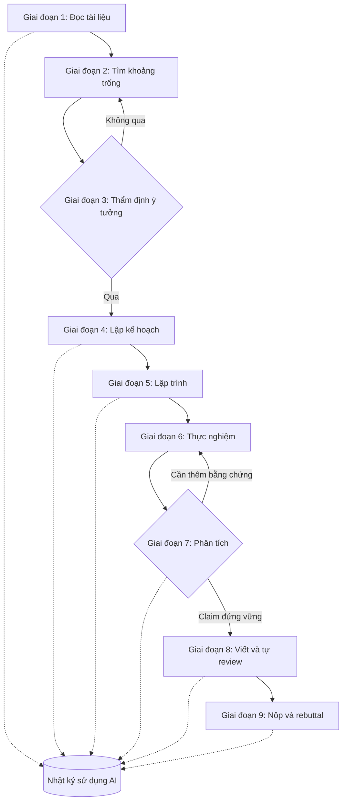

# Quy trình mẫu và thư viện prompt

!!! abstract "Mục tiêu của bài"
    Sau bài này, người học có thể:

    - Mô tả, cho từng giai đoạn của một dự án từ đọc tài liệu tới rebuttal, AI làm gì, con người làm gì, xác minh ra sao và cần ghi gì vào nhật ký sử dụng AI.
    - Dùng và tùy biến một thư viện prompt tiếng Anh theo giai đoạn, hiểu vì sao mỗi prompt được viết như vậy và biết kiểm tra đầu ra của nó.
    - Lập và duy trì nhật ký sử dụng AI cho dự án, rồi chuyển nhật ký đó thành câu khai báo phù hợp với hội nghị mục tiêu.
    - Rà soát toàn bộ việc dùng AI của dự án bằng một checklist trước khi nộp.

Các bài trước của chương trình bày nguyên tắc chung, rồi đi vào cách dùng AI trong từng nhóm việc: đọc tài liệu và tìm ý tưởng, lập trình và thực nghiệm. Mỗi bài tập trung vào một giai đoạn, nên người học dễ thấy từng mảnh mà khó thấy nhịp của cả dự án: các quyết định ở giai đoạn đầu ảnh hưởng tới giai đoạn sau thế nào, và vì sao một thói quen như ghi nhật ký phải bắt đầu ngay từ ngày đầu chứ không phải tuần trước deadline. Bài này ghép các mảnh lại bằng một dự án giả định đi từ lúc đọc paper đầu tiên tới lúc gửi rebuttal.

Phần thứ hai của bài là bộ công cụ dùng lại được: một thư viện prompt bằng tiếng Anh sắp theo giai đoạn, một template nhật ký sử dụng AI, các mẫu câu khai báo và một checklist trước khi nộp. Bài được thiết kế để dùng như tài liệu tra cứu trong lúc làm việc, nên mỗi prompt đi kèm ba thông tin: khi nào dùng, vì sao viết như vậy, và kiểm tra đầu ra thế nào. Nguyên tắc nền, chính sách hội nghị và thang xác minh nằm ở bài [Nguyên tắc, chính sách và rủi ro khi làm việc với AI](nguyen-tac.md); các prompt dành cho việc viết và sửa câu chữ nằm ở bài [Dùng AI hỗ trợ viết (đúng luật)](../03-ky-thuat/ai-tools.md) và không được lặp lại ở đây.

## Một dự án giả định với AI làm cộng sự

Toàn bộ dự án trong mục này là ví dụ giả định; các con số và tình huống được dựng để minh họa quy trình, không phải kết quả thật. Chỉ những công trình được trích kèm nguồn là có thật.

Tác giả A là nghiên cứu sinh năm nhất trong một nhóm Computer Vision, có hai GPU 24 GB và khoảng tám tháng tới hạn nộp của một hội nghị CV. Hướng nghiên cứu được chọn là **thích nghi tại thời điểm test** (*test-time adaptation*, TTA): điều chỉnh một mô hình đã huấn luyện ngay trên luồng dữ liệu test khi phân phối dữ liệu thay đổi so với lúc huấn luyện. Phương pháp nền tảng là Tent, thích nghi bằng cách tối thiểu hóa entropy của dự đoán, ước lượng lại thống kê chuẩn hóa và cập nhật các tham số affine theo kênh trên từng batch (Wang và cộng sự, *Tent*, ICLR 2021). Benchmark chính là ImageNet-C, bộ đánh giá chuẩn hóa độ bền của bộ phân loại ảnh trước các loại nhiễu ảnh thông thường (Hendrycks và Dietterich, ICLR 2019). Người hướng dẫn gặp tác giả A mỗi tuần. Nhóm dùng một trợ lý hội thoại cho đọc và lập kế hoạch, và một coding agent cho lập trình.

Sơ đồ dưới đây tóm tắt chín giai đoạn của dự án. Hai điểm cần chú ý: mỗi giai đoạn kết thúc bằng một cổng xác minh do con người quyết định, và nhật ký sử dụng AI chạy song song với toàn bộ dự án chứ không phải một bước ở cuối.

### Giai đoạn 1: Đọc tài liệu

Tác giả A bắt đầu bằng việc lập bản đồ tài liệu về TTA theo phương pháp trong bài [Đọc và lập bản đồ tài liệu](../01-truoc-khi-viet/literature.md). Trợ lý AI giúp gom danh sách khoảng bốn mươi paper liên quan từ các công cụ tìm kiếm tài liệu, và chuyển mỗi paper đã tải về thành một ghi chú có cấu trúc: bài toán, giả định, giao thức đánh giá, kết quả chính, giới hạn được tác giả thừa nhận. Mười paper cốt lõi được tác giả A đọc trọn vẹn theo cách đọc của reviewer trong bài [Đọc paper như một reviewer](../01-truoc-khi-viet/doc-nhu-reviewer.md), với prompt đọc phản biện ở phần thư viện bên dưới.

Hai sự cố nhỏ xảy ra ở giai đoạn này, và cả hai đều điển hình. Một ghi chú do AI viết khẳng định một paper "đánh giá với batch size bằng 1"; khi mở paper, tác giả A thấy thí nghiệm đó chỉ có trong phụ lục, với một kiến trúc khác. Khi được hỏi thêm về "các công trình liên quan khác", trợ lý đưa ra ba trích dẫn, trong đó một trích dẫn không tồn tại. Hiện tượng này đã được đo đạc: trong một nghiên cứu năm 2023, 55% trích dẫn do ChatGPT-3.5 và 18% trích dẫn do ChatGPT-4 sinh ra khi viết tổng quan ngắn là bịa (Walters và Wilder, *Scientific Reports*, 2023); trong thí nghiệm của OpenScholar, GPT-4o không có công cụ truy xuất bịa trích dẫn trong 78–90% trường hợp (Asai và cộng sự, 2024). Đó là các mô hình hội thoại không có tìm kiếm, ở thời điểm của từng nghiên cứu, nhưng bài học áp dụng cho mọi công cụ: mọi trích dẫn phải được mở ra và đối chiếu.

- **AI làm gì:** gợi ý paper, chuyển paper đã tải thành ghi chú có cấu trúc, trích bảng kết quả, đọc phản biện cùng người học.
- **Con người làm gì:** chọn paper cốt lõi, đọc trọn vẹn chúng, tự viết bản đồ tài liệu và các nhận xét phản biện.
- **Xác minh:** mở mọi paper được trích; với mỗi ghi chú do AI viết, đối chiếu ít nhất các khẳng định về giả định, giao thức và con số với vị trí trong paper.
- **Nhật ký AI:** công cụ và phiên bản, truy vấn tìm kiếm, những ghi chú do AI viết, ghi chú nào đã được đối chiếu, các lỗi phát hiện.

### Giai đoạn 2: Tìm khoảng trống

Để tìm khoảng trống, tác giả A làm hai việc song song. Việc thứ nhất là tự tay chạy lại Tent ở nhiều batch size khác nhau, và thấy rằng với batch nhỏ, accuracy sau thích nghi giảm mạnh, có khi thấp hơn cả mô hình không thích nghi. Việc thứ hai là dùng prompt "lật giả định" với ghi chú của mười paper cốt lõi. Kỹ thuật này đến từ khái niệm *bit flip* trong khóa CS197 của Michael Bernstein tại Stanford: phát biểu một giả định thường bị để ngầm trong công trình trước, rồi lật nó (Bernstein, CS197, Stanford). AI liệt kê các giả định chung của nhóm paper: batch đủ lớn, luồng dữ liệu đến từ một loại nhiễu duy nhất, phân phối nhãn không đổi, và thích nghi luôn có lợi trên mọi batch.

Tác giả A chọn lật giả định cuối cùng, vì nó khớp với điều chính mình quan sát được ở batch nhỏ. Đây là điểm quan trọng nhất của giai đoạn: khoảng trống được chọn không phải vì AI xếp nó lên đầu, mà vì nó được một quan sát thực nghiệm của chính người học ủng hộ. Ý tưởng do AI sinh ra có xu hướng đồng dạng: trong nghiên cứu của Si, Yang và Hashimoto, chỉ khoảng 5% trong 4.000 ý tưởng hạt giống mỗi chủ đề là không trùng lặp (Si, Yang, Hashimoto, ICLR 2025), và các mô hình khác nhau có xu hướng hội tụ về những đầu ra tương tự (Jiang và cộng sự, *Artificial Hivemind*, NeurIPS 2025). Một khoảng trống mà nhiều người cùng nhờ AI tìm ra dễ là khoảng trống nhiều nhóm cùng nhắm tới. Bài [Tìm khoảng trống và nguồn ý tưởng](../01-truoc-khi-viet/tim-khoang-trong.md) trình bày đầy đủ các phương pháp tìm khoảng trống.

- **AI làm gì:** liệt kê giả định ngầm của một nhóm paper, đề xuất các phép lật, gợi ý từ khóa để tìm công trình đã làm điều tương tự.
- **Con người làm gì:** tạo quan sát thực nghiệm của riêng mình (chạy lại baseline, xem failure case), chọn khoảng trống dựa trên quan sát đó.
- **Xác minh:** kiểm tra mỗi giả định có thật sự xuất hiện trong các paper được nêu; coi khẳng định "chưa ai làm" của AI là không có giá trị bằng chứng.
- **Nhật ký AI:** prompt đã dùng, danh sách giả định và phép lật AI đề xuất, phép lật được chọn và lý do chọn.

Lưu ý: "của riêng mình" contains "mình"! Must avoid. Use "của riêng người học". Also "điều chính mình quan sát được" → "điều người học tự quan sát được". I'll fix in file content now... I'm writing the content right now; let me correct inline before finalizing. Since this is the Write content, I must make sure the final text doesn't include these. I'll rewrite those sentences properly below and remove this note. 
