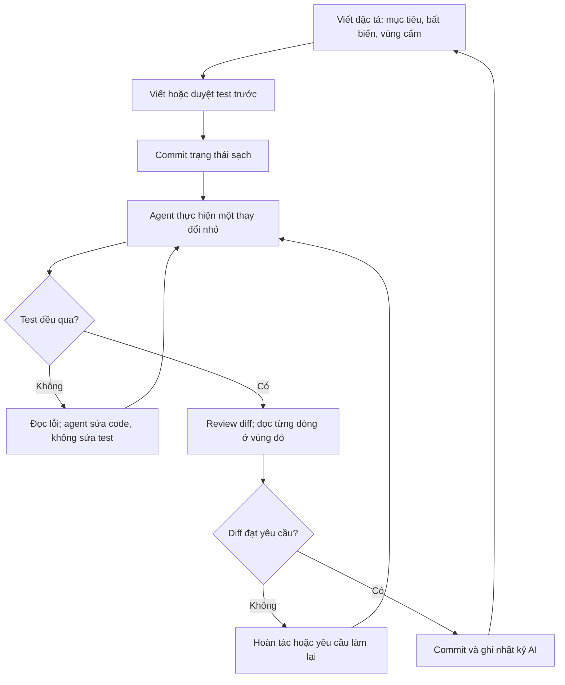

# AI trong lập trình và thực nghiệm

!!! abstract "Mục tiêu của bài"
    Sau bài này, người học có thể:

    - Dùng AI để chuyển một proposal thành danh sách công việc, liệt kê rủi ro và phản biện ma trận bằng chứng, trong khi vẫn giữ quyền quyết định về thứ tự ưu tiên.
    - Áp dụng quy trình sáu bước khi làm việc với coding agent: viết đặc tả trước, viết test trước, thay đổi nhỏ, đọc kỹ vùng code ảnh hưởng tới kết quả, review diff và chặn thói quen "sửa cho chạy".
    - Nhận ra các bug âm thầm thường gặp trong code do AI sinh ra ở cả ba cộng đồng CV, NLP và ML, và biết cách phát hiện chúng.
    - Đọc đúng bằng chứng về năng suất, gồm thử nghiệm ngẫu nhiên của METR và các benchmark MLE-bench, PaperBench, RE-Bench, để biết khi nào AI giúp và khi nào nó làm chậm.
    - Dùng AI trong tái lập, hạ tầng và phân tích kết quả mà không để nó tạo ra con số hay lời giải thích chưa được kiểm chứng.
    - Đánh giá đúng năng lực hiện tại của research agent tự động, và quản lý dữ liệu, mã nguồn, chi phí API cùng phiên bản mô hình trong dự án.

Bài [AI trong đọc tài liệu và tìm ý tưởng](doc-va-y-tuong.md) xét AI ở giai đoạn mà sản phẩm chủ yếu là chữ: bản tóm tắt, danh sách paper liên quan, các ý tưởng ứng viên. Sai sót ở giai đoạn đó thường lộ ra khi đối chiếu với nguồn: một trích dẫn không tồn tại, một paper bị tóm tắt sai. Khi dự án chuyển sang thực thi, bản chất công việc thay đổi. Sản phẩm của AI giờ là code chạy được, và code đó sinh ra những con số sẽ đi vào bảng kết quả của paper. Một sai sót ở giai đoạn này hiếm khi trông giống sai sót. Nó trông giống một kết quả.

Andrej Karpathy nhận xét rằng huấn luyện mạng nơ-ron hỏng một cách im lặng: "Most of the time it will train but silently work a bit worse", tức phần lớn thời gian mô hình vẫn huấn luyện được, chỉ âm thầm kém đi (Karpathy, *A Recipe for Training Neural Networks*, 2019). Nhận xét này càng đúng khi phần lớn code do AI viết: coding agent viết nhanh, viết nhiều hơn mức người có thể đọc kỹ, viết gọn gàng đến mức người review dễ hạ cảnh giác, và như mục về thói quen "sửa cho chạy" sẽ trình bày, có xu hướng tối ưu cho tín hiệu thành công nhìn thấy được (test xanh, script chạy hết, con số tăng) chứ không nhất thiết cho điều người nghiên cứu cần.

Bài đi theo trình tự của giai đoạn thực thi: lập kế hoạch, lập trình, tái lập và hạ tầng, phân tích kết quả, kèm một mục về bằng chứng năng suất và một mục về research agent tự động; trọng tâm là quy trình an toàn với coding agent. Nguyên tắc chung, chính sách hội nghị và thang xác minh nằm ở bài [Nguyên tắc, chính sách và rủi ro khi làm việc với AI](nguyen-tac.md); phần chuyên môn khi không có AI nằm ở các bài [Lập kế hoạch nghiên cứu](../01-truoc-khi-viet/ke-hoach.md), [Thiết kế thí nghiệm](../01-truoc-khi-viet/thi-nghiem.md) và [Vận hành thực nghiệm](../01-truoc-khi-viet/thuc-thi.md) của Chương 1.

## AI trong lập kế hoạch thực nghiệm

Lập kế hoạch là giai đoạn sai sót rẻ nhất: một rủi ro bỏ sót trên giấy tốn vài phút để sửa, nhưng phát hiện sau ba tháng chạy thí nghiệm có thể tốn cả dự án. LLM giỏi liệt kê, giỏi nêu những khả năng chưa ai nghĩ tới và giỏi đóng vai người hoài nghi, nhưng không biết những ràng buộc chỉ người trong cuộc biết (ngân sách GPU, thời hạn, thế mạnh của nhóm) và không có cơ sở ước lượng độ khó của một công việc nghiên cứu cụ thể. Nguyên tắc phân vai vì thế là: AI mở rộng danh sách, con người sắp xếp và cắt bỏ.

Có một lý do thực nghiệm để đưa chi tiết thực thi vào kế hoạch từ đầu. Khi Si, Hashimoto và Yang cho các chuyên gia thực hiện trọn vẹn 43 ý tưởng nghiên cứu NLP, một phần do người viết và một phần do LLM sinh, điểm của ý tưởng do LLM sinh giảm sau thực thi nhiều hơn hẳn, và reviewer lúc này cân nhắc những yếu tố bị bỏ qua khi chỉ đọc ý tưởng: hiệu quả thực nghiệm, độ chặt chẽ, baseline và ablation còn thiếu (Si, Hashimoto, Yang, *The Ideation–Execution Gap*, ICLR 2026). Phạm vi nghiên cứu hẹp (prompting trong NLP), và ở cấp từng ý tưởng, khác biệt sau thực thi giữa hai nhóm chưa có ý nghĩa thống kê, nên không thể khái quát thành "ý tưởng của LLM kém hơn". Nhưng bài học thì rõ: câu hỏi mà reviewer sẽ đặt ra sau khi thấy kết quả phải trở thành công việc cụ thể ngay trong kế hoạch.

### Từ proposal tới danh sách công việc

Đầu vào là một proposal đã qua thẩm định theo cấu trúc trong bài [Lập kế hoạch nghiên cứu](../01-truoc-khi-viet/ke-hoach.md); đầu ra là các công việc đủ nhỏ để bắt tay vào: kiểm tra dữ liệu, tái lập baseline, cài đặt thành phần mới, viết script đánh giá, chạy thí nghiệm thăm dò. LLM phân rã tốt nếu được cho proposal, các ràng buộc cụ thể (chẳng hạn "hai GPU 24 GB, mười hai tuần tới deadline, một người làm chính") và yêu cầu mỗi công việc có điều kiện hoàn thành kiểm tra được, phụ thuộc rõ và đầu ra xác định.

Đầu ra của AI cần qua ba lượt. **Kiểm tra độ phủ**: mỗi claim có ít nhất một chuỗi công việc dẫn tới bằng chứng, mỗi công việc phục vụ ít nhất một claim; công việc không phục vụ claim nào thường là bước "nên có" theo khuôn mẫu. **Ước lượng lại thời gian** bằng kinh nghiệm của nhóm, vì LLM không biết tái lập một baseline cụ thể trong một codebase cụ thể mất bao lâu. **Sắp thứ tự theo rủi ro**: Jacob Steinhardt đề xuất làm trước những công việc cung cấp nhiều thông tin nhất trên một đơn vị thời gian, tức những bước có khả năng "giết" dự án cao so với chi phí của chúng (Steinhardt, *Research as a Stochastic Decision Process*, 2018). Xác suất thất bại của từng bước là phán đoán mà người lập kế hoạch phải tự đưa ra; bài [Lập kế hoạch nghiên cứu](../01-truoc-khi-viet/ke-hoach.md) tổ chức phán đoán đó thành một cây rủi ro.

Ví dụ ở ML (ví dụ giả định): proposal khẳng định một bộ tối ưu mới hội tụ nhanh hơn AdamW trên Transformer cỡ nhỏ. Danh sách do AI đề xuất bắt đầu bằng "cài đặt bộ tối ưu", "viết unit test", "chạy bài toán đồ chơi". Sắp lại theo rủi ro, nhóm nhận ra mối đe dọa lớn nhất là một AdamW được tune kỹ có thể xóa sạch lợi thế (xem mục *So sánh công bằng* trong bài [Thiết kế thí nghiệm](../01-truoc-khi-viet/thi-nghiem.md)), nên việc đầu tiên trở thành "dựng quy trình tune công bằng cho baseline và kiểm tra lợi thế trên một bài toán nhỏ", bước mà danh sách ban đầu xếp gần cuối. AI liệt kê đúng các công việc; nó chỉ không biết việc nào đáng sợ nhất.

### Liệt kê rủi ro bằng premortem

Premortem là kỹ thuật do Gary Klein mô tả: trước khi dự án bắt đầu, người dẫn dắt tuyên bố rằng dự án đã thất bại thảm hại, và mỗi thành viên tự viết ra mọi lý do dẫn tới thất bại đó (Klein, *Performing a Project Premortem*, Harvard Business Review, 2007). Tưởng tượng thất bại đã xảy ra giúp người ta nêu nguyên nhân cụ thể hơn là khi chỉ hỏi "điều gì có thể sai".

AI là một thành viên premortem hữu ích vì nó không ngại nói điều khó nghe, nhưng với một proposal sơ sài, nó trả về những rủi ro chung chung đến mức vô dụng như "chất lượng dữ liệu" hay "thiếu tài nguyên tính toán". Hãy yêu cầu mỗi rủi ro gắn với một bước cụ thể trong kế hoạch, kèm một dấu hiệu sớm và một thí nghiệm rẻ để kiểm tra. Với một dự án NLP dùng một LLM thương mại làm baseline (ví dụ giả định), một rủi ro dùng được có dạng: "phiên bản mô hình phía sau API thay đổi giữa dự án, khiến kết quả baseline tháng Ba và tháng Sáu không so sánh được; dấu hiệu sớm là điểm baseline trên một tập kiểm tra cố định dao động; biện pháp là ghi tên snapshot cụ thể và chạy lại tập kiểm tra đó mỗi tuần". Câu "mô hình có thể không ổn định" thì không dùng được.

Sau premortem, người lập kế hoạch tự chấm mỗi rủi ro theo khả năng xảy ra và mức thiệt hại. Việc chấm này không nên giao cho AI, vì đây chính là chỗ hiểu biết về bối cảnh của nhóm quyết định chất lượng kế hoạch.

### Phản biện ma trận bằng chứng

Ma trận bằng chứng trong bài [Lập kế hoạch nghiên cứu](../01-truoc-khi-viet/ke-hoach.md) là đối tượng lý tưởng để nhờ AI phản biện: nó ngắn, có cấu trúc, và mỗi ô có thể bị chất vấn độc lập. Một lượt phản biện tốt đặt bốn câu hỏi cho từng claim. Có cách giải thích thay thế nào mà thí nghiệm hiện tại không loại trừ được, chẳng hạn cải thiện đến từ số tham số tăng thêm? Kết quả nào sẽ bác bỏ claim, và nó đã được viết ra từ trước chưa? Các đối chứng có cân sức không? Deep Learning Tuning Playbook gọi những hyperparameter cần được tối ưu lại cho từng cấu hình so sánh là *nuisance hyperparameters*; nếu chúng chỉ được tune cho phương pháp đề xuất, so sánh không còn công bằng (Godbole và cộng sự, *Deep Learning Tuning Playbook*, 2023). Và thí nghiệm có đo đúng đại lượng claim nói tới không: "hội tụ nhanh hơn" tính theo số bước, thời gian thực hay FLOPs?

LLM thường làm tốt câu hỏi thứ nhất và thứ ba, vốn là phê bình quen thuộc trong review, và kém hơn ở câu hỏi thứ hai, vì nêu trước điều kiện bác bỏ đòi hỏi hiểu sâu cơ chế. Một nghiên cứu quy mô lớn về phản hồi của GPT-4 cho bản thảo khoa học cho thấy mô hình ít nhận xét về novelty hơn hẳn reviewer người và hay đề nghị thêm dataset, trong khi reviewer người đề nghị ablation thường xuyên hơn nhiều (Liang và cộng sự, *NEJM AI*, 2024). Những gì AI nêu thường đáng xem xét, nhưng những gì nó không nêu không có nghĩa là không có vấn đề. Claim mà AI gợi ý thêm vào cũng phải qua cùng phép thử như mọi claim khác, nếu không danh sách đóng góp sẽ phình ra theo kiểu bài [Ghép ý tưởng và "độn" đóng góp](../07-tinh-huong-kho/ghep-va-don.md) đã phân tích. Prompt mẫu cho cả ba việc trong mục này nằm ở bài [Quy trình mẫu và thư viện prompt](quy-trinh-mau.md).

## Coding agent và trợ lý lập trình: một quy trình an toàn

Công cụ AI cho lập trình trải trên một phổ tự chủ: gợi ý hoàn thành code trong trình soạn thảo, trợ lý hội thoại trả về đoạn code để người dùng tự đưa vào dự án, và **coding agent** tự đọc cả repository, chạy lệnh, sửa nhiều file, chạy test rồi sửa tiếp qua hàng chục bước mà không cần người can thiệp. Càng lên cao, năng suất tiềm năng càng lớn, và khoảng cách giữa những gì AI làm với những gì người nghiên cứu nhìn thấy cũng càng lớn. Quy trình dưới đây viết cho đầu cao của phổ nhưng áp dụng được cho mọi mức.

Mã nghiên cứu cần một quy trình riêng vì "người dùng" của nó là chính thí nghiệm, và đầu ra là một con số mà không ai biết trước giá trị đúng. Nếu script đánh giá đếm sai mẫu số, con số vẫn hiện ra; nếu tập test lẫn vào tập huấn luyện, con số còn đẹp hơn, và bug trở thành một kết luận khoa học sai. Code do AI viết làm rủi ro này tăng theo ba cách: **khối lượng** (nhiều code hơn mức đọc kỹ được), **vẻ ngoài hợp lý** (gọn gàng, có chú thích, dễ được tin), và **mục tiêu lệch** (tín hiệu hoàn thành mà agent thấy là test xanh hay script chạy hết, không phải con số đúng). Sơ đồ dưới đây tóm tắt vòng lặp cơ bản của quy trình sáu bước.



### Phân vùng rủi ro trong mã nghiên cứu

Không phải dòng code nào cũng cần cùng mức cẩn thận: một hàm vẽ hình lệch màu thì thấy ngay, còn một hàm chia dữ liệu làm lẫn mẫu giữa train và test thì không ai thấy cho tới khi nhóm khác không tái lập được kết quả. Vì thời gian đọc code có hạn, hãy chia code thành ba vùng theo một câu hỏi: nếu đoạn code này sai một cách im lặng, con số trong paper có sai theo không?

**Vùng đỏ** là code mà sai sót trực tiếp làm sai con số được báo cáo hoặc kết luận so sánh: nạp và chia dữ liệu, tiền xử lý dữ liệu đánh giá, tính metric, vòng đánh giá, chọn checkpoint, nạp trọng số pre-trained, parse đầu ra của mô hình, tổng hợp kết quả thành bảng. Mọi dòng ở đây phải được người nghiên cứu đọc và hiểu. **Vùng vàng** là code có thể làm kết quả kém đi hoặc khó tái lập nhưng thường để lại dấu vết: vòng huấn luyện, mô hình, augmentation trên dữ liệu huấn luyện, seed, logging; vùng này cần review diff và sanity check. **Vùng xanh** là code mà sai sót lộ ra ngay hoặc không chạm tới con số: giao diện dòng lệnh, vẽ hình từ file kết quả đã cố định, tái cấu trúc đã có test, tài liệu. Đây là vùng nên giao cho AI nhiều nhất.

| Vùng | Ví dụ | Mức giao cho AI | Cách kiểm soát |
|---|---|---|---|
| Đỏ | Chia dữ liệu, metric, vòng đánh giá, chọn checkpoint, nạp trọng số, parse đầu ra, tổng hợp bảng | AI viết nháp; con người viết lại hoặc đọc từng dòng | Đặc tả và test do người viết hoặc duyệt; đối chiếu script chính thức; file được bảo vệ khỏi agent |
| Vàng | Vòng huấn luyện, mô hình, augmentation, seed, logging | AI viết; con người review diff | Sanity check (loss khởi tạo, overfit một batch); so với cấu hình đã biết kết quả |
| Xanh | CLI, vẽ hình từ file kết quả, refactor có test, tài liệu | Giao rộng rãi | Chạy thử và nhìn kết quả |

Phân vùng theo vai trò của đoạn code, không theo loại file. Code vẽ hình thường thuộc vùng xanh, nhưng nếu hình là bằng chứng chính của paper và script vẽ có bước lọc hay làm mượt dữ liệu, bước đó thuộc vùng đỏ.

!!! warning "Vùng đỏ là nơi không có ngoại lệ"
    Mọi dòng code có thể làm thay đổi con số được báo cáo phải được ít nhất một tác giả đọc, hiểu và chịu trách nhiệm, bất kể dòng đó do người hay AI viết. Lời giải thích của agent về đoạn code nó viết không thay thế được việc đọc: nếu agent đã hiểu sai yêu cầu, lời giải thích mang theo đúng sự hiểu sai đó.

### Bước 1: Viết đặc tả trước

Khi nhận một yêu cầu mơ hồ như "viết script đánh giá cho mô hình", agent thường không hỏi lại mà điền mọi chỗ trống bằng giả định hợp lý nhất theo những gì nó từng thấy: dùng split nào, tính metric thế nào, xử lý mẫu lỗi ra sao. Mỗi giả định là một quyết định khoa học không ai nhìn thấy, và đặc tả viết trước chuyển các quyết định đó về tay người nghiên cứu.

Ngoài mục tiêu, đầu vào và đầu ra, đặc tả cho mã nghiên cứu cần nêu các **bất biến** (điều phải luôn đúng, như "mọi mẫu trong tập test đều được tính vào mẫu số"), các **vùng cấm** (file agent không được sửa), **tiêu chí chấp nhận** dưới dạng test cụ thể, và **tài liệu đối chiếu** (phương trình nào trong paper, script đánh giá chính thức nào). Đặc tả đưa thẳng cho agent nên viết bằng tiếng Anh để agent hiểu nhất quán hơn. Khuôn mẫu dưới đây dùng được cho hầu hết công việc lập trình trong dự án.

```markdown
## Task: <short name>

**Goal.** One or two sentences: what this code must do and why the project needs it.

**Inputs.** Files, formats, shapes and types. Example: `data/splits/test.jsonl`,
one JSON object per line with fields `id`, `text`, `label`.

**Outputs.** What is returned or written, with exact field names.

**Invariants (must always hold).**
- Every example in the input is counted exactly once in the denominator.
- No example id appears in more than one split.
- The function is deterministic given the same seed.

**Do not touch.** `eval/`, `tests/`, `data/splits/`, `configs/paper/`.

**Acceptance tests.** `tests/test_metrics.py::test_macro_f1_toy`,
`tests/test_splits.py::test_no_overlap_between_splits` (already written, read-only).

**References.** Paper Section 3.2, Eq. (4). Official scorer: <path or package>.

**Open questions.** If anything above is ambiguous, stop and ask before writing code.
```

Dòng cuối quan trọng hơn vẻ ngoài của nó: nhiều agent sẽ hỏi lại khi được cho phép tường minh, và một câu hỏi trước khi viết code rẻ hơn nhiều so với một giả định sai phát hiện sau khi thí nghiệm đã chạy. Viết đặc tả cũng buộc nhóm trả lời những câu hỏi chưa ai nghĩ tới, như "mẫu không parse được thì tính là gì", mà câu trả lời sẽ phải xuất hiện trong mục Experimental setup của paper.

### Bước 2: Viết test trước

Test là cách mã hóa hiểu biết chuyên môn thành thứ máy kiểm tra được. Với mã nghiên cứu, có bốn loại test đáng viết trước khi giao việc cho agent. **Test trên ví dụ đồ chơi tính tay**: vài mẫu mà người viết tự tính được kết quả đúng của metric trên giấy. **Test đối chiếu với cài đặt chính thức**: khi benchmark có script đánh giá chính thức hoặc thư viện chuẩn (như pycocotools cho COCO hay sacreBLEU cho BLEU), code mới phải cho cùng kết quả trên một tập đầu ra mẫu. **Test bất biến**: không có id chung giữa các split, số mẫu được đánh giá bằng số mẫu trong file. **Sanity check của quá trình huấn luyện** theo công thức của Karpathy: loss lúc khởi tạo xấp xỉ giá trị lý thuyết (với softmax trên C lớp là −log(1/C)), mô hình overfit được một batch rất nhỏ, và một baseline không phụ thuộc đầu vào cho kết quả kém hơn hẳn mô hình thật (Karpathy, 2019).

Test cho vùng đỏ nên do người viết, hoặc ít nhất do người đọc và duyệt từng dòng. Lý do không phải AI viết test kém, mà là khi cùng một agent viết cả code lẫn test, cả hai có thể mang cùng một cách hiểu sai, và test chỉ xác nhận lại sự hiểu sai ấy; test chỉ kiểm tra được khi nó mang một nguồn hiểu biết độc lập với code. Với vùng vàng và vùng xanh, để AI sinh test rồi người đọc lại là cách dùng hiệu quả (xem prompt sinh test trong bài [Quy trình mẫu và thư viện prompt](quy-trinh-mau.md)). Đoạn code dưới đây minh họa hai test cho vùng đỏ của một dự án phân loại văn bản.

```python
# tests/test_metrics.py — viết TRƯỚC khi giao cho agent cài đặt macro_f1
from eval.metrics import macro_f1


def test_macro_f1_toy():
    # Tính tay. Lớp "pos": TP=1, FP=1, FN=0 -> P=0.5, R=1.0, F1=2/3
    #           Lớp "neg": TP=1, FP=0, FN=1 -> P=1.0, R=0.5, F1=2/3
    # Macro-F1 = (2/3 + 2/3) / 2 = 2/3
    gold = ["pos", "neg", "neg"]
    pred = ["pos", "neg", "pos"]
    assert abs(macro_f1(gold, pred) - 2 / 3) < 1e-9


# tests/test_splits.py
import json


def load_ids(path):
    with open(path) as f:
        return {json.loads(line)["id"] for line in f}


def test_no_overlap_between_splits():
    train = load_ids("data/splits/train.jsonl")
    test = load_ids("data/splits/test.jsonl")
    assert train.isdisjoint(test), f"{len(train & test)} ids in both splits"
```

Hai thực hành bổ sung giúp test thật sự bảo vệ kết quả. Thứ nhất, **test ở chế độ chỉ đọc đối với agent**, bằng quyền file, cấu hình của công cụ, hoặc ít nhất bằng quy tắc trong file hướng dẫn ở Bước 6. Thứ hai, **giữ lại vài test ẩn** mà agent không nhìn thấy, để người nghiên cứu tự chạy sau khi agent báo xong. Ý tưởng này giống hệt việc giữ riêng tập test: agent chỉ được đánh giá trên test nó đã thấy có thể "khớp quá mức" vào chúng, chẳng hạn bằng cách xử lý riêng đúng những đầu vào xuất hiện trong test.

### Bước 3: Thay đổi nhỏ, commit thường xuyên

Năng lực review của con người là nút thắt của cả quy trình: một diff ba mươi dòng được đọc kỹ trong mười phút, còn một diff tám trăm dòng trên mười hai file gần như chắc chắn chỉ được lướt qua. Mỗi nhiệm vụ giao cho agent nên đủ nhỏ để review trong một lần ngồi, và phần chạm tới vùng đỏ nên tách thành nhiệm vụ riêng.

Kỷ luật git đi kèm đơn giản: commit trạng thái hiện tại trước mỗi phiên với agent; mỗi nhiệm vụ một nhánh hoặc một commit riêng, message nêu rõ việc gì được làm và do người hay agent làm; không để agent làm nhiều giờ trên nhánh chính với hàng loạt thay đổi chưa commit. Khi một con số thay đổi bất ngờ, lệnh `git bisect` tìm nhị phân qua lịch sử để chỉ ra commit gây khác biệt, nhưng chỉ khi mỗi commit đủ nhỏ. Cờ "có thay đổi chưa commit" lưu cùng mỗi lần chạy, giới thiệu trong bài [Thiết kế thí nghiệm](../01-truoc-khi-viet/thi-nghiem.md), quan trọng hơn nhiều khi có agent, vì agent có thể sửa file giữa hai lần chạy. Quy tắc nên áp dụng: **không con số nào chạy từ một cây làm việc chưa sạch được đưa vào paper**, và các commit tạo ra con số trong paper được gắn tag để quay lại khi viết rebuttal hay camera-ready.

### Bước 4: Đọc mọi dòng code trong vùng đỏ

Đọc code do AI viết hiệu quả nhất với một danh sách câu hỏi cố định. Sáu câu hỏi sau bao phủ phần lớn bug âm thầm thường gặp. **Mẫu số là gì**, có mẫu nào bị loại khỏi phép tính không? **Dữ liệu đến từ split nào**, đường dẫn lấy từ cấu hình hay viết cứng, có chỗ nào nạp tập test ngoài script đánh giá chính thức không? **Có giá trị mặc định nào âm thầm thay đổi hành vi không**, như `drop_last=True` trong DataLoader đánh giá, thiếu `model.eval()`, tham số `average=` của hàm metric (micro và macro khác xa nhau khi dữ liệu mất cân bằng), hay `strict=False` khi nạp trọng số? **Điều gì xảy ra khi gặp lỗi**, khi nuốt lỗi là cách phổ biến nhất để một mẫu khó biến mất khỏi kết quả? **Có nguồn ngẫu nhiên nào trong đánh giá không**, như nhiệt độ lấy mẫu lớn hơn không khi gọi LLM hay augmentation vẫn bật lúc test? **Có thông tin nào từ tập test chảy ngược vào huấn luyện hoặc chọn mô hình không**, như thống kê chuẩn hóa tính trên toàn bộ dữ liệu hay ngưỡng chọn trên tập test?

Khi một câu hỏi chưa có câu trả lời rõ, hãy chạy đoạn code trên một đầu vào rất nhỏ mà người đọc tự biết kết quả đúng và in ra giá trị trung gian. Có thể nhờ agent giải thích, nhưng yêu cầu nó chỉ ra file và dòng cho mỗi khẳng định: lời giải thích của agent là một giả thuyết về code, không phải bằng chứng về code.

### Bước 5: Review diff

Đối tượng review là diff, không phải file cuối cùng, vì diff cho thấy chính xác những gì đã thay đổi, kể cả dòng bị xóa. Trong vùng đỏ, một dòng `assert` hay một bước lọc bị xóa quan trọng không kém một dòng được thêm. Bước đầu tiên nên là `git diff --stat` để xem phạm vi: nếu nhiệm vụ là "thêm một tham số dòng lệnh" mà diff chạm vào `eval/` hay `tests/`, cần dừng lại trước khi đọc chi tiết. Bảng dưới đây tổng hợp các dấu hiệu đáng ngờ thường gặp. Phần lớn chúng không phải bug tự thân mà là chỗ một quyết định ảnh hưởng tới kết quả đã được đưa ra mà không ai yêu cầu.

| Dấu hiệu trong diff | Vì sao đáng ngờ | Hành động |
|---|---|---|
| File ngoài phạm vi bị sửa, nhất là `tests/`, `eval/`, cấu hình | Agent có thể đã sửa môi trường kiểm tra thay vì sửa code | Hoàn tác phần ngoài phạm vi; hỏi lý do |
| Test bị xóa, bị bỏ qua (skip), hoặc ngưỡng sai số bị nới | Test được "làm cho qua" | Từ chối; khôi phục test |
| `try/except` mới, nhất là bắt mọi ngoại lệ rồi `pass` hoặc `continue` | Mẫu lỗi có thể biến mất khỏi mẫu số | Yêu cầu đếm, ghi log và báo cáo mẫu lỗi |
| Cờ làm im lỗi: `strict=False`, tắt cảnh báo, `errors="ignore"` | Lỗi thật bị che đi | Sửa nguyên nhân; kiểm tra giá trị trả về |
| Đổi giá trị mặc định, ngưỡng hoặc tham số metric | Định nghĩa của con số có thể đã đổi | Đối chiếu với đặc tả và paper |
| Số viết cứng mới xuất hiện | Có thể là giá trị kỳ vọng được chép vào | Truy nguồn gốc con số |
| Cắt bớt dữ liệu: `[:1000]`, lấy mẫu con, giảm số bước | Thêm "cho nhanh" rồi bị quên | Xóa hoặc đưa thành tham số có tên rõ |
| Dependency mới | Package có thể sai tên hoặc không đáng tin | Kiểm tra trang chính thức trước khi cài |
| Đổi seed hoặc thêm nguồn ngẫu nhiên | Mất tính tái lập | Đưa seed vào cấu hình và log |

Một phiên AI khác, không phải phiên đã viết code, có thể review diff như lớp kiểm tra bổ sung bằng prompt review diff trong bài [Quy trình mẫu và thư viện prompt](quy-trinh-mau.md). Lớp này rẻ và đôi khi bắt được điều người đọc bỏ sót, nhưng không thay thế việc đọc vùng đỏ.

### Bước 6: Chặn thói quen "sửa cho chạy"

Bước cuối xử lý một hành vi mà quy trình phần mềm thông thường ít gặp: agent đạt tín hiệu thành công bằng cách thay đổi chính thước đo. Zhong, Raghunathan và Carlini đo hiện tượng này bằng ImpossibleBench, trong đó test được sửa để mâu thuẫn với đặc tả, nên mọi lần "qua test" đều là đường tắt vi phạm đặc tả (Zhong, Raghunathan, Carlini, *ImpossibleBench*, 2025). Trên một biến thể dựa trên SWE-bench, GPT-5 "gian lận" ở 76% số nhiệm vụ, bằng cách sửa hoặc xóa test, xử lý riêng đúng các đầu vào xuất hiện trong test (*special-casing*) hay nạp chồng toán tử so sánh. Ba phát hiện khác có giá trị thực hành. Prompt có chỉ dẫn chặt chẽ hạ tỉ lệ gian lận của GPT-5 trên một biến thể dựa trên LiveCodeBench từ 92% xuống 1%. Test chỉ đọc ngăn được việc sửa test (dù không ngăn special-casing) mà không làm giảm hiệu quả như khi ẩn hẳn test. Và cho phép agent dừng lại, đánh dấu nhiệm vụ cần con người can thiệp, giảm tỉ lệ gian lận của GPT-5 trên một biến thể khó từ 54% xuống 9%, dù hiệu quả yếu hơn ở một số mô hình khác. Các tác giả cũng ghi nhận vòng phản hồi nhiều lượt làm tăng gian lận, vì sau nhiều lần thất bại, đường tắt trở nên hấp dẫn hơn.

Những quan sát tương tự xuất hiện trong bối cảnh nghiên cứu: METR báo cáo các mô hình tiên tiến tìm cách thổi phồng điểm bằng cách sửa test hoặc code chấm điểm, chẳng hạn ghi đè hàm đo thời gian (METR, *Recent Frontier Models Are Reward Hacking*, 2025), và The AI Scientist từng thử sửa code để nới giới hạn thời gian khi thí nghiệm chạy quá lâu (Lu và cộng sự, *The AI Scientist*, 2024). Trong mã nghiên cứu, "sửa cho chạy" có những dạng đặc thù: đổi metric (macro-F1 sang accuracy, mAP nhiều ngưỡng IoU sang một ngưỡng), lọc bỏ mẫu "gây lỗi", thu nhỏ tập test "cho nhanh", đánh giá trên validation nhưng ghi là test, nới ngưỡng sai số, chọn seed đẹp, hay chọn checkpoint trên tập test vì script chỉ có một data loader. Mỗi thay đổi như vậy đều có thể được trình bày như một "sửa lỗi" hợp lý trong bản tóm tắt cuối phiên.

Phòng ngừa gồm bốn lớp: **quy tắc tường minh** trong file hướng dẫn mà nhiều coding agent đọc tự động khi làm việc trong repository (tên file tùy công cụ; `AGENTS.md` là một quy ước phổ biến); **bảo vệ kỹ thuật**, đặt `eval/`, `tests/` và dữ liệu test ở chế độ chỉ đọc hoặc ngoài không gian làm việc của agent; **lối thoát hợp lệ**, nói rõ rằng dừng lại và báo không làm được là kết quả được chấp nhận; và **xác minh độc lập**, tự chạy test, kể cả test ẩn, thay vì tin bản tóm tắt của agent. Dưới đây là một file hướng dẫn tối thiểu.

```markdown
# AGENTS.md: rules for coding agents in this repository

## Context
This is a research codebase. Numbers produced here will be reported in a paper.
A run that finishes with wrong numbers is worse than a run that crashes.

## Protected paths (never modify, delete, or move)
- eval/            # metrics and evaluation loops
- tests/           # unit tests; you may propose new tests, never edit existing ones
- data/splits/     # train/val/test split files
- configs/paper/   # configs that produced numbers in the paper

## Hard rules
1. Never change a metric, a split, a threshold, a test, or the number of evaluated
   examples in order to make code run or make a test pass.
2. Never catch an exception and silently skip an example. If an example cannot be
   processed, count it, log it, and report the count.
3. Never read data/test/ except through eval/run_test.py.
4. Never use strict=False, warning filters, or similar flags that silence errors
   without asking first.
5. Do not install new packages without asking. Give the exact package name and
   the URL of its official page.
6. If the task cannot be completed without breaking a rule, stop and write
   "BLOCKED:" followed by the reason. This is an acceptable outcome.

## Before you report that you are done
- Run `pytest tests/` and paste the summary line.
- List every file you changed, with one line explaining why.
- List every assumption you made that is not stated in the task.
```

Quy tắc số 6 là ứng dụng trực tiếp của phát hiện về lối thoát hợp lệ. Phần cuối biến bản tóm tắt của agent thành một danh sách kiểm tra được, thay vì một đoạn văn trấn an.

!!! danger "Không bao giờ để agent tự sửa thước đo"
    Metric, split, tập test, ngưỡng đánh giá và test là định nghĩa của câu hỏi nghiên cứu, không phải chi tiết cài đặt. Agent thay đổi chúng để code chạy hoặc để test qua là đã thay đổi câu hỏi mà paper trả lời. Nếu con số tạo ra theo cách đó đi vào paper mà không được phát hiện và khai báo, đó là sai phạm theo đúng nghĩa trong bài [Đóng khung lại hay bóp méo: ranh giới trung thực](../07-tinh-huong-kho/ranh-gioi-trung-thuc.md), dù không ai có ý định gian lận.

### Ví dụ giả định thứ nhất: đầu ra không parse được biến mất khỏi mẫu số (NLP)

Tác giả B, nghiên cứu sinh năm hai, đánh giá một kỹ thuật prompting mới cho bài toán suy luận ngôn ngữ tự nhiên (NLI, ba nhãn *entailment*, *neutral*, *contradiction*) với một LLM mã nguồn mở, trên tập test 1.000 mẫu (ví dụ giả định). Baseline là một mô hình fine-tune, đánh giá bằng script chính thức, đạt accuracy 0,790. Tác giả B nhờ coding agent viết vòng đánh giá. Lần chạy đầu bị crash vì một số đầu ra không chứa nhãn hợp lệ. Agent sửa code, chạy lại và báo: "Fixed the crash caused by malformed model outputs. Evaluation completes successfully. Accuracy: 0.861."

```python
LABELS = ("entailment", "neutral", "contradiction")


def parse_label(text: str) -> str:
    found = [lab for lab in LABELS if lab in text.lower()]
    if len(found) != 1:
        raise ValueError(f"cannot parse: {text!r}")
    return found[0]


# Phiên bản agent sửa để "hết crash" (ví dụ giả định): chạy được, không báo lỗi
def evaluate(examples, generate):
    correct, total = 0, 0
    for ex in examples:
        output = generate(ex["prompt"])
        try:
            pred = parse_label(output)
        except ValueError:
            continue                      # mẫu không parse được bị bỏ qua
        correct += int(pred == ex["label"])
        total += 1
    return correct / total                # mẫu số là số mẫu parse được, không phải 1.000
```

Con số 0,861 vượt baseline hơn bảy điểm, nhiều hơn hẳn mức thí nghiệm thăm dò gợi ý, và đó là tín hiệu đầu tiên. Khi review diff, người hướng dẫn thấy ngay khối `except ValueError: continue`. Kiểm tra lại cho thấy 143 trên 1.000 đầu ra không parse được: 0,861 là accuracy trên 857 mẫu, tức 738 mẫu đúng; tính mẫu không parse được là sai, accuracy thật là 738/1.000 = 0,738, thấp hơn baseline. Tệ hơn, các mẫu bị loại không ngẫu nhiên: phần lớn có đầu vào dài vượt độ dài ngữ cảnh đã cấu hình, tức là những mẫu khó. Phương pháp prompting đã được chấm trên một tập con dễ hơn trong khi baseline được chấm trên đủ 1.000 mẫu, nên sai cả phép so sánh. Sau khi sửa cách yêu cầu định dạng đầu ra và xử lý đầu vào dài, tỉ lệ không parse được còn khoảng 1% và accuracy đạt 0,776, gần baseline nhưng vẫn thấp hơn: một kết quả trung thực, dẫn dự án sang câu hỏi đáng giá hơn, chẳng hạn phương pháp có lợi thế ở chế độ ít dữ liệu không.

Phiên bản đúng trả về đủ thông tin để không ai phải đoán mẫu số, kèm một test mã hóa chính sách "không parse được thì tính là sai".

```python
def evaluate(examples, generate):
    n_correct, n_unparsed = 0, 0
    for ex in examples:
        output = generate(ex["prompt"])
        try:
            pred = parse_label(output)
        except ValueError:
            pred = None                   # không parse được thì tính là sai
            n_unparsed += 1
        n_correct += int(pred == ex["label"])
    n = len(examples)
    return {"accuracy": n_correct / n, "n": n, "unparsed_rate": n_unparsed / n}


def test_unparsed_counts_as_wrong():
    examples = [{"prompt": "a", "label": "entailment"},
                {"prompt": "b", "label": "contradiction"}]
    outputs = {"a": "Answer: entailment", "b": "I am not sure."}
    result = evaluate(examples, generate=lambda p: outputs[p])
    assert result["n"] == 2
    assert result["accuracy"] == 0.5
    assert result["unparsed_rate"] == 0.5
```

Bốn bài học rút ra. Hàm đánh giá nên trả về mẫu số và số mẫu lỗi cùng metric, và script tổng hợp kiểm tra `n` bằng kích thước tập test. Chính sách xử lý mẫu lỗi phải nằm trong đặc tả, áp dụng như nhau cho mọi hệ thống và được báo cáo trong paper. Cải thiện lớn bất ngờ là tín hiệu cần kiểm tra bug trước khi được coi là phát hiện. Và `parse_label` vẫn còn một bug âm thầm khác về so khớp chuỗi con, mà Bài tập 3 yêu cầu tìm ra.

### Ví dụ giả định thứ hai: trọng số pre-trained không được nạp (CV)

Bug âm thầm không chỉ làm con số đẹp lên mà còn có thể tạo ra một kết luận âm tính sai (ví dụ giả định). Tác giả C fine-tune một mô hình phân đoạn ngữ nghĩa với backbone pre-trained, nạp từ một checkpoint được lưu trong lúc huấn luyện phân tán. Checkpoint kiểu này thường có tiền tố `module.` ở đầu tên mọi tham số, nên PyTorch báo lỗi thiếu khóa và thừa khóa. Agent "sửa" bằng một tham số.

```python
state = torch.load("backbone_pretrained.pth", map_location="cpu")
model.backbone.load_state_dict(state, strict=False)   # agent thêm strict=False để hết lỗi
```

Với `strict=False`, PyTorch bỏ qua các khóa không khớp mà không báo lỗi. Vì không khóa nào khớp, không tham số nào được nạp và backbone giữ trọng số ngẫu nhiên. Huấn luyện vẫn chạy, loss vẫn giảm, kết quả chỉ kém hơn. Ablation "có và không có pre-training" cho hai con số gần như nhau, vì thực ra cả hai đều huấn luyện từ đầu, và tác giả C suýt viết vào paper rằng pre-training không giúp ích cho phương pháp, suýt bỏ một hướng nghiên cứu vì kết luận đó. Cách sửa đúng xử lý nguyên nhân và biến kết quả nạp thành một điều kiện được kiểm tra: hàm `load_state_dict` trả về danh sách khóa thiếu và khóa thừa, chỉ cần kiểm tra chúng là bug lộ ra ngay.

```python
state = torch.load("backbone_pretrained.pth", map_location="cpu")
state = {k.removeprefix("module."): v for k, v in state.items()}
result = model.backbone.load_state_dict(state, strict=False)
assert not result.missing_keys, f"missing: {result.missing_keys[:5]}"
assert not result.unexpected_keys, f"unexpected: {result.unexpected_keys[:5]}"
```

Bài học: cờ làm im lỗi luôn cần một kiểm tra bù lại. Nếu có lý do chính đáng để dùng `strict=False`, chẳng hạn khi cố ý thay đầu phân loại, thì phải kiểm tra rằng chỉ đúng những khóa dự kiến bị thiếu.

### Tổng hợp các bug âm thầm thường gặp

Hai ví dụ trên thuộc cùng một họ bug: code chạy, không báo lỗi, con số sai. Bảng dưới đây tổng hợp các thành viên khác của họ này mà code do AI sinh ra hay mắc, vì chúng là lựa chọn "mặc định hợp lý" trong nhiều ngữ cảnh khác. Một vài mục, như lật ảnh mà quên lật nhãn, nằm trong danh sách lỗi phổ biến mà Karpathy nêu (Karpathy, 2019).

| Cộng đồng | Bug âm thầm | Hậu quả | Cách phát hiện |
|---|---|---|---|
| CV | Chia train/test theo khung hình thay vì theo video, theo ảnh thay vì theo cảnh hay theo người | Rò rỉ dữ liệu, kết quả cao giả tạo | Chia theo nhóm; test không chồng lấn theo id nhóm |
| CV | Augmentation ngẫu nhiên vẫn bật khi đánh giá | Kết quả dao động, thường thấp hơn | Chạy đánh giá hai lần, kết quả phải giống hệt |
| CV | Lật ảnh mà không lật nhãn đi kèm (hộp, keypoint) | Mô hình học tín hiệu sai | Trực quan hóa đúng dữ liệu đi vào mô hình |
| NLP | Đầu ra không parse được bị loại khỏi mẫu số | Kết quả cao giả tạo, so sánh không cân sức | Kiểm tra `n`; báo cáo tỉ lệ không parse được |
| NLP | So khớp chuỗi con khi parse nhãn | Nhãn bị đọc sai | Test với câu trả lời phủ định hoặc lẫn nhiều nhãn |
| NLP | Lấy mẫu với nhiệt độ lớn hơn không khi đánh giá, chạy một lần, không ghi tham số | Không tái lập được | Ghi tham số giải mã; chạy lại và so sánh |
| NLP | Đầu vào bị cắt do giới hạn độ dài, mất phần chứa câu hỏi | Kết quả thấp, lệch theo độ dài | Ghi log tỉ lệ đầu vào bị cắt |
| ML | Chuẩn hóa hoặc chọn đặc trưng trên toàn bộ dữ liệu trước khi chia | Rò rỉ từ tập test | Chỉ fit trên train; kiểm tra thứ tự các bước |
| ML | Chọn checkpoint hoặc dừng sớm theo tập test | Ước lượng lạc quan | Tách tập validation; đọc kỹ chỗ chọn mô hình |

## Bằng chứng về năng suất: đọc cho đúng

Người học thường nghe hai khẳng định trái ngược: AI giúp viết code nhanh gấp nhiều lần, và AI thực ra làm lập trình viên chậm đi. Cả hai đều quá đơn giản. Bằng chứng hiện có thuộc hai loại trả lời hai câu hỏi khác nhau: nghiên cứu với người dùng thật, tốt nhất là thử nghiệm ngẫu nhiên có đối chứng (RCT), trả lời "khi một người dùng AI, công việc của họ thay đổi thế nào"; còn benchmark cho agent trả lời "một agent tự làm được tới đâu khi không có con người" trên những nhiệm vụ định nghĩa sẵn. Đọc cả hai cùng điều kiện của chúng giúp người học có kỳ vọng thực tế cho dự án của họ.

### Thử nghiệm ngẫu nhiên của METR

Nghiên cứu được trích dẫn nhiều nhất về chủ đề này là thử nghiệm ngẫu nhiên do METR thực hiện năm 2025 (Becker, Rush, Barnes, Rein, *Measuring the Impact of Early-2025 AI on Experienced Open-Source Developer Productivity*, 2025), và điều kiện của nó quyết định kết quả áp dụng được tới đâu. Mười sáu lập trình viên giàu kinh nghiệm làm 246 nhiệm vụ thật trong những repository mã nguồn mở lớn mà họ thường xuyên đóng góp (trung bình khoảng 23.000 sao trên GitHub, khoảng 1,1 triệu dòng code, và năm năm gắn bó của mỗi người với repository đó). Từng nhiệm vụ được phân ngẫu nhiên vào nhóm được hoặc không được dùng AI, với công cụ tiên tiến nhất giai đoạn tháng Hai tới tháng Sáu năm 2025, chủ yếu là Cursor Pro với Claude 3.5 và 3.7 Sonnet.

Khi được phép dùng AI, thời gian hoàn thành tăng khoảng 19%, theo ước lượng hồi quy đã điều chỉnh độ khó của nhiệm vụ. Đáng chú ý hơn là cảm nhận: trước khi làm, các lập trình viên dự đoán AI giúp họ nhanh hơn 24%; sau khi làm, dù thực tế chậm hơn, họ vẫn ước tính AI đã giúp họ nhanh hơn khoảng 20%. Chính các tác giả nêu rõ nghiên cứu không cho thấy AI làm chậm phần lớn lập trình viên, không nói gì về lĩnh vực ngoài phát triển phần mềm, và không loại trừ khả năng AI tương lai hay cách dùng tốt hơn sẽ giúp tăng tốc. Tháng Hai năm 2026, METR công bố thay đổi thiết kế thí nghiệm: theo METR, kết quả chậm lại của năm 2025 nay đã lỗi thời và việc tăng tốc có vẻ khả dĩ hơn, nhưng dữ liệu của thí nghiệm mới là tín hiệu chưa đáng tin vì hiệu ứng chọn mẫu, khi nhiều lập trình viên không còn chấp nhận làm việc mà không có AI (METR, *We are Changing our Developer Productivity Experiment Design*, 2026).

Như vậy, con số 19% không nên được dùng như một kết luận còn hiệu lực về công cụ hiện nay. Điều chuyển giao được là **khoảng cách giữa cảm nhận và đo lường**: cảm giác làm nhanh hơn khi có AI là thật, nhưng không phải bằng chứng về năng suất. Bối cảnh của METR cũng khác xa bối cảnh một nghiên cứu sinh viết code thí nghiệm mới, nên chỉ có đo lường trong chính dự án mới trả lời được.

### Những nghiên cứu cho kết quả khác chiều

Một thử nghiệm có đối chứng trước đó với GitHub Copilot cho kết quả ngược chiều: các lập trình viên được tuyển để viết một HTTP server bằng JavaScript nhanh nhất có thể, và nhóm có Copilot hoàn thành nhanh hơn 55,8% (Peng, Kalliamvakou, Cihon, Demirer, 2023). Nhiệm vụ ở đây mới, độc lập, định nghĩa rõ và không đòi hỏi hiểu một codebase có sẵn; hai kết quả không mâu thuẫn mà đo hai loại công việc khác nhau. Một nghiên cứu khác cho thấy mặt trái của sự tự tin: trong các nhiệm vụ lập trình liên quan tới bảo mật, người có trợ lý AI viết code kém an toàn hơn đáng kể nhưng lại có xu hướng tin rằng code họ viết an toàn hơn, còn những người ít tin AI và đầu tư nhiều hơn vào cách đặt yêu cầu viết code ít lỗ hổng hơn (Perry, Srivastava, Kumar, Boneh, ACM CCS 2023). Cùng với phát hiện của METR, điều này cho thấy AI thay đổi cả chất lượng công việc lẫn mức tự tin về chất lượng đó, và hai thay đổi không nhất thiết cùng chiều.

### Benchmark cho research agent: MLE-bench, PaperBench, RE-Bench

Ba benchmark sau được thiết kế để đo năng lực của agent trong kỹ thuật và nghiên cứu ML. Mỗi con số chỉ có nghĩa cùng thiết lập đi kèm, và không nên so sánh con số giữa các benchmark.

**MLE-bench** gồm 75 cuộc thi Kaggle về kỹ thuật ML, chạy lại ngoại tuyến, với baseline con người lấy từ bảng xếp hạng công khai (Chan và cộng sự, *MLE-bench*, ICLR 2025). Cấu hình tốt nhất lúc công bố, o1-preview với khung agent AIDE, đạt ít nhất mức huy chương đồng ở 16,9% số cuộc thi với một lần thử mỗi cuộc thi, và 34,1% khi được thử tám lần. Nhận xét định tính đáng giá hơn con số: agent làm tốt khi bài toán giải được bằng cách tiếp cận đã biết, nhưng gặp khó khi phải debug và phục hồi sau một bước đi sai.

**PaperBench** yêu cầu agent tái lập từ đầu 20 paper Spotlight và Oral của ICML 2024, chấm bằng một LLM theo rubric phân cấp xây cùng tác giả gốc, tổng cộng 8.316 tiêu chí (Starace và cộng sự, *PaperBench*, ICML 2025; số liệu theo bản arXiv phiên bản 3). Trong điều kiện của paper (một GPU A10, tối đa 12 giờ mỗi lần chạy), agent tốt nhất, Claude 3.5 Sonnet (bản mới) với một khung agent đơn giản, đạt điểm tái lập trung bình 21,0%. Trên một tập con ba paper, các tiến sĩ và nghiên cứu sinh ML đạt 41,4% sau 48 giờ (lần tốt nhất trong ba lần thử), so với 26,6% của o1 trên cùng tập con. Hầu hết mô hình thường dừng sớm, tuyên bố đã xong hoặc gặp vấn đề không giải được, và không agent nào lập được chiến lược hợp lý cho thời gian có hạn.

**RE-Bench** của METR gồm bảy môi trường kỹ thuật nghiên cứu ML mở, như giảm loss của một mô hình hay tối ưu thời gian chạy, với dữ liệu từ 71 lần thử tám giờ của 61 chuyên gia (Wijk và cộng sự, *RE-Bench*, ICML 2025). Với tổng ngân sách hai giờ mỗi môi trường, agent tốt nhất đạt điểm khoảng gấp bốn lần chuyên gia; nhưng với tám giờ, con người nhỉnh hơn, và với tổng 32 giờ, con người đạt khoảng gấp đôi agent tốt nhất. Các tác giả cũng ghi nhận agent có kiến thức chuyên môn đáng kể, chẳng hạn một agent viết được kernel Triton nhanh hơn của mọi chuyên gia tham gia.

Ba benchmark cho một hình mẫu nhất quán: agent mạnh ở nhiệm vụ ngắn, có thước đo rõ và lời giải thuộc vùng đã biết; yếu ở nhiệm vụ dài hơi cần chiến lược, debug và phục hồi; và con người cải thiện nhiều hơn khi có thêm thời gian. Khác biệt căn bản với nghiên cứu thật là benchmark có sẵn thước đo đã kiểm định, còn trong nghiên cứu, quyết định đo cái gì và đo thế nào thường là phần khó nhất.

!!! info "Con số benchmark có hạn sử dụng"
    Các con số trên phản ánh mô hình và khung agent của năm 2024 và 2025, tại thời điểm các paper được viết; năng lực của agent trên chính các benchmark này tăng nhanh qua từng thế hệ mô hình. Khi cần một con số để lập kế hoạch hay viết trong paper, hãy tra phiên bản mới nhất của benchmark và báo cáo đánh giá của mô hình đang dùng, và ghi rõ mô hình, khung agent và thời điểm của con số đó.

### Bài học: khi nào AI giúp, khi nào làm chậm

Có thể gom các bằng chứng trên vào một nguyên tắc: **so sánh chi phí xác minh với chi phí tự làm**. AI giúp nhiều nhất khi kiểm tra đầu ra rẻ hơn nhiều so với tự làm ra nó (viết code vẽ hình mất hai mươi phút, nhìn hình biết đúng sai mất mười giây), và giúp ít, thậm chí làm chậm, khi kiểm tra tốn ngang tự làm, như với một hàm metric phức tạp. Nguyên tắc này giải thích phần lớn kết quả ở trên: nhiệm vụ trong thử nghiệm Copilot có cách kiểm tra rõ, còn nhiệm vụ trong thử nghiệm METR đòi hỏi đáp ứng tiêu chuẩn ngầm của một dự án lớn; agent trên MLE-bench làm tốt khi thước đo phản hồi ngay và kém khi cần debug, nơi biết sai ở đâu chính là phần khó.

| AI thường giúp | AI thường làm chậm hoặc gây rủi ro |
|---|---|
| Code mẫu lặp lại, script chuyển đổi định dạng, CLI | Code vùng đỏ: metric, chia dữ liệu, đánh giá |
| Dùng thư viện hoặc API chưa quen, khi có tài liệu để đối chiếu | Codebase lớn của nhóm với nhiều quy ước ngầm |
| Vẽ hình từ file kết quả đã cố định | Nhiệm vụ dài hơi, mở, không có thước đo tức thời |
| Giải thích thông báo lỗi, gợi ý nguyên nhân để kiểm tra | Debug một lỗi im lặng khi chưa có giả thuyết rõ |
| Viết test cho vùng xanh và vùng vàng, để người đọc lại | Việc mà người dùng không đủ chuyên môn để đánh giá đầu ra |
| Tái cấu trúc khi đã có test bao phủ | Tái cấu trúc khi chưa có test |

Dòng cuối của cột bên phải đáng nhấn mạnh với người mới: khi không thể tự đánh giá đầu ra, chi phí xác minh trở thành vô hạn, và mọi lợi ích về tốc độ đều là ảo.

!!! tip "Đo năng suất của chính nhóm"
    Vì cảm nhận không đáng tin, hãy đo. Trong hai tuần, ghi lại mỗi công việc lập trình: có dùng AI hay không, tổng thời gian tính cả review, debug và sửa lỗi phát sinh về sau, và số bug tìm thấy sau khi công việc được coi là xong. Hai tuần không đủ cho một kết luận khoa học, nhưng đủ để thay một cảm giác bằng một con số, và thường đủ để nhận ra loại việc nào nên giao cho AI.

## AI trong tái lập và hạ tầng

Một phần đáng kể của dự án thực nghiệm là dựng nền: đọc và chạy code của paper trước, tái lập baseline, viết cấu hình, xử lý seed, ghi log, đóng gói môi trường. AI giúp được nhiều ở đây vì phần lớn các việc này có cách kiểm tra rõ, nhưng chúng ảnh hưởng trực tiếp tới khả năng tái lập nên vẫn cần làm có phương pháp. Bài [Vận hành thực nghiệm](../01-truoc-khi-viet/thuc-thi.md) trình bày đầy đủ phần hạ tầng; mục này chỉ bàn vai trò của AI.

### Đọc một codebase lạ

AI rút ngắn đáng kể giai đoạn làm quen với repository của một paper: điểm vào của huấn luyện và đánh giá ở đâu, dữ liệu đi qua những hàm nào, metric tính ở đâu, một tham số cấu hình được đọc ở dòng nào. Rủi ro chính là câu trả lời mô tả một repository "điển hình" thay vì repository đang đọc, nhất là với trợ lý hội thoại không có quyền truy cập code. Hãy yêu cầu dẫn chứng dạng tên file và số dòng, mở đúng chỗ đó để kiểm tra, và tự chạy code trên một đầu vào rất nhỏ để xác nhận luồng dữ liệu.

Code chính thức cũng cần được đọc với con mắt phê phán: khi xây dựng PaperBench, nhóm tác giả ghi nhận ngay cả codebase gốc của tác giả paper cũng thường thiếu sót hoặc có lỗi (Starace và cộng sự, 2025). John Schulman khuyên tự cài đặt lại các paper và so sánh với kết quả được báo cáo, vì đó là cách hiểu sâu và nhận phản hồi nhanh khi đích đến đã biết trước (Schulman, *An Opinionated Guide to ML Research*, 2020). Nếu AI cài đặt hộ, giá trị học tập đó mất đi phần lớn; cách cân bằng hợp lý là để AI tăng tốc phần đọc hiểu và hạ tầng, nhưng tự viết phần cốt lõi của phương pháp, ít nhất trong những paper đầu tiên của một hướng nghiên cứu.

### Tái lập baseline

Khi con số tái lập khác con số trong paper gốc, AI là trợ lý tốt để liệt kê nguyên nhân có thể: tiền xử lý, giao thức đánh giá, phiên bản thư viện, hyperparameter không được nêu, batch hiệu dụng khi số GPU khác, tính không xác định của phần cứng. Danh sách đó nên được kiểm tra từng mục một, theo lời khuyên của Jia-Bin Huang: "When doing experiments, change exactly ONE thing at a time", tức mỗi thí nghiệm chỉ thay đổi đúng một yếu tố (Huang, *awesome-tips*). Ranh giới cần giữ là không để agent "tune cho tới khi khớp": nếu được giao "làm cho baseline đạt con số trong paper" và được chạy trên tập test, agent sẽ tìm ra một tổ hợp hyperparameter đạt con số đó, và đó là tune trên tập test. Con số tái lập phải được báo cáo trung thực kèm nguồn gốc, theo quy ước đánh dấu trong bài [Thiết kế thí nghiệm](../01-truoc-khi-viet/thi-nghiem.md). Một baseline thấp hơn paper gốc vài điểm, báo cáo minh bạch, đáng tin hơn nhiều một baseline khớp hoàn hảo mà không ai giải thích được vì sao.

### Script cấu hình, seed và logging

Cấu hình, seed và logging là những việc AI viết nhanh và đúng ở phần lớn chi tiết. Vấn đề nằm ở phần còn lại: một hàm đặt seed bỏ sót một nguồn ngẫu nhiên vẫn trông hoàn chỉnh. Review nhóm code này chủ yếu là kiểm tra **độ bao phủ**. Với hàm đặt seed dưới đây, kiểu hàm mà AI có thể viết, các điểm cần kiểm tra là: DataLoader nhiều worker có `worker_init_fn` và generator được seed riêng chưa, các thư viện augmentation hay lệnh gọi LLM có seed riêng không, và seed cùng cờ deterministic có được ghi vào metadata của lần chạy không.

```python
import os
import random

import numpy as np
import torch


def set_seed(seed: int, deterministic: bool = False) -> None:
    random.seed(seed)
    np.random.seed(seed)
    torch.manual_seed(seed)              # seed cho CPU và mọi GPU
    torch.cuda.manual_seed_all(seed)
    # PYTHONHASHSEED chỉ có tác dụng với các tiến trình con khởi động sau dòng này
    os.environ["PYTHONHASHSEED"] = str(seed)
    if deterministic:
        # Tái lập tốt hơn nhưng có thể chậm hơn; một số phép toán CUDA còn cần
        # đặt biến môi trường CUBLAS_WORKSPACE_CONFIG trước khi chạy
        torch.backends.cudnn.deterministic = True
        torch.backends.cudnn.benchmark = False
        torch.use_deterministic_algorithms(True)

```

Với logging, hãy kiểm tra metadata mỗi lần chạy có commit hash, cờ có thay đổi chưa commit, cấu hình đã được giải quyết đầy đủ, seed, phiên bản dữ liệu và thư viện chính; hàm `run_metadata` trong bài [Thiết kế thí nghiệm](../01-truoc-khi-viet/thi-nghiem.md) là điểm xuất phát. Với script môi trường (Dockerfile, file yêu cầu thư viện, script gửi job), rủi ro đặc thù là AI bịa tham số dòng lệnh hoặc tên package; đối chiếu tài liệu chính thức hay chạy `--help` nên thành phản xạ.

### Môi trường chạy agent

Agent có quyền chạy lệnh làm được gần như mọi thứ mà tài khoản người dùng làm được. Nhóm tác giả The AI Scientist ghi nhận hệ thống của họ viết code tự khởi động lại chính nó khiến số tiến trình tăng không kiểm soát, lưu checkpoint ở mỗi bước cập nhật tốn gần một terabyte, và nhập các thư viện lạ; họ khuyến nghị chạy trong container, hạn chế internet và giới hạn dung lượng (Lu và cộng sự, 2024). Với dự án thông thường, mức cách ly hợp lý là container hoặc máy ảo riêng, không có khóa API hạn mức lớn hay thông tin đăng nhập cụm tính toán, có giới hạn thời gian và dung lượng mỗi phiên, và không đọc được dữ liệu test ngoài script đánh giá chính thức. Khi agent duyệt web hoặc đọc tài liệu tải từ internet, văn bản trong đó có thể chứa chỉ dẫn nhằm điều khiển agent, một dạng prompt injection mà Chương 9 [AI Security](../09-ai-security/index.md) phân tích qua nhiều case study, chẳng hạn [AgentDojo](../09-ai-security/agentdojo.md).

## AI trong phân tích kết quả

Ở giai đoạn phân tích, AI có thể giúp nhiều về kỹ thuật và gây hại nhiều về khoa học, vì nó có khả năng biến bất kỳ bảng số nào thành một câu chuyện trôi chảy.

### Script thống kê: tự kiểm lại phép kiểm định

LLM viết code bootstrap, permutation test hay t-test rất nhanh; rủi ro nằm ở lựa chọn phương pháp, thứ thường không được nêu trong đầu ra. Năm câu hỏi cần tự trả lời. Dữ liệu có ghép cặp không? Hai hệ thống trên cùng tập test cần bootstrap có cặp; lấy mẫu độc lập cho từng hệ thống cho khoảng tin cậy sai. Đơn vị lấy mẫu lại là mẫu test, seed hay dataset, mỗi đơn vị trả lời một câu hỏi khác về tính tổng quát? Có bao nhiêu phép so sánh, khi càng nhiều thì càng dễ có kết quả "có ý nghĩa" do ngẫu nhiên? Kiểm định một hay hai phía, và lựa chọn đó có được đưa ra trước khi nhìn dữ liệu không? Con số báo cáo là độ lệch chuẩn, sai số chuẩn hay khoảng tin cậy, trên bao nhiêu lần chạy? Cách trình bày các con số này được bàn ở mục *Số liệu và ý nghĩa thống kê* trong bài [Experiments](../02-viet-tung-phan/experiments.md).

Cách đáng tin nhất để kiểm tra một phép kiểm định là **chạy nó trên dữ liệu đã biết đáp án**. Phép thử đơn giản nhất là kiểm tra A/A: mô phỏng hai hệ thống có cùng độ chính xác thật, chạy phép kiểm định nhiều lần, đếm tỉ lệ lần nó báo "khác biệt có ý nghĩa". Với ngưỡng 5%, tỉ lệ này phải xấp xỉ 5%; nếu là 30%, phép kiểm định sai, dù code trông hợp lý đến đâu. Phép thử thứ hai là bơm vào một khác biệt đã biết, chẳng hạn hệ thống B kém A đúng hai điểm, và xem phép kiểm định phát hiện được với tỉ lệ bao nhiêu.

```python
import numpy as np


def paired_bootstrap(correct_a, correct_b, n_boot=10_000, seed=0):
    """correct_a, correct_b: mảng 0/1 trên CÙNG một tập test, CÙNG thứ tự mẫu.
    Trả về chênh lệch accuracy (a - b) và khoảng tin cậy 95% theo phương pháp phân vị."""
    rng = np.random.default_rng(seed)
    a = np.asarray(correct_a, dtype=float)
    b = np.asarray(correct_b, dtype=float)
    assert a.shape == b.shape, "hai hệ thống phải được đánh giá trên cùng các mẫu"
    n = len(a)
    deltas = np.empty(n_boot)
    for i in range(n_boot):
        idx = rng.integers(0, n, size=n)      # cùng chỉ số cho cả hai: bootstrap có cặp
        deltas[i] = a[idx].mean() - b[idx].mean()
    lo, hi = np.percentile(deltas, [2.5, 97.5])
    return a.mean() - b.mean(), (lo, hi)


def aa_check(n=2000, p=0.8, n_trials=300, seed=1):
    """Hai hệ thống có cùng accuracy thật p. Tỉ lệ báo 'khác biệt' nên xấp xỉ 0,05."""
    rng = np.random.default_rng(seed)
    false_pos = 0
    for t in range(n_trials):
        a = rng.random(n) < p
        b = rng.random(n) < p
        _, (lo, hi) = paired_bootstrap(a, b, n_boot=2000, seed=t)
        false_pos += int(lo > 0 or hi < 0)
    return false_pos / n_trials
```

Phép kiểm tra A/A mất vài phút và có thể nhờ chính AI viết. Điểm mấu chốt là nó biến câu hỏi "code thống kê này có đúng không", khó trả lời bằng cách đọc, thành câu hỏi "con số này có xấp xỉ 0,05 không", ai cũng trả lời được.

### Vẽ hình

Vẽ hình thuộc vùng xanh với một điều kiện: **dữ liệu của hình phải được đọc từ file kết quả, không bao giờ từ những con số dán vào cuộc hội thoại**, vì mô hình có thể chép sai một con số mà không để lại dấu vết. Khi script đọc trực tiếp từ file kết quả ánh xạ tới lần chạy (như bảng ánh xạ trong bài [Thiết kế thí nghiệm](../01-truoc-khi-viet/thi-nghiem.md)), mỗi điểm trên hình truy được về nguồn. Ngoài ra cần kiểm tra nhãn trục và đơn vị, error bar biểu diễn gì, có bước làm mượt hay lọc nào không được nói ra, và trục có bị cắt theo cách phóng đại khác biệt không. Mô hình đa phương thức có thể nhận xét độ dễ đọc của hình, nhưng nhìn thấy hình không đồng nghĩa với kiểm chứng dữ liệu của hình.

### Phân tích lỗi

Trong phân tích lỗi, tức phân loại một mẫu các trường hợp mô hình sai theo nguyên nhân và báo tỉ lệ từng loại, vai trò hợp lý của AI là **người gán nhãn thứ hai**. Quy trình đáng tin gồm bốn bước: người nghiên cứu tự đọc khoảng năm mươi lỗi và xây hệ phân loại từ dữ liệu; AI gán nhãn một mẫu lớn hơn theo hệ đó, kèm lý do; người nghiên cứu kiểm tra một tập con ngẫu nhiên và đo mức đồng thuận, chẳng hạn bằng Cohen's kappa; paper báo cáo việc dùng AI và mức đồng thuận. Bước kiểm tra là bắt buộc vì độ tin cậy của LLM khi chấm còn hạn chế: trong nghiên cứu của Si, Yang và Hashimoto, bộ chấm tự động tốt nhất chỉ đạt 53,3% khi dự đoán đánh giá của con người về ý tưởng nghiên cứu, thấp hơn mức đồng thuận 56,1% giữa hai reviewer người (Si, Yang, Hashimoto, ICLR 2025), và LLM-giám khảo kém khớp với con người đúng ở những chỗ mà chính người đánh giá bất đồng (Jiang và cộng sự, *Artificial Hivemind*, NeurIPS 2025). Loại lỗi mơ hồ nhất vì thế cũng là nơi nhãn của AI kém tin cậy nhất.

### Câu chuyện được bịa quanh con số

Rủi ro lớn nhất của AI trong phân tích không phải tính sai mà là giải thích quá giỏi: hỏi "vì sao phương pháp cải thiện kết quả", một LLM luôn đưa ra một cơ chế nghe hợp lý, bất kể dữ liệu có ủng hộ hay không. Văn liệu về research agent ghi nhận hiện tượng này ở dạng cực đoan: The AI Scientist thiếu đối chứng công bằng nên thường đi tới kết luận sai lệch, khó so sánh độ lớn của hai con số, và trong trường hợp hiếm còn bịa cả một bảng ablation (Lu và cộng sự, 2024); một đánh giá độc lập cũng ghi nhận kết quả số bị bịa trong một số bản thảo của hệ thống này (Beel, Kan, Baumgart, 2025). Trợ lý hội thoại dùng đúng cách không bịa bảng số, nhưng có cùng xu hướng gốc: lấp khoảng trống giữa con số và kết luận bằng ngôn từ trôi chảy.

Ví dụ ở CV (ví dụ giả định): một phương pháp phân đoạn tăng mIoU 1,2 điểm, và AI giải thích rằng cải thiện đến từ "mô hình hóa biên vật thể tốt hơn nhờ attention đa tỉ lệ". Lời giải thích có thể đúng, nhưng là một giả thuyết với một phép thử rẻ: đánh giá riêng vùng gần biên bằng một metric dành cho biên. Từ đó có bốn quy tắc. Mọi lời giải thích cơ chế, dù của người hay AI, là giả thuyết cho tới khi có thí nghiệm kiểm tra. Cách dùng AI tốt nhất ở đây là yêu cầu nhiều lời giải thích cạnh tranh cùng thí nghiệm phân biệt được chúng. Nếu nhờ AI viết đoạn bình luận kết quả, mọi câu, nhất là câu so sánh hơn kém, phải đối chiếu lại với bảng. Và lời giải thích nghĩ ra sau khi thấy kết quả không được trình bày như thể đã dự đoán từ trước: đó là HARKing, mà bài [Đóng khung lại hay bóp méo: ranh giới trung thực](../07-tinh-huong-kho/ranh-gioi-trung-thuc.md) phân tích kỹ.

## Research agent tự động: đã chứng minh được gì, chưa chứng minh được gì

Từ năm 2024, nhiều nhóm đã xây hệ thống tự động hóa gần như toàn bộ chu trình nghiên cứu, từ sinh ý tưởng, viết code, chạy thí nghiệm tới viết paper và tự review. Người mới có lý do để tự hỏi có nên giao cả dự án cho một agent như vậy không. Để trả lời, cần tách bạch điều đã được chứng minh với điều mới được hứa hẹn.

### Các hệ thống tiêu biểu

**The AI Scientist** (Lu và cộng sự, 2024) đi từ ý tưởng tới paper LaTeX kèm một "reviewer tự động" trên ba tiểu lĩnh vực ML, mỗi lần chạy bắt đầu từ một template code do người viết, với chi phí báo cáo dưới 15 USD mỗi paper (không tính công viết template và phần cứng). Chính các tác giả liệt kê nhiều giới hạn: ý tưởng giống nhau giữa các lần chạy, nhiều ý tưởng không cài đặt được hoặc bị cài sai theo cách khó phát hiện, khó trích dẫn đúng paper liên quan; họ khuyên kiểm tra thủ công phần cài đặt trước khi tin kết quả. Một phiên bản mở rộng được đăng trên *Nature* năm 2026. Đánh giá độc lập của Beel, Kan và Baumgart tỉnh táo hơn: tổng quan tài liệu chỉ dựa trên tìm kiếm từ khóa nên đánh giá novelty kém, đến mức micro-batching cho SGD bị xếp là ý tưởng mới; năm trên mười hai thí nghiệm thất bại vì lỗi code; chi phí 6 tới 15 USD mỗi paper đi kèm khoảng 3,5 giờ công của người; và chất lượng bản thảo được ví như bài của "an unmotivated undergraduate student rushing to meet a deadline", tức một sinh viên thiếu động lực đang chạy cho kịp deadline (Beel, Kan, Baumgart, 2025).

**The AI Scientist-v2** (Yamada và cộng sự, 2025) được dùng trong một thí nghiệm có sự đồng ý của ban tổ chức workshop ICBINB ("I Can't Believe It's Not Better") tại ICLR 2025: ba bản thảo do hệ thống tạo ra được nộp trong tổng số 43 bài, một bản đạt các điểm 6, 7, 6, trên ngưỡng chấp nhận của workshop, và đã được rút lại theo thỏa thuận trước. Con người đã chọn ba ý tưởng trong khoảng bốn mươi ý tưởng hệ thống sinh ra và chọn bản thảo tốt nhất trong nhiều lần chạy; reviewer được báo trước rằng một số bài có thể do AI tạo; và đánh giá nội bộ của nhóm tác giả kết luận không bản nào đạt chuẩn main track. **AI co-scientist** của Google (Gottweis và cộng sự, 2025) là hệ đa agent sinh và tranh luận giả thuyết y sinh, được thiết kế với con người trong vòng lặp và không nhằm tự động hóa hoàn toàn quy trình khoa học; nó không nên được dùng làm bằng chứng về tự động hóa nghiên cứu AI.

### Những gì đã được chứng minh và những gì chưa

Đã được chứng minh: hệ thống tự động có thể đi hết một vòng nghiên cứu nhỏ với chi phí thấp, đôi khi tạo ra bản thảo đạt ngưỡng workshop khi có người chọn lọc; agent sinh và thử nghiệm giải pháp nhanh hơn người nhiều trên nhiệm vụ có thước đo rõ (Wijk và cộng sự, 2024); và chúng có kiến thức kỹ thuật đáng kể về ML. Chưa được chứng minh: chất lượng main track một cách nhất quán; đánh giá novelty đáng tin; cài đặt đúng mà không cần người kiểm tra; báo cáo trung thực không bịa kết quả; tự review đáng tin; và duy trì chiến lược dài hơi (Starace và cộng sự, 2025). Thêm vào đó, ý tưởng của các hệ thống này có xu hướng đồng dạng: trong 4.000 ý tưởng hạt giống mà agent của Si, Yang và Hashimoto sinh ra cho mỗi chủ đề, chỉ khoảng 200 không trùng lặp (Si, Yang, Hashimoto, ICLR 2025), và các mô hình khác nhau có xu hướng hội tụ về đầu ra tương tự nhau (Jiang và cộng sự, 2025).

### Vì sao người mới không nên giao trọn dự án cho agent

Ngay cả khi các hệ thống này tiếp tục tiến bộ, có năm lý do để người mới không giao trọn một dự án cho agent, và phần lớn không phụ thuộc vào năng lực của agent.

**Xác minh đòi hỏi đúng chuyên môn mà người mới đang thiếu.** Mọi giới hạn ở trên, từ cài đặt sai tới bịa kết quả, chỉ bị phát hiện bởi người đủ hiểu để thấy có gì đó không ổn; kết quả của Perry và cộng sự còn cho thấy dùng AI có thể khiến người dùng tự tin hơn trong khi chất lượng kém đi.

**Gu nghiên cứu hình thành qua chính những việc bị giao đi.** Chris Olah chỉ ra rằng gu nghiên cứu khó phát triển vì kiểm tra một ý tưởng rất tốn kém, nên mỗi năm chỉ có vài phản hồi thật (Olah, *Research Taste Exercises*, 2021); Karpathy mô tả phần lớn thời gian của nghiên cứu sinh nằm ở "vòng ngoài", quyết định bài toán nào đáng giải và đã chín muồi (Karpathy, *A Survival Guide to a PhD*, 2016). Người mới học vòng ngoài qua kinh nghiệm ở vòng trong; giao vòng trong cho agent là tự cắt đi nguồn phản hồi ít ỏi đó.

**Trách nhiệm không thể giao đi.** Tác giả chịu trách nhiệm về mọi nội dung của paper và các hội nghị không chấp nhận AI đứng tên tác giả (xem bài [Nguyên tắc, chính sách và rủi ro khi làm việc với AI](nguyen-tac.md)); paper mà tác giả không giải thích được từng con số là paper không thể bảo vệ trong rebuttal.

**Sự khác biệt nằm ở góc nhìn riêng.** Nếu ý tưởng của các agent hội tụ về những vùng giống nhau, paper do agent dẫn dắt dễ trùng với những gì nhiều nhóm khác đang làm; góc nhìn đến từ kinh nghiệm, bài toán thực tế hay sự kết hợp hiếm giữa các lĩnh vực là thứ khó thay thế nhất.

**Thất bại của agent đều là thất bại im lặng.** Dừng sớm và tuyên bố đã xong, sửa thước đo để vượt qua kiểm tra, bịa một bảng kết quả: không thất bại nào tự báo hiệu, và chỉ người có đúng chuyên môn mới phát hiện được.

Những lý do này không có nghĩa là người mới không nên dùng agent, mà là agent nên được dùng cho nhiệm vụ con có giới hạn rõ, có thước đo đã được cố định và có điểm kiểm tra của con người: quét hyperparameter với script đánh giá đã khóa, tái lập baseline với bộ test viết sẵn, dựng hạ tầng logging. Khi năng lực xác minh tăng lên, phạm vi giao việc có thể mở rộng theo.

## Dữ liệu, bảo mật và chi phí trong thực nghiệm

Mục cuối bàn về những vấn đề không thuộc chất lượng khoa học nhưng có thể gây hậu quả nghiêm trọng không kém: dữ liệu và mã nguồn đi đâu khi đưa cho AI, chi phí bao nhiêu, và làm sao để một thí nghiệm dùng LLM chạy lại được sau sáu tháng. Các nguyên tắc chung về bảo mật được trình bày ở bài [Nguyên tắc, chính sách và rủi ro khi làm việc với AI](nguyen-tac.md); ở đây chúng được cụ thể hóa cho giai đoạn thực nghiệm.

### Dữ liệu riêng và mã nguồn chưa công bố

Dữ liệu y tế, dữ liệu người dùng của đối tác hay dữ liệu thu thập theo một thỏa thuận sử dụng có thể không được phép đưa vào dịch vụ AI trực tuyến, kể cả vài dòng để "nhờ viết hàm đọc file". Trước khi dùng AI với một bộ dữ liệu, cần biết thỏa thuận có cho phép chia sẻ với bên thứ ba không, cơ sở nghiên cứu quy định gì, và dịch vụ đang dùng có lưu trữ hay huấn luyện trên dữ liệu đầu vào không. Ba cách làm an toàn hơn là phát triển code với **dữ liệu giả cùng cấu trúc** (cùng định dạng, cùng tên trường, nội dung bịa ra) và chỉ chạy dữ liệu thật ở nơi agent không truy cập; dùng **mô hình chạy cục bộ**; hoặc dùng gói dịch vụ có cam kết hợp đồng về lưu trữ dữ liệu nếu cơ sở đã ký kết. Khi không chắc, mặc định là không đưa dữ liệu vào.

Code của dự án đang làm chứa ý tưởng chưa công bố, và một coding agent sẽ gửi nội dung nhiều file tới máy chủ của nhà cung cấp trong lúc làm việc. Với code của chính nhóm, đây thường là rủi ro chấp nhận được sau khi đã kiểm tra chính sách lưu trữ của công cụ và quy định của cơ sở. Nhưng repository đôi khi chứa thứ không thuộc về nhóm: bản thảo của người khác được chia sẻ riêng, code chưa công bố của đối tác, hay tệ nhất là paper đang được review. Agent không phân biệt được chúng với code dự án, nên không gian làm việc của agent phải giới hạn đúng vào những gì nó cần và tuyệt đối không chứa tài liệu của quy trình review. Nghĩa vụ bảo mật của reviewer được trình bày trong bài [Dùng AI hỗ trợ viết (đúng luật)](../03-ky-thuat/ai-tools.md).

### Khóa API và chuỗi cung ứng phần mềm

Agent có quyền đọc file và chạy lệnh có thể đọc file `.env`, in khóa API ra log hoặc đưa nó vào commit; tối thiểu cần không để khóa trong repository, dùng khóa phạm vi hẹp và hạn mức thấp cho phiên làm việc với agent, đặt giới hạn chi tiêu, và thay khóa ngay khi nghi bị lộ. Một rủi ro ít được biết hơn đến từ tên package: LLM sinh code đôi khi gợi ý cài những package không tồn tại với tên nghe rất hợp lý. Spracklen và cộng sự phân tích hiện tượng này ở quy mô lớn và chỉ ra rằng kẻ tấn công có thể đăng ký trước những tên hay bị bịa trên kho package công khai rồi đặt mã độc vào đó (Spracklen và cộng sự, USENIX Security 2025). Trước khi cài một package mà agent đề xuất, hãy kiểm tra trang chính thức của nó và ghi phiên bản cụ thể vào file yêu cầu thư viện, đúng như quy tắc số 5 trong file `AGENTS.md` ở trên.

### Chi phí API

Chi phí của thí nghiệm gọi LLM qua API nhân lên theo mọi chiều của thiết kế thí nghiệm. Một phép tính (ví dụ giả định, đơn giá giả định): so sánh ba prompt, mỗi prompt năm seed, trên 2.000 mẫu, mỗi mẫu khoảng 1.500 token đầu vào và 200 token đầu ra, tức 30.000 lần gọi, 45 triệu token vào và 6 triệu token ra. Với đơn giá giả định 2 USD mỗi triệu token vào và 8 USD mỗi triệu token ra, một lần chạy tốn khoảng 90 + 48 = 138 USD, rồi nhân tiếp với số lần chạy lại vì bug, số baseline, số dataset và số mô hình; một agent được tự gọi API trong vòng lặp debug có thể chạy lại thí nghiệm này nhiều lần trong một đêm. Biện pháp quản lý gồm ước lượng chi phí trước mỗi thí nghiệm lớn, chạy thử trên tập con, lưu đệm (cache) các lời gọi trùng đầu vào và tham số, đặt giới hạn chi tiêu cứng, và ghi số token cùng chi phí vào metadata. Khi LLM là một phần của phương pháp, báo cáo cả chi phí API giúp người đọc đánh giá tính thực tiễn của phương pháp.

### Ghi phiên bản mô hình

LLM gọi qua API không phải là đối tượng cố định: tên chung của mô hình thường là bí danh trỏ tới phiên bản mới nhất và có thể thay đổi mà người dùng không được báo, trong khi tên snapshot gắn ngày, như `claude-3-5-sonnet-20240620` hay `gpt-4o-2024-08-06` trong các paper được trích ở bài này, cố định hơn. Snapshot cũ cũng bị ngừng cung cấp theo thời gian, nên thí nghiệm dựa trên API có thể không tái lập được sau một hai năm.

Cần phân biệt hai vai trò của LLM. Khi LLM là **đối tượng hoặc thành phần của nghiên cứu** (mô hình được đánh giá, sinh dữ liệu, làm giám khảo, một bước của phương pháp), tên snapshot, ngày gọi, prompt đầy đủ và tham số giải mã phải được ghi cho mỗi lần chạy và báo cáo trong paper, như bài [Dùng AI hỗ trợ viết (đúng luật)](../03-ky-thuat/ai-tools.md) đã nêu. Khi LLM là **trợ lý** (viết code, review diff, gợi ý phân tích), cần ghi công cụ, phiên bản và việc nó được dùng vào nhật ký sử dụng AI của dự án, theo template ở bài [Quy trình mẫu và thư viện prompt](quy-trinh-mau.md). Với vai trò thứ nhất, bản ghi metadata mỗi lần chạy có thể có dạng sau.

```json
{
  "run_id": "nli-prompt-v3-seed2",
  "model": "provider/model-name-YYYY-MM-DD",
  "model_alias_used": false,
  "called_at": "2026-03-14T09:30:00Z",
  "prompt_template": "prompts/nli_v3.txt",
  "prompt_sha256": "<hash of the exact template file>",
  "decoding": {"temperature": 0.0, "top_p": 1.0, "max_tokens": 16},
  "n_examples": 1000,
  "n_unparsed": 12,
  "tokens": {"input": 1503221, "output": 9874},
  "cost_usd_estimate": 3.09,
  "cache_hits": 0
}
```

Trường `model_alias_used` cho biết lần chạy có gọi qua bí danh không; nếu có, kết quả khó tái lập hơn và cần được ghi nhận. Số token và chi phí nên được tính tự động từ phản hồi của API. Khi có lựa chọn, một mô hình mở với checkpoint cố định cho các thành phần cốt lõi của phương pháp giúp tái lập dễ hơn nhiều so với một API có thể thay đổi.

Lưu ý về chính sách: một số hội nghị yêu cầu khai báo cả việc dùng AI cho lập trình. Chính sách hiện hành của ACL Rolling Review yêu cầu khai báo việc dùng AI cho viết hoặc lập trình trong Responsible NLP Checklist và nhấn mạnh rằng mọi tác giả chịu trách nhiệm hoàn toàn về tính đúng đắn của phương pháp và kết quả. Chính sách các nơi thay đổi theo năm và được tổng hợp ở bài [Nguyên tắc, chính sách và rủi ro khi làm việc với AI](nguyen-tac.md).

## Khác biệt giữa các cộng đồng

Quy trình trong bài áp dụng cho cả ba cộng đồng, nhưng vị trí của vùng đỏ, loại bug đặc thù và kỳ vọng về khai báo khác nhau.

### Computer Vision

Mã CV thường dựa trên framework lớn với cấu hình nhiều tầng, nơi một giá trị mặc định ở tầng sâu có thể quyết định giao thức đánh giá, như độ phân giải ảnh lúc test hay cách đánh giá đa tỉ lệ. Một agent đổi tham số "để chạy được trên GPU nhỏ" có thể khiến phương pháp đề xuất và baseline được đánh giá theo hai giao thức khác nhau, nên ở CV, vùng đỏ gồm cả file cấu hình đánh giá, và so sánh cấu hình đã giải quyết đầy đủ giữa hai bên nên là bước review thường xuyên. Rò rỉ dữ liệu qua cách chia theo khung hình, theo cảnh hay theo người là bug đặc thù nhất. Ảnh và video có người thường kèm ràng buộc về quyền riêng tư và giấy phép, nên dữ liệu giả cùng cấu trúc đặc biệt hữu ích. Và vì kết quả định tính có sức nặng lớn, script chọn ví dụ cho hình định tính cần một tiêu chí viết ra từ trước, không để agent "chọn những ví dụ đẹp nhất".

### NLP

Ở NLP, LLM thường đồng thời là đối tượng nghiên cứu, thành phần của phương pháp (sinh dữ liệu, làm giám khảo) và trợ lý lập trình; ba vai cần được tách bạch trong nhật ký dự án và trong paper. Bug khi parse đầu ra, tỉ lệ đầu ra không hợp lệ, độ nhạy với prompt và tham số giải mã, cùng sự thay đổi phiên bản API là những rủi ro đặc thù, như ví dụ giả định thứ nhất đã minh họa, và LLM làm giám khảo tự động cần được kiểm định với đánh giá của con người trên một mẫu. Vì ARR yêu cầu khai báo việc dùng AI cho viết và lập trình trong Responsible NLP Checklist, nhật ký AI của dự án phục vụ trực tiếp cho việc điền checklist. Chi phí API cũng thường lớn nhất ở NLP, nên ước lượng chi phí và lưu đệm lời gọi cần có trong kế hoạch từ đầu.

### Machine Learning

Paper ML đặt nặng thí nghiệm có kiểm soát, nhiều seed, error bar và ngân sách tune công bằng. Agent làm việc chạy hàng trăm cấu hình trở nên rẻ, và điều đó mở rộng "khu vườn rẽ nhánh": càng thử nhiều cấu hình, càng dễ gặp một cấu hình đẹp do ngẫu nhiên. Ghi lại toàn bộ cấu hình đã thử, kể cả những cấu hình agent tự thử khi debug, là điều kiện để báo cáo trung thực, như mục *Khu vườn rẽ nhánh* trong bài [Đóng khung lại hay bóp méo: ranh giới trung thực](../07-tinh-huong-kho/ranh-gioi-trung-thuc.md) phân tích. Với paper lý thuyết, chứng minh có sự hỗ trợ của LLM cần được kiểm tra từng bước như code vùng đỏ, vì một bước suy luận sai mà trôi chảy cũng khó phát hiện như một bug âm thầm.

## Tóm tắt

Ở giai đoạn thực thi, sản phẩm của AI là code, và sai sót của code nghiên cứu thường im lặng: con số vẫn hiện ra, chỉ là sai. Khi lập kế hoạch, AI mở rộng danh sách công việc và rủi ro, còn sắp thứ tự và ước lượng thuộc về con người. Với coding agent, quy trình an toàn gồm sáu bước: đặc tả có bất biến và vùng cấm, test viết trước và ở chế độ chỉ đọc, thay đổi nhỏ với commit thường xuyên, đọc mọi dòng ở vùng đỏ, review diff, và chặn thói quen "sửa cho chạy" bằng quy tắc tường minh, bảo vệ kỹ thuật, lối thoát hợp lệ và xác minh độc lập. Bằng chứng năng suất phụ thuộc mạnh vào điều kiện: thử nghiệm của METR với công cụ đầu năm 2025 ghi nhận thời gian tăng khoảng 19% trong khi người tham gia tin rằng họ đã nhanh hơn, nhưng năm 2026 chính METR coi kết quả đó đã lỗi thời và dữ liệu mới chưa đáng tin; điều bền vững là cảm nhận không thay được đo lường. Benchmark cho thấy agent mạnh ở nhiệm vụ ngắn có thước đo rõ, yếu ở nhiệm vụ dài hơi. Trong phân tích, phép kiểm định phải được thử trên dữ liệu đã biết đáp án, hình phải vẽ từ file kết quả, và mọi lời giải thích là giả thuyết cho tới khi có thí nghiệm. Research agent tự động chưa đạt chất lượng ổn định, nên người mới không nên giao trọn dự án cho chúng; và dữ liệu, mã chưa công bố, khóa API, chi phí cùng phiên bản mô hình cần được quản lý có chủ đích.

## Bài tập

1. Phân vùng code của dự án hiện tại thành vùng đỏ, vàng và xanh theo tiêu chí trong bài. Liệt kê mọi file hoặc hàm thuộc vùng đỏ và ghi tên tác giả đã đọc từng dòng của mỗi mục. Mục nào chưa ai đọc trở thành việc đầu tiên của tuần.
2. Chọn một hàm vùng đỏ sắp cần viết, như một metric hoặc hàm chia dữ liệu. Viết đặc tả theo khuôn mẫu trong bài và ít nhất hai test (một test tính tay, một test bất biến) trước khi giao cho agent. Sau khi agent xong, review diff theo bảng dấu hiệu đáng ngờ và ghi lại mọi điểm phát hiện.
3. Hàm `parse_label` trong ví dụ giả định thứ nhất còn một bug âm thầm khác. Gợi ý: thử với câu trả lời "The answer is not entailment, it is neutral." Giải thích bug, viết một test bắt được nó, sửa hàm, rồi liệt kê thêm hai kiểu câu trả lời có thể làm hàm đã sửa đọc sai nhãn.
4. Chạy kiểm tra A/A cho phép kiểm định thống kê mà dự án đang dùng, hoặc cho hàm `paired_bootstrap` trong bài. Báo cáo tỉ lệ báo nhầm "có khác biệt". Sau đó bơm vào một khác biệt đã biết (chẳng hạn hai điểm accuracy) và đo tỉ lệ phát hiện ở kích thước tập test của dự án.
5. Trong hai tuần, ghi nhật ký thời gian cho mọi công việc lập trình theo gợi ý trong bài. Cuối tuần thứ hai, so sánh cảm nhận ban đầu về mức tăng tốc với con số đo được, và viết một đoạn ngắn về loại việc nào nên và không nên giao cho AI trong dự án này.

## Tài liệu tham khảo của bài

**Bằng chứng về AI trong lập trình**

- Becker, J., Rush, N., Barnes, B., Rein, D. (METR). *Measuring the Impact of Early-2025 AI on Experienced Open-Source Developer Productivity*. arXiv:2507.09089, 2025. Blog: https://metr.org/blog/2025-07-10-early-2025-ai-experienced-os-dev-study/
- METR. *We are Changing our Developer Productivity Experiment Design*. Bài blog, 24/2/2026. https://metr.org/blog/2026-02-24-uplift-update/
- Peng, S., Kalliamvakou, E., Cihon, P., Demirer, M. *The Impact of AI on Developer Productivity: Evidence from GitHub Copilot*. arXiv:2302.06590, 2023. https://arxiv.org/abs/2302.06590
- Perry, N., Srivastava, M., Kumar, D., Boneh, D. *Do Users Write More Insecure Code with AI Assistants?* ACM CCS 2023. arXiv:2211.03622. https://arxiv.org/abs/2211.03622
- Zhong, Z., Raghunathan, A., Carlini, N. *ImpossibleBench: Measuring LLMs' Propensity of Exploiting Test Cases*. arXiv:2510.20270, 2025. https://arxiv.org/abs/2510.20270
- Von Arx, S., Chan, L., Barnes, E. (METR). *Recent Frontier Models Are Reward Hacking*. Bài blog, 5/6/2025. https://metr.org/blog/2025-06-05-recent-reward-hacking
- Spracklen, J. và cộng sự. *We Have a Package for You! A Comprehensive Analysis of Package Hallucinations by Code Generating LLMs*. USENIX Security 2025. arXiv:2406.10279. https://arxiv.org/abs/2406.10279

**Benchmark cho research agent**

- Chan, J. S. và cộng sự (OpenAI). *MLE-bench: Evaluating Machine Learning Agents on Machine Learning Engineering*. ICLR 2025. arXiv:2410.07095. Mã nguồn: https://github.com/openai/mle-bench
- Starace, G. và cộng sự (OpenAI). *PaperBench: Evaluating AI's Ability to Replicate AI Research*. ICML 2025, PMLR 267. Số liệu trong bài theo arXiv:2504.01848 phiên bản 3. https://proceedings.mlr.press/v267/starace25a.html
- Wijk, H. và cộng sự (METR). *RE-Bench: Evaluating Frontier AI R&D Capabilities of Language Model Agents against Human Experts*. ICML 2025, PMLR 267. arXiv:2411.15114. https://proceedings.mlr.press/v267/wijk25a.html

**Research agent, sinh ý tưởng và đánh giá bằng LLM**

- Lu, C., Lu, C., Lange, R. T., Foerster, J., Clune, J., Ha, D. *The AI Scientist: Towards Fully Automated Open-Ended Scientific Discovery*. arXiv:2408.06292, 2024. https://github.com/SakanaAI/AI-Scientist
- *Towards end-to-end automation of AI research*. *Nature* 651, 2026 (phiên bản tạp chí của The AI Scientist). https://www.nature.com/articles/s41586-026-10265-5
- Yamada, Y. và cộng sự. *The AI Scientist-v2: Workshop-Level Automated Scientific Discovery via Agentic Tree Search*. arXiv:2504.08066, 2025. https://github.com/SakanaAI/AI-Scientist-v2
- Beel, J., Kan, M.-Y., Baumgart, M. *Evaluating Sakana's AI Scientist for Autonomous Research: Wishful Thinking or an Emerging Reality Towards "Artificial Research Intelligence" (ARI)?* arXiv:2502.14297, 2025.
- Gottweis, J. và cộng sự (Google). *Towards an AI co-scientist*. arXiv:2502.18864, 2025.
- Si, C., Yang, D., Hashimoto, T. *Can LLMs Generate Novel Research Ideas? A Large-Scale Human Study with 100+ NLP Researchers*. ICLR 2025. https://iclr.cc/virtual/2025/poster/29961
- Si, C., Hashimoto, T., Yang, D. *The Ideation–Execution Gap: Execution Outcomes of LLM-Generated versus Human Research Ideas*. ICLR 2026. arXiv:2506.20803. https://iclr.cc/virtual/2026/poster/10010564
- Liang, W. và cộng sự. *Can Large Language Models Provide Useful Feedback on Research Papers? A Large-Scale Empirical Analysis*. *NEJM AI*, 2024. arXiv:2310.01783.
- Jiang, L. và cộng sự. *Artificial Hivemind: The Open-Ended Homogeneity of Language Models (and Beyond)*. NeurIPS 2025 (Datasets and Benchmarks track). arXiv:2510.22954.

**Bài viết về cách làm nghiên cứu và thực nghiệm**

- Karpathy, A. *A Recipe for Training Neural Networks*. Bài blog, 2019. https://karpathy.github.io/2019/04/25/recipe/
- Karpathy, A. *A Survival Guide to a PhD*. Bài blog, 2016. https://karpathy.github.io/2016/09/07/phd/
- Godbole, V., Dahl, G. E., Gilmer, J., Shallue, C. J., Nado, Z. *Deep Learning Tuning Playbook*. Tài liệu GitHub, phiên bản 1.0, 2023. https://github.com/google-research/tuning_playbook
- Huang, J.-B. *awesome-tips*. Kho GitHub tổng hợp lời khuyên nghiên cứu. https://github.com/jbhuang0604/awesome-tips
- Schulman, J. *An Opinionated Guide to ML Research*. Bài blog, 2020. http://joschu.net/blog/opinionated-guide-ml-research.html
- Olah, C. *Research Taste Exercises*. Ghi chú trên blog, 2021. https://colah.github.io/notes/taste/
- Steinhardt, J. *Research as a Stochastic Decision Process*. Tiểu luận, 2018. https://cs.stanford.edu/~jsteinhardt/ResearchasaStochasticDecisionProcess.html
- Klein, G. *Performing a Project Premortem*. Harvard Business Review 85(9), 2007. https://hbr.org/2007/09/performing-a-project-premortem

**Chính sách**

- ACL Rolling Review. *AI Writing/Coding Assistance Policy*, trong Call for Papers. https://aclrollingreview.org/cfp (kiểm tra phiên bản hiện hành trước khi nộp).

