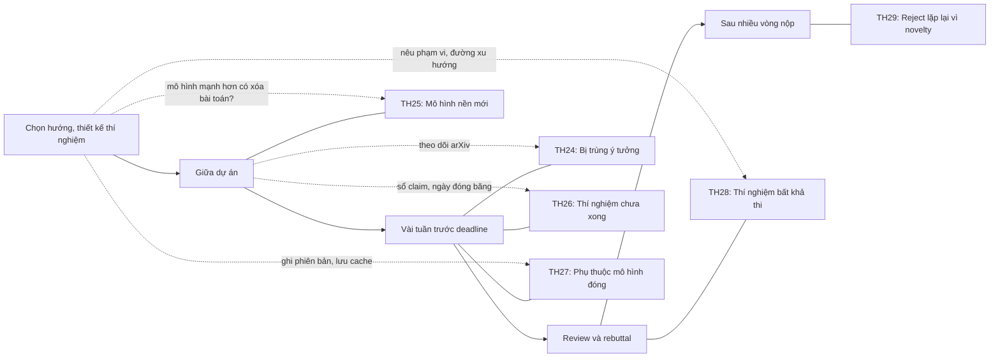

# Áp lực từ bên ngoài

!!! abstract "Mục tiêu của bài"
    Sau bài này, người học có thể:

    - Đánh giá mức độ trùng lặp khi bị một nhóm khác công bố trước, xác định phần đóng góp còn cứu được, và viết lại Introduction cùng Related Work cho phù hợp.
    - Kiểm tra xem bài toán có còn tồn tại khi một mô hình nền mới xuất hiện, và chọn giữa định vị lại, chuyển hướng hoặc dừng.
    - Cắt claim cho vừa với bằng chứng khi deadline cận kề, và quyết định nộp ngay hay chờ đợt sau.
    - Tổ chức thí nghiệm dùng API hoặc mô hình đóng sao cho kết quả vẫn kiểm chứng được.
    - Trả lời yêu cầu thí nghiệm bất khả thi, và chẩn đoán đúng lời phê "thiếu novelty" lặp lại.

Bốn bài trước của chương xem xét những mâu thuẫn *bên trong* một dự án, nơi nhóm tác giả nắm mọi dữ kiện và cái khó nằm ở cách đọc và trình bày chúng. Bài này chuyển sang áp lực từ những thứ nằm ngoài tầm kiểm soát: một nhóm khác công bố đúng ý tưởng đang làm, một mô hình nền mới giải được bài toán của nhóm, lịch hội nghị không lùi lại vì thí nghiệm chạy chậm, nhà cung cấp API thay đổi mô hình không báo trước, reviewer đòi thí nghiệm vượt quá khả năng, và lời phê "thiếu novelty" quay lại sau mỗi lần nộp.

Nguồn gốc áp lực nằm ngoài tầm tay, còn cách phản ứng thì không. Vì không kiểm soát được nguồn gốc, người viết dễ bù đắp bằng những gì kiểm soát được, và sai lầm xuất hiện ở đó: lờ đi công trình của nhóm kia, so sánh với một phiên bản bị làm yếu của mô hình mới, điền số của một run chưa xong. Nguyên tắc xuyên suốt của chương vẫn áp dụng: paper bán hiểu biết chứ không bán phương pháp, nên khi yếu tố bên ngoài lấy đi phần "phương pháp mới" hay "con số tốt nhất", câu hỏi đúng là hiểu biết nào còn đứng được và cần bằng chứng gì để bảo vệ nó. Các tình huống được sắp theo trình tự thời gian của dự án.

## Tình huống 24: Bị trùng ý tưởng khi còn vài tuần đến deadline

### Nhận diện

Một nhóm Computer Vision đã làm tám tháng về test-time adaptation cho phân đoạn ngữ nghĩa trên video lái xe (ví dụ giả định): dùng sự nhất quán theo thời gian giữa các frame làm tín hiệu tự giám sát, và chỉ cập nhật một tập nhỏ tham số. Còn năm tuần đến deadline thì một preprint xuất hiện trên arXiv với tiêu đề gần như trùng, mô tả đúng cơ chế đó trên hai trong ba benchmark của nhóm.

Hiện tượng này thường được gọi là bị *scooped*. Mục *Concurrent work* trong bài [Tìm và thẩm định ý tưởng](../01-truoc-khi-viet/y-tuong.md) đã nêu khung ba bước; ở đây chúng ta đi sâu vào mức độ trùng, phần còn cứu được, cách viết lại, và hai biến thể: reviewer dẫn một paper ra đời sau deadline, và việc đưa bản thảo lên arXiv sớm.

### Chẩn đoán

Bị trùng hiếm khi chỉ là xui rủi: khi một công cụ mới xuất hiện, bước đi hợp lý tiếp theo thường hiện ra cùng lúc trước mắt nhiều nhóm. Phản ứng đầu tiên nên là đo đạc, không phải hoảng loạn.

Việc đo đạc bắt đầu bằng đọc toàn văn paper kia và so sánh theo năm chiều: bài toán và giả định, cơ chế cốt lõi, thiết lập thí nghiệm, kết quả, và hiểu biết đi kèm. **Trùng một phần** là khi hai công trình chung bài toán nhưng khác cơ chế, hoặc chung cơ chế nhưng ở thiết lập khác hẳn. **Trùng gần hết** là khi cơ chế và bài toán giống nhau, khác biệt nằm ở chi tiết thiết kế, quy mô, phạm vi đánh giá hay chiều sâu phân tích; ví dụ trên thuộc nhóm này nếu cách chọn tập tham số được cập nhật quyết định độ bền trên chuỗi dài. **Trùng hoàn toàn** là khi cơ chế, thiết lập và kết quả đều tương đương.

Để biết phần nào còn cứu được, câu hỏi then chốt là: người đã đọc paper kia sẽ học thêm được gì từ paper của nhóm? Câu trả lời chính là phần novelty còn lại: một thiết lập nơi hai cách tiếp cận cho kết quả khác nhau, một phân tích vì sao cơ chế hoạt động, một phát hiện trái chiều, hay một lợi thế rõ rệt về chi phí. Cũng cần biết công trình kia công khai khi nào và đã qua bình duyệt chưa, vì quy định về concurrent work dựa trên các yếu tố này và khác nhau giữa hội nghị, theo năm.

!!! note "Hai nhóm độc lập cùng đi tới một ý tưởng"
    Lịch sử khoa học có nhiều phát hiện độc lập gần như đồng thời, như Newton và Leibniz với phép tính vi tích phân, hay Darwin và Wallace với thuyết chọn lọc tự nhiên. Một nhóm khác đi tới cùng ý tưởng là dấu hiệu hướng đi đúng và kịp thời, và khả năng chọn hướng của nhóm đã được hiệu chỉnh tốt. Cảm giác mất mát là có thật, nhưng không nên để nó che khuất thông tin tích cực này.

### Các lối ra

**Lối ra thứ nhất: giữ hướng và làm rõ khác biệt.** Phù hợp khi trùng một phần và khác biệt thể hiện trong kết quả. Bằng chứng lý tưởng là một thí nghiệm cho thấy khác biệt có ý nghĩa ở đâu; nếu không kịp chạy lại phương pháp của họ, tối thiểu cần một so sánh khái niệm công bằng và nói rõ là chưa có so sánh thực nghiệm. Không phù hợp khi khác biệt chỉ là tên gọi hay chi tiết cài đặt.

**Lối ra thứ hai: dịch trọng tâm sang phần chỉ nhóm mới có.** Khi trùng gần hết, đóng góp chính chuyển sang phân tích, thiết lập rộng hơn, phát hiện về khi nào phương pháp thất bại, hoặc xác nhận độc lập ở quy mô lớn hơn; giọng paper đổi từ "we propose" sang "we study" hay "we show". Nếu phần còn lại tự nó đủ sức ở hội nghị mục tiêu, main track vẫn hợp lý; nếu mỏng hơn, Findings, workshop hay TMLR thường phù hợp hơn.

**Lối ra thứ ba: nộp như công trình đồng thời.** Khi paper kia xuất hiện rất sát deadline và hai công trình thực chất song song, nhóm có thể đẩy nhanh tiến độ và nộp kèm phần thảo luận rõ ràng, đồng thời chuẩn bị sẵn lập luận cho rebuttal, vì quy định không đòi so sánh thực nghiệm không ngăn được reviewer phê thiếu novelty.

**Lối ra thứ tư: dừng, thu hoạch và đổi hướng.** Khi trùng hoàn toàn, nhất là khi công trình kia đã qua bình duyệt, tiếp tục là đặt cược vào việc reviewer không biết paper đó. Code và hạ tầng vẫn còn, và paper kia, bằng cách xác nhận hướng đi, mở ra những câu hỏi tiếp nối mà nhóm có lợi thế xuất phát. Chi phí đã bỏ ra không phải là lý do để tiếp tục.

Đi kèm mọi lối ra là câu hỏi có nên đưa bản thảo lên arXiv sớm. Lợi ích là một mốc thời gian công khai cho thấy công trình độc lập, sự hiện diện sớm hơn chu kỳ review, và phản hồi từ cộng đồng. Bất lợi là chính sách về preprint khác nhau giữa các hội nghị và đã thay đổi qua các năm (xem bài [Chuẩn bị nộp bài](../04-nop-va-sau-nop/submission.md)), một preprint viết vội tồn tại vĩnh viễn, và ý tưởng bị phơi ra trước những nhóm nhiều tài nguyên hơn. Reviewer chấm nội dung chứ không chấm ngày đăng, nên chỉ nên đưa lên phiên bản mà nhóm sẵn sàng để cộng đồng trích dẫn.

### Viết thế nào

Một công trình rất gần cần xuất hiện ngay trong Introduction, vì reviewer biết paper kia sẽ tìm nó trước tiên và dễ cho rằng nhóm né tránh nếu tới cuối Related Work mới thấy. Mọi claim kiểu "the first" được thay bằng khác biệt cụ thể có bằng chứng.

<div class="bad" markdown>
*"We are the first to exploit temporal consistency as a test-time adaptation signal for semantic segmentation."*

Claim "the first" giờ đã sai hoặc gây tranh cãi; reviewer biết paper kia sẽ mất lòng tin vào phần còn lại.
</div>

<div class="good" markdown>
*"Concurrently with our work, X et al. [12] also use temporal consistency as a test-time signal. While they update all normalization layers at every frame, we find that this causes drift on long sequences, and that restricting adaptation to a small set of parameters selected by a stability criterion avoids it (Sec. 5.2)."*

Thừa nhận sự trùng lặp ngay từ đầu, mô tả công trình kia khách quan, và chuyển trọng tâm sang hiểu biết riêng có bằng chứng.
</div>

Khi reviewer dẫn một paper xuất hiện *sau* deadline như bằng chứng thiếu novelty, trước hết cần kiểm tra ngày công khai đầu tiên của nó. Nếu đúng là sau deadline, câu trả lời nêu sự thật này và dẫn quy định nếu có, nhưng vẫn thảo luận nội dung, vì AC muốn thấy nhóm hiểu quan hệ giữa hai công trình; cấu trúc chung của rebuttal có ở bài [Rebuttal và thảo luận](../04-nop-va-sau-nop/rebuttal.md).

<div class="good" markdown>
*"We thank the reviewer for pointing us to [A]. [A] first appeared on arXiv on <date>, after the submission deadline; per the guidelines on contemporaneous work, we understand that a full experimental comparison is not expected. We will nevertheless cite [A] and discuss the differences: [A] ..., whereas we ...."*

Dựa vào sự thật kiểm chứng được và quy định, không dựa vào cảm xúc, và vẫn chủ động thảo luận nội dung.
</div>

Khác biệt giữa các cộng đồng nằm ở cơ chế: ở ICLR, thảo luận công khai cho phép người ngoài chỉ ra công trình gần, nên phần concurrent work phải chặt chẽ từ bản nộp; với ARR, revision notes phải nói rõ paper đã điều chỉnh thế nào nếu bị trùng giữa hai chu kỳ; ở Computer Vision, rebuttal một trang chỉ đủ chỗ cho một hai khác biệt mạnh nhất.

### Điều không được làm

Không được lờ đi một công trình đã biết, mô tả méo mó phương pháp của họ, tự nhận "the first", hay khẳng định một mốc thời gian không chứng minh được; không nên vội đưa lên arXiv một bản dang dở chỉ để "cắm cờ". Nếu một thành viên được phân công review chính paper của nhóm kia, phải khai báo xung đột lợi ích. Xem bài [Ranh giới trung thực](ranh-gioi-trung-thuc.md).

## Tình huống 25: Mô hình nền mới khiến bài toán trở nên lỗi thời

### Nhận diện

Một nhóm NLP làm gần một năm về hỏi đáp trên văn bản dài (ví dụ giả định): truy xuất các đoạn liên quan rồi tổng hợp câu trả lời bằng một mô hình cỡ vừa, vượt ổn định các baseline đã công bố. Bốn tháng trước deadline, một mô hình nền mới ra đời với cửa sổ ngữ cảnh dài hơn hẳn và khả năng suy luận mạnh, và vượt phương pháp của nhóm mà không cần huấn luyện thêm. Computer Vision từng trải qua điều tương tự khi các mô hình phân đoạn điều khiển bằng prompt như Segment Anything xuất hiện (xem case study [Segment Anything và ControlNet](../05-case-studies/sam-controlnet.md)). Dấu hiệu chung là mọi người xung quanh bắt đầu hỏi "sao không dùng luôn mô hình X?", đúng câu reviewer sẽ hỏi.

### Chẩn đoán

Đây là hiện tượng có tính cấu trúc của ngành: mô hình tổng quát huấn luyện ở quy mô lớn định kỳ "hấp thụ" những bài toán từng cần giải pháp riêng. ViT cho thấy khi dữ liệu pre-training đủ lớn, inductive bias của convolution kém cần thiết; GPT-3 cho thấy in-context learning xuất hiện khi scale. Tuy vậy, giải được benchmark không đồng nghĩa với giải được bài toán.

Câu hỏi đầu tiên là **vấn đề có còn tồn tại không**: mô hình mới làm gì trên các tập con khó, trên ngôn ngữ ít tài nguyên hay miền chuyên biệt, dưới ràng buộc về chi phí, độ trễ, quyền riêng tư, và benchmark có thể đã lọt vào dữ liệu huấn luyện của nó không. Câu hỏi thứ hai là **mô hình mới đã được đánh giá đúng cách chưa**: cùng giao thức, vài cách viết prompt, kèm chi phí mỗi truy vấn; nếu là mô hình đóng, Tình huống 27 cũng áp dụng. Câu hỏi thứ ba là **cơ chế của nhóm có còn tạo ra giá trị khi đặt lên trên mô hình mới không**.

### Các lối ra

**Lối ra thứ nhất: định vị như phần bổ trợ cho mô hình mới.** Phù hợp khi cơ chế trực giao với sức mạnh của mô hình nền, chẳng hạn bước truy xuất giúp xử lý tài liệu vượt ngữ cảnh hoặc giảm số token. Bằng chứng bắt buộc là thí nghiệm với chính mô hình mới làm nền; claim "complementary" thiếu thí nghiệm này sẽ bị bác ngay. Không phù hợp khi cải thiện biến mất trên nền mạnh.

**Lối ra thứ hai: chuyển sang phân tích.** Benchmark và công cụ chẩn đoán mà nhóm đã xây có thể dùng để nghiên cứu mô hình mới thành công ở đâu, thất bại ở đâu và vì sao. Đóng góp khi đó là hiểu biết, với điều kiện phân tích có hệ thống và biến được kiểm soát, không phải một tập ví dụ thất bại chọn lọc. Findings hay TMLR phù hợp khi phạm vi khiêm tốn.

**Lối ra thứ ba: chuyển sang hiệu quả cho mô hình nhỏ.** Khi mô hình mới thắng nhưng đắt, đóng hoặc không triển khai được, một phương pháp giúp mô hình nhỏ và mở tiến gần tới nó trong ngân sách cố định có giá trị riêng; "Cramming" của Geiping và Goldstein (ICML 2023) là ví dụ về việc biến ràng buộc tài nguyên thành chính câu hỏi nghiên cứu. Bằng chứng cần là một so sánh trung thực trên đường cong chất lượng theo chi phí, nêu rõ khoảng cách còn lại.

**Lối ra thứ tư: đổi hướng.** Nếu mô hình mới giải được bài toán ở mọi chế độ quan trọng với chi phí chấp nhận được, câu hỏi của dự án đã được trả lời, dù bởi người khác. Benchmark vẫn có thể thành đóng góp riêng nếu nó còn phân biệt được các mô hình mạnh (ví dụ ở Datasets and Benchmarks Track của NeurIPS).

### Viết thế nào

Mô hình mới phải được đối diện trực tiếp ngay trong Introduction, vì reviewer đọc paper trong bối cảnh của thời điểm review, và câu hỏi "why not just use X?" không được trả lời thường đủ để dẫn tới reject.

<div class="bad" markdown>
*"Our method outperforms all prior approaches on LongQA by a large margin."*

Bỏ qua mô hình nền mà mọi reviewer đều biết; "all prior approaches" trở thành claim sai trên thực tế.
</div>

<div class="good" markdown>
*"Recent general-purpose models such as [X] solve most LongQA questions zero-shot, but their accuracy drops sharply on documents longer than their effective context (Sec. 4.1). Applied on top of [X], our retrieval step recovers most of this loss while reducing the number of processed tokens (Tab. 3)."*

Thừa nhận sức mạnh của mô hình mới, chỉ đúng chế độ mà vấn đề còn tồn tại, và đặt phương pháp vào vai trò bổ trợ có bằng chứng.
</div>

Ở NLP, baseline là một mô hình ngôn ngữ lớn được prompt tốt gần như đã là mặc định, và reviewer ARR thường đòi baseline đó hoặc lý do vì sao không có. Ở Computer Vision, khung "chuyên biệt và hiệu quả" thường được chấp nhận nếu lợi thế được định lượng. Ở Machine Learning, câu hỏi thường là hiểu biết có còn đúng khi mô hình lớn hơn, nên thí nghiệm theo nhiều kích thước có sức thuyết phục lớn.

### Điều không được làm

Không được bỏ mô hình mới khỏi phần so sánh khi nó đã có và liên quan trực tiếp, làm yếu nó bằng prompt kém, hay tuyên bố "bổ trợ" khi chưa có thí nghiệm. Không được chọn các chế độ mà mô hình mới thất bại *sau khi* thấy kết quả rồi trình bày như động cơ ban đầu; đó là một dạng HARKing (Kerr, 1998). Tìm chế độ mà vấn đề còn tồn tại chỉ hợp lệ khi chế độ đó quan trọng với người dùng thực và paper nói rõ nó được xác định thế nào; xem bài [Ranh giới trung thực](ranh-gioi-trung-thuc.md).

## Tình huống 26: Deadline cận kề mà thí nghiệm chưa xong

### Nhận diện

Một nhóm Machine Learning đề xuất cách điều chỉnh learning rate theo từng lớp cho huấn luyện Transformer (ví dụ giả định). Còn mười hai ngày. Hai benchmark nhỏ đã đủ ba seed; benchmark lớn nhất mới có một seed; thí nghiệm với mô hình lớn hơn, vốn được hứa trong abstract nháp, chưa bắt đầu; ablation xong một nửa; baseline mạnh nhất đang dùng con số từ paper gốc với cấu hình khác. Dấu hiệu quen thuộc là bảng còn ô trống, bản nháp còn "TODO", và nhóm tranh luận mỗi ngày nên chạy thêm hay ngồi viết.

### Chẩn đoán

Nguyên nhân thường là ước lượng thời gian chạy bỏ sót hàng đợi GPU và lỗi phải chạy lại, abstract viết từ kỳ vọng thay vì từ kết quả, và áp lực tốc độ của cả ngành mà Sculley và cộng sự phân tích trong "Winner's Curse? On Pace, Progress, and Empirical Rigor".

Bước chẩn đoán cốt lõi là liệt kê mọi claim trong abstract, Introduction và danh sách đóng góp, phân loại theo mức bằng chứng hiện có (bảng dưới), và đánh dấu claim nào là trung tâm, tức paper sụp đổ nếu nó sai. Cần thận trọng với bằng chứng ít seed trong thiết lập có phương sai lớn: Henderson và cộng sự, trong "Deep Reinforcement Learning that Matters", cho thấy kết quả deep RL thay đổi đáng kể chỉ vì seed hay chi tiết cài đặt. Với mỗi thí nghiệm còn thiếu, câu hỏi then chốt là: nếu kết quả ra theo chiều ngược lại, claim nào phải thay đổi?

| Mức bằng chứng | Ví dụ | Cách xử lý trong bản nộp |
|---|---|---|
| A: đầy đủ | Đủ seed, đủ dataset, baseline cùng điều kiện | Giữ nguyên claim |
| B: một phần | Ít seed hơn dự định; tập con của benchmark | Giữ claim, nêu rõ phạm vi và độ bất định |
| C: tín hiệu | Một run hoặc một pilot đã hoàn tất | Chuyển thành quan sát sơ bộ, hoặc bỏ |
| D: chưa có | Thí nghiệm chưa chạy | Bỏ khỏi abstract, Introduction và danh sách đóng góp |

### Các lối ra

**Lối ra thứ nhất: cắt claim cho vừa với bằng chứng.** Bước này luôn cần làm, bất kể quyết định cuối cùng. Cắt claim thường làm paper mạnh lên: mỗi claim là một mặt trận phải bảo vệ, và ba claim vững khó bị tấn công hơn năm claim trong đó hai claim treo lơ lửng. Trong ví dụ trên, "scales to larger models" được thay bằng một câu nêu phạm vi kích thước đã kiểm chứng.

**Lối ra thứ hai: ưu tiên thí nghiệm theo giá trị thông tin trên thời gian chạy.** Mỗi thí nghiệm được đánh giá theo mức nó có thể làm thay đổi claim trung tâm, chia cho thời gian chạy kể cả dự phòng. Thứ tự hợp lý thường là thí nghiệm có thể làm sụp claim trung tâm, rồi thí nghiệm reviewer chắc chắn hỏi, rồi ablation thành phần chính, cuối cùng là dataset bổ sung. Nên đặt một ngày "đóng băng thí nghiệm" vài ngày trước deadline, và quyết định *trước khi* xem kết quả rằng run nào sẽ được báo cáo; Gelman và Loken gọi những lựa chọn phân tích không khai báo là "garden of forking paths", và chúng làm sai lệch kết luận ngay cả khi không ai cố ý.

**Lối ra thứ ba: quyết định nộp bây giờ hay chờ đợt sau.** Tiêu chí đầu tiên là paper sau khi cắt có còn hoàn chỉnh không, tức người đọc vẫn học được điều mới có bằng chứng vững. Tiêu chí thứ hai là phần thiếu có phải thứ reviewer chắc chắn đòi, như baseline quan trọng nhất. Tiêu chí thứ ba là chi phí của một lần nộp non: công sức reviewer, khả năng gặp lại reviewer cũ, và dấu vết công khai như trang OpenReview của paper bị reject ở ICLR hay review cũ đi kèm khi nộp lại vào ARR. Tiêu chí thứ tư là venue tiếp theo cách bao xa (xem bài [Khi bị reject](../04-nop-va-sau-nop/reject.md)); ARR có nhiều chu kỳ trong năm nên chi phí chờ thường thấp hơn. Rủi ro bị trùng nếu chờ là có thật, nhưng một bản nộp non không bảo vệ được quyền ưu tiên.

Ở một số hội nghị, tài liệu bổ sung có deadline riêng, muộn hơn paper chính; ở nơi khác, appendix nằm cùng file PDF và chung deadline. Khoảng thời gian muộn hơn dành cho video, hình minh họa và phân tích bổ trợ, không dành cho thí nghiệm mà paper chính phụ thuộc vào, vì reviewer không có nghĩa vụ đọc tài liệu bổ sung.

!!! warning "Đọc kỹ Call for Papers về từng mốc"
    Abstract registration, full paper, supplementary material và các checklist có thể có mốc khác nhau, thậm chí khác múi giờ, và quy định về nội dung của tài liệu bổ sung thay đổi theo hội nghị và theo năm. Đặt vào đó một phiên bản "đã sửa" của paper chính có thể bị coi là vi phạm deadline. Xem bài [Chuẩn bị nộp bài](../04-nop-va-sau-nop/submission.md).

### Viết thế nào

Nguyên tắc là nêu chính xác những gì đã làm, với phạm vi đã kiểm chứng, và không hứa những gì chưa có. Một câu nêu phạm vi đặt đúng chỗ thường được reviewer đọc là dấu hiệu của sự cẩn thận.

<div class="bad" markdown>
*"Results on the largest benchmark will be added in the final version."*

Reviewer chỉ chấm những gì có trong bản nộp; câu này vừa thừa nhận paper chưa xong, vừa đưa ra lời hứa không kiểm chứng được.
</div>

<div class="good" markdown>
*"Due to compute constraints, results on the largest benchmark are averaged over two seeds (five for all other benchmarks); standard deviations are reported in Tab. 2. We evaluate models up to <size> parameters; whether the effect persists at larger scales remains open (Sec. 6)."*

Nói rõ số seed, nơi báo độ lệch chuẩn và giới hạn kích thước, nên reviewer biết chính xác mức tin cậy của từng kết quả.
</div>

Ở Machine Learning, NeurIPS Paper Checklist hỏi trực tiếp về ý nghĩa thống kê và tài nguyên tính toán, và "No" kèm lý giải trung thực tốt hơn "Yes" không có cơ sở (xem bài [Viết cho NeurIPS / ICML / ICLR](../06-cong-dong/ml.md)). Ở NLP, mục Limitations bắt buộc của ARR là nơi nêu việc giảm số seed hay giới hạn quy mô. Ở Computer Vision, nơi tài liệu bổ sung thường có deadline riêng, paper chính không được tham chiếu tới kết quả chưa tồn tại lúc nộp.

### Điều không được làm

Không được bịa số, kể cả dưới dạng "số tạm sẽ cập nhật sau". Không được báo cáo một run chưa chạy xong như kết quả cuối cùng, hay chọn một checkpoint giữa chừng vì nó trông đẹp. Không được viết "results will be added", để sót ô giữ chỗ như "xx.x", hay báo cáo seed tốt nhất như kết quả điển hình. Xem bài [Ranh giới trung thực](ranh-gioi-trung-thuc.md).

## Tình huống 27: Kết quả phụ thuộc vào API hoặc mô hình đóng

### Nhận diện

Một nhóm làm phát hiện vật thể với từ vựng mở (open-vocabulary detection) dùng một mô hình đa phương thức đóng qua API để sinh mô tả cho từng vùng ảnh, và một mô hình đóng khác làm giám khảo chấm chất lượng mô tả (ví dụ giả định). Ba tháng sau, khi chạy lại để thêm một ablation, các con số lệch khỏi bản nháp dù code không đổi: nhà cung cấp đã cập nhật mô hình phía sau cùng một tên gọi. Dấu hiệu gồm cấu hình chỉ ghi tên mô hình chung chung, không có log từng lần gọi, và không ai biết tổng chi phí. Mô hình đóng có thể là baseline, thành phần của phương pháp, giám khảo, hay nguồn sinh dữ liệu; ba vai trò sau rủi ro hơn hẳn, vì khi đó chính kết quả của paper phụ thuộc vào một hệ thống chỉ nhà cung cấp kiểm soát.

### Chẩn đoán

Kết quả dựa trên mô hình đóng khó tái lập vì mô hình có thể được cập nhật phía sau cùng tên gọi, phiên bản cũ có thể bị ngừng, đầu ra thường không được bảo đảm tất định, và dữ liệu huấn luyện không công bố nên không loại trừ được việc benchmark đã lọt vào. Chen, Zaharia và Zou, trong "How is ChatGPT's behavior changing over time?" (2023, sau đăng ở Harvard Data Science Review), so sánh các phiên bản tháng 3 và tháng 6 năm 2023 của GPT-3.5 và GPT-4 trên nhiều loại tác vụ, và thấy hành vi của "cùng một" dịch vụ thay đổi đáng kể chỉ trong vài tháng, có tác vụ tốt lên, có tác vụ kém đi. Nhóm tác giả đó công bố toàn bộ prompt và câu trả lời ở cả hai thời điểm, một cách làm đáng học theo.

Các câu hỏi chẩn đoán là: mô hình đóng đóng vai trò nào; claim trung tâm có còn đứng nếu mô hình thay đổi; phiên bản và đầu ra thô đã được lưu chưa; một mô hình mở có đảm nhận được cùng vai trò không; và điều khoản sử dụng có cho phép công bố đầu ra không.

### Các lối ra

**Lối ra thứ nhất: ghi phiên bản và ngày gọi.** Cần ghi định danh đầy đủ của mô hình, kể cả phiên bản có ngày nếu nhà cung cấp hỗ trợ và tên phiên bản thực tế mà API trả về, khoảng ngày thực hiện các lần gọi, mọi tham số sinh, system prompt và template. Việc này mất vài phút nếu làm từ đầu, nhưng thường không thể khôi phục nếu làm muộn.

**Lối ra thứ hai: lưu cache đầu ra.** Mọi cặp yêu cầu và phản hồi được lưu với khóa là giá trị băm của mô hình, prompt và tham số, để chạy lại phân tích mà không gọi API, trả lời reviewer từ dữ liệu đã có, và công bố đầu ra (trong phạm vi điều khoản cho phép) để người khác tái lập các bước phía sau ngay cả khi mô hình gốc đã ngừng. Khi cần nhiều mẫu cho cùng một prompt, chỉ số mẫu được thêm vào tham số.

```python
import hashlib, json, time
from pathlib import Path

CACHE = Path("cache/api_calls.jsonl")
_index = {}
if CACHE.exists():
    _index = {r["key"]: r for r in map(json.loads, CACHE.open(encoding="utf-8"))}


def cached_call(call_fn, model_id, prompt, **params):
    """call_fn wraps the provider client and returns (text, served_model, usage)."""
    payload = {"model_id": model_id, "prompt": prompt, "params": params}
    key = hashlib.sha256(json.dumps(payload, sort_keys=True).encode()).hexdigest()
    if key not in _index:
        text, served_model, usage = call_fn(model=model_id, prompt=prompt, **params)
        _index[key] = {"key": key, **payload, "served_model": served_model,
                       "output": text, "usage": usage,
                       "called_at_utc": time.strftime("%Y-%m-%dT%H:%M:%SZ", time.gmtime())}
        CACHE.parent.mkdir(parents=True, exist_ok=True)
        with CACHE.open("a", encoding="utf-8") as f:
            f.write(json.dumps(_index[key], ensure_ascii=False) + "\n")
    return _index[key]["output"]
```

**Lối ra thứ ba: thêm một mô hình mở để đối chiếu.** Khi mô hình đóng là thành phần, giám khảo hay nguồn dữ liệu, cùng pipeline nên được chạy với ít nhất một mô hình có trọng số mở và báo cáo cả hai, để cho thấy phát hiện không phải đặc thù của một nhà cung cấp và cho người đọc một đường tái lập. Nếu mô hình mở kém hơn nhiều, đó cũng là thông tin. Với vai trò giám khảo, cần thêm kiểm định trên một tập con có đánh giá của con người.

**Lối ra thứ tư: báo cáo chi phí.** Số lần gọi, số token, tổng chi phí tại thời điểm thí nghiệm (kèm ngày, vì giá thay đổi) giúp reviewer đánh giá cả khả năng tái lập lẫn tính thực tiễn của phương pháp.

Các biện pháp trên chính là câu trả lời cho các checklist về khả năng tái lập (reproducibility): NeurIPS Paper Checklist hỏi về tái hiện kết quả, công bố dữ liệu và code, tài nguyên tính toán; Responsible NLP Checklist của ARR hỏi về ngân sách tính toán và thiết lập thí nghiệm; Limitations là nơi nêu sự phụ thuộc vào mô hình đóng. Xem bài [Chuẩn bị nộp bài](../04-nop-va-sau-nop/submission.md) và [Viết cho ACL / EMNLP / NAACL](../06-cong-dong/nlp.md).

### Viết thế nào

Đoạn mô tả thiết lập thí nghiệm phải đủ để người đọc vài năm sau vẫn hiểu chính xác kết quả được tạo ra thế nào.

<div class="bad" markdown>
*"We use GPT-4 to generate region descriptions and to evaluate caption quality."*

Không có phiên bản, ngày gọi, tham số hay chi phí; vài năm sau câu này gần như vô nghĩa.
</div>

<div class="good" markdown>
*"Region descriptions were generated with `<provider-model-version>` (temperature 0; prompts in Appendix B) between <start date> and <end date>. Because API models may change [Chen et al., 2023], we release all cached responses where the provider's terms allow, and report results with the open-weight model `<open-model>` (Tab. 4): the ranking of methods is unchanged, although the margin is smaller. All API experiments cost approximately <amount> at the time."*

Ghi đủ phiên bản, thời gian, tham số và chi phí, đối chiếu với mô hình mở, và nói thẳng điều gì giữ nguyên, điều gì thay đổi.
</div>

Ở NLP, reviewer ARR thường yêu cầu kết quả trên mô hình mở hoặc ít nhất một thảo luận trong Limitations. Ở Machine Learning, câu hỏi xoay quanh việc claim có kiểm chứng được độc lập không. Ở Computer Vision, khi mô hình đóng sinh nhãn hay làm giám khảo, reviewer thường hỏi giám khảo đã được kiểm định so với con người chưa.

### Điều không được làm

Không được giấu hoặc mô tả mơ hồ việc dùng mô hình đóng, trộn đầu ra từ các phiên bản khác nhau trong một bảng mà không nói rõ, hay gọi API nhiều lần rồi chỉ giữ lần cho kết quả đẹp nhất. Không được công bố đầu ra trái điều khoản sử dụng, và không được trả lời "Yes" về tái lập trong checklist khi phần cốt lõi của kết quả không tái lập được. Xem bài [Ranh giới trung thực](ranh-gioi-trung-thuc.md).

## Tình huống 28: Reviewer đòi thí nghiệm không thể làm

### Nhận diện

Một paper Machine Learning nghiên cứu cách chọn lọc dữ liệu pre-training cho mô hình ngôn ngữ, với ba kích thước mô hình cỡ nhỏ và vừa (ví dụ giả định). Các reviewer lần lượt đòi đánh giá trên một bộ dữ liệu nội bộ chưa công bố của một paper khác, kiểm chứng ở quy mô lớn hơn hàng chục lần, và so sánh với hỗn hợp dữ liệu chưa từng công bố của một mô hình thương mại. Đó là ba dạng bất khả thi thường gặp: dữ liệu không công khai, chi phí quá lớn, hệ thống đóng. Yêu cầu hợp lý về mặt khoa học nhưng không thể thực hiện, và phản xạ đầu tiên của người viết là gạt đi hoặc hứa bừa.

### Chẩn đoán

Một yêu cầu thí nghiệm hầu như luôn đại diện cho một nghi ngờ: "chạy ở quy mô lớn hơn" nghĩa là "kết quả có còn đúng khi scale?", "so sánh với hệ thống thương mại" nghĩa là "phương pháp đứng ở đâu so với thực tiễn tốt nhất?". Câu hỏi chẩn đoán quan trọng nhất vì vậy là có thí nghiệm khả thi nào kiểm tra cùng nghi ngờ đó không. Câu hỏi thứ hai là chính paper có mời gọi yêu cầu đó không: nếu abstract viết "scalable" mà thí nghiệm dừng ở mô hình nhỏ, lời giải nằm ở việc thu hẹp claim.

### Các lối ra

**Lối ra thứ nhất: giải thích ràng buộc một cách cụ thể.** Một câu chung chung như "we lack the resources" nghe như lời biện hộ; một ràng buộc cụ thể nghe như dữ kiện: ước lượng chi phí so với toàn bộ thí nghiệm trong paper, việc hệ thống kia không công bố trọng số hay dữ liệu, hay việc bộ dữ liệu được phân phối theo thỏa thuận mà nhóm không thể có. Lối ra này hiếm khi đủ nếu thiếu lối ra thứ hai hoặc thứ ba.

**Lối ra thứ hai: đề xuất và chạy thí nghiệm thay thế kiểm tra cùng nghi ngờ.** Với scale, một đường xu hướng qua nhiều kích thước khả thi là bằng chứng có giá trị, dù không chứng minh cho quy mô chưa thử. Với hệ thống đóng, so sánh với hệ thống mở mạnh nhất cùng loại, hoặc với con số đã công bố trong cùng giao thức. Với dữ liệu không công khai, dùng một bộ dữ liệu công khai có cùng tính chất cần kiểm tra. Thí nghiệm thay thế phải nhắm đúng nghi ngờ, không phải một thí nghiệm dễ hơn nhưng trả lời câu hỏi khác.

**Lối ra thứ ba: đưa bằng chứng một phần.** Một phiên bản thu nhỏ của chính thí nghiệm được yêu cầu, như một seed ở kích thước lớn hơn với lịch huấn luyện ngắn, được trình bày với nhãn rõ ràng về phạm vi, thường đủ để AC kết luận mối lo đã được xử lý trong khả năng hợp lý.

**Lối ra thứ tư: thu hẹp claim và cam kết nêu rõ phạm vi.** Khi không có cách kiểm tra nào, câu trả lời trung thực là cam kết sửa abstract, Introduction và Limitations để nêu đúng phạm vi đã kiểm chứng. AC thường đánh giá cao điều này hơn một lời hứa không kiểm chứng được.

Phòng ngừa luôn rẻ hơn chữa. Một paper nêu rõ phạm vi từ đầu, trong Introduction, phần thiết lập thí nghiệm và Limitations, ít bị đòi hỏi ngoài tầm hơn, và khi bị đòi hỏi thì rebuttal chỉ thẳng tới đoạn đã viết; một đường xu hướng theo kích thước mô hình ngay trong bản nộp thường trả lời trước câu hỏi về scale. Các chiến lược khi tài nguyên hạn chế có ở bài [Experiments](../02-viet-tung-phan/experiments.md).

### Viết thế nào

Cấu trúc chung của rebuttal đã có ở bài [Rebuttal và thảo luận](../04-nop-va-sau-nop/rebuttal.md). Ở đây chỉ bàn đoạn trả lời cho một yêu cầu bất khả thi, gồm ba nhịp: đồng ý với mục đích, nêu ràng buộc cụ thể, đưa bằng chứng thay thế và cam kết phạm vi.

<div class="bad" markdown>
*"We do not have the resources to run experiments at this scale. We will add them in the camera-ready version."*

Câu đầu nghe như lời biện hộ và không chạm tới nghi ngờ thật; câu sau là lời hứa mà AC biết gần như chắc chắn không thực hiện được.
</div>

<div class="good" markdown>
*"We agree that validating at larger scale is important. Training a model of the suggested size would require roughly <N> times the compute of all experiments in the paper combined, which is beyond our means. To address whether the gains persist with scale, we added a fourth model size (Tab. R1): the improvement over random selection is stable across all four sizes. We will state in Sec. 1 and the Limitations that our conclusions are established up to <size>."*

Thừa nhận giá trị của yêu cầu, định lượng ràng buộc, trả lời đúng nghi ngờ bằng một thí nghiệm khả thi, và chỉ cam kết những gì làm được.
</div>

Với hệ thống đóng, cấu trúc tương tự: *"The data mixture of [System] has not been publicly disclosed, so a direct comparison is not possible; as the closest available reference, we compare with the documented mixture of [open model] under the same budget (Tab. R2)."* Rebuttal một trang ở Computer Vision buộc những đoạn như vậy phải rất gọn; thảo luận nhiều vòng trên OpenReview ở Machine Learning cho phép đăng bằng chứng một phần ngay khi có; ở ARR, cam kết về phạm vi phải xuất hiện trong revision notes nếu nộp lại.

### Điều không được làm

Không được giả lập thí nghiệm được yêu cầu, hay trình bày một thí nghiệm khác như thể đó là thí nghiệm reviewer đòi. Không được hứa những gì không làm được trong camera-ready, hay ngụ ý reviewer thiếu hiểu biết. Kênh bình luận bảo mật gửi AC dành cho review vi phạm chuẩn mực nghiêm trọng, không dành cho một yêu cầu hợp lý nhưng vượt khả năng của nhóm.

## Tình huống 29: Bị reject nhiều lần với cùng lời phê "thiếu novelty"

### Nhận diện

Một paper NLP đề xuất phương pháp tăng cường dữ liệu cho nhận dạng thực thể có tên (NER) ở ngôn ngữ ít tài nguyên (ví dụ giả định). Qua hai chu kỳ ARR và một hội nghị ML, reviewer khác nhau nhưng đều viết "limited novelty", "a combination of existing techniques", "incremental", và nhóm bắt đầu tin vấn đề nằm ở may rủi khi phân công reviewer. Dấu hiệu là sự lặp lại qua nhiều vòng, thường kèm việc phần tóm tắt paper của reviewer khác với điều nhóm muốn nói.

### Chẩn đoán

"Thiếu novelty" là tên của một triệu chứng, không phải của một bệnh. Đôi khi chính reviewer đánh giá sai: Michael J. Black, trong bài viết "Novelty in Science: A guide for reviewers", lập luận rằng sự đơn giản không đồng nghĩa với thiếu novelty, rằng ý tưởng thường trông hiển nhiên *sau khi* đã được trình bày, và novelty có thể nằm ở ý tưởng, ở việc chứng minh nó hoạt động, hay ở hiểu biết mang lại. Nhưng khi cùng một lời phê lặp lại qua ba vòng với reviewer khác nhau, giả thuyết "xui" khó đứng vững.

Có năm chẩn đoán thường gặp. **Phát biểu đóng góp không rõ**: đóng góp có thật nhưng reviewer không tìm thấy trong hai trang đầu. **Sót công trình liên quan**: reviewer biết một công trình tương tự mà paper không trích dẫn. **Định vị kém**: đóng góp được đặt cạnh sai điểm tham chiếu, chẳng hạn trình bày như phương pháp mới trong khi giá trị nằm ở một phát hiện, hoặc theo kiểu "ghép A với B" (xem bài [Ghép ý tưởng và "độn" đóng góp](ghep-va-don.md)). **Thật sự incremental**: khoảng cách với công trình gần nhất nhỏ và hiểu biết mới mỏng. **Sai cộng đồng**: loại novelty của paper được coi trọng ở cộng đồng khác. Đặt review của mọi vòng cạnh nhau giúp phân biệt; bảng dưới đây bổ sung cho bảng tín hiệu tổng quát trong bài [Khi bị reject](../04-nop-va-sau-nop/reject.md).

| Tín hiệu qua các vòng review | Chẩn đoán nghiêng về |
|---|---|
| Tóm tắt của reviewer khác đóng góp nhóm muốn nêu | Phát biểu không rõ |
| Reviewer nêu tên công trình cụ thể "đã làm điều này" | Sót công trình liên quan |
| "A combination of existing techniques", mỗi vòng nêu một công trình khác | Định vị kém |
| Reviewer hiểu đúng đóng góp nhưng cho rằng nó nhỏ | Thật sự incremental |
| "More suitable for...", reviewer tự nhận ít chuyên môn | Sai cộng đồng |

!!! tip "Phép thử một câu"
    Nhờ một đồng nghiệp trong ngành nhưng ngoài dự án đọc Abstract và Introduction trong khoảng mười phút, rồi viết một câu: paper này cho người đọc biết điều gì mới. Nếu câu đó khác câu nhóm muốn nghe, vấn đề nằm ở cách viết; nếu hai câu giống nhau mà đồng nghiệp vẫn nhún vai, vấn đề nằm ở chính nghiên cứu. Nên làm thêm một vòng tìm kiếm novelty ba tầng như trong bài [Tìm và thẩm định ý tưởng](../01-truoc-khi-viet/y-tuong.md), vì lĩnh vực có thể đã thay đổi.

### Các lối ra

**Lối ra thứ nhất: sửa định vị.** Dành cho ba chẩn đoán đầu. Tiêu đề, abstract và đoạn đóng góp được viết lại quanh phát hiện thay vì tổ hợp kỹ thuật; thêm một đoạn hoặc bảng so sánh trực tiếp với công trình gần nhất, cùng một phân tích cho thấy khác biệt có ý nghĩa ở đâu. Bổ sung so sánh với công trình bị sót có thể buộc thu hẹp claim, và điều đó cần được chấp nhận. Mức độ sửa có ở mục *Sửa nhỏ, sửa lớn hay đổi hướng* trong bài [Khi bị reject](../04-nop-va-sau-nop/reject.md).

**Lối ra thứ hai: gửi TMLR hoặc journal.** Khi nghiên cứu vững chắc nhưng novelty khiêm tốn, TMLR đánh giá chủ yếu việc claim có được bằng chứng ủng hộ chính xác, thuyết phục, rõ ràng, và có người quan tâm, thay vì đòi mức "nổi bật" như hội nghị lớn. Journal phù hợp với phiên bản mở rộng có phân tích sâu hơn (xem bài [AAAI / IJCAI / KDD / Journal](../06-cong-dong/khac.md)); với ARR, Findings là một lựa chọn. Lối ra này không phù hợp khi paper còn vấn đề về bằng chứng.

**Lối ra thứ ba: chuyển cộng đồng.** Với chẩn đoán sai cộng đồng, một hiểu biết đặc thù về ngôn ngữ ít tài nguyên có thể được đánh giá đúng hơn ở ARR so với ở hội nghị ML, và ngược lại. Việc chuyển đòi hỏi viết lại framing chứ không chỉ đổi template (xem bài [Chuyển một paper giữa các cộng đồng](../06-cong-dong/chuyen-doi.md)), và không phải là cách né phê bình xác đáng.

**Lối ra thứ tư: đổi hướng hoặc dừng.** Với chẩn đoán thật sự incremental, lựa chọn hợp lý là bổ sung một đóng góp mới thực sự, gộp công trình vào một dự án lớn hơn, công bố technical report kèm code, hoặc dừng. Chi phí chìm của ba vòng nộp không phải là lý do để có vòng thứ tư.

### Viết thế nào

Khi sửa định vị, thay đổi quan trọng nhất nằm ở cách phát biểu đóng góp. Từ "novel" không làm đóng góp trở nên mới; một phát hiện cụ thể có bằng chứng thì làm được.

<div class="bad" markdown>
*"We propose a novel framework that combines entity-aware augmentation with consistency training for low-resource NER."*

Đúng hình mẫu bẫy "A + B": hai thành phần đã biết nối bằng chữ "combines", và "novel" không thêm thông tin nào.
</div>

<div class="good" markdown>
*"We find that most errors of augmentation-based NER in low-resource languages stem from entity boundary shifts introduced by the augmentation itself, and show that constraining augmentation to preserve boundaries closes most of the gap to a high-resource setting (Sec. 5). The closest work, [Z], also augments entity spans but does not control boundaries; Tab. 6 shows this matters most for morphologically rich languages."*

Đặt phát hiện lên trước phương pháp, nêu tên công trình gần nhất, và chỉ ra chỗ khác biệt có ý nghĩa bằng bằng chứng.
</div>

Khi nộp lại vào ARR, revision notes nên có một mục riêng trả lời lời phê về novelty. Cách viết lại cũng phụ thuộc cộng đồng đích: reviewer ML thường tìm một nguyên lý tổng quát, reviewer CV coi trọng phương pháp đi kèm kết quả mạnh, reviewer NLP đánh giá cao hiểu biết về ngôn ngữ và dữ liệu.

### Điều không được làm

Không được thổi phồng ngôn ngữ ("novel", "first", "paradigm") khi nội dung không đổi, hay lờ đi công trình reviewer đã nêu tên. Không nên nộp lại nguyên trạng với hy vọng gặp reviewer dễ tính hơn, và không được chia nhỏ công trình thành nhiều paper mỏng. Phép thử chung, như bài [Ranh giới trung thực](ranh-gioi-trung-thuc.md) trình bày: nếu reviewer được xem toàn bộ log thí nghiệm và tài liệu liên quan, claim có còn đứng được không.

## Nhìn lại theo trục thời gian của dự án

Mỗi tình huống có một giai đoạn điển hình mà nó bùng phát, và một giai đoạn sớm hơn mà ở đó việc phòng ngừa tốn rất ít công sức. Trong sơ đồ dưới đây, mũi tên nét đứt nối từ giai đoạn có thể phòng ngừa tới tình huống tương ứng.



| Tình huống | Câu hỏi đầu tiên khi xảy ra | Phòng ngừa từ sớm |
|---|---|---|
| TH24: Bị trùng ý tưởng | Người đã đọc paper kia còn học thêm được gì? | Tìm kiếm novelty định kỳ; quyết định có chủ đích về preprint |
| TH25: Mô hình nền mới | Giải được benchmark hay giải được bài toán? | Khi chọn hướng, hỏi một mô hình tổng quát mạnh hơn có xóa câu hỏi không |
| TH26: Thí nghiệm chưa xong | Claim nào ở mức bằng chứng nào? | Viết abstract từ kết quả; sổ claim; ngày đóng băng thí nghiệm |
| TH27: Phụ thuộc mô hình đóng | Claim trung tâm có còn đứng nếu mô hình đổi? | Ghi phiên bản, lưu cache từ lần gọi đầu; một mô hình mở đối chiếu |
| TH28: Thí nghiệm bất khả thi | Yêu cầu này đại diện cho nghi ngờ nào? | Nêu phạm vi trong Introduction và Limitations; đường xu hướng theo quy mô |
| TH29: Reject lặp lại vì novelty | Lời phê thật sự muốn nói gì? | Phép thử một câu trước lần nộp đầu; phát biểu đóng góp như một phát hiện |

Cột cuối cho thấy phần lớn biện pháp phòng ngừa đều rẻ nếu làm đúng lúc: ghi phiên bản API mất vài phút ở lần gọi đầu, và một câu nêu phạm vi trong Introduction có thể tránh cả một vòng tranh luận trong rebuttal.

## Tóm tắt

Áp lực từ bên ngoài không kiểm soát được, nhưng cách phản ứng thì có. Khi bị trùng ý tưởng, cần đo mức độ trùng, xác định hiểu biết còn lại cho người đã biết công trình kia, và thừa nhận công trình đó ngay trong Introduction. Khi mô hình nền mới xuất hiện, cần phân biệt giải được benchmark với giải được bài toán, và mọi lối ra đều cần bằng chứng trên chính mô hình mới. Khi deadline cận kề, claim được cắt cho vừa với bằng chứng, và chỉ nộp khi paper sau khi cắt vẫn hoàn chỉnh. Khi kết quả dựa vào mô hình đóng, phiên bản, ngày gọi, cache, mô hình mở đối chiếu và chi phí là bắt buộc. Khi reviewer đòi điều bất khả thi, câu trả lời tốt nhắm vào nghi ngờ đằng sau yêu cầu. Và "thiếu novelty" lặp lại qua nhiều vòng là triệu chứng cần chẩn đoán, không phải vận rủi cần chờ qua.

## Bài tập

1. **Bản đồ trùng lặp.** Chọn công trình gần nhất với dự án hiện tại, hoặc giả định một preprint giống dự án vừa xuất hiện. Lập bảng so sánh theo năm chiều ở Tình huống 24, xếp mức độ trùng, rồi viết bằng tiếng Anh một đoạn Related Work và một danh sách đóng góp mới.
2. **Kiểm tra trước mô hình nền.** Đánh giá mô hình tổng quát mạnh nhất hiện có trên benchmark của dự án và trên hai tập con khó, cùng giao thức với phương pháp của nhóm, rồi viết một đoạn tiếng Anh trả lời "why not just use X?".
3. **Sổ claim và bằng chứng.** Xếp mọi claim trong bản nháp hiện tại vào mức A, B, C hoặc D, xếp thứ tự các thí nghiệm còn thiếu theo giá trị thông tin trên thời gian chạy, đặt một ngày đóng băng, và viết lại abstract cho trường hợp phải nộp vào ngày đó.
4. **Kiểm toán tái lập và phạm vi.** Nếu dự án dùng mô hình đóng, viết đoạn thiết lập thí nghiệm theo mẫu ở Tình huống 27. Sau đó tự đặt một yêu cầu bất khả thi mà reviewer có thể đưa ra cho dự án, và viết đoạn rebuttal theo ba nhịp ở Tình huống 28.
