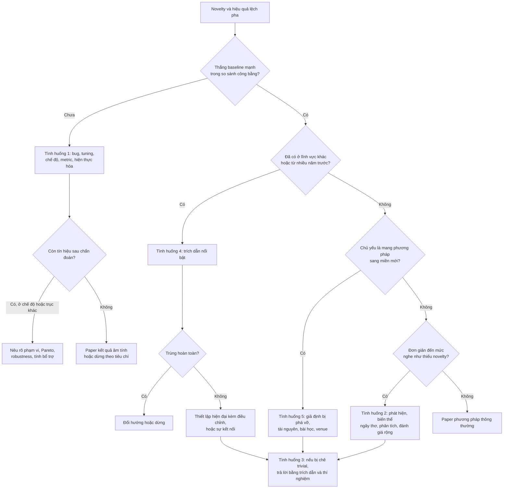

# Khi novelty và hiệu quả lệch pha

!!! abstract "Mục tiêu của bài"
    Sau bài này, người học có thể:

    - Chẩn đoán theo một trình tự cố định một phương pháp mới đang thua baseline, rồi chọn lối ra phù hợp, kể cả quyết định dừng lại.
    - Trình bày một phương pháp đơn giản mà hiệu quả như một phát hiện, kèm bằng chứng rằng các biến thể ngây thơ thất bại và lời giải thích vì sao phương pháp hoạt động.
    - Phân biệt "hiển nhiên khi nhìn lại" với "thật sự tầm thường", phòng ngừa nhận xét "trivial" ngay trong paper và trả lời nó trong rebuttal.
    - Xử lý trung thực khi ý tưởng đã có ở lĩnh vực khác hoặc từ nhiều năm trước.
    - Biến một paper "chỉ là ứng dụng" thành đóng góp có insight kỹ thuật, hoặc chọn đúng nơi công bố cho nó.

Form review của hầu hết hội nghị A\* hỏi hai câu tách biệt: paper có gì mới (*novelty*), và paper có thực sự hoạt động, có ý nghĩa hay không (*soundness*, *significance*). Người mới làm nghiên cứu thường hình dung hai câu trả lời đi cùng nhau. Thực tế hiếm khi gọn gàng như vậy: có ý tưởng mới thật mà số liệu không theo, có giải pháp đơn giản đến mức người viết ngại đưa vào paper dù nó chạy tốt hơn mọi thứ phức tạp, có ý tưởng tưởng là mới rồi hóa ra đã nằm trong một tạp chí thống kê từ ba mươi năm trước. Trong bài này, "hiệu quả" là phương pháp thực sự cải thiện kết quả (*effectiveness*); chi phí được gọi là "hiệu quả tính toán" (*efficiency*).

Cả năm tình huống trong bài đều được gỡ dễ hơn khi tách ba thứ thường bị gộp làm một: **phát hiện** (*finding*), **phương pháp** (*method*) và **bằng chứng** (*evidence*). Một paper bán hiểu biết, không bán phương pháp; novelty là lượng hiểu biết mới mà người đọc nhận được, không phải độ phức tạp của thứ được đề xuất. Bài đi sâu hơn những gì đã có ở bài [Tìm và thẩm định ý tưởng](../01-truoc-khi-viet/y-tuong.md) và mục *Khi kết quả không như mong đợi* ở bài [Xây "câu chuyện" của paper](../01-truoc-khi-viet/cau-chuyen.md). Mỗi tình huống đi qua năm bước: nhận diện, chẩn đoán, các lối ra, cách viết, và điều không được làm; ranh giới giữa đóng khung lại và bóp méo được bàn ở bài [Ranh giới trung thực](ranh-gioi-trung-thuc.md).

## Tình huống 1: Ý tưởng mới, nghe hay, nhưng thua baseline

### Nhận diện

Một nghiên cứu sinh NLP (ví dụ giả định) bổ sung cho mô hình ngôn ngữ một bộ nhớ làm việc lấy cảm hứng từ tâm lý học nhận thức: vài "ô nhớ" được ghi và xóa qua một cơ chế cổng (*gating*) để giữ thông tin qua văn bản rất dài. Tìm kiếm novelty không thấy công trình trùng khớp. Sau ba tháng, perplexity (càng thấp càng tốt) trên benchmark chuẩn vẫn cao hơn một Transformer cùng kích thước và cùng ngân sách tính toán, còn trên hai tác vụ downstream thì ngang hoặc thấp hơn một chút.

Dấu hiệu khá quen thuộc: ý tưởng được giải thích bằng lời rất mạch lạc nhưng con số không theo; mỗi tuần nhóm thử "thêm một mẹo" mà không có giả thuyết vì sao nó sẽ giúp; kết quả đổi dấu giữa các seed. Nguy hiểm nhất là khi trong nhóm bắt đầu có câu "hay bỏ dataset này đi" hoặc "lấy cấu hình baseline nhỏ hơn".

### Chẩn đoán

Phương pháp mới phải cạnh tranh với baseline đã được cả cộng đồng mài giũa qua nhiều năm: một Transformer chuẩn là kiến trúc cộng với công thức huấn luyện, lịch learning rate và vô số chi tiết đã được tối ưu. Thua là dễ hiểu kể cả khi ý tưởng đúng, nhưng cũng có thể ý tưởng sai. Năm câu hỏi dưới đây phân biệt hai khả năng, và nên được trả lời đúng thứ tự: câu đầu rẻ hơn câu sau, và câu sau chỉ có nghĩa khi câu trước đã được loại trừ.

**Có bug không?** Kiểm tra đầu tiên là sanity check trên dữ liệu đồ chơi (*toy data*) nơi insight dự đoán rõ phương pháp phải thắng, chẳng hạn một tác vụ tổng hợp đòi nhớ lại một token từ hàng nghìn bước trước. Nếu phương pháp thất bại ở đây, hoặc có bug, hoặc insight sai. Kiểm tra thứ hai là overfit một batch nhỏ: với vài chục ví dụ, loss phải về gần không. Kiểm tra thứ ba là thành phần mới có được dùng không; một cổng bão hòa về không từ đầu biến phương pháp thành baseline cộng tham số thừa.

**So sánh có cân sức không?** Bất cân xứng trong tuning đi theo cả hai chiều: baseline bị tune kém, hoặc phương pháp mới chạy với hyperparameter vốn tối ưu cho baseline. Melis, Dyer và Blunsom (ICLR 2018) cho thấy một LSTM chuẩn được regularize và tune kỹ vượt nhiều kiến trúc mới hơn trong language modeling, tức khác biệt về tuning có thể lớn hơn khác biệt về kiến trúc. Lipton và Steinhardt (*Troubling Trends in Machine Learning Scholarship*) gọi tên xu hướng không xác định được nguồn gốc thật của cải thiện. Cách kiểm tra là cấp cùng ngân sách tuning cho hai phía và ghi lại (xem mục *So sánh công bằng* ở bài [Thiết kế thí nghiệm](../01-truoc-khi-viet/thi-nghiem.md)).

**Có đang đo ở sai chế độ không?** Insight thường chỉ dự đoán ưu thế trong một chế độ (*regime*): ít dữ liệu, đuôi dài, ngoài phân phối (OOD), ngữ cảnh dài, hay khi bị ràng buộc về hiệu quả tính toán. Bộ nhớ làm việc chỉ có ích khi thông tin cần thiết nằm xa, nên ưu thế bị pha loãng trong benchmark mà phần lớn token đoán được từ ngữ cảnh gần. Theo chính paper ViT (ICLR 2021), khi huấn luyện trên dataset cỡ trung như ImageNet mà không có regularization mạnh, ViT kém ResNet cùng cỡ vài điểm phần trăm; bức tranh chỉ đổi khi pre-training trên dữ liệu lớn hơn nhiều. Chế độ đó được *insight dự đoán* (thiếu inductive bias thì cần thêm dữ liệu), không phải tìm ra bằng cách lục lọi.

**Metric có đo đúng điều insight dự đoán không?** Perplexity trung bình gộp mọi token. Nếu insight nói về token cần thông tin từ xa, phép đo đúng là perplexity trên nhóm token ấy, chia theo khoảng cách, theo tinh thần "đánh giá chia nhỏ" ở bài [Xây "câu chuyện" của paper](../01-truoc-khi-viet/cau-chuyen.md). Metric chuyên biệt nên được định nghĩa từ insight trước khi nhìn kết quả, và báo cáo song song với metric chuẩn.

**Insight đúng nhưng hiện thực hóa sai?** Masked modeling cho ảnh từng được thử trước MAE mà chưa thành công; ý tưởng không sai, nhưng phải che rất nhiều mảnh ảnh mới phát huy. Công cụ hữu ích ở đây là thí nghiệm "oracle": đưa thẳng thông tin đúng vào thành phần mới, ví dụ ghi sẵn vào bộ nhớ đoạn văn chứa câu trả lời. Oracle cũng không giúp thì insight có lẽ sai; oracle giúp nhiều mà phiên bản học được không giúp thì vấn đề nằm ở hiện thực hóa, chỗ đáng đầu tư tiếp.

Sau năm câu hỏi, nên viết ra một đoạn kết luận chẩn đoán; chính đoạn này quyết định lối ra.

### Các lối ra

**Lối ra thứ nhất: tìm chế độ mà phương pháp thắng, và nêu rõ phạm vi.** Phù hợp khi chế độ được insight dự đoán trước và có người dùng thực sự quan tâm. Bằng chứng gồm benchmark dành cho chế độ đó, một đường cong theo trục chế độ (khoảng cách ngữ cảnh, lượng dữ liệu, mức dịch chuyển phân phối) cho thấy điểm giao với baseline, và kết quả trung thực trên benchmark chung.

!!! warning "Chế độ được tìm ra sau khi xem kết quả"
    Gelman và Loken gọi đây là "khu vườn của những lối rẽ" (*the garden of forking paths*): nhiều lựa chọn phân tích không được khai báo làm sai lệch suy luận, kể cả khi không ai cố ý. Quét hai mươi tập con thì gần như chắc chắn có một tập đẹp do ngẫu nhiên. Phát hiện như vậy phải được gọi là khám phá và kiểm chứng lại trên dữ liệu độc lập.

**Lối ra thứ hai: đổi trục so sánh.** Phương pháp có thể thắng ở trục khác: cùng chất lượng với chi phí thấp hơn, hoặc vững hơn dưới dịch chuyển phân phối, nhiễu hay tấn công. Bằng chứng là đường biên Pareto chất lượng theo chi phí qua nhiều kích thước mô hình, đo trên phần cứng thực, hoặc các phép dịch chuyển chuẩn được cộng đồng công nhận. Không phù hợp khi không ai cần sự đánh đổi đó, chẳng hạn kém ba điểm để tiết kiệm mười phần trăm bộ nhớ.

**Lối ra thứ ba: kiểm tra tính bổ trợ với baseline.** Phương pháp thua khi đứng riêng đôi khi lại cải thiện baseline khi kết hợp, ví dụ thêm vài ô nhớ vào Transformer thay vì thay attention. Khi đó nó nắm được thứ baseline bỏ sót, và phân tích độ chồng lấn lỗi sẽ củng cố kết luận. Cần so với baseline được cấp thêm dung lượng tương đương, và giải thích vì sao hai thành phần bổ trợ nhau để tránh bẫy "A + B" (xem bài [Ghép ý tưởng và "độn" đóng góp](ghep-va-don.md)).

**Lối ra thứ tư: viết paper phân tích "vì sao X không giúp được".** Khi ý tưởng đủ tự nhiên để nhiều nhóm khác cũng nghĩ tới, một lời giải thích chặt chẽ vì sao nó thất bại tiết kiệm công sức cho cộng đồng. Điều kiện là chẩn đoán kín kẽ: không bug, tuning công bằng, nhiều chế độ và kích thước. Nơi công bố gồm workshop *I Can't Believe It's Not Better!* (ICBINB) tại NeurIPS từ năm 2020, workshop *Insights from Negative Results in NLP* đi kèm các hội nghị ACL/EMNLP từ năm 2020, và TMLR, nơi tiêu chí là claim có được bằng chứng ủng hộ chính xác, thuyết phục, rõ ràng và có người quan tâm, không đòi mức "nổi bật". Kết quả âm tính lật đổ một niềm tin phổ biến có thể vào main track, như *Rethinking the Value of Network Pruning* (ICLR 2019) hay *Are GANs Created Equal?* (NeurIPS 2018).

**Lối ra thứ năm: dừng lại theo tiêu chí đã đặt trước.** Nếu năm câu hỏi không để lại tín hiệu nào và kết quả âm tính khó có người đọc, dừng lại là quyết định nghiên cứu tốt. Đây là lúc tiêu chí ở mục *Pilot experiment và tiêu chí dừng* trong bài [Tìm và thẩm định ý tưởng](../01-truoc-khi-viet/y-tuong.md) phát huy tác dụng; chi phí chìm không phải lý do để tiếp tục.

### Viết thế nào

Khó khăn chính là giữ phạm vi claim khớp phạm vi bằng chứng ở mọi vị trí: title, abstract, Introduction, danh sách đóng góp. Chế độ nên được nêu ngay trong abstract, và bảng chính vẫn chứa benchmark chung kể cả khi phương pháp thua ở đó. Hai cặp câu dưới đây là ví dụ giả định.

*"Our memory-augmented Transformer significantly outperforms strong baselines on language modeling."*

Claim nói về language modeling nói chung trong khi bảng chính cho thấy perplexity tổng thể kém baseline; đọc tới Table 2, reviewer mất niềm tin vào mọi claim còn lại.

*"In overall perplexity, our model is slightly behind a well-tuned Transformer (+0.4, Table 2). Its advantage is concentrated where our hypothesis predicts: on tokens that depend on information more than 4K tokens back, it reduces perplexity by 11%, and the gap widens with distance (Fig. 3)."*

Câu này báo cáo trung thực kết quả tổng, rồi khoanh vùng ưu thế vào đúng chế độ mà giả thuyết dự đoán.

*"Unfortunately, our method did not work as expected, possibly due to limited resources."*

Một lời xin lỗi không mang theo hiểu biết nào, với lý do không được kiểm chứng.

*"Explicit memory modules are often assumed to help language models exploit distant context [8, 14]. Under matched tuning budgets across three model sizes, we find no benefit beyond 1B parameters; attribution analysis shows that standard models already retrieve the relevant distant tokens."*

Paper kết quả âm tính nêu niềm tin có trích dẫn, điều kiện kiểm định công bằng, kết quả và cơ chế.

Reviewer ML ở NeurIPS, ICML, ICLR coi hiểu biết là đóng góp độc lập, nên paper phân tích hay kết quả âm tính có kiểm soát chặt và error bar có cơ hội thật; họ hỏi kỹ ngân sách tuning và số seed, nhất là sau khi Henderson et al. (*Deep Reinforcement Learning that Matters*, AAAI 2018) cho thấy kết quả deep RL nhạy với seed, hyperparameter và chi tiết cài đặt. Reviewer NLP quen với paper phân tích; short paper hợp với phát hiện âm tính tập trung, và mục Limitations bắt buộc trong ARR là chỗ khoanh vùng chế độ. Reviewer CV bắt đầu từ bảng benchmark chuẩn, nên claim theo chế độ cần một benchmark được công nhận cho chế độ đó.

### Điều không được làm

Ba cám dỗ của tình huống này là **chọn lọc dataset**, **làm yếu baseline** (cấu hình nhỏ hơn, ít epoch hơn, prompt sơ sài hơn cho baseline LLM) và **tune trên test**, kể cả chọn "chế độ" bằng cách nhìn tập test. Cả ba biến một kết quả âm tính trung thực thành dương tính sai, và không qua được phép thử: nếu reviewer xem toàn bộ log thí nghiệm, claim có còn đứng được không? Sculley et al. (*Winner's Curse?*, ICLR 2018 workshop) chỉ ra áp lực "thắng bảng" làm suy giảm sự chặt chẽ của cả lĩnh vực. Xem thêm [Ranh giới trung thực](ranh-gioi-trung-thuc.md) và [Khi con số không đẹp](con-so-khong-dep.md).

## Tình huống 2: Đơn giản đến bất ngờ, hiệu quả, nhưng nghe như thiếu novelty

### Nhận diện

Một nhóm Computer Vision làm nhận diện hành động trong video (ví dụ giả định), nơi các phương pháp mạnh nhất đều có module mô hình hóa thời gian ngày càng tinh vi. Khi dựng baseline, nhóm thử một việc rất thô: lấy một encoder ảnh và văn bản đã pre-train, giữ nguyên trọng số, trích đặc trưng từ tám khung hình lấy mẫu đều, chuẩn hóa L2, lấy trung bình, rồi huấn luyện một bộ phân loại tuyến tính. Kết quả ngang, thậm chí nhỉnh hơn, các kiến trúc video chuyên biệt trên hai benchmark phổ biến, với khoảng hai mươi dòng code.

Phản ứng đầu tiên thường là lo lắng: "reviewer sẽ nói đây chỉ là average pooling". Phần Method khó viết quá nửa trang, và trong nhóm xuất hiện đề xuất thêm một module attention "cho paper nặng hơn". Đó là dấu hiệu rõ nhất: động cơ thêm thành phần là hình thức, không phải bằng chứng.

### Chẩn đoán

Nỗi lo này bắt nguồn từ sự nhầm lẫn giữa novelty và độ phức tạp, có thật ở cả người viết lẫn reviewer.

!!! info "Novelty theo Michael J. Black"
    Trong bài blog *Novelty in Science: A guide for reviewers* (Medium, 2022), Michael J. Black lập luận rằng sự đơn giản thường bị nhầm với thiếu novelty, trong khi một ý tưởng gần như luôn trông hiển nhiên *sau khi* đã có người trình bày nó. Theo tinh thần bài viết, novelty có thể nằm ở ý tưởng, ở việc chứng minh nó hoạt động, hoặc ở hiểu biết nó mang lại. Bài dành cho reviewer, nhưng người viết đọc để biết cần cung cấp gì cho một reviewer công tâm.

Hiện tượng phía sau là **thiên kiến nhìn lại** (*hindsight bias*): khi đã biết kết quả, con người đánh giá quá cao khả năng bản thân đã có thể đoán trước nó. Phép thử chống lại nó là câu hỏi: nếu ý tưởng hiển nhiên, vì sao cộng đồng chưa làm, và vì sao lại tin điều ngược lại?

Nhiều đóng góp lớn có lõi kỹ thuật rất đơn giản, và mỗi đóng góp đứng đối diện một niềm tin phổ biến. Ở CV, thay đổi của ResNet (CVPR 2016) chỉ là một kết nối tắt đồng nhất; novelty nằm ở chẩn đoán rằng degradation là vấn đề tối ưu hóa (xem case study [ResNet](../05-case-studies/resnet.md)). ViT áp một Transformer chuẩn lên mảnh ảnh với ít thay đổi nhất có thể, trong khi trước đó attention trong thị giác thường đi kèm hoặc thay một phần mạng tích chập; phát hiện là khi dữ liệu pre-training đủ lớn, inductive bias của convolution kém cần thiết. Theo abstract của ConvNeXt (CVPR 2022), thành công của kiến trúc lai khi đó vẫn phần lớn được quy cho ưu thế nội tại của Transformer; paper hiện đại hóa từng bước một ResNet chuẩn, chỉ dùng module ConvNet chuẩn, và cho thấy ConvNet thuần vẫn cạnh tranh. Ở NLP, *Frustratingly Easy Domain Adaptation* (Daumé III, ACL 2007) nhân mỗi đặc trưng thành một bản dùng chung và các bản riêng cho từng miền; tiêu đề chủ động nhận sự đơn giản. Ở ML, *Understanding deep learning requires rethinking generalization* (Zhang et al., ICLR 2017, best paper) không có phương pháp mới: paper đối diện niềm tin rằng tổng quát hóa được giải thích bởi tính chất của họ mô hình hoặc regularization, bằng thí nghiệm cho thấy mạng vẫn khớp hoàn toàn nhãn ngẫu nhiên, kể cả khi ảnh bị thay bằng nhiễu. GPT-3 (NeurIPS 2020) cũng có kiến trúc gần như không mới; đóng góp là phát hiện về in-context learning khi tăng quy mô.

Một số paper chọn định vị khiêm tốn. *Simple Baselines for Human Pose Estimation and Tracking* (Xiao, Wu, Wei; ECCV 2018) tự giới thiệu là baseline đơn giản, hiệu quả, để truyền cảm hứng và giúp đánh giá ý tưởng mới. Case study [VLGuard](../07-ai-security/vlguard.md) phân tích một paper ICML 2024 có phương pháp chỉ là fine-tuning trên dataset nhỏ, với chữ "A Baseline" trong tiêu đề, và chỉ ra bốn yếu tố giúp nó đứng vững: một phát hiện độc lập, một tài nguyên dùng được ngay, một claim thực dụng kiểm chứng được, và độ rộng của đánh giá.

| Paper | Niềm tin trước đó | Điều đơn giản được làm | Đóng góp thật |
|---|---|---|---|
| ResNet (CV) | Mạng sâu hơn tệ hơn vì overfitting | Kết nối tắt đồng nhất | Degradation là vấn đề tối ưu hóa |
| ViT (CV) | Thị giác cần thiên kiến của convolution | Transformer chuẩn trên mảnh ảnh | Quy mô dữ liệu bù cho inductive bias |
| ConvNeXt (CV) | Kiến trúc lai thành công nhờ Transformer | Hiện đại hóa từng bước ResNet | ConvNet thuần vẫn cạnh tranh |
| Frustratingly Easy DA (NLP) | Thích nghi miền cần mô hình phức tạp | Nhân bản không gian đặc trưng | Baseline mạnh, dễ dùng lại |
| Zhang et al. (ML) | Tổng quát hóa do họ mô hình, regularization | Huấn luyện trên nhãn ngẫu nhiên | Lý thuyết cũ không giải thích được thực tế |

Năm câu hỏi chẩn đoán tương ứng: phương pháp có thật sự mới không (nếu không, xem Tình huống 4); niềm tin nào khiến cách làm này chưa được dùng, có trích dẫn được không; biến thể ngây thơ có thất bại không; vì sao phương pháp hoạt động; và kết quả có vững qua nhiều benchmark, backbone, seed không.

Câu "vì sao" đáng dừng lâu nhất, vì trong ví dụ video nó mở ra hai câu chuyện: hoặc mô hình hóa thời gian ít cần thiết hơn cộng đồng nghĩ, hoặc hai benchmark không thực sự đòi suy luận thời gian. Câu chuyện thứ nhất là paper phương pháp, câu chuyện thứ hai là paper về benchmark, và chỉ thí nghiệm mới phân biệt được: xáo trộn thứ tự khung hình rồi xem các mô hình chuyên biệt có bị ảnh hưởng không, hoặc đánh giá riêng những lớp chỉ phân biệt được qua thứ tự thời gian, như mở cửa và đóng cửa. Câu chuyện thứ hai có tiền lệ: *Annotation Artifacts in Natural Language Inference Data* (Gururangan et al., NAACL 2018) cho thấy một bộ phân loại chỉ nhìn hypothesis đạt độ chính xác cao bất thường do dấu vết gán nhãn. Một phương pháp đơn giản bất ngờ hiệu quả đôi khi chính là công cụ làm lộ vấn đề của benchmark.

### Các lối ra

**Lối ra thứ nhất: mở bằng phát hiện, không mở bằng phương pháp.** Introduction bắt đầu bằng niềm tin phổ biến kèm trích dẫn, rồi trình bày thí nghiệm đơn giản và kết quả đi ngược niềm tin đó. Đặt cạnh một niềm tin cụ thể, sự đơn giản biến thành sức nặng của phát hiện: nếu thứ đơn giản như vậy đã đủ, những thứ phức tạp đang làm gì? Bằng chứng cần có là trích dẫn xác thực cho niềm tin và một kết quả đủ rõ để thách thức nó. Lối ra này không phù hợp khi không có niềm tin nào như vậy để đối diện.

**Lối ra thứ hai: biến sự đơn giản thành ưu điểm.** Đơn giản nghĩa là ít hyperparameter, dễ tái lập, rẻ, dễ kết hợp với cải tiến khác, và là baseline mà các phương pháp sau phải vượt. Bằng chứng là chi phí đo được, độ nhạy thấp với hyperparameter, và code công bố. Định vị "baseline" khiêm tốn nhưng bền, với điều kiện phương pháp đủ mạnh để làm mốc.

**Lối ra thứ ba: chứng minh rằng các biến thể ngây thơ thất bại.** Câu hỏi ngầm của reviewer là "ai cũng làm được". Câu trả lời mạnh nhất là cho thấy người làm theo cách hiển nhiên nhất sẽ thất bại: bỏ chuẩn hóa L2 hoặc lấy tám khung liên tiếp thay vì lấy mẫu đều có thể làm kết quả giảm mạnh. Những chi tiết nhỏ quyết định thành công chính là đóng góp kỹ thuật, và chúng thuộc về phần Method chứ không phải appendix. MAE là tiền lệ: tỉ lệ che rất cao là chi tiết khiến masked modeling hoạt động với ảnh. *Bag of Tricks for Image Classification with Convolutional Neural Networks* (He et al., CVPR 2019) còn biến một tập tinh chỉnh nhỏ thành đóng góp nhờ khảo sát có hệ thống và ablation từng tinh chỉnh. Hình thức hiệu quả là bảng "từ ngây thơ tới hoàn chỉnh", mỗi dòng đổi một yếu tố, như lộ trình của ConvNeXt; các chi tiết phải ổn định qua dataset và seed, nếu không chúng là dấu hiệu của tuning.

**Lối ra thứ tư: phân tích vì sao phương pháp hoạt động.** Một phương pháp hoạt động là một dữ kiện; lời giải thích vì sao là một hiểu biết. Xáo trộn khung hình, phân tích theo lớp, hay so với mô hình chỉ nhìn một khung cho biết thông tin nào đang được dùng. Zhang et al. là mẫu mực: thí nghiệm cốt lõi rất đơn giản nhưng được bao quanh bởi các biến thể có kiểm soát (nhãn ngẫu nhiên một phần, điểm ảnh xáo trộn, nhiễu). *Rethinking ImageNet Pre-training* (He, Girshick, Dollár; ICCV 2019) cũng đặt kết luận rằng huấn luyện từ đầu có thể đạt kết quả tương đương pre-training ImageNet trên COCO, nếu huấn luyện đủ lâu, trong các thí nghiệm khoanh vùng điều kiện. Phân tích còn chỉ ra nơi phương pháp *không* hoạt động, nội dung trung thực nhất cho Limitations.

**Lối ra thứ năm: đánh giá rộng hơn bình thường.** Phương pháp đơn giản ngầm claim "chỉ cần thế này là đủ", và claim mạnh đòi bằng chứng rộng: nhiều dataset, backbone và quy mô, baseline mạnh được tune công bằng, error bar qua nhiều seed. Luận điểm của *Revisiting ResNets: Improved Training and Scaling Strategies* (Bello et al., NeurIPS 2021), rằng cải thiện chủ yếu đến từ phương pháp huấn luyện và chiến lược scaling chứ không từ kiến trúc, thuyết phục được vì nó được kiểm chứng qua nhiều quy mô.

Nếu phân tích cho thấy phương pháp hoạt động chủ yếu vì benchmark có khiếm khuyết, nên đổi hướng sang một paper về benchmark. Nếu kết quả không vững ngoài một thiết lập, cần thu hẹp claim, hoặc nhắm short paper hay workshop.

### Viết thế nào

Introduction nên đi theo trình tự: niềm tin phổ biến, bằng chứng niềm tin có thật, thí nghiệm đơn giản, kết quả bất ngờ, lời giải thích, ý nghĩa. Phương pháp chỉ là phương tiện kiểm định niềm tin. Hai cách mở cùng một paper (ví dụ giả định):

*"We propose TCAN, a novel Temporal Consensus Aggregation Network, which consists of a frame encoding module, a feature normalization module, and an adaptive temporal aggregation module."*

Ba "module" thực chất là một encoder đóng băng, một phép chuẩn hóa và một phép lấy trung bình; reviewer nhận ra ở trang 3 và đọc phần còn lại với sự nghi ngờ.

*"Recent action recognition models devote most of their capacity to temporal modeling, reflecting a widespread view that motion cues are essential [4, 9, 17]. We find that this view needs revisiting: averaging L2-normalized features of eight uniformly sampled frames from a frozen image–text encoder matches specialized video architectures on two widely used benchmarks. This holds only with two seemingly minor design choices; naive variants lose up to 9 points. Frame-shuffling experiments suggest that these benchmarks reward static appearance more than motion."*

Đoạn văn mở bằng niềm tin có trích dẫn, gọi tên phương pháp đúng bản chất, nêu chi tiết quyết định cùng cái giá của biến thể ngây thơ, và kết bằng phân tích.

Tiêu đề là nơi chủ động nhận sự đơn giản. "Simple" (*Simple Baselines for Human Pose Estimation and Tracking*) báo trước giá trị nằm ở tính hữu dụng; "Frustratingly Easy" nhận sự dễ dàng một cách tự tin; "Revisiting" (*Revisiting ResNets*) và "Rethinking" (*Rethinking ImageNet Pre-training*, paper của Zhang et al.) báo hiệu xem xét lại niềm tin cũ. Mỗi từ là một lời hứa, và các mẫu này đã bị bắt chước nhiều, nên chỉ dùng khi sự đơn giản hoặc sự xem xét lại chính là thông điệp (xem bài [Title](../02-viet-tung-phan/title.md)).

Reviewer CV quen với bảng so sánh "module mới", nên paper đơn giản cần kết quả mạnh trên nhiều benchmark và phân tích trực quan; ViT và ConvNeXt cho thấy cộng đồng đón nhận khi bằng chứng đủ rộng. Reviewer NLP đánh giá cao phân tích và baseline mạnh, và một phát hiện gọn vừa với short paper. Reviewer ML hỏi "vì sao" và "dưới giả định nào", nên thí nghiệm có kiểm soát hoặc toy experiment là bằng chứng họ tìm (xem bài [Viết cho NeurIPS / ICML / ICLR](../06-cong-dong/ml.md)).

### Điều không được làm

Cám dỗ lớn nhất là **phức tạp hóa giả tạo**. Lipton và Steinhardt gọi một dạng của nó là *mathiness*: phương trình được thêm vào để paper trông có chiều sâu mà không làm rõ điều gì. Dạng còn lại là **thêm module vô ích** hoặc đặt tên kêu cho phép toán tầm thường. Một ablation trung thực sẽ cho thấy module thừa không đóng góp gì, còn bỏ ablation đi để che điều đó là vượt sang vùng thiếu trung thực. Cũng không được giấu chi tiết quyết định để giữ "bí quyết". Xem bài [Ghép ý tưởng và "độn" đóng góp](ghep-va-don.md) và [Ranh giới trung thực](ranh-gioi-trung-thuc.md).

## Tình huống 3: Reviewer chê "hiển nhiên", "trivial"

### Nhận diện

Một nhóm Machine Learning (ví dụ giả định) nghiên cứu fine-tuning liên tục qua nhiều tác vụ. Nhóm đo được rằng hiện tượng mất ổn định sau mỗi lần chuyển tác vụ đến từ ước lượng moment bậc hai "cũ" của Adam, và sửa bằng cách đặt lại ước lượng này tại ranh giới tác vụ kèm warmup ngắn. Cải thiện nhất quán, nhưng review viết: *"The proposed fix is trivial"*, *"It is obvious that resetting the optimizer state helps."* Dấu hiệu là review không phản bác kết quả mà phản bác tầm quan trọng, với các từ "obvious", "straightforward", "well-known" thường không kèm trích dẫn.

### Chẩn đoán

Từ "hiển nhiên" gộp hai thứ khác hẳn nhau. **Hiển nhiên khi nhìn lại** là khi ý tưởng chỉ trông dễ sau khi được trình bày, còn trước đó cộng đồng tin hoặc làm khác. **Thật sự tầm thường** là khi ý tưởng đã là thực hành chuẩn, là hệ quả trực tiếp của điều ai cũng biết, hoặc tạo cải thiện không đáng kể mà không kèm hiểu biết. Bốn câu hỏi phân biệt hai trường hợp: các codebase và paper chính trước đó thực sự làm gì với trạng thái optimizer, và quy mất ổn định cho nguyên nhân nào; các biến thể tự nhiên có hoạt động như nhau không; paper có đo trực tiếp cơ chế không; và cải thiện có đáng kể không. Nếu thực hành chuẩn đã là đặt lại trạng thái, người viết đang ở gần Tình huống 4.

Nhiều nhận xét "trivial" là hệ quả của cách viết: khi Introduction không nói cộng đồng đã tin hoặc làm gì, reviewer chỉ còn trực giác sau khi đọc, và trực giác ấy bị thiên kiến nhìn lại chi phối. Ngược lại, nếu câu trả lời trung thực là "thật sự tầm thường", phản bác reviewer không giúp gì.

### Các lối ra

**Lối ra thứ nhất: phòng ngừa ngay trong paper bằng cách nêu rõ cộng đồng đã tin hoặc làm gì.** Introduction cần một đoạn có trích dẫn mô tả thực hành hiện có (giữ trạng thái optimizer qua các tác vụ) và cách giải thích phổ biến (quy mất ổn định cho sự trôi dạt của biểu diễn). Một khảo sát nhỏ các bản cài đặt công khai, nếu được làm thật, biến "ai cũng biết" thành "trên thực tế, không ai làm".

**Lối ra thứ hai: chứng minh cách làm ngây thơ thất bại.** Khi bảng kết quả cho thấy giảm learning rate, kéo dài warmup hay đặt lại toàn bộ trạng thái đều không xóa được mất ổn định, còn chỉ đặt lại moment bậc hai thì xóa được, "hiển nhiên" trở thành "cụ thể". Cùng phép đo cơ chế, đây là bằng chứng paper xác định đúng nguyên nhân.

**Lối ra thứ ba: trả lời trong rebuttal bằng bằng chứng.** Mục tiêu là chuyển tranh luận từ cảm nhận sang dữ kiện, như mục *Phân loại ý kiến reviewer* ở bài [Rebuttal & thảo luận](../04-nop-va-sau-nop/rebuttal.md) khuyên với ý kiến về novelty: đồng ý phần đúng, tách đóng góp thật, dẫn trích dẫn và bảng, và lịch sự đề nghị reviewer cung cấp tài liệu nếu có.

**Lối ra thứ tư: khi reviewer đúng, mở rộng hoặc đổi hình thức.** Có thể mở rộng thành một phân tích có hệ thống về động lực của optimizer khi phân phối dữ liệu thay đổi, trong đó cách sửa chỉ là một hệ quả; chuyển sang short paper, workshop hay TMLR; hoặc gộp kết quả vào dự án lớn hơn (xem bài [Khi bị reject](../04-nop-va-sau-nop/reject.md)).

### Viết thế nào

Trong rebuttal, AC hay meta-reviewer cần thấy một lập luận dựa trên dữ kiện, không phải phản ứng tự vệ (ví dụ giả định):

*"We strongly disagree with the reviewer. Our method is not trivial. It is novel and effective, as shown by our extensive experiments."*

Câu trả lời mang tính cảm xúc, không có dữ kiện mới, và buộc AC chọn giữa hai lời khẳng định.

*"We agree that the fix is simple to implement, and see this as a strength. What was not known, to our knowledge, is the cause: prior work attributes the instability to representation drift [12, 15], and the public implementations of [12, 15, 21] carry optimizer states across tasks. Table 4 shows that seemingly equivalent alternatives (lower learning rate, longer warmup, resetting all states) do not remove it, whereas resetting only the second-moment estimate does. If the reviewer knows of prior work identifying this cause, we would be grateful for the reference."*

Câu trả lời đồng ý phần đúng, tách đóng góp khỏi cách sửa, đưa trích dẫn và bảng, và mời phản bác bằng bằng chứng.

Không nên viết thẳng rằng reviewer mắc thiên kiến nhìn lại; câu ấy đọc như lời trách móc. Tốt hơn là *cho thấy* điều đó bằng trích dẫn về niềm tin trước đó.

!!! tip "Viết sẵn đoạn phòng ngừa trong paper"
    Một câu như *"A natural question is whether simpler remedies suffice; we test three of them in Sec. 5.2"* trong Introduction thường ngăn nhận xét "trivial" từ đầu, vì nó báo rằng phản bác đã được trả lời bằng thí nghiệm.

Ở CV, rebuttal thường là một trang PDF duy nhất, nên bảng biến thể ngây thơ phải nằm ngay trong trang. Ở ML, thảo luận nhiều vòng trên OpenReview cho phép hỏi lại reviewer, nhưng phản hồi có thể công khai nên giọng càng cần điềm tĩnh. Ở NLP, meta-reviewer ARR đọc toàn bộ, nên mỗi câu trả lời cần tự đứng vững. Nếu Reviewer Guidelines của năm nộp khuyến cáo không coi sự đơn giản là lý do reject, có thể nhắc lại một cách lịch sự sau khi đọc nguyên văn.

### Điều không được làm

Không công kích hay mỉa mai reviewer. Không dựng một niềm tin giả để phương pháp trông bất ngờ: mọi câu "previous work assumes…" phải được trích dẫn bằng công trình thực sự giả định như vậy. Không thêm thành phần vô ích để trông "không tầm thường", và mọi khảo sát về thực hành của cộng đồng phải được làm thật. Xem bài [Ranh giới trung thực](ranh-gioi-trung-thuc.md).

## Tình huống 4: Ý tưởng hóa ra đã có ở lĩnh vực khác hoặc từ nhiều năm trước

### Nhận diện

Một nhóm NLP (ví dụ giả định) đề xuất tiêu chí chọn ví dụ minh họa cho in-context learning: chọn tham lam những ví dụ phủ được nhiều đặc trưng của đầu vào nhất, đồng thời phạt trùng lặp. Hai tuần trước deadline, một đồng tác giả có nền tảng thống kê nhận ra tiêu chí này trùng với một thủ tục thiết kế thí nghiệm tuần tự trong một paper thống kê giữa thập niên 1990, vốn dành cho hồi quy tuyến tính với rất ít quan sát. Chuyện tương tự xảy ra ở mọi cộng đồng: một phép chuẩn hóa đặc trưng trong mạng thị giác hóa ra là bộ lọc thích nghi quen thuộc của xử lý tín hiệu, hay một quy tắc điều chỉnh learning rate theo phản hồi từ loss hóa ra là một luật điều khiển đã được phân tích kỹ.

Dấu hiệu thường đến từ người ở lĩnh vực lân cận ("cái này giống với…"), hoặc từ một công thức quá gọn để chưa ai nghĩ ra. Khác với concurrent work ở bài [Tìm và thẩm định ý tưởng](../01-truoc-khi-viet/y-tuong.md), công trình kia đã có từ lâu, nên không quy định nào miễn trừ việc ghi nhận nó.

### Chẩn đoán

"Phát minh lại" xảy ra vì các lĩnh vực gọi cùng một khái niệm bằng tên khác nhau, công bố ở venue mà người làm học sâu ít đọc, và việc tìm tài liệu thường chỉ phủ vài năm gần nhất. Trước khi chọn lối ra, cần trả lời bốn câu hỏi. Mức trùng lặp thực sự: cùng hàm mục tiêu, thuật toán, giả định, hay chỉ cùng tinh thần? Điều gì đã thay đổi: quy mô, thiết lập (in-context learning không tồn tại vào thập niên 1990), và những điều chỉnh cần thiết? Công trình cũ đã chứng minh gì và chưa chứng minh gì? Và reviewer từ lĩnh vực kia sẽ đọc paper như phát minh lại hay như cây cầu nối hai lĩnh vực?

"Ý tưởng cũ, quy mô mới" không đáng xấu hổ. Như phần mở đầu của ConvNeXt nhắc lại, mạng tích chập huấn luyện bằng lan truyền ngược đã có từ thập niên 1980, nhưng phải đến cuối năm 2012 tiềm năng thật của nó mới được thấy rõ.

### Các lối ra

**Lối ra thứ nhất: trích dẫn nổi bật và trung thực.** Áp dụng trong mọi trường hợp. Công trình cũ cần xuất hiện ở Introduction và Method, không chỉ ở một dòng trong Related Work, và mối liên hệ phải được nói thẳng: tiêu chí *trùng với* hoặc *là biến thể của* thủ tục kia. Reviewer biết công trình cũ sẽ tìm ra nó dù paper có nhắc hay không; khi paper tự nói trước, "phát minh lại" biến thành "kết nối".

**Lối ra thứ hai: chuyển đóng góp sang "nó hoạt động ở quy mô hoặc thiết lập hiện đại, kèm các điều chỉnh cần thiết".** Bằng chứng là so sánh với phiên bản nguyên gốc của phương pháp cũ áp dụng trực tiếp. Nếu phiên bản ấy thất bại vì giả định bị vi phạm (giả định tuyến tính và nhiễu Gauss không còn đúng với không gian biểu diễn của mô hình ngôn ngữ lớn), các điều chỉnh trở thành đóng góp kỹ thuật thật. Nếu nó đã hoạt động tốt như phiên bản của nhóm, đóng góp chỉ còn là thí nghiệm ứng dụng, gần với Tình huống 5.

**Lối ra thứ ba: biến chính sự kết nối thành đóng góp.** Phát hiện rằng một kỹ thuật hiện đại tương đương một phương pháp cổ điển có thể là hiểu biết có giá trị tự thân, nếu nó mang được công cụ phân tích của lĩnh vực kia sang hoặc giải thích vì sao kỹ thuật hiện đại hoạt động. Cần một phát biểu chính xác về sự tương đương và ít nhất một hệ quả kiểm chứng được. Lối ra này đặc biệt hợp với cộng đồng ML.

**Lối ra thứ tư: nếu trùng hoàn toàn, đổi hướng.** Khi công trình cũ đã làm đúng ý tưởng trong thiết lập về cơ bản giống hệt, không còn paper nào ở đây. Thời gian còn lại nên dành cho một câu hỏi sâu hơn, như khi nào tiêu chí cổ điển thất bại với mô hình ngôn ngữ lớn và vì sao, hoặc dừng lại (xem bài [Khi bị reject](../04-nop-va-sau-nop/reject.md)).

### Viết thế nào

Người đọc phải biết về công trình cũ từ chính paper, sớm và rõ (ví dụ giả định):

*"Inspired by information theory, we propose DACS, a novel Diversity-Aware Coverage Selection criterion for in-context learning."*

Tên mới và chữ "novel" cho một tiêu chí đã có; reviewer biết công trình cũ sẽ đọc phần còn lại như một sự che giấu.

*"Our selection criterion is not new: it coincides with the sequential design criterion of [31], developed for linear regression with few observations. We show that it transfers to in-context example selection for large language models, where its assumptions do not hold directly, and identify two modifications without which it underperforms random selection (Table 3)."*

Mối liên hệ được nói thẳng ở phần phương pháp, và đóng góp được định vị vào đúng phần còn mới.

Mối liên hệ cũng nên được nhắc ở Introduction và trong một đoạn riêng ở Related Work (xem bài [Related Work](../02-viet-tung-phan/related-work.md)). Reviewer ML thường có nền tảng thống kê, tối ưu hóa hoặc điều khiển, nên dễ nhận ra phương pháp cổ điển và cũng đánh giá cao nhất một kết nối được trình bày trung thực. Ở NLP, truyền thống NLP thống kê vẫn còn trong ký ức của nhiều reviewer, và ACL Anthology lưu công trình từ nhiều thập kỷ. Ở CV, nhiều kỹ thuật xử lý ảnh và tín hiệu cổ điển có tương đương trong kiến trúc học sâu. Ở cả ba cộng đồng, nhận xét *"this is a rediscovery of…"* đi kèm sự che giấu gần như là lý do reject, còn cùng mối liên hệ ấy, khi paper tự nêu, thường là điểm cộng.

### Điều không được làm

Không **giấu đi**: không bỏ trích dẫn, không đẩy nó vào một chú thích khó thấy, không mô tả sai công trình cũ để khác biệt có vẻ lớn hơn. Không **đổi tên**: không đặt tên mới kèm chữ "novel" cho phương pháp đã có. Cả hai có thể bị phát hiện nhiều năm sau khi công bố, với hậu quả nặng hơn nhiều một lần reject. Nếu công trình cũ chỉ được phát hiện sau khi paper được chấp nhận, bản camera-ready cần bổ sung trích dẫn và điều chỉnh claim về tính mới. Xem bài [Ranh giới trung thực](ranh-gioi-trung-thuc.md).

## Tình huống 5: "Chỉ là ứng dụng"

### Nhận diện

Một nhóm Computer Vision (ví dụ giả định) mang một mô hình phân vùng ảnh hiện đại sang ảnh vệ tinh đa phổ để xác định ranh giới thửa ruộng, tự gán nhãn một dataset, và đạt kết quả tốt nhất trên đó. Review viết: *"The paper applies an existing method to a new domain; the technical novelty is limited."* Kịch bản tương tự xảy ra ở NLP với một ngôn ngữ mới, hay ở ML với dự đoán tính chất phân tử. Dấu hiệu nằm trong bản thảo: phần Method chủ yếu mô tả phương pháp của người khác, danh sách đóng góp mở đầu bằng "We apply X to Y", và không có đoạn nào giải thích miền mới đòi hỏi điều gì mà phương pháp gốc không có.

### Chẩn đoán

Main track đánh giá hiểu biết có thể mang sang nơi khác, nên paper không chỉ ra thách thức kỹ thuật đặc thù của miền thì không để lại gì cho người đọc ngoài miền. Như mục *Ứng dụng có insight kỹ thuật* ở bài [Tìm và thẩm định ý tưởng](../01-truoc-khi-viet/y-tuong.md) đã nêu, paper ứng dụng vẫn có chỗ đứng khi chỉ ra được thách thức đó. Câu hỏi chẩn đoán xoay quanh giả định của phương pháp gốc: với ảnh vệ tinh, đó có thể là ba kênh màu tự nhiên như dữ liệu pre-training, vật thể có hướng chuẩn, hay ranh giới đủ dày để không bị xóa khi giảm độ phân giải. Áp dụng nguyên trạng có thất bại theo cách giải thích được bằng giả định bị phá vỡ không? Cộng đồng có thiếu tài nguyên không? Bài học có chuyển sang miền khác được không? Và người đọc chính là cộng đồng phương pháp hay cộng đồng của miền?

### Các lối ra

**Lối ra thứ nhất: chỉ ra đặc thù của miền phá vỡ giả định của phương pháp gốc.** Một ví dụ có thật là PhoBERT (Findings of EMNLP 2020), được phân tích ở case study [PhoBERT](../05-case-studies/phobert.md). Mô hình kiểu BERT áp BPE lên các đơn vị phân tách bằng khoảng trắng, ngầm giả định khoảng trắng phân tách từ; trong tiếng Việt, khoảng trắng phân tách âm tiết, và nhiều từ gồm nhiều âm tiết. PhoBERT tách từ trước khi áp BPE, và chính quan sát ngôn ngữ học này là lý do tồn tại của paper. Case study cũng chỉ ra bằng chứng rằng tách từ là nguyên nhân còn gián tiếp, vì mô hình và đối thủ khác nhau ở nhiều yếu tố; paper theo lối ra này cần ablation chỉ thay đổi đúng yếu tố đặc thù của miền.

**Lối ra thứ hai: đóng góp tài nguyên đạt chuẩn.** "Đạt chuẩn" nghĩa là có tài liệu mô tả dữ liệu, giấy phép rõ, quy trình gán nhãn kèm mức đồng thuận giữa người gán nhãn, cách chia tập tránh rò rỉ (với ảnh vệ tinh, chia theo vùng địa lý), và baseline mạnh. NeurIPS có Datasets and Benchmarks Track từ năm 2021, còn các hội nghị thuộc hệ ACL thường có track cho tài nguyên và đánh giá. Một dataset nội bộ chỉ để báo cáo kết quả không phải là đóng góp tài nguyên.

**Lối ra thứ ba: rút ra bài học tổng quát.** Paper ứng dụng mạnh trả lời được câu hỏi "người làm ở miền khác học được gì?", chẳng hạn sự lệch phương thức giữa dữ liệu pre-training và dữ liệu đích quan trọng hơn lựa chọn kiến trúc. Bài học cần được kiểm chứng trên ít nhất một miền hoặc ngôn ngữ thứ hai (xem bài [Chuyển một paper giữa các cộng đồng](../06-cong-dong/chuyen-doi.md)).

**Lối ra thứ tư: chọn venue phù hợp với người đọc.** Đây là quyết định chiến lược, không phải sự thỏa hiệp. Ở NLP, Findings dành cho paper vững chắc nhưng không được chọn vào hội nghị chính, và chính PhoBERT được công bố ở đó; các hội nghị thuộc hệ ACL những năm gần đây cũng thường có Industry Track. KDD có Applied Data Science Track. WACV là hội nghị mà ngay tên gọi đã đặt trọng tâm vào ứng dụng của thị giác máy tính; MICCAI cho ảnh y tế và LREC cho tài nguyên ngôn ngữ là nơi người đọc của miền tập trung. Journal chuyên ngành của miền ứng dụng đánh giá cao chính tính hữu dụng và tác động lên miền. Tên track và phạm vi thay đổi theo năm, nên cần kiểm tra Call for Papers.

**Lối ra thứ năm: khi không lối ra nào đứng được, chọn hình thức khác hoặc dừng.** Nếu không có giả định bị phá vỡ, tài nguyên mới hay bài học tổng quát, một báo cáo kỹ thuật kèm code hoặc một bài ở workshop của miền trung thực hơn việc tiếp tục nộp và nhận lại cùng một nhận xét.

### Viết thế nào

Paper ứng dụng có insight bắt đầu từ giả định bị phá vỡ, không từ phương pháp được mượn (ví dụ giả định):

*"We apply a state-of-the-art segmentation model to multispectral satellite images and obtain the best results on our new dataset."*

Chỉ có thao tác và kết quả trên dataset do chính nhóm xây; reviewer không biết miền mới khó ở đâu.

*"Segmentation models pre-trained on RGB photographs assume three natural color channels and a canonical object orientation, two assumptions that multispectral satellite imagery violates. Naive transfer loses most of its accuracy on thin field boundaries; two targeted changes recover it, and the same pattern holds on a second sensor. We release a geographically split benchmark to support future work."*

Gọi tên giả định bị phá vỡ, cho thấy hậu quả đo được, kiểm chứng trên miền thứ hai, và đóng góp tài nguyên chia tập đúng cách.

Reviewer CV chấp nhận paper theo miền khi nó mang tới tác vụ mới, dataset có ảnh hưởng hoặc insight kỹ thuật; nếu không, họ thường gợi ý venue chuyên ngành. Reviewer NLP đánh giá cao công trình cho ngôn ngữ ít tài nguyên, nhưng kỳ vọng paper gọi tên ngôn ngữ, giải thích đặc điểm ngôn ngữ học cho người không biết ngôn ngữ đó, và có ablation tách đặc điểm ấy (xem bài [Viết cho ACL / EMNLP / NAACL](../06-cong-dong/nlp.md)). Reviewer ML hỏi bài học có vượt ra ngoài miền không, như mục *Những lỗi khiến paper bị coi là "more suitable for CVPR/ACL"* ở bài [Viết cho NeurIPS / ICML / ICLR](../06-cong-dong/ml.md) mô tả.

### Điều không được làm

Không thổi phồng độ khó của miền mà không có thí nghiệm chứng minh. Không tuyên bố "đầu tiên trong miền" khi chưa tìm kỹ ở cả venue của miền. Không chia tập theo cách gây rò rỉ. Không khái quát từ một miền ra mọi miền, hay từ một ngôn ngữ ra mọi ngôn ngữ ít tài nguyên. Và không trình bày phương pháp mượn nguyên vẹn như đóng góp của nhóm. Xem bài [Ranh giới trung thực](ranh-gioi-trung-thuc.md).

## Tổng hợp: từ triệu chứng đến lối ra

Năm tình huống không tách rời nhau: một phương pháp đơn giản có thể đồng thời là ý tưởng cũ, một paper ứng dụng có thể bị chê là hiển nhiên. Sơ đồ dưới đây gợi ý thứ tự đặt câu hỏi, theo nguyên tắc chắc chắn về bằng chứng trước, bàn về câu chuyện sau.

Nhánh "Chưa" ở câu hỏi đầu dẫn tới chẩn đoán chứ không dẫn thẳng tới cách trình bày, vì một phương pháp thua baseline chưa được chẩn đoán thì chưa có gì để trình bày. Tình huống 3 nằm ở cuối nhiều nhánh vì nhận xét "trivial" có thể đến với bất kỳ paper nào có lõi đơn giản, nhưng cách phòng ngừa nó nằm ở các nhánh phía trên, trong chính cách paper được viết trước khi nộp.

## Tóm tắt

Khi novelty và hiệu quả lệch pha, câu hỏi đầu tiên luôn là bằng chứng nói gì, rồi mới tới câu chuyện nên kể thế nào. Một ý tưởng mới thua baseline cần được chẩn đoán theo thứ tự bug, tuning, chế độ, metric, hiện thực hóa; lối ra có thể là khoanh vùng chế độ, đổi trục so sánh, kết hợp với baseline, viết paper kết quả âm tính, hoặc dừng theo tiêu chí đặt trước. Một phương pháp đơn giản không thiếu novelty khi nó đứng đối diện một niềm tin phổ biến, cho thấy biến thể ngây thơ thất bại, giải thích được vì sao nó hoạt động và được đánh giá rộng hơn bình thường. Nhận xét "trivial" được phòng ngừa tốt nhất ngay trong paper, bằng cách nêu rõ cộng đồng đã tin và làm gì trước đó. Khi ý tưởng đã có ở nơi khác, trích dẫn nổi bật là bắt buộc và đóng góp chỉ còn ở phần thật sự mới. Một paper ứng dụng có chỗ ở main track khi nó chỉ ra giả định bị phá vỡ, đóng góp tài nguyên đạt chuẩn hoặc rút ra bài học tổng quát; nếu không, chọn đúng venue là một quyết định tốt.

## Bài tập

1. Với một kết quả chưa như mong đợi trong dự án hiện tại, viết đoạn kết luận chẩn đoán theo năm câu hỏi của Tình huống 1, chọn một lối ra, và liệt kê bằng chứng còn thiếu.
2. Chọn một paper có phương pháp đơn giản trong lĩnh vực của dự án; tìm đoạn nêu niềm tin trước đó, bảng biến thể ngây thơ và phần phân tích vì sao phương pháp hoạt động. Phần nào thiếu, và reviewer sẽ hỏi gì?
3. Viết Introduction một trang cho đóng góp đơn giản nhất của dự án theo trình tự "niềm tin, bằng chứng của niềm tin, thí nghiệm, kết quả, giải thích, ý nghĩa", rồi viết sẵn một đoạn rebuttal tiếng Anh khoảng 120 từ cho nhận xét *"the method is trivial"*.
4. Diễn đạt ý tưởng cốt lõi của dự án bằng thuật ngữ của hai lĩnh vực lân cận (thống kê, xử lý tín hiệu, điều khiển, ngôn ngữ học…), tìm kiếm trên các nguồn của những lĩnh vực đó, và hỏi một người thuộc lĩnh vực ấy. Nếu tìm thấy công trình gần, viết câu trình bày mối liên hệ cho phần Method.
