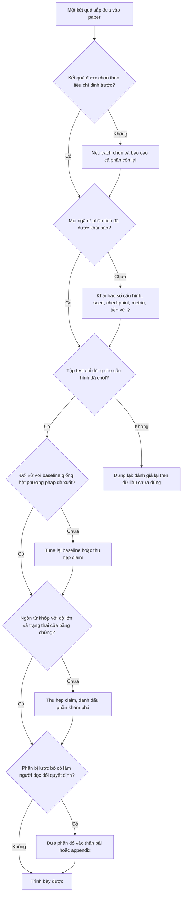

# Đóng khung lại hay bóp méo: ranh giới trung thực

!!! abstract "Mục tiêu của bài"
    Sau bài này, người học có thể:

    - Phân biệt ba vùng trên phổ trình bày kết quả (hợp lệ, vùng xám, sai phạm), xếp một hành vi cụ thể vào đúng vùng và nêu được điều kiện khiến nó chuyển vùng.
    - Giải thích HARKing, phân biệt nó với việc đổi khung hợp lệ, và viết câu đánh dấu một phân tích là khám phá.
    - Nhận diện các bậc tự do của người nghiên cứu trong một dự án ML (seed, hyperparameter, checkpoint, dataset, metric, tiền xử lý) và khai báo chúng trong paper.
    - Nhận ra các dạng chọn lọc, rò rỉ tập test, ngôn từ thổi phồng, cắt lát và nộp trùng, và hiểu vì sao cộng đồng coi chúng là vấn đề.
    - Dùng ba phép thử nhanh và một bộ thực hành phòng ngừa để tự kiểm tra trước khi viết, kể cả khi áp lực đến từ chính nhóm nghiên cứu.

Các bài khác trong chương này liên tục khuyên người viết đổi khung (reframe) câu chuyện. Một phương pháp thua trên benchmark tổng thể có thể được kể lại như một phương pháp mạnh ở chế độ ít dữ liệu. Một tổ hợp nhiều thành phần có thể được viết lại thành một nghiên cứu thực nghiệm về việc thành phần nào thực sự quan trọng. Một kết quả âm tính có thể trở thành một phát hiện. Những lời khuyên đó đúng, và chúng phản ánh một sự thật của nghề nghiên cứu: kế hoạch ban đầu hiếm khi còn nguyên vẹn sau khi gặp dữ liệu. Nhưng cũng chính những lời khuyên ấy, nếu bị đẩy quá xa, sẽ trượt sang một thứ khác hẳn: chọn ra phần bằng chứng đẹp, giấu phần xấu, và kể một câu chuyện mà toàn bộ dữ liệu không ủng hộ. Ranh giới giữa hai thứ này hiếm khi được vạch rõ, và người mới thường chỉ nhận ra đã vượt qua nó khi reviewer chỉ ra, hoặc tệ hơn, khi một nhóm khác không tái lập được kết quả.

Bài [Xây "câu chuyện" của paper](../01-truoc-khi-viet/cau-chuyen.md) đã có một mục ngắn mang tên *Trung thực*, nêu những điều không được làm và nhắc tới HARKing. Bài này đi sâu hơn theo ba hướng. Thứ nhất, nó thay danh sách "không được làm" bằng một **phổ liên tục**, vì phần lớn các quyết định khó không nằm ở hai đầu phổ mà ở vùng giữa, nơi cùng một hành vi có thể hợp lệ hay không tùy vào việc nó có được khai báo hay không. Thứ hai, nó giảng các khái niệm phương pháp luận nằm sau những lời khuyên quen thuộc: HARKing, khu vườn rẽ nhánh, việc tái sử dụng tập test, áp lực bảng xếp hạng. Hiểu cơ chế giúp người viết tự xử lý cả những tình huống mà không danh sách nào liệt kê trước. Thứ ba, nó cung cấp công cụ: ba phép thử nhanh, các thực hành phòng ngừa, và cách nêu quan ngại khi áp lực đến từ trong nhóm.

Bài này không nhằm khiến người viết dè dặt tới mức không dám trình bày kết quả một cách thuyết phục. Trình bày tốt là một kỹ năng chính đáng, và một paper trung thực nhưng viết vụng vẫn có thể khiến người đọc hiểu sai giá trị của công trình. Mục tiêu là giúp người viết biết chính xác một quyết định trình bày đang nằm ở đâu trên phổ, để có thể mạnh dạn ở vùng hợp lệ và dừng lại đúng chỗ.

## Phổ từ trình bày tốt tới sai phạm

Cách nghĩ phổ biến nhất về đạo đức nghiên cứu là nhị phân: có những việc "gian lận" như bịa số liệu, và mọi thứ còn lại đều được phép. Cách nghĩ này nguy hiểm theo hai chiều. Một mặt, nó khiến người viết yên tâm với những thực hành gây hiểu lầm nghiêm trọng chỉ vì chúng không phải là bịa số liệu, như báo cáo seed tốt nhất hay lặng lẽ bỏ đi một dataset bất lợi. Mặt khác, nó khiến một số người viết quá dè dặt, coi mọi lựa chọn trình bày là thao túng, kể cả những lựa chọn hoàn toàn chính đáng như đặt kết quả mạnh nhất lên Figure 1. Một mô hình hữu ích hơn là nhìn các hành vi như những điểm trên một phổ gồm ba vùng.

**Vùng hợp lệ** gồm những lựa chọn trình bày giúp người đọc hiểu bằng chứng nhanh hơn và đúng hơn: chọn thứ tự trình bày, nhấn mạnh phát hiện quan trọng nhất, chọn ví dụ minh họa theo một tiêu chí được nêu rõ, đặt câu chuyện quanh chế độ mà phương pháp thực sự mạnh trong khi vẫn báo cáo kết quả ở các chế độ còn lại. Đặc điểm chung của vùng này là: nếu người đọc biết mọi điều mà tác giả biết, họ vẫn rút ra cùng một kết luận. Trình bày chỉ thay đổi tốc độ và độ rõ của việc hiểu, không thay đổi nội dung của điều được hiểu.

**Vùng xám** gồm những hành vi mà tính hợp lệ phụ thuộc vào ngữ cảnh và, quan trọng nhất, vào việc có được **khai báo** hay không. Báo cáo kết quả của seed tốt nhất là một ví dụ. Nó có thể chấp nhận được khi mục đích là cho thấy mức trần mà phương pháp đạt được, paper nói rõ đó là "best of N", báo kèm trung bình, và áp dụng đúng quy tắc ấy cho baseline. Nó trở thành gây hiểu lầm khi con số được trình bày như kết quả điển hình. Văn liệu phương pháp luận thường gọi những hành vi kiểu này là *questionable research practices*: chúng không nhất thiết xuất phát từ ý định lừa dối, thường được làm một cách vô thức hoặc vì "ai cũng làm thế", nhưng tác động lên người đọc thì như nhau. Điều đặc trưng của vùng xám là khai báo có thể kéo hành vi về vùng hợp lệ, vì khi được biết cách chọn, người đọc tự điều chỉnh mức độ tin tưởng tương ứng.

**Vùng sai phạm** gồm những hành vi làm sai lệch bằng chứng theo cách mà người đọc không thể tự điều chỉnh, hoặc vi phạm trực tiếp quy định của nơi công bố. Ở cực xa nhất là bịa đặt (fabrication) và sửa đổi (falsification) dữ liệu hay kết quả, cùng với đạo văn. Nhưng vùng này rộng hơn nhiều so với hình dung thông thường. Tune hyperparameter trên tập test rồi báo cáo con số như kết quả trên dữ liệu chưa thấy là sai phạm dù không có con số nào bị bịa, vì con số đó không còn đo đại lượng mà nó tuyên bố đo. Nộp trùng là sai phạm dù cả hai bản đều chứa kết quả thật, vì nó vi phạm một quy định mà tác giả đã cam kết tuân thủ khi nộp bài.

Từ mô hình phổ này có thể rút ra hai nguyên tắc dùng cho toàn bộ phần còn lại của bài. Nguyên tắc thứ nhất: **ý định không phải là thước đo chính**. Một nghiên cứu sinh thật lòng tin rằng seed tốt nhất là "seed đúng", vì các seed khác hẳn đã "bị lỗi gì đó", vẫn gây ra cho người đọc đúng sai lệch mà một người cố ý chọn gây ra. Vì vậy, các biện pháp phòng ngừa ở cuối bài tập trung vào quy trình chứ không vào thiện chí. Nguyên tắc thứ hai: **khai báo là cây cầu nối vùng xám với vùng hợp lệ, nhưng không bắc được tới vùng sai phạm**. Một paper viết *"we tuned hyperparameters on the test set"* là trung thực, nhưng con số của nó vẫn vô giá trị như một ước lượng về khả năng tổng quát hóa; reviewer sẽ không chấp nhận, và họ đúng.

Bảng dưới đây tổng hợp mười lăm hành vi thường gặp. Cột cuối nêu điều kiện khiến hành vi chuyển vùng, vì đó mới là thông tin có ích khi phải ra quyết định.

| Hành vi | Vùng | Điều kiện và ghi chú |
|---|---|---|
| Chọn ví dụ định tính theo tiêu chí nêu rõ (ngẫu nhiên với seed cố định, theo phân vị chất lượng), kèm failure cases | Hợp lệ | Tiêu chí được ghi trong caption hoặc appendix |
| Chọn ví dụ định tính đẹp nhất mà không nói cách chọn | Xám, nghiêng về sai phạm | Gây hiểu lầm khi hình ngụ ý tính đại diện; ghi rõ là ví dụ chọn lọc và thêm mẫu ngẫu nhiên ở appendix để về vùng hợp lệ |
| Báo cáo trung bình và độ lệch chuẩn qua nhiều seed, nêu số seed | Hợp lệ | Là chuẩn mực được mong đợi khi kết quả dao động |
| Báo cáo seed tốt nhất | Xám | Chấp nhận được khi ghi "best of N", kèm trung bình, và cùng quy tắc cho baseline; sai phạm khi trình bày như kết quả điển hình |
| Đổi khung câu chuyện sau khi có kết quả, khung mới đúng với toàn bộ bằng chứng | Hợp lệ | Phân tích hình thành sau khi xem dữ liệu được đánh dấu là khám phá hoặc được kiểm chứng trên dữ liệu mới |
| Trình bày giả thuyết hình thành sau khi có kết quả như thể đã đặt ra từ trước (HARKing) | Xám tới sai phạm | Càng che giấu nhiều bằng chứng trái chiều, càng gần sai phạm |
| Bỏ một dataset vì lý do khách quan đã nêu (license, lỗi nhãn đã biết, ngoài phạm vi bài toán) | Hợp lệ | Lý do được nêu và không phụ thuộc vào kết quả của phương pháp |
| Bỏ một dataset chuẩn của bài toán chỉ vì phương pháp thua, không nhắc tới | Sai phạm | Báo cáo và phân tích nó, hoặc thu hẹp claim |
| Chọn hyperparameter hoặc checkpoint dựa trên tập test | Sai phạm | Khai báo không cứu được con số |
| Dùng baseline yếu, cũ, hoặc tune kém hơn phương pháp đề xuất | Xám tới sai phạm | Cần cùng ngân sách tune, baseline mạnh gần đây, nguồn gốc số liệu rõ ràng |
| Chỉ báo cáo metric mà phương pháp thắng, trong khi cộng đồng dùng nhiều metric | Xám | Báo đủ metric chuẩn; metric mới cần lý do độc lập với kết quả |
| Thổi phồng đóng góp và ngôn từ ("first", "solves", "significantly" khi chưa kiểm định) | Xám | Thành sai phạm khi tác giả biết claim "first" là không đúng |
| Cắt một kết quả thành nhiều paper chồng lấn | Xám tới sai phạm | Mỗi paper phải đứng được với đóng góp riêng, trích dẫn chéo và khai báo phần chồng lấn |
| Nộp cùng nội dung tới hai nơi có thời gian review chồng lấn | Sai phạm | Vi phạm quy định đã cam kết khi nộp |
| Không trích dẫn công trình đồng thời hoặc công trình gần mà tác giả đã biết | Xám tới sai phạm | Trích dẫn và nêu khác biệt một cách khách quan |

Khi đọc kỹ cột cuối, có thể thấy gần như mọi điều kiện đều quy về hai ý. Ý thứ nhất là **khai báo**: người đọc có được biết cách chọn hay không. Ý thứ hai là **đối xứng**: quy tắc áp cho phương pháp đề xuất có được áp đúng như vậy cho baseline hay không. Một bảng báo seed tốt nhất cho phương pháp mới nhưng seed trung bình cho baseline vi phạm cả hai, dù từng con số trong đó đều có thật. Hai ý này sẽ trở lại trong mọi mục tiếp theo.

!!! danger "Những điều không có vùng xám"
    Bịa hoặc sửa số liệu, hình ảnh, log hay nhãn dữ liệu; báo cáo con số đã được tối ưu trên tập test như kết quả trên dữ liệu chưa thấy; nộp trùng; đạo văn, kể cả đạo văn ý tưởng hay hình vẽ. Không có cách trình bày nào làm những hành vi này trở nên chấp nhận được. Hậu quả, tùy quy định của hội nghị và của cơ sở nghiên cứu, có thể gồm rút paper, bị hạn chế nộp bài, và các hình thức xử lý ở cấp cơ sở, kéo theo tổn hại lâu dài cho mọi đồng tác giả.

## Đổi khung sau khi có kết quả: HARKing và đổi khung hợp lệ

Trong các hành vi của bảng trên, đổi khung sau khi có kết quả là hành vi khó phân định nhất, vì cùng một thao tác bề ngoài có thể nằm ở bất kỳ vùng nào trong ba vùng. Vấn đề đã được đặt tên từ lâu trong phương pháp luận khoa học. Năm 1998, nhà tâm lý học Norbert Kerr đặt ra thuật ngữ **HARKing** (*Hypothesizing After the Results are Known*) trong một bài trên tạp chí *Personality and Social Psychology Review*. Theo Kerr, HARKing là việc trình bày một giả thuyết được hình thành *sau khi* đã thấy kết quả, như thể nó là giả thuyết được đặt ra *trước* nghiên cứu.

Vì sao điều này có hại, khi giả thuyết hậu nghiệm có thể hoàn toàn đúng? Lý do nằm ở cách người đọc đánh giá sức nặng của bằng chứng. Khi một giả thuyết được đặt ra trước và thí nghiệm có thể bác bỏ nó nhưng đã không bác bỏ, người đọc có lý do để tin nó: giả thuyết đã "chịu rủi ro" và sống sót. Khi giả thuyết được nặn ra để khớp với kết quả đã có, nó không chịu rủi ro nào cả; nó khớp với dữ liệu vì được xây để khớp. Trình bày giả thuyết hậu nghiệm như tiên nghiệm vì thế khiến người đọc đánh giá bằng chứng mạnh hơn thực tế, và một quy luật có thể chỉ là nhiễu của một dataset được nâng lên thành "lý thuyết". Một hệ quả kém hiển nhiên hơn, cũng thường được nêu trong các thảo luận về HARKing, là những giả thuyết ban đầu đã thất bại biến mất khỏi văn liệu, nên các nhóm khác có thể tốn công thử lại đúng những ý tưởng ấy.

Trong ML, CV và NLP, giả thuyết hiếm khi được phát biểu tường minh như trong tâm lý học, nhưng nó luôn hiện diện dưới dạng câu "thành phần A giúp ích vì nó xử lý vấn đề X". Xét một ví dụ giả định ở NLP. Một nhóm thiết kế một cơ chế truy xuất tăng cường với giả thuyết rằng nó giảm ảo giác (hallucination) trên các thực thể hiếm. Kết quả cho thấy cơ chế gần như không có tác dụng trên thực thể hiếm, nhưng cải thiện rõ trên các câu hỏi cần suy luận nhiều bước (multi-hop). Phiên bản HARKing của paper sẽ mở đầu bằng *"We hypothesize that multi-hop reasoning fails because…, and design our method to address this"*, trong khi phương pháp chưa bao giờ được thiết kế cho mục đích đó, và nhóm chưa từng kiểm tra giả thuyết multi-hop trên dữ liệu nào khác ngoài chính dữ liệu đã gợi ra nó.

Phiên bản hợp lệ không đòi hỏi paper phải kể lại nhật ký dự án. Paper khoa học không phải nhật ký, và việc tổ chức câu chuyện quanh phát hiện multi-hop là hoàn toàn chính đáng. Điều phân biệt hai phiên bản là ba điều kiện. Điều kiện thứ nhất: **khung mới đúng với toàn bộ bằng chứng**, không chỉ với phần được chọn để trình bày. Điều kiện thứ hai: **trạng thái của bằng chứng được nói đúng**. Nếu quy luật multi-hop được phát hiện trên chính tập dữ liệu dùng để báo cáo, nó là kết quả khám phá (exploratory); nếu nhóm hình thành giả thuyết trên tập validation rồi kiểm tra trên hai benchmark multi-hop chưa từng dùng trong quá trình phân tích, nó trở thành kết quả khẳng định (confirmatory). Điều kiện thứ ba: **những gì người đọc cần biết về giả thuyết ban đầu không bị xóa**. Nếu cộng đồng có lý do để kỳ vọng rằng truy xuất tăng cường giúp ích cho thực thể hiếm, việc nó không giúp ích là một thông tin có giá trị, và nên xuất hiện ít nhất trong phần phân tích hoặc appendix.

Điều kiện thứ hai là nơi người viết có nhiều việc cụ thể để làm nhất, vì cách viết quyết định người đọc hiểu bằng chứng thuộc loại nào. Cặp ví dụ dưới đây cho thấy sự khác biệt.

<div class="bad" markdown>
*"As hypothesized, our retrieval mechanism substantially improves multi-hop reasoning (Table 4)."*

Cụm *"as hypothesized"* khẳng định một trình tự không có thật, và người đọc sẽ coi Bảng 4 là một phép kiểm định thành công.
</div>

<div class="good" markdown>
*"Although our mechanism was not designed for multi-hop questions, the gains concentrate there (Table 4). We hypothesize that retrieval helps by supplying intermediate facts, and test this hypothesis on two multi-hop benchmarks that were not used in this analysis (Sec. 5.4)."*

Người đọc biết phát hiện là hậu nghiệm, biết giả thuyết là gì, và biết bằng chứng nào là kiểm định độc lập.
</div>

Khi không có điều kiện kiểm chứng trên dữ liệu mới, câu trung thực là gọi tên trạng thái khám phá một cách thẳng thắn. Các câu mẫu sau thường gặp trong paper của cả ba cộng đồng và có thể điều chỉnh theo ngữ cảnh.

```text
This analysis is exploratory: we identified the pattern on the validation
set after observing the main results, and it should be read as
hypothesis-generating rather than confirmatory.

We did not pre-specify this subgroup analysis. For completeness, Appendix D
reports the same analysis for all other subgroups we examined.

Our initial motivation was to reduce hallucination on rare entities; we found
no consistent effect there (Appendix C). The gains instead concentrate on
multi-hop questions, which we study in the remainder of the paper.

We caution that this observation is post hoc and based on a single dataset;
verifying it on other benchmarks is an important direction for future work.
```

Câu thứ hai trong khối trên đáng chú ý: nó không chỉ gọi tên trạng thái khám phá mà còn báo cáo *mọi* nhóm con đã xem xét. Đây là cầu nối sang khái niệm tiếp theo, vì vấn đề của phân tích hậu nghiệm không chỉ nằm ở trình tự thời gian mà còn ở số lượng con đường đã đi qua trước khi tới được kết quả.

## Khu vườn rẽ nhánh: những lựa chọn không ai nhìn thấy

HARKing là chuyện thay đổi câu hỏi sau khi thấy câu trả lời. Một vấn đề tinh tế hơn xảy ra ngay cả khi câu hỏi không đổi: con đường từ dữ liệu tới con số trong bảng có rất nhiều ngã rẽ, và ở mỗi ngã rẽ, nhà nghiên cứu chọn một nhánh. Andrew Gelman và Eric Loken, trong bài viết năm 2013 mang tên *The garden of forking paths*, chỉ ra rằng các lựa chọn phân tích không được khai báo có thể làm sai lệch suy luận *kể cả khi không ai cố ý thử nhiều phân tích để tìm kết quả đẹp*. Điểm then chốt trong lập luận của họ là: nhà nghiên cứu có thể chỉ chạy đúng một phân tích, nhưng phân tích đó được chọn *sau khi* nhìn dữ liệu. Nếu dữ liệu khác đi, nhà nghiên cứu đã có thể chọn một phân tích khác, cũng hợp lý không kém. Vì vậy, xét về mặt thống kê, con số cuối cùng mang theo dấu vết của nhiều phép so sánh tiềm năng, dù chỉ một phép so sánh được thực hiện.

Một phép tính đơn giản giúp hình dung mức độ của hiện tượng. Giả sử mỗi cấu hình có 5% khả năng trông "tốt hơn có ý nghĩa" chỉ do ngẫu nhiên, và nhóm tác giả đi qua 20 cấu hình độc lập. Khả năng ít nhất một cấu hình trông tốt do ngẫu nhiên là 1 − 0,95^20, tức khoảng 64%. Các cấu hình trong ML không độc lập với nhau, nên con số thực tế khác đi, nhưng hướng của hiệu ứng thì không đổi: càng nhiều ngã rẽ, nhánh tốt nhất càng lạc quan so với hiệu quả thật.

Trong một dự án ML, CV hay NLP điển hình, các bậc tự do của người nghiên cứu (thường được gọi là *researcher degrees of freedom*) nhiều hơn hẳn so với một thí nghiệm tâm lý học. **Seed** quyết định khởi tạo, thứ tự dữ liệu và augmentation; Henderson và cộng sự, trong *Deep Reinforcement Learning that Matters* (AAAI 2018), cho thấy kết quả deep RL nhạy với seed, hyperparameter và chi tiết cài đặt, và kêu gọi một chuẩn báo cáo chặt hơn. **Hyperparameter** không chỉ là giá trị cuối cùng mà còn là không gian tìm kiếm, ngân sách tìm kiếm và tập dùng để chọn. **Checkpoint** là một ngã rẽ hay bị bỏ qua: chọn checkpoint cuối, checkpoint tốt nhất trên validation, hay trung bình các checkpoint là ba lựa chọn cho ba con số khác nhau. **Dataset** gồm cả việc chọn dataset nào, phiên bản nào, cách chia nào, và có lọc bỏ mẫu nào không. **Metric** gồm cả tên metric lẫn cách cài đặt: cùng một tên metric nhưng khác cách tokenize, khác cách chuẩn hóa văn bản hay khác ngưỡng IoU có thể cho những con số không so sánh được với nhau. **Tiền xử lý** gồm độ phân giải ảnh, cách cắt câu, cách khử trùng lặp, và với các phương pháp dùng LLM, cả prompt template lẫn tham số giải mã.

Lời giải không phải là tránh đưa ra lựa chọn, điều bất khả thi, mà là làm cho các lựa chọn trở nên nhìn thấy được. Có bốn việc cụ thể. Một là đưa ra lựa chọn trên tập validation, trước khi chạm vào tập test. Hai là khai báo không chỉ nhánh được chọn mà cả số nhánh đã thử. Ba là cho thấy kết luận vững qua các nhánh hợp lý, ví dụ bằng một phân tích độ nhạy với hyperparameter quan trọng nhất hoặc kết quả theo cả hai cách chọn checkpoint. Bốn là áp dụng cùng quy trình cho baseline. Bảng sau tổng hợp các bậc tự do và cách khai báo tương ứng.

| Bậc tự do | Ngã rẽ điển hình | Cách khai báo trong paper |
|---|---|---|
| Seed | Số lần chạy, seed nào được báo cáo | Số seed, mean ± std, yếu tố thay đổi giữa các lần chạy |
| Hyperparameter | Không gian và ngân sách tìm kiếm, tập dùng để chọn | Không gian tìm kiếm, số cấu hình đã thử cho mỗi phương pháp, tiêu chí chọn |
| Checkpoint | Cuối cùng, tốt nhất trên validation, trung bình | Quy tắc chọn checkpoint, áp dụng như nhau cho mọi hệ thống |
| Dataset | Dataset, phiên bản, cách chia, lọc mẫu | Danh sách mọi dataset đã đánh giá, phiên bản, quy tắc lọc |
| Metric | Metric nào, cài đặt nào | Định nghĩa, thư viện và phiên bản, tham số của metric |
| Tiền xử lý | Độ phân giải, tokenization, khử trùng lặp, prompt | Quy trình đầy đủ trong appendix; prompt và tham số giải mã nguyên văn |

Khối dưới đây là một đoạn mẫu cho phần Experimental setup hoặc appendix, gói các khai báo trên vào vài câu. Một đoạn như vậy chiếm ít chỗ nhưng trả lời trước phần lớn các câu hỏi về độ tin cậy mà reviewer có thể đặt ra.

```text
Hyperparameters for all methods, including baselines, were selected on the
validation set using the same budget of 30 configurations per method
(search space in Appendix B.1). We report the checkpoint with the best
validation score, selected identically for all systems. All results are
mean ± standard deviation over 5 seeds, which vary initialization and data
order. We evaluated on every dataset listed in Table 1; no dataset was
excluded after observing results. The test set was used only once per
reported configuration.
```

## Chọn lọc: năm chỗ dễ trượt

Khu vườn rẽ nhánh mô tả những lựa chọn diễn ra *trong quá trình phân tích*. Chọn lọc là những lựa chọn diễn ra *khi trình bày*: trong mọi thứ đã có, phần nào được đưa vào paper. Năm đối tượng hay bị chọn lọc nhất là seed, ví dụ định tính, dataset, baseline và metric. Mỗi đối tượng có một dạng chọn lọc hợp lệ và một dạng gây hiểu lầm, và reviewer có kinh nghiệm thường nhận ra dạng thứ hai qua những dấu hiệu khá quen thuộc.

**Seed.** Dạng chọn lọc rõ nhất là chạy nhiều lần rồi báo lần tốt nhất. Một dạng kín đáo hơn là chạy lại "cho chắc" chỉ khi kết quả xấu, và dừng ngay khi kết quả đẹp; quy tắc dừng phụ thuộc vào kết quả như vậy cũng là chọn lọc, dù cuối cùng chỉ một con số được báo. Reviewer nhận ra vấn đề khi mức cải thiện nhỏ, không có error bar, hoặc khi kết quả của baseline thấp hơn con số trong paper gốc. Cách làm trung thực đã được trình bày ở mục *Số liệu và ý nghĩa thống kê* trong bài [Experiments](../02-viet-tung-phan/experiments.md): cố định số seed từ trước, báo mean ± std, và nói rõ ký hiệu ± biểu thị gì.

**Ví dụ định tính.** Ở CV, *"cherry-picked visualizations"* là một trong những phê bình quen thuộc nhất. Ở NLP, vấn đề tương tự xuất hiện với các ví dụ đầu ra của mô hình sinh văn bản. Chọn ví dụ đẹp để minh họa không có gì sai, vì mục đích của một hình minh họa là cho thấy phương pháp *có thể* làm được gì. Vấn đề phát sinh khi hình ngụ ý rằng đây là chất lượng điển hình. Cách giải quyết gọn nhất là nói rõ tiêu chí chọn ngay trong caption và bổ sung một tập mẫu không chọn lọc, chẳng hạn mẫu ngẫu nhiên với seed cố định, trong appendix hoặc supplementary. Trong mô hình sinh ảnh, nhiều paper phân biệt rõ mẫu *curated* và *uncurated*; thực hành này đáng học theo ở mọi cộng đồng. Một hình failure case đặt cạnh các ví dụ thành công còn làm tăng độ tin cậy của toàn bộ phần định tính.

**Dataset.** Câu hỏi then chốt là danh sách dataset được chốt *khi nào*. Nếu nó được chốt trước khi chạy, việc báo cáo đủ danh sách là hiển nhiên. Nếu nó được chốt sau khi biết phương pháp thắng ở đâu, danh sách ấy là một nhánh trong khu vườn rẽ nhánh. Bỏ một dataset vì lý do khách quan, như license không cho phép, lỗi nhãn đã được cộng đồng ghi nhận, hay dataset nằm ngoài phạm vi bài toán, là hợp lệ khi lý do được nêu ra. Bỏ một dataset chuẩn vì phương pháp thua thì không. Lối ra trung thực thường mạnh hơn người viết nghĩ: phân tích vì sao phương pháp thua trên dataset đó thường làm lộ ra đúng ranh giới áp dụng của phương pháp, và ranh giới ấy có thể trở thành một phần của câu chuyện. Các lối ra cụ thể được bàn trong bài [Khi con số không đẹp](con-so-khong-dep.md).

**Baseline.** Lipton và Steinhardt, trong *Troubling Trends in Machine Learning Scholarship* (2018), xếp "không xác định được nguồn gốc của cải thiện thực nghiệm" vào bốn xu hướng đáng lo ngại của văn liệu ML; ví dụ tiêu biểu là cải thiện được gán cho thay đổi kiến trúc trong khi thực ra đến từ việc tune kỹ hơn. Các nghiên cứu đánh giá lại như *On the State of the Art of Evaluation in Neural Language Models* (Melis và cộng sự, ICLR 2018), *Are GANs Created Equal?* (Lucic và cộng sự, NeurIPS 2018) và *A Metric Learning Reality Check* (Musgrave và cộng sự, ECCV 2020) đã được giới thiệu ở mục *So sánh công bằng* trong bài [Thiết kế thí nghiệm](../01-truoc-khi-viet/thi-nghiem.md); điểm chung của chúng là nhiều "tiến bộ" co lại đáng kể khi baseline được đối xử công bằng. Dưới góc nhìn của bài này, chọn baseline yếu là một dạng chọn lọc: trong tập các đối thủ có thể so sánh, tác giả chọn những đối thủ dễ thắng. Dấu hiệu reviewer hay để ý là baseline mạnh nhất gần đây vắng mặt, hoặc baseline được chạy lại với kết quả thấp hơn paper gốc mà không có lời giải thích.

**Metric.** Khi cộng đồng dùng nhiều metric cho một bài toán, chỉ báo cáo metric mà phương pháp thắng là chọn lọc, dù mỗi con số được báo đều đúng. Một dạng khác là đổi metric chính sau khi thấy kết quả. Đề xuất một metric mới là đóng góp hợp lệ, với điều kiện lý do cho metric mới độc lập với việc phương pháp của tác giả đạt điểm cao trên nó, và các metric chuẩn vẫn được báo cáo bên cạnh. Một metric mới chỉ có một bằng chứng ủng hộ là "phương pháp đề xuất thắng trên metric này" thì không thuyết phục được ai.

Năm dạng chọn lọc trên có chung một phép thử: nếu người đọc thấy được phần không được chọn, họ có đổi ý không? Phép thử này sẽ được phát biểu đầy đủ ở mục *Ba phép thử nhanh*. Trước đó, cần xem xét đối tượng nhạy cảm nhất trong mọi quy trình đánh giá.

## Tập test là thứ thiêng liêng

Tập test có một vai trò duy nhất: ước lượng hiệu năng của một hệ thống trên dữ liệu mà nó chưa từng "thấy", theo bất kỳ nghĩa nào. Mọi con số trên tập test chỉ có ý nghĩa đó khi điều kiện này được giữ nguyên vẹn. Vì vậy, các vi phạm liên quan tới tập test thuộc loại nghiêm trọng nhất trong bài: chúng không làm con số kém chính xác đi một chút, mà làm nó mất đi chính ý nghĩa mà nó tuyên bố.

Dạng vi phạm rõ ràng nhất là **tune trên test**: chọn hyperparameter, checkpoint, ngưỡng quyết định hay prompt dựa trên kết quả test. Ít ai làm điều này một cách công khai, nhưng nó dễ xảy ra qua những đường vòng, chẳng hạn khi code chọn checkpoint mặc định đọc metric từ tập test, hoặc khi benchmark chỉ có hai phần chia và nhóm dùng phần "test" làm validation.

Dạng kín đáo hơn là **đánh giá lặp lại trên test**. Không có bước tune nào cả, nhưng nhóm chạy test sau mỗi thay đổi nhỏ, nhìn kết quả, rồi quyết định hướng thay đổi tiếp theo. Mỗi lần nhìn để lại một chút thông tin về tập test trong quyết định của con người, và qua đủ nhiều vòng, hiệu quả tích lũy không khác gì tune trên test. Đây là lý do nhiều benchmark có tập test ẩn đặt giới hạn số lần nộp lên server đánh giá. Ở quy mô cộng đồng, câu hỏi về tái sử dụng tập test đã được kiểm tra trực tiếp: Recht và cộng sự, trong *Do ImageNet Classifiers Generalize to ImageNet?* (ICML 2019), tạo lại một tập test mới theo quy trình gốc và thấy độ chính xác của các mô hình đều giảm, nhưng thứ hạng giữa chúng phần lớn được giữ nguyên. Kết quả này thường được đọc như một tin tương đối tốt về thứ hạng giữa các mô hình sau nhiều năm cả cộng đồng dùng chung một tập test. Nó không phải giấy phép cho một paper cụ thể chọn cấu hình dựa trên tập test, và mức sụt giảm độ chính xác là lời nhắc rằng con số tuyệt đối trên một tập test cụ thể không nên được đọc như năng lực tổng quát.

Dạng thứ ba là **rò rỉ dữ liệu** (data leakage): thông tin của tập test lọt vào quá trình huấn luyện qua đường kỹ thuật, thường hoàn toàn vô ý. Các dạng thường gặp gồm mẫu trùng hoặc gần trùng giữa các phần chia; cùng một thực thể xuất hiện ở cả train và test (cùng một bệnh nhân, cùng một người nói, cùng một cảnh, các khung hình của cùng một video, các câu của cùng một tài liệu); rò rỉ theo thời gian, khi dữ liệu huấn luyện chứa thông tin từ sau thời điểm của dữ liệu test; tiền xử lý được "fit" trên toàn bộ dữ liệu, như thống kê chuẩn hóa hay từ vựng; và nhãn bị mã hóa gián tiếp trong metadata hay tên file. Rò rỉ không phải là gian lận, nhưng một khi đã phát hiện, việc không sửa và không báo cáo thì chắc chắn là vấn đề.

Dạng thứ tư, ngày càng trung tâm, là **contamination** trong các mô hình lớn: benchmark có thể đã nằm trong dữ liệu pre-training mà tác giả không kiểm soát được. Các cách giảm thiểu đã được trình bày ở bài [Viết cho ACL / EMNLP / NAACL](../06-cong-dong/nlp.md). Dưới góc độ trung thực, điều cốt lõi là khi không thể loại trừ contamination, paper phải nói như vậy, và claim phải được thu hẹp tương ứng; một claim về "zero-shot generalization" đứng không vững nếu dữ liệu test có thể đã được mô hình nhìn thấy. Với mô hình đóng qua API, một khó khăn khác là mô hình phía sau có thể thay đổi: Chen, Zaharia và Zou, trong *How is ChatGPT's behavior changing over time?* (2023), ghi nhận hành vi của GPT-3.5 và GPT-4 thay đổi giữa hai thời điểm trong cùng một năm. Ghi lại tên mô hình, phiên bản và ngày gọi không chỉ là chuyện tái lập, mà còn là cách trung thực để nói rõ con số đo cái gì.

Một quy ước nhóm đơn giản giải quyết phần lớn các vấn đề trên: tập test chỉ được chạy cho những cấu hình đã chốt, và mỗi lần chạy test được ghi vào log kèm lý do. Bài [Thiết kế thí nghiệm](../01-truoc-khi-viet/thi-nghiem.md) đã nêu nguyên tắc này dưới dạng một lời cảnh báo; bài này bổ sung lý do vì sao nó không thể thương lượng.

## Ngôn từ và đóng góp thổi phồng

Các mục trên bàn về con số. Nhưng ngay cả khi mọi con số đều sạch, paper vẫn có thể gây hiểu lầm qua chữ. Lipton và Steinhardt dành phần lớn bài viết của họ cho chuyện này. Bốn xu hướng mà họ nêu gồm: không phân biệt giải thích với suy đoán; không xác định nguồn gốc của cải thiện thực nghiệm; "mathiness", tức dùng toán để gây ấn tượng hoặc che mờ thay vì làm rõ (đã bàn ở bài [Viết cho NeurIPS / ICML / ICLR](../06-cong-dong/ml.md)); và lạm dụng ngôn từ.

Xu hướng thứ nhất có liên hệ trực tiếp với HARKing. Một paper đưa ra lời giải thích cho việc vì sao phương pháp hoạt động, nhưng lời giải thích ấy chưa từng được kiểm tra; nó là suy đoán khoác áo giải thích, và nhờ uy tín của hình thức paper khoa học, nó dễ được các paper sau nhắc lại như sự thật. Lipton và Steinhardt nêu một ví dụ tích cực: paper giới thiệu dropout dành riêng một mục *Motivation* để chứa phần suy đoán về mối liên hệ với sinh học, tách nó khỏi phần bằng chứng. Bài học cho người viết là: suy đoán được phép, thậm chí có ích, miễn là được đánh dấu là suy đoán. Những cụm như *"we conjecture"*, *"one possible explanation is"*, *"we leave a rigorous test of this hypothesis to future work"* làm đúng việc đó.

Xu hướng lạm dụng ngôn từ được hai tác giả chia thành ba dạng. *Định nghĩa gợi ý* (suggestive definitions) là đặt cho một khái niệm kỹ thuật cái tên mang hàm ý đời thường, nhờ đó "lén" đưa vào những hàm ý chưa được chứng minh, như gọi tên một thành phần mô hình bằng thuật ngữ của nhận thức con người. *Quá tải thuật ngữ* (overloaded terminology) là dùng một thuật ngữ đã có nghĩa kỹ thuật chính xác theo nghĩa lỏng lẻo hoặc trái với nghĩa gốc. *Từ va li* (suitcase words), mượn từ Minsky, là những từ gói nhiều nghĩa khác nhau, như *interpretability* hay *generalization*; *generalization* có thể nghĩa là từ train sang test cùng phân phối, từ miền này sang miền khác, hay từ benchmark ra thế giới thực, và lẫn lộn các nghĩa này dẫn tới đánh giá quá cao năng lực của hệ thống. Họ cũng phê phán những claim lỏng lẻo kiểu *"human-level"*, vốn che đi khác biệt giữa một tác vụ trên benchmark và công việc thật của con người.

Ở cấp độ paper, thổi phồng thường tập trung ở danh sách đóng góp. Một nguyên tắc xuyên suốt chương này là **mỗi đóng góp được liệt kê là một claim phải bảo vệ**. Thêm đóng góp yếu không làm paper mạnh lên; nó mở thêm mặt trận cho reviewer tấn công và làm loãng thông điệp chính, như bài [Ghép ý tưởng và "độn" đóng góp](ghep-va-don.md) phân tích chi tiết. Một số từ đặc biệt cần thận trọng. *First* đòi hỏi một cuộc tìm kiếm novelty nghiêm túc, và nên đi kèm phạm vi cụ thể; nếu tác giả biết có công trình đồng thời hoặc công trình gần mà không trích dẫn, claim *first* chuyển sang vùng sai phạm (xem mục *Concurrent work* trong bài [Tìm và thẩm định ý tưởng](../01-truoc-khi-viet/y-tuong.md)). *Solves* hầu như không bao giờ đúng. *Significantly* được hiểu là có ý nghĩa thống kê. *State-of-the-art* cần nói rõ trên benchmark nào và dưới ràng buộc nào.

<div class="bad" markdown>
*"We propose the first framework that truly understands visual scenes, significantly outperforming all existing methods and solving the long-standing problem of compositional generalization."*

Năm claim lớn trong một câu, không claim nào có phạm vi; *understands* là định nghĩa gợi ý, *significantly* chưa có kiểm định, và *solving* không thể bảo vệ.
</div>

<div class="good" markdown>
*"We propose a scene-graph-conditioned decoder that improves compositional generalization on CLEVR-style splits by 4.1 points over the strongest baseline (mean over 5 seeds; Table 2). The gains shrink on natural images (Table 5), suggesting that the benefit depends on the availability of accurate scene graphs."*

Claim có thước đo, phạm vi, đối tượng so sánh và độ bất định; giới hạn được nêu ngay cạnh kết quả.
</div>

Câu tốt ở trên (của một phương pháp giả định) không yếu hơn câu xấu. Ngược lại, nó cho reviewer một thứ cụ thể để tin, và việc tự nêu giới hạn khiến phần còn lại đáng tin hơn. Lời khuyên của Lipton và Steinhardt cho tác giả gói lại tinh thần này: hãy hỏi "cái gì đã hiệu quả?" và "vì sao?", chứ không chỉ "tốt tới mức nào?"; và ba thực hành họ thấy ở những paper thực nghiệm mạnh nhất là phân tích lỗi, ablation và kiểm tra độ vững (robustness checks).

## Áp lực bảng xếp hạng

Nhiều hành vi trong bài này không xuất phát từ cá nhân mà từ một cấu trúc khuyến khích chung: cộng đồng đo tiến bộ bằng việc ai đứng đầu bảng xếp hạng. Sculley và cộng sự gọi tên vấn đề này trong *Winner's Curse? On Pace, Progress, and Empirical Rigor* (ICLR 2018 workshop). Lập luận chính của họ là nhịp độ công bố nhanh và sự nhấn mạnh vào việc "thắng" baseline đã làm sự chặt chẽ thực nghiệm suy giảm, và cộng đồng cần những chuẩn mực tốt hơn cho việc đánh giá và báo cáo thực nghiệm. Tinh thần chung của các đề xuất là đặt sự chặt chẽ và hiểu biết lên trên việc thắng: đối xử với baseline nghiêm túc như với phương pháp mới, và coi trọng các nghiên cứu thực nghiệm nhằm hiểu chứ không chỉ nhằm thắng.

Tiêu đề của bài mượn một khái niệm từ kinh tế học đấu giá. "Lời nguyền của người thắng" (winner's curse) mô tả hiện tượng người thắng một cuộc đấu giá thường là người đã ước lượng giá trị món hàng cao hơn thực tế. Phiên bản thống kê của hiện tượng này rất dễ thấy trong ML: khi nhiều phương pháp, mỗi phương pháp với nhiều cấu hình, được đánh giá trên cùng một benchmark có nhiễu, phương pháp đứng đầu có xu hướng là phương pháp vừa tốt vừa *may mắn*. Mức cải thiện mà người thắng báo cáo vì thế thường lạc quan hơn mức cải thiện thật, và khi người khác tái lập, khoảng cách co lại. Không ai cần gian lận để hiện tượng này xảy ra; chỉ cần chọn người thắng trên các ước lượng có nhiễu.

Đối với người viết, áp lực bảng xếp hạng thể hiện qua vài cám dỗ cụ thể: in đậm một con số cao hơn 0,1 điểm trong khi độ lệch chuẩn là 0,4; dồn ngân sách tune cho phương pháp đề xuất trong khi baseline chạy với cấu hình mặc định; nộp nhiều lần lên server đánh giá; và coi một bảng không có số in đậm ở hàng của mình là thất bại. Cách đối phó không phải là phớt lờ bảng xếp hạng, vì benchmark vẫn là ngôn ngữ chung của cộng đồng, mà là báo cáo kèm độ bất định và nói đúng về những gì nằm trong nhiễu. Một câu như *"our method performs on par with the strongest baseline (within one standard deviation) while using 40% fewer FLOPs"* là một claim trung thực và vẫn có giá trị.

Người viết cũng nên biết rằng áp lực này không hoàn toàn đến từ reviewer như nhiều người nghĩ. Hướng dẫn cho reviewer của một số hội nghị những năm gần đây nhắc rằng không nên bác bỏ paper chỉ vì không đạt SOTA; khi chuẩn bị rebuttal, có thể kiểm tra Reviewer Guidelines của năm nộp để biết chính xác quy định. Các nơi công bố như TMLR, với tiêu chí chú trọng việc claim được bằng chứng ủng hộ chính xác hơn là mức độ nổi bật, cũng là lựa chọn thực sự cho những kết quả trung thực nhưng không đứng đầu bảng. Các bài [Khi novelty và hiệu quả lệch pha](novelty-va-hieu-qua.md) và [Áp lực từ bên ngoài](ap-luc-ben-ngoai.md) bàn chi tiết các lối ra này.

## Cắt lát, nộp trùng và tự đạo văn

Các mục trước bàn về cách trình bày bằng chứng *bên trong* một paper. Nhóm hành vi cuối cùng liên quan tới quan hệ *giữa các paper*: một kết quả được công bố bao nhiêu lần, ở bao nhiêu nơi, dưới bao nhiêu hình thức.

**Cắt lát** (salami slicing) là chia một nghiên cứu thành nhiều paper nhỏ, mỗi paper chứa một phần kết quả, để tăng số lượng công bố. Vấn đề không nằm ở việc một dự án sinh ra nhiều paper, điều hoàn toàn bình thường với các dự án lớn, mà ở chỗ các paper không đứng được một mình, hoặc chồng lấn đáng kể với nhau mà không khai báo. Hậu quả với cộng đồng là reviewer phải đọc cùng một nội dung nhiều lần, người đọc phải ghép nhiều paper để hiểu một kết quả, và các khảo sát hay phân tích tổng hợp có thể đếm cùng một bằng chứng hai lần. Một phép thử hữu ích: mỗi paper có trả lời một câu hỏi riêng, với một đóng góp mà paper kia không có, và có đọc hiểu được mà không cần paper kia không? Nếu có, và các paper trích dẫn lẫn nhau một cách minh bạch, việc chia tách là hợp lệ.

**Nộp trùng** (dual submission) là nộp cùng một nội dung, hoặc nội dung chồng lấn đáng kể, tới hai nơi có bình duyệt trong khoảng thời gian chồng lấn. Các bài [Chuẩn bị nộp bài](../04-nop-va-sau-nop/submission.md) và [Chuyển một paper giữa các cộng đồng](../06-cong-dong/chuyen-doi.md) đã trình bày chi tiết quy định và rủi ro, trong đó có một điểm thường bị hiểu sai: viết lại framing cho cộng đồng khác không biến paper thành một paper khác. Ở đây chỉ cần nhấn mạnh lý do nộp trùng thuộc vùng sai phạm chứ không phải vùng xám: nó vi phạm một cam kết mà tác giả đưa ra khi nộp, và nó tiêu tốn công sức của hai nhóm reviewer cho một đóng góp.

**Tự đạo văn** (self-plagiarism, hay text recycling) là dùng lại nội dung đã công bố của chính nhóm tác giả mà không trích dẫn hoặc không khai báo. Đây là vùng xám rộng nhất trong nhóm này, vì thực hành chấp nhận được khác nhau đáng kể giữa các nơi công bố. Dùng lại một đoạn mô tả thiết lập thí nghiệm chuẩn từ paper trước của nhóm, có trích dẫn, thường không bị coi là vấn đề lớn. Trình bày lại kết quả, hình vẽ hay bảng đã công bố như thể chúng là đóng góp mới thì khác. Các trường hợp chuyển tiếp hay gặp nhất là mở rộng một workshop paper thành paper hội nghị và mở rộng một paper hội nghị thành bài tạp chí; cả hai đều có thể hợp lệ, với điều kiện quy định của cả hai nơi cho phép, phiên bản trước được trích dẫn, và phần mới đủ đáng kể theo tiêu chí của nơi nộp sau. Ở các hội nghị double-blind, công trình trước của chính nhóm thường được trích dẫn ở ngôi thứ ba như mọi công trình khác.

!!! info "Quy định khác nhau giữa các hội nghị và theo năm"
    Ranh giới cụ thể của nộp trùng, của việc workshop paper có bị coi là công bố trước hay không, của yêu cầu về phần nội dung mới khi mở rộng sang tạp chí, và của chính sách preprint đều khác nhau giữa các hội nghị, các tạp chí, và thay đổi theo năm. Không nên dựa vào kinh nghiệm của năm trước hay của một hội nghị khác. Căn cứ duy nhất là Call for Papers, Author Guidelines và chính sách đạo đức của nơi nộp trong năm nộp. Khi vẫn không chắc, cách an toàn là hỏi trực tiếp Program Chairs hoặc biên tập viên, và khai báo phần chồng lấn ngay trong form nộp bài.

Điểm chung của cả ba hành vi là chúng làm sai lệch "kế toán" của tri thức: cộng đồng tưởng rằng có nhiều bằng chứng độc lập hơn thực tế, hoặc tưởng rằng một đóng góp mới khi nó đã được công bố. Đó cũng là lý do vì sao khai báo minh bạch, thông qua trích dẫn và form nộp bài, là công cụ chính để ở lại trong vùng hợp lệ.

## Ba phép thử nhanh

Sau khi đã đi qua các khái niệm, chúng ta cần những công cụ đủ đơn giản để dùng trong lúc viết, khi không có thời gian mở lại từng mục của bài này. Ba phép thử dưới đây, mỗi phép thử là một câu hỏi, bao quát phần lớn các tình huống đã bàn. Chúng không thay thế phán đoán, nhưng giúp phán đoán diễn ra ở đúng chỗ.

**Phép thử toàn bộ log.** Nếu reviewer được xem toàn bộ log thí nghiệm, gồm mọi lần chạy, mọi cấu hình, mọi dataset đã thử và mọi lần chạm vào tập test, claim có còn đứng được không? Đây là phép thử trung tâm của chương. Nó bắt được việc chọn seed, bỏ dataset, tune bất đối xứng và HARKing, vì tất cả đều để lại dấu vết trong log mà paper không phản ánh. Một cách thực hành phép thử này là tưởng tượng bảng tổng hợp mọi lần chạy được đính kèm làm appendix, rồi đọc lại Introduction với giả định đó.

**Phép thử người tái lập.** Một người có năng lực, độc lập với nhóm, chỉ có trong tay paper (và code, nếu được công bố), làm đúng theo mô tả, có thu được những con số cùng cỡ và đi tới cùng một kết luận không? Phép thử này bắt được những ngã rẽ không được khai báo: quy tắc chọn checkpoint ngầm định, một bước tiền xử lý quan trọng chỉ có trong code, một prompt đã được tinh chỉnh nhiều vòng mà paper chỉ ghi bản cuối. Nó cũng nhắc người viết rằng tái lập không chỉ là chuyện ra được cùng con số, mà là ra được cùng kết luận.

**Phép thử quyết định của người đọc.** Thông tin bị lược bỏ có làm thay đổi quyết định của một người đọc hợp lý không, chẳng hạn quyết định tin vào claim, dùng phương pháp cho bài toán của họ, hay chọn phương pháp làm baseline? Nếu có, thông tin đó phải có mặt trong paper: ở thân bài nếu nó liên quan tới claim chính, ở appendix nếu nó là chi tiết bổ trợ. Phép thử này đặc biệt có ích để phân định giữa chọn lọc hợp lệ, vốn là việc bắt buộc vì paper có giới hạn trang, và chọn lọc gây hiểu lầm. Lược bỏ một ablation phụ không làm ai đổi quyết định; lược bỏ một dataset nơi phương pháp thua thì có.

Một phép thử phụ đôi khi hữu ích là **đảo vai**: nếu nhóm tác giả đọc được đúng cách trình bày này trong paper của một nhóm cạnh tranh, khi đang làm reviewer, có chấp nhận không? Phép thử này không chặt chẽ bằng ba phép thử trên, nhưng nó bật lại sự hoài nghi mà người viết thường tắt đi khi nhìn kết quả của chính nhóm.

Sơ đồ dưới đây gom các câu hỏi tự kiểm tra thành một trình tự có thể đi qua trước khi đưa một kết quả bất kỳ vào paper, từ một ô trong bảng tới một hình định tính.



Chú ý rằng trong sơ đồ, chỉ có một nhánh dẫn tới "dừng lại" chứ không phải "khai báo rồi đi tiếp": nhánh của tập test. Điều này phản ánh nguyên tắc thứ hai ở đầu bài: khai báo kéo được vùng xám về vùng hợp lệ, nhưng không cứu được một con số đã mất ý nghĩa.

## Thực hành phòng ngừa

Ba phép thử ở mục trước giúp phát hiện vấn đề lúc viết. Nhưng như nguyên tắc thứ nhất của bài đã nói, phần lớn sai lệch xảy ra một cách vô thức, nên cách phòng ngừa hiệu quả nhất là thiết kế quy trình sao cho sai lệch khó xảy ra ngay từ đầu. Năm thực hành dưới đây không tốn nhiều công, nhưng chúng thay đổi đáng kể cả chất lượng lẫn độ trung thực của paper.

**Sổ tay thí nghiệm và nhật ký quyết định.** Mục *Ghi chép thí nghiệm* trong bài [Thiết kế thí nghiệm](../01-truoc-khi-viet/thi-nghiem.md) đã hướng dẫn lưu metadata cho mỗi lần chạy và lập bảng ánh xạ mỗi con số trong paper về một lần chạy. Dưới góc độ trung thực, cần bổ sung một thứ mà metadata tự động không ghi được: **nhật ký quyết định**. Mỗi khi nhóm đưa ra một lựa chọn phân tích, như đổi metric chính, bỏ một dataset, đổi quy tắc chọn checkpoint hay thêm một phân tích nhóm con, nhật ký ghi lại ngày, lựa chọn, lý do, và quan trọng nhất, lựa chọn đó được đưa ra *trước* hay *sau* khi nhìn kết quả liên quan. Vài dòng mỗi tuần là đủ. Khi viết paper, nhật ký này cho biết chính xác phân tích nào là khẳng định và phân tích nào là khám phá, thay vì phải dựa vào trí nhớ vốn rất dễ tự điều chỉnh theo câu chuyện.

**Ghi giả thuyết và tiêu chí trước khi chạy.** Một số ngành như tâm lý học và nghiên cứu lâm sàng có cơ chế đăng ký trước (preregistration) chính thức. Trong ML, CV và NLP, đăng ký trước chính thức chưa phải là thông lệ phổ biến, nhưng phiên bản gọn nhẹ của nó rất dễ áp dụng: trước mỗi đợt thí nghiệm quan trọng, viết một trang kế hoạch phân tích và commit vào repository của dự án, nhờ đó có dấu thời gian. Bài [Thiết kế thí nghiệm](../01-truoc-khi-viet/thi-nghiem.md) đã khuyên xác định trước kết quả nào ủng hộ và kết quả nào bác bỏ mỗi claim; mẫu dưới đây bổ sung những ngã rẽ cần chốt cùng lúc.

```text
# Analysis plan (commit before running; do not edit afterwards; add amendments below)
Date:
Claim under test:
Prediction that would support the claim:
Result that would count against it:
Datasets and splits (complete list):
Primary metric (implementation and version):
Secondary metrics:
Baselines and tuning budget for each (same for all methods):
Seeds (number, fixed in advance):
Checkpoint selection rule:
Test-set protocol (who runs it, how many times):
Planned subgroup analyses:

## Amendments (date, change, reason, before or after seeing which results)
```

Phần *Amendments* ở cuối mẫu là chỗ quan trọng nhất. Kế hoạch thay đổi là chuyện bình thường; điều mẫu này bảo đảm là mọi thay đổi đều để lại dấu vết, kèm thông tin về việc nó được đưa ra trước hay sau khi nhìn kết quả. Đó chính là thông tin cần có để viết đúng các câu đánh dấu phân tích khám phá ở mục HARKing.

**Báo cáo mọi run.** Paper không thể chứa mọi lần chạy, nhưng có thể báo cáo *số lượng* và *phạm vi* của chúng: bao nhiêu cấu hình đã thử cho mỗi phương pháp, những dataset nào đã đánh giá, những biến thể nào đã thử mà không hiệu quả. Appendix là nơi phù hợp cho bảng đầy đủ. Một đoạn ngắn như *"Appendix E lists all 47 configurations we trained, including variants that did not improve over the baseline"* làm được nhiều việc: nó trả lời trước phép thử toàn bộ log, cho người tái lập biết cần bao nhiêu công sức, và giúp cộng đồng tránh thử lại những hướng không hiệu quả.

**Mục Limitations.** Cách viết một mục Limitations cụ thể và trung thực đã được trình bày ở bài [Conclusion, Limitations và Appendix](../02-viet-tung-phan/conclusion-supp.md). Bài này bổ sung một góc nhìn: Limitations là nơi tự nhiên để khai báo những điều đã nêu ở các mục trên, như trạng thái khám phá của một phân tích, rủi ro contamination không thể loại trừ, các dataset hay chế độ mà phương pháp không cải thiện, và những ngã rẽ mà kết luận nhạy cảm. Khi được tác giả chủ động nêu, chúng định khung paper như một công trình hiểu rõ phạm vi của mình; khi bị reviewer phát hiện, cùng những điều đó trở thành bằng chứng của sự che giấu.

**Các checklist.** NeurIPS Paper Checklist và ARR Responsible NLP Checklist là hai ví dụ tiêu biểu về việc cộng đồng biến những câu hỏi trong bài này thành yêu cầu bắt buộc. Nội dung và cách trả lời được trình bày ở các bài [Viết cho NeurIPS / ICML / ICLR](../06-cong-dong/ml.md) và [Chuẩn bị nộp bài](../04-nop-va-sau-nop/submission.md); các hội nghị CV có những yêu cầu riêng trong form nộp bài. Lời khuyên ở đây chỉ có một: điền checklist từ bản nháp đầu tiên và dùng nó như một công cụ tự kiểm tra, không phải một thủ tục điền vào đêm trước deadline. Mỗi câu trả lời khó viết một cách trung thực là một chỗ trong paper cần sửa.

## Khi áp lực đến từ trong nhóm

Những tình huống khó nhất về trung thực thường không đến từ bản thân người viết, mà từ một đề nghị của người hướng dẫn hoặc đồng tác giả: bỏ dataset này đi, chỉ báo lần chạy tốt nhất, viết rằng phương pháp được thiết kế cho mục đích mà thực ra chỉ phát hiện ra sau. Với một nghiên cứu sinh, những đề nghị như vậy đặt ra một bài toán khó, vì quan hệ trong nhóm không cân bằng và hệ quả của bất đồng có thể rất thật.

Điều đầu tiên cần nhớ là phần lớn những đề nghị kiểu này không xuất phát từ ý định lừa dối. Chúng thường đến từ áp lực deadline, từ thói quen của một môi trường mà "ai cũng làm thế", hoặc đơn giản từ việc người đề nghị chưa nhìn kỹ log và không biết rằng dataset bị bỏ là benchmark chuẩn của bài toán. Vì vậy, cách tiếp cận hiệu quả nhất là coi đây là một câu hỏi về chất lượng paper, không phải một cuộc đối đầu về đạo đức. Một câu hỏi đặt đúng cách thường giải quyết được vấn đề trước khi nó trở thành bất đồng.

Có bốn yếu tố giúp nêu quan ngại một cách xây dựng. Thứ nhất là **dựa vào chuẩn mực của cộng đồng thay vì quan điểm cá nhân**: NeurIPS Paper Checklist hỏi trực tiếp về error bar và cách chọn hyperparameter, ARR yêu cầu mục Limitations, reviewer CV quen phê bình *"cherry-picked visualizations"*. Viện dẫn những chuẩn mực này chuyển cuộc trao đổi từ "đúng hay sai" sang "reviewer sẽ đọc thế nào", một câu hỏi mà mọi đồng tác giả đều quan tâm. Thứ hai là **đưa bằng chứng cụ thể**: con số trong log, vị trí của dataset trong các paper gần đây, câu hỏi mà reviewer gần như chắc chắn sẽ đặt ra. Thứ ba là **luôn đi kèm một phương án thay thế vẫn trung thực mà vẫn mạnh**; một quan ngại không kèm đề xuất dễ bị coi là cản trở, còn một quan ngại kèm đề xuất là một đóng góp cho paper. Thứ tư là **nêu sớm và bằng văn bản**, chẳng hạn bằng một bình luận trong tài liệu chung của nhóm, tập trung vào nội dung paper chứ không vào con người.

Một tin nhắn hoặc bình luận theo cấu trúc trên có thể gồm bốn phần, viết ngắn gọn và trung lập, như trong ví dụ giả định dưới đây:

- **Quan sát.** Bảng 2 hiện không có dataset Z; log cho thấy phương pháp thấp hơn baseline B khoảng một điểm trên Z, trung bình qua năm seed.
- **Chuẩn mực.** Z là một trong ba benchmark được dùng trong hầu hết paper gần đây về bài toán này, nên reviewer có khả năng cao sẽ hỏi; NeurIPS Paper Checklist cũng hỏi paper có thảo luận hạn chế không.
- **Đề xuất.** Giữ Z trong Bảng 2; thêm một đoạn ở Mục 5.3 phân tích rằng Z có phân phối độ dài khác hẳn, đúng ở chế độ mà phương pháp không nhắm tới; điều chỉnh claim ở Introduction thành cải thiện trên văn bản ngắn; nêu Z trong Limitations.
- **Chi phí.** Khoảng nửa trang, không cần thí nghiệm mới; đổi lại, claim chính khó bị tấn công hơn.

Phần đề xuất là phần quan trọng nhất, và nó thường có sẵn trong các bài khác của chương này: tìm chế độ mà phương pháp thắng và nói rõ ranh giới, chuyển phân tích bất lợi thành một phát hiện về phạm vi áp dụng, thu hẹp claim cho khớp với bằng chứng, bổ sung một thí nghiệm kiểm chứng, hoặc chọn một nơi công bố có tiêu chí phù hợp hơn. Đôi khi phương án tốt nhất là đề nghị lùi deadline sang chu kỳ sau để làm đủ thí nghiệm, hoặc dừng hướng đi hiện tại; như một nguyên tắc xuyên suốt của chương, dừng lại cũng là một quyết định nghiên cứu tốt, và chi phí chìm không phải là lý do để tiếp tục.

!!! note "Mọi tác giả đứng tên đều chịu trách nhiệm về nội dung"
    Theo chuẩn mực chung của cộng đồng khoa học, đứng tên trên một paper đồng nghĩa với việc chịu trách nhiệm về nội dung của nó, không chỉ về phần việc của riêng từng người. Đây vừa là lý do để mỗi đồng tác giả có quyền nêu quan ngại, vừa là lý do để người hướng dẫn và các tác giả khác lắng nghe. Khi bất đồng về một vấn đề nghiêm trọng vẫn kéo dài, có thể tìm ý kiến của một người thứ ba đáng tin cậy, như một giảng viên khác hoặc một đồng tác giả cấp cao, hoặc tham khảo bộ phận phụ trách liêm chính học thuật mà các trường và viện thường có. Rút tên khỏi paper là lựa chọn sau cùng, nhưng là một lựa chọn chính đáng.

Cũng cần nhìn tình huống từ phía ngược lại. Một người hướng dẫn hoặc tác giả cấp cao muốn xây dựng một nhóm trung thực có thể làm nhiều điều để những cuộc trao đổi như trên trở nên dễ dàng: đặt quy ước về tập test và về báo cáo seed ngay từ đầu dự án, khuyến khích báo cáo kết quả âm tính trong các buổi họp nhóm, và phản ứng với một kết quả xấu bằng câu hỏi "điều này cho biết gì?" thay vì "làm sao để nó biến mất?". Văn hóa của nhóm quyết định phần lớn những gì xảy ra trong các đêm trước deadline.

## Tóm tắt

Trình bày kết quả không phải là lựa chọn nhị phân giữa trung thực và gian lận, mà là một phổ gồm vùng hợp lệ, vùng xám và vùng sai phạm. Ở vùng hợp lệ, người đọc biết mọi thứ tác giả biết vẫn rút ra cùng kết luận; ở vùng xám, khai báo và đối xử đối xứng với baseline kéo hành vi về vùng hợp lệ; ở vùng sai phạm, như tune trên test, nộp trùng hay bịa số liệu, không cách trình bày nào cứu được. Đổi khung sau khi có kết quả là hợp lệ khi khung mới đúng với toàn bộ bằng chứng và trạng thái khám phá hay khẳng định được nói đúng; HARKing là khi giả thuyết hậu nghiệm được trình bày như tiên nghiệm. Khu vườn rẽ nhánh nhắc rằng ngay cả một phân tích duy nhất cũng mang dấu vết của nhiều lựa chọn phụ thuộc dữ liệu về seed, hyperparameter, checkpoint, dataset, metric và tiền xử lý, nên các lựa chọn này cần được chốt trên validation và khai báo. Chọn lọc seed, ví dụ, dataset, baseline và metric, rò rỉ tập test, ngôn từ thổi phồng, áp lực bảng xếp hạng, cắt lát và nộp trùng đều có chung một phép thử trung tâm: nếu reviewer được xem toàn bộ log, claim có còn đứng được không. Ba phép thử nhanh cùng các thực hành phòng ngừa (nhật ký quyết định, kế hoạch phân tích viết trước, báo cáo mọi run, Limitations và checklist) biến sự trung thực từ thiện chí thành quy trình, và khi áp lực đến từ trong nhóm, cách hiệu quả nhất là nêu quan ngại dựa trên chuẩn mực cộng đồng, kèm một phương án trình bày vừa trung thực vừa mạnh.

## Bài tập

1. **Lập sổ cái thí nghiệm.** Với dự án hiện tại, liệt kê mọi cấu hình, seed, dataset, metric và biến thể đã thử, kể cả những thứ đã bỏ. Đặt danh sách này cạnh các bảng trong bản nháp và áp dụng phép thử toàn bộ log: với mỗi khác biệt giữa hai bên, quyết định cần khai báo ở thân bài, ở appendix, hay cần thay đổi claim.
2. **Viết kế hoạch phân tích.** Trước đợt thí nghiệm quan trọng tiếp theo, điền mẫu kế hoạch phân tích trong bài và commit vào repository. Sau khi có kết quả, đối chiếu với kế hoạch, ghi mọi thay đổi vào phần *Amendments*, và viết các câu đánh dấu phân tích khám phá tương ứng bằng tiếng Anh.
3. **Xếp hành vi lên phổ.** Chọn bảng kết quả chính, một hình định tính và danh sách đóng góp trong bản nháp. Với mỗi lựa chọn trình bày (seed nào được báo, ví dụ nào được chọn, baseline nào được so sánh, từ ngữ nào được dùng), xếp nó vào một vùng trên phổ dựa theo bảng tổng hợp, và viết câu khai báo hoặc bản sửa cần thiết để đưa nó về vùng hợp lệ.
4. **Thực hành nêu quan ngại.** Giả định một đồng tác giả đề nghị bỏ một kết quả bất lợi khỏi paper. Viết một bình luận ngắn theo cấu trúc bốn phần trong bài (quan sát, chuẩn mực, đề xuất, chi phí), trong đó phần đề xuất là một cách trình bày thay thế cụ thể, kèm câu tiếng Anh sẽ dùng trong paper.
