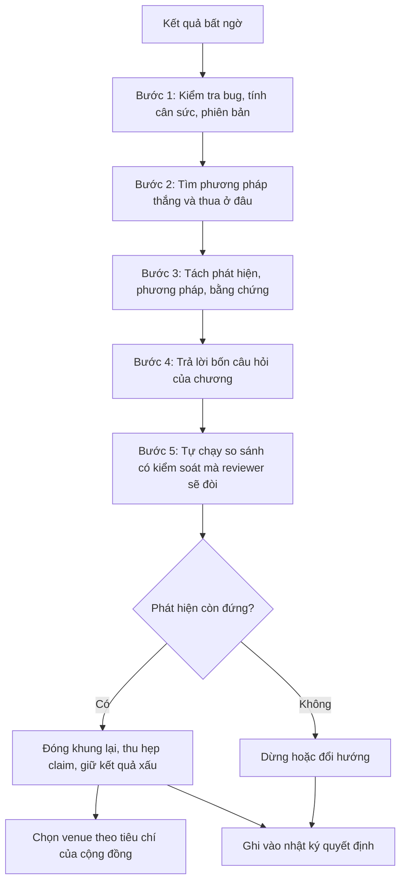

# Thực hành: ba dự án đi qua ngõ cụt

!!! abstract "Mục tiêu của bài"
    Sau bài này, người học có thể:

    - Nhận ra rằng trong dự án thật, các tình huống trớ trêu nối tiếp nhau thành chuỗi, và lối ra chọn ở tình huống trước quyết định hình dạng của tình huống sau.
    - Áp dụng khung ba lớp (phát hiện, phương pháp, bằng chứng) và bốn câu hỏi của chương cho trọn một dự án, từ lúc kết quả bất ngờ xuất hiện tới lúc chọn venue.
    - Viết lại abstract và danh sách contribution sau khi đổi khung, và giải thích từng thay đổi bằng bằng chứng.
    - Nhận diện các lối tắt vi phạm ranh giới trung thực khi chúng xuất hiện dưới dạng một đề xuất nghe hợp lý.
    - Duy trì một nhật ký quyết định cho dự án của người học.

Các bài trước trong chương xử lý mỗi tình huống như một ca bệnh riêng. Cách trình bày ấy cần cho việc học, nhưng nó che đi một đặc điểm của nghiên cứu thật: tình huống đến thành chuỗi. Một module mới thua baseline; phân tích kỹ thì nó thắng ở tập con này, thua ở tập con kia; để cứu con số tổng, nhóm thêm vài mẹo huấn luyện và đạt SOTA, rồi không ai còn biết cái gì tạo ra kết quả. Một lựa chọn sai ở giữa chuỗi, chẳng hạn viết abstract SOTA trước khi làm ablation, có thể khóa nhóm tác giả vào một câu chuyện mà bằng chứng về sau không ủng hộ.

Bài này theo dõi ba dự án giả định, mỗi dự án thuộc một cộng đồng, từ ý tưởng ban đầu tới bản paper được nộp. Bài [Thực hành: một paper từ con số 0](../05-case-studies/worked-example.md) ở Chương 5 đi theo một con đường suôn sẻ, với trọng tâm là quy trình. Ba dự án ở đây đều đi vào ngõ cụt, và trọng tâm là cách *ra khỏi* ngõ cụt. Mỗi dự án được kể theo dòng thời gian với chín phần cố định: ý tưởng và câu chuyện ban đầu; diễn biến thí nghiệm; nhận diện tình huống và bốn câu hỏi; các lối ra; abstract trước và sau; contribution trước và sau; venue; những gì không làm; bài học. Cấu trúc lặp lại có chủ ý, để người học so sánh ba dự án ở cùng một điểm của quy trình.

Không dự án nào kết thúc bằng một paper "thắng lớn". Cả ba kết thúc bằng một paper *đúng*: claim hẹp hơn kỳ vọng, nhưng đứng vững trước toàn bộ log thí nghiệm. Đó là kết cục thường gặp nhất của một ngõ cụt được xử lý tốt, và cũng là kết cục người mới hay đánh giá thấp nhất.

!!! note "Mọi chi tiết trong bài là ví dụ giả định"
    Ba dự án, tên phương pháp (ScaleBridge, DecoVer, StabReg), benchmark tự tạo (NoisySmall-6), mọi con số, nhận xét của người hướng dẫn và cả paper concurrent ở dự án thứ hai đều là **giả định**. COCO, CIFAR-10 và ImageNet là benchmark có thật, nhưng mọi kết quả trên chúng trong bài đều là giả định. Paper thật chỉ được nhắc khi là ví dụ nổi tiếng cho đúng điểm đang bàn.

| | Dự án thứ nhất | Dự án thứ hai | Dự án thứ ba |
|---|---|---|---|
| Cộng đồng | Computer Vision | NLP | Machine Learning |
| Ý tưởng ban đầu | Module cross-scale attention cho instance segmentation | Pipeline prompt năm bước cho suy luận | Regularizer suy ra từ một bound ổn định |
| Chuỗi tình huống | TH1, TH12, TH6, TH18 | TH2, TH27, TH24 | TH34, TH14, TH11, TH7 |
| Venue cuối cùng | Hội nghị CV lớn | Chu kỳ ARR kế tiếp, chấp nhận Findings | TMLR |

## Dự án thứ nhất (Computer Vision): module attention cho vật thể nhỏ

### Ý tưởng ban đầu và câu chuyện ban đầu

Nhóm tác giả gồm một nghiên cứu sinh, một postdoc và người hướng dẫn, làm instance segmentation: vừa phát hiện vừa vẽ mặt nạ (*mask*) cho từng vật thể. Trên COCO, kết quả thường được tách theo ba nhóm kích thước, AP_S, AP_M và AP_L; theo quy ước của COCO, vật nhỏ có diện tích dưới 32×32 pixel và vật lớn trên 96×96 pixel. AP_S luôn thấp hơn hẳn. Giả thuyết của nhóm: mask head làm việc trên feature map độ phân giải thấp, nơi vật nhỏ chỉ còn vài ô; nếu cho feature thô "hỏi" trực tiếp feature map độ phân giải cao (stride 4) qua attention, chi tiết bị mất do downsampling sẽ được khôi phục. Module được đặt tên ScaleBridge. Câu chuyện trong bản pitch tháng đầu tiên:

> *Cross-scale attention lets coarse semantic features recover the fine detail lost by downsampling, improving segmentation for objects of all sizes, and especially for small objects.*

Câu này chứa hai claim chứ không phải một. "Mọi kích thước" và "đặc biệt vật nhỏ" nghe như cùng hướng, nhưng bằng chứng hoàn toàn có thể ủng hộ claim này và phủ định claim kia. Khi chưa có số liệu, không ai để ý điều đó.

### Diễn biến thí nghiệm: kết quả bất ngờ ở đâu

Tháng thứ hai và thứ ba, nhóm cài ScaleBridge vào một mô hình dựa trên query có mã nguồn mở, chạy lại baseline bằng mã chính thức với ba seed. Mask AP tổng *giảm* từ 44,1 xuống 43,7. Trước khi diễn giải, nhóm kiểm tra bug theo đúng lời khuyên của bài [Khi con số không đẹp](con-so-khong-dep.md): khởi tạo nhánh đầu ra của ScaleBridge bằng 0 để module ban đầu là phép đồng nhất và xác nhận mô hình ở bước 0 trùng với baseline; kiểm tra attention không dồn về một điểm; rà learning rate của module mới. Không có bug.

Tách theo kích thước, bức tranh khác hẳn: AP_S tăng 2,3 điểm, AP_M gần như không đổi, AP_L giảm 2,1 điểm. Trên một dataset ảnh đường phố có hơn nửa số instance là vật nhỏ, AP tổng tăng 1,4 điểm. Box AP của vật lớn gần như không đổi, tức mô hình vẫn tìm thấy vật lớn; cái giảm là chất lượng mask. Xem các mask lỗi, nhóm thấy một mẫu hình nhất quán: trên vật lớn có bề mặt nhiều kết cấu (*texture*), như sofa hoa văn hay hươu cao cổ, mask vỡ thành nhiều mảnh, như thể chi tiết tần số cao đã tạo ra đường biên giả bên trong vật thể.

Tháng thứ tư, deadline còn sáu tuần. Postdoc đề xuất ba mẹo huấn luyện quen thuộc: lịch huấn luyện dài gấp đôi, *large-scale jitter*, và trung bình trượt của trọng số (EMA). ScaleBridge đạt 45,6 AP, cao hơn con số tốt nhất đã công bố cho cùng backbone (giả định 45,2). Một bản abstract "SOTA" được viết ngay trong tuần. Người hướng dẫn chỉ hỏi: baseline với cùng ba mẹo đạt bao nhiêu? Bảng dưới đây (giả định; COCO val; trung bình ba seed) là bước ngoặt của dự án.

| Cấu hình | AP | AP_S | AP_M | AP_L |
|---|---|---|---|---|
| (a) Baseline, recipe gốc | 44,1 ± 0,1 | 26,0 | 47,6 | 61,2 |
| (b) Baseline + ScaleBridge, recipe gốc | 43,7 ± 0,2 | 28,3 | 47,4 | 59,1 |
| (c) Baseline + ba mẹo | 45,4 ± 0,15 | 27,1 | 48,9 | 62,6 |
| (d) Baseline + ScaleBridge + ba mẹo | 45,6 ± 0,2 | 29,0 | 48,8 | 61,1 |
| (e) Như (d), thêm gate theo kích thước | 45,7 ± 0,2 | 28,8 | 48,9 | 62,0 |

Riêng ba mẹo đã mang lại 1,3 điểm, dòng (c) so với dòng (a). Khi cả hai cùng hưởng ba mẹo, ScaleBridge chỉ thêm 0,2 điểm, nằm trong dao động giữa các seed: con số SOTA gần như hoàn toàn đến từ recipe. Nhưng bảng còn cho thấy điều con số tổng che đi: trong cùng recipe, ScaleBridge vẫn tăng AP_S 1,9 điểm và vẫn giảm AP_L 1,5 điểm. Trade-off theo kích thước là thuộc tính của cơ chế, không phải sản phẩm phụ của một recipe yếu.

### Nhận diện tình huống và bốn câu hỏi

Dự án đi qua bốn tình huống theo đúng thứ tự: ý tưởng mới nhưng thua baseline (TH1, bài [Khi novelty và hiệu quả lệch pha](novelty-va-hieu-qua.md)); thắng chỗ này, thua chỗ kia (TH12, bài [Khi con số không đẹp](con-so-khong-dep.md)), ở đây vừa theo tập con kích thước vừa theo dataset; ghép nhiều thứ đạt SOTA nhưng không rõ cái gì tạo ra kết quả (TH6, bài [Ghép ý tưởng và "độn" đóng góp](ghep-va-don.md)); và phương pháp "hoạt động" nhưng không vì lý do đã nêu (TH18, bài [Khi câu chuyện và bằng chứng không khớp](cau-chuyen-va-bang-chung.md)). Lipton và Steinhardt, trong "Troubling Trends in Machine Learning Scholarship", gọi đây là không xác định được nguồn gốc của cải thiện thực nghiệm: cải thiện đến từ tuning chứ không từ thay đổi kiến trúc được nhấn mạnh. Chuỗi này có quan hệ nhân quả. TH1 tạo áp lực, áp lực dẫn tới thêm mẹo, thêm mẹo mà không ablation dẫn tới TH6, và TH18 là hệ quả của việc viết abstract trước ablation. Nếu nhóm dừng ở TH12 để hỏi cơ chế nào gây ra trade-off, hai tình huống sau có lẽ đã không xảy ra.

**Phát hiện thật sự là gì?** *Đưa chi tiết độ phân giải cao vào mask head giúp mask của vật nhỏ, nhưng chính chi tiết ấy làm vỡ mask của vật lớn nhiều kết cấu, và trade-off này bị che trong AP tổng.* Câu này viết được, không có tên phương pháp hay con số, và khác hẳn câu chuyện ban đầu.

**Bằng chứng ủng hộ tới đâu?** Một kiến trúc nền, một backbone, hai dataset, ba seed; trade-off giữ nguyên dưới hai recipe. Còn thiếu một backbone thứ hai, và một phép đo định lượng cho cơ chế "đường biên giả", chẳng hạn số thành phần liên thông của mask theo kích thước và mức độ kết cấu.

**Ai quan tâm?** Cộng đồng CV, nhất là những người làm với vật nhỏ (ảnh đường phố, drone, y khoa) và những người thiết kế mask head. Reviewer CV coi trọng bảng SOTA, nhưng chấp nhận paper phân tích một trade-off nếu so sánh cân sức.

**Nếu reviewer thấy toàn bộ log?** Bản abstract SOTA sụp đổ ngay khi reviewer thấy dòng (c). Bản đóng khung quanh trade-off đứng được, với điều kiện cả dòng (b) lẫn (c) có trong paper.

### Các lối ra đã cân nhắc và lối ra được chọn

**Lối ra thứ nhất: giữ claim SOTA, coi ba mẹo là một phần của phương pháp.** Về hình thức, phương pháp bao gồm cả recipe không có gì sai. Nhóm loại lối ra này vì reviewer CV từng đọc "Bag of Tricks for Image Classification with Convolutional Neural Networks" (He et al., CVPR 2019) hay "Revisiting ResNets" (Bello et al., NeurIPS 2021) đều biết tinh chỉnh huấn luyện có thể tạo cải thiện ngang thay đổi kiến trúc, nên gần như chắc chắn sẽ hỏi về baseline cùng recipe. Và kể cả khi không ai hỏi, paper sẽ dạy người đọc một điều sai.

**Lối ra thứ hai: sửa phương pháp cho tới khi hết thua ở vật lớn.** Lối ra này hợp lệ khi sửa đổi xuất phát từ chẩn đoán. Từ chẩn đoán "đường biên giả", nhóm thiết kế một gate học được, điều chỉnh mức đóng góp của ScaleBridge theo kích thước dự đoán của vật. Dòng (e) cho thấy mức thua ở vật lớn giảm từ 1,5 xuống 0,6 điểm, trong khi giữ được 1,7 trong 1,9 điểm tăng ở vật nhỏ. Nhóm không thử thêm biến thể nào chỉ để kéo AP_L lên: mỗi biến thể là thêm một nhánh rẽ trong "khu vườn rẽ nhánh" của Gelman và Loken, và thử đủ nhiều thì kiểu gì cũng có một biến thể trông đẹp. Gate được giữ như một phần của lối ra thứ ba.

**Lối ra thứ ba: đóng khung quanh trade-off theo kích thước, với so sánh có kiểm soát.** Mọi mô hình trong bảng chính, kể cả baseline và các phương pháp được chạy lại, dùng chung ba mẹo; mọi bảng báo cáo đủ AP_S, AP_M, AP_L; gate được trình bày như cách giảm nhẹ trade-off, không như lời giải. Đây là lối ra được chọn, kèm một quy tắc dừng viết sẵn: nếu backbone thứ hai không cho trade-off cùng chiều, claim thu hẹp về một kiến trúc hoặc paper lùi sang hội nghị kế tiếp. Kết quả (giả định) trên backbone thứ hai cùng chiều, AP_S tăng 1,5 và AP_L giảm 1,2.

**Lối ra thứ tư: dừng, hoặc viết paper về recipe.** Nhóm không dừng vì phát hiện về trade-off đứng vững qua hai recipe và hai dataset. Paper về recipe bị loại ngay: ba mẹo đều đã biết, và các khảo sát có hệ thống như Bag of Tricks đã làm việc đó.

### Abstract trước và sau

<div class="bad" markdown>
**Bản trước** (viết khi có 45,6 AP, trước khi có dòng (c)):

Instance segmentation models still struggle to produce accurate masks, especially for small objects, because repeated downsampling discards fine spatial detail. We propose ScaleBridge, a novel cross-scale attention module that allows coarse semantic features to adaptively query high-resolution feature maps and recover the lost detail at every scale. ScaleBridge is lightweight, plug-and-play, adds marginal computational cost, and can be inserted into any query-based segmentation model. Combined with an improved training recipe, ScaleBridge achieves a new state of the art of 45.6 mask AP on COCO, surpassing all prior methods with comparable backbones, and delivers consistent and significant gains on a second benchmark rich in small objects. Extensive experiments and ablations demonstrate that cross-scale attention is a powerful and general mechanism for improving segmentation quality across object sizes. Code will be released.

Bản này quy con số SOTA cho module trong khi ablation quy nó cho recipe, và khẳng định "across object sizes" trong khi AP_L giảm.
</div>

<div class="good" markdown>
**Bản sau** (viết sau khi có đủ dòng (a) đến (e) và backbone thứ hai):

Overall mask AP can hide how a segmentation model trades accuracy between objects of different sizes. We study one such trade-off, created by injecting high-resolution features into the mask head through cross-scale attention. Under a controlled protocol in which every model, including all baselines, is trained with the same recipe, this attention improves mask AP on small objects by 1.9 points on COCO, and the gain transfers to a second backbone and to a dataset dominated by small objects. The same mechanism, however, lowers mask AP on large objects by 1.5 points: our analysis shows that high-frequency detail creates spurious internal boundaries in large, textured objects and fragments their masks. A simple scale-aware gate reduces this loss to 0.6 points while retaining most of the small-object gain. We further find that most of the overall improvement obtained by combining the module with a stronger recipe comes from the recipe itself. We release code and per-size results for all models.

Bản này mở bằng phát hiện, nêu cả cái được lẫn cái mất, và mỗi con số đều đến từ một so sánh cân sức.
</div>

Bản trước mở bằng một khó khăn chung chung ("still struggle") mà reviewer đã đọc hàng trăm lần. Bản sau mở bằng một khoảng trống cụ thể, AP tổng che giấu trade-off, và câu đó báo trước loại đóng góp của paper, đúng chức năng của câu "khoảng trống" trong khuôn ở bài [Abstract](../02-viet-tung-phan/abstract.md). Tên ScaleBridge là chủ ngữ của gần mọi câu ở bản trước, còn ở bản sau thì không xuất hiện; chủ ngữ là cơ chế ("this attention", "the same mechanism"). Nêu tên phương pháp trong abstract không có gì sai, nhưng việc tên module lùi lại phản ánh đúng sự dịch chuyển từ bán phương pháp sang bán hiểu biết.

Loại con số cũng đổi. Bản trước nêu 45,6 AP, con số phần lớn đến từ recipe. Bản sau nêu +1,9, −1,5 và −0,6, cả ba đo trong cùng recipe và gắn trực tiếp với phát hiện. Con số âm nằm ngay trong abstract chứ không bị đẩy xuống Limitations, vì nó là một nửa của phát hiện, và reviewer thấy tác giả tự nêu điểm yếu sẽ tin các con số dương hơn. Cuối cùng, câu về recipe biến một mối đe dọa (reviewer phát hiện dòng (c)) thành một phát hiện phụ mà nhóm tự công bố. Tiêu đề cũng đổi theo, từ "ScaleBridge: Cross-Scale Attention for Instance Segmentation" sang một tiêu đề nêu trade-off, chẳng hạn "What Fine Detail Costs: Size Trade-offs of Cross-Scale Attention in Instance Segmentation".

### Danh sách contribution trước và sau

Bản trước:

1. *We propose ScaleBridge, a novel cross-scale attention module that recovers fine detail for objects of all sizes.*
2. *We introduce an improved training recipe that further boosts segmentation performance.*
3. *We achieve state-of-the-art results on COCO and consistent gains on a second benchmark.*
4. *Extensive ablations demonstrate the effectiveness of each component.*

Bản sau:

1. *A size-stratified analysis showing that injecting high-resolution features through cross-scale attention improves masks of small objects but fragments masks of large, textured objects, a trade-off hidden by overall AP.*
2. *A scale-aware gate that reduces the large-object loss while retaining most of the small-object gain, evaluated on two backbones and two datasets.*
3. *A controlled comparison in which all models share the same training recipe, showing that the recipe accounts for most of the overall improvement attributed to the module.*

Contribution "training recipe" của bản trước là ví dụ điển hình của độn đóng góp (TH7, bài [Ghép ý tưởng và "độn" đóng góp](ghep-va-don.md)). Nó mời gọi lời chê "these tricks are well known", và tệ hơn, mâu thuẫn với chính so sánh có kiểm soát: nếu recipe là đóng góp của nhóm, vì sao baseline cũng được dùng? Ở bản sau, recipe được mô tả đầy đủ trong mục thiết lập thí nghiệm. "SOTA" biến mất vì không còn đúng theo nghĩa có ý nghĩa, còn "extensive ablations" là bằng chứng chứ không phải đóng góp. Ba dòng còn lại ứng đúng ba lớp của chương, phát hiện, phương pháp, bằng chứng, và mỗi dòng có một thí nghiệm cụ thể để bảo vệ.

### Venue được chọn và lý do

Nhóm giữ main track của một hội nghị CV lớn và giữ deadline hiện tại. Trade-off giữa chi tiết và ngữ cảnh theo kích thước vật thể là chủ đề cộng đồng CV quan tâm trực tiếp, trong khi reviewer ML có thể thấy nó quá hẹp. Bằng chứng chính đã đủ; hai thí nghiệm bổ sung vừa trong ba tuần, còn hai tuần để viết lại. Rủi ro lớn nhất, lời chê "no improvement in overall AP" hay "limited novelty" (gần TH3 và TH29, bài [Khi novelty và hiệu quả lệch pha](novelty-va-hieu-qua.md) và [Áp lực từ bên ngoài](ap-luc-ben-ngoai.md)), đã có câu trả lời nằm sẵn trong paper. Nếu bị reject, phương án dự phòng là hội nghị CV lớn kế tiếp, kèm thêm backbone, như bài [Khi bị reject](../04-nop-va-sau-nop/reject.md) phân tích.

### Những gì không làm vì vi phạm ranh giới trung thực

Đề xuất đầu tiên bị từ chối là đặt dòng (d) cạnh dòng (a) trong bảng chính và đẩy dòng (c) vào supplementary. Mọi con số vẫn có mặt, nhưng một so sánh không cân sức được trình bày như so sánh chính. Đề xuất thứ hai là đổi ngưỡng "vật nhỏ" từ 32×32 lên 48×48 pixel để mức tăng trông lớn hơn. Đây chính là một nhánh rẽ: ngưỡng được chọn *sau khi* thấy dữ liệu, theo hướng có lợi. Nhóm giữ định nghĩa chuẩn của COCO; phân tích mịn hơn được đưa vào appendix dưới dạng đường cong AP theo nhiều mức kích thước, công bố *mọi* mức.

Đề xuất thứ ba là trình bày gate như một phần của thiết kế ban đầu. Paper nói rõ gate được thiết kế sau phân tích lỗi trên tập val, và được cố định trước khi chạy đánh giá cuối cùng; câu đó cho reviewer biết bằng chứng nào mang tính khám phá, bằng chứng nào mang tính xác nhận. Đề xuất thứ tư là chỉ chọn ảnh định tính có vật nhỏ được cải thiện; hình cuối cùng gồm cả các mask vỡ mảnh trên vật lớn. Cụm "state of the art" chỉ còn trong một câu mô tả trung thực: *"With the shared recipe, all models, including the baselines, are competitive with the best published results for this backbone."* Bài [Ranh giới trung thực](ranh-gioi-trung-thuc.md) phân tích vì sao những lựa chọn trình bày như vậy nằm ở phía bóp méo.

### Bài học

**Ablation phải đến trước ăn mừng.** Mọi thứ thêm vào phương pháp, dù là module hay mẹo huấn luyện, phải được thêm vào baseline trước, trừ khi có lý do rõ ràng để không làm. Đây cũng là tinh thần khiến Rainbow (Hessel et al., AAAI 2018) thành mẫu mực cho paper "ghép": mỗi thành phần được đo riêng. **Trade-off là một câu chuyện, không phải một vết nhơ:** kết quả AP_L giảm từng là thứ nhóm muốn giấu, cuối cùng thành một nửa của phát hiện. Và **tách câu chuyện thành từng claim ngay từ lúc pitch:** nếu "mọi kích thước" và "đặc biệt vật nhỏ" được viết thành hai dòng riêng, nhóm đã đo AP theo kích thước từ tuần đầu.

## Dự án thứ hai (NLP): pipeline prompt năm bước và một biến thể một dòng

### Ý tưởng ban đầu và câu chuyện ban đầu

Nhóm tác giả gồm hai nghiên cứu sinh và người hướng dẫn, làm về suy luận của mô hình ngôn ngữ lớn (LLM). Với chain-of-thought (CoT), tức prompt yêu cầu mô hình suy luận từng bước trước khi trả lời, LLM vẫn sai nhiều ở các bài toán có nhiều điều kiện. Giả thuyết: mô hình cố giải "một hơi", và lỗi sẽ giảm nếu quy trình được chia thành các bước có kiểm soát. Phương pháp DecoVer gồm năm bước: phân rã thành câu hỏi con, giải từng câu bằng CoT, tự kiểm tra đáp án trung gian, phê bình lời giải so với đề bài gốc, và tổng hợp. Mỗi câu hỏi tốn khoảng bảy lượt gọi. Nhóm đánh giá trên ba loại tác vụ (toán lời văn, hỏi đáp nhiều bước, suy luận logic) với một LLM thương mại qua API, gọi bằng tên mặc định luôn trỏ tới phiên bản mới nhất. Câu chuyện ban đầu:

> *Complex reasoning requires explicit decomposition and verification; each of DecoVer's five stages addresses a distinct failure mode of chain-of-thought prompting.*

Câu chuyện chứa một giả định chưa ai kiểm tra: năm bước ứng với năm kiểu lỗi, và bước nào cũng cần. Giả định kiểu này dễ xuất hiện khi phương pháp được thiết kế từ trực giác về "suy luận tốt" thay vì từ phân tích lỗi thực tế.

### Diễn biến thí nghiệm: kết quả bất ngờ ở đâu

Hai tháng đầu suôn sẻ: DecoVer vượt CoT rõ rệt trên cả ba tác vụ. Tháng thứ ba, nhóm làm ablation bỏ từng bước, theo bài [Thiết kế thí nghiệm](../01-truoc-khi-viet/thi-nghiem.md). Bỏ bước phân rã hay bước tự kiểm tra chỉ mất chưa tới một điểm; bỏ bước phê bình so với đề bài gốc thì mất gần hết lợi ích. Đọc đầu ra của bước phê bình, phần lớn sửa chữa có cùng dạng: "lời giải đã bỏ qua điều kiện X trong đề bài". Hai nghiên cứu sinh gán nhãn độc lập 300 câu trả lời sai của CoT (100 câu mỗi tác vụ) vào năm loại lỗi, đo đồng thuận bằng Cohen's kappa (giả định 0,71) và phân xử bất đồng. *Bỏ sót điều kiện* là loại lỗi lớn nhất, chiếm khoảng một nửa ở toán lời văn và hỏi đáp nhiều bước, ít hơn hẳn ở suy luận logic.

Từ chẩn đoán này, nhóm thử một biến thể đơn giản đến mức ngượng ngùng: CoT cộng một chỉ dẫn, trong một lượt gọi duy nhất. Câu chữ được chỉnh trên tập dev và cố định trước khi chạy test.

```text
Before solving, list every quantity and every condition stated in the problem.
Then solve step by step, and check your final answer against each listed condition.
```

| Phương pháp (giả định, % đúng) | Lượt gọi | Token tương đối | Toán lời văn | Hỏi đáp nhiều bước | Suy luận logic |
|---|---|---|---|---|---|
| CoT | 1 | 1,0× | 78,0 | 61,5 | 70,2 |
| DecoVer (năm bước) | khoảng 7 | 6,4× | 84,1 | 66,0 | 76,8 |
| Liệt kê điều kiện (một lượt) | 1 | 1,1× | 83,4 | 65,2 | 73,9 |

Biến thể một dòng thu hồi khoảng 89% lợi ích của DecoVer ở toán lời văn và 82% ở hỏi đáp nhiều bước, với chi phí khoảng một phần sáu; ở suy luận logic chỉ khoảng 56%. Cũng trong tháng thứ ba, khi chạy lại CoT để tính khoảng tin cậy, nhóm thu được con số cao hơn tháng đầu khoảng hai điểm dù prompt và dữ liệu không đổi: nhà cung cấp đã cập nhật mô hình sau tên mặc định, và phiên bản cũ sắp ngừng phục vụ. Hiện tượng này đã được ghi nhận công khai trong "How is ChatGPT's behavior changing over time?" của Chen, Zaharia và Zou, nơi hành vi của GPT-3.5 và GPT-4 qua API thay đổi đáng kể giữa hai thời điểm trong năm 2023. Nhóm chuyển sang một phiên bản cố định có ghi ngày (*snapshot*) và chạy lại *mọi* phương pháp trong cùng một tuần; bảng trên là kết quả lần chạy đó.

Ba tuần trước deadline của chu kỳ ACL Rolling Review (ARR), một preprint xuất hiện trên arXiv với một pipeline nhiều bước rất giống DecoVer (lập kế hoạch, giải, kiểm tra, sửa), báo cáo kết quả tốt trên hai benchmark trùng với nhóm. Phản ứng đầu tiên là hoảng hốt: "DecoVer bị trùng rồi."

### Nhận diện tình huống và bốn câu hỏi

Tình huống thứ nhất là giải pháp đơn giản đến bất ngờ, hiệu quả, nhưng nghe thiếu novelty (TH2, bài [Khi novelty và hiệu quả lệch pha](novelty-va-hieu-qua.md)), nằm sát TH21 ở bài [Khi câu chuyện và bằng chứng không khớp](cau-chuyen-va-bang-chung.md). Nhìn từ phía DecoVer, đây còn là TH32 ở bài [Bài toán, dữ liệu và phạm vi](bai-toan-va-pham-vi.md): tốt hơn một chút nhưng tốn kém hơn nhiều. Tình huống thứ hai là kết quả phụ thuộc vào API đóng (TH27), và thứ ba là bị trùng ý tưởng sát deadline (TH24), cả hai ở bài [Áp lực từ bên ngoài](ap-luc-ben-ngoai.md). Ba tình huống này tương tác theo hướng có lợi nếu nhìn đúng: paper concurrent trùng với *phương pháp* DecoVer, không trùng với *phát hiện* về lỗi bỏ sót điều kiện. Một khi đã tách hai lớp, paper kia chỉ là thêm một pipeline nhiều bước mà lợi ích có thể được giải thích bởi cùng cơ chế.

**Phát hiện thật sự là gì?** *Lỗi phổ biến nhất của LLM trên bài toán nhiều điều kiện là bỏ sót điều kiện chứ không phải suy luận sai; buộc mô hình nêu rõ mọi điều kiện trước khi giải sửa được phần lớn lỗi này, và phần lớn lợi ích của pipeline nhiều bước đến từ chính cơ chế đó.*

**Bằng chứng ủng hộ tới đâu?** Một mô hình đóng đã cố định snapshot, ba tác vụ, 300 lỗi có đồng thuận được báo cáo. Còn thiếu: mô hình mở nhiều kích cỡ, để phát hiện không phải đặc thù của một mô hình và để người khác tái lập được; độ nhạy với câu chữ, vì một prompt một dòng có thể phụ thuộc cách diễn đạt; khoảng tin cậy bằng bootstrap. Vế "pipeline nhiều bước nói chung" mới được kiểm chứng trên đúng một pipeline, nên phải thu hẹp nếu không kiểm chứng thêm được.

**Ai quan tâm?** Cộng đồng NLP, nơi phân tích lỗi có ví dụ cụ thể và baseline đơn giản được làm kỹ được trân trọng (xem [Viết cho ACL / EMNLP / NAACL](../06-cong-dong/nlp.md)); người làm ứng dụng, vì chi phí giảm sáu lần. ARR chấm riêng Soundness và Excitement; một paper "simple baseline" vững có thể cao về Soundness nhưng vừa phải về Excitement, nên có khả năng vào Findings.

**Nếu reviewer thấy toàn bộ log?** Nếu paper bán DecoVer, reviewer thấy bảng trên sẽ hỏi vì sao cần năm bước. Nếu paper trình bày biến thể một dòng như một phương pháp "thiết kế từ nguyên lý" và giấu nguồn gốc, đó là HARKing theo nghĩa của Kerr (1998). Cách trình bày đứng được là kể đúng con đường: bắt đầu từ một pipeline phức tạp, phân tích nó, tìm ra cơ chế.

### Các lối ra đã cân nhắc và lối ra được chọn

**Lối ra thứ nhất: nộp DecoVer vào chu kỳ ARR sắp tới, trích dẫn paper kia như công trình đồng thời.** Ba tuần đủ để hoàn thiện bản nháp, và quy định về concurrent work (mục *Concurrent work* trong bài [Tìm và thẩm định ý tưởng](../01-truoc-khi-viet/y-tuong.md)) giúp nhóm không bị buộc so sánh thực nghiệm. Nhóm loại lối ra này vì một lý do không liên quan tới paper kia: biến thể một dòng *phải* có mặt trong paper, và một khi có mặt, độ phức tạp của DecoVer không còn được biện minh. Ba tuần cũng không đủ để thêm mô hình mở.

**Lối ra thứ hai: đặt tên hấp dẫn cho biến thể một dòng và bán nó như một kỹ thuật prompt mới.** Không vi phạm trung thực nếu nguồn gốc được kể đúng, nhưng đặt trọng tâm sai chỗ: một prompt một dòng trình bày như "phương pháp" gần như mời gọi lời chê "trivial" (TH3). Giá trị nằm ở lời giải thích vì sao một dòng thu hồi được phần lớn lợi ích của năm bước. Nhóm vẫn học được từ những paper chủ động nhận sự đơn giản, như "Frustratingly Easy Domain Adaptation" (Daumé III, ACL 2007), hay tự định vị là baseline đơn giản để đo các ý tưởng mới, như "Simple Baselines for Human Pose Estimation and Tracking" (Xiao, Wu, Wei; ECCV 2018). Như Michael Black lập luận trong bài viết về novelty dành cho reviewer, đơn giản không đồng nghĩa với thiếu novelty, và một ý tưởng thường chỉ trông hiển nhiên *sau khi* đã được trình bày.

**Lối ra thứ ba: paper "simple baseline + phân tích" ở chu kỳ ARR kế tiếp.** Đây là lối ra được chọn. Kế hoạch gồm ba mô hình mở thuộc hai họ, từ nhỏ tới lớn; ba cách diễn đạt tương đương cho mỗi prompt; bootstrap; bảng chi phí theo token; mở rộng phân tích lỗi; và ablation từng bước của DecoVer, trình bày như phân tích một pipeline tiêu biểu chứ không như phương pháp đề xuất. Nếu paper concurrent công bố mã nguồn, nhóm chạy cùng phân tích trên pipeline đó; nếu không, claim thu hẹp về pipeline đã phân tích.

**Lối ra thứ tư và thứ năm: workshop ngay, hoặc dừng.** Một bản ngắn ở workshop giúp nhận phản hồi sớm nhưng đòi kiểm tra kỹ quy định archival và dual submission; với một phát hiện đã khá vững, nhóm thấy không đáng phân tán công sức. Dừng lại không được cân nhắc lâu, vì phát hiện có giá trị và chi phí hoàn thiện thấp.

Lối ra được chọn có một cái giá. Khi lùi sang chu kỳ sau, tùy quy định và khoảng thời gian, paper kia có thể không còn được coi là công trình đồng thời, và phải được đối xử như công trình đã có: trích dẫn đầy đủ, nêu khác biệt, so sánh nếu được. Nhóm chấp nhận vì khung mới bổ sung chứ không cạnh tranh với paper kia. Quy định về concurrent work, preprint và ẩn danh khác nhau giữa các hội nghị và theo năm, nên cần kiểm tra trong Call for Papers và hướng dẫn của ARR ở đúng chu kỳ nộp.

### Abstract trước và sau

<div class="bad" markdown>
**Bản trước** (viết ở tháng thứ hai, trước ablation):

Large language models (LLMs) still fail on complex multi-step reasoning problems. We introduce DecoVer, a novel five-stage prompting framework that decomposes a problem into sub-questions, solves each with chain-of-thought, verifies every intermediate answer, critiques the solution against the original question, and reconciles the results into a final answer. DecoVer requires no training, is simple to implement, and works with any LLM. On three challenging benchmarks covering math word problems, multi-hop question answering, and logical deduction, DecoVer improves accuracy over chain-of-thought prompting by up to 6.6 points with a state-of-the-art commercial LLM, establishing a new state of the art among prompting methods. Ablation studies confirm that every stage contributes to the final performance. Our results show that structured decomposition and verification are the key to unlocking the reasoning abilities of LLMs.

Bản này khẳng định mọi bước đều cần và quy lợi ích cho "decomposition and verification", trong khi ablation quy phần lớn lợi ích cho bước đối chiếu với điều kiện của đề bài.
</div>

<div class="good" markdown>
**Bản sau** (viết sau khi có mô hình mở và phân tích lỗi đầy đủ):

Multi-stage prompting pipelines that decompose, verify, and critique are increasingly used to improve LLM reasoning, but it is unclear which of their many components matter. Starting from such a pipeline, we analyze where its gains come from and which errors it corrects. Manual analysis of chain-of-thought failures on three reasoning tasks shows that the most frequent error is not a faulty reasoning step but an omitted constraint: the model ignores a condition stated in the problem. A single-pass prompt that asks the model to list all stated quantities and conditions before solving recovers 82–89% of the full pipeline's gain on math word problems and multi-hop question answering, at about one sixth of the token cost. The remaining gap is largest on logical deduction, where explicit verification still helps. These findings hold for one commercial model evaluated at a fixed, dated snapshot and for three open-weight models, although the smallest model benefits less because it often lists conditions incorrectly. We release all prompts, model outputs, and annotations.

Bản này nêu câu hỏi nghiên cứu, phát hiện, phạm vi của phát hiện, và cả nơi phát hiện không đúng hoàn toàn.
</div>

Hai bản trả lời hai câu hỏi khác nhau. Bản trước hỏi "phương pháp của nhóm có tốt không?", và câu trả lời dựa trên một mô hình ở một thời điểm không còn tái lập được. Bản sau hỏi "trong pipeline nhiều bước, cái gì thực sự có tác dụng?", một câu hỏi cộng đồng quan tâm hơn vì các pipeline này đang được dùng ngày càng nhiều; câu mở "it is unclear which of their many components matter" chính là câu khoảng trống.

Bản sau giữ hai chi tiết mà nhiều người viết muốn bỏ: khoảng cách còn lại ở suy luận logic, và mô hình nhỏ nhất hưởng lợi ít hơn. Cả hai làm phát hiện bớt "gọn" nhưng vạch ra ranh giới của nó, đúng như câu hỏi thứ hai của chương yêu cầu, và cho người đọc lời khuyên thực tế: với suy luận logic, bước kiểm tra tường minh vẫn đáng chi phí. Cụm "with a state-of-the-art commercial LLM" được thay bằng "at a fixed, dated snapshot", ít hào nhoáng hơn nhưng là thứ reviewer NLP cần để đánh giá khả năng tái lập. Câu cuối, công bố prompt, đầu ra và nhãn lỗi, không phải phép lịch sự: với paper dựa một phần vào API đóng, đó là cách duy nhất để người khác kiểm tra lại phân tích khi snapshot ngừng phục vụ.

### Danh sách contribution trước và sau

Bản trước:

1. *We propose DecoVer, a novel five-stage prompting framework for complex reasoning.*
2. *DecoVer achieves state-of-the-art results among prompting methods on three reasoning benchmarks.*
3. *Comprehensive ablations show that each stage of DecoVer is necessary.*

Bản sau:

1. *An error analysis of chain-of-thought failures on three reasoning tasks, with two annotators and reported agreement, identifying omitted constraints as the most frequent error type.*
2. *A component-wise analysis of a representative multi-stage pipeline, together with a single-pass constraint-listing baseline that recovers most of its gain at a fraction of the cost, and a characterization of where this baseline falls short.*
3. *A reproducible evaluation across a dated snapshot of a commercial model and three open-weight models, with all prompts, outputs, and annotations released.*

Contribution "each stage is necessary" bị bằng chứng phủ định trực tiếp, nên phải biến mất bất kể khung mới là gì. SOTA trên một mô hình đóng vừa không tái lập được vừa không còn là trọng tâm. DecoVer vẫn có mặt ở bản sau nhưng ở vị trí khác: là đối tượng được phân tích, không phải sản phẩm được bán. Contribution thứ ba trông như chi tiết kỹ thuật, nhưng với paper về hành vi của LLM, khả năng tái lập là một phần thật của giá trị; Responsible NLP Checklist của ARR cũng hỏi trực tiếp về phiên bản mô hình, chi phí và việc công bố tài nguyên.

### Venue được chọn và lý do

Nhóm nộp vào chu kỳ ARR kế tiếp, chọn area gần nhất với phân tích mô hình (tên area thay đổi theo chu kỳ), rồi commit tới ACL, EMNLP hoặc NAACL gần nhất sau khi có review. Nhóm chấp nhận trước rằng kết quả có thể là Findings, và coi đó là kết cục tốt; [PhoBERT](../05-case-studies/phobert.md), một case study của giáo trình, được công bố ở Findings và có ảnh hưởng lớn. ICLR hay NeurIPS được cân nhắc vì hành vi của LLM cũng là chủ đề ML, nhưng bằng chứng trung tâm là một phân tích lỗi có ví dụ ngôn ngữ và giao thức gán nhãn, đúng khẩu vị reviewer NLP. Phần Limitations, bắt buộc ở ARR, nêu thẳng: snapshot thương mại có thể ngừng phục vụ; ba tác vụ đều bằng tiếng Anh; vế "pipeline nhiều bước" mới kiểm chứng trên số ít pipeline; mô hình nhỏ hưởng lợi ít hơn.

### Những gì không làm vì vi phạm ranh giới trung thực

Nhóm không giấu biến thể một dòng, cũng không nhắc nó trong một câu ở appendix; đó là che giấu bằng chứng bất lợi, thuộc phía bóp méo theo bài [Ranh giới trung thực](ranh-gioi-trung-thuc.md). Nhóm không trộn con số của các snapshot khác nhau trong cùng một bảng, không chọn lần chạy API đẹp nhất; mọi con số đến từ một snapshot, chạy trong cùng một tuần, và ngày chạy được ghi trong paper. Phân tích lỗi và việc chỉnh câu chữ chỉ dùng tập dev; ba cách diễn đạt được cố định trước khi chạy test, và quy trình này được mô tả trong paper, vì nếu phân tích lỗi đã chạm vào test thì mọi con số trên test đều bị nhiễm.

Với paper concurrent, nhóm không lờ đi, không hạ thấp, và không viết những câu như *"we are the first to show that decomposition helps"*. Câu mô tả quan hệ được viết theo tinh thần sau:

*"Concurrent work [X] proposes a multi-stage plan–solve–verify–revise pipeline and reports gains on two of our benchmarks. Our study is complementary: rather than proposing a new pipeline, we ask which components of such pipelines account for their gains, and find that a single constraint-listing step recovers most of them on two of three tasks."*

Cuối cùng, nhóm không vội đăng lên arXiv một bản DecoVer chỉ để "giành ưu tiên". Đăng preprint là thực hành hợp lệ nếu tuân thủ chính sách ẩn danh của venue, nhưng đăng một bản mà nhóm biết claim chính đã sai là đưa vào tài liệu khoa học một kết luận sai.

### Bài học

**Ablation phương pháp của chính nhóm là công cụ nghiên cứu, không chỉ là thủ tục:** phát hiện giá trị nhất đến từ đúng thí nghiệm nhóm định làm "cho đủ bảng". **Với API đóng, cố định phiên bản và ghi ngày từ lần chạy đầu tiên:** chi phí gần như bằng không, còn không làm thì mất trọn con số của hai tháng. **Công trình trùng lặp thường là vấn đề đóng khung hơn là một bản án:** paper concurrent chỉ trùng lớp phương pháp. Và **cái đơn giản có thể chính là đóng góp:** nhóm từng cảm thấy biến thể một dòng "giết" dự án, nhưng thực ra nó là lý do dự án có một paper đáng đọc.

## Dự án thứ ba (Machine Learning): regularizer có lý thuyết đẹp

### Ý tưởng ban đầu và câu chuyện ban đầu

Nhóm tác giả gồm một nghiên cứu sinh mạnh về lý thuyết và người hướng dẫn, với tài nguyên khiêm tốn: một máy chủ tám GPU dùng chung cho cả lab. Theo hướng ổn định thuật toán (*algorithmic stability*), nhóm chứng minh (giả định) một bound, trong đó khoảng cách tổng quát hóa (*generalization gap*) của SGD bị chặn bởi một đại lượng tỉ lệ thuận với phương sai gradient theo từng mẫu dọc quỹ đạo huấn luyện và tỉ lệ nghịch với kích thước tập huấn luyện $n$. Phương pháp suy ra tự nhiên: tối ưu $\hat{L}(\theta) + \lambda\,\hat{V}(\theta)$, với $\hat{V}$ là ước lượng rẻ của phương sai đó, tính bằng cách chia minibatch thành các micro-batch. Phương pháp được đặt tên StabReg. Câu chuyện ban đầu:

> *StabReg is a theoretically grounded regularizer: it directly tightens a generalization bound for SGD and improves generalization across scales.*

Mầm mống của vấn đề đã có ở đây. Bound có $n$ ở mẫu số, nghĩa là chính nó dự đoán số hạng phương sai chỉ quan trọng khi $n$ nhỏ, và nhãn nhiễu (làm tăng phương sai gradient theo từng mẫu) sẽ khuếch đại nó. Nhóm có nhận thấy, nhưng coi định lý là *lời biện minh* cho một phương pháp tổng quát chứ không phải một *dự đoán* cần kiểm chứng. Đó là ranh giới mỏng giữa lý thuyết phục vụ claim và lý thuyết trang trí mà Lipton và Steinhardt gọi là "mathiness", và bài [Viết cho NeurIPS / ICML / ICLR](../06-cong-dong/ml.md) bàn trong mục *Lý thuyết phải liên quan, không trang trí*.

### Diễn biến thí nghiệm: kết quả bất ngờ ở đâu

Hai tháng đầu, chứng minh được hoàn thiện; trên mạng hai lớp với dữ liệu tổng hợp, khoảng cách tổng quát hóa thu hẹp rõ; trên tập con 5.000 ảnh CIFAR-10 với ResNet-18 và ba seed, StabReg tăng độ chính xác test 3,1 điểm. Tháng thứ ba, người hướng dẫn hỏi weight decay của baseline có được tune với cùng ngân sách như $\lambda$ không. Không: baseline dùng giá trị mặc định, còn $\lambda$ được quét sáu giá trị. Tune lại baseline với cùng sáu cấu hình cho weight decay và label smoothing, mức tăng còn 1,9 điểm. Melis, Dyer và Blunsom (ICLR 2018) đã cho thấy điều tương tự ở mô hình ngôn ngữ: một baseline được tune kỹ có thể xóa phần lớn khoảng cách với các phương pháp mới hơn.

Nhóm đoán trước reviewer NeurIPS sẽ đòi ImageNet. Với tám GPU, ba seed ResNet-50 cho mỗi phương pháp, cộng thêm khoảng 10% thời gian do StabReg, chiếm gần trọn máy chủ trong hai tuần rưỡi. Kết quả (giả định): baseline 76,30 ± 0,12, StabReg 76,45 ± 0,15. Mức chênh nằm gọn trong dao động giữa các seed.

Tháng thứ tư, deadline NeurIPS còn năm tuần. Một đồng tác giả nhận xét paper "chưa đủ đóng góp" và đề xuất benchmark NoisySmall-6: sáu tác vụ phân loại ảnh ít mẫu, nhãn nhiễu, tạo bằng cách lấy mẫu con từ dataset công khai và tiêm nhiễu vào nhãn. StabReg thắng 3 đến 5 điểm trên cả sáu, và benchmark sẽ là contribution thứ tư. Khi người hướng dẫn hỏi sáu tác vụ được chọn thế nào, câu trả lời khiến cả nhóm im lặng: ban đầu có mười ứng viên, và bốn tác vụ nơi StabReg không giúp đã bị bỏ sau những lần chạy thử.

### Nhận diện tình huống và bốn câu hỏi

Dự án đi qua bốn tình huống: lý thuyết đẹp nhưng thí nghiệm đồ chơi (TH34, bài [Bài toán, dữ liệu và phạm vi](bai-toan-va-pham-vi.md)); không đủ tài nguyên để đua với lab lớn (TH14) và cải thiện nằm trong nhiễu (TH11), cả hai ở bài [Khi con số không đẹp](con-so-khong-dep.md); và muốn thêm benchmark cho "đủ" đóng góp (TH7, bài [Ghép ý tưởng và "độn" đóng góp](ghep-va-don.md)). Chuỗi nhân quả rất rõ: TH34 đẩy nhóm lên quy mô lớn, TH14 giới hạn quy mô đó, ở quy mô lớn thì gặp TH11, và TH7 là phản ứng tâm lý trước cảm giác "chưa đủ". Điểm mấu chốt chỉ lộ ra khi trả lời bốn câu hỏi: kết quả ImageNet *không phải* bằng chứng chống lại lý thuyết. Với $n$ hơn một triệu ảnh, chính bound của nhóm dự đoán số hạng phương sai gần như không đáng kể.

**Phát hiện thật sự là gì?** *Phạt phương sai gradient theo từng mẫu giúp tổng quát hóa khi dữ liệu ít hoặc nhãn nhiễu, và lợi ích giảm dần khi dữ liệu tăng, đúng như phân tích ổn định dự đoán.* Phát biểu này kiểm chứng được và có thể sai, dấu hiệu của một claim khoa học tốt.

**Bằng chứng ủng hộ tới đâu?** Một bài toán toy, một kích thước tập con với ba seed, và một kết quả ImageNet không có ý nghĩa thống kê. Cần một phép quét có kiểm soát theo $n$ (1.000; 5.000; 20.000; 50.000 mẫu) và theo tỉ lệ nhiễu (0%, 20%, 40%) với đủ seed; một kiểm tra cơ chế (StabReg có làm giảm $\hat{V}$ không, khoảng cách tổng quát hóa có biến thiên theo $\hat{V}$ không); một phép đo xem bound lỏng tới mức nào; và mọi baseline tune cùng ngân sách.

**Ai quan tâm?** Người nghiên cứu lý thuyết tổng quát hóa, vì hiếm khi một bound đưa ra dự đoán kiểm chứng được trên mạng sâu; người làm ứng dụng với dữ liệu ít hoặc nhãn nhiễu, như ảnh y khoa hay dữ liệu khoa học. Reviewer NeurIPS, ICML, ICLR thường kỳ vọng tính tổng quát và quy mô. TMLR hỏi claim có được bằng chứng ủng hộ chính xác, thuyết phục, rõ ràng không, và có người trong cộng đồng quan tâm không, chứ không đòi mức "nổi bật".

**Nếu reviewer thấy toàn bộ log?** Baseline từng không được tune, ImageNet không có ý nghĩa, sáu tác vụ benchmark được chọn sau khi bỏ bốn tác vụ bất lợi. Câu chuyện "across scales" kèm benchmark không đứng được. Câu chuyện "lợi ích nằm đúng ở chế độ lý thuyết dự đoán" đứng được, nếu ImageNet được báo cáo trong phần chính và benchmark bị loại.

### Các lối ra đã cân nhắc và lối ra được chọn

**Lối ra thứ nhất: giữ claim tổng quát, thêm NoisySmall-6, nộp NeurIPS.** Claim "across scales" bị chính kết quả ImageNet phủ định. Benchmark được chọn sau khi thấy kết quả nên thiên lệch có hệ thống, bất kể ý định. Và một benchmark liệt kê là đóng góp cần bằng chứng riêng (lý do chọn tác vụ, kiểm tra chất lượng, bộ baseline đầy đủ); đó là một paper khác, đúng kiểu "một paper chứa hai paper" (TH8). Nhóm loại lối ra này.

**Lối ra thứ hai: "cứu" kết quả ImageNet** bằng cách chạy thêm seed cho tới khi có ý nghĩa thống kê, hoặc tune thêm $\lambda$ trên ImageNet. Thêm seed là hợp lệ khi số seed được quyết định trước và kết quả được báo cáo dù ra sao; thêm *cho tới khi* đạt ngưỡng là dừng tùy chọn (*optional stopping*), một dạng p-hacking. Tune thêm $\lambda$ mà không tune baseline tương ứng là lặp lại lỗi của tháng thứ ba. Henderson et al. (AAAI 2018) đã cho thấy kết quả có thể nhạy với seed và hyperparameter tới mức nào. Lối ra này cũng vượt quá ngân sách tính toán của lab.

**Lối ra thứ ba: thu hẹp claim về đúng chế độ lý thuyết dự đoán.** Đây là lối ra được chọn. Trước khi chạy phép quét, nhóm ghi vào nhật ký quyết định ba dự đoán: (i) mức tăng giảm dần khi $n$ tăng; (ii) ở cùng $n$, mức tăng lớn hơn khi nhãn nhiễu hơn; (iii) StabReg làm giảm $\hat{V}$, và khoảng cách tổng quát hóa biến thiên cùng chiều với $\hat{V}$. Nhóm cam kết báo cáo kết quả dù dự đoán đúng hay sai. Lối ra này biến TH14 thành lợi thế: chế độ mà claim nói tới, dữ liệu nhỏ, cũng là chế độ rẻ, nên mười seed cho mỗi cấu hình nằm trong khả năng của tám GPU. Tinh thần này gần với "Cramming" của Geiping và Goldstein (ICML 2023), nơi giới hạn tài nguyên trở thành chính câu hỏi nghiên cứu.

**Lối ra thứ tư: paper lý thuyết thuần túy.** Bound tự thân không đủ sâu cho một venue lý thuyết; giá trị của nó nằm ở dự đoán kiểm chứng được, và phần kiểm chứng là thực nghiệm. **Lối ra thứ năm: dừng lại,** được viết sẵn điều kiện: nếu phép quét không xác nhận (i) và (iii), dự án dừng, và kết quả âm tính có thể thành một bài ngắn cho workshop "I Can't Believe It's Not Better!" (ICBINB) tại NeurIPS. Viết điều kiện dừng từ trước là cách chống chi phí chìm hiệu quả nhất, như mục *Pilot experiment và tiêu chí dừng* trong bài [Tìm và thẩm định ý tưởng](../01-truoc-khi-viet/y-tuong.md) nhấn mạnh.

Kết quả phép quét (giả định; CIFAR-10; ResNet-18; mười seed; baseline tune cùng ngân sách) xác nhận cả ba dự đoán về chiều hướng. Không có nhiễu nhãn, mức tăng là 3,8; 1,9; 0,6 và 0,1 điểm ở $n$ bằng 1.000; 5.000; 20.000 và 50.000. Ở $n$ = 50.000 với 40% nhãn nhiễu, mức tăng là 1,6 điểm. $\hat{V}$ giảm rõ khi dùng StabReg. Tính ra số, bound lỏng hơn khoảng cách thực tế một bậc độ lớn, nhưng biến thiên cùng chiều; paper nói rõ cả hai điều.

### Abstract trước và sau

<div class="bad" markdown>
**Bản trước** (viết ở tháng thứ tư, khi định nộp NeurIPS):

Generalization in deep learning remains poorly understood, and widely used regularizers lack principled foundations. We introduce StabReg, a theoretically grounded regularizer derived from a novel algorithmic stability bound, which directly penalizes the variance of per-example gradients. We prove that StabReg tightens the generalization bound of stochastic gradient descent and provide an efficient estimator with negligible overhead. Empirically, StabReg consistently improves generalization across scales, from synthetic tasks and CIFAR-10 to ImageNet, and across a wide range of architectures, and it is complementary to standard regularizers. To further evaluate robustness, we introduce NoisySmall-6, a new benchmark of six small-sample, noisy-label image classification tasks, on which StabReg outperforms all baselines by a large margin. Our results establish gradient-variance regularization as a simple and general principle for improving generalization in deep networks.

Bản này khẳng định cải thiện nhất quán "across scales" và "across a wide range of architectures" trong khi ImageNet nằm trong nhiễu và chỉ có hai kiến trúc, gọi chi phí 10% là "negligible", và dựa vào một benchmark chọn sau khi thấy kết quả.
</div>

<div class="good" markdown>
**Bản sau** (viết sau phép quét, nộp TMLR):

Stability-based generalization bounds suggest that penalizing the variance of per-example gradients should improve generalization, but they also predict when it should help: most when the training set is small or labels are noisy, and progressively less as the training set grows. We test this prediction directly. We derive a regularizer from such a bound, with an estimator that adds about 10% to training time, and evaluate it in controlled sweeps over training-set size, from 1,000 to 50,000 examples, and label-noise rate, using ten seeds per configuration and baselines tuned with the same budget. On CIFAR-10, the regularizer improves test accuracy by 3.8 points with 1,000 training examples; the gain shrinks monotonically as data grows and increases with label noise, as the bound predicts. On ImageNet with ResNet-50, we observe no significant difference, which is consistent with the bound rather than evidence against it. We also measure how loose the bound is in practice and discuss when the regularizer is worth its cost.

Bản này biến lý thuyết thành một dự đoán, kiểm chứng dự đoán đó, và đặt kết quả ImageNet vào đúng vị trí của nó.
</div>

Thay đổi quan trọng nhất là vai trò của lý thuyết. Ở bản trước, định lý là tấm huy chương ("theoretically grounded", "we prove that StabReg tightens"). Cụm "tightens the generalization bound" nghe mạnh nhưng gần như hiển nhiên: phạt một số hạng trong bound thì bound giảm, và điều đó không nói gì về khoảng cách tổng quát hóa *thực tế*. Ở bản sau, lý thuyết là công cụ sinh dự đoán, và câu ngắn nhất, "We test this prediction directly", là câu quan trọng nhất. Đây đúng là cách dùng lý thuyết mà reviewer ML đánh giá cao.

Kết quả ImageNet được nêu thẳng là "no significant difference", và ngay trong cùng câu, được giải thích *bằng chính lý thuyết của paper* chứ không bằng một lý do nghĩ ra sau, kiểu "có lẽ cần tune thêm". Các mô tả nhỏ cũng trung thực hơn: "negligible overhead" thành "about 10% to training time"; "consistently", "a wide range of architectures", "large margin" biến mất; lời khẳng định "a simple and general principle" được thay bằng một lời hứa khiêm tốn nhưng hữu ích hơn, đo độ lỏng của bound và bàn khi nào regularizer đáng dùng.

### Danh sách contribution trước và sau

Bản trước:

1. *A novel algorithmic stability bound for SGD in terms of per-example gradient variance.*
2. *StabReg, a theoretically grounded regularizer with an efficient estimator.*
3. *Consistent improvements across scales, from synthetic data and CIFAR-10 to ImageNet.*
4. *NoisySmall-6, a new benchmark for small-sample, noisy-label learning.*

Bản sau:

1. *A stability bound that yields an explicit, testable prediction about the regime (small training sets, noisy labels) in which gradient-variance regularization should help.*
2. *A controlled empirical test of this prediction, sweeping training-set size and label noise with ten seeds and equal tuning budgets, which confirms its direction and reports a null result at ImageNet scale.*
3. *A practical estimator, a measurement of how loose the bound is in practice, and guidance on when the regularizer is worth its cost.*

NoisySmall-6 bị loại hoàn toàn, quyết định khó nhất về cảm xúc vì đồng tác giả đề xuất nó đã bỏ công thật. Phép quét theo $n$ và tỉ lệ nhiễu *vẫn* nằm trong paper, nhưng như một giao thức thí nghiệm để kiểm chứng dự đoán, chứ không như một benchmark được liệt kê là đóng góp. Khác biệt này không chỉ là chữ nghĩa: một giao thức chỉ cần phục vụ câu hỏi của paper, còn một benchmark tự nhận vai trò công cụ chung cho cộng đồng và phải chịu tiêu chuẩn kiểm định riêng. Nếu ý tưởng benchmark thực sự có giá trị, nó xứng đáng là một dự án riêng, với danh sách tác vụ cố định *trước* khi chạy bất kỳ phương pháp nào, mọi ứng viên được báo cáo, và có thể hướng tới NeurIPS Datasets & Benchmarks track. Contribution "consistent improvements" được thay bằng một contribution mô tả *thí nghiệm* chứ không mô tả *kết quả mong muốn*, và nêu cả kết quả âm tính.

### Venue được chọn và lý do

Nhóm chọn TMLR thay vì NeurIPS. Claim đã thu hẹp, vững, rõ ràng và có người quan tâm, đúng những gì TMLR đánh giá; ở một hội nghị lớn, paper có nguy cơ bị chấm "limited significance" vì không cải thiện ở quy mô lớn, dù chính kết quả đó là một phần của phát hiện. TMLR nhận bài liên tục, không theo mùa deadline, mà áp lực deadline chính là thứ đã sinh ra đề xuất độn benchmark. Quy trình review cho phép trao đổi và sửa đổi, phù hợp với một paper có phần lý thuyết cần đọc kỹ. Nhóm không loại trừ ICLR nếu phép quét cho ra một quy luật định lượng nổi bật hơn dự kiến, và điều kiện đó được ghi vào nhật ký. Quy định về định dạng và quy trình của TMLR cần được kiểm tra trên trang hướng dẫn tác giả tại thời điểm nộp.

### Những gì không làm vì vi phạm ranh giới trung thực

Nhóm không viết "consistent improvements across scales", và kết quả ImageNet nằm trong bảng chính kèm độ lệch chuẩn, không bị đẩy xuống appendix. Số seed của mọi thí nghiệm được quyết định trước khi chạy và ghi trong nhật ký. Ngân sách tune của mọi phương pháp được báo cáo, để sai lầm của tháng thứ ba không lặp lại. NoisySmall-6 không xuất hiện; nếu bất kỳ tác vụ nào trong mười ứng viên được dùng làm bằng chứng, cả mười phải được báo cáo. Nhóm không dùng những từ như "guarantees" hay "proves that StabReg improves generalization": định lý nói về một bound lỏng một bậc độ lớn, và paper phát biểu đúng như vậy, nêu đủ giả định, để chứng minh trong appendix với cấu trúc dễ kiểm tra.

Có một điểm tinh tế. Dự đoán về chế độ nằm sẵn trong bound từ đầu, nhưng *quyết định kiểm chứng nó* đến sau kết quả ImageNet. Đó có phải HARKing không? Không, vì ba dự đoán được viết *trước khi* chạy phép quét, và phép quét là dữ liệu mới. Kết quả ImageNet thúc đẩy câu hỏi nhưng không quyết định câu trả lời. Nhật ký quyết định ghi lại trình tự này, và nếu reviewer hỏi, nhóm trả lời được bằng bằng chứng có ghi ngày.

### Bài học

**Lý thuyết cho biết chế độ, và chế độ chính là ranh giới của claim:** một bound có $n$ ở mẫu số đã nói trước rằng ImageNet sẽ không cho khác biệt, và nhóm mất hai tháng để khám phá lại điều định lý đã nói. **Một kết quả âm tính ở đúng chỗ có thể là bằng chứng xác nhận.** **Muốn độn đóng góp là một triệu chứng, không phải một kế hoạch:** lời đáp cho cảm giác "chưa đủ" là làm rõ đóng góp đang có, không phải thêm một đóng góp yếu hơn. Và **ghi dự đoán trước khi chạy:** ba dòng trong nhật ký đã biến một phép quét thông thường thành một phép thử thực sự.

## So sánh ba dự án: điểm chung trong cách gỡ

Ba dự án thuộc ba cộng đồng, gặp những tình huống khác nhau và kết thúc ở ba venue khác nhau, nhưng cách chúng được gỡ có cùng một cấu trúc. Hiểu cấu trúc này quan trọng hơn nhớ chi tiết, vì dự án tiếp theo của người học sẽ gặp một chuỗi tình huống khác, nhưng nhiều khả năng sẽ được gỡ theo cùng cách.

Cả ba nhóm đều **kiểm tra trước khi diễn giải**: khởi tạo module bằng phép đồng nhất, cố định snapshot, tune lại baseline. Không có bước này, mọi đổi khung sau đó đều xây trên cát. Ở cả ba, **phát hiện sống sót trong khi phương pháp lùi lại**: ScaleBridge không còn là SOTA, DecoVer không còn là phương pháp chính, StabReg không còn "nhất quán ở mọi quy mô", nhưng trade-off theo kích thước, lỗi bỏ sót điều kiện và chế độ lý thuyết dự đoán vẫn đứng vững. Đây là minh họa trực tiếp cho nguyên tắc paper bán hiểu biết, không bán phương pháp. **Bước ngoặt luôn là một so sánh có kiểm soát**, và đó luôn là thí nghiệm mà một reviewer giỏi sẽ đòi; tự làm trước thì mối đe dọa thành bằng chứng, để reviewer đòi thì nó thành lý do reject.

**Kết quả "xấu" được giữ lại và trở thành ranh giới của phát hiện**: AP_L giảm, khoảng cách ở suy luận logic, ImageNet không khác biệt. **Danh sách contribution ngắn lại**, và những gì bị loại thuộc cùng một nhóm: recipe đã biết, SOTA không cân sức, "mọi bước đều cần", benchmark chọn sau kết quả. **Venue được chọn cùng lúc với khung câu chuyện**, không phải như thủ tục sau cùng. Cuối cùng, **mỗi dự án có một cám dỗ nghe rất hợp lý**, và không cám dỗ nào trông giống gian lận lúc nó xuất hiện. Cả ba bị từ chối vì nhóm tác giả đặt câu hỏi thứ tư một cách tường minh.

| | Dự án CV | Dự án NLP | Dự án ML |
|---|---|---|---|
| Bước kiểm tra đầu tiên | Khởi tạo module bằng phép đồng nhất | Cố định snapshot có ghi ngày | Tune baseline cùng ngân sách |
| So sánh bước ngoặt | Baseline với cùng recipe | Biến thể một dòng so với năm bước | Quét theo kích thước dữ liệu và tỉ lệ nhiễu |
| Phát hiện sống sót | Trade-off theo kích thước | Lỗi bỏ sót điều kiện | Chế độ lý thuyết dự đoán |
| Kết quả "xấu" được giữ | AP_L giảm | Khoảng cách ở suy luận logic | ImageNet không khác biệt |
| Đóng góp bị loại | Recipe, SOTA | "Mọi bước đều cần", SOTA | Benchmark tự tạo, "mọi quy mô" |
| Cám dỗ đã từ chối | Đổi ngưỡng "vật nhỏ" | Chọn lần chạy API đẹp nhất | Thêm seed tới khi có ý nghĩa |
| Venue | Hội nghị CV lớn | ARR, chấp nhận Findings | TMLR |

Sơ đồ dưới đây tóm tắt trình tự gỡ chung. Nó không thay thế các bài tình huống mà chỉ cho thấy thứ tự của các quyết định.



## Nhật ký quyết định

Cả ba dự án đều dựa vào một nhật ký quyết định, công cụ đơn giản nhất trong bài và có lẽ hữu ích nhất. Lý do cần nó nằm ở cách trí nhớ làm việc. Sau ba tháng, gần như không ai nhớ chính xác gate được nghĩ ra trước hay sau khi xem lỗi trên vật lớn, sáu tác vụ benchmark được chọn trước hay sau lần chạy thử, dự đoán được viết trước hay sau phép quét. Trí nhớ không chỉ mờ đi mà còn tự sắp xếp lại theo hướng có lợi cho câu chuyện hiện tại. Đó chính là cơ chế khiến HARKing và khu vườn rẽ nhánh xảy ra ở những người không hề có ý gian lận.

Nhật ký làm bốn việc. Nó buộc mỗi lần đổi khung đi kèm một lý do dựa trên bằng chứng. Ô "điều đã khai báo trong paper" nối mỗi thay đổi với một câu cụ thể, nên khi viết bản cuối, danh sách cần khai báo đã có sẵn. Khi có tranh chấp, chẳng hạn reviewer nghi một phân tích là hậu nghiệm, nhật ký có ghi ngày là bằng chứng. Và ô dự đoán biến nhật ký thành một hình thức đăng ký trước (*pre-registration*) gọn nhẹ. Nên viết một mục mỗi khi câu phát hiện thay đổi; khi một dataset, metric hay tập con được thêm hoặc bỏ; khi baseline hay ngân sách tune thay đổi; khi một thành phần được thêm vào phương pháp sau khi đã thấy kết quả; khi venue đổi; và trước mỗi thí nghiệm có thể làm đổi khung. Mẫu dưới đây có thể đặt trong một file markdown cùng thư mục mã nguồn và commit cùng code để có dấu thời gian.

```markdown
## Mục nhật ký số ___        Ngày: ____-__-__        Người ghi: ______

### Bằng chứng mới
- Thí nghiệm hoặc phân tích: (mô tả ngắn; đường dẫn tới log, commit, ID lần chạy)
- Kết quả chính: (con số, số seed, độ lệch chuẩn hoặc khoảng tin cậy)
- Đã kiểm tra bug và tính cân sức chưa? Bằng cách nào?

### Khung cũ
- Phát hiện (một câu, không tên phương pháp, không con số):
- Claim chính trong abstract:
- Danh sách contribution:

### Khung mới
- Phát hiện:
- Claim chính:
- Danh sách contribution:
- Tình huống đang gặp (số TH trong Chương 8):

### Lý do
- Vì sao bằng chứng mới buộc đổi khung:
- Các lối ra đã cân nhắc và vì sao loại:
- Phép thử toàn bộ log: khung mới có đứng được không?

### Điều đã khai báo trong paper
- Vị trí (mục, bảng, chú thích, appendix):
- Câu khai báo dự kiến (tiếng Anh):

### Dự đoán và điều kiện đảo ngược
- Thí nghiệm tiếp theo và kết quả dự đoán (ghi TRƯỚC khi chạy):
- Kết quả nào sẽ khiến quyết định này bị đảo ngược:
- Ngày xem xét lại:
```

Dưới đây là mục nhật ký (giả định) mà nhóm của dự án thứ nhất viết ngay sau khi có dòng (c), rút gọn.

```markdown
## Mục nhật ký số 7        Ngày: tháng 4, tuần 2        Người ghi: Tác giả A

### Bằng chứng mới
- Baseline + ba mẹo, 3 seed, cùng cấu hình với ScaleBridge + ba mẹo (runs/abl_recipe/).
- 45,4 ± 0,15 so với 45,6 ± 0,2 AP; trong cùng recipe: AP_S +1,9, AP_L -1,5.
- Cân sức: cùng số epoch, độ phân giải, augmentation, code.

### Khung cũ / Khung mới
- Cũ: chi tiết độ phân giải cao giúp mọi kích thước; SOTA 45,6 AP.
- Mới: giúp vật nhỏ, làm vỡ mask vật lớn nhiều kết cấu; recipe giải thích
  phần lớn cải thiện tổng. Tình huống: TH6, TH18 (sau TH1, TH12).

### Lý do
- +0,2 AP tổng nằm trong dao động seed khi recipe giống nhau.
- Đã loại: giữ claim SOTA (không qua phép thử toàn bộ log); paper về recipe.

### Điều đã khai báo trong paper
- Mục 4.1, Bảng 2: mọi mô hình dùng chung recipe; đủ các dòng (a) đến (e).
- "When all models share the same training recipe, most of the overall gain
  disappears; the size-dependent effects remain."

### Dự đoán và điều kiện đảo ngược
- Dự đoán: trên backbone thứ hai, AP_S tăng và AP_L giảm.
- Đảo ngược nếu không cùng chiều: thu hẹp claim về một kiến trúc hoặc lùi hội nghị.
- Xem xét lại: tháng 4, tuần 4.
```

Mục này mất khoảng hai mươi phút để viết. Đổi lại, khi viết bản cuối, câu khai báo cho Mục 4.1 đã có sẵn; khi reviewer hỏi gate có được thiết kế sau khi thấy dữ liệu không, nhóm có câu trả lời kèm ngày; và khi backbone thứ hai cho kết quả, quyết định đã được đưa ra từ trước, lúc chưa bị kết quả ảnh hưởng.

!!! tip "Ô quan trọng nhất là ô dự đoán"
    Nếu chỉ có thời gian điền một phần của mẫu, hãy điền "Dự đoán và điều kiện đảo ngược", và điền *trước* khi chạy thí nghiệm. Một dòng dự đoán viết trước biến một thí nghiệm khám phá thành một phép thử. Trong dự án thứ ba, ba dòng như vậy chính là thứ phân biệt paper cuối cùng với một trường hợp HARKing.

Ba lỗi hay gặp khi giữ nhật ký: chỉ ghi kết quả mà không ghi khung, nên không biết quyết định nào đã được đưa ra; viết lại nhật ký sau khi mọi việc đã xong "cho đủ hồ sơ", khiến nó mang đúng những thiên kiến mà nó được tạo ra để chống lại; và giữ nhật ký riêng của một người, trong khi giá trị lớn nhất đến từ việc đồng tác giả đọc và chỉ ra lúc khung mới bắt đầu xa bằng chứng.

## Tóm tắt

Ba dự án giả định đi vào ngõ cụt theo những cách rất quen thuộc. Dự án CV có một module attention thua baseline, thắng ở vật nhỏ nhưng thua ở vật lớn, rồi đạt SOTA nhờ ba mẹo mà baseline cũng hưởng lợi y như vậy (TH1, TH12, TH6, TH18). Dự án NLP có một pipeline năm bước mà gần hết lợi ích được một prompt một dòng thu hồi, kết quả phụ thuộc vào một API thay đổi theo thời gian, và một paper concurrent xuất hiện sát deadline (TH2, TH27, TH24). Dự án ML có một regularizer với lý thuyết đẹp, thí nghiệm nhỏ, cải thiện nằm trong nhiễu ở ImageNet, và đề xuất độn một benchmark chọn sau khi thấy kết quả (TH34, TH14, TH11, TH7).

Cả ba được gỡ theo cùng trình tự: kiểm tra bug và tính cân sức; tìm xem phương pháp thắng, thua ở đâu; tách phát hiện khỏi phương pháp và bằng chứng; trả lời bốn câu hỏi; tự chạy so sánh có kiểm soát mà reviewer sẽ đòi; rồi đóng khung quanh phát hiện còn đứng vững, giữ các kết quả "xấu" làm ranh giới của nó. Abstract chuyển từ "phương pháp cộng con số" sang "phát hiện cộng phạm vi", danh sách contribution ngắn lại, venue được chọn như một phần của lối ra, và mỗi lối tắt vi phạm trung thực bị nhận ra nhờ phép thử toàn bộ log. Nhật ký quyết định, với ô dự đoán điền trước khi chạy, giúp mọi bước trên trung thực và kiểm chứng được về sau.

## Bài tập

1. **Bốn câu hỏi cho dự án hiện tại.** Viết câu trả lời cho bốn câu hỏi của chương, mỗi câu không quá năm dòng, kể cả khi dự án chưa gặp ngõ cụt. Phát hiện phải là một câu không có tên phương pháp và không có con số. Nếu không viết được, liệt kê những phân tích có thể giúp viết được nó, như phân tích theo kích thước ở dự án CV.
2. **Thí nghiệm mà reviewer sẽ đòi.** Xác định so sánh có kiểm soát đóng vai trò "dòng (c)" của dự án: thí nghiệm mà nếu kết quả bất lợi thì claim chính sụp đổ. Ghi dự đoán và điều kiện đảo ngược vào một mục nhật ký *trước* khi chạy, rồi so kết quả với dự đoán.
3. **Abstract trước và sau.** Với mỗi câu trong abstract hiện tại, ghi bằng chứng nào trong log ủng hộ nó. Viết lại những câu không có bằng chứng, rồi phân tích khác biệt giữa hai bản theo bốn điểm của bài: câu mở, vị trí tên phương pháp, loại con số được nêu, và nơi đặt kết quả bất lợi.
4. **Kiểm toán contribution.** Với mỗi contribution, ghi lớp của nó (phát hiện, phương pháp, bằng chứng), thí nghiệm bảo vệ nó, và câu tấn công mạnh nhất của reviewer. Contribution nào không có thí nghiệm bảo vệ, hoặc chỉ tồn tại vì danh sách có vẻ "thiếu thiếu", hãy chuyển vào mục thiết lập, đưa sang appendix hoặc bỏ, đối chiếu với TH7 trong bài [Ghép ý tưởng và "độn" đóng góp](ghep-va-don.md).
5. **Nhật ký hồi cứu.** Theo mẫu ở mục *Nhật ký quyết định*, ghi lại ba lần gần nhất mà khung câu chuyện của dự án đã thay đổi, kể cả thay đổi nhỏ như thêm dataset hay đổi metric, và kiểm tra paper đã khai báo chúng chưa. Nếu có thay đổi nào không thể khai báo mà không làm yếu claim, hãy đọc bài [Ranh giới trung thực](ranh-gioi-trung-thuc.md) trước khi viết tiếp.
