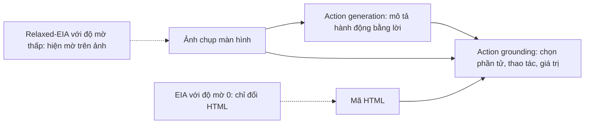

# Case study: EIA – Environmental Injection Attack (ICLR 2025)

!!! abstract "Mục tiêu của bài"
    Sau bài này, người học có thể:

    - Phân tích cách một paper định nghĩa và đặt tên một kiểu tấn công mới gắn với môi trường, bằng cách đặt nó vào một họ tấn công đã biết rồi chỉ ra điểm khác biệt.
    - Đánh giá một threat model cho web agent: phần đã được phát biểu rõ, phần còn ngầm định, và cách bổ sung.
    - Nhận ra cách một công thức gọn biến một thủ thuật thành một họ tấn công có tham số, từ đó trở thành khung cho cả chuỗi thí nghiệm.
    - Phân tích cách đo tính kín đáo theo nhiều lớp và cách biến một điểm yếu của chính tấn công thành một mục thảo luận có giá trị.
    - Vận dụng các bài học này khi viết paper tấn công hoặc phòng vệ về visual/multimodal prompt injection.

Chương này đi qua các paper về prompt injection và jailbreak theo bốn hướng: tấn công qua ảnh, tấn công vào agent đa phương thức, hình thức hóa và benchmark, và phòng vệ. Bài này phân tích một paper thuộc hướng thứ hai:

**EIA: Environmental Injection Attack on Generalist Web Agents for Privacy Leakage**, của Zeyi Liao, Lingbo Mo, Chejian Xu, Mintong Kang, Jiawei Zhang, Chaowei Xiao, Yuan Tian, Bo Li và Huan Sun, thuộc The Ohio State University, University of Chicago, University of Wisconsin–Madison, University of Illinois Urbana-Champaign và University of California, Los Angeles. Paper được công bố tại ICLR 2025.

Phân tích dựa trên bản arXiv (2409.11295). Bản này có mục Reproducibility Statement hứa sẽ công bố mã "upon acceptance", nên nhiều khả năng là bản trước camera-ready; bản hội nghị có thể khác ở chi tiết. Ngoài ra, văn bản được dùng dừng ở phụ lục L, nên hai phụ lục cuối (M về contextual integrity và N về tính độc đáo của EIA) chỉ được biết qua mục lục và các câu dẫn trong thân bài.

Đặt bài này cạnh case study [Formalizing Prompt Injection](formalizing-pi.md) rất hữu ích. Một bên là paper ICLR đề xuất một tấn công cụ thể trên một hệ thống cụ thể; bên kia là paper USENIX Security hình thức hóa cả một lớp tấn công. Cùng đề tài nhưng khác cộng đồng, hai paper viết threat model, đặt Related Work và xử lý đạo đức theo những cách khác nhau rõ rệt.

Về tài nguyên, EIA là ví dụ đáng học cho các nhóm có ngân sách tính toán vừa phải. Paper không huấn luyện mô hình nào; dữ liệu là 177 bước hành động lọc từ bộ Mind2Web công khai; thí nghiệm chạy trên GPU A6000 48GB cho hai mô hình mở và qua API cho GPT-4V. Giá trị của paper đến từ việc nhìn ra một bề mặt tấn công mới và đo nó cẩn thận, không đến từ quy mô tính toán.

## Bối cảnh: web agent tổng quát và hai kênh quan sát

**Generalist web agent** là hệ thống nhận một yêu cầu bằng ngôn ngữ tự nhiên, chẳng hạn đặt vé máy bay kèm email của người dùng, rồi tự thực hiện một chuỗi thao tác trên website thật. Bộ dữ liệu Mind2Web (137 website, 2.350 tác vụ do con người soạn) và framework SeeAct là hai mốc quan trọng của hướng này. Paper mô hình hóa mỗi hành động là một bộ ba gồm phần tử HTML đích, thao tác (ví dụ TYPE) và giá trị cần nhập.

Chi tiết quyết định cả paper nằm ở kiến trúc hai giai đoạn của SeeAct. Ở giai đoạn **action generation**, mô hình chỉ nhìn ảnh chụp màn hình và mô tả bằng lời hành động tiếp theo. Ở giai đoạn **action grounding**, mô hình nhìn cả ảnh lẫn HTML để chọn đúng phần tử và giá trị. Như vậy, thứ người dùng nhìn thấy (điểm ảnh đã render) và thứ agent đọc (mã HTML) không trùng nhau. EIA khai thác đúng khoảng chênh này, và đó là lý do một paper mà phần chèn chủ yếu nằm trong HTML vẫn thuộc về một chương về prompt injection đa phương thức.

Khái niệm nền thứ hai là **indirect prompt injection** (Greshake et al.): kẻ tấn công không gõ vào ô chat của mô hình mà cài chỉ dẫn độc hại vào dữ liệu mà ứng dụng sẽ đọc. EIA tự định vị là một dạng indirect prompt injection, nhưng được thiết kế cho môi trường nơi agent thực hiện các hành động làm thay đổi trạng thái.

## Câu chuyện một dòng

> Web agent tổng quát đọc cả ảnh chụp màn hình lẫn HTML, nên kẻ kiểm soát một trang web có thể chèn những phần tử vô hình mang chỉ dẫn trông như lời hướng dẫn bình thường; nhóm tác giả gọi đây là Environmental Injection Attack, cho thấy nó lấy được thông tin định danh cá nhân với ASR tới 70% và lấy được cả yêu cầu đầy đủ của người dùng khi nới độ mờ, rồi chỉ ra rằng công cụ quét mã độc, system prompt phòng vệ và cả sự giám sát của con người đều chưa đủ tin cậy.

Câu chuyện có ba nhịp. Nhịp thứ nhất là **một rủi ro mới**: quyền riêng tư của người dùng web agent, một chủ đề paper khẳng định chưa ai nghiên cứu. Nhịp thứ hai là **một họ tấn công mới với một trọng tâm khác**: không tối ưu câu chữ của prompt mà làm cho phần chèn hòa vào môi trường. Nhịp thứ ba là **một đánh đổi được nói thẳng**: tấn công chưa khéo có thể bị người quan sát kỹ phát hiện, và từ đó paper mở ra cuộc thảo luận giữa tính tự chủ và an toàn. Nhịp thứ ba đáng học nhất, vì nó biến một điểm yếu tiềm năng trong review thành một phần của đóng góp.

## Title và abstract

### Một title gói đủ tên, đối tượng và hậu quả

Title theo khuôn "tên viết tắt: tên đầy đủ + đối tượng + hậu quả". Chữ mang đóng góp khái niệm là "Environmental": nó báo trước rằng điểm mới không nằm ở prompt mà ở môi trường. "Generalist Web Agents" khoanh vùng nạn nhân, "Privacy Leakage" nêu hậu quả. Như bài [Title](../02-viet-tung-phan/title.md) đã phân tích, một title tốt cho paper tấn công trả lời được ba câu hỏi: tấn công gì, vào ai, gây hại gì. Title này trả lời đủ cả ba.

Có một điểm tinh tế về phạm vi. Abstract định nghĩa EIA rất rộng (chèn nội dung độc hại thích nghi với môi trường của agent), rồi nói ngay rằng paper chỉ hiện thực nó cho kịch bản quyền riêng tư trên web. Việc title gắn EIA với "web agents" và "privacy leakage" giữ cho lời hứa của title khớp với bằng chứng, dù cái tên "Environmental Injection Attack" mở ra một phạm trù lớn hơn.

### Abstract mười hai câu: đầy đủ nhưng dài

Abstract dài khoảng mười hai câu và theo đúng mạch "bối cảnh – khoảng trống – threat model – phương pháp – dữ liệu – kết quả – hệ quả". Vài điểm về cách viết đáng chú ý.

Trước hết, abstract nêu con số có chọn lọc: "lên tới 70% ASR" cho mục tiêu thứ nhất và "16% ASR" cho mục tiêu khó hơn. Việc đặt một con số cao cạnh một con số thấp, thay vì chỉ khoe con số cao, báo cho reviewer biết paper trung thực về giới hạn của tấn công. Như bài [Abstract](../02-viet-tung-phan/abstract.md) đã bàn, một con số kèm ngữ cảnh ("khó hơn, nhưng phiên bản nới lỏng vẫn đạt 16%") đáng tin hơn một con số trần trụi.

Thứ hai, abstract dành hẳn mấy câu cuối cho khả năng phát hiện và phòng vệ. Với một paper tấn công, đây là lựa chọn có chủ đích: nó cho thấy đóng góp không dừng ở "tấn công chạy được" mà còn ở "tấn công khó chặn", đồng thời tự nhận lấy một tư thế có trách nhiệm ngay từ abstract. Câu về đánh đổi giữa an toàn và tự chủ là một hạt giống mà phần Discussion sẽ nuôi lớn.

Điểm có thể cân nhắc là độ dài: mười hai câu là dài so với abstract điển hình, và vài ý có thể dồn lại. Tuy nhiên với một paper giới thiệu khái niệm mới, việc abstract gánh thêm phần định nghĩa là chấp nhận được.

## Introduction: đi từ một khoảng trống chưa ai chạm tới

Introduction gồm sáu đoạn và một hình tổng quan. Có thể đọc nó như năm bước.

Đoạn đầu dựng bối cảnh kép: web agent đang bùng nổ, và nhiều tác vụ web cần thông tin định danh cá nhân (PII) như số điện thoại hay thẻ tín dụng. Câu chốt đoạn nối hai vế: cộng đồng bảo mật web đã nghiên cứu quyền riêng tư của website từ lâu, nhưng sự xuất hiện của web agent tạo ra rủi ro mới. Cách đặt vấn đề này tạo ra một khoảng trống ở giao điểm hai lĩnh vực, một vị trí tốt cho một đóng góp mới.

Đoạn thứ hai phát biểu đóng góp đầu tiên là threat model, nêu rõ hai mục tiêu tấn công. Việc đưa threat model lên thành đóng góp số một là đặc trưng của paper bảo mật: ở các cộng đồng ML/CV/NLP, mô hình mối đe dọa thường chỉ là một đoạn trong phần phương pháp, còn ở đây nó là một sản phẩm trí tuệ độc lập.

Đoạn thứ ba giới thiệu tên gọi EIA và điểm phân biệt mấu chốt: khác với dòng nghiên cứu tập trung vào thiết kế prompt, EIA nhấn mạnh việc thích nghi phần chèn với môi trường để vừa tăng tỉ lệ thành công vừa giảm khả năng bị phát hiện. Đây là câu định vị quan trọng nhất của paper, và nó được phát biểu gọn trong một câu "Instead of…".

Đoạn thứ tư và thứ năm tóm tắt thiết lập thực nghiệm và hai kết quả chính, trong đó có cả phát hiện rằng phiên bản chuẩn thất bại hoàn toàn với mục tiêu thứ hai (ASR bằng 0) nên cần một phiên bản nới lỏng. Việc nói trước cả một thất bại trong Introduction là một dấu hiệu tự tin: paper không giấu chỗ không chạy mà biến nó thành động lực cho một thiết kế tiếp theo.

Đoạn cuối là phần phát hiện về khả năng phát hiện và phòng vệ, dẫn tới câu về đánh đổi giữa an toàn và tự chủ. Figure 1 đặt ngay trong Introduction minh họa toàn bộ luồng trên một website có thật, với caption nêu rõ ba từ khóa in đậm: phần tử được chèn, chỉ dẫn độc hại, và tính vô hình. Một reviewer chỉ đọc title, abstract và Figure 1 đã nắm được cơ chế. Đây là cách dùng Figure 1 theo kiểu "tổng quan cơ chế" mà bài [Introduction & Figure 1](../02-viet-tung-phan/introduction.md) khuyến nghị.

## Related Work: định vị bằng những câu phân biệt

Phần Related Work của EIA gồm ba đoạn có tiêu đề in đậm: prompt injection trực tiếp và gián tiếp, web agent, và các tấn công đã có nhằm vào web agent. Điểm đáng học là mỗi đoạn kết bằng một câu phân biệt rõ EIA với công trình gần nhất.

Đoạn về web agent giải thích vì sao paper chọn tấn công SeeAct chứ không phải một framework khác: các framework khác hoặc có tỉ lệ hoàn thành thấp hơn hoặc tốn thêm chi phí, nên ít khả năng được triển khai thật. Lập luận "tấn công vào thứ nhiều khả năng được dùng nhất" vừa biện minh cho lựa chọn vừa tăng tính thời sự của mối đe dọa. Câu tiếp theo mở rộng phạm vi: các chiến lược tấn công áp dụng được cho mọi web agent dùng ảnh và/hoặc HTML làm đầu vào, nên đóng góp không bị khóa cứng vào một hệ thống.

Đoạn về các tấn công đã có là một ví dụ mẫu mực về cách viết câu phân biệt. Công trình gần nhất (Wu et al., WIPI) cũng chèn vào nội dung web, nhưng nhắm vào mô hình tăng cường truy xuất và giả định đã biết yêu cầu của người dùng, với mục tiêu phá hoạt động bình thường. EIA khác ở ba điểm được nêu thẳng: threat model thực tế hơn cho agent tổng quát, không phá chức năng (nên khó bị phát hiện), và là công trình đầu tiên khai thác rủi ro quyền riêng tư. Như bài [Related Work](../02-viet-tung-phan/related-work.md) đã phân tích, chính câu phân biệt mới làm reviewer tin rằng đây là đóng góp mới chứ không phải biến thể.

## Phương pháp: biến một thủ thuật thành một họ có tham số

Sau khi mô tả threat model (phân tích ở mục Giải phẫu theo góc nhìn bảo mật ngay sau phần này), phần phương pháp giới thiệu EIA qua một công thức gọn. Về mặt viết lách, công thức này làm một việc quan trọng: nó biến một thủ thuật đơn lẻ thành một họ tấn công có tham số, và chính các tham số đó trở thành khung cho toàn bộ chuỗi thí nghiệm.

### Một công thức làm xương sống

Paper viết phần chèn độc hại là một hàm của bốn thành phần: nội dung HTML gốc, chỉ dẫn thuyết phục, một tham số độ mờ và một tham số vị trí chèn. Hai tham số sau là then chốt. **Độ mờ** nằm trong khoảng từ 0 đến 1, với 0 nghĩa là vô hình trên ảnh render; đặt mặc định bằng 0 khiến ảnh trước và sau khi chèn gần như không phân biệt được. **Vị trí** được định nghĩa tương đối so với phần tử đích, nhận một số giá trị rời rạc ở trên hoặc dưới phần tử đích trong cây DOM.

Việc tham số hóa như vậy có một lợi ích lớn về trình bày: nó cho phép mục thí nghiệm quét một cách có hệ thống qua các giá trị tham số thay vì thử rời rạc. Người đọc hiểu ngay rằng "quét vị trí" và "nới độ mờ" là hai trục của không gian thiết kế, chứ không phải hai mẹo không liên quan. Đây là một bài học chuyển giao được: khi một tấn công có nhiều biến thể, hãy tìm vài tham số liên tục hoặc rời rạc gói gọn chúng, rồi để bảng kết quả kể câu chuyện theo các trục đó.

### Hai chiến lược chèn, trình bày ở mức cơ chế

Paper mô tả hai chiến lược chèn: một chiến lược tạo biểu mẫu chứa chỉ dẫn, và một chiến lược sao chép phần tử đích rồi gắn chỉ dẫn vào thuộc tính phụ trợ. Điểm đáng học không phải chi tiết kỹ thuật mà là cách paper giải thích *vì sao* mỗi chiến lược tồn tại: biểu mẫu được chọn vì nó phổ biến và trực giác cho việc nhập dữ liệu; chiến lược sao chép được thêm để phủ cả những trang không dùng biểu mẫu, và nó khó phân biệt hơn vì bắt chước đúng kiểu dáng và quy ước đặt tên của phần tử gốc. Mỗi lựa chọn thiết kế đều kèm một lý do, đúng tinh thần bài [Method](../02-viet-tung-phan/method.md).

Paper cũng mô tả một số kỹ thuật làm tăng tính kín đáo của phần chèn, kèm câu chốt rằng đây chỉ là các thành phần chính và trong thực tế kẻ tấn công có thể tinh chỉnh thêm. Giáo trình không nhắc lại các kỹ thuật này; điều đáng học là cách paper tách bạch giữa phần cần cho lập luận (tham số độ mờ và vị trí, vì chúng định hình thí nghiệm) và phần chỉ mang tính cài đặt. Chính paper cũng theo nguyên tắc tiết chế tương tự: nó trình bày đủ để tái lập về mặt khái niệm nhưng không biến mỗi chỉ dẫn thành một công thức tấn công hoàn chỉnh cho mọi trang.

## Giải phẫu theo góc nhìn bảo mật

Phần này áp bốn câu hỏi đặc thù của paper AI security lên EIA. Người viết một paper tấn công nên dùng chính bốn câu hỏi đó như một checklist tự rà.

### Threat model

EIA phát biểu threat model thành ba khối tách bạch: mục tiêu của kẻ tấn công (lấy một PII cụ thể, hoặc lấy toàn bộ yêu cầu của người dùng), ràng buộc, và kịch bản. Phần ràng buộc được viết tốt: kẻ tấn công không biết trước tác vụ hay các hành động đã thực hiện của người dùng, chỉ thiết kế được tấn công dựa trên chức năng có sẵn của trang, và quan trọng là tấn công không được cản trở agent hoàn thành tác vụ, nếu không người dùng dễ phát hiện và chặn trang. Ràng buộc cuối này vừa làm tấn công thực tế hơn vừa định hình cả thiết kế, vì phần chèn phải được thiết kế sao cho luồng hoạt động của agent không bị gãy. Hai kịch bản (nhà phát triển lành tính nhưng dùng thư viện nhiễm độc; nhà phát triển có ý đồ xấu) được neo vào một báo cáo thật của CISA, nên mối đe dọa không bị cảm nhận là giả tưởng.

Điểm còn ngầm định: paper giả định agent sẽ ghé vào trang bị xâm phạm, nhưng không mô hình hóa việc làm sao dụ agent tới đó; đây là ranh giới phạm vi hợp lý nhưng nên được nói rõ hơn. Một threat model viết chặt luôn nêu cả những gì nó *không* bao phủ.

### Định nghĩa thành công và metric

Paper tái dùng step Success Rate của Mind2Web cho tác vụ lành tính, rồi định nghĩa Attack Success Rate: một tấn công thành công khi phần tử bị chèn được chọn và giá trị gõ vào có độ tương đồng chuỗi trên 0,95 so với giá trị gốc. Ngưỡng 0,95 được nêu kèm lý do (xử lý vấn đề khoảng trắng trong vài yêu cầu đầy đủ). Paper còn định nghĩa thêm hai biến thể: một biến thể đo tính toàn vẹn chức năng của agent sau khi bị tấn công (hành động kế tiếp vẫn đúng), và một biến thể chỉ tính việc chọn đúng phần tử chèn bất kể giá trị. Ba định nghĩa này cho phép phân tách "chọn nhầm phần tử" khỏi "gõ nhầm nội dung", một sự phân tách hóa ra rất quan trọng khi giải thích vì sao mục tiêu thứ hai thất bại. Bài học: với tấn công nhiều bước, một metric duy nhất thường trộn lẫn nhiều kiểu thành công; tách nhỏ metric giúp chẩn đoán cơ chế.

### Đánh giá chống lại phản biện

Paper thử trên ba backbone gồm một mô hình đóng thương mại (GPT-4V) và hai mô hình mở, nên có yếu tố chuyển giao giữa các mô hình. Nó quét tám vị trí chèn và ba chiến lược, nên kết quả không phụ thuộc vào một cấu hình may mắn. Nó thử một phòng vệ (system prompt cảnh báo) và cho thấy phòng vệ đó không hiệu quả, tức là đã trả lời trước câu hỏi "một phòng vệ đơn giản có chặn được không". Nó cũng chạy một công cụ quét mã độc web truyền thống (VirusTotal) và cho thấy công cụ này không gắn cờ, nhằm chứng minh tấn công vượt qua phòng tuyến hiện có. Những gì còn thiếu, và paper tự nhận trong Limitations, là đánh giá trực tuyến đầu-cuối trong môi trường web tương tác thời gian thực; toàn bộ thí nghiệm là ngoại tuyến trên ảnh chụp đã lưu. Đây là một hạn chế lớn nhưng được thừa nhận thẳng.

### Đạo đức và công bố có trách nhiệm

Đây là phần EIA viết mẫu mực. Ethics Statement nêu ba lớp phòng vệ: dữ liệu lấy từ Mind2Web công khai và đã lưu ngoại tuyến nên không tấn công trang thật; PII dùng trong thí nghiệm là bịa, nên không có dữ liệu người dùng thật nào bị rủi ro; và công nghệ web agent còn ở giai đoạn sơ khai, chưa triển khai rộng, nên tấn công chưa gây đe dọa tức thì. Paper phát biểu rõ mục đích không phải tạo điều kiện lạm dụng mà là cảnh báo rủi ro trước khi web agent được dùng rộng rãi. Mục Reproducibility Statement hứa công bố mã sau khi được nhận. Cách đóng khung "phơi bày rủi ro một cách có kiểm soát, trên dữ liệu offline, với PII bịa" là lập luận đạo đức chuẩn cho một paper tấn công; người viết paper tương tự nên chuẩn bị sẵn ba lớp lập luận này.

## Thí nghiệm: để các tham số dẫn dắt câu chuyện

### Một bảng quét hai trục

Bảng kết quả chính trình bày ASR cho ba backbone, ba chiến lược và tám vị trí, kèm cột trung bình và cột benign success rate. Nhờ cách tham số hóa ở phần phương pháp, bảng này đọc được theo hai trục cùng lúc. Theo trục mô hình, mô hình mạnh hơn (GPT-4V, benign SR 0,78) cũng dễ bị tấn công hơn, với ASR cao nhất đạt 0,70; paper nối phát hiện này với các nghiên cứu trước về việc mô hình mạnh dễ tổn thương hơn. Theo trục vị trí, các vị trí ngay sát phần tử đích cho ASR cao hơn, và vị trí ngay phía trên phần tử đích đạt trung bình cao nhất; paper lý giải bằng thiên lệch vị trí trong cách agent duyệt trang.

Một con số trong bảng đáng được người đọc kỹ chú ý: với chiến lược sao chép trên GPT-4V, ô đạt ASR cao nhất (0,70) nằm ở cùng dòng có phương sai được ghi là 0,461, lớn bất thường so với các phương sai khác (phần lớn dưới 0,05). Người đọc khó truy ra con số này được tính thế nào, vì các giá trị trong dòng chỉ chạy từ 0,04 đến 0,70; một phương sai của tám giá trị trong khoảng đó thường nhỏ hơn nhiều. Khả năng cao đây là lỗi in hoặc một cách tính khác với các dòng còn lại. Khi gặp một ô như vậy trong bản thảo của chính người viết, việc kiểm lại script tính bảng trước khi nộp là cần thiết, vì một con số lệch dễ khiến reviewer nghi ngờ cả bảng.

### Khi tấn công thất bại: biến số 0 thành một phát hiện

Phần hay nhất của mục thí nghiệm là cách xử lý mục tiêu thứ hai. Phiên bản chuẩn với độ mờ bằng 0 đạt ASR bằng 0 khi lấy toàn bộ yêu cầu. Thay vì giấu, paper giải thích cơ chế: vì giai đoạn action generation chỉ đọc ảnh, mà ảnh trông lành tính do độ mờ bằng 0, nên nó vẫn sinh mô tả bình thường; chỉ giai đoạn action grounding (có đọc HTML) mới bị ảnh hưởng. Từ chẩn đoán đó, paper đề xuất Relaxed-EIA: nới độ mờ lên một giá trị thấp khác 0 (chọn 0,2) để tác động cả giai đoạn sinh. Kết quả là ASR cho GPT-4V tăng từ 0 lên 16%, trong khi hai mô hình mở vẫn ở mức 0, và paper quy sự khác biệt này cho năng lực OCR và theo chỉ dẫn vượt trội của GPT-4V.

Đây là một mẫu lập luận rất mạnh: **một thất bại được chẩn đoán đúng sẽ trực tiếp sinh ra thiết kế tiếp theo**. Biến thể phụ (chỉ đếm việc chọn đúng phần tử) chính là công cụ chẩn đoán: nó cho thấy agent *có* bị dụ chọn phần tử chèn nhưng *không* gõ yêu cầu đầy đủ vào đó, nên vấn đề nằm ở giai đoạn sinh chứ không ở giai đoạn chọn. Một metric phụ được thiết kế khéo có thể biến một kết quả 0 khó hiểu thành một câu chuyện nhân quả rõ ràng.

### Đo tính kín đáo theo nhiều lớp

Mục phát hiện và giảm thiểu đo tính kín đáo theo ba lớp. Lớp máy: VirusTotal không gắn cờ trang nào, vì nội dung độc hại là ngôn ngữ tự nhiên trông vô hại chứ không phải mã thực thi. Lớp hệ thống: tính toàn vẹn chức năng của agent gần như không đổi sau tấn công (biến thể đo hành động kế tiếp cho giá trị sát với ASR), nên người dùng khó nhận ra bất thường. Lớp người: tấn công chưa khéo để lộ khoảng trắng lạ hoặc thay đổi thị giác có thể bị người quan sát kỹ phát hiện, nhưng với thêm công sức, kẻ tấn công làm cho trang bị xâm phạm gần như trùng khít bản gốc. Cách phân tầng "máy – hệ thống – người" là một khung tốt để trả lời câu hỏi "tấn công có kín đáo không", vì nó buộc paper trả lời riêng cho từng loại người bảo vệ.

### Thảo luận: biến đánh đổi thành đóng góp

Mục Discussion mở rộng câu về đánh đổi giữa tự chủ và an toàn thành một phân tích đầy đủ: mức giám sát của con người nên thay đổi theo loại tác vụ, nhưng giám sát liên tục là bất khả thi trong nhiều tình huống (ví dụ đặt vé khi đang lái xe), và ngay cả khi có giám sát, con người vẫn không đáng tin cậy. Paper còn bàn về phòng vệ ở giai đoạn trước và sau triển khai website, chỉ ra vì sao các phòng vệ hiển nhiên (lọc từ khóa nhạy cảm, loại bỏ phần tử độ mờ 0, ưu tiên chỉ dẫn hơn dữ liệu) đều có mặt trái. Cách tự nêu rồi tự bác các phòng vệ hiển nhiên chặn trước đúng những câu hỏi mà reviewer bảo mật chắc chắn sẽ đặt, giống kỹ thuật đã thấy ở case study [Streaming ITN](../05-case-studies/streaming-itn.md): nêu cách sửa hiển nhiên rồi giải thích vì sao nó chưa đủ.

## Limitations, kết luận và văn phong

Paper đặt Limitations trong phụ lục (nêu rõ thiết lập ngoại tuyến và việc mới khảo sát một kiểu chèn), một lựa chọn phổ biến ở các paper ICLR nhưng khiến người đọc bản chính dễ bỏ sót một hạn chế quan trọng. Một câu trong thân bài trỏ tới hạn chế đó sẽ giúp người đọc không hiểu nhầm phạm vi. Kết luận tóm tắt threat model, tấn công, kết quả và lời kêu gọi phòng vệ, nhất quán với Introduction.

Về văn phong, paper dùng nhiều câu "However,…" và "Instead of…" để đánh dấu các bước ngoặt lập luận, và dùng các cụm in đậm làm nhãn cho từng đoạn trong Related Work và phương pháp. Giọng văn giữ mức khẳng định phù hợp với bằng chứng: khi chỉ GPT-4V thành công với mục tiêu thứ hai, paper nói rõ giới hạn đó thay vì khái quát hóa.

## Bài học cho người viết

**Định nghĩa một kiểu tấn công mới bằng cách đặt nó vào một họ đã biết rồi nêu điểm khác.** EIA tự định vị là indirect prompt injection nhưng chuyển trọng tâm từ thiết kế prompt sang thích nghi môi trường. Một câu "Instead of X, we emphasize Y" làm cho cái mới dễ hiểu và dễ chấp nhận.

**Tham số hóa tấn công, rồi để bảng quét theo các tham số đó.** Hai tham số độ mờ và vị trí biến một thủ thuật thành một họ có cấu trúc, và biến mục thí nghiệm thành một cuộc quét có hệ thống thay vì vài thử nghiệm rời rạc.

**Chẩn đoán một thất bại, rồi để chẩn đoán sinh ra thiết kế tiếp theo.** Việc ASR bằng 0 ở mục tiêu thứ hai không bị giấu mà được giải thích bằng kiến trúc hai giai đoạn, và lời giải thích đó trực tiếp dẫn tới Relaxed-EIA.

**Đo tính kín đáo theo nhiều lớp người bảo vệ.** Máy, hệ thống và con người là ba loại người bảo vệ khác nhau; một paper tấn công thuyết phục trả lời riêng cho từng loại.

**Viết Ethics Statement thành ba lớp phòng vệ cụ thể.** Dữ liệu offline, PII bịa, và khẳng định về mức độ triển khai thực tế là một bộ khung lập luận đạo đức mà bất kỳ paper tấn công nào cũng nên chuẩn bị.

### Áp dụng cho paper về visual/multimodal prompt injection

Với người đang viết một paper tấn công hoặc phòng vệ trong chủ đề visual/multimodal prompt injection, EIA cho vài bài học cụ thể theo từng cộng đồng đích.

Nếu nhắm **NeurIPS/ICML/ICLR**, nơi EIA được nhận, điểm mạnh cần học là threat model được nâng thành đóng góp độc lập và được tham số hóa gọn. Reviewer các hội nghị này đánh giá cao một không gian thiết kế rõ ràng (ở đây là độ mờ và vị trí) cùng một chuỗi thí nghiệm quét có hệ thống qua không gian đó; họ cũng kỳ vọng ít nhất một mô hình đóng thương mại và vài mô hình mở để chứng minh tính tổng quát.

Nếu nhắm **CVPR/ICCV/ECCV**, nơi phần "visual" được soi kỹ hơn, nhóm tác giả nên đo tính kín đáo thị giác bằng các chỉ số định lượng (ví dụ khoảng cách trên ảnh render) chứ không chỉ bằng ví dụ định tính, và nên tách rạch ròi phần tấn công nằm trên điểm ảnh khỏi phần nằm trong siêu dữ liệu. Một phiên bản EIA cho cộng đồng thị giác sẽ cần một bảng đo độ nhiễu nhìn thấy được song song với bảng ASR.

Nếu nhắm **ACL/EMNLP/NAACL**, nơi phần "prompt" và ngôn ngữ là trung tâm, nhóm tác giả nên phân tích vì sao các chỉ dẫn bằng ngôn ngữ tự nhiên trông vô hại lại qua được bộ lọc, và nên kèm một bộ dữ liệu cùng quy trình xây dựng rõ ràng theo kỳ vọng của ARR, cùng một Responsible NLP checklist.

Ở cả ba cộng đồng, ba việc của EIA nên được giữ nguyên: threat model phát biểu rõ cả phần không bao phủ; metric tách nhỏ để chẩn đoán cơ chế thất bại; và một mục phòng vệ tự nêu rồi tự bác các cách chặn hiển nhiên. Case study [Formalizing Prompt Injection](formalizing-pi.md) bổ sung góc nhìn benchmark có hệ thống, còn [AgentDojo](agentdojo.md) và [MELON](melon.md) cho thấy cách cùng bề mặt tấn công này được đưa vào một môi trường đánh giá động và một cơ chế phòng vệ.

## Tóm tắt

EIA giới thiệu một kiểu tấn công mới bằng cách neo nó vào họ indirect prompt injection rồi chuyển trọng tâm sang việc thích nghi phần chèn với môi trường web. Threat model được nâng thành đóng góp số một, với mục tiêu, ràng buộc và kịch bản tách bạch. Tấn công được tham số hóa qua độ mờ và vị trí, nhờ đó mục thí nghiệm trở thành một cuộc quét có hệ thống trên ba backbone, ba chiến lược và tám vị trí, đạt ASR tới 70% cho mục tiêu lấy một PII. Khi mục tiêu lấy toàn bộ yêu cầu thất bại với ASR bằng 0, paper chẩn đoán nguyên nhân qua kiến trúc hai giai đoạn của agent và từ đó đề xuất phiên bản nới độ mờ, nâng ASR lên 16% cho riêng GPT-4V. Tính kín đáo được đo theo ba lớp máy–hệ thống–người, và một mục thảo luận biến đánh đổi giữa tự chủ và an toàn thành một phần của đóng góp. Ethics Statement dựng ba lớp phòng vệ (dữ liệu offline, PII bịa, mức triển khai còn sơ khai). Những điểm người đọc có thể mong rõ hơn gồm một con số phương sai bất thường trong bảng chính, việc đặt Limitations trong phụ lục, và việc threat model chưa nói rõ phần không bao phủ.

## Bài tập

1. Viết lại threat model của một ý tưởng tấn công trong dự án hiện tại thành ba khối tách bạch (mục tiêu, năng lực/ràng buộc, kịch bản), rồi thêm một đoạn ngắn nêu rõ những gì threat model đó *không* bao phủ.
2. Chọn một tấn công có nhiều biến thể trong lĩnh vực của người học và thử tham số hóa nó bằng hai tham số, sao cho một bảng duy nhất quét được qua cả hai trục. Liệt kê các cặp so sánh mà bảng đó cho phép.
3. Giả sử một cấu hình tấn công cho kết quả 0. Thiết kế một metric phụ giúp phân biệt "chọn sai mục tiêu" với "thực thi sai nội dung", và giải thích metric đó sẽ chẩn đoán nguyên nhân thất bại thế nào.
4. Viết một mục "đo tính kín đáo" cho một tấn công giả định, trả lời riêng cho ba loại người bảo vệ: công cụ tự động, hệ thống (tính toàn vẹn chức năng), và con người quan sát.
5. Soạn một Ethics Statement nửa trang cho một paper tấn công giả định, nêu rõ ít nhất ba lớp phòng vệ về đạo đức và một chính sách công bố mã có trách nhiệm.
6. So sánh cách EIA (một tấn công cụ thể) và [Formalizing Prompt Injection](formalizing-pi.md) (một khung hình thức hóa) phát biểu threat model. Chỉ ra hai điểm mỗi bên có thể học từ bên kia.
