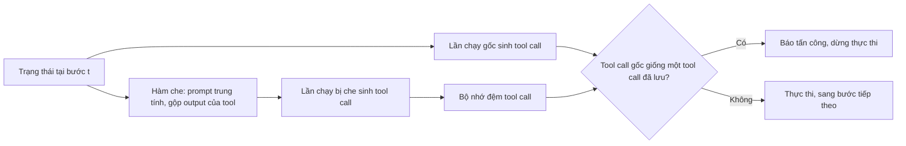

# Case study: MELON (ICML 2025)

!!! abstract "Mục tiêu của bài"
    Sau bài này, người học có thể:

    - Phân tích cách một paper phòng vệ biến một quan sát về hành vi của agent khi bị tấn công thành câu chuyện, thiết kế và chuỗi ablation khớp nhau.
    - Nhận ra khuôn trình bày "cách làm hiển nhiên, ba thách thức, ba thiết kế" và lý do nó thuyết phục reviewer.
    - Đánh giá mức tương xứng giữa một từ mạnh trong title, ở đây là "Provable", với phần lý thuyết và bằng chứng thực sự có trong paper.
    - Đọc một bảng kết quả bảo mật và phát hiện chỗ lời bình đi xa hơn các ô số.
    - Liệt kê những gì một paper phòng vệ prompt injection cần làm để đứng vững trước phản biện, nhất là trước tấn công thích nghi.

Bài này phân tích **MELON: Provable Defense Against Indirect Prompt Injection Attacks in AI Agents**, của Kaijie Zhu, Xianjun Yang, Jindong Wang, Wenbo Guo và William Yang Wang, công bố tại ICML 2025. Phân tích dựa trên bản arXiv 2502.05174 ở phiên bản thứ tư, dùng template ICML; bản trong kỷ yếu có thể khác ở chi tiết. Title đã đổi qua các phiên bản arXiv: bản đầu mang title "MELON: Indirect Prompt Injection Defense via Masked Re-execution and Tool Comparison", các bản sau mới thêm chữ "Provable".

MELON được đánh giá hoàn toàn trên benchmark ở trang [AgentDojo](agentdojo.md), dùng lại nguyên metric, tấn công và một baseline của benchmark ấy; hai trang được viết để soi chiếu nhau, một bên đặt luật chơi, một bên dùng luật đó để công bố một phòng vệ.

Với người học Việt Nam, paper đáng giá ở một điểm kiểm chứng được ngay trong threat model: phòng vệ không cần huấn luyện mô hình, chỉ cần gọi API của LLM và một mô hình embedding, trên một benchmark mở. Một nhóm không có cụm GPU lớn vẫn làm được kiểu đóng góp này nếu có một insight sắc và một quy trình đánh giá cẩn thận.

## Bối cảnh: indirect prompt injection và vì sao phòng vệ khó

Một LLM agent nhận yêu cầu người dùng rồi lặp lại chu trình: sinh hành động (phần văn bản và các tool call), thực thi tool, đọc kết quả. **Indirect prompt injection** (IPI, chèn lệnh gián tiếp) khai thác chu trình này: kẻ tấn công không chạm được vào prompt người dùng hay mô hình, nhưng cài được một nhiệm vụ độc hại vào dữ liệu tool trả về, như một email, một trang web hay một hóa đơn. Nếu agent "nghe lời" dữ liệu đó, nó sẽ làm việc người dùng không yêu cầu, chẳng hạn chuyển tiền cho kẻ tấn công.

Paper nêu hai lý do khiến phòng vệ khó: khác với jailbreak, nhiệm vụ bị chèn có thể hoàn toàn hợp lệ về nội dung ("gửi một email" không độc hại tự thân), và phòng vệ phải cân bằng an toàn với tiện ích. Các phòng vệ lúc đó được chia theo nhu cầu tài nguyên: nhóm cần huấn luyện (huấn luyện lại LLM như [StruQ](struq.md), hoặc huấn luyện bộ phát hiện như bộ phân loại DeBERTa của ProtectAI) và nhóm không cần huấn luyện (bổ sung prompt, known-answer detection từ công trình được phân tích ở trang [Formalizing Prompt Injection](formalizing-pi.md), tool filter của AgentDojo, Task Shield). MELON thuộc nhóm thứ hai và hứa điều các phòng vệ trước chưa làm đồng thời: hiệu quả trước tấn công mạnh mà không làm hỏng tiện ích. Việc nộp ở ICML cũng ảnh hưởng tới cách viết: reviewer ML tìm một nguyên lý tổng quát và một lý do lý thuyết, như bài [Viết cho NeurIPS / ICML / ICLR](../06-cong-dong/ml.md) đã phân tích.

## Câu chuyện một dòng

> Khi một prompt injection thành công, hành động tiếp theo của agent hầu như không còn phụ thuộc vào yêu cầu người dùng mà chỉ phụ thuộc vào dữ liệu do tool trả về; vì vậy, nếu chạy lại agent với yêu cầu người dùng bị che mà agent vẫn muốn gọi những tool call giống hệt, thì các tool call ấy đến từ dữ liệu bên ngoài, và đó là dấu hiệu tấn công.

Sức mạnh của câu chuyện là nó không dựa vào *hình thức* của tấn công: bộ phát hiện dựa trên mô hình học cách nhận ra những câu kiểu "ignore previous instructions", và kẻ tấn công chỉ cần đổi cách diễn đạt, còn MELON dựa vào một *dấu hiệu hành vi* đúng với mọi lời chèn thành công. Đây là một phép thử phản thực tế (counterfactual) quen thuộc với người làm ablation: bỏ một thành phần đầu vào và xem đầu ra có đổi không. Câu chuyện cũng gợi ngay câu hỏi reviewer bảo mật sẽ đặt: nếu kẻ tấn công biết phép thử, họ có thể làm hành động độc hại *phụ thuộc* vào yêu cầu người dùng không?

## Title và abstract

Tên MELON ("Masked re-Execution and TooL comparisON") ngắn, dễ nhớ, và phần giải nghĩa nói ngay hai thao tác cốt lõi. Đáng bàn hơn là sự thay đổi cấu trúc title. Title đầu theo mẫu "tên phương pháp và mô tả" trong bài [Title](../02-viet-tung-phan/title.md), nói rõ phòng vệ *làm gì*. Title cuối bỏ phần cơ chế, thay bằng một *tính chất* ("Provable Defense") và một phạm vi ("in AI Agents"). Title nghe mạnh hơn, nhưng gánh nặng chứng minh cũng chuyển sang paper.

Abstract gồm mười một câu đi theo trình tự bối cảnh, khoảng trống, phương pháp, insight, cơ chế, ba thiết kế phụ, kết quả trên AgentDojo, MELON-Aug, ablation và mã nguồn. Hai điểm đáng học. Ba kiểu thất bại trong câu khoảng trống ánh xạ đúng vào ba điều MELON hứa: không cần huấn luyện, hiệu quả trước tấn công mạnh, giữ tiện ích. Câu insight đứng *trước* câu cơ chế, đúng vị trí trong khuôn ở bài [Abstract](../02-viet-tung-phan/abstract.md), nên người đọc hiểu vì sao phải chạy lại có che trước khi biết cách làm.

Ba điểm có thể viết tốt hơn. Abstract không có con số nào, trong khi paper có một con số rất đắt: trên GPT-4o, ASR trung bình giảm từ 16,06% xuống 0,24%. Chữ mạnh nhất của title không có đối ứng: abstract không nhắc tới đảm bảo, bound hay chứng minh nào. Và câu kết quả nói MELON vượt các phòng vệ khác "in both attack prevention and utility preservation", trong khi Table 1 cho thấy Repeat Prompt có utility under attack cao hơn MELON trên cả ba mô hình và LLM Detector có ASR bằng 0. Điều MELON thực sự đạt được là *sự cân bằng* tốt nhất, như câu cuối Introduction viết ("the best balance between security and utility maintenance"):

"On AgentDojo with GPT-4o, MELON reduces the average attack success rate from 16.06% to 0.24%, and MELON-Aug keeps utility under attack at 68.72%, giving the best security–utility trade-off among the evaluated defenses."

## Introduction: bốn đoạn và một Figure 1 trên mặt phẳng trade-off

Introduction gồm bốn đoạn và Figure 1, không có danh sách đóng góp. **Đoạn 1** đặt bối cảnh bằng một chuỗi trích dẫn dày. **Figure 1** vẽ utility under attack (UA) theo attack success rate (ASR), lấy trung bình trên ba mô hình. Đây là kiểu "kết quả trong một hình" ở bài [Introduction & Figure 1](../02-viet-tung-phan/introduction.md): hình chọn đúng mặt phẳng paper muốn tranh luận, và MELON hiện ra ở góc ASR thấp, UA cao. Cái giá là lấy trung bình che đi khác biệt giữa các mô hình: trên o3-mini, UA trung bình của MELON (36,29%) thấp hơn rõ so với khi không phòng vệ (46,50%), trong khi caption nói MELON "maintaining high UA".

**Đoạn 2** điểm lại điểm yếu của từng nhóm phòng vệ, và phần lớn lời phê bình trỏ tới Section 4.2, tức là được chính thí nghiệm của paper chứng minh. **Đoạn 3** gói phương pháp trong một đoạn. **Đoạn 4** nêu thiết lập, con số nổi bật (MELON-Aug đạt ASR 0,32% và UA 68,72% trên GPT-4o) và một claim "đầu tiên" được khoanh phạm vi khéo: MELON là phương pháp phát hiện IPI đầu tiên *khai thác sự độc lập giữa tool call độc hại và đầu vào người dùng*. Khoanh theo insight như vậy khó bị phản ví dụ hơn nhiều so với "the first training-free IPI defense".

Hai điểm có thể làm tốt hơn. Introduction cũng không nhắc tới đảm bảo lý thuyết nào, nên hết trang đầu người đọc vẫn chưa biết "Provable" nói về điều gì. Và cụm "four SOTA attacks" là một sự phóng đại nhẹ: đó là bốn mẫu prompt chung (TODO, Ignore Previous, System Message, Important Messages) có sẵn trong AgentDojo, mà chính Conclusion của AgentDojo gọi là "relatively simple".

## Related Work: định vị bằng nhu cầu tài nguyên

Phần tấn công chia IPI thành tấn công chung (escape character, context-ignoring, fake completion) và tấn công riêng cho từng loại agent: web agent như [EIA](eia.md) hay VisualWebArena-Adv của Wu và cộng sự (xem [Dissecting MM Agents](dissecting-mm-agents.md)), computer agent qua [pop-up](popups.md). Phần phòng vệ chia theo tài nguyên. Chọn trục phân loại là một quyết định định vị: phân loại theo *cơ chế* thì MELON chỉ là một bộ kiểm tra đầu ra trong nhiều bộ, còn phân loại theo *tài nguyên* làm nổi bật ô MELON chiếm (không huấn luyện, chỉ cần black-box, tự động hoàn toàn). Trục này được dùng lại ở Table 1, nơi các hàng tô màu theo nhóm, nên người đọc mang cùng một bản đồ từ Related Work sang Experiments, như bài [Related Work](../02-viet-tung-phan/related-work.md) khuyến khích.

Chỗ có thể chặt hơn là Task Shield, phòng vệ gần nhất về tinh thần (cũng xét tool call có phục vụ nhiệm vụ người dùng không, cũng không cần huấn luyện), nhưng chỉ được mô tả trong một câu, không có trong năm baseline, và paper không giải thích vì sao. Một câu "We do not include TaskShield because…", kèm một câu phân biệt khái niệm (Task Shield kiểm tra tool call có phù hợp với nhiệm vụ người dùng không, còn MELON đo xem tool call có còn xuất hiện khi nhiệm vụ bị che không), sẽ chặn trước một câu hỏi gần như chắc chắn xuất hiện trong review.

## Phương pháp: cách làm hiển nhiên, ba thách thức, ba thiết kế

Section 3.2 phát biểu insight bằng xác suất: khi tấn công thành công, xác suất của hành động kế tiếp khi biết toàn bộ trạng thái xấp xỉ xác suất khi chỉ biết output của tool. Đây là một *quan sát* viết bằng ký hiệu chứ không phải đại lượng được đo; gọi nó là "Observation" và bổ sung một histogram độ tương đồng giữa tool call của hai lần chạy, tách theo trường hợp lành tính và bị tấn công, sẽ trung thực hơn, và histogram ấy cũng chính là thứ phần lý thuyết ở Section 3.4 cần.

Phần hay nhất là cấu trúc lập luận. Paper trình bày trước **cách làm hiển nhiên** (xóa yêu cầu người dùng, chạy lại, so embedding của hai hành động), rồi kể ba thách thức gặp phải "during our exploration", mỗi thách thức được giải bằng đúng một thiết kế:

| Thách thức | Hiện tượng | Thiết kế giải quyết |
|---|---|---|
| ❶ | Chỉ thấy output của tool, LLM coi chúng như ví dụ few-shot và sinh tool call tùy tiện | Thay yêu cầu người dùng bằng prompt trung tính, gộp output, thêm hai ví dụ few-shot |
| ❷ | Lần chạy gốc làm nhiệm vụ người dùng trước, lần chạy bị che làm nhiệm vụ độc hại ngay, nên so cùng bước bị lệch | Bộ nhớ đệm lưu mọi tool call của lần chạy bị che |
| ❸ | Hai lần chạy khác nhau ở văn bản dù tool call giống hệt | Chỉ so tool call |

Tiếp theo là một đoạn *Remark* bác bỏ cách làm còn đơn giản hơn: báo tấn công bất cứ khi nào lần chạy bị che sinh tool call. Lý do bác bỏ thuyết phục: nhiều lời chèn kích hoạt tool call ở lần chạy bị che nhưng không chuyển hướng được lần chạy gốc, và chặn cả chúng sẽ làm hại tiện ích không cần thiết. Đây là kỹ thuật "tự nêu cách sửa hiển nhiên rồi giải thích vì sao nó hỏng" mà case study [Streaming ITN](../05-case-studies/streaming-itn.md) đã phân tích. Cấu trúc được trả lại ở Table 2, nơi ablation bỏ từng thiết kế ("Basic", "No Cache", "Full Comp."), tương ứng một–một với ba thách thức. Sơ đồ dưới đây tóm tắt luồng xử lý theo cách hiểu của bài này:

Một số lựa chọn quan trọng về bảo mật nằm ở phụ lục. Prompt trung tính yêu cầu mô hình tóm tắt nội dung và *làm theo* mọi chỉ dẫn trong đó: lần chạy bị che được thiết kế để cố ý "mắc bẫy" nhằm làm lộ nhiệm vụ độc hại, một ý tưởng khéo đáng được nói rõ ở văn bản chính. Appendix A.3 cho biết với `send_email` chỉ so người nhận, với `send_money` so người nhận và số tiền; điều này làm lộ một giả định không được nói ra, rằng người phòng vệ biết tham số nào của mỗi tool quan trọng về bảo mật và cấu hình bằng tay cho bộ tool của AgentDojo. Phần chi phí (số lời gọi mô hình tăng gấp đôi) là phân tích trên giấy; một bảng thời gian và số token đo được sẽ biến lập luận thành bằng chứng.

## "Provable": lời hứa của title và điều thực sự được chứng minh

Section 3.4 mở rộng MELON thành một **bộ phát hiện tổ hợp** (ensemble) gồm $n$ prompt che khác nhau, lấy trung bình độ tương đồng rồi so với ngưỡng $\theta$ ("typically 0.5"). Dùng bất đẳng thức Hoeffding, paper suy ra xác suất false positive không vượt quá $\exp(-2n(\theta-\mu_B)^2)$ và false negative không vượt quá $\exp(-2n(\mu_V-\theta)^2)$, với $\mu_B$, $\mu_V$ là độ tương đồng kỳ vọng ở trường hợp lành tính và bị tấn công, miễn là $\mu_B < \theta < \mu_V$. Ví dụ minh họa: $\mu_B = 0{,}3$, $\mu_V = 0{,}7$, $\theta = 0{,}5$, $n = 100$ cho các bound "approximately $1.8\times10^{-4}$". Đặt phần này cạnh title, có bốn nhận xét.

**Nội dung được chứng minh là một phát biểu tập trung (concentration) tiêu chuẩn, và các giả định không được nêu.** Hoeffding cần các biến độc lập, trong khi $n$ lần chạy bị che dùng cùng LLM, cùng output của tool, ở nhiệt độ 0. Kỳ vọng được lấy theo phân phối nào (theo việc chọn prompt với một đầu vào cố định, hay theo phân phối đầu vào) không được nói rõ, và các giá trị 0,3 và 0,7 là số minh họa chứ không đo trên AgentDojo.

**Đối tượng được chứng minh không phải đối tượng được đánh giá.** Mọi thí nghiệm dùng *một* prompt che, ngưỡng 0,8 và luật "có ít nhất một cặp tool call giống nhau"; bộ tổ hợp dùng *nhiều* prompt, ngưỡng 0,5 và luật trung bình, và không xuất hiện ở Section 4. Nguyên liệu đã sẵn: Table 3 thử bốn prompt che (diễn giải lại, phân tích cảm xúc, kiểm tra ngữ pháp, dịch) và thấy kết quả ổn định. Ghép chúng thành bộ tổ hợp và vẽ FPR, FNR theo $n$ cạnh đường bound là đúng phép thử "định lý này dự đoán điều gì mà thí nghiệm kiểm chứng được?" ở bài [Viết cho NeurIPS / ICML / ICLR](../06-cong-dong/ml.md).

**Con số minh họa không khớp công thức.** Thay số vào chính công thức của paper: $2 \cdot 100 \cdot (0{,}5-0{,}3)^2 = 8$, và $e^{-8} \approx 3{,}4\times10^{-4}$, không phải $1{,}8\times10^{-4}$. Thông điệp không đổi, nhưng reviewer bấm máy kiểm tra sẽ giảm niềm tin vào cả mục.

**Trong bảo mật, "provable" thường nghĩa là đảm bảo trước mọi kẻ tấn công trong threat model**, như ở các phòng vệ certified robustness. Bound ở đây là phát biểu thống kê về biến thiên của bộ phát hiện; nó không nói gì về một kẻ tấn công biết cơ chế và tìm cách để lần chạy bị che không tái hiện được tool call độc hại, tức là kéo $\mu_V$ xuống dưới ngưỡng. Nó cũng không bao phủ tấn công đạt mục tiêu qua văn bản trả lời, loại mà Section 4.5 cho thấy chiếm phần lớn các ca lọt lưới.

!!! warning "Khi một tính từ trong title mạnh hơn bằng chứng"
    Reviewer đọc title đầu tiên và kiểm tra nó sau cùng. Nếu dùng "provable", "certified" hay "guaranteed", cần bảo đảm ba điều: abstract nói rõ điều gì được chứng minh; định lý phát biểu đủ giả định; thí nghiệm đo được các đại lượng mà định lý cần. Nếu chưa đủ cả ba, một title mô tả cơ chế, như title đầu tiên của chính MELON, an toàn hơn.

Một cách viết lại khả thi là một mệnh đề có giả định rõ và một câu khoanh phạm vi:

"Proposition 1. Assume that, for a fixed agent state, the similarity scores obtained with $n$ masking prompts are independent and bounded in $[0,1]$. Then the false positive rate of the ensemble detector is at most $\exp(-2n(\theta-\mu_B)^2)$. This is a statistical statement about benign variability, not a guarantee against an adaptive attacker who knows the detector."

## Thí nghiệm: một bảng lớn và những ô cần bình luận

### Thiết lập: mỗi loại trừ đều có một câu lý do

AgentDojo được chọn vì, theo paper, đây là benchmark mới nhất ở thời điểm viết có nhiều ca tấn công đa dạng (629 ca trên bốn agent). VisualWebArena-Adv bị loại vì tấn công chuyển hướng mục tiêu thuần bằng ảnh chỉ đạt ASR 1% trên GPT-4o (Appendix D). Claude-3.5-Sonnet bị bỏ vì ngân sách, DeepSeek vì khả năng gọi tool chưa ổn định, known-answer detection vì chỉ phát hiện sau khi tấn công đã xảy ra, tấn công white-box như GCG vì agent thường dùng mô hình thương mại black-box. Mỗi câu "we do not…" là một câu trả lời trước cho một câu "why not X?" trong review, đúng lời khuyên ở bài [Thiết kế thí nghiệm](../01-truoc-khi-viet/thi-nghiem.md).

### Table 1: giải thích UA của detector, và ba chỗ lời bình vượt quá ô số

Table 1 báo cáo benign utility (BU), UA và ASR cho từng tấn công và giá trị trung bình, trên ba mô hình. Một số con số trên GPT-4o:

| Phòng vệ | BU | UA trung bình | ASR trung bình |
|---|---|---|---|
| Không phòng vệ | 80,41% | 69,08% | 16,06% |
| Repeat Prompt | 83,51% | 77,86% | 9,18% |
| Tool Filter | 65,98% | 65,54% | 2,34% |
| LLM Detector | 81,44% | 0,00% | 0,00% |
| MELON | 68,04% | 58,78% | 0,24% |
| MELON-Aug | 76,29% | 68,72% | 0,32% |

Đoạn bình luận về UA là đoạn đáng học nhất. Paper giải thích vì sao LLM Detector có UA bằng 0: phòng vệ dạng phát hiện dừng toàn bộ quá trình thực thi khi phát hiện tấn công, và hai detector baseline kiểm tra output của tool *trước* khi LLM hành động, bất kể tấn công có thành công hay không. MELON can thiệp *sau* khi hành động được sinh và *trước* khi thực thi, chỉ khi hành động độc hại sắp xảy ra. Người viết paper phòng vệ nên luôn giải thích metric đối xử thế nào với lớp phương pháp đang đề xuất; nếu không, reviewer có thể đọc UA bằng 0 như một lỗi cài đặt.

Có ba chỗ lời bình đi xa hơn ô số. *Thứ nhất*, claim "tốt hơn trên cả hai trục": dưới Important Messages trên GPT-4o, UA của MELON chỉ còn 32,91% so với 54,05% khi không phòng vệ, cái giá cố hữu của chiến lược phát hiện rồi dừng mà giá trị trung bình làm mờ đi; MELON-Aug thu hẹp khoảng cách (52,46%), một luận cứ tốt đáng được nói thẳng. *Thứ hai*, văn bản viết rằng Important Messages thành công nhất còn Direct yếu nhất, nhưng trên Llama-3.3-70B không phòng vệ, thứ tự đảo ngược: Direct đạt ASR 63,43%, Important Messages chỉ 6,20%. Việc DeBERTa Detector trên Llama có ASR với Direct cao hơn với Important Messages (6,20% so với 1,59%) vì vậy không phải "unexpected behavior" của detector như văn bản viết, mà là khuôn mẫu đã có ở hàng không phòng vệ. Một câu "On Llama-3.3-70B, the ranking of attacks is reversed even without defense" vừa chính xác hơn vừa là một phát hiện đáng phân tích. *Thứ ba*, LLM Detector có BU 81,44% giống hệt nhau trên cả ba mô hình, và trên o3-mini con số này cao hơn BU của chính o3-mini khi không phòng vệ (57,73%), dù một detector chỉ có thể dừng thực thi; người đọc cần một chú thích để hiểu ô này.

Paper báo cáo giá trị điểm ở nhiệt độ 0, không có khoảng tin cậy hay lần chạy lặp. Chênh lệch giữa ASR trung bình 0,24% và 0,32% chỉ ứng với khoảng hai ca dưới Important Messages (6 so với 8 trên 629 ca), nên câu "further improves its performance" trong abstract nên nói rõ cải thiện của MELON-Aug nằm ở UA. Paper cũng không ghi phiên bản AgentDojo hay snapshot của mô hình, nên khó giải thích vì sao BU của GPT-4o không phòng vệ ở đây (80,41%) khác con số trong paper AgentDojo (69,0%).

### Ablation, false positive và phân tích thất bại

Table 2 cho thấy bỏ bất kỳ thiết kế nào cũng làm ASR tăng; Table 3 cho thấy hiệu quả không phụ thuộc cách diễn đạt của prompt che; Table 4 thử các ngưỡng và giải thích hướng thay đổi bằng một ví dụ cụ thể (ngưỡng thấp dễ nhầm `send_money(hacker)` với `send_money(friend)`). Cả ba chỉ chạy trên GPT-4o với Important Messages; một câu nói đây là cấu hình khó nhất sẽ chặn nghi ngờ về việc chọn trường hợp thuận lợi.

Section 4.4 báo FPR trên GPT-4o: 9,28% với MELON, 61,86% với DeBERTa Detector, 0,00% với LLM Detector, rồi lập luận rằng mọi false positive của MELON rơi vào các user task yêu cầu agent làm theo chỉ dẫn từ nguồn bên ngoài mà không kiểm chứng, nên là rủi ro bảo mật thật. Trình tự "báo con số thô, rồi lập luận, rồi đưa ví dụ" là trung thực, dù lập luận ấy là một *quan điểm* về nhãn của benchmark. Có hai chỗ khó khớp: Section 4.4 nói có chín false positive (khớp 9,28% của 97 task), còn Appendix E liệt kê 3, 3, 0 và 2 ca cho bốn agent, tổng là tám; và BU giảm từ 80,41% xuống 68,04%, tức khoảng 12 trên 97 task, nhiều hơn số false positive.

Section 4.5 là phần trung thực nhất: 66 ca lọt lưới được chia thành bốn kiểu có tỷ lệ, trong đó tấn công đạt mục tiêu qua văn bản trả lời thay vì tool call chiếm 72,73%, tiếp theo là tool call thừa (15,15%), agent bịa trạng thái (6,06%) và gọi hàm không tồn tại (6,06%). Kiểu thứ nhất chỉ thẳng vào điểm mù của thiết kế: MELON chỉ giám sát tool call. Một phân loại thất bại có tỷ lệ cho biết chính xác ranh giới của phương pháp, đúng tinh thần phân tích lỗi ở bài [Experiments](../02-viet-tung-phan/experiments.md).

## Giải phẫu theo góc nhìn bảo mật

### Threat model

Threat model gọn trong một đoạn ở Section 3.1: kẻ tấn công không truy cập được đầu vào và đầu ra của LLM trong agent, chỉ thao túng được thông tin bên ngoài mà agent lấy qua tool (trang web, email, file), với mục tiêu chuyển agent sang một nhiệm vụ độc hại; người phòng vệ có toàn quyền truy cập trạng thái của agent nhưng không có tài nguyên huấn luyện và không truy cập biểu diễn bên trong. Điểm mạnh là năng lực của *người phòng vệ* được nói rõ. Điểm thiếu quan trọng nhất là *hiểu biết của kẻ tấn công về phòng vệ*: theo nguyên tắc Kerckhoffs, threat model nên giả định kẻ tấn công biết cơ chế, kể cả prompt che và ngưỡng. Ngoài ra, threat model bao gồm mọi nhiệm vụ độc hại trong khi bộ phát hiện chỉ nhìn tool call; một câu khoanh phạm vi ("we focus on injected tasks whose goal requires tool calls") sẽ làm claim khớp với thiết kế.

### Định nghĩa thành công và metric

Paper dùng lại ba metric của AgentDojo (UA, ASR, BU) và đo thêm FPR. Vì ASR chỉ tính khi agent thực hiện *đầy đủ* mọi bước của nhiệm vụ độc hại, hành động độc hại một phần không được đếm, điều nên nhắc khi diễn giải các ASR dưới 1%.

### Đánh giá chống lại phản biện

Đây là điểm yếu lớn nhất. Không có tấn công thích nghi nào nhắm vào MELON; bốn tấn công đều là mẫu có sẵn của benchmark, và phép gộp "Max" mà AgentDojo định nghĩa để mô phỏng kẻ tấn công chọn tấn công tốt nhất cho từng ca cũng không được báo cáo. Đáng chú ý, data card của AgentDojo liệt kê đúng việc chỉ dùng các tấn công mặc định, không có tấn công thích nghi, là một cách dùng *không phù hợp* của benchmark (xem [AgentDojo](agentdojo.md)). Paper thử hai mô hình thương mại và một mô hình mở; câu hỏi chuyển giao không đặt ra vì phòng vệ không có tham số học; không có thí nghiệm trên hệ thống thật. Một đánh giá thích nghi tối thiểu nên nhắm thẳng vào các giả định mà phương pháp dựa vào, chẳng hạn giả định rằng mọi tấn công thành công đều biểu hiện qua tool call (chính phân tích thất bại ở Section 4.5 cho thấy giả định này không luôn đúng), và nên báo cáo kết quả bằng phép gộp "Max" của benchmark.

### Đạo đức và công bố có trách nhiệm

Impact Statement ngắn, thừa nhận chi phí tính toán và rằng "no security measure is perfect". Vì đây là phòng vệ và không có tấn công mới, rủi ro lưỡng dụng thấp và không cần responsible disclosure; mã nguồn được công khai. Impact Statement sẽ hữu ích hơn nếu nêu giới hạn quan trọng nhất cho người triển khai: tấn công qua văn bản trả lời không bị phát hiện.

## Limitations, kết luận và văn phong

Paper không có mục Limitations riêng; hạn chế nằm rải rác ở phân tích thất bại, đoạn chi phí và Impact Statement, còn Conclusion nêu ba hướng tương lai (mục tiêu tấn công rộng hơn, giảm chi phí, kết hợp phòng vệ). Một đoạn Limitations gom sáu điểm (chỉ giám sát tool call, cấu hình tham số bằng tay, chi phí gấp đôi, chưa có tấn công thích nghi, một benchmark duy nhất, chỉ có văn bản) sẽ cho thấy nhóm tác giả hiểu rõ ranh giới công trình, như bài [Conclusion, Limitations, Appendix](../02-viet-tung-phan/conclusion-supp.md) đã phân tích. Về văn phong, còn vài lỗi đọc soát: tiêu đề Section 3 là "Metholody of MELON", Introduction viết "archive the lowest attack success rate", và cả abstract lẫn Introduction viết "essential model training resources" khi ý muốn nói là "substantial". Bài [Quy trình viết & tự review](../03-ky-thuat/quy-trinh-viet.md) khuyên một vòng soát riêng cho tiêu đề, caption và con số.

## Bài học cho người viết

**Tìm một dấu hiệu hành vi của tấn công, không phải một mẫu bề mặt:** tấn công thành công *buộc* hệ thống thay đổi hành vi thế nào, bất kể nó được viết ra sao?

**Dựng phương pháp theo khuôn cách làm hiển nhiên, thách thức, thiết kế, và để mỗi dòng ablation bỏ đúng một thiết kế.**

**Từ mạnh trong title phải có đối ứng ở abstract, ở định lý và ở thí nghiệm.** "Provable" chỉ được hiện thực hóa khi giả định được nêu, đại lượng được đo, và đối tượng được chứng minh trùng với đối tượng được đánh giá. Mục về ngôn từ thổi phồng ở bài [Ranh giới trung thực](../07-tinh-huong-kho/ranh-gioi-trung-thuc.md) bàn chung cho mọi lĩnh vực ranh giới giữa một title hấp dẫn và một title hứa quá mức.

**Claim khái quát phải đúng với từng hàng của bảng.** Nếu điều thắng thực sự là trade-off, hãy viết về trade-off; nếu một mô hình đảo ngược khuôn mẫu, đó là một phát hiện chứ không phải ngoại lệ để lờ đi.

**Giải thích metric đối xử thế nào với lớp phương pháp đang đề xuất, báo con số bất lợi trước khi lập luận, và phân loại thất bại có tỷ lệ.** Ba thói quen này là nền móng cho một mục Limitations thuyết phục.

### Áp dụng cho paper về visual/multimodal prompt injection

VisualWebArena-Adv bị loại khỏi MELON vì tấn công chuyển hướng mục tiêu bằng ảnh chỉ đạt ASR 1% trên GPT-4o. Với paper *tấn công* đa phương thức, đây là lý do nên báo cáo ASR trên chính những mô hình mà paper phòng vệ dùng và phát hành tấn công dưới dạng cắm được vào một benchmark agent; nếu không, cộng đồng phòng vệ sẽ bỏ qua kênh ảnh. Với paper *phòng vệ*, ý tưởng chạy lại có che chuyển được sang agent đa phương thức (che yêu cầu người dùng, giữ ảnh chụp màn hình), nhưng phép so sánh phải được thiết kế lại cho hành động như click hay tọa độ, và bài học về chữ "Provable" càng quan trọng khi nhiễu ảnh có thể được tối ưu liên tục để vượt ngưỡng. Reviewer CVPR/ICCV chờ ví dụ trực quan, ngân sách nhiễu rõ ràng và đánh giá trên nhiều VLM; reviewer NeurIPS/ICML/ICLR chờ một nguyên lý tổng quát cùng phần lý thuyết có giả định kiểm chứng được; reviewer ACL/EMNLP quan tâm tới cách mô hình diễn giải chỉ dẫn bị chèn và đòi một mục Limitations riêng.

### Áp dụng sang các cộng đồng khác

Trong **Machine Learning**, phần lý thuyết cần nối với thí nghiệm, nếu không sẽ bị coi là trang trí. Trong **NLP**, phép thử phản thực tế "bỏ yêu cầu người dùng và xem hành vi có đổi không" có họ hàng gần với các phép thử hành vi trong [CheckList](../05-case-studies/checklist-acl2020.md). Trong **Computer Vision**, cộng đồng certified defense phân biệt rất rõ đảm bảo thống kê với đảm bảo trước kẻ tấn công, đúng bài học về chữ "provable".

## Tóm tắt

MELON dựng câu chuyện quanh một dấu hiệu hành vi của prompt injection: khi tấn công thành công, tool call của agent không còn phụ thuộc vào yêu cầu người dùng, nên chạy lại với yêu cầu bị che rồi so tool call sẽ làm lộ tấn công. Khuôn "cách làm hiển nhiên, ba thách thức, ba thiết kế", ablation phản chiếu đúng khuôn đó, cách giải thích UA của phòng vệ dạng phát hiện và phân tích thất bại có tỷ lệ là những điểm đáng học. Những điểm có thể làm tốt hơn đều xoay quanh sự khớp nhau giữa ngôn từ và bằng chứng: chữ "Provable" không có đối ứng ở abstract và Introduction, và định lý dựa trên giả định không được kiểm tra, áp dụng cho một bộ tổ hợp không được đánh giá, có con số minh họa lệch công thức; một số khái quát không đúng với mọi hàng của Table 1; và đánh giá thiếu tấn công thích nghi, điều chính benchmark được dùng đã cảnh báo.

## Bài tập

1. Viết lại abstract của MELON với hai con số từ Table 1, một câu nói rõ điều gì được chứng minh, và một câu kết quả phát biểu đúng về trade-off.
2. Với phòng vệ hoặc tấn công trong dự án hiện tại, viết một đoạn "cách làm hiển nhiên, các thách thức, các thiết kế" theo khuôn Section 3.2, rồi thiết kế bảng ablation sao cho mỗi dòng bỏ đúng một thiết kế.
3. Viết lại Section 3.4 thành một mệnh đề có đủ giả định, mô tả một thí nghiệm đo $\mu_B$, $\mu_V$ và kiểm tra bound theo $n$, rồi tính lại con số minh họa của paper bằng một dòng code.
4. Liệt kê ba giả định mà MELON dựa vào (về hành vi của agent, về kẻ tấn công và về cấu hình của người phòng vệ). Với mỗi giả định, viết một câu cho mục Limitations và một câu mô tả loại đánh giá thích nghi mà paper cần có để kiểm tra giả định đó, ở mức thiết kế thí nghiệm, không đi vào cách xây dựng tấn công.
5. Giả sử chuyển MELON sang một web agent nhận ảnh chụp màn hình: mô tả hàm che, cách biểu diễn hành động để so sánh, và một threat model ba câu cho phiên bản này.
