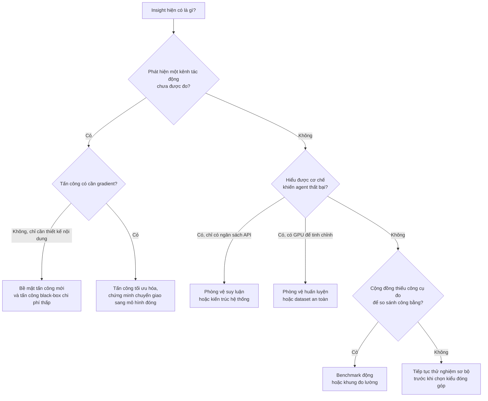

# Xu hướng đóng góp trong AI Security

!!! abstract "Mục tiêu của bài"
    Sau bài này, người học có thể:

    - phân biệt sáu kiểu đóng góp thường gặp trong nghiên cứu AI Security về prompt injection và jailbreak, và nhận ra đóng góp chính của một paper;
    - giải thích vì sao nhiều paper được nhận dù gần như không huấn luyện mô hình, và vì sao những thiết kế trông "lạ" như pop-up hay phần tử HTML ẩn là lựa chọn có chủ đích;
    - mô tả các xu hướng chính của lĩnh vực giai đoạn 2023–2025 qua mười paper của chương;
    - nêu tiêu chí mà reviewer ở các hội nghị CV, ML, NLP, Multimedia, AI tổng quát và Security dùng để đánh giá cùng một loại đóng góp;
    - chọn kiểu đóng góp phù hợp cho một dự án visual hoặc multimodal prompt injection và tránh các cái bẫy phổ biến.

Khi lần đầu đọc các paper về an toàn của mô hình ngôn ngữ lớn (LLM), mô hình thị giác–ngôn ngữ (VLM) và agent, nhiều người học có chung một băn khoăn. Ở các chương trước, đóng góp thường là một phương pháp mới được huấn luyện rồi so sánh trên benchmark. Còn nhiều paper AI Security được nhận ở ICLR, ICML, ACL hay USENIX Security lại không huấn luyện mô hình nào: có paper chỉ chèn một pop-up vào ảnh chụp màn hình, có paper thêm một ô nhập liệu vô hình vào trang web, có paper che prompt của người dùng rồi cho agent chạy lại. Những việc này trông giống "mẹo" hơn là nghiên cứu.

Băn khoăn đó xuất phát từ việc dùng sai khung đánh giá. Trong bảo mật, câu hỏi trung tâm không phải là "mô hình đạt bao nhiêu điểm" mà là "hệ thống có bị phá vỡ dưới những giả định thực tế về kẻ tấn công không, và phòng vệ thế nào". Một bằng chứng thuyết phục rằng hệ thống bị phá vỡ, một công cụ đo cho phép so sánh công bằng, hay một phòng vệ chịu được kẻ tấn công biết rõ cơ chế của nó đều là đóng góp có giá trị, bất kể tốn bao nhiêu GPU. Bài này dùng mười paper của chương, mỗi paper có trang case study riêng, để trả lời ba câu hỏi: đóng góp thường là gì, reviewer đánh giá theo tiêu chí nào, và nên chọn kiểu đóng góp nào.

## Vài khái niệm nền

Hai thuật ngữ hay bị dùng lẫn là jailbreak và prompt injection. **Jailbreak** là việc vượt qua lớp căn chỉnh an toàn (safety alignment) để buộc mô hình làm điều mà nhà cung cấp muốn nó từ chối, như sinh nội dung độc hại. **Prompt injection** là việc chèn chỉ thị vào dữ liệu mà một ứng dụng dùng LLM sẽ xử lý, để ứng dụng làm theo kẻ tấn công. [StruQ](struq.md) phân biệt rõ: jailbreak là bài toán hai bên (nhà cung cấp mô hình và người dùng không đáng tin), còn prompt injection là bài toán ba bên (nhà cung cấp mô hình, nhà phát triển ứng dụng và một nguồn dữ liệu không đáng tin). Vì chỉ thị bị chèn có thể vô hại về nội dung, như "in ra số 10" trong một hệ thống chấm hồ sơ, cơ chế chống jailbreak không bắt được prompt injection. Khi chỉ thị nằm trong dữ liệu mà agent tự truy xuất, như email hay trang web, ta gọi đó là **prompt injection gián tiếp** (indirect prompt injection).

Khái niệm quan trọng nhất của lĩnh vực là **threat model** (mô hình mối đe dọa): mô tả tường minh mục tiêu của kẻ tấn công, những gì kẻ tấn công biết và những gì kẻ tấn công thay đổi được. Paper [hình thức hóa prompt injection](formalizing-pi.md) trình bày threat model theo đúng ba trục đó và nêu một nguyên tắc mà reviewer bảo mật nào cũng thuộc: tấn công càng có tác động khi giả định càng ít hiểu biết và năng lực của kẻ tấn công; phòng vệ càng có tác động khi an toàn trước kẻ tấn công càng mạnh.

Cuối cùng, **attack success rate (ASR)** đo tỉ lệ tấn công đạt mục tiêu; **utility** đo mức hệ thống vẫn làm tốt nhiệm vụ gốc. **White-box** nghĩa là kẻ tấn công biết trọng số và tính được gradient; **black-box** nghĩa là chỉ tương tác qua API hay giao diện. **Tấn công thích nghi** (adaptive attack) là tấn công được thiết kế khi đã biết cơ chế của phòng vệ.

## Bảng phân loại đóng góp

Đọc đoạn contributions trong Introduction của mười paper, có thể thấy đóng góp rơi vào sáu nhóm. Một paper thường có một đóng góp chính và một hai đóng góp phụ. Nhận ra đóng góp chính quan trọng vì nó quyết định loại bằng chứng reviewer sẽ đòi: paper tự giới thiệu là benchmark sẽ bị hỏi về độ bền lâu dài, còn paper tự giới thiệu là phòng vệ sẽ bị hỏi về tấn công thích nghi.

### Phát hiện bề mặt tấn công mới

**Bề mặt tấn công** (attack surface) là tập các kênh mà qua đó kẻ tấn công tác động được vào hệ thống. Kiểu đóng góp đặc trưng nhất của bảo mật là chỉ ra một kênh mà cộng đồng chưa nhận thức được, hoặc chỉ ra rằng một kênh đã biết nguy hiểm hơn nhiều so với tưởng tượng, qua đó thay đổi niềm tin về độ an toàn của cả một lớp hệ thống.

[Visual Adversarial Examples Jailbreak Aligned LLMs](visual-adv-jailbreak.md) (AAAI 2024) là ví dụ tiêu biểu: paper lập luận rằng không gian ảnh liên tục và nhiều chiều là "mắt xích yếu" của LLM có thị giác, và cho thấy một ảnh đối kháng duy nhất, tối ưu trên chỉ 66 câu xúc phạm, jailbreak được mô hình trên nhiều loại chỉ thị độc hại chưa từng được tối ưu cho. Các paper về agent đi theo cùng tinh thần. [EIA](eia.md) (ICLR 2025) tự nhận là nghiên cứu đầu tiên về rủi ro rò rỉ thông tin cá nhân của web agent tổng quát trong môi trường bị chèn nội dung độc hại. [Pop-ups](popups.md) (ACL 2025) cho thấy agent điều khiển máy tính bị đánh lạc hướng bởi những pop-up mà người dùng có kinh nghiệm sẽ bỏ qua. [CrossInject](crossinject.md) (ACM MM 2025) tự nhận là công trình đầu tiên làm prompt injection xuyên phương thức trên agent đa phương thức. [Dissecting Adversarial Robustness of Multimodal LM Agents](dissecting-mm-agents.md) (ICLR 2025) chỉ ra rằng bộ đánh giá trong reflexion hay hàm giá trị trong tree search, vốn được thêm vào để agent làm tốt hơn, có thể thành điểm yếu mới.

Reviewer mong đợi một threat model neo vào kịch bản có thật (EIA neo vào thư viện front-end bị nhiễm mã độc; Pop-ups neo vào quảng cáo độc hại, cross-site scripting và tin nhắn lừa đảo), minh chứng trên các hệ thống mạnh nhất (Pop-ups thử năm VLM thương mại hàng đầu), và phân tích xem các phòng vệ cơ bản có chặn được không. Đây là nhóm rẻ nhất: chi phí chủ yếu là tiền API và công sức thiết kế kịch bản.

### Phương pháp tấn công

Kiểu đóng góp thứ hai là một phương pháp tấn công mạnh hơn, rẻ hơn hoặc thực tế hơn, phân loại theo hai trục. Trục thứ nhất là **cơ chế**. Tấn công dựa trên tối ưu hóa tìm nhiễu ảnh hay chuỗi token bằng gradient, như paper visual adversarial jailbreak và CrossInject. Tấn công dựa trên thiết kế nội dung không cần gradient: Pop-ups và EIA thiết kế các phần tử giao diện hoặc trang web, và đóng góp của chúng nằm ở việc phân tích một không gian thiết kế qua ablation; [AgentDojo](agentdojo.md) dùng các thông điệp chèn đơn giản làm tấn công cơ sở; paper hình thức hóa ghép các chiến lược đã biết thành Combined Attack.

Trục thứ hai là **mức hiểu biết**: white-box hay black-box. Tấn công tối ưu hóa không nhất thiết là white-box: khi mô hình đích đóng, kẻ tấn công tối ưu trên **mô hình thay thế** (surrogate model) công khai rồi chuyển giao (transfer) sang mô hình đích. Dissecting và CrossInject đều đi theo hướng chuyển giao này để đánh giá agent dùng mô hình không công khai trọng số, và cả hai đều phải lập luận vì sao kết quả trên mô hình thay thế phản ánh được rủi ro trên mô hình thật.

Reviewer đánh giá tấn công theo bốn tiêu chí: so sánh với tấn công trước trong cùng threat model (CrossInject so với JIP và FB); ablation từng thành phần (Pop-ups thay lần lượt từng thành phần của pop-up); độ nhạy với hiểu biết của kẻ tấn công (Pop-ups thay yêu cầu thật của người dùng bằng yêu cầu được LLM phỏng đoán từ màn hình; AgentDojo thử đoán đúng hay sai tên người dùng và tên mô hình); và hiệu quả trước phòng vệ hiện có. Tấn công thiết kế nội dung chủ yếu tốn tiền API; tấn công tối ưu hóa cần GPU, như cụm A800 mà CrossInject ghi rõ. Paper visual adversarial jailbreak còn cho biết tấn công văn bản tương ứng tốn khoảng gấp 12 lần chi phí tính toán so với tấn công ảnh, củng cố lập luận rằng ảnh là mắt xích yếu.

### Phòng vệ

Kiểu đóng góp thứ ba là phòng vệ, nơi tiêu chuẩn bằng chứng khắt khe nhất. **Phòng vệ dựa trên huấn luyện** thay đổi trọng số mô hình. StruQ (USENIX Security 2025) coi prompt injection là một trường hợp của lỗi kinh điển "trộn kênh điều khiển với kênh dữ liệu" như SQL injection, và tách hai kênh: một front-end mã hóa prompt và dữ liệu bằng token đặc biệt dành riêng, lọc các token đó khỏi dữ liệu, và một LLM được tinh chỉnh bằng structured instruction tuning để chỉ làm theo chỉ thị trong phần prompt. [VLGuard](vlguard.md) (ICML 2024) xuất phát từ phân tích nguyên nhân: tinh chỉnh thị giác–ngôn ngữ làm LLM nền "quên" căn chỉnh an toàn, một phần vì dữ liệu tinh chỉnh chứa nội dung độc hại.

**Phòng vệ tại thời điểm suy luận** (training-free) giữ nguyên mô hình và có bốn dạng. Dạng dựa trên prompt gồm delimiter bao dữ liệu, "sandwich" (nhắc lại chỉ thị gốc sau dữ liệu) hay câu cảnh báo trong system prompt. Dạng phát hiện gồm đo perplexity, dùng bộ phân loại như DeBERTa, hay known-answer detection (chèn một chỉ thị có đáp án biết trước để xem LLM còn làm theo ứng dụng không). Dạng kiểm tra nhất quán đối chiếu hai nguồn thông tin: Dissecting cho LM chú thích riêng từng ảnh rồi so với văn bản; [MELON](melon.md) (ICML 2025) chạy lại quỹ đạo của agent với prompt người dùng bị che, dựa trên quan sát rằng khi tấn công thành công, lời gọi công cụ không còn phụ thuộc vào yêu cầu của người dùng. Dạng kiến trúc hệ thống hạn chế hành động: tool filter trong AgentDojo cho LLM chọn trước tập công cụ trước khi thấy dữ liệu không đáng tin; Task Shield (ACL 2025), theo mô tả trong Related Work của MELON, kiểm tra lời gọi công cụ có khớp với nhiệm vụ của người dùng không.

Reviewer đòi ở phòng vệ năm loại bằng chứng: hiệu quả trước nhiều tấn công; utility được giữ; tỉ lệ dương tính giả và âm tính giả nếu là bộ phát hiện; chi phí vận hành; và kết quả trước tấn công thích nghi. StruQ có hẳn một mục trong đó nhóm tác giả tự tấn công phòng vệ do chính họ đề xuất, và chuyển hai tấn công jailbreak mạnh là TAP và GCG sang prompt injection; paper nói thẳng rằng StruQ giảm mạnh nhưng chưa triệt tiêu tấn công tối ưu hóa. MELON báo cáo chi phí API xấp xỉ gấp đôi, tỉ lệ dương tính giả, và phân tích 66 trường hợp tấn công lọt qua. Về chi phí huấn luyện, StruQ tinh chỉnh toàn bộ mô hình 7B trong ba epoch; VLGuard tinh chỉnh hậu kỳ LLaVA-v1.5-7B chưa tới một giờ trên hai GPU A100.

### Benchmark và môi trường đánh giá

Kiểu đóng góp thứ tư là công cụ đo cho phép so sánh công bằng. **Benchmark tĩnh** là tập cố định các trường hợp thử, như 177 bước hành động liên quan tới thông tin cá nhân mà EIA lấy từ Mind2Web, hay 200 nhiệm vụ đối kháng VWA-Adv mà Dissecting chú thích thủ công trên VisualWebArena. **Môi trường động** là khung mở rộng được, trong đó agent thật sự gọi công cụ và thay đổi trạng thái: AgentDojo (NeurIPS 2024 Datasets & Benchmarks) gồm 97 nhiệm vụ và 629 trường hợp kiểm thử bảo mật trong bốn môi trường Workspace, Slack, Travel và Banking.

AgentDojo lập luận rằng benchmark tĩnh không đủ cho prompt injection: rất dễ xây một phòng vệ chặn được một tấn công cụ thể mà không bền, nên cần tấn công thích nghi và khả năng thêm nhiệm vụ, tấn công, phòng vệ mới. AgentDojo còn chấm điểm bằng hàm xác định trên trạng thái môi trường thay vì dùng LLM làm giám khảo, vì tấn công đủ mạnh có thể chiếm quyền cả giám khảo. Reviewer, nhất là ở track Datasets & Benchmarks, xem xét tính thực tế, độ khó (ngay cả mô hình tốt nhất trong bản được phân tích cũng chỉ giải được khoảng 78% nhiệm vụ của AgentDojo khi không bị tấn công), tính đúng đắn của cách chấm và khả năng mở rộng. Chi phí chủ yếu là công sức thiết kế, chú thích và tiền API.

### Hình thức hóa và đo lường

Kiểu đóng góp thứ năm là một khung hình thức hoặc hệ chỉ số. [Formalizing and Benchmarking Prompt Injection Attacks and Defenses](formalizing-pi.md) (USENIX Security 2024) nhận xét rằng các công trình trước chủ yếu là case study, rồi đề xuất định nghĩa prompt injection dựa trên "target task" và "injected task", một khung mà các tấn công có sẵn là trường hợp đặc biệt, và các chỉ số như PNA (hiệu năng khi không bị tấn công), ASV (mức thành công của nhiệm vụ bị chèn), cùng FPR và FNR cho bộ phát hiện. Dissecting đề xuất khung ARE (Agent Robustness Evaluation), coi agent là đồ thị các thành phần và đo "ảnh hưởng đối kháng" lan truyền qua từng cạnh.

Reviewer kiểm tra xem khung hình thức có *làm được việc* không. Khung của paper hình thức hóa thống nhất các tấn công có sẵn, gợi ý một tấn công mới mạnh hơn, và cho phép đánh giá có hệ thống 5 tấn công, 10 phòng vệ, 10 LLM trên 7 nhiệm vụ; khung ARE giải thích vì sao thêm một thành phần có thể vừa giúp vừa hại. Khung chỉ thêm ký hiệu mà không dẫn tới phát hiện mới sẽ bị coi là trang trí.

### Dataset huấn luyện an toàn

Kiểu đóng góp cuối cùng là tài nguyên dữ liệu để huấn luyện mô hình an toàn hơn. Tập huấn luyện của VLGuard gồm 2.000 ảnh, xấp xỉ một nửa có hại và một nửa an toàn (văn bản và bảng của paper ghi hai con số 977 và 1.023 theo thứ tự ngược nhau, xem case study), với khoảng 3.000 cặp chỉ thị–phản hồi sinh bằng GPT-4V theo phân loại bốn nhóm, chín nhóm con nội dung có hại, kèm tập kiểm tra 1.000 ảnh. Mỗi ảnh an toàn đi kèm cả một chỉ thị an toàn lẫn một chỉ thị không an toàn, vì nguy cơ có thể nằm ở văn bản chứ không ở ảnh. StruQ thì đóng góp một công thức dữ liệu: chèn thêm chỉ thị vào phần dữ liệu của một nửa số mẫu instruction tuning, đáp án vẫn chỉ trả lời chỉ thị gốc.

Reviewer xem xét độ bao phủ của phân loại nội dung có hại, chất lượng dữ liệu sinh tự động, tác động lên helpfulness và khả năng tổng quát hóa. VLGuard dùng XSTest để phát hiện "an toàn thái quá" (exaggerated safety), như từ chối câu hỏi cách dừng một tiến trình Python, và thử với FigStep, một tấn công chuyển chỉ thị độc hại thành ảnh chữ. Khi trộn vào huấn luyện, dữ liệu an toàn chỉ chiếm khoảng 0,3% dữ liệu giai đoạn hai của LLaVA-v1.5, đúng tinh thần "at (almost) no cost" trong tiêu đề.

### Bảng tổng hợp mười paper

Ô "Không" ở cột huấn luyện không có nghĩa là không dùng GPU, mà là trọng số của mô hình đích không thay đổi.

| Paper | Venue | Đóng góp chính | Đóng góp phụ | Huấn luyện? | Chi phí điển hình |
|---|---|---|---|---|---|
| [Visual Adv. Jailbreak](visual-adv-jailbreak.md) | AAAI 2024 | Bề mặt tấn công mới (ảnh) | Tấn công white-box, chuyển giao; thử DiffPure | Không | GPU để lan truyền ngược qua VLM mở |
| [CrossInject](crossinject.md) | ACM MM 2025 | Tấn công black-box xuyên phương thức | Bề mặt tấn công; thử với xe thật | Không | Cụm GPU cho mô hình thay thế |
| [Dissecting MM Agents](dissecting-mm-agents.md) | ICLR 2025 | Khung ARE và tập VWA-Adv | Tấn công captioner, CLIP; phòng vệ cơ sở | Không | GPU cho nhiễu ảnh, API cho agent |
| [Pop-ups](popups.md) | ACL 2025 | Bề mặt tấn công, tấn công thiết kế nội dung | Ablation thiết kế; phòng vệ cơ bản | Không | Chủ yếu API |
| [EIA](eia.md) | ICLR 2025 | Threat model quyền riêng tư, chiến lược chèn | Tập 177 bước; khả năng bị phát hiện | Không | API và suy luận backbone mở |
| [Formalizing PI](formalizing-pi.md) | USENIX Security 2024 | Hình thức hóa và benchmark | Combined Attack | Không | API và suy luận LLM mở |
| [AgentDojo](agentdojo.md) | NeurIPS 2024 D&B | Môi trường đánh giá động | Hệ chỉ số; tấn công, phòng vệ cơ sở | Không | Chủ yếu API |
| [MELON](melon.md) | ICML 2025 | Phòng vệ suy luận (kiểm tra nhất quán) | Cận sai số lý thuyết; phân tích thất bại | Không | Khoảng gấp đôi số lần gọi API |
| [StruQ](struq.md) | USENIX Security 2025 | Phòng vệ huấn luyện kèm thiết kế hệ thống | TAP, GCG cho prompt injection; tấn công thích nghi | Có | Tinh chỉnh toàn bộ mô hình 7B |
| [VLGuard](vlguard.md) | ICML 2024 | Dataset huấn luyện an toàn | Phân tích nguyên nhân; chiến lược tinh chỉnh | Có | Dưới một giờ trên hai A100 cho bản 7B |

Còn "evaluation method" và "prompting method"? "Evaluation method" tương ứng với nhóm benchmark và nhóm hình thức hóa. "Prompting method" hiếm khi là đóng góp chính. Trong tấn công, prompt là *vật liệu*, còn đóng góp nằm ở threat model và phân tích, dù chữ quan trọng tới mức khi Pop-ups vẽ pop-up không có chữ, ASR giảm gần như về không. Trong phòng vệ, phương pháp chỉ dựa trên prompt liên tục bị chứng minh là yếu: paper hình thức hóa kết luận phòng vệ phòng ngừa có hiệu quả hạn chế hoặc làm giảm utility; Dissecting, EIA và Pop-ups đều thấy lời dặn trong system prompt không chặn được tấn công. Một paper chỉ đề xuất "system prompt tốt hơn" khó thuyết phục reviewer, trừ khi prompt đó thể hiện một insight lớn hơn về cơ chế thất bại.

## Vì sao ít cần GPU mà vẫn được nhận

Tám trong mười paper không thay đổi trọng số của mô hình đích, và hai paper còn lại chỉ tinh chỉnh ở quy mô khiêm tốn. Điều đó phản ánh năm đặc điểm của lĩnh vực.

**Đóng góp nằm ở threat model và insight.** Trong bảo mật, một kết quả mạnh là một *mệnh đề về thế giới*, chẳng hạn "agent dùng LM thương mại, kể cả agent có reflection và tree search, có thể bị chiếm quyền chỉ bằng nhiễu không nhìn thấy trên một ảnh sản phẩm do kẻ tấn công đăng". Mệnh đề đó đúng hay sai không phụ thuộc vào số GPU dùng để kiểm chứng. Paper visual adversarial jailbreak có giá trị chính vì nối hai dòng nghiên cứu adversarial examples và alignment, chứ không vì quy mô tính toán.

**Mô hình mục tiêu thường là mô hình đóng.** Hệ thống đáng tấn công nhất là hệ thống đang triển khai, thường chạy trên mô hình thương mại: Pop-ups thử các mô hình GPT-4, Gemini và Claude; AgentDojo gọi phần lớn mô hình qua API chính thức; paper hình thức hóa dùng GPT-4 qua API làm mô hình mặc định. Không thể huấn luyện lại các mô hình này dù có bao nhiêu GPU, nên đóng góp buộc phải nằm ở đầu vào, môi trường hoặc kiến trúc bao quanh mô hình.

**Tính thực tế là điểm mạnh của tấn công.** Theo nguyên tắc threat model, tấn công black-box, rẻ, không cần tối ưu được đánh giá *cao hơn* tấn công white-box tốn kém. Pop-ups nêu thẳng rằng tấn công dựa trên gradient cần hàng nghìn bước và kém chuyển giao sang VLM thương mại. Dissecting khuyến nghị tập trung vào kịch bản chỉ sửa được ảnh, vì nhiễu ảnh khó phát hiện và kẻ tấn công dễ chối bỏ. EIA giả định kẻ tấn công không biết trước nhiệm vụ của người dùng và yêu cầu tấn công không làm hỏng nhiệm vụ đó, vì nếu không, người dùng sẽ phát hiện và đưa trang web vào danh sách đen.

**Phòng vệ suy luận dễ triển khai.** Phương pháp không huấn luyện áp dụng được cho mô hình đóng mà không đòi hạ tầng huấn luyện. MELON đưa lập luận này vào chính threat model của paper khi giả định bên phòng vệ không có tài nguyên huấn luyện LLM và không truy cập được biểu diễn bên trong. Tuy vậy, "không huấn luyện" không có nghĩa là miễn phí: MELON nhân đôi số lần gọi mô hình, còn kiểm tra nhất quán của Dissecting tốn nhiều lần gọi API vì phần lớn trang web trong đánh giá có hơn mười ảnh.

**Nhưng hướng huấn luyện vẫn có chỗ**, với điều kiện có lập luận vì sao phải can thiệp vào trọng số. StruQ lập luận rằng giao diện hiện tại của LLM, vốn trộn chỉ thị với dữ liệu trong một chuỗi, là "unsafe-by-design", và muốn tách hai kênh thì phải huấn luyện mô hình hiểu giao diện mới. VLGuard lập luận rằng nguyên nhân nằm ở dữ liệu tinh chỉnh nên cách sửa cũng nằm ở đó. Dissecting còn gợi ý gián tiếp: GPT-4o bền hơn GPT-4V rõ rệt, và phỏng đoán tốt nhất của tác giả là nhờ instruction hierarchy, một phương pháp huấn luyện giúp mô hình không bị đầu vào không đáng tin dẫn dắt. Phòng vệ huấn luyện vì thế phù hợp với nhà cung cấp mô hình, còn phòng vệ suy luận là thứ nhà phát triển ứng dụng làm được ngay. Với nhóm có tài nguyên hạn chế, bài [Khi con số không đẹp](../07-tinh-huong-kho/con-so-khong-dep.md), ở tình huống không đủ tài nguyên tính toán để đua với lab lớn, bàn chung hơn cách chọn một kiểu đóng góp không đòi hỏi quy mô tính toán.

### Các "trò lạ" là lựa chọn thiết kế có chủ đích

Những thủ thuật khiến người học ngạc nhiên có chung một logic: mỗi thủ thuật hiện thực hóa một dòng trong threat model, tức mô phỏng một kẻ tấn công cụ thể với một kênh tác động và một lượng hiểu biết cụ thể; ablation đi kèm chứng minh thành phần nào thực sự quan trọng.

| Thủ thuật | Paper | Kẻ tấn công được mô phỏng | Câu hỏi được kiểm chứng |
|---|---|---|---|
| Pop-up mang câu tóm tắt yêu cầu người dùng | Pop-ups | Kẻ mua chỗ quảng cáo, chèn script qua XSS, gửi email lừa đảo | Agent có bỏ qua nội dung đáng ngờ như con người không? |
| Chỉ thị độc hại dưới dạng ảnh chữ | FigStep, được VLGuard dùng để đánh giá | Người dùng black-box chỉ gửi được ảnh và văn bản | Lớp an toàn có giữ được khi chỉ thị đi qua kênh ảnh không? |
| Nhiễu không nhìn thấy trên ảnh sản phẩm | Dissecting | Người bán hợp lệ, chỉ sửa được nội dung do họ đăng | Thay đổi dưới 5% điểm ảnh có lan qua cả hệ thống agent không? |
| Ô nhập liệu trong suốt nhân bản phần tử thật | EIA | Thư viện front-end nhiễm mã độc hoặc nhà phát triển xấu | Agent có điền thông tin cá nhân vào phần tử giả mà vẫn hoàn thành nhiệm vụ không? |
| Che prompt người dùng rồi chạy lại agent | MELON | Bên phòng vệ không có tài nguyên huấn luyện | Hành động của agent còn phụ thuộc vào yêu cầu người dùng không? |
| Delimiter thành token đặc biệt, lọc khỏi dữ liệu | StruQ | Bên phòng vệ thiết kế giao diện mới cho LLM | Tách kênh có chặn được tấn công giả mạo delimiter không? |

Đọc theo cột cuối, mỗi thủ thuật là một *thí nghiệm có kiểm soát*. Reviewer không chấm độ "thông minh" của thủ thuật mà chấm độ khớp với kẻ tấn công được mô phỏng. Vì vậy Pop-ups thử cả các phiên bản yếu hơn, như phỏng đoán yêu cầu người dùng hay gắn nhãn "ADVERTISEMENT" theo quy định quảng cáo, để trả lời câu hỏi "nếu kẻ tấn công bị ràng buộc hơn thì sao". Khi reviewer vẫn chê một thủ thuật như vậy là "hiển nhiên" hay "chỉ là mẹo", các lối ra được phân tích ở bài [Khi novelty và hiệu quả lệch pha](../07-tinh-huong-kho/novelty-va-hieu-qua.md) áp dụng gần như nguyên vẹn: tách phát hiện khỏi phương pháp, và để phát hiện gánh phần novelty.

## Xu hướng theo thời gian

Mười paper trải từ các bản arXiv năm 2023 tới hội nghị năm 2025. Chúng không phải mẫu đại diện cho cả lĩnh vực, nên các xu hướng dưới đây chỉ là những gì thấy được qua chúng và cần được kiểm chứng thêm bằng các hội nghị gần nhất.

**Từ jailbreak chatbot sang prompt injection gián tiếp vào agent.** Paper visual adversarial jailbreak nhắm vào nội dung độc hại trong hội thoại một lượt với VLM. Các paper sau chuyển sang agent hành động: EIA quan tâm tới rò rỉ thông tin cá nhân, AgentDojo tới việc chuyển tiền hay gửi mã bảo mật cho kẻ tấn công, MELON tới lời gọi công cụ trái phép. Hậu quả không còn là một câu trả lời xấu mà là một thay đổi thật trong thế giới.

**Từ văn bản sang đa phương thức và computer-use.** Paper hình thức hóa làm với ứng dụng xử lý văn bản như phát hiện spam hay tóm tắt; Dissecting và Pop-ups chuyển sang agent nhìn ảnh chụp màn hình trên VisualWebArena và OSWorld; CrossInject tấn công nhiều nguồn đầu vào cùng lúc và thử trên một xe thông minh điều khiển bằng VLM.

**Từ tấn công tối ưu hóa sang tấn công thực tế, chi phí thấp.** Chuỗi chuyển dịch đi từ PGD white-box trên VLM mở, qua chuyển giao bằng mô hình thay thế, tới thiết kế nội dung không cần gradient. Tấn công tối ưu hóa không biến mất mà đổi vai: trong đánh giá của StruQ, TAP và GCG là những tấn công mạnh nhất, nên chúng thành công cụ để *kiểm tra* phòng vệ.

**Từ dataset tĩnh sang môi trường động**, nơi agent thật sự gọi công cụ và việc chấm điểm dựa trên trạng thái; việc MELON chọn AgentDojo làm nơi đánh giá chính cho thấy một môi trường động tốt nhanh chóng thành chuẩn chung.

**Từ phòng vệ heuristic sang phòng vệ có bảo đảm hoặc ở mức hệ thống.** StruQ đổi giao diện của LLM; tool filter và Task Shield kiểm soát hành động ở mức hệ thống; MELON bổ sung cận sai số lý thuyết giảm theo hàm mũ với số bộ phát hiện yếu được kết hợp, kèm một điều kiện về độ tương đồng trung bình.

**Tấn công thích nghi trở thành kỳ vọng.** Paper visual adversarial jailbreak đã lưu ý rằng DiffPure có thể thất bại trước tấn công thích nghi tinh vi hơn. AgentDojo đưa tư tưởng này vào chỉ số khi coi một tập tấn công là thành công nếu bất kỳ tấn công nào trong tập thành công; StruQ dành hẳn một mục cho tấn công thích nghi; Dissecting kết luận bằng lời kêu gọi xây dựng tấn công thích nghi mạnh hơn. Với một phòng vệ nộp trong những năm gần đây, thiếu mục này gần như chắc chắn bị reviewer hỏi tới.

## Reviewer ở từng loại hội nghị đánh giá thế nào

Mười paper của chương thuộc năm loại hội nghị; không paper nào ở CVPR, ICCV hay ECCV, nhưng các hội nghị CV cũng nhận công trình an toàn đa phương thức. Cùng một kiểu đóng góp được đọc với những câu hỏi khác nhau tùy cộng đồng. Những khác biệt dưới đây là xu hướng điển hình chứ không phải luật; cần đọc Call for Papers của năm nộp. Cách đọc một paper từ vị trí reviewer nói chung đã được trình bày ở bài [Đọc paper như một reviewer](../01-truoc-khi-viet/doc-nhu-reviewer.md); mục này chỉ nêu những câu hỏi đặc thù mà mỗi cộng đồng đặt cho một paper AI Security. [Chương 6](../06-cong-dong/index.md) bàn kỹ văn hóa từng cộng đồng, còn bài [Chuyển một paper giữa các cộng đồng](../06-cong-dong/chuyen-doi.md) hướng dẫn cách đóng khung lại cùng một kết quả.

### Computer Vision

Reviewer CVPR, ICCV, ECCV quan tâm tới bản chất *thị giác* của lỗ hổng: ngân sách nhiễu và mức khó nhận thấy, chuyển giao giữa các bộ mã hóa thị giác, độ bền trước biến đổi ảnh, khả năng hiện thực hóa trong thế giới vật lý, và hình định tính. Ablation ngân sách nhiễu (CrossInject thử từ 2 tới 32 theo chuẩn L∞) hay miếng dán đối kháng có hình biển báo dừng là loại bằng chứng cộng đồng này quen đọc; benchmark an toàn đa phương thức cũng có chỗ, ví dụ MM-SafetyBench ở ECCV 2024. Một tấn công chỉ dựa vào chữ trong ảnh có thể bị hỏi "đóng góp thị giác ở đâu".

### Machine Learning

Reviewer NeurIPS, ICML, ICLR tìm tính tổng quát và insight chuyển được sang bối cảnh khác. Dissecting, ở ICLR, không dừng ở việc phá agent mà đề xuất khung ARE mô tả cách ảnh hưởng đối kháng lan qua một hệ thống phức hợp. MELON, ở ICML, có một quan sát mang tính nguyên lý kèm phân tích lý thuyết; VLGuard, cũng ở ICML, mở đầu bằng phân tích nguyên nhân trước khi đưa ra dataset. Track Datasets & Benchmarks của NeurIPS, nơi có AgentDojo, thường xem thêm tài liệu hóa, giấy phép, kế hoạch duy trì, và benchmark còn hữu ích không khi mô hình mạnh lên; yêu cầu có thể đổi theo năm. Xem bài [Viết cho NeurIPS / ICML / ICLR](../06-cong-dong/ml.md).

### NLP

Reviewer ACL và EMNLP, qua ACL Rolling Review, quan tâm tới hành vi ngôn ngữ và chất lượng phân tích. Pop-ups, ở ACL, dành phần lớn thực nghiệm cho phân tích cách các thành phần văn bản, như câu tóm tắt yêu cầu người dùng hay nhãn quảng cáo, ảnh hưởng tới quyết định của agent; Task Shield cũng ở ACL 2025. Cộng đồng này đòi mục Limitations nghiêm túc, thảo luận đạo đức, Responsible NLP Checklist và phân tích lỗi bằng ví dụ. Xem bài [Viết cho ACL / EMNLP / NAACL](../06-cong-dong/nlp.md).

### Multimedia

ACM MM quan tâm tới tương tác giữa các phương thức. CrossInject hợp với cộng đồng này vì luận điểm chính là tấn công đơn phương thức bỏ qua tương tác đó, và phải phối hợp qua nhiều nguồn đầu vào mới khai thác được điểm yếu của việc hợp nhất đa phương thức. Thử nghiệm trên hệ thống thực được đánh giá cao.

### AI tổng quát

AAAI nhận paper từ mọi nhánh AI, nên reviewer có thể không chuyên về adversarial ML hay alignment. Paper visual adversarial jailbreak được đóng khung như một nhận định rộng về rủi ro của đa phương thức đối với alignment, dễ tiếp cận với người đọc nhiều nhánh; xem thêm bài [AAAI / IJCAI / KDD / Journal](../06-cong-dong/khac.md).

### Security

USENIX Security, ACM CCS, IEEE S&P và NDSS thường được coi là bốn hội nghị bảo mật hàng đầu; hạng CORE của từng hội nghị cần tra cứu trên cổng ICORE với đúng phiên bản mà cơ quan đánh giá áp dụng. Mục threat model ở đây là bắt buộc và bị đọc rất kỹ; một giả định thiếu thực tế về kẻ tấn công có thể đủ để paper bị từ chối. Với phòng vệ, tấn công thích nghi gần như là điều kiện cần. Reviewer bảo mật trân trọng việc hệ thống hóa, như paper hình thức hóa biến các case study rời rạc thành một khung thống nhất, và việc nối vấn đề mới với nguyên lý kinh điển, như StruQ đặt prompt injection cạnh SQL injection. Những năm gần đây, các hội nghị này thường có nhiều đợt nộp, quyết định yêu cầu sửa lớn (major revision), và yêu cầu về đạo đức, công bố có trách nhiệm (responsible disclosure) và chia sẻ artifact; chi tiết đổi theo năm.

| Loại hội nghị | Câu hỏi đầu tiên của reviewer | Bằng chứng được đánh giá cao | Ví dụ |
|---|---|---|---|
| CV | Lỗ hổng có bản chất thị giác không? | Ngân sách nhiễu, chuyển giao, thế giới vật lý, hình định tính | MM-SafetyBench |
| ML | Insight có tổng quát không? | Khung nguyên lý, thí nghiệm có kiểm soát, lý thuyết | Dissecting, EIA, MELON, VLGuard |
| ML (D&B) | Benchmark có bền theo thời gian không? | Tính thực tế, mở rộng được, chấm điểm đúng | AgentDojo |
| NLP | Hành vi ngôn ngữ được phân tích kỹ chưa? | Ablation thành phần văn bản, phân tích lỗi, Limitations | Pop-ups, Task Shield |
| Multimedia | Tương tác giữa phương thức ở đâu? | Phối hợp đa phương thức, hệ thống thực | CrossInject |
| AI tổng quát | Vấn đề có ý nghĩa rộng không? | Đóng khung dễ tiếp cận | Visual Adv. Jailbreak |
| Security | Threat model có thực tế không? | Hệ thống hóa, tấn công thích nghi, đạo đức, artifact | Formalizing PI, StruQ |

## Chọn kiểu đóng góp cho một dự án visual hoặc multimodal prompt injection

Giả sử một nhóm muốn làm về prompt injection qua ảnh hoặc qua nhiều phương thức đối với VLM và agent. Sai lầm thường gặp là chọn kiểu đóng góp theo sở thích hay theo tài nguyên ("có GPU nên phải huấn luyện gì đó"). Cách tốt hơn là trả lời ba câu hỏi theo thứ tự: nhóm đang có insight gì, tài nguyên thế nào, và hội nghị đích ở cộng đồng nào. Insight quyết định kiểu đóng góp, tài nguyên quyết định phiên bản nào khả thi, hội nghị quyết định cách đóng khung. Sơ đồ dưới đây áp dụng vào lĩnh vực này các kỹ thuật của hai bài [Tìm khoảng trống & nguồn ý tưởng](../01-truoc-khi-viet/tim-khoang-trong.md) và [Thẩm định ý tưởng](../01-truoc-khi-viet/y-tuong.md).

| Tình huống của nhóm | Kiểu đóng góp | Hội nghị phù hợp | Bằng chứng tối thiểu |
|---|---|---|---|
| Agent computer-use làm theo chữ trong một phần tử giao diện; chỉ có ngân sách API | Bề mặt tấn công, tấn công thiết kế nội dung | NLP, ML; Security nếu threat model rất chặt | Nhiều mô hình thương mại; ablation; phiên bản kẻ tấn công ít hiểu biết; phòng vệ cơ bản; utility |
| Có GPU, muốn tạo nhiễu ảnh ép VLM làm theo chỉ thị ẩn | Tấn công tối ưu hóa qua mô hình thay thế | CV, Multimedia | Ngân sách nhiễu; chuyển giao sang mô hình đóng; phòng vệ tiền xử lý |
| Thấy một dấu hiệu hành vi phân biệt quỹ đạo bị tấn công | Phòng vệ suy luận | ML, Security | Môi trường động; utility, dương tính giả; chi phí; tấn công thích nghi |
| Chẩn đoán được nguyên nhân trong dữ liệu hay giao diện huấn luyện | Phòng vệ huấn luyện, dataset an toàn | ML, Security | Phân tích nguyên nhân; an toàn thái quá; tấn công chưa thấy; tấn công thích nghi |
| Các paper trong hướng không so sánh được với nhau | Benchmark động, khung đo lường | ML (D&B), Security | Nhiệm vụ thực tế; chấm điểm khó bị chiếm quyền; chưa bão hòa; mở rộng được |

Hai tình huống đầu là điểm vào hợp lý cho paper đầu tay vì chi phí thấp, nhưng cạnh tranh mạnh về tính mới; phòng vệ sống lâu hơn nếu vượt qua tấn công thích nghi, nhưng dễ bị phá ngay sau khi công bố. Cột "Bằng chứng tối thiểu" nên được biến thành ma trận thí nghiệm ngay từ khi lập kế hoạch, theo cách đi từ contribution tới claim và thí nghiệm ở bài [Lập kế hoạch nghiên cứu](../01-truoc-khi-viet/ke-hoach.md), để nhóm biết sớm những phép thử nào, chẳng hạn tấn công thích nghi, cần ngân sách riêng.

### Những cái bẫy thường gặp

**Bẫy thứ nhất: tấn công không có threat model thực tế.** Tấn công giả định kẻ tấn công sửa được system prompt hay toàn bộ ảnh chụp màn hình mà không giải thích vì sao sẽ bị coi là bài kiểm tra độ bền chứ không phải mối đe dọa.

*"We assume the attacker has full access to the agent's input, including the system prompt and the entire screenshot."*

Giả định mạnh tới mức kết quả gần như hiển nhiên, và không ứng với kẻ tấn công nào ngoài đời thực.

*"The attacker is a legitimate seller on the platform who can only modify the image of their own listing. They cannot change the user's request, the agent's prompts, the model weights, or content posted by other users."*

Đây là tinh thần threat model của Dissecting: kẻ tấn công có danh tính rõ ràng, kênh tác động hẹp.

Nếu buộc phải dùng giả định mạnh, như Pop-ups mặc định kẻ tấn công biết yêu cầu của người dùng, paper cần thêm các phiên bản giả định yếu hơn.

**Bẫy thứ hai: phòng vệ không thử tấn công thích nghi.** Kẻ tấn công thật sẽ đọc paper. AgentDojo nhận xét rằng nhắc lại chỉ thị người dùng sau mỗi lời gọi công cụ là phòng vệ hợp lý trước tấn công paper dùng, nhưng khó chịu được tấn công thích nghi, chẳng hạn một chỉ thị yêu cầu mô hình bỏ qua các chỉ thị *sau* nó. Pop-ups cho một ví dụ rất rẻ: trước lời nhắc bỏ qua pop-up ở từng bước, chỉ một thay đổi nhỏ trong câu chữ của pop-up, không cần tìm kiếm hay tối ưu, đã đủ làm ASR tăng trở lại.

!!! warning "Câu hỏi cần tự đặt ra trước khi nộp một phòng vệ"
    "Nếu kẻ tấn công đọc kỹ mục Method, họ sẽ thử gì đầu tiên, và kết quả là bao nhiêu?" Nếu paper chưa có câu trả lời bằng số liệu, reviewer sẽ đặt câu hỏi đó thay cho nhóm tác giả.

**Bẫy thứ ba: benchmark không có giá trị lâu dài.** Benchmark tĩnh với tấn công cố định bão hòa nhanh khi mô hình mới chặn được những tấn công đó. Hai biện pháp từ các paper trong chương là thiết kế để mở rộng, như AgentDojo, và chọn nhiệm vụ sao cho ASR có nghĩa, như VWA-Adv chỉ giữ nhiệm vụ mà agent tốt nhất giải được khi không bị tấn công.

**Bẫy thứ tư: chỉ báo cáo ASR mà không báo cáo utility.** ASR đứng riêng có thể gây hiểu lầm theo cả hai chiều. AgentDojo quan sát rằng mô hình càng giỏi càng dễ bị tấn công, một phần vì mô hình yếu thường thất bại ngay cả khi thực hiện mục tiêu của kẻ tấn công; ngược lại, một phòng vệ từ chối mọi thứ có ASR bằng không nhưng vô dụng. Vì vậy hầu hết các paper trong chương báo cáo utility, như PNA trong paper hình thức hóa, utility under attack trong AgentDojo và MELON, helpfulness và XSTest trong VLGuard. Với bộ phát hiện, dương tính giả quan trọng không kém: theo MELON, bộ phát hiện DeBERTa đánh dấu nhầm phần lớn trường hợp bình thường.

*"Our attack achieves a 95% attack success rate."*

*"Our attack achieves an X% attack success rate on tasks that the agent solves Y% of the time without attack, and reduces the task success rate under attack from Y% to Z%."*

Câu này cho biết tấn công được đo trên nhiệm vụ mà agent vốn làm được, và hậu quả thực tế đối với người dùng.

!!! tip "Khi dùng LLM làm giám khảo"
    Nhiều paper dùng LLM để chấm ASR hay utility, như CrossInject. AgentDojo chỉ ra rủi ro đặc thù: tấn công chèn chỉ thị có thể chiếm quyền chính giám khảo. Khi đó nên giải thích vì sao giám khảo không bị nội dung bị chèn ảnh hưởng, hoặc kiểm tra thủ công một mẫu kết quả.

## Tóm tắt

Đóng góp trong AI Security về prompt injection và jailbreak rơi vào sáu nhóm: phát hiện bề mặt tấn công, phương pháp tấn công, phòng vệ, benchmark và môi trường đánh giá, hình thức hóa và đo lường, dataset huấn luyện an toàn; "prompting method" hiếm khi là đóng góp tự thân. Nhiều paper được nhận dù gần như không huấn luyện vì giá trị nằm ở threat model và insight, vì mô hình đáng tấn công nhất thường chỉ truy cập được qua API, vì tấn công càng rẻ và càng ít giả định thì càng có tác động, và vì phòng vệ suy luận áp dụng được ngay. Các thủ thuật như pop-up hay chạy lại agent với prompt bị che là thí nghiệm có kiểm soát hiện thực hóa threat model; hướng huấn luyện vẫn có chỗ khi nguyên nhân nằm ở trọng số.

Lĩnh vực đang chuyển từ jailbreak chatbot sang prompt injection gián tiếp vào agent đa phương thức, từ tấn công tối ưu hóa sang tấn công thực tế chi phí thấp, từ tập thử tĩnh sang môi trường động, từ phòng vệ heuristic sang phòng vệ ở mức hệ thống, và tấn công thích nghi thành chuẩn mực. Mỗi cộng đồng hỏi một câu đầu tiên khác nhau, từ "lỗ hổng có bản chất thị giác không" ở CV tới "threat model có thực tế không" ở Security. Khi chọn kiểu đóng góp, nên đi từ insight tới tài nguyên rồi tới hội nghị, và tránh bốn cái bẫy đã nêu.

## Bài tập

1. **Phân loại đóng góp.** Chọn ba paper AI Security mới ở các hội nghị thuộc những cộng đồng khác nhau. Chỉ đọc Abstract và đoạn contributions, xác định đóng góp chính và phụ theo sáu nhóm của bài; sau đó đọc phần thí nghiệm để kiểm tra paper có đủ bằng chứng reviewer mong đợi cho đóng góp chính không.

2. **Viết threat model.** Với dự án hiện tại, viết một mục threat model bằng tiếng Anh khoảng 150–250 từ theo ba trục mục tiêu, hiểu biết và năng lực, gắn kẻ tấn công với một kịch bản có thật như người bán trên sàn thương mại hay chủ một trang web. Viết thêm hai phiên bản giả định yếu hơn và dự đoán kết quả sẽ thay đổi thế nào.

3. **Giải thích một thủ thuật.** Chọn một thủ thuật trong dự án mà người ngoài có thể coi là "mẹo". Viết một đoạn cho mục Method nêu thủ thuật mô phỏng kẻ tấn công nào và kiểm chứng câu hỏi gì, rồi thiết kế một bảng ablation tối thiểu cho thủ thuật đó.

4. **Tự tấn công phòng vệ.** Nếu dự án là phòng vệ, liệt kê ít nhất ba tấn công thích nghi mà kẻ tấn công đọc kỹ mục Method sẽ thử và lập kế hoạch thí nghiệm cho từng tấn công. Nếu dự án là tấn công hay benchmark, liệt kê các chỉ số utility sẽ báo cáo cạnh ASR và giải thích vì sao mỗi chỉ số cần thiết.
