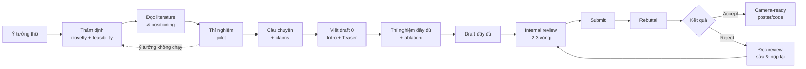

# Viết Paper A* từ A đến Z

> Bài giảng dành cho người **chưa từng tự viết một paper hội nghị A\*** — trước đây có người viết hộ, giờ muốn tự làm chủ toàn bộ quy trình. Tập trung vào **Computer Vision (CVPR, ICCV, ECCV)** trước, sau đó mở rộng sang **NeurIPS, ICML, ICLR, ACL, EMNLP, AAAI…**

<!-- Dùng HTML thô: PDF được sinh SAU bước mkdocs build nên link Markdown sẽ bị --strict báo lỗi -->
<a class="md-button md-button--primary" href="pdf/viet-paper-astar.pdf">:material-file-pdf-box: Tải bản PDF</a>
<a class="md-button" href="print_page/">:material-printer: Xem bản in</a>

## Bạn sẽ học được gì?

Sau khi đi hết khóa này, bạn có thể **một mình** đi từ một ý tưởng thô đến một bản submission đạt chuẩn CVPR, viết rebuttal, và hoàn thiện camera-ready. Cụ thể:

| Giai đoạn | Kỹ năng | Chương |
|---|---|---|
| Hiểu luật chơi | Hội nghị A\* là gì, reviewer đọc paper ra sao, tiêu chí accept | [0. Tổng quan](00-tong-quan/index.md) |
| Chuẩn bị | Thẩm định ý tưởng, đọc literature có hệ thống, thiết kế thí nghiệm, dựng "câu chuyện" | [1. Trước khi viết](01-truoc-khi-viet/index.md) |
| Viết | Title → Abstract → Intro → Related Work → Method → Experiments → Figures → Conclusion/Supp | [2. Viết từng phần](02-viet-tung-phan/index.md) |
| Đánh bóng | LaTeX, tiếng Anh học thuật, quy trình viết – sửa, dùng AI đúng luật | [3. Kỹ thuật](03-ky-thuat/index.md) |
| Nộp | Checklist, anonymity, rebuttal, camera-ready, xử lý reject | [4. Nộp & sau nộp](04-nop-va-sau-nop/index.md) |
| Học từ người giỏi | Mổ xẻ ResNet, Mask R-CNN, NeRF, MAE, LDM, SAM, ControlNet + 1 bài thực hành từ con số 0 | [5. Case studies](05-case-studies/index.md) |
| Mở rộng | Khác biệt khi viết cho ML (NeurIPS/ICML/ICLR), NLP (ACL/EMNLP), AAAI, journal | [6. Hội nghị khác](06-cong-dong/index.md) |

## Cách dùng tài liệu này

!!! tip "Đọc theo thứ tự nếu bạn là người mới"
    Chương 0 → 1 → 2 là xương sống. Đừng nhảy thẳng vào "cách viết Abstract" khi chưa hiểu **reviewer đọc paper như thế nào** (Chương 0) và **câu chuyện của paper** (Chương 1.4) — vì mọi kỹ thuật viết đều phục vụ hai thứ đó.

!!! example "Đọc song song với một paper thật"
    Mỗi khi học một phần (ví dụ Introduction), hãy mở 2–3 paper CVPR gần nhất trong lĩnh vực của bạn và đối chiếu. Các chương Case study (Chương 5) làm sẵn việc này cho 7 paper kinh điển.

!!! warning "Luật hội nghị thay đổi mỗi năm"
    Số trang, định dạng rebuttal, chính sách LLM, nghĩa vụ review của tác giả… **thay đổi theo từng năm**. Tài liệu này dạy *nguyên lý* và đưa ra con số *điển hình*; trước mỗi lần nộp, **luôn đọc Call for Papers và Author Guidelines của đúng năm đó**.

## Triết lý cốt lõi (đọc 1 lần, nhớ mãi)

1. **Paper là một lập luận, không phải một báo cáo.** Bạn không "kể lại những gì đã làm", bạn *thuyết phục* người đọc rằng một khẳng định (claim) là đúng và đáng quan tâm.
2. **Reviewer bận và mệt.** Họ đọc 5–10 paper trong vài tuần, thường đọc Title → Abstract → Teaser figure → Intro → bảng kết quả chính, rồi mới quyết định có đọc kỹ không. Hãy viết cho người đó.
3. **Mỗi claim phải có bằng chứng; mỗi bằng chứng phải phục vụ một claim.** Thí nghiệm không gắn với claim nào là thừa; claim không có thí nghiệm là điểm yếu bị reviewer bắt.
4. **Viết sớm.** Viết paper là *một phần* của nghiên cứu, không phải bước cuối. Viết Intro từ tuần đầu giúp bạn phát hiện lỗ hổng trong ý tưởng.
5. **Rõ ràng > thông minh.** Câu đơn giản, ký hiệu nhất quán, hình tự giải thích được. Không ai reject paper vì nó quá dễ hiểu.

## Bản đồ toàn bộ quy trình

---

*Repo:* [tuandung222/How-to-write-Astar-Paper](https://github.com/tuandung222/How-to-write-Astar-Paper) — đóng góp, sửa lỗi qua Pull Request đều được hoan nghênh.
