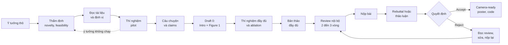

# Viết Paper A* từ A đến Z

Giáo trình này trình bày một cách có hệ thống toàn bộ quy trình viết một bài báo khoa học cho các hội nghị hàng đầu của ngành trí tuệ nhân tạo, những hội nghị thường được gọi tắt là "hội nghị A\*". Phạm vi của giáo trình trải đều trên ba cộng đồng lớn: Computer Vision với CVPR, ICCV, ECCV; Xử lý ngôn ngữ tự nhiên (NLP) với ACL, EMNLP, NAACL và các hội nghị anh em; Machine Learning với NeurIPS, ICML, ICLR. Hành trình được mô tả bắt đầu từ lúc một ý tưởng còn ở dạng thô, đi qua thẩm định ý tưởng, thiết kế thí nghiệm, dựng câu chuyện, viết từng phần, tự sửa và nhờ người khác review, rồi tới nộp bài, phản hồi reviewer, và kết thúc ở bản camera-ready hoặc ở một lần nộp lại sau khi bị từ chối.

Mục đích của giáo trình không phải là trao cho người học một công thức chắc chắn được chấp nhận, vì không có công thức nào như vậy. Điều giáo trình hướng tới là giúp người học hiểu *luật chơi* của các hội nghị này đủ sâu để tự đưa ra những quyết định đúng: nên kể câu chuyện nào, thí nghiệm nào là bắt buộc và thí nghiệm nào chỉ làm loãng bài, câu nào trong Introduction đang khiến reviewer bối rối, và một bản review tiêu cực thực sự đang nói điều gì.

<!-- Dùng HTML thô: PDF được sinh SAU bước mkdocs build nên link Markdown sẽ bị --strict báo lỗi -->
<a class="md-button md-button--primary" href="pdf/viet-paper-astar.pdf">:material-file-pdf-box: Tải bản PDF</a>
<a class="md-button" href="print_page/">:material-printer: Xem bản in</a>

## Giáo trình này dành cho ai

Đối tượng chính của giáo trình là nghiên cứu sinh, học viên cao học và kỹ sư nghiên cứu trong các phòng thí nghiệm công nghiệp: những người đã có nền tảng kỹ thuật vững, biết huấn luyện và đánh giá mô hình, đọc được paper trong lĩnh vực chuyên môn, nhưng chưa từng tự đảm nhận vai trò tác giả chính (first author) của một bài nộp hội nghị A\* từ đầu đến cuối. Nhiều người học ở vị trí này đã đứng tên trong một vài paper với vai trò hỗ trợ, như chạy thí nghiệm, vẽ hình hoặc viết một mục, và giờ muốn tự điều phối toàn bộ một bài báo. Những người đã có vài công bố cũng có thể dùng giáo trình để hệ thống hóa lại kinh nghiệm vốn tích lũy rời rạc qua từng lần nộp.

Khoảng cách giữa "làm được nghiên cứu" và "viết được một paper được chấp nhận" lớn hơn nhiều so với hình dung của phần đông người mới. Một kết quả thí nghiệm tốt chỉ là nguyên liệu. Để trở thành một paper, kết quả ấy cần được đặt vào đúng bối cảnh tài liệu, được diễn đạt thành những khẳng định có thể kiểm chứng, được bảo vệ bằng các thí nghiệm có chủ đích, và được trình bày sao cho một người đọc bận rộn nắm được ý chính trong vài phút. Những kỹ năng này hiếm khi được dạy thành bài bản. Thông thường chúng được truyền miệng trong từng nhóm nghiên cứu, qua những lần người hướng dẫn sửa bản thảo, qua những bản review khó chịu, và qua nhiều lần thất bại. Giáo trình cố gắng viết những hiểu biết ngầm ấy ra thành lời, để người học không phải trả giá bằng chừng ấy lần thất bại.

Giáo trình không dạy kiến thức chuyên môn của từng lĩnh vực: không giảng về kiến trúc mạng, hàm mất mát hay kỹ thuật tiền xử lý dữ liệu. Người học được giả định đã có, hoặc đang tự xây dựng, phần kiến thức đó. Trọng tâm ở đây là nghề viết và nghề công bố: biến một công trình nghiên cứu thành một lập luận thuyết phục, và vận hành chu trình nộp, review, sửa, nộp lại một cách tỉnh táo. Người hướng dẫn và trưởng nhóm cũng có thể dùng giáo trình làm tài liệu chung, để cả nhóm có cùng một bộ từ vựng khi góp ý bản thảo cho nhau.

## Ba cộng đồng, một nghề viết

Ba cộng đồng Computer Vision, NLP và Machine Learning được trình bày ngang hàng trong giáo trình, không cộng đồng nào được coi là "mặc định". Lý do rất thực tế: ranh giới giữa ba cộng đồng ngày càng mờ. Một mô hình vision-language có thể được nộp ở CVPR, ở EMNLP hoặc ở NeurIPS; một phương pháp huấn luyện mới cho mô hình ngôn ngữ lớn có thể được đọc bởi reviewer xuất thân từ cả ba nơi. Người viết chỉ quen với một cộng đồng sẽ dễ bị bất ngờ khi bước sang cộng đồng khác.

Phần lớn nghề viết là chung cho cả ba. Paper nào cũng cần một vấn đề được phát biểu rõ, một khẳng định trung tâm, bằng chứng tương xứng với khẳng định, và một vị trí trung thực trong dòng chảy tài liệu. Phần còn lại là *văn hóa*, và chính phần này thường quyết định những paper nằm ở vùng ranh giới. Cộng đồng CV đặc biệt coi trọng benchmark, hình ảnh minh họa và ablation. Cộng đồng NLP coi trọng sự cẩn thận trong đánh giá, phân tích lỗi, đạo đức dữ liệu, và vận hành một hệ thống review riêng là ACL Rolling Review. Cộng đồng ML coi trọng tính tổng quát, phân tích hoặc lý thuyết, và các thí nghiệm có kiểm soát với độ tin cậy thống kê. Một paper có bảng kết quả xuất sắc nhưng thiếu mục Limitations có thể bị loại ngay từ vòng kiểm tra hình thức ở ARR; một paper đậm chất CV chỉ thử trên một tập dữ liệu có thể nhận về nhận xét "unclear generality" ở ICLR. Hai thất bại ấy không xuất phát từ chất lượng nghiên cứu mà từ việc không hiểu người đọc.

Vì vậy, xuyên suốt giáo trình, các ví dụ minh họa được luân phiên giữa ba cộng đồng. Ở những bài có khác biệt đáng kể, một mục riêng mang tên "Khác biệt giữa các cộng đồng" sẽ trình bày điều cần điều chỉnh. Chương 5 phân tích các paper kinh điển của cả ba cộng đồng, và Chương 6 dành riêng cho những đặc thù khi viết cho từng nơi cũng như khi chuyển một paper từ cộng đồng này sang cộng đồng khác.

## Cấu trúc giáo trình

Giáo trình gồm bảy phần, đánh số từ 0 đến 6, cùng một phụ lục. Thứ tự các phần đi theo thứ tự thời gian của một dự án nghiên cứu thực tế: hiểu luật chơi, chuẩn bị, viết, đánh bóng, nộp, rồi học từ người đi trước và mở rộng sang những bối cảnh khác. Bảng dưới đây tóm tắt nội dung và câu hỏi trung tâm của mỗi phần.

| Phần | Nội dung chính | Câu hỏi mà phần này trả lời |
|---|---|---|
| [0. Tổng quan](00-tong-quan/index.md) | Bản đồ các hội nghị A\*, hệ sinh thái CV, NLP, ML, quy trình review, lộ trình tính ngược từ deadline | Luật chơi là gì, ai đọc paper và đọc như thế nào? |
| [1. Trước khi viết](01-truoc-khi-viet/index.md) | Tìm và thẩm định ý tưởng, đọc tài liệu có hệ thống, thiết kế thí nghiệm, dựng câu chuyện | Có điều gì đáng viết, và paper sẽ khẳng định điều gì? |
| [2. Viết từng phần](02-viet-tung-phan/index.md) | Title, Abstract, Introduction và Figure 1, Related Work, Method, Experiments, Figures & Tables, Conclusion, Limitations, Appendix | Mỗi phần của paper làm nhiệm vụ gì, và viết nó ra sao? |
| [3. Kỹ thuật & văn phong](03-ky-thuat/index.md) | LaTeX và Overleaf, tiếng Anh học thuật, quy trình viết và tự review, dùng AI hỗ trợ đúng quy định | Làm sao để bản thảo sạch, rõ ràng và hợp lệ? |
| [4. Nộp & sau khi nộp](04-nop-va-sau-nop/index.md) | Chuẩn bị nộp, rebuttal và thảo luận, camera-ready, poster, code, xử lý khi bị reject | Cần làm gì từ lúc bấm nộp tới khi có quyết định cuối cùng? |
| [5. Case studies](05-case-studies/index.md) | ResNet, Mask R-CNN, NeRF, MAE và Latent Diffusion, SAM và ControlNet, BERT, CheckList, Transformer, Adam, DDPM, cùng một bài thực hành từ con số 0 | Những paper có ảnh hưởng lớn đã được dựng lên như thế nào? |
| [6. Đặc thù từng cộng đồng](06-cong-dong/index.md) | Viết cho NeurIPS, ICML, ICLR; viết cho ACL, EMNLP, NAACL; chuyển paper giữa các cộng đồng; AAAI, IJCAI, KDD và tạp chí | Cần điều chỉnh gì khi đổi cộng đồng hoặc đổi nơi nộp? |
| [7. Chuyên đề: AI Security](07-ai-security/index.md) | Xu hướng đóng góp trong AI Security; mười case study về prompt injection, jailbreak và phòng vệ cho LLM, VLM và agent | Một paper bảo mật AI được viết và đánh giá khác paper phương pháp ở đâu? |
| [8. Tình huống trớ trêu](08-tinh-huong-kho/index.md) | Ba mươi lăm tình huống khó: ý tưởng mới mà thua baseline, đơn giản mà nghe thiếu novelty, ghép nhiều thứ, độn đóng góp, con số không đẹp, bằng chứng mâu thuẫn câu chuyện, áp lực từ bên ngoài, bài toán và phạm vi, ranh giới trung thực, cùng một bài thực hành | Làm gì khi dự án không đi theo kịch bản? |
| [Phụ lục](phu-luc/index.md) | Checklist tổng hợp, template và mẫu câu, thuật ngữ, tài nguyên | Tra cứu nhanh trong lúc làm việc |

Phần 0 đứng đầu vì mọi kỹ thuật viết ở các phần sau đều là phản ứng với một thực tế cụ thể của quy trình review: reviewer có ít thời gian, Area Chair cần lý lẽ để bảo vệ paper, giới hạn trang buộc người viết phải chọn lọc. Hiểu thực tế ấy trước sẽ giúp người học thấy mỗi lời khuyên về sau là hợp lý chứ không phải một quy tắc tùy tiện.

Phần 1 là phần có đòn bẩy lớn nhất, dù chưa có chữ nào của paper được viết ra. Số phận của một paper phần lớn đã được định đoạt từ lúc chọn bài toán, chọn baseline và quyết định paper sẽ khẳng định điều gì. Một câu chuyện yếu không thể được cứu bằng văn phong đẹp. Phần 2 đi lần lượt qua từng phần của paper theo thứ tự xuất hiện trong bản PDF, nhưng mỗi bài sẽ chỉ ra rằng thứ tự *viết* nên khác thứ tự *đọc*: Introduction và Figure 1 nên được viết rất sớm, còn Abstract và Title thường được hoàn thiện sau cùng.

Phần 3 tập hợp những kỹ năng xuyên suốt, dùng được cho mọi phần của paper: tổ chức project LaTeX, viết tiếng Anh học thuật rõ ràng, tổ chức các vòng sửa bản thảo, và sử dụng công cụ AI trong giới hạn mà các hội nghị cho phép. Phần 4 bắt đầu từ lúc chuẩn bị bấm nút nộp và kéo dài tới khi paper được công bố hoặc được chuẩn bị cho lần nộp kế tiếp. Phần 5 là nơi học từ ví dụ: mỗi case study phân tích *cách* một paper nổi tiếng được xây dựng, không chỉ *nội dung* kỹ thuật của nó. Phần 6 dành cho những người cần điều chỉnh paper theo khẩu vị của một cộng đồng hoặc một hội nghị cụ thể. Phần 7 áp dụng toàn bộ các kỹ năng trên vào một lĩnh vực có văn hóa viết riêng là an toàn và bảo mật của hệ thống AI. Phần 8 là một cẩm nang tình huống cho những lúc dự án không đi theo kịch bản, khi novelty, kết quả, sự đơn giản và sự trung thực kéo về các hướng khác nhau. Phụ lục gom các checklist, mẫu câu và bảng thuật ngữ để tra cứu nhanh.

## Cách đọc giáo trình

Không có một cách đọc duy nhất, vì người học đến với giáo trình ở những thời điểm rất khác nhau của một dự án. Người mới bắt đầu, còn ít nhất vài tháng trước deadline gần nhất, nên đọc tuần tự Phần 0, Phần 1 và Phần 2, vì ba phần này là xương sống của giáo trình. Phần 3 có thể đọc song song khi bắt đầu viết bản nháp, còn Phần 4 nên đọc khi chuẩn bị nộp. Đừng nhảy thẳng vào bài về Abstract khi chưa hiểu reviewer đọc paper như thế nào và câu chuyện của paper là gì, bởi mọi kỹ thuật viết đều phục vụ hai điều đó.

Người đang chạy một deadline gần có thể đi theo lộ trình ngắn hơn: đọc bài [Lộ trình thực hiện một paper](00-tong-quan/lo-trinh.md) để xác định dự án đang ở đâu so với các mốc kiểm tra, mở [Checklist tổng hợp](phu-luc/checklist.md), rồi đọc các bài của Phần 2 tương ứng với phần đang viết dở, và cuối cùng là bài [Chuẩn bị nộp bài](04-nop-va-sau-nop/submission.md). Người đã có kinh nghiệm ở một cộng đồng và muốn nộp sang cộng đồng khác nên bắt đầu từ trang hệ sinh thái của cộng đồng mới trong Phần 0, sau đó đọc Phần 6, đặc biệt là bài [Chuyển một paper giữa các cộng đồng](06-cong-dong/chuyen-doi.md).

Mỗi bài học nội dung trong giáo trình đều theo cùng một cấu trúc: mở đầu bằng mục tiêu của bài, tiếp theo là phần giảng giải có ví dụ, rồi một đoạn tóm tắt và một vài bài tập. Các bài tập được thiết kế để áp dụng lên một dự án nghiên cứu thật của người học, không phải một dự án giả định. Viết paper là một kỹ năng thực hành; đọc mà không làm bài tập thì hiệu quả chỉ bằng một phần nhỏ.

!!! tip "Đọc song song với paper thật"
    Mỗi khi học một phần (ví dụ Introduction), nên mở hai hoặc ba paper gần đây ở hội nghị mục tiêu, trong đúng mảng nghiên cứu đang theo đuổi, và đối chiếu với nội dung bài học. Việc đối chiếu này biến những nguyên tắc trừu tượng thành các mẫu hình có thể nhận ra và bắt chước. Chương 5 đã làm sẵn công việc ấy cho hơn mười paper kinh điển của cả ba cộng đồng.

!!! warning "Luật hội nghị thay đổi theo từng năm"
    Số trang, định dạng rebuttal, chính sách về công cụ AI, nghĩa vụ review của tác giả, các mục bắt buộc như Limitations hay checklist đều có thể thay đổi giữa các năm. Giáo trình dạy *nguyên lý* và đưa ra các con số *điển hình*. Trước mỗi lần nộp, người viết cần đọc Call for Papers và Author Guidelines của đúng hội nghị, đúng năm đó.

## Triết lý cốt lõi

Có năm ý tưởng xuất hiện đi xuất hiện lại trong toàn bộ giáo trình. Chúng không phải là khẩu hiệu mà là những nguyên lý có thể dùng để tự trả lời các câu hỏi cụ thể khi giáo trình chưa đề cập tới. Mỗi chương sau đều có thể được đọc như một ứng dụng chi tiết của năm nguyên lý này.

### Paper là một lập luận, không phải một bản báo cáo

Sai lầm phổ biến nhất của paper đầu tay là viết như một bản báo cáo công việc: trình bày theo trình tự thời gian những gì nhóm đã làm, đã thử, đã đạt được. Một bản báo cáo trả lời câu hỏi "nhóm đã làm gì?". Một paper phải trả lời câu hỏi khó hơn: "vì sao người đọc nên tin vào khẳng định này, và vì sao khẳng định này đáng quan tâm?". Nói cách khác, paper là một lập luận gồm một khẳng định trung tâm, các lý do, các bằng chứng, và cách trả lời những phản bác có thể có.

Hai đoạn mở đầu dưới đây cùng mô tả một công trình về mô hình ngôn ngữ, nhưng chỉ đoạn thứ hai là một lập luận.

*"We fine-tuned several language models on our question answering dataset and report their results in Table 2. We also tried different prompting strategies and found that some of them work better."*

*"We hypothesize that current models answer multi-hop questions by exploiting lexical overlap rather than by composing facts. To test this, we construct contrast sets in which the overlap cue is removed while the reasoning chain is preserved. All models degrade substantially on these sets, whereas human accuracy is unaffected, suggesting that..."*

Đoạn thứ nhất liệt kê hoạt động; người đọc không biết phải rút ra điều gì. Đoạn thứ hai nêu một giả thuyết, mô tả một thí nghiệm được thiết kế để kiểm tra đúng giả thuyết đó, và cho thấy bằng chứng nghiêng về phía nào. Reviewer đọc đoạn thứ hai biết ngay paper muốn thuyết phục họ điều gì, và biết phải kiểm tra chỗ nào. Toàn bộ Chương 1, đặc biệt bài [Xây "câu chuyện" của paper](01-truoc-khi-viet/cau-chuyen.md), được xây dựng quanh nguyên lý này.

### Reviewer bận, và paper phải được viết cho người bận

Reviewer của các hội nghị A\* thường nhận nhiều paper cùng lúc, phải đọc chúng trong vài tuần, xen giữa deadline và công việc riêng. Phần lớn reviewer hình thành ấn tượng ban đầu từ Title, Abstract, Figure 1, đoạn liệt kê đóng góp trong Introduction và bảng kết quả chính, rồi mới quyết định đọc kỹ phần nào. Đây không phải là một lời chê trách; đó là một ràng buộc của hệ thống, giống như giới hạn số trang.

Viết cho người bận có nghĩa là đưa thông điệp quan trọng nhất lên trước, dùng các câu chuyển ý để người đọc luôn biết lập luận đang đi tới đâu, làm cho hình và bảng tự giải thích được mà không cần đọc toàn văn, và trả lời trước những câu hỏi mà một reviewer chắc chắn sẽ đặt ra. Bài [Paper được đánh giá thế nào](00-tong-quan/review-process.md) mô tả chi tiết cách một reviewer điển hình đọc paper, và những hệ quả của nó cho người viết.

### Mỗi claim cần bằng chứng, mỗi bằng chứng phục vụ một claim

Mối quan hệ giữa khẳng định (claim) và bằng chứng phải đi theo cả hai chiều. Chiều thứ nhất dễ thấy: mọi khẳng định trong paper đều cần được hỗ trợ bởi thí nghiệm, phân tích hoặc chứng minh. Nếu paper viết rằng phương pháp "robust to distribution shift", thì phải có thí nghiệm trên dữ liệu bị dịch chuyển phân phối; nếu viết rằng phương pháp "efficient", thì phải có số liệu về thời gian chạy, bộ nhớ hoặc FLOPs được đo một cách công bằng; nếu đưa ra một định lý, thì các giả định phải được nêu rõ và chứng minh phải có mặt, dù là trong appendix. Một claim không có bằng chứng là điểm yếu mà reviewer sẽ bắt được gần như chắc chắn.

Chiều thứ hai ít được chú ý hơn: mọi thí nghiệm trong paper cũng phải phục vụ một khẳng định nào đó. Một bảng kết quả không gắn với claim nào chiếm chỗ, làm loãng thông điệp và khiến reviewer tự hỏi tác giả muốn nói gì. Công cụ đơn giản nhất để giữ kỷ luật này là một bảng hai cột, một cột ghi claim và một cột ghi bằng chứng tương ứng, được lập ngay từ khi dựng câu chuyện và được cập nhật liên tục trong suốt quá trình làm thí nghiệm.

### Viết sớm: viết là một phần của nghiên cứu

Nhiều người coi viết paper là bước cuối cùng, chỉ bắt đầu khi "đã có đủ kết quả". Trên thực tế, viết là một công cụ tư duy. Khi phải viết đoạn mở đầu của Introduction, người viết buộc phải trả lời vì sao bài toán quan trọng; khi phải viết đoạn liệt kê đóng góp, người viết buộc phải gọi tên điều gì thực sự mới. Nếu không viết được những đoạn đó, thì thêm thí nghiệm cũng không giải quyết được vấn đề, vì lỗ hổng nằm ở ý tưởng hoặc ở cách định vị chứ không nằm ở số liệu.

Viết sớm còn có hai lợi ích thực tế. Bảng claim và bằng chứng lập từ sớm cho thấy ngay những thí nghiệm còn thiếu, khi vẫn còn đủ thời gian để chạy chúng. Bản nháp sớm cũng cho phép người hướng dẫn và đồng tác giả điều chỉnh hướng đi khi việc điều chỉnh còn rẻ. Một paper được viết dồn trong hai tuần cuối gần như luôn đọc giống một bản báo cáo, vì không còn thời gian để biến nó thành một lập luận.

### Rõ ràng quan trọng hơn thông minh

Ký hiệu phức tạp, từ vựng cầu kỳ và những đoạn văn dày đặc không làm paper trông sâu sắc hơn; chúng chỉ tăng chi phí đọc cho reviewer, và chi phí ấy thường được trả lại bằng điểm số thấp hơn. Ngược lại, một ý tưởng đơn giản được giải thích rõ ràng là một tín hiệu cho thấy tác giả hiểu sâu vấn đề. Nhiều paper có ảnh hưởng lớn nhất, như ResNet hay Adam được phân tích ở Chương 5, có ý tưởng cốt lõi có thể phát biểu trong một hai câu, và chính sự giản dị ấy giúp chúng lan rộng.

Rõ ràng là một kỹ năng có thể luyện tập: mỗi khái niệm chỉ dùng một thuật ngữ, ký hiệu nhất quán từ đầu đến cuối, mỗi đoạn văn chỉ mang một ý chính, mỗi hình có chú thích đủ để hiểu độc lập. Hiếm có reviewer nào từ chối một paper vì nó quá dễ hiểu, nhưng rất nhiều paper bị từ chối vì reviewer không hiểu đóng góp của nó là gì.

## Bản đồ toàn bộ quy trình

Sơ đồ dưới đây tóm tắt quy trình mà giáo trình sẽ đi qua. Mỗi nút tương ứng với một hoặc vài bài học, và các mũi tên quay ngược biểu thị những vòng lặp không thể tránh khỏi của nghiên cứu thực tế.

Nửa đầu sơ đồ, từ ý tưởng thô tới câu chuyện và claims, thuộc về Chương 1. Điểm đáng chú ý là bản nháp đầu tiên (draft 0) chỉ gồm Introduction và Figure 1, và nó xuất hiện *trước* khi thí nghiệm đầy đủ được chạy xong; đây là ứng dụng trực tiếp của nguyên lý viết sớm. Các bước viết bản thảo và review nội bộ thuộc về Chương 2 và Chương 3, còn từ bước nộp bài trở đi thuộc về Chương 4.

Hai vòng lặp trong sơ đồ có ý nghĩa quan trọng. Vòng lặp nét đứt từ thí nghiệm pilot quay về bước thẩm định nhắc rằng một ý tưởng không hoạt động trong pilot là thông tin quý, và việc quay lại sớm rẻ hơn rất nhiều so với việc cố viết một paper cho một ý tưởng không có tín hiệu. Vòng lặp từ quyết định reject quay về review nội bộ nhắc rằng bị từ chối là một phần bình thường của quy trình: một paper tốt thường cần hai hoặc ba lần nộp, và mỗi bộ review là một nguồn phản hồi miễn phí để làm paper tốt hơn trước lần nộp kế tiếp, dù ở một hội nghị khác hay ở chu kỳ ARR sau.

## Một vài quy ước trong giáo trình

Giáo trình giữ nguyên các thuật ngữ tiếng Anh đã trở thành thông dụng trong giới nghiên cứu, như paper, reviewer, rebuttal, baseline, ablation, benchmark hay camera-ready, và giải thích chúng ở lần xuất hiện đầu tiên trong mỗi bài; phần [Thuật ngữ](phu-luc/thuat-ngu.md) trong phụ lục tập hợp các giải thích này. Các câu mẫu tiếng Anh được in nghiêng hoặc đặt trong khối code để người học có thể sao chép và điều chỉnh. Các ví dụ tốt và chưa tốt được đặt cạnh nhau, đánh dấu bằng viền xanh và viền đỏ. Mọi con số về deadline, số trang, tỉ lệ chấp nhận hay số lượng submission đều là con số điển hình của những năm gần đây, chỉ có giá trị định hướng.

---

*Repo:* [tuandung222/How-to-write-Astar-Paper](https://github.com/tuandung222/How-to-write-Astar-Paper) — đóng góp, sửa lỗi qua Pull Request đều được hoan nghênh.
